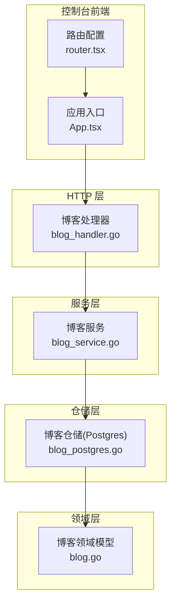
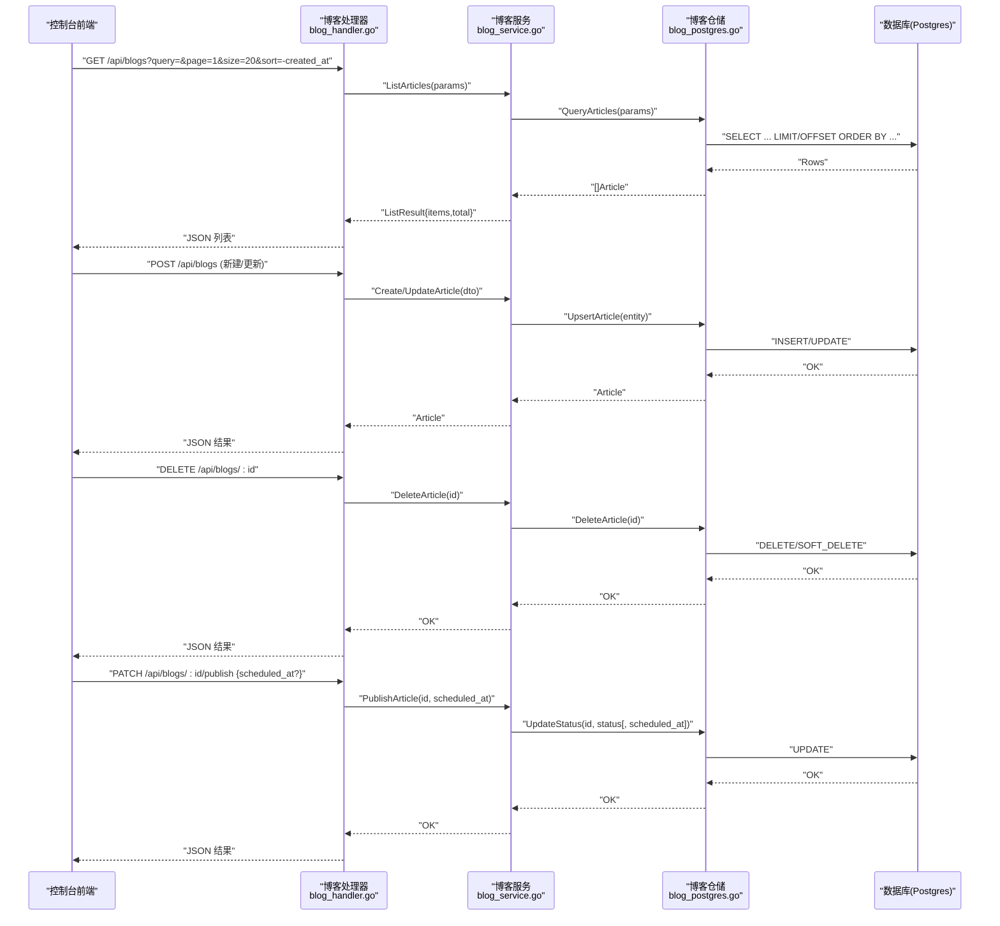
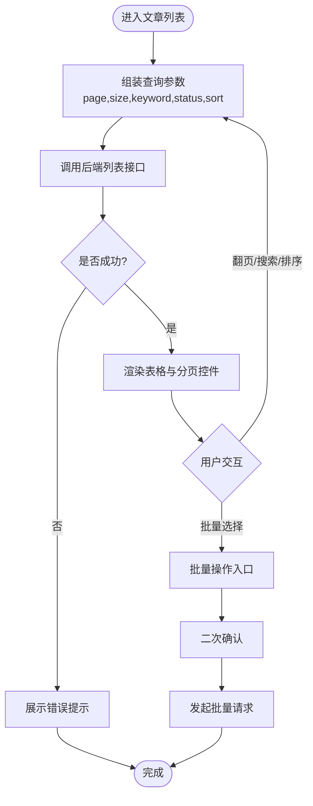
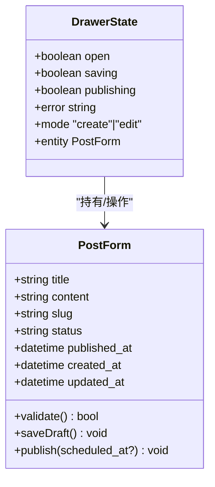
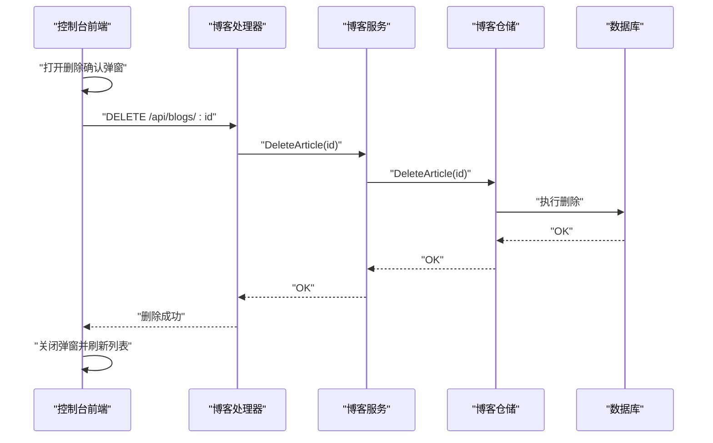
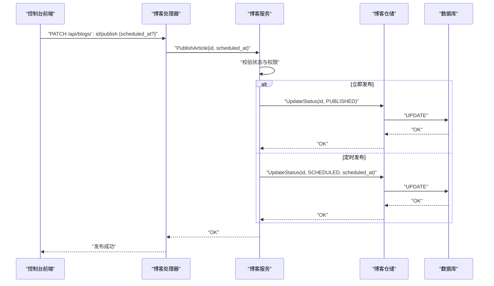
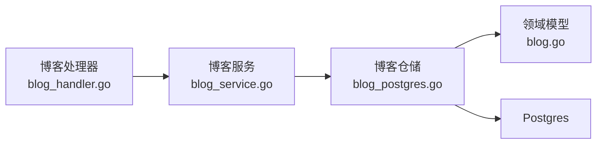

# 文章管理功能

<cite>
**本文引用的文件**   
- [blog_handler.go](file://notifuse/internal/http/blog_handler.go)
- [blog_service.go](file://notifuse/internal/service/blog_service.go)
- [blog_postgres.go](file://notifuse/internal/repository/blog_postgres.go)
- [blog.go](file://notifuse/internal/domain/blog.go)
- [router.tsx](file://notifuse/console/src/router.tsx)
- [App.tsx](file://notifuse/console/src/App.tsx)
</cite>

## 目录
1. [简介](#简介)
2. [项目结构](#项目结构)
3. [核心组件](#核心组件)
4. [架构总览](#架构总览)
5. [详细组件分析](#详细组件分析)
6. [依赖关系分析](#依赖关系分析)
7. [性能考虑](#性能考虑)
8. [故障排查指南](#故障排查指南)
9. [结论](#结论)
10. [附录](#附录)

## 简介
本文件围绕“博客文章管理”能力，系统性梳理后端接口、领域模型与仓储实现，并给出前端路由与入口的概览。文档重点覆盖：
- 文章列表（PostsTable）所需的数据获取、分页、搜索过滤、排序与批量操作的后端支撑
- 文章编辑（PostDrawer）所需的表单数据绑定与状态管理的前端入口
- 删除确认（DeletePostModal）与发布流程（PublishModal）在后端的处理路径
- 文章 CRUD 的 API 调用链路、错误处理与用户反馈建议
- 版本控制、草稿管理与定时发布的实现方案建议

说明：当前仓库未包含 PostsTable、PostDrawer、DeletePostModal、PublishModal 的具体前端源码，因此本文对前端部分以“概念性设计 + 路由/入口映射”的方式呈现，并在需要时提供可落地的实现建议。

## 项目结构
从整体工程看，博客文章相关能力主要分布在以下层次：
- HTTP 层：路由与请求解析、响应封装
- 服务层：业务编排、校验、事务边界
- 仓储层：SQL 构建与持久化访问
- 领域层：实体定义、枚举与约束
- 控制台前端：路由与页面入口

图表来源
- [router.tsx](file://notifuse/console/src/router.tsx)
- [App.tsx](file://notifuse/console/src/App.tsx)
- [blog_handler.go](file://notifuse/internal/http/blog_handler.go)
- [blog_service.go](file://notifuse/internal/service/blog_service.go)
- [blog_postgres.go](file://notifuse/internal/repository/blog_postgres.go)
- [blog.go](file://notifuse/internal/domain/blog.go)

章节来源
- [router.tsx](file://notifuse/console/src/router.tsx)
- [App.tsx](file://notifuse/console/src/App.tsx)
- [blog_handler.go](file://notifuse/internal/http/blog_handler.go)
- [blog_service.go](file://notifuse/internal/service/blog_service.go)
- [blog_postgres.go](file://notifuse/internal/repository/blog_postgres.go)
- [blog.go](file://notifuse/internal/domain/blog.go)

## 核心组件
- 文章列表（PostsTable）
  - 后端需支持：分页参数、搜索关键词、排序字段与方向、可选的状态筛选（如草稿/已发布）、批量操作（如批量删除、批量变更状态）。
  - 典型查询条件包括：标题/内容模糊匹配、创建时间范围、作者或标签等扩展维度。
- 文章编辑（PostDrawer）
  - 前端负责：表单字段绑定、实时校验提示、保存/发布按钮状态、撤销/恢复草稿。
  - 后端负责：新建/更新文章、校验必填项与长度限制、生成 slug、记录更新时间。
- 删除确认（DeletePostModal）
  - 前端触发二次确认；后端执行软删除或硬删除策略，返回统一结果。
- 发布流程（PublishModal）
  - 前端收集发布时间（立即/定时）；后端校验权限与状态机转换，写入计划任务或标记为待发布。

章节来源
- [blog_handler.go](file://notifuse/internal/http/blog_handler.go)
- [blog_service.go](file://notifuse/internal/service/blog_service.go)
- [blog_postgres.go](file://notifuse/internal/repository/blog_postgres.go)
- [blog.go](file://notifuse/internal/domain/blog.go)

## 架构总览
文章管理的端到端调用链如下：

图表来源
- [blog_handler.go](file://notifuse/internal/http/blog_handler.go)
- [blog_service.go](file://notifuse/internal/service/blog_service.go)
- [blog_postgres.go](file://notifuse/internal/repository/blog_postgres.go)

## 详细组件分析

### 文章列表（PostsTable）
- 分页加载
  - 通过查询参数 page、size 控制偏移与页大小；后端使用 LIMIT/OFFSET 或游标分页。
  - 返回 total 用于前端计算总页数。
- 搜索过滤
  - 支持按标题/内容模糊匹配，可按状态（草稿/已发布）筛选，可扩展到标签、作者等维度。
- 排序
  - 支持按创建时间、更新时间、标题等字段排序，允许指定升序/降序。
- 批量操作
  - 支持批量删除、批量变更状态（如批量发布/归档），后端接收 ids 数组进行批量更新或删除。

章节来源
- [blog_handler.go](file://notifuse/internal/http/blog_handler.go)
- [blog_service.go](file://notifuse/internal/service/blog_service.go)
- [blog_postgres.go](file://notifuse/internal/repository/blog_postgres.go)

### 文章编辑（PostDrawer）
- 表单验证
  - 必填项：标题、正文等；长度限制；富文本/Markdown 基础合法性检查。
- 数据绑定
  - 新建模式：空对象初始化；编辑模式：回填详情数据。
- 状态管理
  - 本地草稿：自动保存至浏览器存储或后端草稿区；提交时合并差异。
  - 保存/发布：保存仅落库不改变发布状态；发布则触发状态机转换。

图表来源
- [blog.go](file://notifuse/internal/domain/blog.go)

章节来源
- [blog_handler.go](file://notifuse/internal/http/blog_handler.go)
- [blog_service.go](file://notifuse/internal/service/blog_service.go)
- [blog_postgres.go](file://notifuse/internal/repository/blog_postgres.go)
- [blog.go](file://notifuse/internal/domain/blog.go)

### 删除确认（DeletePostModal）
- 前端弹出确认框，显示文章标题与不可逆后果提示。
- 确认后发起删除请求，成功后刷新列表并提示“删除成功”。

图表来源
- [blog_handler.go](file://notifuse/internal/http/blog_handler.go)
- [blog_service.go](file://notifuse/internal/service/blog_service.go)
- [blog_postgres.go](file://notifuse/internal/repository/blog_postgres.go)

章节来源
- [blog_handler.go](file://notifuse/internal/http/blog_handler.go)
- [blog_service.go](file://notifuse/internal/service/blog_service.go)
- [blog_postgres.go](file://notifuse/internal/repository/blog_postgres.go)

### 发布流程（PublishModal）
- 支持立即发布与定时发布（scheduled_at）。
- 后端校验权限与当前状态，若为定时发布则记录计划时间；由调度器在到期时执行发布动作。

图表来源
- [blog_handler.go](file://notifuse/internal/http/blog_handler.go)
- [blog_service.go](file://notifuse/internal/service/blog_service.go)
- [blog_postgres.go](file://notifuse/internal/repository/blog_postgres.go)

章节来源
- [blog_handler.go](file://notifuse/internal/http/blog_handler.go)
- [blog_service.go](file://notifuse/internal/service/blog_service.go)
- [blog_postgres.go](file://notifuse/internal/repository/blog_postgres.go)

### 文章版本控制、草稿管理与定时发布（实现方案）
- 版本控制
  - 建议在领域模型中引入版本号或快照表，每次保存生成新版本；对比时可基于 diff 工具展示变更。
  - 关键要点：幂等保存、冲突检测（乐观锁）、回滚到指定版本。
- 草稿管理
  - 前端：本地暂存 + 定期同步后端草稿接口；后端提供独立的草稿读写接口，避免污染正式状态。
  - 后端：草稿与正式态分离，支持自动清理过期草稿。
- 定时发布
  - 前端：时间选择器，校验时区与最小间隔。
  - 后端：将 scheduled_at 写入文章记录；调度器轮询即将到期的文章，执行发布并记录审计日志。

[本节为概念性方案，无需代码来源]

## 依赖关系分析
- 组件耦合
  - HTTP 处理器依赖服务层，服务层依赖仓储层，仓储层依赖领域模型与数据库。
- 外部依赖
  - 数据库：Postgres（根据仓储命名推断）
  - 前端：控制台路由与页面入口位于 console 子项目

图表来源
- [blog_handler.go](file://notifuse/internal/http/blog_handler.go)
- [blog_service.go](file://notifuse/internal/service/blog_service.go)
- [blog_postgres.go](file://notifuse/internal/repository/blog_postgres.go)
- [blog.go](file://notifuse/internal/domain/blog.go)

章节来源
- [blog_handler.go](file://notifuse/internal/http/blog_handler.go)
- [blog_service.go](file://notifuse/internal/service/blog_service.go)
- [blog_postgres.go](file://notifuse/internal/repository/blog_postgres.go)
- [blog.go](file://notifuse/internal/domain/blog.go)

## 性能考虑
- 列表查询
  - 合理使用索引（标题、状态、创建时间等）；避免 SELECT *，按需投影字段。
  - 大数据量场景优先使用游标分页或基于主键的范围分页。
- 搜索与排序
  - 全文检索建议使用数据库内置全文索引或搜索引擎；复杂排序尽量走数据库侧。
- 批量操作
  - 分批提交，避免单次事务过大导致锁竞争与超时。
- 缓存
  - 对热点只读列表可加短期缓存，注意失效策略与一致性。

[本节为通用指导，无需代码来源]

## 故障排查指南
- 常见错误
  - 参数校验失败：检查分页、排序、关键字等参数格式与取值范围。
  - 权限不足：确认当前用户具备相应工作空间/角色权限。
  - 并发冲突：采用乐观锁或版本号机制，提示用户重试。
- 定位步骤
  - 查看 HTTP 层日志，确认请求参数与响应码。
  - 在服务层打印关键断点与事务边界信息。
  - 在仓储层核对 SQL 与索引命中情况。
- 用户反馈
  - 统一错误码与消息模板；网络异常时提供重试与降级提示。

章节来源
- [blog_handler.go](file://notifuse/internal/http/blog_handler.go)
- [blog_service.go](file://notifuse/internal/service/blog_service.go)
- [blog_postgres.go](file://notifuse/internal/repository/blog_postgres.go)

## 结论
本文基于现有后端代码结构，给出了文章管理功能的完整技术蓝图：从列表分页、搜索过滤、排序与批量操作，到编辑抽屉的表单与状态管理，再到删除确认与发布流程的调用链路与错误处理建议。同时提供了版本控制、草稿管理与定时发布的落地方案，便于后续在前端补齐 PostsTable、PostDrawer、DeletePostModal、PublishModal 等组件时快速对接。

[本节为总结，无需代码来源]

## 附录
- 前端入口参考
  - 路由配置：console/src/router.tsx
  - 应用入口：console/src/App.tsx

章节来源
- [router.tsx](file://notifuse/console/src/router.tsx)
- [App.tsx](file://notifuse/console/src/App.tsx)