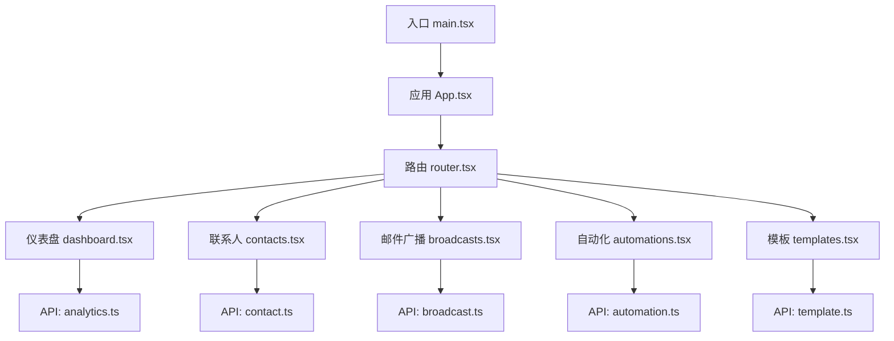
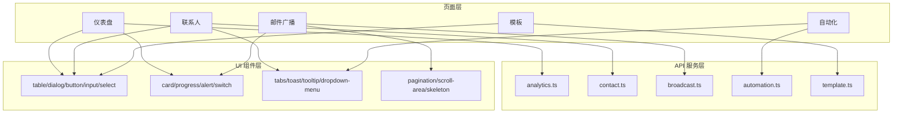
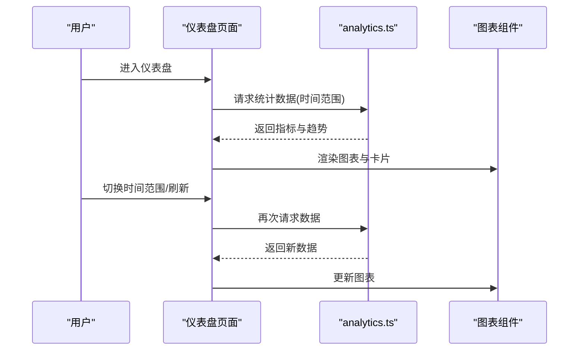
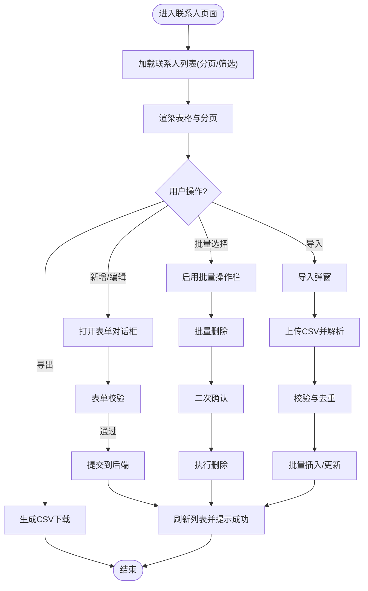
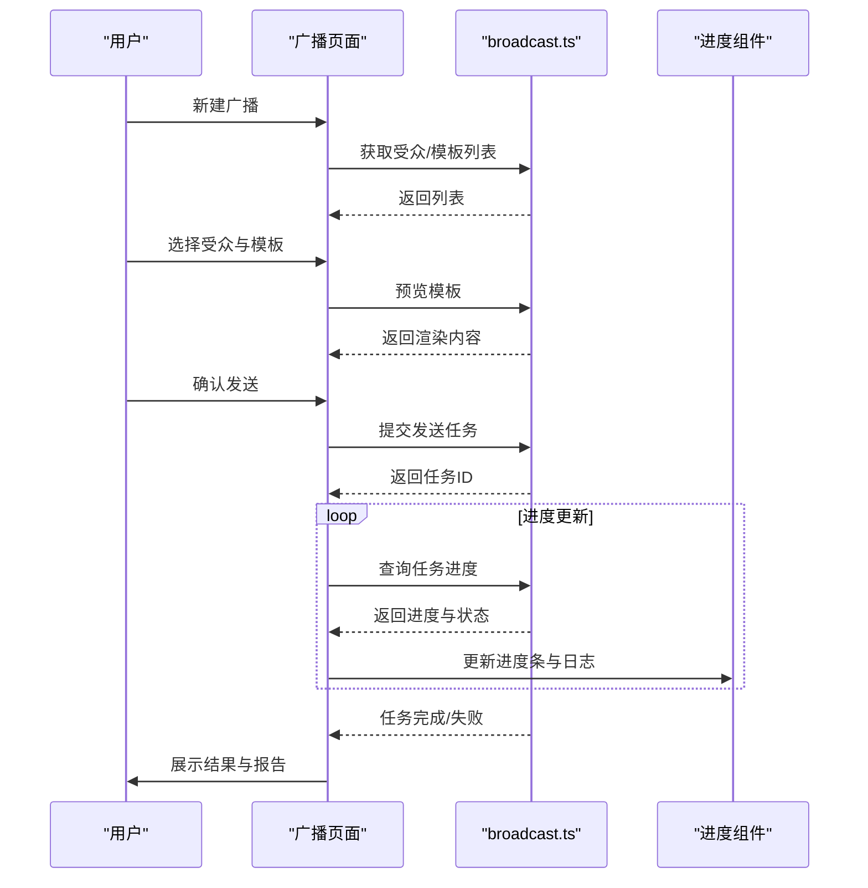
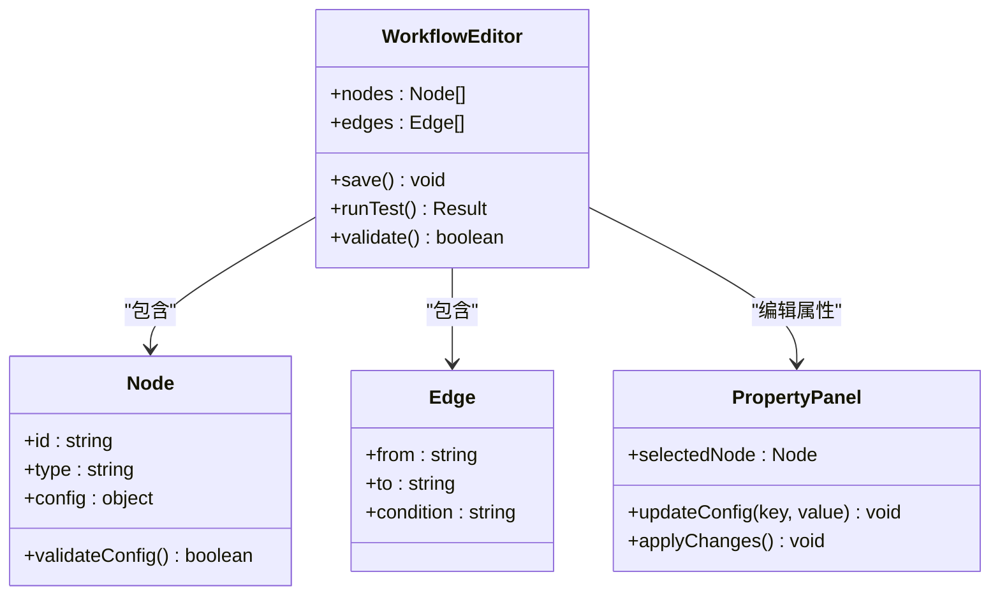
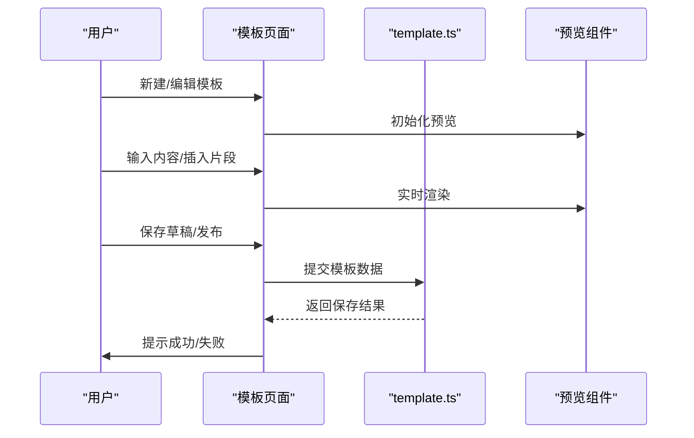
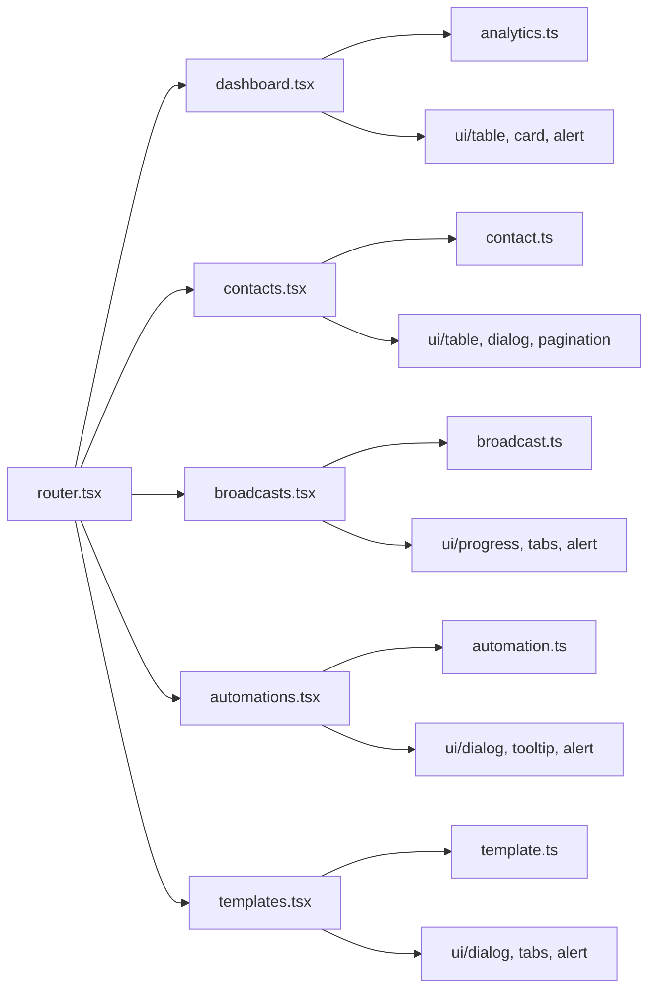

# 核心页面组件

<cite>
**本文引用的文件**   
- [router.tsx](file://notifuse/console/src/router.tsx)
- [App.tsx](file://notifuse/console/src/App.tsx)
- [main.tsx](file://notifuse/console/src/main.tsx)
- [index.html](file://notifuse/console/index.html)
- [package.json](file://notifuse/console/package.json)
- [vite.config.ts](file://notifuse/console/vite.config.ts)
- [dashboard.tsx](file://notifuse/console/pages/dashboard.tsx)
- [contacts.tsx](file://notifuse/console/pages/contacts.tsx)
- [broadcasts.tsx](file://notifuse/console/pages/broadcasts.tsx)
- [automations.tsx](file://notifuse/console/pages/automations.tsx)
- [templates.tsx](file://notifuse/console/pages/templates.tsx)
- [api/analytics.ts](file://notifuse/console/src/services/api/analytics.ts)
- [api/contact.ts](file://notifuse/console/src/services/api/contact.ts)
- [api/broadcast.ts](file://notifuse/console/src/services/api/broadcast.ts)
- [api/automation.ts](file://notifuse/console/src/services/api/automation.ts)
- [api/template.ts](file://notifuse/console/src/services/api/template.ts)
- [components/ui/table.tsx](file://notifuse/console/src/components/ui/table.tsx)
- [components/ui/dialog.tsx](file://notifuse/console/src/components/ui/dialog.tsx)
- [components/ui/button.tsx](file://notifuse/console/src/components/ui/button.tsx)
- [components/ui/input.tsx](file://notifuse/console/src/components/ui/input.tsx)
- [components/ui/select.tsx](file://notifuse/console/src/components/ui/select.tsx)
- [components/ui/tabs.tsx](file://notifuse/console/src/components/ui/tabs.tsx)
- [components/ui/card.tsx](file://notifuse/console/src/components/ui/card.tsx)
- [components/ui/progress.tsx](file://notifuse/console/src/components/ui/progress.tsx)
- [components/ui/alert.tsx](file://notifuse/console/src/components/ui/alert.tsx)
- [components/ui/switch.tsx](file://notifuse/console/src/components/ui/switch.tsx)
- [components/ui/tooltip.tsx](file://notifuse/console/src/components/ui/tooltip.tsx)
- [components/ui/dropdown-menu.tsx](file://notifuse/console/src/components/ui/dropdown-menu.tsx)
- [components/ui/popover.tsx](file://notifuse/console/src/components/ui/popover.tsx)
- [components/ui/checkbox.tsx](file://notifuse/console/src/components/ui/checkbox.tsx)
- [components/ui/radio-group.tsx](file://notifuse/console/src/components/ui/radio-group.tsx)
- [components/ui/textarea.tsx](file://notifuse/console/src/components/ui/textarea.tsx)
- [components/ui/form.tsx](file://notifuse/console/src/components/ui/form.tsx)
- [components/ui/command.tsx](file://notifuse/console/src/components/ui/command.tsx)
- [components/ui/calendar.tsx](file://notifuse/console/src/components/ui/calendar.tsx)
- [components/ui/date-picker.tsx](file://notifuse/console/src/components/ui/date-picker.tsx)
- [components/ui/accordion.tsx](file://notifuse/console/src/components/ui/accordion.tsx)
- [components/ui/avatar.tsx](file://notifuse/console/src/components/ui/avatar.tsx)
- [components/ui/badge.tsx](file://notifuse/console/src/components/ui/badge.tsx)
- [components/ui/collapsible.tsx](file://notifuse/console/src/components/ui/collapsible.tsx)
- [components/ui/context-menu.tsx](file://notifuse/console/src/components/ui/context-menu.tsx)
- [components/ui/hover-card.tsx](file://notifuse/console/src/components/ui/hover-card.tsx)
- [components/ui/menubar.tsx](file://notifuse/console/src/components/ui/menubar.tsx)
- [components/ui/navigation-menu.tsx](file://notifuse/console/src/components/ui/navigation-menu.tsx)
- [components/ui/pagination.tsx](file://notifuse/console/src/components/ui/pagination.tsx)
- [components/ui/resizable.tsx](file://notifuse/console/src/components/ui/resizable.tsx)
- [components/ui/scroll-area.tsx](file://notifuse/console/src/components/ui/scroll-area.tsx)
- [components/ui/sheet.tsx](file://notifuse/console/src/components/ui/sheet.tsx)
- [components/ui/slider.tsx](file://notifuse/console/src/components/ui/slider.tsx)
- [components/ui/skeleton.tsx](file://notifuse/console/src/components/ui/skeleton.tsx)
- [components/ui/toast.tsx](file://notifuse/console/src/components/ui/toast.tsx)
- [components/ui/toggle.tsx](file://notifuse/console/src/components/ui/toggle.tsx)
- [components/ui/separator.tsx](file://notifuse/console/src/components/ui/separator.tsx)
- [components/ui/sonner.tsx](file://notifuse/console/src/components/ui/sonner.tsx)
- [components/ui/switch.tsx](file://notifuse/console/src/components/ui/switch.tsx)
- [components/ui/switch.tsx](file://notifuse/console/src/components/ui/switch.tsx)
</cite>

## 目录
1. [简介](#简介)
2. [项目结构](#项目结构)
3. [核心组件](#核心组件)
4. [架构总览](#架构总览)
5. [详细组件分析](#详细组件分析)
6. [依赖分析](#依赖分析)
7. [性能考虑](#性能考虑)
8. [故障排查指南](#故障排查指南)
9. [结论](#结论)
10. [附录](#附录)

## 简介
本文件聚焦 Notifuse 前端控制台的核心页面组件，围绕以下关键页面展开：仪表盘、联系人管理、邮件广播、自动化工作流与模板管理。文档从系统架构、数据流、用户交互、状态同步、权限控制、响应式适配等维度进行系统化说明，并提供可视化图表、最佳实践与排障建议，帮助读者快速理解并高效扩展这些核心功能。

## 项目结构
控制台基于 React + TypeScript + Vite 构建，采用路由驱动的页面组织方式。核心入口与路由定义位于应用根目录，页面按业务域拆分至 pages 目录，API 服务封装在 services/api 下，通用 UI 组件集中在 components/ui。

图示来源
- [main.tsx](file://notifuse/console/src/main.tsx)
- [App.tsx](file://notifuse/console/src/App.tsx)
- [router.tsx](file://notifuse/console/src/router.tsx)
- [dashboard.tsx](file://notifuse/console/pages/dashboard.tsx)
- [contacts.tsx](file://notifuse/console/pages/contacts.tsx)
- [broadcasts.tsx](file://notifuse/console/pages/broadcasts.tsx)
- [automations.tsx](file://notifuse/console/pages/automations.tsx)
- [templates.tsx](file://notifuse/console/pages/templates.tsx)
- [api/analytics.ts](file://notifuse/console/src/services/api/analytics.ts)
- [api/contact.ts](file://notifuse/console/src/services/api/contact.ts)
- [api/broadcast.ts](file://notifuse/console/src/services/api/broadcast.ts)
- [api/automation.ts](file://notifuse/console/src/services/api/automation.ts)
- [api/template.ts](file://notifuse/console/src/services/api/template.ts)

章节来源
- [main.tsx](file://notifuse/console/src/main.tsx)
- [App.tsx](file://notifuse/console/src/App.tsx)
- [router.tsx](file://notifuse/console/src/router.tsx)
- [index.html](file://notifuse/console/index.html)
- [package.json](file://notifuse/console/package.json)
- [vite.config.ts](file://notifuse/console/vite.config.ts)

## 核心组件
- 仪表盘：聚合统计指标与趋势图表，支持时间范围筛选与刷新策略。
- 联系人管理：提供增删改查、批量选择与批量操作（导入/导出/删除），支持分页与搜索过滤。
- 邮件广播：创建广播任务、选择受众、预览内容、发送与进度监控。
- 自动化工作流：可视化编辑器用于编排触发器、条件分支与动作节点，支持保存与运行测试。
- 模板管理：富文本/代码混合编辑器、变量注入、实时预览与版本管理。

章节来源
- [dashboard.tsx](file://notifuse/console/pages/dashboard.tsx)
- [contacts.tsx](file://notifuse/console/pages/contacts.tsx)
- [broadcasts.tsx](file://notifuse/console/pages/broadcasts.tsx)
- [automations.tsx](file://notifuse/console/pages/automations.tsx)
- [templates.tsx](file://notifuse/console/pages/templates.tsx)

## 架构总览
控制台采用“页面-服务-UI”分层模式：
- 页面层负责业务编排、用户交互与状态管理；
- API 服务层统一封装 HTTP 请求、错误处理与重试策略；
- UI 组件层提供可复用的基础控件与布局。

图示来源
- [dashboard.tsx](file://notifuse/console/pages/dashboard.tsx)
- [contacts.tsx](file://notifuse/console/pages/contacts.tsx)
- [broadcasts.tsx](file://notifuse/console/pages/broadcasts.tsx)
- [automations.tsx](file://notifuse/console/pages/automations.tsx)
- [templates.tsx](file://notifuse/console/pages/templates.tsx)
- [api/analytics.ts](file://notifuse/console/src/services/api/analytics.ts)
- [api/contact.ts](file://notifuse/console/src/services/api/contact.ts)
- [api/broadcast.ts](file://notifuse/console/src/services/api/broadcast.ts)
- [api/automation.ts](file://notifuse/console/src/services/api/automation.ts)
- [api/template.ts](file://notifuse/console/src/services/api/template.ts)
- [components/ui/table.tsx](file://notifuse/console/src/components/ui/table.tsx)
- [components/ui/dialog.tsx](file://notifuse/console/src/components/ui/dialog.tsx)
- [components/ui/button.tsx](file://notifuse/console/src/components/ui/button.tsx)
- [components/ui/input.tsx](file://notifuse/console/src/components/ui/input.tsx)
- [components/ui/select.tsx](file://notifuse/console/src/components/ui/select.tsx)
- [components/ui/card.tsx](file://notifuse/console/src/components/ui/card.tsx)
- [components/ui/progress.tsx](file://notifuse/console/src/components/ui/progress.tsx)
- [components/ui/alert.tsx](file://notifuse/console/src/components/ui/alert.tsx)
- [components/ui/tabs.tsx](file://notifuse/console/src/components/ui/tabs.tsx)
- [components/ui/toast.tsx](file://notifuse/console/src/components/ui/toast.tsx)
- [components/ui/tooltip.tsx](file://notifuse/console/src/components/ui/tooltip.tsx)
- [components/ui/dropdown-menu.tsx](file://notifuse/console/src/components/ui/dropdown-menu.tsx)
- [components/ui/pagination.tsx](file://notifuse/console/src/components/ui/pagination.tsx)
- [components/ui/scroll-area.tsx](file://notifuse/console/src/components/ui/scroll-area.tsx)
- [components/ui/skeleton.tsx](file://notifuse/console/src/components/ui/skeleton.tsx)

## 详细组件分析

### 仪表盘页面
- 业务逻辑
  - 加载关键指标（如发送量、打开率、退订率）与趋势数据；
  - 支持时间范围选择与数据刷新；
  - 根据权限展示不同维度的统计卡片。
- 用户交互流程
  - 进入页面自动拉取数据；
  - 切换时间范围或点击刷新按钮重新获取；
  - 图表支持缩放、图例切换与工具提示。
- 数据绑定与状态同步
  - 使用本地状态缓存最近一次查询结果；
  - 通过 API 服务异步获取数据，失败时显示错误提示；
  - 防抖刷新避免频繁请求。
- 图表可视化实现
  - 折线图/柱状图/饼图等组合展示；
  - 数据格式化与单位换算；
  - 空数据占位与骨架屏过渡。
- 权限控制
  - 仅管理员可见部分高级指标；
  - 未授权时降级为只读视图。
- 响应式适配
  - 小屏设备隐藏次要指标，保留核心趋势；
  - 图表容器自适应宽度与高度。

图示来源
- [dashboard.tsx](file://notifuse/console/pages/dashboard.tsx)
- [api/analytics.ts](file://notifuse/console/src/services/api/analytics.ts)
- [components/ui/card.tsx](file://notifuse/console/src/components/ui/card.tsx)
- [components/ui/alert.tsx](file://notifuse/console/src/components/ui/alert.tsx)

章节来源
- [dashboard.tsx](file://notifuse/console/pages/dashboard.tsx)
- [api/analytics.ts](file://notifuse/console/src/services/api/analytics.ts)
- [components/ui/card.tsx](file://notifuse/console/src/components/ui/card.tsx)
- [components/ui/alert.tsx](file://notifuse/console/src/components/ui/alert.tsx)

### 联系人管理页面
- 业务逻辑
  - 列表展示、分页、搜索与筛选；
  - 新增/编辑/删除单个联系人；
  - 批量选择后执行批量删除/导入/导出。
- 用户交互流程
  - 打开对话框表单完成新增/编辑；
  - 勾选多行后启用批量操作栏；
  - 导入弹窗支持 CSV 上传与校验反馈。
- 数据绑定与状态同步
  - 表格行选中状态与批量操作联动；
  - 表单字段双向绑定，提交前进行客户端校验；
  - 操作成功后刷新列表并提示结果。
- 权限控制
  - 非管理员不可见批量删除；
  - 无写入权限时禁用编辑/删除按钮。
- 响应式适配
  - 移动端以卡片形式展示联系人；
  - 批量操作栏在小屏折叠为抽屉面板。

图示来源
- [contacts.tsx](file://notifuse/console/pages/contacts.tsx)
- [api/contact.ts](file://notifuse/console/src/services/api/contact.ts)
- [components/ui/table.tsx](file://notifuse/console/src/components/ui/table.tsx)
- [components/ui/dialog.tsx](file://notifuse/console/src/components/ui/dialog.tsx)
- [components/ui/button.tsx](file://notifuse/console/src/components/ui/button.tsx)
- [components/ui/input.tsx](file://notifuse/console/src/components/ui/input.tsx)
- [components/ui/select.tsx](file://notifuse/console/src/components/ui/select.tsx)
- [components/ui/pagination.tsx](file://notifuse/console/src/components/ui/pagination.tsx)
- [components/ui/toast.tsx](file://notifuse/console/src/components/ui/toast.tsx)

章节来源
- [contacts.tsx](file://notifuse/console/pages/contacts.tsx)
- [api/contact.ts](file://notifuse/console/src/services/api/contact.ts)
- [components/ui/table.tsx](file://notifuse/console/src/components/ui/table.tsx)
- [components/ui/dialog.tsx](file://notifuse/console/src/components/ui/dialog.tsx)
- [components/ui/button.tsx](file://notifuse/console/src/components/ui/button.tsx)
- [components/ui/input.tsx](file://notifuse/console/src/components/ui/input.tsx)
- [components/ui/select.tsx](file://notifuse/console/src/components/ui/select.tsx)
- [components/ui/pagination.tsx](file://notifuse/console/src/components/ui/pagination.tsx)
- [components/ui/toast.tsx](file://notifuse/console/src/components/ui/toast.tsx)

### 邮件广播页面
- 业务逻辑
  - 创建广播任务，选择目标受众（列表/标签/自定义筛选）；
  - 选择模板并预览内容；
  - 发起发送并跟踪进度（队列中/进行中/已完成/失败）。
- 用户交互流程
  - 向导式步骤：受众选择 → 模板选择 → 预览 → 发送；
  - 发送后进入进度页，实时更新完成百分比与失败明细。
- 数据绑定与状态同步
  - 步骤间状态持久化，支持返回修改；
  - 进度通过轮询或事件通道更新；
  - 失败项支持重试与导出报告。
- 权限控制
  - 仅具备发送权限的用户可发起广播；
  - 查看历史广播需相应角色。
- 响应式适配
  - 步骤条在小屏改为垂直布局；
  - 预览区域支持滚动与缩放。

图示来源
- [broadcasts.tsx](file://notifuse/console/pages/broadcasts.tsx)
- [api/broadcast.ts](file://notifuse/console/src/services/api/broadcast.ts)
- [components/ui/progress.tsx](file://notifuse/console/src/components/ui/progress.tsx)
- [components/ui/alert.tsx](file://notifuse/console/src/components/ui/alert.tsx)
- [components/ui/tabs.tsx](file://notifuse/console/src/components/ui/tabs.tsx)

章节来源
- [broadcasts.tsx](file://notifuse/console/pages/broadcasts.tsx)
- [api/broadcast.ts](file://notifuse/console/src/services/api/broadcast.ts)
- [components/ui/progress.tsx](file://notifuse/console/src/components/ui/progress.tsx)
- [components/ui/alert.tsx](file://notifuse/console/src/components/ui/alert.tsx)
- [components/ui/tabs.tsx](file://notifuse/console/src/components/ui/tabs.tsx)

### 自动化工作流页面
- 业务逻辑
  - 可视化编辑器用于编排触发器、条件与动作节点；
  - 支持拖拽连接、节点属性配置与校验；
  - 保存工作流、运行测试与查看执行日志。
- 用户交互流程
  - 左侧节点库拖拽至画布；
  - 点击节点弹出属性面板；
  - 连线建立上下游关系；
  - 保存并发布，运行测试查看结果。
- 数据绑定与状态同步
  - 画布状态与 JSON 模型双向绑定；
  - 变更即时校验，非法连接阻止；
  - 撤销/重做历史记录。
- 权限控制
  - 仅管理员可发布工作流；
  - 普通用户仅可编辑草稿。
- 响应式适配
  - 画布在小屏缩小比例并启用平移；
  - 属性面板在窄屏变为底部抽屉。

图示来源
- [automations.tsx](file://notifuse/console/pages/automations.tsx)
- [api/automation.ts](file://notifuse/console/src/services/api/automation.ts)
- [components/ui/dialog.tsx](file://notifuse/console/src/components/ui/dialog.tsx)
- [components/ui/alert.tsx](file://notifuse/console/src/components/ui/alert.tsx)
- [components/ui/tooltip.tsx](file://notifuse/console/src/components/ui/tooltip.tsx)

章节来源
- [automations.tsx](file://notifuse/console/pages/automations.tsx)
- [api/automation.ts](file://notifuse/console/src/services/api/automation.ts)
- [components/ui/dialog.tsx](file://notifuse/console/src/components/ui/dialog.tsx)
- [components/ui/alert.tsx](file://notifuse/console/src/components/ui/alert.tsx)
- [components/ui/tooltip.tsx](file://notifuse/console/src/components/ui/tooltip.tsx)

### 模板管理页面
- 业务逻辑
  - 模板的增删改查与版本管理；
  - 编辑器支持 HTML/Liquid 语法高亮与片段插入；
  - 实时预览渲染效果，支持变量注入与主题切换。
- 用户交互流程
  - 新建模板进入编辑器；
  - 右侧预览区同步渲染；
  - 保存草稿与正式发布；
  - 查看历史版本并回滚。
- 数据绑定与状态同步
  - 编辑器内容与预览模型实时同步；
  - 保存时进行语法校验与安全检查；
  - 失败时保留上次有效版本。
- 权限控制
  - 仅设计/管理员可发布模板；
  - 普通用户仅可编辑草稿。
- 响应式适配
  - 编辑器与预览在小屏上下排列；
  - 工具栏折叠为图标菜单。

图示来源
- [templates.tsx](file://notifuse/console/pages/templates.tsx)
- [api/template.ts](file://notifuse/console/src/services/api/template.ts)
- [components/ui/dialog.tsx](file://notifuse/console/src/components/ui/dialog.tsx)
- [components/ui/alert.tsx](file://notifuse/console/src/components/ui/alert.tsx)
- [components/ui/tabs.tsx](file://notifuse/console/src/components/ui/tabs.tsx)

章节来源
- [templates.tsx](file://notifuse/console/pages/templates.tsx)
- [api/template.ts](file://notifuse/console/src/services/api/template.ts)
- [components/ui/dialog.tsx](file://notifuse/console/src/components/ui/dialog.tsx)
- [components/ui/alert.tsx](file://notifuse/console/src/components/ui/alert.tsx)
- [components/ui/tabs.tsx](file://notifuse/console/src/components/ui/tabs.tsx)

## 依赖分析
- 页面与 API 服务耦合清晰，单一职责明确；
- UI 组件被多个页面复用，提升一致性；
- 路由集中管理，便于权限守卫与懒加载；
- 外部依赖由 package.json 与 vite.config.ts 统一管理。

图示来源
- [router.tsx](file://notifuse/console/src/router.tsx)
- [dashboard.tsx](file://notifuse/console/pages/dashboard.tsx)
- [contacts.tsx](file://notifuse/console/pages/contacts.tsx)
- [broadcasts.tsx](file://notifuse/console/pages/broadcasts.tsx)
- [automations.tsx](file://notifuse/console/pages/automations.tsx)
- [templates.tsx](file://notifuse/console/pages/templates.tsx)
- [api/analytics.ts](file://notifuse/console/src/services/api/analytics.ts)
- [api/contact.ts](file://notifuse/console/src/services/api/contact.ts)
- [api/broadcast.ts](file://notifuse/console/src/services/api/broadcast.ts)
- [api/automation.ts](file://notifuse/console/src/services/api/automation.ts)
- [api/template.ts](file://notifuse/console/src/services/api/template.ts)
- [components/ui/table.tsx](file://notifuse/console/src/components/ui/table.tsx)
- [components/ui/card.tsx](file://notifuse/console/src/components/ui/card.tsx)
- [components/ui/alert.tsx](file://notifuse/console/src/components/ui/alert.tsx)
- [components/ui/dialog.tsx](file://notifuse/console/src/components/ui/dialog.tsx)
- [components/ui/pagination.tsx](file://notifuse/console/src/components/ui/pagination.tsx)
- [components/ui/progress.tsx](file://notifuse/console/src/components/ui/progress.tsx)
- [components/ui/tabs.tsx](file://notifuse/console/src/components/ui/tabs.tsx)
- [components/ui/tooltip.tsx](file://notifuse/console/src/components/ui/tooltip.tsx)

章节来源
- [router.tsx](file://notifuse/console/src/router.tsx)
- [package.json](file://notifuse/console/package.json)
- [vite.config.ts](file://notifuse/console/vite.config.ts)

## 性能考虑
- 数据加载
  - 首屏按需加载页面与图表库，减少初始包体积；
  - 列表分页与虚拟滚动优化大数据渲染；
  - 请求合并与缓存策略降低重复网络开销。
- 渲染优化
  - 图表增量更新，避免整表重绘；
  - 使用骨架屏与占位符提升感知性能；
  - 防抖/节流处理高频交互（搜索、缩放）。
- 内存管理
  - 及时清理定时器与事件监听；
  - 大对象释放引用，避免闭包泄漏；
  - 图片与资源懒加载。
- 用户体验
  - 操作反馈（Toast/Alert）与错误边界；
  - 离线/弱网降级提示；
  - 无障碍支持与键盘导航。

[本节为通用指导，不直接分析具体文件]

## 故障排查指南
- 常见问题
  - 数据加载失败：检查 API 服务错误处理与重试逻辑；
  - 表单提交无效：核对字段校验规则与必填项；
  - 进度不更新：确认轮询间隔与任务状态码；
  - 模板预览异常：验证语法与变量注入安全。
- 定位方法
  - 浏览器开发者工具 Network 面板查看请求与响应；
  - Console 面板捕获异常堆栈；
  - 使用 Toast/Alert 输出关键状态；
  - 对复杂流程增加断点与日志。
- 恢复策略
  - 失败重试与幂等接口调用；
  - 草稿自动保存与版本回滚；
  - 用户友好提示与引导修复。

章节来源
- [components/ui/alert.tsx](file://notifuse/console/src/components/ui/alert.tsx)
- [components/ui/toast.tsx](file://notifuse/console/src/components/ui/toast.tsx)

## 结论
通过对仪表盘、联系人管理、邮件广播、自动化工作流与模板管理等核心页面的深入分析，可以看出前端控制台采用清晰的页面-服务-UI 分层架构，具备良好的可扩展性与可维护性。结合权限控制、响应式适配与性能优化策略，能够在保证用户体验的同时支撑复杂的业务场景。建议在后续迭代中持续完善错误处理、可观测性与无障碍能力，进一步提升系统的稳定性与易用性。

## 附录
- 页面间导航
  - 通过路由集中定义，支持嵌套与参数传递；
  - 可在导航守卫中实施权限校验与跳转拦截。
- 权限控制
  - 页面级与组件级双重控制；
  - 未授权时展示降级视图或提示信息。
- 响应式适配
  - 基于栅格与媒体查询实现；
  - 关键交互在小屏进行形态转换（抽屉/折叠）。

[本节为概念性总结，不直接分析具体文件]