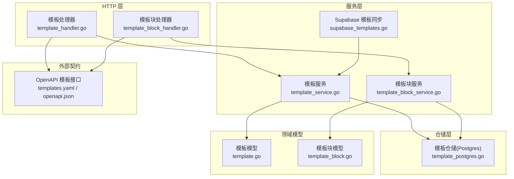
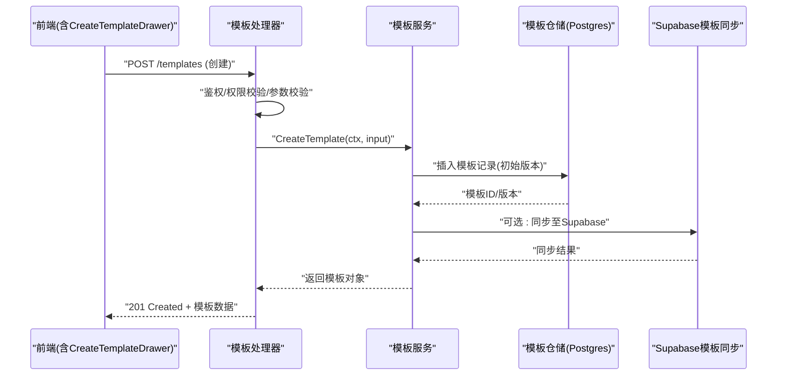
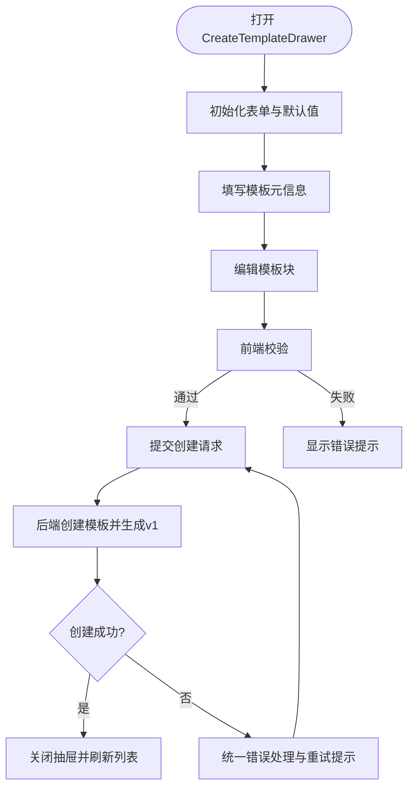
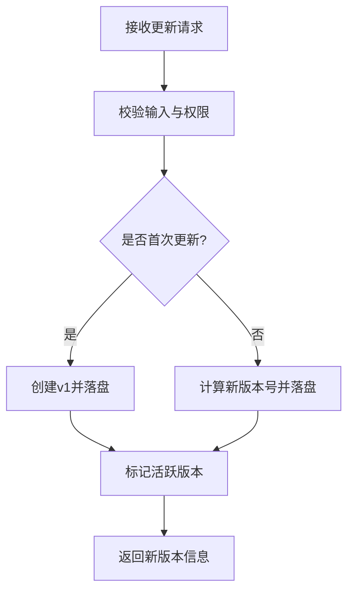
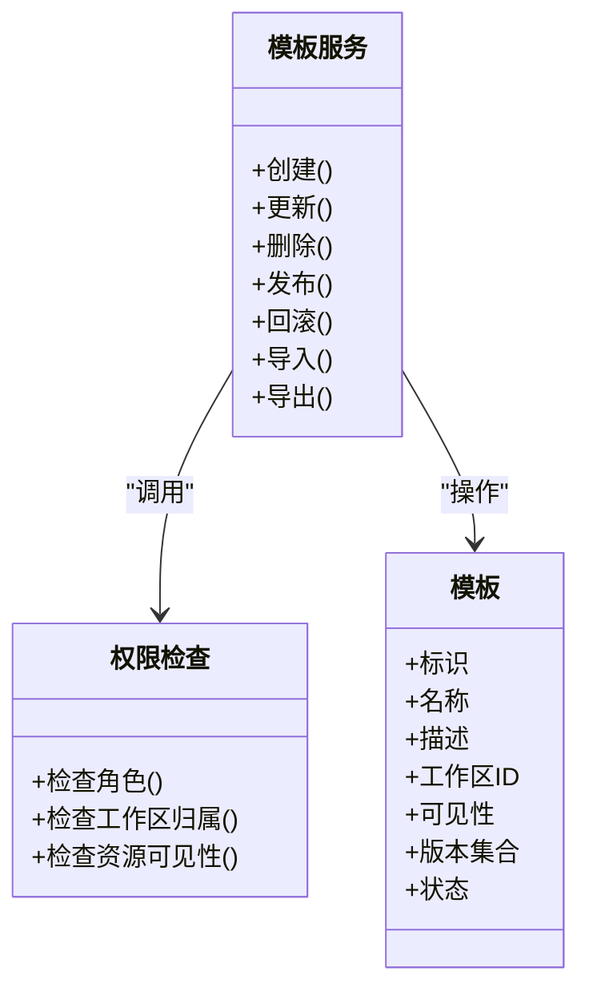
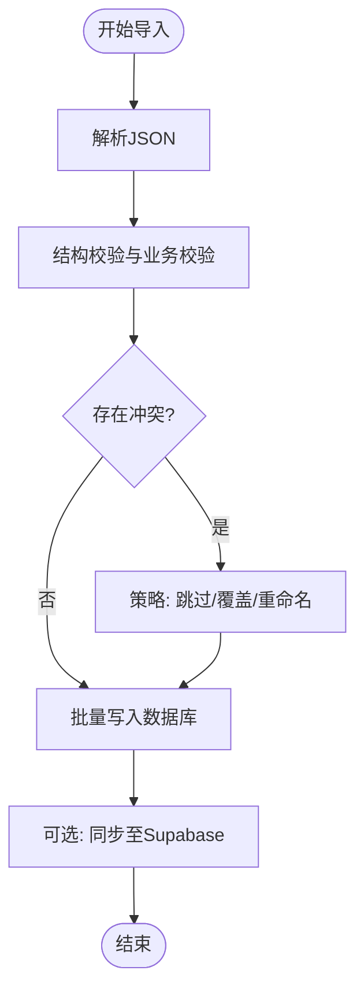
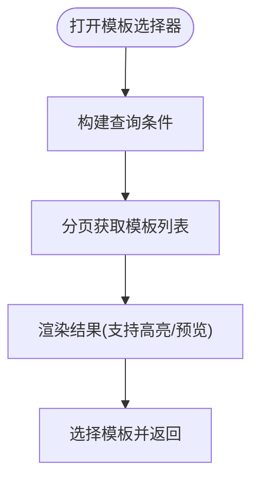
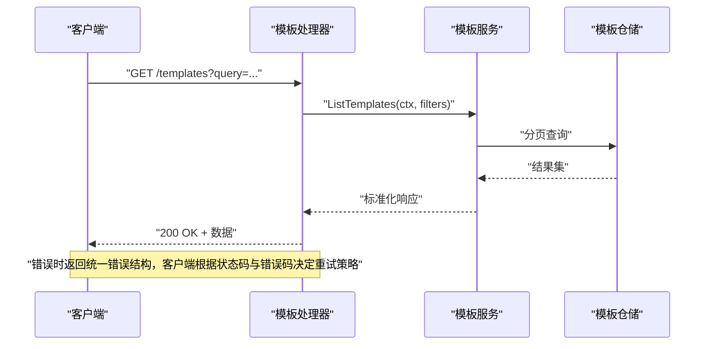
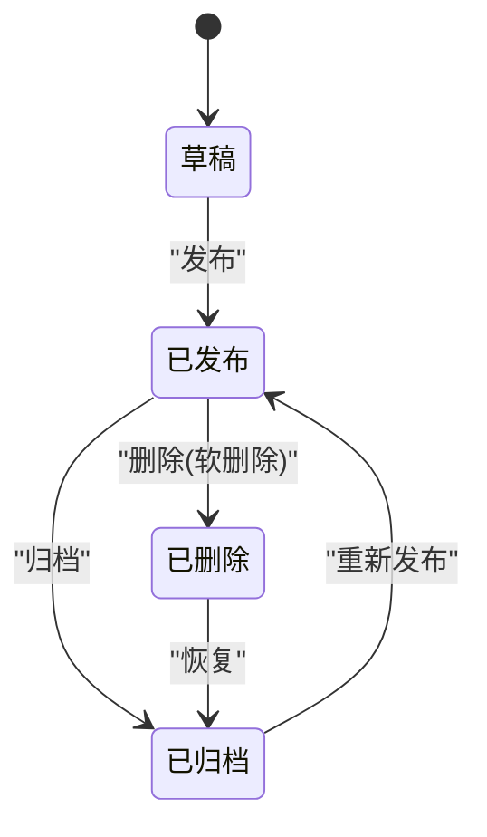
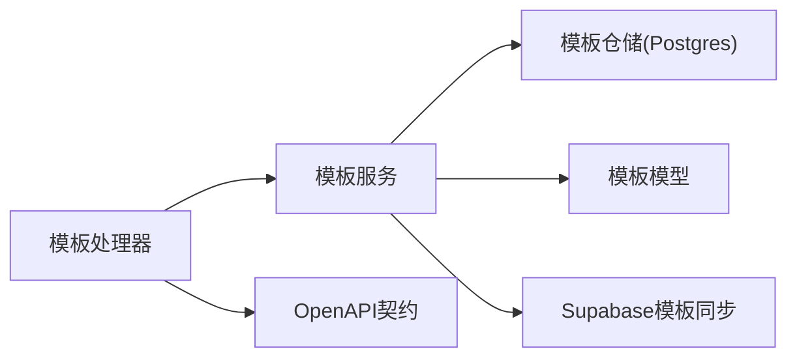

# 模板管理功能

<cite>
**本文引用的文件**   
- [template.go](file://notifuse/internal/domain/template.go)
- [template_block.go](file://notifuse/internal/domain/template_block.go)
- [template_service.go](file://notifuse/internal/service/template_service.go)
- [template_block_service.go](file://notifuse/internal/service/template_block_service.go)
- [template_postgres.go](file://notifuse/internal/repository/template_postgres.go)
- [template_handler.go](file://notifuse/internal/http/templates/handler.go)
- [template_block_handler.go](file://notifuse/internal/http/templates/block_handler.go)
- [supabase_templates.go](file://notifuse/internal/service/supabase_templates.go)
- [templates.yaml](file://notifuse/openapi/paths/templates.yaml)
- [openapi.json](file://notifuse/openapi.json)
</cite>

## 目录
1. [简介](#简介)
2. [项目结构](#项目结构)
3. [核心组件](#核心组件)
4. [架构总览](#架构总览)
5. [详细组件分析](#详细组件分析)
6. [依赖分析](#依赖分析)
7. [性能考虑](#性能考虑)
8. [故障排查指南](#故障排查指南)
9. [结论](#结论)
10. [附录](#附录)

## 简介
本文件聚焦 Notifuse 的模板管理功能，覆盖以下主题：
- CreateTemplateDrawer 模板创建流程（前端交互与后端接口）
- 模板版本控制、团队协作与权限管理
- 模板导入导出（JSON 规范、批量操作、迁移工具）
- 模板选择器组件实现、分类管理与搜索过滤
- 模板 API 调用方式、错误处理与重试机制
- 模板生命周期管理、备份恢复与审计日志
- 最佳实践与性能优化建议

说明：
- 文档基于仓库中领域模型、服务层、仓储层、HTTP 处理器与 OpenAPI 定义进行梳理。
- 若涉及前端具体 UI 组件（如 CreateTemplateDrawer、模板选择器），以“概念性流程图”呈现其典型交互；若仓库中存在对应源码，将补充“图示来源”。

## 项目结构
围绕模板管理的代码主要分布在如下层次：
- 领域模型：模板与模板块的数据结构与约束
- 服务层：模板业务编排、校验、版本化、协作与权限检查
- 仓储层：PostgreSQL 持久化与查询构建
- HTTP 层：REST 接口处理器，负责鉴权、参数校验、响应封装
- OpenAPI：对外接口契约与示例

**图示来源**
- [template_handler.go](file://notifuse/internal/http/templates/handler.go)
- [template_block_handler.go](file://notifuse/internal/http/templates/block_handler.go)
- [template_service.go](file://notifuse/internal/service/template_service.go)
- [template_block_service.go](file://notifuse/internal/service/template_block_service.go)
- [template_postgres.go](file://notifuse/internal/repository/template_postgres.go)
- [template.go](file://notifuse/internal/domain/template.go)
- [template_block.go](file://notifuse/internal/domain/template_block.go)
- [supabase_templates.go](file://notifuse/internal/service/supabase_templates.go)
- [templates.yaml](file://notifuse/openapi/paths/templates.yaml)
- [openapi.json](file://notifuse/openapi.json)

**章节来源**
- [template.go](file://notifuse/internal/domain/template.go)
- [template_block.go](file://notifuse/internal/domain/template_block.go)
- [template_service.go](file://notifuse/internal/service/template_service.go)
- [template_block_service.go](file://notifuse/internal/service/template_block_service.go)
- [template_postgres.go](file://notifuse/internal/repository/template_postgres.go)
- [template_handler.go](file://notifuse/internal/http/templates/handler.go)
- [template_block_handler.go](file://notifuse/internal/http/templates/block_handler.go)
- [supabase_templates.go](file://notifuse/internal/service/supabase_templates.go)
- [templates.yaml](file://notifuse/openapi/paths/templates.yaml)
- [openapi.json](file://notifuse/openapi.json)

## 核心组件
- 领域模型
  - 模板：包含标识、名称、描述、可见性、工作区归属、版本信息、状态等字段与约束。
  - 模板块：模板内可复用的片段，支持独立编辑与引用。
- 服务层
  - 模板服务：提供创建、更新、删除、复制、版本化、发布/回滚、导入导出、批量操作、权限校验等能力。
  - 模板块服务：提供模板块的增删改查、排序、关联到模板等操作。
- 仓储层
  - Postgres 模板仓储：负责模板与模板块的 CRUD、分页、筛选、版本历史、软删除等。
- HTTP 处理器
  - 模板处理器：暴露 REST 接口，承载鉴权、参数校验、事务边界与错误映射。
  - 模板块处理器：暴露模板块相关接口。
- 外部集成
  - Supabase 模板同步：用于跨环境或平台间模板同步与迁移。
- OpenAPI 契约
  - 模板接口定义与示例，确保前后端一致。

**章节来源**
- [template.go](file://notifuse/internal/domain/template.go)
- [template_block.go](file://notifuse/internal/domain/template_block.go)
- [template_service.go](file://notifuse/internal/service/template_service.go)
- [template_block_service.go](file://notifuse/internal/service/template_block_service.go)
- [template_postgres.go](file://notifuse/internal/repository/template_postgres.go)
- [template_handler.go](file://notifuse/internal/http/templates/handler.go)
- [template_block_handler.go](file://notifuse/internal/http/templates/block_handler.go)
- [supabase_templates.go](file://notifuse/internal/service/supabase_templates.go)
- [templates.yaml](file://notifuse/openapi/paths/templates.yaml)
- [openapi.json](file://notifuse/openapi.json)

## 架构总览
下图展示从前端到后端的端到端调用链，涵盖模板创建、保存、版本化与返回结果。

**图示来源**
- [template_handler.go](file://notifuse/internal/http/templates/handler.go)
- [template_service.go](file://notifuse/internal/service/template_service.go)
- [template_postgres.go](file://notifuse/internal/repository/template_postgres.go)
- [supabase_templates.go](file://notifuse/internal/service/supabase_templates.go)

## 详细组件分析

### CreateTemplateDrawer 模板创建流程（前端交互）
- 目标：引导用户完成模板基本信息、内容块、变量与预览配置，提交后由后端创建并返回最新版本。
- 关键步骤
  - 打开抽屉：初始化表单、加载默认模板或空白模板。
  - 填写元信息：名称、描述、标签/分类、可见性范围。
  - 编辑模板块：新增/编辑/排序/删除，实时预览。
  - 变量与上下文：声明变量、设置默认值、校验规则。
  - 提交：触发创建接口，显示进度与错误提示。
  - 完成后：跳转至模板详情或列表，自动选中最新版本。

[此图为概念性流程图，不直接映射具体源码文件]

### 模板版本控制
- 版本策略
  - 每次有效变更生成新版本号，保留历史版本以便回滚与对比。
  - 支持标记“活跃版本”，渲染时优先使用活跃版本。
- 关键操作
  - 创建：自动生成 v1。
  - 更新：增量变更，追加新版本。
  - 发布/回滚：切换活跃版本。
  - 比较：差异查看与合并建议。
- 数据流
  - 服务层在写库前执行版本化逻辑，仓储层按版本维度落盘。

**图示来源**
- [template_service.go](file://notifuse/internal/service/template_service.go)
- [template_postgres.go](file://notifuse/internal/repository/template_postgres.go)

**章节来源**
- [template_service.go](file://notifuse/internal/service/template_service.go)
- [template_postgres.go](file://notifuse/internal/repository/template_postgres.go)

### 团队协作与权限管理
- 角色与范围
  - 工作区级隔离：模板属于特定工作区。
  - 角色：管理员、编辑者、观察者等，不同角色具备不同读写权限。
- 权限点
  - 创建/编辑/删除模板
  - 发布/回滚版本
  - 导入/导出
  - 共享与可见性控制
- 实现要点
  - 处理器层在进入业务逻辑前进行鉴权与授权检查。
  - 服务层在执行敏感操作前再次校验上下文与权限。

**图示来源**
- [template_handler.go](file://notifuse/internal/http/templates/handler.go)
- [template_service.go](file://notifuse/internal/service/template_service.go)
- [template.go](file://notifuse/internal/domain/template.go)

**章节来源**
- [template_handler.go](file://notifuse/internal/http/templates/handler.go)
- [template_service.go](file://notifuse/internal/service/template_service.go)
- [template.go](file://notifuse/internal/domain/template.go)

### 模板导入导出（JSON 规范、批量操作、迁移工具）
- JSON 规范
  - 顶层包含模板元信息与版本数组。
  - 每个版本包含内容、变量、块引用、渲染上下文等。
  - 支持扩展字段，但需保持向后兼容。
- 导入流程
  - 解析与校验 JSON 结构。
  - 去重与冲突解决（同名模板、版本合并）。
  - 批量写入数据库，必要时触发 Supabase 同步。
- 导出流程
  - 按工作区或指定模板集合导出为 JSON。
  - 支持选择性导出（仅活跃版本、仅块定义等）。
- 迁移工具
  - 基于 Supabase 模板同步能力，实现跨环境迁移。
  - 提供幂等导入，避免重复数据。

**图示来源**
- [template_service.go](file://notifuse/internal/service/template_service.go)
- [supabase_templates.go](file://notifuse/internal/service/supabase_templates.go)

**章节来源**
- [template_service.go](file://notifuse/internal/service/template_service.go)
- [supabase_templates.go](file://notifuse/internal/service/supabase_templates.go)

### 模板选择器组件、分类管理与搜索过滤
- 选择器组件
  - 支持按工作区、分类、标签、关键词检索。
  - 支持多选/单选模式，支持最近使用与收藏。
- 分类管理
  - 分类作为模板元信息的一部分，便于组织与导航。
  - 支持层级分类与自定义标签。
- 搜索过滤
  - 前端组合条件构建，后端分页与索引优化。
  - 支持模糊匹配、正则表达式（可选）、高亮显示。

[此图为概念性流程图，不直接映射具体源码文件]

### 模板 API 接口调用方式、错误处理与重试机制
- 接口契约
  - 参考 OpenAPI 定义，包括路径、方法、请求体、响应体与错误码。
- 调用方式
  - 标准 RESTful 风格，携带认证头与工作区上下文。
  - 支持批量操作接口（如批量导入、批量删除）。
- 错误处理
  - 统一错误码与消息结构，区分客户端错误与服务端错误。
  - 对网络异常与超时进行重试（指数退避）。
- 重试机制
  - 幂等接口支持重试（如创建、查询）。
  - 非幂等接口谨慎重试，避免重复副作用。

**图示来源**
- [template_handler.go](file://notifuse/internal/http/templates/handler.go)
- [template_service.go](file://notifuse/internal/service/template_service.go)
- [template_postgres.go](file://notifuse/internal/repository/template_postgres.go)
- [templates.yaml](file://notifuse/openapi/paths/templates.yaml)
- [openapi.json](file://notifuse/openapi.json)

**章节来源**
- [template_handler.go](file://notifuse/internal/http/templates/handler.go)
- [template_service.go](file://notifuse/internal/service/template_service.go)
- [template_postgres.go](file://notifuse/internal/repository/template_postgres.go)
- [templates.yaml](file://notifuse/openapi/paths/templates.yaml)
- [openapi.json](file://notifuse/openapi.json)

### 模板生命周期管理、备份恢复与审计日志
- 生命周期
  - 草稿 -> 已发布 -> 已归档/已删除（软删除）。
  - 支持冻结版本，禁止进一步修改。
- 备份恢复
  - 定期导出模板 JSON 快照，支持全量与增量。
  - 恢复时进行一致性校验与冲突处理。
- 审计日志
  - 记录关键操作：创建、更新、发布、回滚、删除、导入、导出。
  - 记录操作人、时间、IP、变更摘要。

[此图为概念性流程图，不直接映射具体源码文件]

## 依赖分析
- 组件耦合
  - HTTP 处理器依赖服务层，服务层依赖仓储层与领域模型。
  - Supabase 模板同步作为可选外部依赖，不影响核心流程。
- 外部依赖
  - PostgreSQL 作为主存储。
  - OpenAPI 契约驱动前后端一致性。

**图示来源**
- [template_handler.go](file://notifuse/internal/http/templates/handler.go)
- [template_service.go](file://notifuse/internal/service/template_service.go)
- [template_postgres.go](file://notifuse/internal/repository/template_postgres.go)
- [template.go](file://notifuse/internal/domain/template.go)
- [supabase_templates.go](file://notifuse/internal/service/supabase_templates.go)
- [templates.yaml](file://notifuse/openapi/paths/templates.yaml)

**章节来源**
- [template_handler.go](file://notifuse/internal/http/templates/handler.go)
- [template_service.go](file://notifuse/internal/service/template_service.go)
- [template_postgres.go](file://notifuse/internal/repository/template_postgres.go)
- [template.go](file://notifuse/internal/domain/template.go)
- [supabase_templates.go](file://notifuse/internal/service/supabase_templates.go)
- [templates.yaml](file://notifuse/openapi/paths/templates.yaml)

## 性能考虑
- 查询优化
  - 合理使用索引（工作区ID、分类、标签、更新时间）。
  - 分页与游标结合，避免深翻页。
- 缓存策略
  - 热点模板与分类列表可短期缓存。
  - 版本切换后失效相关缓存。
- 批量操作
  - 使用事务与批量写入减少往返开销。
  - 分片处理大文件导入，避免内存峰值。
- 渲染与预览
  - 模板块懒加载与按需编译。
  - 预览采用异步任务与增量更新。

[本节为通用指导，不直接分析具体文件]

## 故障排查指南
- 常见问题
  - 权限不足：检查工作区成员角色与资源可见性。
  - 版本冲突：确认并发更新策略与乐观锁。
  - 导入失败：检查 JSON 结构与必填字段。
  - 同步失败：检查 Supabase 连接与凭据。
- 定位手段
  - 查看处理器日志与错误码。
  - 检查服务层事务与异常堆栈。
  - 核对仓储层 SQL 与索引命中情况。
- 重试与降级
  - 对幂等接口实施指数退避重试。
  - 外部同步失败时记录告警并允许手动重试。

**章节来源**
- [template_handler.go](file://notifuse/internal/http/templates/handler.go)
- [template_service.go](file://notifuse/internal/service/template_service.go)
- [template_postgres.go](file://notifuse/internal/repository/template_postgres.go)

## 结论
Notifuse 的模板管理功能以清晰的领域模型与服务分层为基础，提供完善的版本控制、协作与权限体系，并通过 OpenAPI 契约保障前后端一致性。导入导出与 Supabase 同步增强了跨环境迁移能力。建议在大规模使用中关注查询索引、缓存与批量操作的稳定性，并结合审计日志与错误码快速定位问题。

[本节为总结，不直接分析具体文件]

## 附录
- 术语
  - 模板：可复用的通知内容定义。
  - 模板块：模板内的可复用片段。
  - 活跃版本：当前生效的版本。
- 参考
  - OpenAPI 模板接口定义：[templates.yaml](file://notifuse/openapi/paths/templates.yaml)、[openapi.json](file://notifuse/openapi.json)