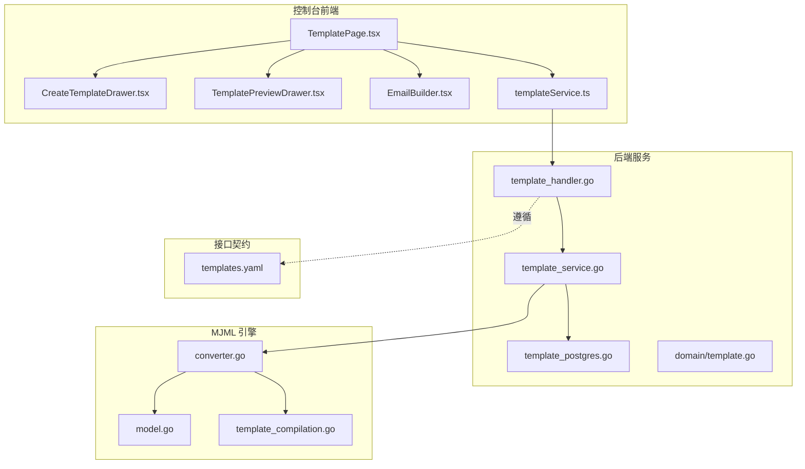
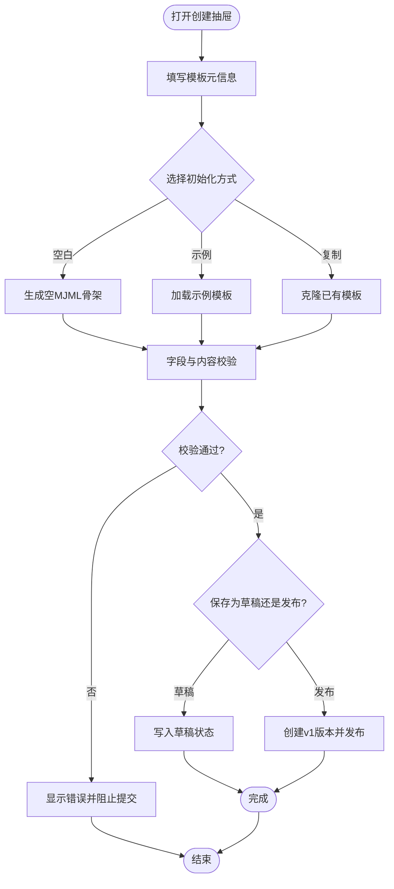
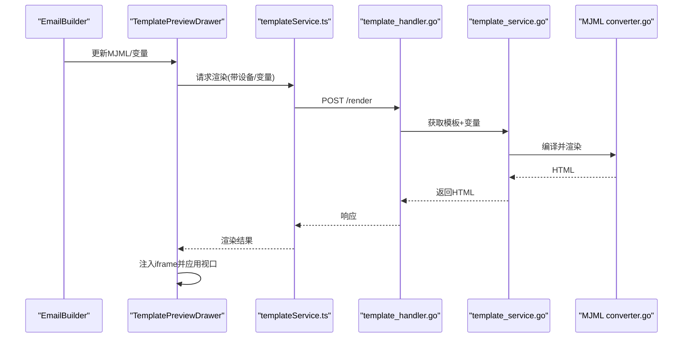
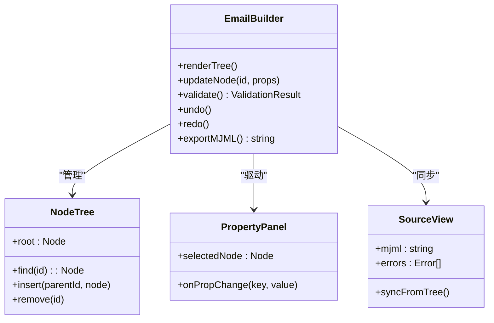
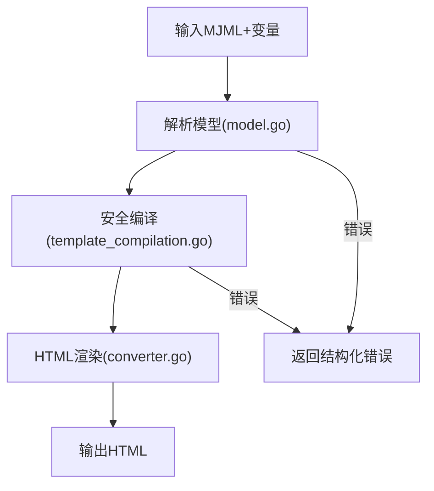
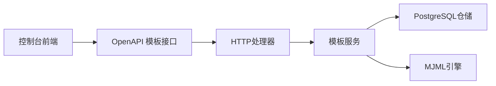

# 模板管理页面

<cite>
**本文引用的文件**   
- [console/src/pages/TemplatePage.tsx](file://notifuse/console/src/pages/TemplatePage.tsx)
- [console/src/components/templates/CreateTemplateDrawer.tsx](file://notifuse/console/src/components/templates/CreateTemplateDrawer.tsx)
- [console/src/components/templates/TemplatePreviewDrawer.tsx](file://notifuse/console/src/components/templates/TemplatePreviewDrawer.tsx)
- [console/src/components/templates/EmailBuilder.tsx](file://notifuse/console/src/components/templates/EmailBuilder.tsx)
- [console/src/services/api/templateService.ts](file://notifuse/console/src/services/api/templateService.ts)
- [internal/domain/template.go](file://notifuse/internal/domain/template.go)
- [internal/service/template_service.go](file://notifuse/internal/service/template_service.go)
- [internal/http/template_handler.go](file://notifuse/internal/http/template_handler.go)
- [internal/repository/template_postgres.go](file://notifuse/internal/repository/template_postgres.go)
- [pkg/notifuse_mjml/converter.go](file://notifuse/pkg/notifuse_mjml/converter.go)
- [pkg/notifuse_mjml/model.go](file://notifuse/pkg/notifuse_mjml/model.go)
- [pkg/notifuse_mjml/template_compilation.go](file://notifuse/pkg/notifuse_mjml/template_compilation.go)
- [openapi/paths/templates.yaml](file://notifuse/openapi/paths/templates.yaml)
</cite>

## 目录
1. [简介](#简介)
2. [项目结构](#项目结构)
3. [核心组件](#核心组件)
4. [架构总览](#架构总览)
5. [详细组件分析](#详细组件分析)
6. [依赖分析](#依赖分析)
7. [性能考虑](#性能考虑)
8. [故障排查指南](#故障排查指南)
9. [结论](#结论)
10. [附录](#附录)

## 简介
本文件面向 Notifuse 控制台“模板管理”页面，系统性说明邮件模板的创建、编辑、预览与管理能力。重点覆盖：
- CreateTemplateDrawer 模板创建流程
- TemplatePreviewDrawer 实时预览机制
- EmailBuilder 可视化编辑器核心实现
- MJML 模板引擎集成、变量替换与响应式支持
- 模板版本控制、团队协作、导入导出与模板市场（概念性）
- 模板校验、错误提示、性能优化与跨设备兼容性处理

## 项目结构
控制台前端位于 notifuse/console，模板相关页面与组件集中在 src/pages 与 src/components/templates；后端 API 与领域逻辑位于 internal 目录；MJML 渲染与编译在 pkg/notifuse_mjml；OpenAPI 定义在 openapi。



图表来源
- [console/src/pages/TemplatePage.tsx](file://notifuse/console/src/pages/TemplatePage.tsx)
- [console/src/components/templates/CreateTemplateDrawer.tsx](file://notifuse/console/src/components/templates/CreateTemplateDrawer.tsx)
- [console/src/components/templates/TemplatePreviewDrawer.tsx](file://notifuse/console/src/components/templates/TemplatePreviewDrawer.tsx)
- [console/src/components/templates/EmailBuilder.tsx](file://notifuse/console/src/components/templates/EmailBuilder.tsx)
- [console/src/services/api/templateService.ts](file://notifuse/console/src/services/api/templateService.ts)
- [internal/http/template_handler.go](file://notifuse/internal/http/template_handler.go)
- [internal/service/template_service.go](file://notifuse/internal/service/template_service.go)
- [internal/repository/template_postgres.go](file://notifuse/internal/repository/template_postgres.go)
- [internal/domain/template.go](file://notifuse/internal/domain/template.go)
- [pkg/notifuse_mjml/converter.go](file://notifuse/pkg/notifuse_mjml/converter.go)
- [pkg/notifuse_mjml/model.go](file://notifuse/pkg/notifuse_mjml/model.go)
- [pkg/notifuse_mjml/template_compilation.go](file://notifuse/pkg/notifuse_mjml/template_compilation.go)
- [openapi/paths/templates.yaml](file://notifuse/openapi/paths/templates.yaml)

章节来源
- [console/src/pages/TemplatePage.tsx](file://notifuse/console/src/pages/TemplatePage.tsx)
- [console/src/components/templates/CreateTemplateDrawer.tsx](file://notifuse/console/src/components/templates/CreateTemplateDrawer.tsx)
- [console/src/components/templates/TemplatePreviewDrawer.tsx](file://notifuse/console/src/components/templates/TemplatePreviewDrawer.tsx)
- [console/src/components/templates/EmailBuilder.tsx](file://notifuse/console/src/components/templates/EmailBuilder.tsx)
- [console/src/services/api/templateService.ts](file://notifuse/console/src/services/api/templateService.ts)
- [internal/http/template_handler.go](file://notifuse/internal/http/template_handler.go)
- [internal/service/template_service.go](file://notifuse/internal/service/template_service.go)
- [internal/repository/template_postgres.go](file://notifuse/internal/repository/template_postgres.go)
- [internal/domain/template.go](file://notifuse/internal/domain/template.go)
- [pkg/notifuse_mjml/converter.go](file://notifuse/pkg/notifuse_mjml/converter.go)
- [pkg/notifuse_mjml/model.go](file://notifuse/pkg/notifuse_mjml/model.go)
- [pkg/notifuse_mjml/template_compilation.go](file://notifuse/pkg/notifuse_mjml/template_compilation.go)
- [openapi/paths/templates.yaml](file://notifuse/openapi/paths/templates.yaml)

## 核心组件
- 模板列表页（TemplatePage）：负责模板分页、搜索、筛选、新建入口、打开预览与编辑等交互编排。
- 创建抽屉（CreateTemplateDrawer）：提供模板元信息录入、基础内容初始化、从空白或示例快速生成、保存草稿与发布。
- 预览抽屉（TemplatePreviewDrawer）：基于 MJML 渲染 HTML，支持设备尺寸切换、主题变量注入、动态数据模拟。
- 可视化编辑器（EmailBuilder）：拖拽/属性面板驱动 MJML 节点树，双向同步到源码视图，内置校验与错误定位。
- 模板服务（templateService）：封装 REST 调用，统一错误处理、重试与缓存策略。
- 后端处理器与服务（template_handler / template_service）：鉴权、参数校验、业务编排、事务与审计。
- 存储层（template_postgres）：模板、版本、块级变更、审计日志持久化。
- MJML 引擎（pkg/notifuse_mjml）：模型解析、安全编译、HTML 转换、变量注入与响应式适配。

章节来源
- [console/src/pages/TemplatePage.tsx](file://notifuse/console/src/pages/TemplatePage.tsx)
- [console/src/components/templates/CreateTemplateDrawer.tsx](file://notifuse/console/src/components/templates/CreateTemplateDrawer.tsx)
- [console/src/components/templates/TemplatePreviewDrawer.tsx](file://notifuse/console/src/components/templates/TemplatePreviewDrawer.tsx)
- [console/src/components/templates/EmailBuilder.tsx](file://notifuse/console/src/components/templates/EmailBuilder.tsx)
- [console/src/services/api/templateService.ts](file://notifuse/console/src/services/api/templateService.ts)
- [internal/http/template_handler.go](file://notifuse/internal/http/template_handler.go)
- [internal/service/template_service.go](file://notifuse/internal/service/template_service.go)
- [internal/repository/template_postgres.go](file://notifuse/internal/repository/template_postgres.go)
- [pkg/notifuse_mjml/converter.go](file://notifuse/pkg/notifuse_mjml/converter.go)
- [pkg/notifuse_mjml/model.go](file://notifuse/pkg/notifuse_mjml/model.go)
- [pkg/notifuse_mjml/template_compilation.go](file://notifuse/pkg/notifuse_mjml/template_compilation.go)

## 架构总览
下图展示从控制台到后端的完整请求链路，以及 MJML 渲染路径。

```mermaid
sequenceDiagram
participant U as "用户"
participant FE as "控制台前端<br/>TemplatePage.tsx"
participant API as "模板服务API<br/>templateService.ts"
participant H as "HTTP处理器<br/>template_handler.go"
participant S as "模板服务<br/>template_service.go"
participant DB as "PostgreSQL<br/>template_postgres.go"
participant MJ as "MJML引擎<br/>converter.go"
U->>FE : 点击“新建模板”
FE->>API : POST /templates (创建)
API->>H : 路由分发
H->>S : 校验+落库(含版本记录)
S->>DB : INSERT templates, versions
DB-->>S : 返回模板ID/版本
S-->>H : 成功
H-->>API : JSON
API-->>FE : 模板对象
U->>FE : 打开预览
FE->>API : GET /templates/ : id/render?device=...&vars=...
API->>H
H->>S : 读取模板+变量
S->>MJ : 编译并渲染HTML
MJ-->>S : HTML片段
S-->>H : 渲染结果
H-->>API : HTML/JSON
API-->>FE : 预览内容
```

图表来源
- [console/src/pages/TemplatePage.tsx](file://notifuse/console/src/pages/TemplatePage.tsx)
- [console/src/services/api/templateService.ts](file://notifuse/console/src/services/api/templateService.ts)
- [internal/http/template_handler.go](file://notifuse/internal/http/template_handler.go)
- [internal/service/template_service.go](file://notifuse/internal/service/template_service.go)
- [internal/repository/template_postgres.go](file://notifuse/internal/repository/template_postgres.go)
- [pkg/notifuse_mjml/converter.go](file://notifuse/pkg/notifuse_mjml/converter.go)

## 详细组件分析

### CreateTemplateDrawer 模板创建流程
- 输入项：名称、标识符、描述、可见范围、初始语言、默认主题、是否启用。
- 初始化策略：空白模板、系统内置示例、从现有模板复制。
- 保存行为：支持草稿与发布两种状态；首次发布自动创建 v1 版本。
- 协作与权限：工作区级别可见性控制，管理员可强制覆盖。
- 校验规则：唯一性、必填字段、命名规范、敏感字符过滤。
- 错误反馈：表单级错误提示、网络异常重试、超时保护。



图表来源
- [console/src/components/templates/CreateTemplateDrawer.tsx](file://notifuse/console/src/components/templates/CreateTemplateDrawer.tsx)
- [console/src/services/api/templateService.ts](file://notifuse/console/src/services/api/templateService.ts)
- [internal/http/template_handler.go](file://notifuse/internal/http/template_handler.go)
- [internal/service/template_service.go](file://notifuse/internal/service/template_service.go)
- [internal/repository/template_postgres.go](file://notifuse/internal/repository/template_postgres.go)

章节来源
- [console/src/components/templates/CreateTemplateDrawer.tsx](file://notifuse/console/src/components/templates/CreateTemplateDrawer.tsx)
- [console/src/services/api/templateService.ts](file://notifuse/console/src/services/api/templateService.ts)
- [internal/http/template_handler.go](file://notifuse/internal/http/template_handler.go)
- [internal/service/template_service.go](file://notifuse/internal/service/template_service.go)
- [internal/repository/template_postgres.go](file://notifuse/internal/repository/template_postgres.go)

### TemplatePreviewDrawer 预览功能
- 渲染管线：前端将当前 MJML 与变量集发送至后端渲染接口，返回最终 HTML。
- 设备切换：桌面/平板/手机三种视口，通过 CSS 媒体查询与容器宽度控制。
- 变量注入：支持上下文变量、联系人字段、主题变量、运行时占位符。
- 沙箱隔离：使用 iframe 与 CSP 限制脚本执行，避免样式污染。
- 性能优化：防抖触发、增量更新、结果缓存（按模板ID+变量指纹）。



图表来源
- [console/src/components/templates/TemplatePreviewDrawer.tsx](file://notifuse/console/src/components/templates/TemplatePreviewDrawer.tsx)
- [console/src/components/templates/EmailBuilder.tsx](file://notifuse/console/src/components/templates/EmailBuilder.tsx)
- [console/src/services/api/templateService.ts](file://notifuse/console/src/services/api/templateService.ts)
- [internal/http/template_handler.go](file://notifuse/internal/http/template_handler.go)
- [internal/service/template_service.go](file://notifuse/internal/service/template_service.go)
- [pkg/notifuse_mjml/converter.go](file://notifuse/pkg/notifuse_mjml/converter.go)

章节来源
- [console/src/components/templates/TemplatePreviewDrawer.tsx](file://notifuse/console/src/components/templates/TemplatePreviewDrawer.tsx)
- [console/src/components/templates/EmailBuilder.tsx](file://notifuse/console/src/components/templates/EmailBuilder.tsx)
- [console/src/services/api/templateService.ts](file://notifuse/console/src/services/api/templateService.ts)
- [internal/http/template_handler.go](file://notifuse/internal/http/template_handler.go)
- [internal/service/template_service.go](file://notifuse/internal/service/template_service.go)
- [pkg/notifuse_mjml/converter.go](file://notifuse/pkg/notifuse_mjml/converter.go)

### EmailBuilder 可视化编辑器
- 节点树：以树形结构维护 MJML 元素，支持增删改、层级拖拽、批量操作。
- 属性面板：根据选中节点动态渲染属性表单，双向绑定到节点数据。
- 源码视图：与可视化视图同步，支持语法高亮与错误定位。
- 校验器：实时检查非法标签、缺失必需属性、嵌套约束与样式兼容。
- 撤销重做：基于命令模式维护历史栈，支持分步回滚。
- 协作特性：锁定节点、冲突合并、变更批注（概念性扩展点）。



图表来源
- [console/src/components/templates/EmailBuilder.tsx](file://notifuse/console/src/components/templates/EmailBuilder.tsx)

章节来源
- [console/src/components/templates/EmailBuilder.tsx](file://notifuse/console/src/components/templates/EmailBuilder.tsx)

### MJML 模板引擎集成与渲染
- 模型与编译：解析 MJML 抽象模型，进行安全白名单校验、依赖分析与常量折叠。
- 渲染输出：生成跨客户端兼容的 HTML/CSS，内联关键样式，保留响应式断点。
- 变量替换：在编译期/运行期注入 Liquid 风格变量，支持条件分支与循环。
- 错误诊断：对非法语法、未知标签、不匹配闭合给出明确错误位置与建议。



图表来源
- [pkg/notifuse_mjml/model.go](file://notifuse/pkg/notifuse_mjml/model.go)
- [pkg/notifuse_mjml/template_compilation.go](file://notifuse/pkg/notifuse_mjml/template_compilation.go)
- [pkg/notifuse_mjml/converter.go](file://notifuse/pkg/notifuse_mjml/converter.go)

章节来源
- [pkg/notifuse_mjml/model.go](file://notifuse/pkg/notifuse_mjml/model.go)
- [pkg/notifuse_mjml/template_compilation.go](file://notifuse/pkg/notifuse_mjml/template_compilation.go)
- [pkg/notifuse_mjml/converter.go](file://notifuse/pkg/notifuse_mjml/converter.go)

### 模板版本控制与团队协作
- 版本策略：每次发布创建新版本，支持回滚至指定版本；草稿独立于版本。
- 变更追踪：记录作者、时间、变更摘要；支持差异对比。
- 协作机制：工作区成员角色控制（查看/编辑/发布），冲突检测与合并建议。
- 审计日志：关键操作留痕，便于合规与回溯。

章节来源
- [internal/domain/template.go](file://notifuse/internal/domain/template.go)
- [internal/service/template_service.go](file://notifuse/internal/service/template_service.go)
- [internal/repository/template_postgres.go](file://notifuse/internal/repository/template_postgres.go)

### 导入导出与模板市场（概念性）
- 导入导出：支持 MJML 文件导入导出，批量迁移与备份恢复。
- 模板市场：内部共享模板库，按标签分类、评分与评论，一键复用。
- 安全策略：导入前进行静态扫描与沙箱渲染验证，防止恶意代码注入。

[本节为概念性说明，未直接分析具体文件]

## 依赖分析
- 前端耦合：TemplatePage 聚合多个子组件并通过 templateService 与后端通信。
- 前后端契约：OpenAPI 定义模板 CRUD、渲染、版本与审计接口。
- 后端分层：HTTP 处理器 -> 服务层 -> 仓储层，职责清晰，易于测试与替换。
- 外部依赖：MJML 引擎作为纯函数式模块，无副作用，便于缓存与并行渲染。



图表来源
- [openapi/paths/templates.yaml](file://notifuse/openapi/paths/templates.yaml)
- [internal/http/template_handler.go](file://notifuse/internal/http/template_handler.go)
- [internal/service/template_service.go](file://notifuse/internal/service/template_service.go)
- [internal/repository/template_postgres.go](file://notifuse/internal/repository/template_postgres.go)
- [pkg/notifuse_mjml/converter.go](file://notifuse/pkg/notifuse_mjml/converter.go)

章节来源
- [openapi/paths/templates.yaml](file://notifuse/openapi/paths/templates.yaml)
- [internal/http/template_handler.go](file://notifuse/internal/http/template_handler.go)
- [internal/service/template_service.go](file://notifuse/internal/service/template_service.go)
- [internal/repository/template_postgres.go](file://notifuse/internal/repository/template_postgres.go)
- [pkg/notifuse_mjml/converter.go](file://notifuse/pkg/notifuse_mjml/converter.go)

## 性能考虑
- 前端
  - 预览防抖与节流：减少频繁渲染开销。
  - 增量更新：仅重绘变更节点，避免全量重建。
  - 结果缓存：按模板ID+变量指纹缓存渲染结果。
- 后端
  - 并发渲染：MJML 渲染无状态，适合并行处理。
  - 编译缓存：相同模板结构的编译产物复用。
  - 资源压缩：输出 HTML/CSS 压缩与懒加载非关键样式。
- 兼容性
  - 响应式断点：确保移动端可读性与点击区域合理。
  - 邮件客户端兼容：内联关键样式，避免高级特性。

[本节提供通用指导，无需特定文件引用]

## 故障排查指南
- 常见错误
  - 模板校验失败：检查必填字段、唯一性、命名规范与敏感字符。
  - 渲染异常：确认 MJML 语法合法、标签闭合、属性有效。
  - 变量未生效：核对变量键名与作用域，检查注入顺序。
  - 预览空白：检查网络请求、CSP 策略与 iframe 同源限制。
- 定位方法
  - 浏览器开发者工具：Network 面板查看请求/响应，Console 查看错误堆栈。
  - 后端日志：关注模板服务与 MJML 编译阶段的错误码与消息。
  - 差异对比：利用版本差异定位引入问题的变更。
- 修复建议
  - 使用最小复现模板逐步缩小问题范围。
  - 关闭第三方插件或自定义样式，回归基线。
  - 对复杂模板拆分组件，降低单次渲染复杂度。

章节来源
- [console/src/components/templates/EmailBuilder.tsx](file://notifuse/console/src/components/templates/EmailBuilder.tsx)
- [console/src/components/templates/TemplatePreviewDrawer.tsx](file://notifuse/console/src/components/templates/TemplatePreviewDrawer.tsx)
- [internal/service/template_service.go](file://notifuse/internal/service/template_service.go)
- [pkg/notifuse_mjml/template_compilation.go](file://notifuse/pkg/notifuse_mjml/template_compilation.go)

## 结论
模板管理页面围绕“可视化编辑—实时预览—版本化管理”的主线，结合 MJML 引擎的安全编译与响应式输出，提供了高效、稳定且可扩展的邮件模板解决方案。通过清晰的职责分层与完善的校验、错误提示与性能优化策略，既满足个人创作者需求，也支撑团队协作与规模化运营。

[本节为总结性内容，无需特定文件引用]

## 附录
- OpenAPI 参考：模板相关接口定义见 templates.yaml。
- 领域模型：模板实体、版本与关联关系见 domain/template.go。
- 仓储实现：模板持久化与查询见 template_postgres.go。

章节来源
- [openapi/paths/templates.yaml](file://notifuse/openapi/paths/templates.yaml)
- [internal/domain/template.go](file://notifuse/internal/domain/template.go)
- [internal/repository/template_postgres.go](file://notifuse/internal/repository/template_postgres.go)