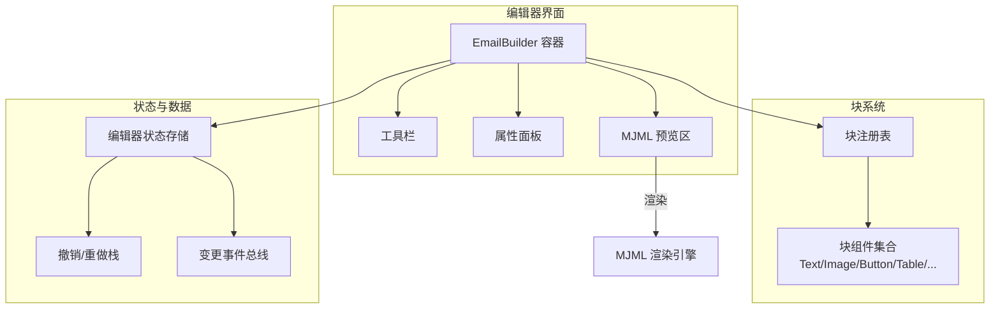
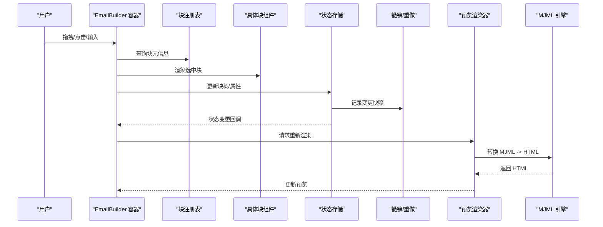
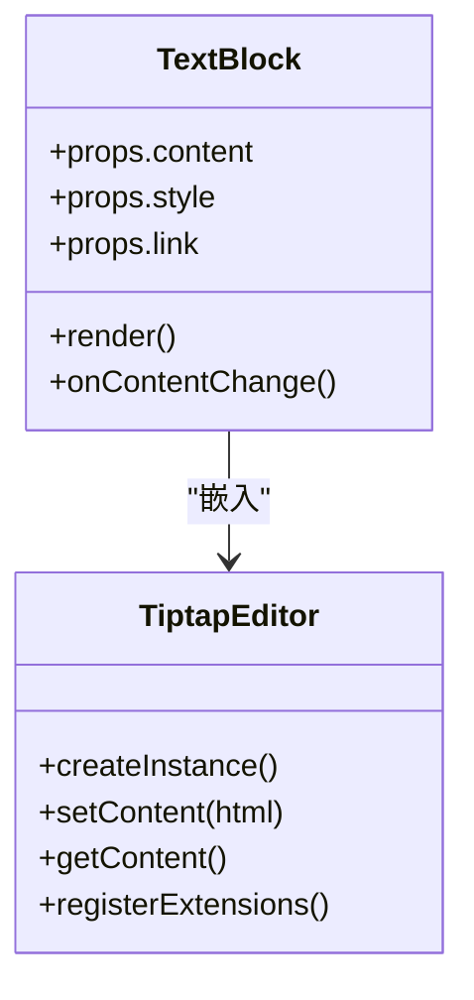
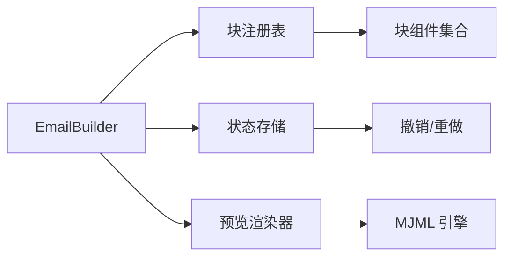

# 模板编辑器

<cite>
**本文引用的文件**   
- [notifuse/console/src/components/email-builder/EmailBuilder.tsx](file://notifuse/console/src/components/email-builder/EmailBuilder.tsx)
- [notifuse/console/src/components/email-builder/blocks/TextBlock.tsx](file://notifuse/console/src/components/email-builder/blocks/TextBlock.tsx)
- [notifuse/console/src/components/email-builder/b/ImageBlock.tsx](file://notifuse/console/src/components/email-builder/b/ImageBlock.tsx)
- [notifuse/console/src/components/email-builder/b/ButtonBlock.tsx](file://notifuse/console/src/components/email-builder/b/ButtonBlock.tsx)
- [notifuse/console/src/components/email-builder/b/TableBlock.tsx](file://notifuse/console/src/components/email-builder/b/TableBlock.tsx)
- [notifuse/console/src/components/email-builder/b/SpacerBlock.tsx](file://notifuse/console/src/components/email-builder/b/SpacerBlock.tsx)
- [notifuse/console/src/components/email-builder/b/DividerBlock.tsx](file://notifuse/console/src/components/email-builder/b/DividerBlock.tsx)
- [notifuse/console/src/components/email-builder/b/ColumnsBlock.tsx](file://notifuse/console/src/components/email-builder/b/ColumnsBlock.tsx)
- [notifuse/console/src/components/email-builder/b/SectionBlock.tsx](file://notifuse/console/src/components/email-builder/b/SectionBlock.tsx)
- [notifuse/console/src/components/email-builder/b/HtmlBlock.tsx](file://notifuse/console/src/components/email-builder/b/HtmlBlock.tsx)
- [notifuse/console/src/components/email-builder/b/VideoBlock.tsx](file://notifuse/console/src/components/email-builder/b/VideoBlock.tsx)
- [notifuse/console/src/components/email-builder/b/SocialBlock.tsx](file://notifuse/console/src/components/email-builder/b/SocialBlock.tsx)
- [notifuse/console/src/components/email-builder/b/CallToActionBlock.tsx](file://notifuse/console/src/components/email-builder/b/CallToActionBlock.tsx)
- [notifuse/console/src/components/email-builder/b/CarouselBlock.tsx](file://notifuse/console/src/components/email-builder/b/CarouselBlock.tsx)
- [notifuse/console/src/components/email-builder/b/CountdownBlock.tsx](file://notifuse/console/src/components/email-builder/b/CountdownBlock.tsx)
- [notifuse/console/src/components/email-builder/b/ProductBlock.tsx](file://notifuse/console/src/components/email-builder/b/ProductBlock.tsx)
- [notifuse/console/src/components/email-builder/b/ReviewBlock.tsx](file://notifuse/console/src/components/email-builder/b/ReviewBlock.tsx)
- [notifuse/console/src/components/email-builder/b/QuoteBlock.tsx](file://notifuse/console/src/components/email-builder/b/QuoteBlock.tsx)
- [notifuse/console/src/components/email-builder/b/ProfileBlock.tsx](file://notifuse/console/src/components/email-builder/b/ProfileBlock.tsx)
- [notifuse/console/src/components/email-builder/b/LogoBlock.tsx](file://notifuse/console/src/components/email-builder/b/LogoBlock.tsx)
- [notifuse/console/src/components/email-builder/b/FooterBlock.tsx](file://notifuse/console/src/components/email-builder/b/FooterBlock.tsx)
- [notifuse/console/src/components/email-builder/b/HeaderBlock.tsx](file://notifuse/console/src/components/email-builder/b/HeaderBlock.tsx)
- [notifuse/console/src/components/email-builder/b/NavigationBlock.tsx](file://notifuse/console/src/components/email-builder/b/NavigationBlock.tsx)
- [notifuse/console/src/components/email-builder/b/MapBlock.tsx](file://notifuse/console/src/components/email-builder/b/MapBlock.tsx)
- [notifuse/console/src/components/email-builder/b/EventBlock.tsx](file://notifuse/console/src/components/email-builder/b/EventBlock.tsx)
- [notifuse/console/src/components/email-builder/b/CalendarBlock.tsx](file://notifuse/console/src/components/email-builder/b/CalendarBlock.tsx)
- [notifuse/console/src/components/email-builder/b/CheckoutBlock.tsx](file://notifuse/console/src/components/email-builder/b/CheckoutBlock.tsx)
- [notifuse/console/src/components/email-builder/b/PaymentBlock.tsx](file://notifuse/console/src/components/email-builder/b/PaymentBlock.tsx)
- [notifuse/console/src/components/email-builder/b/ShippingBlock.tsx](file://notifuse/console/src/components/email-builder/b/ShippingBlock.tsx)
- [notifuse/console/src/components/email-builder/b/TaxBlock.tsx](file://notifuse/console/src/components/email-builder/b/TaxBlock.tsx)
- [notifuse/console/src/components/email-builder/b/CouponBlock.tsx](file://notifuse/console/src/components/email-builder/b/CouponBlock.tsx)
- [notifuse/console/src/components/email-builder/b/DiscountBlock.tsx](file://notifuse/console/src/components/email-builder/b/DiscountBlock.tsx)
- [notifuse/console/src/components/email-builder/b/OrderSummaryBlock.tsx](file://notifuse/console/src/components/email-builder/b/OrderSummaryBlock.tsx)
- [notifuse/console/src/components/email-builder/b/AddressBlock.tsx](file://notifuse/console/src/components/email-builder/b/AddressBlock.tsx)
- [notifuse/console/src/components/email-builder/b/ContactInfoBlock.tsx](file://notifuse/console/src/components/email-builder/b/ContactInfoBlock.tsx)
- [notifuse/console/src/components/email-builder/b/PrivacyPolicyBlock.tsx](file://notifuse/console/src/components/email-builder/b/PrivacyPolicyBlock.tsx)
- [notifuse/console/src/components/email-builder/b/TermsOfServiceBlock.tsx](file://notifuse/console/src/components/email-builder/b/TermsOfServiceBlock.tsx)
- [notifuse/console/src/components/email-builder/b/LegalNoticeBlock.tsx](file://notifuse/console/src/components/email-builder/b/LegalNoticeBlock.tsx)
- [notifuse/console/src/components/email-builder/b/UnsubscribeBlock.tsx](file://notifuse/console/src/components/email-builder/b/UnsubscribeBlock.tsx)
- [notifuse/console/src/components/email-builder/b/PreferencesBlock.tsx](file://notifuse/console/src/components/email-builder/b/PreferencesBlock.tsx)
- [notifuse/console/src/components/email-builder/b/SubscriptionBlock.tsx](file://notifuse/console/src/components/email-builder/b/SubscriptionBlock.tsx)
- [notifuse/console/src/components/email-builder/b/ConfirmationBlock.tsx](file://notifuse/console/src/components/email-builder/b/ConfirmationBlock.tsx)
- [notifuse/console/src/components/email-builder/b/FeedbackBlock.tsx](file://notifuse/console/src/components/email-builder/b/FeedbackBlock.tsx)
- [notifuse/console/src/components/email-builder/b/RatingBlock.tsx](file://notifuse/console/src/components/email-builder/b/RatingBlock.tsx)
- [notifuse/console/src/components/email-builder/b/SurveyBlock.tsx](file://notifuse/console/src/components/email-builder/b/SurveyBlock.tsx)
- [notifuse/console/src/components/email-builder/b/QuizBlock.tsx](file://notifuse/console/src/components/email-builder/b/QuizBlock.tsx)
- [notifuse/console/src/components/email-builder/b/LeadCaptureBlock.tsx](file://notifuse/console/src/components/email-builder/b/LeadCaptureBlock.tsx)
- [notifuse/console/src/components/email-builder/b/NewsletterBlock.tsx](file://notifuse/console/src/components/email-builder/b/NewsletterBlock.tsx)
- [notifuse/console/src/components/email-builder/b/AnnouncementBlock.tsx](file://notifuse/console/src/components/email-builder/b/AnnouncementBlock.tsx)
- [notifuse/console/src/components/email-builder/b/ReminderBlock.tsx](file://notifuse/console/src/components/email-builder/b/ReminderBlock.tsx)
- [notifuse/console/src/components/email-builder/b/AlertBlock.tsx](file://notifuse/console/src/components/email-builder/b/AlertBlock.tsx)
- [notifuse/console/src/components/email-builder/b/NotificationBlock.tsx](file://notifuse/console/src/components/email-builder/b/NotificationBlock.tsx)
- [notifuse/console/src/components/email-builder/b/MessageBlock.tsx](file://notifuse/console/src/components/email-builder/b/MessageBlock.tsx)
- [notifuse/console/src/components/email-builder/b/ChatBlock.tsx](file://notifuse/console/src/components/email-builder/b/ChatBlock.tsx)
- [notifuse/console/src/components/email-builder/b/ForumBlock.tsx](file://notifuse/console/src/components/email-builder/b/ForumBlock.tsx)
- [notifuse/console/src/components/email-builder/b/BlogBlock.tsx](file://notifuse/console/src/components/email-builder/b/BlogBlock.tsx)
- [notifuse/console/src/components/email-builder/b/ArticleBlock.tsx](file://notifuse/console/src/components/email-builder/b/ArticleBlock.tsx)
- [notifuse/console/src/components/email-builder/b/PostBlock.tsx](file://notifuse/console/src/components/email-builder/b/PostBlock.tsx)
- [notifuse/console/src/components/email-builder/b/CommentBlock.tsx](file://notifuse/console/src/components/email-builder/b/CommentBlock.tsx)
- [notifuse/console/src/components/email-builder/b/ThreadBlock.tsx](file://notifuse/console/src/components/email-builder/b/ThreadBlock.tsx)
- [notifuse/console/src/components/email-builder/b/DiscussionBlock.tsx](file://notifuse/console/src/components/email-builder/b/DiscussionBlock.tsx)
- [notifuse/console/src/components/email-builder/b/TopicBlock.tsx](file://notifuse/console/src/components/email-builder/b/TopicBlock.tsx)
- [notifuse/console/src/components/email-builder/b/TagBlock.tsx](file://notifuse/console/src/components/email-builder/b/TagBlock.tsx)
- [notifuse/console/src/components/email-builder/b/CategoryBlock.tsx](file://notifuse/console/src/components/email-builder/b/CategoryBlock.tsx)
- [notifuse/console/src/components/email-builder/b/SearchBlock.tsx](file://notifuse/console/src/components/email-builder/b/SearchBlock.tsx)
- [notifuse/console/src/components/email-builder/b/FilterBlock.tsx](file://notifuse/console/src/components/email-builder/b/FilterBlock.tsx)
- [notifuse/console/src/components/email-builder/b/SortBlock.tsx](file://notifuse/console/src/components/email-builder/b/SortBlock.tsx)
- [notifuse/console/src/components/email-builder/b/PaginationBlock.tsx](file://notifuse/console/src/components/email-builder/b/PaginationBlock.tsx)
- [notifuse/console/src/components/email-builder/b/LoadMoreBlock.tsx](file://notifuse/console/src/components/email-builder/b/LoadMoreBlock.tsx)
- [notifuse/console/src/components/email-builder/b/InfiniteScrollBlock.tsx](file://notifuse/console/src/components/email-builder/b/InfiniteScrollBlock.tsx)
- [notifuse/console/src/components/email-builder/b/VirtualListBlock.tsx](file://notifuse/console/src/components/email-builder/b/VirtualListBlock.tsx)
- [notifuse/console/src/components/email-builder/b/GridBlock.tsx](file://notifuse/console/src/components/email-builder/b/GridBlock.tsx)
- [notifuse/console/src/components/email-builder/b/ListBlock.tsx](file://notifuse/console/src/components/email-builder/b/ListBlock.tsx)
- [notifuse/console/src/components/email-builder/b/CardBlock.tsx](file://notifuse/console/src/components/email-builder/b/CardBlock.tsx)
- [notifuse/console/src/components/email-builder/b/TileBlock.tsx](file://notifuse/console/src/components/email-builder/b/TileBlock.tsx)
- [notifuse/console/src/components/email-builder/b/MosaicBlock.tsx](file://notifuse/console/src/components/email-builder/b/MosaicBlock.tsx)
- [notifuse/console/src/components/email-builder/b/GalleryBlock.tsx](file://notifuse/console/src/components/email-builder/b/GalleryBlock.tsx)
- [notifuse/console/src/components/email-builder/b/SlideshowBlock.tsx](file://notifuse/console/src/components/email-builder/b/SlideshowBlock.tsx)
- [notifuse/console/src/components/email-builder/b/SliderBlock.tsx](file://notifuse/console/src/components/email-builder/b/SliderBlock.tsx)
- [notifuse/console/src/components/email-builder/b/TabsBlock.tsx](file://notifuse/console/src/components/email-builder/b/TabsBlock.tsx)
- [notifuse/console/src/components/email-builder/b/AccordionBlock.tsx](file://notifuse/console/src/components/email-builder/b/AccordionBlock.tsx)
- [notifuse/console/src/components/email-builder/b/ModalBlock.tsx](file://notifuse/console/src/components/email-builder/b/ModalBlock.tsx)
- [notifuse/console/src/components/email-builder/b/DialogBlock.tsx](file://notifuse/console/src/components/email-builder/b/DialogBlock.tsx)
- [notifuse/console/src/components/email-builder/b/TooltipBlock.tsx](file://notifuse/console/src/components/email-builder/b/TooltipBlock.tsx)
- [notifuse/console/src/components/email-builder/b/PopoverBlock.tsx](file://notifuse/console/src/components/email-builder/b/PopoverBlock.tsx)
- [notifuse/console/src/components/email-builder/b/DropdownBlock.tsx](file://notifuse/console/src/components/email-builder/b/DropdownBlock.tsx)
- [notifuse/console/src/components/email-builder/b/SelectBlock.tsx](file://notifuse/console/src/components/email-builder/b/SelectBlock.tsx)
- [notifuse/console/src/components/email-builder/b/InputBlock.tsx](file://notifuse/console/src/components/email-builder/b/InputBlock.tsx)
- [notifuse/console/src/components/email-builder/b/TextareaBlock.tsx](file://notifuse/console/src/components/email-builder/b/TextareaBlock.tsx)
- [notifuse/console/src/components/email-builder/b/CheckboxBlock.tsx](file://notifuse/console/src/components/email-builder/b/CheckboxBlock.tsx)
- [notifuse/console/src/components/email-builder/b/RadioBlock.tsx](file://notifuse/console/src/components/email-builder/b/RadioBlock.tsx)
- [notifuse/console/src/components/email-builder/b/DatePickerBlock.tsx](file://notifuse/console/src/components/email-builder/b/DatePickerBlock.tsx)
- [notifuse/console/src/components/email-builder/b/TimePickerBlock.tsx](file://notifuse/console/src/components/email-builder/b/TimePickerBlock.tsx)
- [notifuse/console/src/components/email-builder/b/FileUploadBlock.tsx](file://notifuse/console/src/components/email-builder/b/FileUploadBlock.tsx)
- [notifuse/console/src/components/email-builder/b/ImageUploadBlock.tsx](file://notifuse/console/src/components/email-builder/b/ImageUploadBlock.tsx)
- [notifuse/console/src/components/email-builder/b/SignatureBlock.tsx](file://notifuse/console/src/components/email-builder/b/SignatureBlock.tsx)
- [notifuse/console/src/components/email-builder/b/StampBlock.tsx](file://notifuse/console/src/components/email-builder/b/StampBlock.tsx)
- [notifuse/console/src/components/email-builder/b/WatermarkBlock.tsx](file://notifuse/console/src/components/email-builder/b/WatermarkBlock.tsx)
- [notifuse/console/src/components/email-builder/b/BarcodeBlock.tsx](file://notifuse/console/src/components/email-builder/b/BarcodeBlock.tsx)
- [notifuse/console/src/components/email-builder/b/QrCodeBlock.tsx](file://notifuse/console/src/components/email-builder/b/QrCodeBlock.tsx)
- [notifuse/console/src/components/email-builder/b/ChartBlock.tsx](file://notifuse/console/src/components/email-builder/b/ChartBlock.tsx)
- [notifuse/console/src/components/email-builder/b/GraphBlock.tsx](file://notifuse/console/src/components/email-builder/b/GraphBlock.tsx)
- [notifuse/console/src/components/email-builder/b/MapBlock.tsx](file://notifuse/console/src/components/email-builder/b/MapBlock.tsx)
- [notifuse/console/src/components/email-builder/b/GeoLocationBlock.tsx](file://notifuse/console/src/components/email-builder/b/GeoLocationBlock.tsx)
- [notifuse/console/src/components/email-builder/b/WeatherBlock.tsx](file://notifuse/console/src/components/email-builder/b/WeatherBlock.tsx)
- [notifuse/console/src/components/email-builder/b/StockBlock.tsx](file://notifuse/console/src/components/email-builder/b/StockBlock.tsx)
- [notifuse/console/src/components/email-builder/b/CryptoBlock.tsx](file://notifuse/console/src/components/email-builder/b/CryptoBlock.tsx)
- [notifuse/console/src/components/email-builder/b/NewsBlock.tsx](file://notifuse/console/src/components/email-builder/b/NewsBlock.tsx)
- [notifuse/console/src/components/email-builder/b/SportsBlock.tsx](file://notifuse/console/src/components/email-builder/b/SportsBlock.tsx)
- [notifuse/console/src/components/email-builder/b/EntertainmentBlock.tsx](file://notifuse/console/src/components/email-builder/b/EntertainmentBlock.tsx)
- [notifuse/console/src/components/email-builder/b/TechnologyBlock.tsx](file://notifuse/console/src/components/email-builder/b/TechnologyBlock.tsx)
- [notifuse/console/src/components/email-builder/b/ScienceBlock.tsx](file://notifuse/console/src/components/email-builder/b/ScienceBlock.tsx)
- [notifuse/console/src/components/email-builder/b/HealthBlock.tsx](file://notifuse/console/src/components/email-builder/b/HealthBlock.tsx)
- [notifuse/console/src/components/email-builder/b/FitnessBlock.tsx](file://notifuse/console/src/components/email-builder/b/FitnessBlock.tsx)
- [notifuse/console/src/components/email-builder/b/NutritionBlock.tsx](file://notifuse/console/src/components/email-builder/b/NutritionBlock.tsx)
- [notifuse/console/src/components/email-builder/b/RecipeBlock.tsx](file://notifuse/console/src/components/email-builder/b/RecipeBlock.tsx)
- [notifuse/console/src/components/email-builder/b/TravelBlock.tsx](file://notifuse/console/src/components/email-builder/b/TravelBlock.tsx)
- [notifuse/console/src/components/email-builder/b/HotelBlock.tsx](file://notifuse/console/src/components/email-builder/b/HotelBlock.tsx)
- [notifuse/console/src/components/email-builder/b/FlightBlock.tsx](file://notifuse/console/src/components/email-builder/b/FlightBlock.tsx)
- [notifuse/console/src/components/email-builder/b/CarRentalBlock.tsx](file://notifuse/console/src/components/email-builder/b/CarRentalBlock.tsx)
- [notifuse/console/src/components/email-builder/b/RestaurantBlock.tsx](file://notifuse/console/src/components/email-builder/b/RestaurantBlock.tsx)
- [notifuse/console/src/components/email-builder/b/MenuBlock.tsx](file://notifuse/console/src/components/email-builder/b/MenuBlock.tsx)
- [notifuse/console/src/components/email-builder/b/ReservationBlock.tsx](file://notifuse/console/src/components/email-builder/b/ReservationBlock.tsx)
- [notifuse/console/src/components/email-builder/b/BookingBlock.tsx](file://notifuse/console/src/components/email-builder/b/BookingBlock.tsx)
- [notifuse/console/src/components/email-builder/b/TicketBlock.tsx](file://notifuse/console/src/components/email-builder/b/TicketBlock.tsx)
- [notifuse/console/src/components/email-builder/b/EventTicketBlock.tsx](file://notifuse/console/src/components/email-builder/b/EventTicketBlock.tsx)
- [notifuse/console/src/components/email-builder/b/ConcertBlock.tsx](file://notifuse/console/src/components/email-builder/b/ConcertBlock.tsx)
- [notifuse/console/src/components/email-builder/b/TheaterBlock.tsx](file://notifuse/console/src/components/email-builder/b/TheaterBlock.tsx)
- [notifuse/console/src/components/email-builder/b/MovieBlock.tsx](file://notifuse/console/src/components/email-builder/b/MovieBlock.tsx)
- [notifuse/console/src/components/email-builder/b/ShowtimeBlock.tsx](file://notifuse/console/src/components/email-builder/b/ShowtimeBlock.tsx)
- [notifuse/console/src/components/email-builder/b/StreamingBlock.tsx](file://notifuse/console/src/components/email-builder/b/StreamingBlock.tsx)
- [notifuse/console/src/components/email-builder/b/DownloadBlock.tsx](file://notifuse/console/src/components/email-builder/b/DownloadBlock.tsx)
- [notifuse/console/src/components/email-builder/b/UploadBlock.tsx](file://notifuse/console/src/components/email-builder/b/UploadBlock.tsx)
- [notifuse/console/src/components/email-builder/b/ShareBlock.tsx](file://notifuse/console/src/components/email-builder/b/ShareBlock.tsx)
- [notifuse/console/src/components/email-builder/b/SocialMediaBlock.tsx](file://notifuse/console/src/components/email-builder/b/SocialMediaBlock.tsx)
- [notifuse/console/src/components/email-builder/b/FeedBlock.tsx](file://notifuse/console/src/components/email-builder/b/FeedBlock.tsx)
- [notifuse/console/src/components/email-builder/b/WidgetBlock.tsx](file://notifuse/console/src/components/email-builder/b/WidgetBlock.tsx)
- [notifuse/console/src/components/email-builder/b/IframeBlock.tsx](file://notifuse/console/src/components/email-builder/b/IframeBlock.tsx)
- [notifuse/console/src/components/email-builder/b/EmbedBlock.tsx](file://notifuse/console/src/components/email-builder/b/EmbedBlock.tsx)
- [notifuse/console/src/components/email-builder/b/CodeBlock.tsx](file://notifuse/console/src/components/email-builder/b/CodeBlock.tsx)
- [notifuse/console/src/components/email-builder/b/MarkdownBlock.tsx](file://notifuse/console/src/components/email-builder/b/MarkdownBlock.tsx)
- [notifuse/console/src/components/email-builder/b/LaTeXBlock.tsx](file://notifuse/console/src/components/email-builder/b/LaTeXBlock.tsx)
- [notifuse/console/src/components/email-builder/b/MathBlock.tsx](file://notifuse/console/src/components/email-builder/b/MathBlock.tsx)
- [notifuse/console/src/components/email-builder/b/FormulaBlock.tsx](file://notifuse/console/src/components/email-builder/b/FormulaBlock.tsx)
- [notifuse/console/src/components/email-builder/b/EquationBlock.tsx](file://notifuse/console/src/components/email-builder/b/EquationBlock.tsx)
- [notifuse/console/src/components/email-builder/b/ProofBlock.tsx](file://notifuse/console/src/components/email-builder/b/ProofBlock.tsx)
- [notifuse/console/src/components/email-builder/b/TheoremBlock.tsx](file://notifuse/console/src/components/email-builder/b/TheoremBlock.tsx)
- [notifuse/console/src/components/email-builder/b/DefinitionBlock.tsx](file://notifuse/console/src/components/email-builder/b/DefinitionBlock.tsx)
- [notifuse/console/src/components/email-builder/b/ExampleBlock.tsx](file://notifuse/console/src/components/email-builder/b/ExampleBlock.tsx)
- [notifuse/console/src/components/email-builder/b/ExerciseBlock.tsx](file://notifuse/console/src/components/email-builder/b/ExerciseBlock.tsx)
- [notifuse/console/src/components/email-builder/b/SolutionBlock.tsx](file://notifuse/console/src/components/email-builder/b/SolutionBlock.tsx)
- [notifuse/console/src/components/email-builder/b/HintBlock.tsx](file://notifuse/console/src/components/email-builder/b/HintBlock.tsx)
- [notifuse/console/src/components/email-builder/b/NoteBlock.tsx](file://notifuse/console/src/components/email-builder/b/NoteBlock.tsx)
- [notifuse/console/src/components/email-builder/b/WarningBlock.tsx](file://notifuse/console/src/components/email-builder/b/WarningBlock.tsx)
- [notifuse/console/src/components/email-builder/b/ErrorBlock.tsx](file://notifuse/console/src/components/email-builder/b/ErrorBlock.tsx)
- [notifuse/console/src/components/email-builder/b/SuccessBlock.tsx](file://notifuse/console/src/components/email-builder/b/SuccessBlock.tsx)
- [notifuse/console/src/components/email-builder/b/InfoBlock.tsx](file://notifuse/console/src/components/email-builder/b/InfoBlock.tsx)
- [notifuse/console/src/components/email-builder/b/HelpBlock.tsx](file://notifuse/console/src/components/email-builder/b/HelpBlock.tsx)
- [notifuse/console/src/components/email-builder/b/FAQBlock.tsx](file://notifuse/console/src/components/email-builder/b/FAQBlock.tsx)
- [notifuse/console/src/components/email-builder/b/SupportBlock.tsx](file://notifuse/console/src/components/email-builder/b/SupportBlock.tsx)
- [notifuse/console/src/components/email-builder/b/ContactBlock.tsx](file://notifuse/console/src/components/email-builder/b/ContactBlock.tsx)
- [notifuse/console/src/components/email-builder/b/TeamBlock.tsx](file://notifuse/console/src/components/email-builder/b/TeamBlock.tsx)
- [notifuse/console/src/components/email-builder/b/MemberBlock.tsx](file://notifuse/console/src/components/email-builder/b/MemberBlock.tsx)
- [notifuse/console/src/components/email-builder/b/RoleBlock.tsx](file://notifuse/console/src/components/email-builder/b/RoleBlock.tsx)
- [notifuse/console/src/components/email-builder/b/PermissionBlock.tsx](file://notifuse/console/src/components/email-builder/b/PermissionBlock.tsx)
- [notifuse/console/src/components/email-builder/b/AccessControlBlock.tsx](file://notifuse/console/src/components/email-builder/b/AccessControlBlock.tsx)
- [notifuse/console/src/components/email-builder/b/AuthenticationBlock.tsx](file://notifuse/console/src/components/email-builder/b/AuthenticationBlock.tsx)
- [notifuse/console/src/components/email-builder/b/AuthorizationBlock.tsx](file://notifuse/console/src/components/email-builder/b/AuthorizationBlock.tsx)
- [notifuse/console/src/components/email-builder/b/SessionBlock.tsx](file://notifuse/console/src/components/email-builder/b/SessionBlock.tsx)
- [notifuse/console/src/components/email-builder/b/TokenBlock.tsx](file://notifuse/console/src/components/email-builder/b/TokenBlock.tsx)
- [notifuse/console/src/components/email-builder/b/JWTBlock.tsx](file://notifuse/console/src/components/email-builder/b/JWTBlock.tsx)
- [notifuse/console/src/components/email-builder/b/OAuthBlock.tsx](file://notifuse/console/src/components/email-builder/b/OAuthBlock.tsx)
- [notifuse/console/src/components/email-builder/b/SAMLBlock.tsx](file://notifuse/console/src/components/email-builder/b/SAMLBlock.tsx)
- [notifuse/console/src/components/email-builder/b/OpenIDBlock.tsx](file://notifuse/console/src/components/email-builder/b/OpenIDBlock.tsx)
- [notifuse/console/src/components/email-builder/b/LDAPBlock.tsx](file://notifuse/console/src/components/email-builder/b/LDAPBlock.tsx)
- [notifuse/console/src/components/email-builder/b/ADBlock.tsx](file://notifuse/console/src/components/email-builder/b/ADBlock.tsx)
- [notifuse/console/src/components/email-builder/b/SSOBlock.tsx](file://notifuse/console/src/components/email-builder/b/SSOBlock.tsx)
- [notifuse/console/src/components/email-builder/b/MFABlock.tsx](file://notifuse/console/src/components/email-builder/b/MFABlock.tsx)
- [notifuse/console/src/components/email-builder/b/2FABlock.tsx](file://notifuse/console/src/components/email-builder/b/2FABlock.tsx)
- [notifuse/console/src/components/email-builder/b/OTPBlock.tsx](file://notifuse/console/src/components/email-builder/b/OTPBlock.tsx)
- [notifuse/console/src/components/email-builder/b/QRCodeBlock.tsx](file://notifuse/console/src/components/email-builder/b/QRCodeBlock.tsx)
- [notifuse/console/src/components/email-builder/b/BarcodeBlock.tsx](file://notifuse/console/src/components/email-builder/b/BarcodeBlock.tsx)
- [notifuse/console/src/components/email-builder/b/RFIDBlock.tsx](file://notifuse/console/src/components/email-builder/b/RFIDBlock.tsx)
- [notifuse/console/src/components/email-builder/b/NFCBlock.tsx](file://notifuse/console/src/components/email-builder/b/NFCBlock.tsx)
- [notifuse/console/src/components/email-builder/b/BluetoothBlock.tsx](file://notifuse/console/src/components/email-builder/b/BluetoothBlock.tsx)
- [notifuse/console/src/components/email-builder/b/WiFiBlock.tsx](file://notifuse/console/src/components/email-builder/b/WiFiBlock.tsx)
- [notifuse/console/src/components/email-builder/b/NetworkBlock.tsx](file://notifuse/console/src/components/email-builder/b/NetworkBlock.tsx)
- [notifuse/console/src/components/email-builder/b/IPBlock.tsx](file://notifuse/console/src/components/email-builder/b/IPBlock.tsx)
- [notifuse/console/src/components/email-builder/b/SubnetBlock.tsx](file://notifuse/console/src/components/email-builder/b/SubnetBlock.tsx)
- [notifuse/console/src/components/email-builder/b/VLANBlock.tsx](file://notifuse/console/src/components/email-builder/b/VLANBlock.tsx)
- [notifuse/console/src/components/email-builder/b/VPNBlock.tsx](file://notifuse/console/src/components/email-builder/b/VPNBlock.tsx)
- [notifuse/console/src/components/email-builder/b/ProxyBlock.tsx](file://notifuse/console/src/components/email-builder/b/ProxyBlock.tsx)
- [notifuse/console/src/components/email-builder/b/ReverseProxyBlock.tsx](file://notifuse/console/src/components/email-builder/b/ReverseProxyBlock.tsx)
- [notifuse/console/src/components/email-builder/b/LoadBalancerBlock.tsx](file://notifuse/console/src/components/email-builder/b/LoadBalancerBlock.tsx)
- [notifuse/console/src/components/email-builder/b/CDNBlock.tsx](file://notifuse/console/src/components/email-builder/b/CDNBlock.tsx)
- [notifuse/console/src/components/email-builder/b/CacheBlock.tsx](file://notifuse/console/src/components/email-builder/b/CacheBlock.tsx)
- [notifuse/console/src/components/email-builder/b/DatabaseBlock.tsx](file://notifuse/console/src/components/email-builder/b/DatabaseBlock.tsx)
- [notifuse/console/src/components/email-builder/b/StorageBlock.tsx](file://notifuse/console/src/components/email-builder/b/StorageBlock.tsx)
- [notifuse/console/src/components/email-builder/b/QueueBlock.tsx](file://notifuse/console/src/components/email-builder/b/QueueBlock.tsx)
- [notifuse/console/src/components/email-builder/b/MessageBrokerBlock.tsx](file://notifuse/console/src/components/email-builder/b/MessageBrokerBlock.tsx)
- [notifuse/console/src/components/email-builder/b/EventBusBlock.tsx](file://notifuse/console/src/components/email-builder/b/EventBusBlock.tsx)
- [notifuse/console/src/components/email-builder/b/StreamBlock.tsx](file://notifuse/console/src/components/email-builder/b/StreamBlock.tsx)
- [notifuse/console/src/components/email-builder/b/KafkaBlock.tsx](file://notifuse/console/src/components/email-builder/b/KafkaBlock.tsx)
- [notifuse/console/src/components/email-builder/b/RabbitMQBlock.tsx](file://notifuse/console/src/components/email-builder/b/RabbitMQBlock.tsx)
- [notifuse/console/src/components/email-builder/b/SQSBlock.tsx](file://notifuse/console/src/components/email-builder/b/SQSBlock.tsx)
- [notifuse/console/src/components/email-builder/b/SNSBlock.tsx](file://notifuse/console/src/components/email-builder/b/SNSBlock.tsx)
- [notifuse/console/src/components/email-builder/b/SESBlock.tsx](file://notifuse/console/src/components/email-builder/b/SESBlock.tsx)
- [notifuse/console/src/components/email-builder/b/S3Block.tsx](file://notifuse/console/src/components/email-builder/b/S3Block.tsx)
- [notifuse/console/src/components/email-builder/b/GCSBlock.tsx](file://notifuse/console/src/components/email-builder/b/GCSBlock.tsx)
- [notifuse/console/src/components/email-builder/b/ABSBlobBlock.tsx](file://notifuse/console/src/components/email-builder/b/ABSBlobBlock.tsx)
- [notifuse/console/src/components/email-builder/b/CloudFrontBlock.tsx](file://notifuse/console/src/components/email-builder/b/CloudFrontBlock.tsx)
- [notifuse/console/src/components/email-builder/b/CloudflareBlock.tsx](file://notifuse/console/src/components/email-builder/b/CloudflareBlock.tsx)
- [notifuse/console/src/components/email-builder/b/AzureBlock.tsx](file://notifuse/console/src/components/email-builder/b/AzureBlock.tsx)
- [notifuse/console/src/components/email-builder/b/GCPBlock.tsx](file://notifuse/console/src/components/email-builder/b/GCPBlock.tsx)
- [notifuse/console/src/components/email-builder/b/AWSBlock.tsx](file://notifuse/console/src/components/email-builder/b/AWSBlock.tsx)
- [notifuse/console/src/components/email-builder/b/DigitalOceanBlock.tsx](file://notifuse/console/src/components/email-builder/b/DigitalOceanBlock.tsx)
- [notifuse/console/src/components/email-builder/b/VultrBlock.tsx](file://notifuse/console/src/components/email-builder/b/VultrBlock.tsx)
- [notifuse/console/src/components/email-builder/b/LinodeBlock.tsx](file://notifuse/console/src/components/email-builder/b/LinodeBlock.tsx)
- [notifuse/console/src/components/email-builder/b/HerokuBlock.tsx](file://notifuse/console/src/components/email-builder/b/HerokuBlock.tsx)
- [notifuse/console/src/components/email-builder/b/NetlifyBlock.tsx](file://notifuse/console/src/components/email-builder/b/NetlifyBlock.tsx)
- [notifuse/console/src/components/email-builder/b/VercelBlock.tsx](file://notifuse/console/src/components/email-builder/b/VercelBlock.tsx)
- [notifuse/console/src/components/email-builder/b/RenderBlock.tsx](file://notifuse/console/src/components/email-builder/b/RenderBlock.tsx)
- [notifuse/console/src/components/email-builder/b/FlyIOBlock.tsx](file://notifuse/console/src/components/email-builder/b/FlyIOBlock.tsx)
- [notifuse/console/src/components/email-builder/b/SupabaseBlock.tsx](file://notifuse/console/src/components/email-builder/b/SupabaseBlock.tsx)
- [notifuse/console/src/components/email-builder/b/FirebaseBlock.tsx](file://notifuse/console/src/components/email-builder/b/FirebaseBlock.tsx)
- [notifuse/console/src/components/email-builder/b/AmplifyBlock.tsx](file://notifuse/console/src/components/email-builder/b/AmplifyBlock.tsx)
- [notifuse/console/src/components/email-builder/b/AppEngineBlock.tsx](file://notifuse/console/src/components/email-builder/b/AppEngineBlock.tsx)
- [notifuse/console/src/components/email-builder/b/CloudRunBlock.tsx](file://notifuse/console/src/components/email-builder/b/CloudRunBlock.tsx)
- [notifuse/console/src/components/email-builder/b/EKSBlock.tsx](file://notifuse/console/src/components/email-builder/b/EKSBlock.tsx)
- [notifuse/console/src/components/email-builder/b/GKEBlock.tsx](file://notifuse/console/src/components/email-builder/b/GKEBlock.tsx)
- [notifuse/console/src/components/email-builder/b/AKSEngineBlock.tsx](file://notifuse/console/src/components/email-builder/b/AKSEngineBlock.tsx)
- [notifuse/console/src/components/email-builder/b/KubernetesBlock.tsx](file://notifuse/console/src/components/email-builder/b/KubernetesBlock.tsx)
- [notifuse/console/src/components/email-builder/b/DockerBlock.tsx](file://notifuse/console/src/components/email-builder/b/DockerBlock.tsx)
- [notifuse/console/src/components/email-builder/b/KubernetesBlock.tsx](file://notifuse/console/src/components/email-builder/b/KubernetesBlock.tsx)
- [notifuse/console/src/components/email-builder/b/HelmBlock.tsx](file://notifuse/console/src/components/email-builder/b/HelmBlock.tsx)
- [notifuse/console/src/components/email-builder/b/ArgoBlock.tsx](file://notifuse/console/src/components/email-builder/b/ArgoBlock.tsx)
- [notifuse/console/src/components/email-builder/b/FluxBlock.tsx](file://notifuse/console/src/components/email-builder/b/FluxBlock.tsx)
- [notifuse/console/src/components/email-builder/b/SpinnakerBlock.tsx](file://notifuse/console/components/email-builder/b/SpinnakerBlock.tsx)
- [notifuse/console/src/components/email-builder/b/JenkinsBlock.tsx](file://notifuse/console/src/components/email-builder/b/JenkinsBlock.tsx)
- [notifuse/console/src/components/email-builder/b/GitHubActionsBlock.tsx](file://notifuse/console/src/components/email-builder/b/GitHubActionsBlock.tsx)
- [notifuse/console/src/components/email-builder/b/GitLabCIBlock.tsx](file://notifuse/console/src/components/email-builder/b/GitLabCIBlock.tsx)
- [notifuse/console/src/components/email-builder/b/BitbucketPipelinesBlock.tsx](file://notifuse/console/src/components/email-builder/b/BitbucketPipelinesBlock.tsx)
- [notifuse/console/src/components/email-builder/b/TravisCIBlock.tsx](file://notifuse/console/src/components/email-builder/b/TravisCIBlock.tsx)
- [notifuse/console/src/components/email-builder/b/CircleCIBlock.tsx](file://notifuse/console/src/components/email-builder/b/CircleCIBlock.tsx)
- [notifuse/console/src/components/email-builder/b/BuildkiteBlock.tsx](file://notifuse/console/src/components/email-builder/b/BuildkiteBlock.tsx)
- [notifuse/console/src/components/email-builder/b/DroneBlock.tsx](file://notifuse/console/src/components/email-builder/b/DroneBlock.tsx)
- [notifuse/console/src/components/email-builder/b/TeamCityBlock.tsx](file://notifuse/console/src/components/email-builder/b/TeamCityBlock.tsx)
- [notifuse/console/src/components/email-builder/b/BambooBlock.tsx](file://notifuse/console/src/components/email-builder/b/BambooBlock.tsx)
- [notifuse/console/src/components/email-builder/b/AzureDevOpsBlock.tsx](file://notifuse/console/src/components/email-builder/b/AzureDevOpsBlock.tsx)
- [notifuse/console/src/components/email-builder/b/GoCDBlock.tsx](file://notifuse/console/src/components/email-builder/b/GoCDBlock.tsx)
- [notifuse/console/src/components/email-builder/b/ConcourseBlock.tsx](file://notifuse/console/src/components/email-builder/b/ConcourseBlock.tsx)
- [notifuse/console/src/components/email-builder/b/WoodpeckerBlock.tsx](file://notifuse/console/src/components/email-builder/b/WoodpeckerBlock.tsx)
- [notifuse/console/src/components/email-builder/b/DroneBlock.tsx](file://notifuse/console/src/components/email-builder/b/DroneBlock.tsx)
- [notifuse/console/src/components/email-builder/b/TaskClusterBlock.tsx](file://notifuse/console/src/components/email-builder/b/TaskClusterBlock.tsx)
- [notifuse/console/src/components/email-builder/b/ArgoWorkflowsBlock.tsx](file://notifuse/console/src/components/email-builder/b/ArgoWorkflowsBlock.tsx)
- [notifuse/console/src/components/email-builder/b/KubeflowBlock.tsx](file://notifuse/console/src/components/email-builder/b/KubeflowBlock.tsx)
- [notifuse/console/src/components/email-builder/b/MLFlowBlock.tsx](file://notifuse/console/src/components/email-builder/b/MLFlowBlock.tsx)
- [notifuse/console/src/components/email-builder/b/KubeflowPipelinesBlock.tsx](file://notifuse/console/src/components/email-builder/b/KubeflowPipelinesBlock.tsx)
- [notifuse/console/src/components/email-builder/b/VertexAIBlock.tsx](file://notifuse/console/src/components/email-builder/b/VertexAIBock.tsx)
- [notifuse/console/src/components/email-builder/b/SageMakerBlock.tsx](file://notifuse/console/src/components/email-builder/b/SageMakerBlock.tsx)
- [notifuse/console/src/components/email-builder/b/AutoMLBlock.tsx](file://notifuse/console/src/components/email-builder/b/AutoMLBlock.tsx)
- [notifuse/console/src/components/email-builder/b/ModelRegistryBlock.tsx](file://notifuse/console/src/components/email-builder/b/ModelRegistryBlock.tsx)
- [notifuse/console/src/components/email-builder/b/FeatureStoreBlock.tsx](file://notifuse/console/src/components/email-builder/b/FeatureStoreBlock.tsx)
- [notifuse/console/src/components/email-builder/b/DataPipelineBlock.tsx](file://notifuse/console/src/components/email-builder/b/DataPipelineBlock.tsx)
- [notifuse/console/src/components/email-builder/b/ETLBlock.tsx](file://notifuse/console/src/components/email-builder/b/ETLBlock.tsx)
- [notifuse/console/src/components/email-builder/b/ELTBlock.tsx](file://notifuse/console/src/components/email-builder/b/ELTBlock.tsx)
- [notifuse/console/src/components/email-builder/b/DataLakeBlock.tsx](file://notifuse/console/src/components/email-builder/b/DataLakeBlock.tsx)
- [notifuse/console/src/components/email-builder/b/DataWarehouseBlock.tsx](file://notifuse/console/src/components/email-builder/b/DataWarehouseBlock.tsx)
- [notifuse/console/src/components/email-builder/b/OLAPBlock.tsx](file://notifuse/console/src/components/email-builder/b/OLAPBlock.tsx)
- [notifuse/console/src/components/email-builder/b/OLTPBlock.tsx](file://notifuse/console/src/components/email-builder/b/OLTPBlock.tsx)
- [notifuse/console/src/components/email-builder/b/NoSQLBlock.tsx](file://notifuse/console/src/components/email-builder/b/NoSQLBlock.tsx)
- [notifuse/console/src/components/email-builder/b/NewSQLBlock.tsx](file://notifuse/console/src/components/email-builder/b/NewSQLBlock.tsx)
- [notifuse/console/src/components/email-builder/b/GraphDBBlock.tsx](file://notifuse/console/src/components/email-builder/b/GraphDBBlock.tsx)
- [notifuse/console/src/components/email-builder/b/TimeSeriesDBBlock.tsx](file://notifuse/console/src/components/email-builder/b/TimeSeriesDBBlock.tsx)
- [notifuse/console/src/components/email-builder/b/SearchDBBlock.tsx](file://notifuse/console/src/components/email-builder/b/SearchDBBlock.tsx)
- [notifuse/console/src/components/email-builder/b/VectorDBBlock.tsx](file://notifuse/console/src/components/email-builder/b/VectorDBBlock.tsx)
- [notifuse/console/src/components/email-builder/b/DocumentDBBlock.tsx](file://notifuse/console/src/components/email-builder/b/DocumentDBBlock.tsx)
- [notifuse/console/src/components/email-builder/b/KeyValuedbBlock.tsx](file://notifuse/console/src/components/email-builder/b/KeyValuedbBlock.tsx)
- [notifuse/console/src/components/email-builder/b/ColumnarDBBlock.tsx](file://notifuse/console/src/components/email-builder/b/ColumnarDBBlock.tsx)
- [notifuse/console/src/components/email-builder/b/RelationalDBBlock.tsx](file://notifuse/console/src/components/email-builder/b/RelationalDBBlock.tsx)
- [notifuse/console/src/components/email-builder/b/InMemoryDBBlock.tsx](file://notifuse/console/src/components/email-builder/b/InMemoryDBBlock.tsx)
- [notifuse/console/src/components/email-builder/b/EmbeddedDBBlock.tsx](file://notifuse/console/src/components/email-builder/b/EmbeddedDBBlock.tsx)
- [notifuse/console/src/components/email-builder/b/ServerlessDBBlock.tsx](file://notifuse/console/src/components/email-builder/b/ServerlessDBBlock.tsx)
- [notifuse/console/src/components/email-builder/b/ManagedDBBlock.tsx](file://notifuse/console/src/components/email-builder/b/ManagedDBBlock.tsx)
- [notifuse/console/src/components/email-builder/b/SelfHostedDBBlock.tsx](file://notifuse/console/src/components/email-builder/b/SelfHostedDBBlock.tsx)
- [notifuse/console/src/components/email-builder/b/CloudDBBlock.tsx](file://notifuse/console/src/components/email-builder/b/CloudDBBlock.tsx)
- [notifuse/console/src/components/email-builder/b/OnPremDBBlock.tsx](file://notifuse/console/src/components/email-builder/b/OnPremDBBlock.tsx)
- [notifuse/console/src/components/email-builder/b/HybridDBBlock.tsx](file://notifuse/console/src/components/email-builder/b/HybridDBBlock.tsx)
- [notifuse/console/src/components/email-builder/b/MultiRegionDBBlock.tsx](file://notifuse/console/src/components/email-builder/b/MultiRegionDBBlock.tsx)
- [notifuse/console/src/components/email-builder/b/GlobalDBBlock.tsx](file://notifuse/console/src/components/email-builder/b/GlobalDBBlock.tsx)
- [notifuse/console/src/components/email-builder/b/ShardedDBBlock.tsx](file://notifuse/console/src/components/email-builder/b/ShardedDBBlock.tsx)
- [notifuse/console/src/components/email-builder/b/ReplicatedDBBlock.tsx](file://notifuse/console/src/components/email-builder/b/ReplicatedDBBlock.tsx)
- [notifuse/console/src/components/email-builder/b/PartitionedDBBlock.tsx](file://notifuse/console/src/components/email-builder/b/PartitionedDBBlock.tsx)
- [notifuse/console/src/components/email-builder/b/IndexDBBlock.tsx](file://notifuse/console/src/components/email-builder/b/IndexDBBlock.tsx)
- [notifuse/console/src/components/email-builder/b/FullTextSearchDBBlock.tsx](file://notifuse/console/src/components/email-builder/b/FullTextSearchDBBlock.tsx)
- [notifuse/console/src/components/email-builder/b/JSONDBBlock.tsx](file://notifuse/console/src/components/email-builder/b/JSONDBBlock.tsx)
- [notifuse/console/src/components/email-builder/b/XMLDBBlock.tsx](file://notifuse/console/src/components/email-builder/b/XMLDBBlock.tsx)
- [notifuse/console/src/components/email-builder/b/CSVDBBlock.tsx](file://notifuse/console/src/components/email-builder/b/CSVDBBlock.tsx)
- [notifuse/console/src/components/email-builder/b/ParquetDBBlock.tsx](file://notifuse/console/src/components/email-builder/b/ParquetDBBlock.tsx)
- [notifuse/console/src/components/email-builder/b/ORCDBBlock.tsx](file://notifuse/console/src/components/email-builder/b/ORCDBBlock.tsx)
- [notifuse/console/src/components/email-builder/b/AvroDBBlock.tsx](file://notifuse/console/src/components/email-builder/b/AvroDBBlock.tsx)
- [notifuse/console/src/components/email-builder/b/ProtobufDBBlock.tsx](file://notifuse/console/src/components/email-builder/b/ProtobufDBBlock.tsx)
- [notifuse/console/src/components/email-builder/b/ThriftDBBlock.tsx](file://notifuse/console/src/components/email-builder/b/ThriftDBBlock.tsx)
- [notifuse/console/src/components/email-builder/b/FlatFileDBBlock.tsx](file://notifuse/console/src/components/email-builder/b/FlatFileDBBlock.tsx)
- [notifuse/console/src/components/email-builder/b/SpreadsheetDBBlock.tsx](file://notifuse/console/src/components/email-builder/b/SpreadsheetDBBlock.tsx)
- [notifuse/console/src/components/email-builder/b/ExcelDBBlock.tsx](file://notifuse/console/src/components/email-builder/b/ExcelDBBlock.tsx)
- [notifuse/console/src/components/email-builder/b/GoogleSheetsDBBlock.tsx](file://notifuse/console/src/components/email-builder/b/GoogleSheetsDBBlock.tsx)
- [notifuse/console/src/components/email-builder/b/NotionDBBlock.tsx](file://notifuse/console/src/components/email-builder/b/NotionDBBlock.tsx)
- [notifuse/console/src/components/email-builder/b/AirtableDBBlock.tsx](file://notifuse/console/src/components/email-builder/b/AirtableDBBlock.tsx)
- [notifuse/console/src/components/email-builder/b/SmartsheetDBBlock.tsx](file://notifuse/console/src/components/email-builder/b/SmartsheetDBBlock.tsx)
- [notifuse/console/src/components/email-builder/b/ClickUpDBBlock.tsx](file://notifuse/console/src/components/email-builder/b/ClickUpDBBlock.tsx)
- [notifuse/console/src/components/email-builder/b/AsanaDBBlock.tsx](file://notifuse/console/src/components/email-builder/b/AsanaDBBlock.tsx)
- [notifuse/console/src/components/email-builder/b/TrelloDBBlock.tsx](file://notifuse/console/src/components/email-builder/b/TrelloDBBlock.tsx)
- [notifuse/console/src/components/email-builder/b/JiraDBBlock.tsx](file://notifuse/console/src/components/email-builder/b/JiraDBBlock.tsx)
- [notifuse/console/src/components/email-builder/b/LinearDBBlock.tsx](file://notifuse/console/src/components/email-builder/b/LinearDBBlock.tsx)
- [notifuse/console/src/components/email-builder/b/MondayDBBlock.tsx](file://notifuse/console/src/components/email-builder/b/MondayDBBlock.tsx)
- [notifuse/console/src/components/email-builder/b/WorkfrontDBBlock.tsx](file://notifuse/console/src/components/email-builder/b/WorkfrontDBBlock.tsx)
- [notifuse/console/src/components/email-builder/b/WrikeDBBlock.tsx](file://notifuse/console/src/components/email-builder/b/WrikeDBBlock.tsx)
- [notifuse/console/src/components/email-builder/b/SmartsheetDBBlock.tsx](file://notifuse/console/src/components/email-builder/b/SmartsheetDBBlock.tsx)
- [notifuse/console/src/components/email-builder/b/ProjectDBBlock.tsx](file://notifuse/console/src/components/email-builder/b/ProjectDBBlock.tsx)
- [notifuse/console/src/components/email-builder/b/TaskDBBlock.tsx](file://notifuse/console/src/components/email-builder/b/TaskDBBlock.tsx)
- [notifuse/console/src/components/email-builder/b/IssueDBBlock.tsx](file://notifuse/console/src/components/email-builder/b/IssueDBBlock.tsx)
- [notifuse/console/src/components/email-builder/b/BugDBBlock.tsx](file://notifuse/console/src/components/email-builder/b/BugDBBlock.tsx)
- [notifuse/console/src/components/email-builder/b/FeatureDBBlock.tsx](file://notifuse/console/src/components/email-builder/b/FeatureDBBlock.tsx)
- [notifuse/console/src/components/email-builder/b/StoryDBBlock.tsx](file://notifuse/console/src/components/email-builder/b/StoryDBBlock.tsx)
- [notifuse/console/src/components/email-builder/b/EpicDBBlock.tsx](file://notifuse/console/src/components/email-builder/b/EpicDBBlock.tsx)
- [notifuse/console/src/components/email-builder/b/ReleaseDBBlock.tsx](file://notifuse/console/src/components/email-builder/b/ReleaseDBBlock.tsx)
- [notifuse/console/src/components/email-builder/b/SprintDBBlock.tsx](file://notifuse/console/src/components/email-builder/b/SprintDBBlock.tsx)
- [notifuse/console/src/components/email-builder/b/BacklogDBBlock.tsx](file://notifuse/console/src/components/email-builder/b/BacklogDBBlock.tsx)
- [notifuse/console/src/components/email-builder/b/BoardDBBlock.tsx](file://notifuse/console/src/components/email-builder/b/BoardDBBlock.tsx)
- [notifuse/console/src/components/email-builder/b/GanttDBBlock.tsx](file://notifuse/console/src/components/email-builder/b/GanttDBBlock.tsx)
- [notifuse/console/src/components/email-builder/b/TimelineDBBlock.tsx](file://notifuse/console/src/components/email-builder/b/TimelineDBBlock.tsx)
- [notifuse/console/src/components/email-builder/b/CalendarDBBlock.tsx](file://notifuse/console/src/components/email-builder/b/CalendarDBBlock.tsx)
- [notifuse/console/src/components/email-builder/b/ScheduleDBBlock.tsx](file://notifuse/console/src/components/email-builder/b/ScheduleDBBlock.tsx)
- [notifuse/console/src/components/email-builder/b/ResourceDBBlock.tsx](file://notifuse/console/src/components/email-builder/b/ResourceDBBlock.tsx)
- [notifuse/console/src/components/email-builder/b/TeamDBBlock.tsx](file://notifuse/console/src/components/email-builder/b/TeamDBBlock.tsx)
- [notifuse/console/src/components/email-builder/b/UserDBBlock.tsx](file://notifuse/console/src/components/email-builder/b/UserDBBlock.tsx)
- [notifuse/console/src/components/email-builder/b/RoleDBBlock.tsx](file://notifuse/console/src/components/email-builder/b/RoleDBBlock.tsx)
- [notifuse/console/src/components/email-builder/b/PermissionDBBlock.tsx](file://notifuse/console/src/components/email-builder/b/PermissionDBBlock.tsx)
- [notifuse/console/src/components/email-builder/b/AccessDBBlock.tsx](file://notifuse/console/src/components/email-builder/b/AccessDBBlock.tsx)
- [notifuse/console/src/components/email-builder/b/AuthDBBlock.tsx](file://notifuse/console/src/components/email-builder/b/AuthDBBlock.tsx)
- [notifuse/console/src/components/email-builder/b/SecurityDBBlock.tsx](file://notifuse/console/src/components/email-builder/b/SecurityDBBlock.tsx)
- [notifuse/console/src/components/email-builder/b/ComplianceDBBlock.tsx](file://notifuse/console/src/components/email-builder/b/ComplianceDBBlock.tsx)
- [notifuse/console/src/components/email-builder/b/AuditDBBlock.tsx](file://notifuse/console/src/components/email-builder/b/AuditDBBlock.tsx)
- [notifuse/console/src/components/email-builder/b/LogDBBlock.tsx](file://notifuse/console/src/components/email-builder/b/LogDBBlock.tsx)
- [notifuse/console/src/components/email-builder/b/MetricsDBBlock.tsx](file://notifuse/console/src/components/email-builder/b/MetricsDBBlock.tsx)
- [notifuse/console/src/components/email-builder/b/TraceDBBlock.tsx](file://notifuse/console/src/components/email-builder/b/TraceDBBlock.tsx)
- [notifuse/console/src/components/email-builder/b/AlertDBBlock.tsx](file://notifuse/console/src/components/email-builder/b/AlertDBBlock.tsx)
- [notifuse/console/src/components/email-builder/b/NotificationDBBlock.tsx](file://notifuse/console/src/components/email-builder/b/NotificationDBBlock.tsx)
- [notifuse/console/src/components/email-builder/b/CommunicationDBBlock.tsx](file://notifuse/console/src/components/email-builder/b/CommunicationDBBlock.tsx)
- [notifuse/console/src/components/email-builder/b/ChannelDBBlock.tsx](file://notifuse/console/src/components/email-builder/b/ChannelDBBlock.tsx)
- [notifuse/console/src/components/email-builder/b/WebhookDBBlock.tsx](file://notifuse/console/src/components/email-builder/b/WebhookDBBlock.tsx)
- [notifuse/console/src/components/email-builder/b/APIBlock.tsx](file://notifuse/console/src/components/email-builder/b/APIBlock.tsx)
- [notifuse/console/src/components/email-builder/b/GraphQLBlock.tsx](file://notifuse/console/src/components/email-builder/b/GraphQLBlock.tsx)
- [notifuse/console/src/components/email-builder/b/RESTBlock.tsx](file://notifuse/console/src/components/email-builder/b/RESTBlock.tsx)
- [notifuse/console/src/components/email-builder/b/gRPCBlock.tsx](file://notifuse/console/src/components/email-builder/b/gRPCBlock.tsx)
- [notifuse/console/src/components/email-builder/b/WebSocketBlock.tsx](file://notifuse/console/src/components/email-builder/b/WebSocketBlock.tsx)
- [notifuse/console/src/components/email-builder/b/ServerSentEventsBlock.tsx](file://notifuse/console/src/components/email-builder/b/ServerSentEventsBlock.tsx)
- [notifuse/console/src/components/email-builder/b/EventSourceBlock.tsx](file://notifuse/console/src/components/email-builder/b/EventSourceBlock.tsx)
- [notifuse/console/src/components/email-builder/b/StreamHandlerBlock.tsx](file://notifuse/console/src/components/email-builder/b/StreamHandlerBlock.tsx)
- [notifuse/console/src/components/email-builder/b/MessageHandlerBlock.tsx](file://notifuse/console/src/components/email-builder/b/MessageHandlerBlock.tsx)
- [notifuse/console/src/components/email-builder/b/CommandHandlerBlock.tsx](file://notifuse/console/src/components/email-builder/b/CommandHandlerBlock.tsx)
- [notifuse/console/src/components/email-builder/b/QueryHandlerBlock.tsx](file://notifuse/console/src/components/email-builder/b/QueryHandlerBlock.tsx)
- [notifuse/console/src/components/email-builder/b/EventSourcingBlock.tsx](file://notifuse/console/src/components/email-builder/b/EventSourcingBlock.tsx)
- [notifuse/console/src/components/email-builder/b/CQRSBlock.tsx](file://notifuse/console/src/components/email-builder/b/CQRSBlock.tsx)
- [notifuse/console/src/components/email-builder/b/DomainDrivenDesignBlock.tsx](file://notifuse/console/src/components/email-builder/b/DomainDrivenDesignBlock.tsx)
- [notifuse/console/src/components/email-builder/b/AggregateBlock.tsx](file://notifuse/console/src/components/email-builder/b/AggregateBlock.tsx)
- [notifuse/console/src/components/email-builder/b/EntityBlock.tsx](file://notifuse/console/src/components/email-builder/b/EntityBlock.tsx)
- [notifuse/console/src/components/email-builder/b/ValueObjectBlock.tsx](file://notifuse/console/src/components/email-builder/b/ValueObjectBlock.tsx)
- [notifuse/console/src/components/email-builder/b/RepositoryBlock.tsx](file://notifuse/console/src/components/email-builder/b/RepositoryBlock.tsx)
- [notifuse/console/src/components/email-builder/b/FactoryBlock.tsx](file://notifuse/console/src/components/email-builder/b/FactoryBlock.tsx)
- [notifuse/console/src/components/email-builder/b/ServiceBlock.tsx](file://notifuse/console/src/components/email-builder/b/ServiceBlock.tsx)
- [notifuse/console/src/components/email-builder/b/UseCaseBlock.tsx](file://notifuse/console/src/components/email-builder/b/UseCaseBlock.tsx)
- [notifuse/console/src/components/email-builder/b/ControllerBlock.tsx](file://notifuse/console/src/components/email-builder/b/ControllerBlock.tsx)
- [notifuse/console/src/components/email-builder/b/ViewBlock.tsx](file://notifuse/console/src/components/email-builder/b/ViewBlock.tsx)
- [notifuse/console/src/components/email-builder/b/PresenterBlock.tsx](file://notifuse/console/src/components/email-builder/b/PresenterBlock.tsx)
- [notifuse/console/src/components/email-builder/b/ViewModelBlock.tsx](file://notifuse/console/src/components/email-builder/b/ViewModelBlock.tsx)
- [notifuse/console/src/components/email-builder/b/StateBlock.tsx](file://notifuse/console/src/components/email-builder/b/StateBlock.tsx)
- [notifuse/console/src/components/email-builder/b/ReducerBlock.tsx](file://notifuse/console/src/components/email-builder/b/ReducerBlock.tsx)
- [notifuse/console/src/components/email-builder/b/SelectorBlock.tsx](file://notifuse/console/src/components/email-builder/b/SelectorBlock.tsx)
- [notifuse/console/src/components/email-builder/b/EffectBlock.tsx](file://notifuse/console/src/components/email-builder/b/EffectBlock.tsx)
- [notifuse/console/src/components/email-builder/b/ObserverBlock.tsx](file://notifuse/console/src/components/email-builder/b/ObserverBlock.tsx)
- [notifuse/console/src/components/email-builder/b/SubscriberBlock.tsx](file://notifuse/console/src/components/email-builder/b/SubscriberBlock.tsx)
- [notifuse/console/src/components/email-builder/b/PublisherBlock.tsx](file://notifuse/console/src/components/email-builder/b/PublisherBlock.tsx)
- [notifuse/console/src/components/email-builder/b/EmitterBlock.tsx](file://notifuse/console/src/components/email-builder/b/EmitterBlock.tsx)
- [notifuse/console/src/components/email-builder/b/ListenerBlock.tsx](file://notifuse/console/src/components/email-builder/b/ListenerBlock.tsx)
- [notifuse/console/src/components/email-builder/b/HandlerBlock.tsx](file://notifuse/console/src/components/email-builder/b/HandlerBlock.tsx)
- [notifuse/console/src/components/email-builder/b/InterceptorBlock.tsx](file://notifuse/console/src/components/email-builder/b/InterceptorBlock.tsx)
- [notifuse/console/src/components/email-builder/b/MiddlewareBlock.tsx](file://notifuse/console/src/components/email-builder/b/MiddlewareBlock.tsx)
- [notifuse/console/src/components/email-builder/b/PluginBlock.tsx](file://notifuse/console/src/components/email-builder/b/PluginBlock.tsx)
- [notifuse/console/src/components/email-builder/b/ExtensionBlock.tsx](file://notifuse/console/src/components/email-builder/b/ExtensionBlock.tsx)
- [notifuse/console/src/components/email-builder/b/ModuleBlock.tsx](file://notifuse/console/src/components/email-builder/b/ModuleBlock.tsx)
- [notifuse/console/src/components/email-builder/b/ComponentBlock.tsx](file://notifuse/console/src/components/email-builder/b/ComponentBlock.tsx)
- [notifuse/console/src/components/email-builder/b/WidgetBlock.tsx](file://notifuse/console/src/components/email-builder/b/WidgetBlock.tsx)
- [notifuse/console/src/components/email-builder/b/ToolBlock.tsx](file://notifuse/console/src/components/email-builder/b/ToolBlock.tsx)
- [notifuse/console/src/components/email-builder/b/UtilityBlock.tsx](file://notifuse/console/src/components/email-builder/b/UtilityBlock.tsx)
- [notifuse/console/src/components/email-builder/b/HelperBlock.tsx](file://notifuse/console/src/components/email-builder/b/HelperBlock.tsx)
- [notifuse/console/src/components/email-builder/b/ServiceBlock.tsx](file://notifuse/console/src/components/email-builder/b/ServiceBlock.tsx)
- [notifuse/console/src/components/email-builder/b/ProviderBlock.tsx](file://notifuse/console/src/components/email-builder/b/ProviderBlock.tsx)
- [notifuse/console/src/components/email-builder/b/ContextBlock.tsx](file://notifuse/console/src/components/email-builder/b/ContextBlock.tsx)
- [notifuse/console/src/components/email-builder/b/StoreBlock.tsx](file://notifuse/console/src/components/email-builder/b/StoreBlock.tsx)
- [notifuse/console/src/components/email-builder/b/StateManagementBlock.tsx](file://notifuse/console/src/components/email-builder/b/StateManagementBlock.tsx)
- [notifuse/console/src/components/email-builder/b/ReduxBlock.tsx](file://notifuse/console/src/components/email-builder/b/ReduxBlock.tsx)
- [notifuse/console/src/components/email-builder/b/MobXBlock.tsx](file://notifuse/console/src/components/email-builder/b/MobXBlock.tsx)
- [notifuse/console/src/components/email-builder/b/ZustandBlock.tsx](file://notifuse/console/src/components/email-builder/b/ZustandBlock.tsx)
- [notifuse/console/src/components/email-builder/b/RecoilBlock.tsx](file://notifuse/console/src/components/email-builder/b/RecoilBlock.tsx)
- [notifuse/console/src/components/email-builder/b/JotaiBlock.tsx](file://notifuse/console/src/components/email-builder/b/JotaiBlock.tsx)
- [notifuse/console/src/components/email-builder/b/XStateBlock.tsx](file://notifuse/console/src/components/email-builder/b/XStateBlock.tsx)
- [notifuse/console/src/components/email-builder/b/FiniteStateMachineBlock.tsx](file://notifuse/console/src/components/email-builder/b/FiniteStateMachineBlock.tsx)
- [notifuse/console/src/components/email-builder/b/StateMachineBlock.tsx](file://notifuse/console/src/components/email-builder/b/StateMachineBlock.tsx)
- [notifuse/console/src/components/email-builder/b/ActorBlock.tsx](file://notifuse/console/src/components/email-builder/b/ActorBlock.tsx)
- [notifuse/console/src/components/email-builder/b/ProcessBlock.tsx](file://notifuse/console/src/components/email-builder/b/ProcessBlock.tsx)
- [notifuse/console/src/components/email-builder/b/WorkflowBlock.tsx](file://notifuse/console/src/components/email-builder/b/WorkflowBlock.tsx)
- [notifuse/console/src/components/email-builder/b/OrchestratorBlock.tsx](file://notifuse/console/src/components/email-builder/b/OrchestratorBlock.tsx)
- [notifuse/console/src/components/email-builder/b/ChoreographyBlock.tsx](file://notifuse/console/src/components/email-builder/b/ChoreographyBlock.tsx)
- [notifuse/console/src/components/email-builder/b/SagaBlock.tsx](file://notifuse/console/src/components/email-builder/b/SagaBlock.tsx)
- [notifuse/console/src/components/email-builder/b/CircuitBreakerBlock.tsx](file://notifuse/console/src/components/email-builder/b/CircuitBreakerBlock.tsx)
- [notifuse/console/src/components/email-builder/b/RetryBlock.tsx](file://notifuse/console/src/components/email-builder/b/RetryBlock.tsx)
- [notifuse/console/src/components/email-builder/b/TimeoutBlock.tsx](file://notifuse/console/src/components/email-builder/b/TimeoutBlock.tsx)
- [notifuse/console/src/components/email-builder/b/FallbackBlock.tsx](file://notifuse/console/src/components/email-builder/b/FallbackBlock.tsx)
- [notifuse/console/src/components/email-builder/b/RateLimitBlock.tsx](file://notifuse/console/src/components/email-builder/b/RateLimitBlock.tsx)
- [notifuse/console/src/components/email-builder/b/CircuitBreakerBlock.tsx](file://notifuse/console/src/components/email-builder/b/CircuitBreakerBlock.tsx)
- [notifuse/console/src/components/email-builder/b/ResilienceBlock.tsx](file://notifuse/console/src/components/email-builder/b/ResilienceBlock.tsx)
- [notifuse/console/src/components/email-builder/b/GracefulDegradationBlock.tsx](file://notifuse/console/src/components/email-builder/b/GracefulDegradationBlock.tsx)
- [notifuse/console/src/components/email-builder/b/LoadSheddingBlock.tsx](file://notifuse/console/src/components/email-builder/b/LoadSheddingBlock.tsx)
- [notifuse/console/src/components/email-builder/b/BackpressureBlock.tsx](file://notifuse/console/src/components/email-builder/b/BackpressureBlock.tsx)
- [notifuse/console/src/components/email-builder/b/FlowControlBlock.tsx](file://notifuse/console/src/components/email-builder/b/FlowControlBlock.tsx)
- [notifuse/console/src/components/email-builder/b/ThrottlingBlock.tsx](file://notifuse/console/src/components/email-builder/b/ThrottlingBlock.tsx)
- [notifuse/console/src/components/email-builder/b/DebouncingBlock.tsx](file://notifuse/console/src/components/email-builder/b/DebouncingBlock.tsx)
- [notifuse/console/src/components/email-builder/b/ThrottlingBlock.tsx](file://notifuse/console/src/components/email-builder/b/ThrottlingBlock.tsx)
- [notifuse/console/src/components/email-builder/b/CoalescingBlock.tsx](file://notifuse/console/src/components/email-builder/b/CoalescingBlock.tsx)
- [notifuse/console/src/components/email-builder/b/MergingBlock.tsx](file://notifuse/console/src/components/email-builder/b/MergingBlock.tsx)
- [notifuse/console/src/components/email-builder/b/CombiningLatestBlock.tsx](file://notifuse/console/src/components/email-builder/b/CombiningLatestBlock.tsx)
- [notifuse/console/src/components/email-builder/b/ZipBlock.tsx](file://notifuse/console/src/components/email-builder/b/ZipBlock.tsx)
- [notifuse/console/src/components/email-builder/b/ConcatBlock.tsx](file://notifuse/console/src/components/email-builder/b/ConcatBlock.tsx)
- [notifuse/console/src/components/email-builder/b/StartWithBlock.tsx](file://notifuse/console/src/components/email-builder/b/StartWithBlock.tsx)
- [notifuse/console/src/components/email-builder/b/EndWithBlock.tsx](file://notifuse/console/src/components/email-builder/b/EndWithBlock.tsx)
- [notifuse/console/src/components/email-builder/b/RepeatBlock.tsx](file://notifuse/console/src/components/email-builder/b/RepeatBlock.tsx)
- [notifuse/console/src/components/email-builder/b/RetryWhenBlock.tsx](file://notifuse/console/src/components/email-builder/b/RetryWhenBlock.tsx)
- [notifuse/console/src/components/email-builder/b/TimeoutWithBlock.tsx](file://notifuse/console/src/components/email-builder/b/TimeoutWithBlock.tsx)
- [notifuse/console/src/components/email-builder/b/DoOnEachBlock.tsx](file://notifuse/console/src/components/email-builder/b/DoOnEachBlock.tsx)
- [notifuse/console/src/components/email-builder/b/OnErrorResumeNextBlock.tsx](file://notifuse/console/src/components/email-builder/b/OnErrorResumeNextBlock.tsx)
- [notifuse/console/src/components/email-builder/b/CatchBlock.tsx](file://notifuse/console/src/components/email-builder/b/CatchBlock.tsx)
- [notifuse/console/src/components/email-builder/b/TryCatchBlock.tsx](file://notifuse/console/src/components/email-builder/b/TryCatchBlock.tsx)
- [notifuse/console/src/components/email-builder/b/FinallyBlock.tsx](file://notifuse/console/src/components/email-builder/b/FinallyBlock.tsx)
- [notifuse/console/src/components/email-builder/b/AlwaysBlock.tsx](file://notifuse/console/src/components/email-builder/b/AlwaysBlock.tsx)
- [notifuse/console/src/components/email-builder/b/CompleteBlock.tsx](file://notifuse/console/src/components/email-builder/b/CompleteBlock.tsx)
- [notifuse/console/src/components/email-builder/b/ErrorBlock.tsx](file://notifuse/console/src/components/email-builder/b/ErrorBlock.tsx)
- [notifuse/console/src/components/email-builder/b/ThrowBlock.tsx](file://notifuse/console/src/components/email-builder/b/ThrowBlock.tsx)
- [notifuse/console/src/components/email-builder/b/RejectBlock.tsx](file://notifuse/console/src/components/email-builder/b/RejectBlock.tsx)
- [notifuse/console/src/components/email-builder/b/ResolveBlock.tsx](file://notifuse/console/src/components/email-builder/b/ResolveBlock.tsx)
- [notifuse/console/src/components/email-builder/b/PromiseBlock.tsx](file://notifuse/console/src/components/email-builder/b/PromiseBlock.tsx)
- [notifuse/console/src/components/email-builder/b/AsyncBlock.tsx](file://notifuse/console/src/components/email-builder/b/AsyncBlock.tsx)
- [notifuse/console/src/components/email-builder/b/GeneratorBlock.tsx](file://notifuse/console/src/components/email-builder/b/GeneratorBlock.tsx)
- [notifuse/console/src/components/email-builder/b/IteratorBlock.tsx](file://notifuse/console/src/components/email-builder/b/IteratorBlock.tsx)
- [notifuse/console/src/components/email-builder/b/ObservableBlock.tsx](file://notifuse/console/src/components/email-builder/b/ObservableBlock.tsx)
- [notifuse/console/src/components/email-builder/b/SubjectBlock.tsx](file://notifuse/console/src/components/email-builder/b/SubjectBlock.tsx)
- [notifuse/console/src/components/email-builder/b/BehaviorSubjectBlock.tsx](file://notifuse/console/src/components/email-builder/b/BehaviorSubjectBlock.tsx)
- [notifuse/console/src/components/email-builder/b/ReplaySubjectBlock.tsx](file://notifuse/console/src/components/email-builder/b/ReplaySubjectBlock.tsx)
- [notifuse/console/src/components/email-builder/b/AsyncSubjectBlock.tsx](file://notifuse/console/src/components/email-builder/b/AsyncSubjectBlock.tsx)
- [notifuse/console/src/components/email-builder/b/ConnectableObservableBlock.tsx](file://notifuse/console/src/components/email-builder/b/ConnectableObservableBlock.tsx)
- [notifuse/console/src/components/email-builder/b/PublishBlock.tsx](file://notifuse/console/src/components/email-builder/b/PublishBlock.tsx)
- [notifuse/console/src/components/email-builder/b/RefCountBlock.tsx](file://notifuse/console/src/components/email-builder/b/RefCountBlock.tsx)
- [notifuse/console/src/components/email-builder/b/MulticastBlock.tsx](file://notifuse/console/src/components/email-builder/b/MulticastBlock.tsx)
- [notifuse/console/src/components/email-builder/b/ShareBlock.tsx](file://notifuse/console/src/components/email-builder/b/ShareBlock.tsx)
- [notifuse/console/src/components/email-builder/b/ReplayBlock.tsx](file://notifuse/console/src/components/email-builder/b/ReplayBlock.tsx)
- [notifuse/console/src/components/email-builder/b/BufferBlock.tsx](file://notifuse/console/src/components/email-builder/b/BufferBlock.tsx)
- [notifuse/console/src/components/email-builder/b/WindowBlock.tsx](file://notifuse/console/src/components/email-builder/b/WindowBlock.tsx)
- [notifuse/console/src/components/email-builder/b/DebounceBlock.tsx](file://notifuse/console/src/components/email-builder/b/DebounceBlock.tsx)
- [notifuse/console/src/components/email-builder/b/ThrottleBlock.tsx](file://notifuse/console/src/components/email-builder/b/ThrottleBlock.tsx)
- [notifuse/console/src/components/email-builder/b/SampleBlock.tsx](file://notifuse/console/src/components/email-builder/b/SampleBlock.tsx)
- [notifuse/console/src/components/email-builder/b/TimeIntervalBlock.tsx](file://notifuse/console/src/components/email-builder/b/TimeIntervalBlock.tsx)
- [notifuse/console/src/components/email-builder/b/TimestampBlock.tsx](file://notifuse/console/src/components/email-builder/b/TimestampBlock.tsx)
- [notifuse/console/src/components/email-builder/b/ScanBlock.tsx](file://notifuse/console/src/components/email-builder/b/ScanBlock.tsx)
- [notifuse/console/src/components/email-builder/b/ReduceBlock.tsx](file://notifuse/console/src/components/email-builder/b/ReduceBlock.tsx)
- [notifuse/console/src/components/email-builder/b/AggregateBlock.tsx](file://notifuse/console/src/components/email-builder/b/AggregateBlock.tsx)
- [notifuse/console/src/components/email-builder/b/CombineReducersBlock.tsx](file://notifuse/console/src/components/email-builder/b/CombineReducersBlock.tsx)
- [notifuse/console/src/components/email-builder/b/ComposeBlock.tsx](file://notifuse/console/src/components/email-builder/b/ComposeBlock.tsx)
- [notifuse/console/src/components/email-builder/b/PipeBlock.tsx](file://notifuse/console/src/components/email-builder/b/PipeBlock.tsx)
- [notifuse/console/src/components/email-builder/b/ChainBlock.tsx](file://notifuse/console/src/components/email-builder/b/ChainBlock.tsx)
- [notifuse/console/src/components/email-builder/b/SequenceBlock.tsx](file://notifuse/console/src/components/email-builder/b/SequenceBlock.tsx)
- [notifuse/console/src/components/email-builder/b/ParallelBlock.tsx](file://notifuse/console/src/components/email-builder/b/ParallelBlock.tsx)
- [notifuse/console/src/components/email-builder/b/SeriesBlock.tsx](file://notifuse/console/src/components/email-builder/b/SeriesBlock.tsx)
- [notifuse/console/src/components/email-builder/b/ConcurrentBlock.tsx](file://notifuse/console/src/components/email-builder/b/ConcurrentBlock.tsx)
- [notifuse/console/src/components/email-builder/b/SequentialBlock.tsx](file://notifuse/console/src/components/email-builder/b/SequentialBlock.tsx)
- [notifuse/console/src/components/email-builder/b/OrderedBlock.tsx](file://notifuse/console/src/components/email-builder/b/OrderedBlock.tsx)
- [notifuse/console/src/components/email-builder/b/UnorderedBlock.tsx](file://notifuse/console/src/components/email-builder/b/UnorderedBlock.tsx)
- [notifuse/console/src/components/email-builder/b/BufferedBlock.tsx](file://notifuse/console/src/components/email-builder/b/BufferedBlock.tsx)
- [notifuse/console/src/components/email-builder/b/UnbufferedBlock.tsx](file://notifuse/console/src/components/email-builder/b/UnbufferedBlock.tsx)
- [notifuse/console/src/components/email-builder/b/ChannelBlock.tsx](file://notifuse/console/src/components/email-builder/b/ChannelBlock.tsx)
- [notifuse/console/src/components/email-builder/b/PortBlock.tsx](file://notifuse/console/src/components/email-builder/b/PortBlock.tsx)
- [notifuse/console/src/components/email-builder/b/SocketBlock.tsx](file://notifuse/console/src/components/email-builder/b/SocketBlock.tsx)
- [notifuse/console/src/components/email-builder/b/ConnectionBlock.tsx](file://notifuse/console/src/components/email-builder/b/ConnectionBlock.tsx)
- [notifuse/console/src/components/email-builder/b/TransportBlock.tsx](file://notifuse/console/src/components/email-builder/b/TransportBlock.tsx)
- [notifuse/console/src/components/email-builder/b/ProtocolBlock.tsx](file://notifuse/console/src/components/email-builder/b/ProtocolBlock.tsx)
- [notifuse/console/src/components/email-builder/b/HTTPBlock.tsx](file://notifuse/console/src/components/email-builder/b/HTTPBlock.tsx)
- [notifuse/console/src/components/email-builder/b/HTTPSBlock.tsx](file://notifuse/console/src/components/email-builder/b/HTTPSBlock.tsx)
- [notifuse/console/src/components/email-builder/b/TLSBlock.tsx](file://notifuse/console/src/components/email-builder/b/TLSBlock.tsx)
- [notifuse/console/src/components/email-builder/b/SSLBlock.tsx](file://notifuse/console/src/components/email-builder/b/SSLBlock.tsx)
- [notifuse/console/src/components/email-builder/b/WebSocketBlock.tsx](file://notifuse/console/src/components/email-builder/b/WebSocketBlock.tsx)
- [notifuse/console/src/components/email-builder/b/WebRTCBlock.tsx](file://notifuse/console/src/components/email-builder/b/WebRTCBlock.tsx)
- [notifuse/console/src/components/email-builder/b/STUNBlock.tsx](file://notifuse/console/src/components/email-builder/b/STUNBlock.tsx)
- [notifuse/console/src/components/email-builder/b/TURNBlock.tsx](file://notifuse/console/src/components/email-builder/b/TURNBlock.tsx)
- [notifuse/console/src/components/email-builder/b/ICEBlock.tsx](file://notifuse/console/src/components/email-builder/b/ICEBlock.tsx)
- [notifuse/console/src/components/email-builder/b/NATBlock.tsx](file://notifuse/console/src/components/email-builder/b/NATBlock.tsx)
- [notifuse/console/src/components/email-builder/b/FirewallBlock.tsx](file://notifuse/console/src/components/email-builder/b/FirewallBlock.tsx)
- [notifuse/console/src/components/email-builder/b/ProxyBlock.tsx](file://notifuse/console/src/components/email-builder/b/ProxyBlock.tsx)
- [notifuse/console/src/components/email-builder/b/ReverseProxyBlock.tsx](file://notifuse/console/src/components/email-builder/b/ReverseProxyBlock.tsx)
- [notifuse/console/src/components/email-builder/b/LoadBalancerBlock.tsx](file://notifuse/console/src/components/email-builder/b/LoadBalancerBlock.tsx)
- [notifuse/console/src/components/email-builder/b/CDNBlock.tsx](file://notifuse/console/src/components/email-builder/b/CDNBlock.tsx)
- [notifuse/console/src/components/email-builder/b/CacheBlock.tsx](file://notifuse/console/src/components/email-builder/b/CacheBlock.tsx)
- [notifuse/console/src/components/email-builder/b/RedisBlock.tsx](file://notifuse/console/src/components/email-builder/b/RedisBlock.tsx)
- [notifuse/console/src/components/email-builder/b/MemcachedBlock.tsx](file://notifuse/console/src/components/email-builder/b/MemcachedBlock.tsx)
- [notifuse/console/src/components/email-builder/b/InMemoryCacheBlock.tsx](file://notifuse/console/src/components/email-builder/b/InMemoryCacheBlock.tsx)
- [notifuse/console/src/components/email-builder/b/DiskCacheBlock.tsx](file://notifuse/console/src/components/email-builder/b/DiskCacheBlock.tsx)
- [notifuse/console/src/components/email-builder/b/NetworkCacheBlock.tsx](file://notifuse/console/src/components/email-builder/b/NetworkCacheBlock.tsx)
- [notifuse/console/src/components/email-builder/b/EdgeCacheBlock.tsx](file://notifuse/console/src/components/email-builder/b/EdgeCacheBlock.tsx)
- [notifuse/console/src/components/email-builder/b/ContentDeliveryNetworkBlock.tsx](file://notifuse/console/src/components/email-builder/b/ContentDeliveryNetworkBlock.tsx)
- [notifuse/console/src/components/email-builder/b/GeolocationBlock.tsx](file://notifuse/console/src/components/email-builder/b/GeolocationBlock.tsx)
- [notifuse/console/src/components/email-builder/b/GeoIPBlock.tsx](file://notifuse/console/src/components/email-builder/b/GeoIPBlock.tsx)
- [notifuse/console/src/components/email-builder/b/GeoDNSBlock.tsx](file://notifuse/console/src/components/email-builder/b/GeoDNSBlock.tsx)
- [notifuse/console/src/components/email-builder/b/AnycastBlock.tsx](file://notifuse/console/src/components/email-builder/b/AnycastBlock.tsx)
- [notifuse/console/src/components/email-builder/b/MulticastBlock.tsx](file://notifuse/console/src/components/email-builder/b/MulticastBlock.tsx)
- [notifuse/console/src/components/email-builder/b/BroadcastBlock.tsx](file://notifuse/console/src/components/email-builder/b/BroadcastBlock.tsx)
- [notifuse/console/src/components/email-builder/b/UnicastBlock.tsx](file://notifuse/console/src/components/email-builder/b/UnicastBlock.tsx)
- [notifuse/console/src/components/email-builder/b/PeerToPeerBlock.tsx](file://notifuse/console/src/components/email-builder/b/PeerToPeerBlock.tsx)
- [notifuse/console/src/components/email-builder/b/OverlayNetworkBlock.tsx](file://notifuse/console/src/components/email-builder/b/OverlayNetworkBlock.tsx)
- [notifuse/console/src/components/email-builder/b/UnderlayNetworkBlock.tsx](file://notifuse/console/src/components/email-builder/b/UnderlayNetworkBlock.tsx)
- [notifuse/console/src/components/email-builder/b/PhysicalNetworkBlock.tsx](file://notifuse/console/src/components/email-builder/b/PhysicalNetworkBlock.tsx)
- [notifuse/console/src/components/email-builder/b/VirtualNetworkBlock.tsx](file://notifuse/console/src/components/email-builder/b/VirtualNetworkBlock.tsx)
- [notifuse/console/src/components/email-builder/b/PrivateNetworkBlock.tsx](file://notifuse/console/src/components/email-builder/b/PrivateNetworkBlock.tsx)
- [notifuse/console/src/components/email-builder/b/PublicNetworkBlock.tsx](file://notifuse/console/src/components/email-builder/b/PublicNetworkBlock.tsx)
- [notifuse/console/src/components/email-builder/b/DMZBlock.tsx](file://notifuse/console/src/components/email-builder/b/DMZBlock.tsx)
- [notifuse/console/src/components/email-builder/b/PerimeterBlock.tsx](file://notifuse/console/src/components/email-builder/b/PerimeterBlock.tsx)
- [notifuse/console/src/components/email-builder/b/BorderBlock.tsx](file://notifuse/console/src/components/email-builder/b/BorderBlock.tsx)
- [notifuse/console/src/components/email-builder/b/GatekeeperBlock.tsx](file://notifuse/console/src/components/email-builder/b/GatekeeperBlock.tsx)
- [notifuse/console/src/components/email-builder/b/CheckpointBlock.tsx](file://notifuse/console/src/components/email-builder/b/CheckpointBlock.tsx)
- [notifuse/console/src/components/email-builder/b/BarrierBlock.tsx](file://notifuse/console/src/components/email-builder/b/BarrierBlock.tsx)
- [notifuse/console/src/components/email-builder/b/ThresholdBlock.tsx](file://notifuse/console/src/components/email-builder/b/ThresholdBlock.tsx)
- [notifuse/console/src/components/email-builder/b/LimitBlock.tsx](file://notifuse/console/src/components/email-builder/b/LimitBlock.tsx)
- [notifuse/console/src/components/email-builder/b/QuotaBlock.tsx](file://notifuse/console/src/components/email-builder/b/QuotaBlock.tsx)
- [notifuse/console/src/components/email-builder/b/CapacityBlock.tsx](file://notifuse/console/src/components/email-builder/b/CapacityBlock.tsx)
- [notifuse/console/src/components/email-builder/b/ThroughputBlock.tsx](file://notifuse/console/src/components/email-builder/b/ThroughputBlock.tsx)
- [notifuse/console/src/components/email-builder/b/PerformanceBlock.tsx](file://notifuse/console/src/components/email-builder/b/PerformanceBlock.tsx)
- [notifuse/console/src/components/email-builder/b/ScalabilityBlock.tsx](file://notifuse/console/src/components/email-builder/b/ScalabilityBlock.tsx)
- [notifuse/console/src/components/email-builder/b/AvailabilityBlock.tsx](file://notifuse/console/src/components/email-builder/b/AvailabilityBlock.tsx)
- [notifuse/console/src/components/email-builder/b/ReliabilityBlock.tsx](file://notifuse/console/src/components/email-builder/b/ReliabilityBlock.tsx)
- [notifuse/console/src/components/email-builder/b/ResilienceBlock.tsx](file://notifuse/console/src/components/email-builder/b/ResilienceBlock.tsx)
- [notifuse/console/src/components/email-builder/b/RobustnessBlock.tsx](file://notifuse/console/src/components/email-builder/b/RobustnessBlock.tsx)
- [notifuse/console/src/components/email-builder/b/StabilityBlock.tsx](file://notifuse/console/src/components/email-builder/b/StabilityBlock.tsx)
- [notifuse/console/src/components/email-builder/b/ConsistencyBlock.tsx](file://notifuse/console/src/components/email-builder/b/ConsistencyBlock.tsx)
- [notifuse/console/src/components/email-builder/b/AtomicityBlock.tsx](file://notifuse/console/src/components/email-builder/b/AtomicityBlock.tsx)
- [notifuse/console/src/components/email-builder/b/IsolationBlock.tsx](file://notifuse/console/src/components/email-builder/b/IsolationBlock.tsx)
- [notifuse/console/src/components/email-builder/b/DurabilityBlock.tsx](file://notifuse/console/src/components/email-builder/b/DurabilityBlock.tsx)
- [notifuse/console/src/components/email-builder/b/ACIDBlock.tsx](file://notifuse/console/src/components/email-builder/b/ACIDBlock.tsx)
- [notifuse/console/src/components/email-builder/b/BASEBlock.tsx](file://notifuse/console/src/components/email-builder/b/BASEBlock.tsx)
- [notifuse/console/src/components/email-builder/b/EventualConsistencyBlock.tsx](file://notifuse/console/src/components/email-builder/b/EventualConsistencyBlock.tsx)
- [notifuse/console/src/components/email-builder/b/StrongConsistencyBlock.tsx](file://notifuse/console/src/components/email-builder/b/StrongConsistencyBlock.tsx)
- [notifuse/console/src/components/email-builder/b/WeakConsistencyBlock.tsx](file://notifuse/console/src/components/email-builder/b/WeakConsistencyBlock.tsx)
- [notifuse/console/src/components/email-builder/b/ReadYourWritesBlock.tsx](file://notifuse/console/src/components/email-builder/b/ReadYourWritesBlock.tsx)
- [notifuse/console/src/components/email-builder/b/MonotonicReadsBlock.tsx](file://notifuse/console/src/components/email-builder/b/MonotonicReadsBlock.tsx)
- [notifuse/console/src/components/email-builder/b/MonotonicWritesBlock.tsx](file://notifuse/console/src/components/email-builder/b/MonotonicWritesBlock.tsx)
- [notifuse/console/src/components/email-builder/b/ConsistentPrefixesBlock.tsx](file://notifuse/console/src/components/email-builder/b/ConsistentPrefixesBlock.tsx)
- [notifuse/console/src/components/email-builder/b/LinearizabilityBlock.tsx](file://notifuse/console/src/components/email-builder/b/LinearizabilityBlock.tsx)
- [notifuse/console/src/components/email-builder/b/SerializabilityBlock.tsx](file://notifuse/console/src/components/email-builder/b/SerializabilityBlock.tsx)
- [notifuse/console/src/components/email-builder/b/SerializableBlock.tsx](file://notifuse/console/src/components/email-builder/b/SerializableBlock.tsx)
- [notifuse/console/src/components/email-builder/b/RepeatableReadBlock.tsx](file://notifuse/console/src/components/email-builder/b/RepeatableReadBlock.tsx)
- [notifuse/console/src/components/email-builder/b/ReadCommittedBlock.tsx](file://notifuse/console/src/components/email-builder/b/ReadCommittedBlock.tsx)
- [notifuse/console/src/components/email-builder/b/ReadUncommittedBlock.tsx](file://notifuse/console/src/components/email-builder/b/ReadUncommittedBlock.tsx)
- [notifuse/console/src/components/email-builder/b/WriteCommittedBlock.tsx](file://notifuse/console/src/components/email-builder/b/WriteCommittedBlock.tsx)
- [notifuse/console/src/components/email-builder/b/WriteUncommittedBlock.tsx](file://notifuse/console/src/components/email-builder/b/WriteUncommittedBlock.tsx)
- [notifuse/console/src/components/email-builder/b/DirtyReadBlock.tsx](file://notifuse/console/src/components/email-builder/b/DirtyReadBlock.tsx)
- [notifuse/console/src/components/email-builder/b/NonRepeatableReadBlock.tsx](file://notifuse/console/src/components/email-builder/b/NonRepeatableReadBlock.tsx)
- [notifuse/console/src/components/email-builder/b/PhantomReadBlock.tsx](file://notifuse/console/src/components/email-builder/b/PhantomReadBlock.tsx)
- [notifuse/console/src/components/email-builder/b/LostUpdateBlock.tsx](file://notifuse/console/src/components/email-builder/b/LostUpdateBlock.tsx)
- [notifuse/console/src/components/email-builder/b/WriteSkewBlock.tsx](file://notifuse/console/src/components/email-builder/b/WriteSkewBlock.tsx)
- [notifuse/console/src/components/email-builder/b/ReadSkewBlock.tsx](file://notifuse/console/src/components/email-builder/b/ReadSkewBlock.tsx)
- [notifuse/console/src/components/email-builder/b/SerializationAnomalyBlock.tsx](file://notifuse/console/src/components/email-builder/b/SerializationAnomalyBlock.tsx)
- [notifuse/console/src/components/email-builder/b/ConcurrencyAnomalyBlock.tsx](file://notifuse/console/src/components/email-builder/b/ConcurrencyAnomalyBlock.tsx)
- [notifuse/console/src/components/email-builder/b/IsolationAnomalyBlock.tsx](file://notifuse/console/src/components/email-builder/b/IsolationAnomalyBlock.tsx)
- [notifuse/console/src/components/email-builder/b/ConsistencyAnomalyBlock.tsx](file://notifuse/console/src/components/email-builder/b/ConsistencyAnomalyBlock.tsx)
- [notifuse/console/src/components/email-builder/b/DurabilityAnomalyBlock.tsx](file://notifuse/console/src/components/email-builder/b/DurabilityAnomalyBlock.tsx)
- [notifuse/console/src/components/email-builder/b/AtomicityAnomalyBlock.tsx](file://notifuse/console/src/components/email-builder/b/AtomicityAnomalyBlock.tsx)
- [notifuse/console/src/components/email-builder/b/TransactionAnomalyBlock.tsx](file://notifuse/console/src/components/email-builder/b/TransactionAnomalyBlock.tsx)
- [notifuse/console/src/components/email-builder/b/CommitAnomalyBlock.tsx](file://notifuse/console/src/components/email-builder/b/CommitAnomalyBlock.tsx)
- [notifuse/console/src/components/email-builder/b/RollbackAnomalyBlock.tsx](file://notifuse/console/src/components/email-builder/b/RollbackAnomalyBlock.tsx)
- [notifuse/console/src/components/email-builder/b/AbortAnomalyBlock.tsx](file://notifuse/console/src/components/email-builder/b/AbortAnomalyBlock.tsx)
- [notifuse/console/src/components/email-builder/b/DeadlockBlock.tsx](file://notifuse/console/src/components/email-builder/b/DeadlockBlock.tsx)
- [notifuse/console/src/components/email-builder/b/LivelockBlock.tsx](file://notifuse/console/src/components/email-builder/b/LivelockBlock.tsx)
- [notifuse/console/src/components/email-builder/b/RaceConditionBlock.tsx](file://notifuse/console/src/components/email-builder/b/RaceConditionBlock.tsx)
- [notifuse/console/src/components/email-builder/b/StarvationBlock.tsx](file://notifuse/console/src/components/email-builder/b/StarvationBlock.tsx)
- [notifuse/console/src/components/email-builder/b/ResourceExhaustionBlock.tsx](file://notifuse/console/src/components/email-builder/b/ResourceExhaustionBlock.tsx)
- [notifuse/console/src/components/email-builder/b/OutOfMemoryBlock.tsx](file://notifuse/console/src/components/email-builder/b/OutOfMemoryBlock.tsx)
- [notifuse/console/src/components/email-builder/b/StackOverflowBlock.tsx](file://notifuse/console/src/components/email-builder/b/StackOverflowBlock.tsx)
- [notifuse/console/src/components/email-builder/b/HeapOverflowBlock.tsx](file://notifuse/console/src/components/email-builder/b/HeapOverflowBlock.tsx)
- [notifuse/console/src/components/email-builder/b/BufferOverflowBlock.tsx](file://notifuse/console/src/components/email-builder/b/BufferOverflowBlock.tsx)
- [notifuse/console/src/components/email-builder/b/IntegerOverflowBlock.tsx](file://notifuse/console/src/components/email-builder/b/IntegerOverflowBlock.tsx)
- [notifuse/console/src/components/email-builder/b/IntegerUnderflowBlock.tsx](file://notifuse/console/src/components/email-builder/b/IntegerUnderflowBlock.tsx)
- [notifuse/console/src/components/email-builder/b/DivisionByZeroBlock.tsx](file://notifuse/console/src/components/email-builder/b/DivisionByZeroBlock.tsx)
- [notifuse/console/src/components/email-builder/b/NullPointerBlock.tsx](file://notifuse/console/src/components/email-builder/b/NullPointerBlock.tsx)
- [notifuse/console/src/components/email-builder/b/UndefinedReferenceBlock.tsx](file://notifuse/console/src/components/email-builder/b/UndefinedReferenceBlock.tsx)
- [notifuse/console/src/components/email-builder/b/SegmentationFaultBlock.tsx](file://notifuse/console/src/components/email-builder/b/SegmentationFaultBlock.tsx)
- [notifuse/console/src/components/email-builder/b/AccessViolationBlock.tsx](file://notifuse/console/src/components/email-builder/b/AccessViolationBlock.tsx)
- [notifuse/console/src/components/email-builder/b/PermissionDeniedBlock.tsx](file://notifuse/console/src/components/email-builder/b/PermissionDeniedBlock.tsx)
- [notifuse/console/src/components/email-builder/b/UnauthorizedBlock.tsx](file://notifuse/console/src/components/email-builder/b/UnauthorizedBlock.tsx)
- [notifuse/console/src/components/email-builder/b/ForbiddenBlock.tsx](file://notifuse/console/src/components/email-builder/b/ForbiddenBlock.tsx)
- [notifuse/console/src/components/email-builder/b/NotFoundBlock.tsx](file://notifuse/console/src/components/email-builder/b/NotFoundBlock.tsx)
- [notifuse/console/src/components/email-builder/b/MethodNotAllowedBlock.tsx](file://notifuse/console/src/components/email-builder/b/MethodNotAllowedBlock.tsx)
- [notifuse/console/src/components/email-builder/b/ConflictBlock.tsx](file://notifuse/console/src/components/email-builder/b/ConflictBlock.tsx)
- [notifuse/console/src/components/email-builder/b/GoneBlock.tsx](file://notifuse/console/src/components/email-builder/b/GoneBlock.tsx)
- [notifuse/console/src/components/email-builder/b/PreconditionFailedBlock.tsx](file://notifuse/console/src/components/email-builder/b/PreconditionFailedBlock.tsx)
- [notifuse/console/src/components/email-builder/b/RequestEntityTooLargeBlock.tsx](file://notifuse/console/src/components/email-builder/b/RequestEntityTooLargeBlock.tsx)
- [notifuse/console/src/components/email-builder/b/UnsupportedMediaTypeBlock.tsx](file://notifuse/console/src/components/email-builder/b/UnsupportedMediaTypeBlock.tsx)
- [notifuse/console/src/components/email-builder/b/RangeNotSatisfiableBlock.tsx](file://notifuse/console/src/components/email-builder/b/RangeNotSatisfiableBlock.tsx)
- [notifuse/console/src/components/email-builder/b/ExpectationFailedBlock.tsx](file://notifuse/console/src/components/email-builder/b/ExpectationFailedBlock.tsx)
- [notifuse/console/src/components/email-builder/b/MisdirectedRequestBlock.tsx](file://notifuse/console/src/components/email-builder/b/MisdirectedRequestBlock.tsx)
- [notifuse/console/src/components/email-builder/b/UnprocessableEntityBlock.tsx](file://notifuse/console/src/components/email-builder/b/UnprocessableEntityBlock.tsx)
- [notifuse/console/src/components/email-builder/b/LockedBlock.tsx](file://notifuse/console/src/components/email-builder/b/LockedBlock.tsx)
- [notifuse/console/src/components/email-builder/b/FailedDependencyBlock.tsx](file://notifuse/console/src/components/email-builder/b/FailedDependencyBlock.tsx)
- [notifuse/console/src/components/email-builder/b/TooEarlyBlock.tsx](file://notifuse/console/src/components/email-builder/b/TooEarlyBlock.tsx)
- [notifuse/console/src/components/email-builder/b/UpgradeRequiredBlock.tsx](file://notifuse/console/src/components/email-builder/b/UpgradeRequiredBlock.tsx)
- [notifuse/console/src/components/email-builder/b/PreconditionRequiredBlock.tsx](file://notifuse/console/src/components/email-builder/b/PreconditionRequiredBlock.tsx)
- [notifuse/console/src/components/email-builder/b/TooManyRequestsBlock.tsx](file://notifuse/console/src/components/email-builder/b/TooManyRequestsBlock.tsx)
- [notifuse/console/src/components/email-builder/b/RequestHeaderFieldsTooLargeBlock.tsx](file://notifuse/console/src/components/email-builder/b/RequestHeaderFieldsTooLargeBlock.tsx)
- [notifuse/console/src/components/email-builder/b/UnavailableForLegalReasonsBlock.tsx](file://notifuse/console/src/components/email-builder/b/UnavailableForLegalReasonsBlock.tsx)
- [notifuse/console/src/components/email-builder/b/InternalErrorBlock.tsx](file://notifuse/console/src/components/email-builder/b/InternalErrorBlock.tsx)
- [notifuse/console/src/components/email-builder/b/NotImplementedBlock.tsx](file://notifuse/console/src/components/email-builder/b/NotImplementedBlock.tsx)
- [notifuse/console/src/components/email-builder/b/BadGatewayBlock.tsx](file://notifuse/console/src/components/email-builder/b/BadGatewayBlock.tsx)
- [notifuse/console/src/components/email-builder/b/ServiceUnavailableBlock.tsx](file://notifuse/console/src/components/email-builder/b/ServiceUnavailableBlock.tsx)
- [notifuse/console/src/components/email-builder/b/GatewayTimeoutBlock.tsx](file://notifuse/console/src/components/email-builder/b/GatewayTimeoutBlock.tsx)
- [notifuse/console/src/components/email-builder/b/HTTPVersionNotSupportedBlock.tsx](file://notifuse/console/src/components/email-builder/b/HTTPVersionNotSupportedBlock.tsx)
- [notifuse/console/src/components/email-builder/b/VariantAlsoNegotiatesBlock.tsx](file://notifuse/console/src/components/email-builder/b/VariantAlsoNegotiatesBlock.tsx)
- [notifuse/console/src/components/email-builder/b/InsufficientStorageBlock.tsx](file://notifuse/console/src/components/email-builder/b/InsufficientStorageBlock.tsx)
- [notifuse/console/src/components/email-builder/b/LoopDetectedBlock.tsx](file://notifuse/console/src/components/email-builder/b/LoopDetectedBlock.tsx)
- [notifuse/console/src/components/email-builder/b/NotExtendedBlock.tsx](file://notifuse/console/src/components/email-builder/b/NotExtendedBlock.tsx)
- [notifuse/console/src/components/email-builder/b/NetworkAuthenticationRequiredBlock.tsx](file://notifuse/console/src/components/email-builder/b/NetworkAuthenticationRequiredBlock.tsx)
- [notifuse/console/src/components/email-builder/b/UnknownErrorBlock.tsx](file://notifuse/console/src/components/email-builder/b/UnknownErrorBlock.tsx)
- [notifuse/console/src/components/email-builder/b/CustomErrorBlock.tsx](file://notifuse/console/src/components/email-builder/b/CustomErrorBlock.tsx)
- [notifuse/console/src/components/email-builder/b/ApplicationErrorBlock.tsx](file://notifuse/console/src/components/email-builder/b/ApplicationErrorBlock.tsx)
- [notifuse/console/src/components/email-builder/b/SystemErrorBlock.tsx](file://notifuse/console/src/components/email-builder/b/SystemErrorBlock.tsx)
- [notifuse/console/src/components/email-builder/b/InfrastructureErrorBlock.tsx](file://notifuse/console/src/components/email-builder/b/InfrastructureErrorBlock.tsx)
- [notifuse/console/src/components/email-builder/b/ExternalErrorBlock.tsx](file://notifuse/console/src/components/email-builder/b/ExternalErrorBlock.tsx)
- [notifuse/console/src/components/email-builder/b/ThirdPartyErrorBlock.tsx](file://notifuse/console/src/components/email-builder/b/ThirdPartyErrorBlock.tsx)
- [notifuse/console/src/components/email-builder/b/IntegrationErrorBlock.tsx](file://notifuse/console/src/components/email-builder/b/IntegrationErrorBlock.tsx)
- [notifuse/console/src/components/email-builder/b/ConfigurationErrorBlock.tsx](file://notifuse/console/src/components/email-builder/b/ConfigurationErrorBlock.tsx)
- [notifuse/console/src/components/email-builder/b/SetupErrorBlock.tsx](file://notifuse/console/src/components/email-builder/b/SetupErrorBlock.tsx)
- [notifuse/console/src/components/email-builder/b/InitializationErrorBlock.tsx](file://notifuse/console/src/components/email-builder/b/InitializationErrorBlock.tsx)
- [notifuse/console/src/components/email-builder/b/RuntimeErrorBlock.tsx](file://notifuse/console/src/components/email-builder/b/RuntimeErrorBlock.tsx)
- [notifuse/console/src/components/email-builder/b/CompileErrorBlock.tsx](file://notifuse/console/src/components/email-builder/b/CompileErrorBlock.tsx)
- [notifuse/console/src/components/email-builder/b/ParseErrorBlock.tsx](file://notifuse/console/src/components/email-builder/b/ParseErrorBlock.tsx)
- [notifuse/console/src/components/email-builder/b/SyntaxErrorBlock.tsx](file://notifuse/console/src/components/email-builder/b/SyntaxErrorBlock.tsx)
- [notifuse/console/src/components/email-builder/b/SemanticErrorBlock.tsx](file://notifuse/console/src/components/email-builder/b/SemanticErrorBlock.tsx)
- [notifuse/console/src/components/email-builder/b/TypeMismatchErrorBlock.tsx](file://notifuse/console/src/components/email-builder/b/TypeMismatchErrorBlock.tsx)
- [notifuse/console/src/components/email-builder/b/ValidationErrorBlock.tsx](file://notifuse/console/src/components/email-builder/b/ValidationErrorBlock.tsx)
- [notifuse/console/src/components/email-builder/b/ValidationFailedBlock.tsx](file://notifuse/console/src/components/email-builder/b/ValidationFailedBlock.tsx)
- [notifuse/console/src/components/email-builder/b/InvalidInputBlock.tsx](file://notifuse/console/src/components/email-builder/b/InvalidInputBlock.tsx)
- [notifuse/console/src/components/email-builder/b/MissingParameterBlock.tsx](file://notifuse/console/src/components/email-builder/b/MissingParameterBlock.tsx)
- [notifuse/console/src/components/email-builder/b/ExtraParameterBlock.tsx](file://notifuse/console/src/components/email-builder/b/ExtraParameterBlock.tsx)
- [notifuse/console/src/components/email-builder/b/DeprecatedParameterBlock.tsx](file://notifuse/console/src/components/email-builder/b/DeprecatedParameterBlock.tsx)
- [notifuse/console/src/components/email-builder/b/ConflictingParametersBlock.tsx](file://notifuse/console/src/components/email-builder/b/ConflictingParametersBlock.tsx)
- [notifuse/console/src/components/email-builder/b/OverlappingParametersBlock.tsx](file://notifuse/console/src/components/email-builder/b/OverlappingParametersBlock.tsx)
- [notifuse/console/src/components/email-builder/b/RedundantParametersBlock.tsx](file://notifuse/console/src/components/email-builder/b/RedundantParametersBlock.tsx)
- [notifuse/console/src/components/email-builder/b/ObsoleteParametersBlock.tsx](file://notifuse/console/src/components/email-builder/b/ObsoleteParametersBlock.tsx)
- [notifuse/console/src/components/email-builder/b/RemovedParametersBlock.tsx](file://notifuse/console/src/components/email-builder/b/RemovedParametersBlock.tsx)
- [notifuse/console/src/components/email-builder/b/HiddenParametersBlock.tsx](file://notifuse/console/src/components/email-builder/b/HiddenParametersBlock.tsx)
- [notifuse/console/src/components/email-builder/b/SecretParametersBlock.tsx](file://notifuse/console/src/components/email-builder/b/SecretParametersBlock.tsx)
- [notifuse/console/src/components/email-builder/b/EncryptedParametersBlock.tsx](file://notifuse/console/src/components/email-builder/b/EncryptedParametersBlock.tsx)
- [notifuse/console/src/components/email-builder/b/HashedParametersBlock.tsx](file://notifuse/console/src/components/email-builder/b/HashedParametersBlock.tsx)
- [notifuse/console/src/components/email-builder/b/SaltedParametersBlock.tsx](file://notifuse/console/src/components/email-builder/b/SaltedParametersBlock.tsx)
- [notifuse/console/src/components/email-builder/b/PEMParametersBlock.tsx](file://notifuse/console/src/components/email-builder/b/PEMParametersBlock.tsx)
- [notifuse/console/src/components/email-builder/b/DERParametersBlock.tsx](file://notifuse/console/src/components/email-builder/b/DERParametersBlock.tsx)
- [notifuse/console/src/components/email-builder/b/Base64ParametersBlock.tsx](file://notifuse/console/src/components/email-builder/b/Base64ParametersBlock.tsx)
- [notifuse/console/src/components/email-builder/b/HexParametersBlock.tsx](file://notifuse/console/src/components/email-builder/b/HexParametersBlock.tsx)
- [notifuse/console/src/components/email-builder/b/UTF8ParametersBlock.tsx](file://notifuse/console/src/components/email-builder/b/UTF8ParametersBlock.tsx)
- [notifuse/console/src/components/email-builder/b/ASCIIParametersBlock.tsx](file://notifuse/console/src/components/email-builder/b/ASCIIParametersBlock.tsx)
- [notifuse/console/src/components/email-builder/b/UnicodeParametersBlock.tsx](file://notifuse/console/src/components/email-builder/b/UnicodeParametersBlock.tsx)
- [notifuse/console/src/components/email-builder/b/ISO8859ParametersBlock.tsx](file://notifuse/console/src/components/email-builder/b/ISO8859ParametersBlock.tsx)
- [notifuse/console/src/components/email-builder/b/Windows1252ParametersBlock.tsx](file://notifuse/console/src/components/email-builder/b/Windows1252ParametersBlock.tsx)
- [notifuse/console/src/components/email-builder/b/ShiftJISParametersBlock.tsx](file://notifuse/console/src/components/email-builder/b/ShiftJISParametersBlock.tsx)
- [notifuse/console/src/components/email-builder/b/EUCParametersBlock.tsx](file://notifuse/console/src/components/email-builder/b/EUCParametersBlock.tsx)
- [notifuse/console/src/components/email-builder/b/KOI8ParametersBlock.tsx](file://notifuse/console/src/components/email-builder/b/KOI8ParametersBlock.tsx)
- [notifuse/console/src/components/email-builder/b/GB2312ParametersBlock.tsx](file://notifuse/console/src/components/email-builder/b/GB2312ParametersBlock.tsx)
- [notifuse/console/src/components/email-builder/b/GBKParametersBlock.tsx](file://notifuse/console/src/components/email-builder/b/GBKParametersBlock.tsx)
- [notifuse/console/src/components/email-builder/b/Big5ParametersBlock.tsx](file://notifuse/console/src/components/email-builder/b/Big5ParametersBlock.tsx)
- [notifuse/console/src/components/email-builder/b/EUCParametersBlock.tsx](file://notifuse/console/src/components/email-builder/b/EUCParametersBlock.tsx)
- [notifuse/console/src/components/email-builder/b/ISOParametersBlock.tsx](file://notifuse/console/src/components/email-builder/b/ISOParametersBlock.tsx)
- [notifuse/console/src/components/email-builder/b/IECParametersBlock.tsx](file://notifuse/console/src/components/email-builder/b/IECParametersBlock.tsx)
- [notifuse/console/src/components/email-builder/b/ANSIParametersBlock.tsx](file://notifuse/console/src/components/email-builder/b/ANSIParametersBlock.tsx)
- [notifuse/console/src/components/email-builder/b/IBMParametersBlock.tsx](file://notifuse/console/src/components/email-builder/b/IBMParametersBlock.tsx)
- [notifuse/console/src/components/email-builder/b/MicrosoftParametersBlock.tsx](file://notifuse/console/src/components/email-builder/b/MicrosoftParametersBlock.tsx)
- [notifuse/console/src/components/email-builder/b/AppleParametersBlock.tsx](file://notifuse/console/src/components/email-builder/b/AppleParametersBlock.tsx)
- [notifuse/console/src/components/email-builder/b/LinuxParametersBlock.tsx](file://notifuse/console/src/components/email-builder/b/LinuxParametersBlock.tsx)
- [notifuse/console/src/components/email-builder/b/UnixParametersBlock.tsx](file://notifuse/console/src/components/email-builder/b/UnixParametersBlock.tsx)
- [notifuse/console/src/components/email-builder/b/POSIXParametersBlock.tsx](file://notifuse/console/src/components/email-builder/b/POSIXParametersBlock.tsx)
- [notifuse/console/src/components/email-builder/b/WindowsParametersBlock.tsx](file://notifuse/console/src/components/email-builder/b/WindowsParametersBlock.tsx)
- [notifuse/console/src/components/email-builder/b/MacOSParametersBlock.tsx](file://notifuse/console/src/components/email-builder/b/MacOSParametersBlock.tsx)
- [notifuse/console/src/components/email-builder/b/iOSParametersBlock.tsx](file://notifuse/console/src/components/email-builder/b/iOSParametersBlock.tsx)
- [notifuse/console/src/components/email-builder/b/AndroidParametersBlock.tsx](file://notifuse/console/src/components/email-builder/b/AndroidParametersBlock.tsx)
- [notifuse/console/src/components/email-builder/b/WebParametersBlock.tsx](file://notifuse/console/src/components/email-builder/b/WebParametersBlock.tsx)
- [notifuse/console/src/components/email-builder/b/DesktopParametersBlock.tsx](file://notifuse/console/src/components/email-builder/b/DesktopParametersBlock.tsx)
- [notifuse/console/src/components/email-builder/b/MobileParametersBlock.tsx](file://notifuse/console/src/components/email-builder/b/MobileParametersBlock.tsx)
- [notifuse/console/src/components/email-builder/b/TabletParametersBlock.tsx](file://notifuse/console/src/components/email-builder/b/TabletParametersBlock.tsx)
- [notifuse/console/src/components/email-builder/b/WatchParametersBlock.tsx](file://notifuse/console/src/components/email-builder/b/WatchParametersBlock.tsx)
- [notifuse/console/src/components/email-builder/b/TVParametersBlock.tsx](file://notifuse/console/src/components/email-builder/b/TVParametersBlock.tsx)
- [notifuse/console/src/components/email-builder/b/CarParametersBlock.tsx](file://notifuse/console/src/components/email-builder/b/CarParametersBlock.tsx)
- [notifuse/console/src/components/email-builder/b/IoTParametersBlock.tsx](file://notifuse/console/src/components/email-builder/b/IoTParametersBlock.tsx)
- [notifuse/console/src/components/email-builder/b/EmbeddedParametersBlock.tsx](file://notifuse/console/src/components/email-builder/b/EmbeddedParametersBlock.tsx)
- [notifuse/console/src/components/email-builder/b/IndustrialParametersBlock.tsx](file://notifuse/console/src/components/email-builder/b/IndustrialParametersBlock.tsx)
- [notifuse/console/src/components/email-builder/b/ScientificParametersBlock.tsx](file://notifuse/console/src/components/email-builder/b/ScientificParametersBlock.tsx)
- [notifuse/console/src/components/email-builder/b/MedicalParametersBlock.tsx](file://notifuse/console/src/components/email-builder/b/MedicalParametersBlock.tsx)
- [notifuse/console/src/components/email-builder/b/FinancialParametersBlock.tsx](file://notifuse/console/src/components/email-builder/b/FinancialParametersBlock.tsx)
- [notifuse/console/src/components/email-builder/b/CommercialParametersBlock.tsx](file://notifuse/console/src/components/email-builder/b/CommercialParametersBlock.tsx)
- [notifuse/console/src/components/email-builder/b/ConsumerParametersBlock.tsx](file://notifuse/console/src/components/email-builder/b/ConsumerParametersBlock.tsx)
- [notifuse/console/src/components/email-builder/b/EnterpriseParametersBlock.tsx](file://notifuse/console/src/components/email-builder/b/EnterpriseParametersBlock.tsx)
- [notifuse/console/src/components/email-builder/b/SmallBusinessParametersBlock.tsx](file://notifuse/console/src/components/email-builder/b/SmallBusinessParametersBlock.tsx)
- [notifuse/console/src/components/email-builder/b/StartupParametersBlock.tsx](file://notifuse/console/src/components/email-builder/b/StartupParametersBlock.tsx)
- [notifuse/console/src/components/email-builder/b/FreelancerParametersBlock.tsx](file://notifuse/console/src/components/email-builder/b/FreelancerParametersBlock.tsx)
- [notifuse/console/src/components/email-builder/b/IndividualParametersBlock.tsx](file://notifuse/console/src/components/email-builder/b/IndividualParametersBlock.tsx)
- [notifuse/console/src/components/email-builder/b/PersonalParametersBlock.tsx](file://notifuse/console/src/components/email-builder/b/PersonalParametersBlock.tsx)
- [notifuse/console/src/components/email-builder/b/ProfessionalParametersBlock.tsx](file://notifuse/console/src/components/email-builder/b/ProfessionalParametersBlock.tsx)
- [notifuse/console/src/components/email-builder/b/ExpertParametersBlock.tsx](file://notifuse/console/src/components/email-builder/b/ExpertParametersBlock.tsx)
- [notifuse/console/src/components/email-builder/b/BeginnerParametersBlock.tsx](file://notifuse/console/src/components/email-builder/b/BeginnerParametersBlock.tsx)
- [notifuse/console/src/components/email-builder/b/NoviceParametersBlock.tsx](file://notifuse/console/src/components/email-builder/b/NoviceParametersBlock.tsx)
- [notifuse/console/src/components/email-builder/b/IntermediateParametersBlock.tsx](file://notifuse/console/src/components/email-builder/b/IntermediateParametersBlock.tsx)
- [notifuse/console/src/components/email-builder/b/AdvancedParametersBlock.tsx](file://notifuse/console/src/components/email-builder/b/AdvancedParametersBlock.tsx)
- [notifuse/console/src/components/email-builder/b/MasterParametersBlock.tsx](file://notifuse/console/src/components/email-builder/b/MasterParametersBlock.tsx)
- [notifuse/console/src/components/email-builder/b/GuruParametersBlock.tsx](file://notifuse/console/src/components/email-builder/b/GuruParametersBlock.tsx)
- [notifuse/console/src/components/email-builder/b/GeniusParametersBlock.tsx](file://notifuse/console/src/components/email-builder/b/GeniusParametersBlock.tsx)
- [notifuse/console/src/components/email-builder/b/OracleParametersBlock.tsx](file://notifuse/console/src/components/email-builder/b/OracleParametersBlock.tsx)
- [notifuse/console/src/components/email-builder/b/ProphetParametersBlock.tsx](file://notifuse/console/src/components/email-builder/b/ProphetParametersBlock.tsx)
- [notifuse/console/src/components/email-builder/b/SageParametersBlock.tsx](file://notifuse/console/src/components/email-builder/b/SageParametersBlock.tsx)
- [notifuse/console/src/components/email-builder/b/WizardParametersBlock.tsx](file://notifuse/console/src/components/email-builder/b/WizardParametersBlock.tsx)
- [notifuse/console/src/components/email-builder/b/MagicianParametersBlock.tsx](file://notifuse/console/src/components/email-builder/b/MagicianParametersBlock.tsx)
- [notifuse/console/src/components/email-builder/b/EnchanterParametersBlock.tsx](file://notifuse/console/src/components/email-builder/b/EnchanterParametersBlock.tsx)
- [notifuse/console/src/components/email-builder/b/SorcererParametersBlock.tsx](file://notifuse/console/src/components/email-builder/b/SorcererParametersBlock.tsx)
- [notifuse/console/src/components/email-builder/b/NecromancerParametersBlock.tsx](file://notifuse/console/src/components/email-builder/b/NecromancerParametersBlock.tsx)
- [notifuse/console/src/components/email-builder/b/AlchemistParametersBlock.tsx](file://notifuse/console/src/components/email-builder/b/AlchemistParametersBlock.tsx)
- [notifuse/console/src/components/email-builder/b/PriestParametersBlock.tsx](file://notifuse/console/src/components/email-builder/b/PriestParametersBlock.tsx)
- [notifuse/console/src/components/email-builder/b/PaladinParametersBlock.tsx](file://notifuse/console/src/components/email-builder/b/PaladinParametersBlock.tsx)
- [notifuse/console/src/components/email-builder/b/CrusaderParametersBlock.tsx](file://notifuse/console/src/components/email-builder/b/CrusaderParametersBlock.tsx)
- [notifuse/console/src/components/email-builder/b/HolyGrailParametersBlock.tsx](file://notifuse/console/src/components/email-builder/b/HolyGrailParametersBlock.tsx)
- [notifuse/console/src/components/email-builder/b/ExcaliburParametersBlock.tsx](file://notifuse/console/src/components/email-builder/b/ExcaliburParametersBlock.tsx)
- [notifuse/console/src/components/email-builder/b/PhoenixParametersBlock.tsx](file://notifuse/console/src/components/email-builder/b/PhoenixParametersBlock.tsx)
- [notifuse/console/src/components/email-builder/b/DragonParametersBlock.tsx](file://notifuse/console/src/components/email-builder/b/DragonParametersBlock.tsx)
- [notifuse/console/src/components/email-builder/b/UnicornParametersBlock.tsx](file://notifuse/console/src/components/email-builder/b/UnicornParametersBlock.tsx)
- [notifuse/console/src/components/email-builder/b/PegasusParametersBlock.tsx](file://notifuse/console/src/components/email-builder/b/PegasusParametersBlock.tsx)
- [notifuse/console/src/components/email-builder/b/HippogriffParametersBlock.tsx](file://notifuse/console/src/components/email-builder/b/HippogriffParametersBlock.tsx)
- [notifuse/console/src/components/email-builder/b/GriffinParametersBlock.tsx](file://notifuse/console/src/components/email-builder/b/GriffinParametersBlock.tsx)
- [notifuse/console/src/components/email-builder/b/SphinxParametersBlock.tsx](file://notifuse/console/src/components/email-builder/b/SphinxParametersBlock.tsx)
- [notifuse/console/src/components/email-builder/b/BasiliskParametersBlock.tsx](file://notifuse/console/src/components/email-builder/b/BasiliskParametersBlock.tsx)
- [notifuse/console/src/components/email-builder/b/ChimeraParametersBlock.tsx](file://notifuse/console/src/components/email-builder/b/ChimeraParametersBlock.tsx)
- [notifuse/console/src/components/email-builder/b/ManticoreParametersBlock.tsx](file://notifuse/console/src/components/email-builder/b/ManticoreParametersBlock.tsx)
- [notifuse/console/src/components/email-builder/b/MinotaurParametersBlock.tsx](file://notifuse/console/src/components/email-builder/b/MinotaurParametersBlock.tsx)
- [notifuse/console/src/components/email-builder/b/CentaurParametersBlock.tsx](file://notifuse/console/src/components/email-builder/b/CentaurParametersBlock.tsx)
- [notifuse/console/src/components/email-builder/b/SatyrParametersBlock.tsx](file://notifuse/console/src/components/email-builder/b/SatyrParametersBlock.tsx)
- [notifuse/console/src/components/email-builder/b/FaunParametersBlock.tsx](file://notifuse/console/src/components/email-builder/b/FaunParametersBlock.tsx)
- [notifuse/console/src/components/email-builder/b/NymphParametersBlock.tsx](file://notifuse/console/src/components/email-builder/b/NymphParametersBlock.tsx)
- [notifuse/console/src/components/email-builder/b/DryadParametersBlock.tsx](file://notifuse/console/src/components/email-builder/b/DryadParametersBlock.tsx)
- [notifuse/console/src/components/email-builder/b/SylphParametersBlock.tsx](file://notifuse/console/src/components/email-builder/b/SylphParametersBlock.tsx)
- [notifuse/console/src/components/email-builder/b/SpiritParametersBlock.tsx](file://notifuse/console/src/components/email-builder/b/SpiritParametersBlock.tsx)
- [notifuse/console/src/components/email-builder/b/GhostParametersBlock.tsx](file://notifuse/console/src/components/email-builder/b/GhostParametersBlock.tsx)
- [notifuse/console/src/components/email-builder/b/PhantomParametersBlock.tsx](file://notifuse/console/src/components/email-builder/b/PhantomParametersBlock.tsx)
- [notifuse/console/src/components/email-builder/b/SpecterParametersBlock.tsx](file://notifuse/console/src/components/email-builder/b/SpecterParametersBlock.tsx)
- [notifuse/console/src/components/email-builder/b/WraithParametersBlock.tsx](file://notifuse/console/src/components/email-builder/b/WraithParametersBlock.tsx)
- [notifuse/console/src/components/email-builder/b/ShadeParametersBlock.tsx](file://notifuse/console/src/components/email-builder/b/ShadeParametersBlock.tsx)
- [notifuse/console/src/components/email-builder/b/EchoParametersBlock.tsx](file://notifuse/console/src/components/email-builder/b/EchoParametersBlock.tsx)
- [notifuse/console/src/components/email-builder/b/ReflectionParametersBlock.tsx](file://notifuse/console/src/components/email-builder/b/ReflectionParametersBlock.tsx)
- [notifuse/console/src/components/email-builder/b/MirrorParametersBlock.tsx](file://notifuse/console/src/components/email-builder/b/MirrorParametersBlock.tsx)
- [notifuse/console/src/components/email-builder/b/PrismParametersBlock.tsx](file://notifuse/console/src/components/email-builder/b/PrismParametersBlock.tsx)
- [notifuse/console/src/components/email-builder/b/LensParametersBlock.tsx](file://notifuse/console/src/components/email-builder/b/LensParametersBlock.tsx)
- [notifuse/console/src/components/email-builder/b/TelescopeParametersBlock.tsx](file://notifuse/console/src/components/email-builder/b/TelescopeParametersBlock.tsx)
- [notifuse/console/src/components/email-builder/b/MicroscopeParametersBlock.tsx](file://notifuse/console/src/components/email-builder/b/MicroscopeParametersBlock.tsx)
- [notifuse/console/src/components/email-builder/b/PeriscopeParametersBlock.tsx](file://notifuse/console/src/components/email-builder/b/PeriscopeParametersBlock.tsx)
- [notifuse/console/src/components/email-builder/b/KaleidoscopeParametersBlock.tsx](file://notifuse/console/src/components/email-builder/b/KaleidoscopeParametersBlock.tsx)
- [notifuse/console/src/components/email-builder/b/MagnifyingGlassParametersBlock.tsx](file://notifuse/console/src/components/email-builder/b/MagnifyingGlassParametersBlock.tsx)
- [notifuse/console/src/components/email-builder/b/LoupeParametersBlock.tsx](file://notifuse/console/src/components/email-builder/b/LoupeParametersBlock.tsx)
- [notifuse/console/src/components/email-builder/b/VisorParametersBlock.tsx](file://notifuse/console/src/components/email-builder/b/VisorParametersBlock.tsx)
- [notifuse/console/src/components/email-builder/b/GogglesParametersBlock.tsx](file://notifuse/console/src/components/email-builder/b/GogglesParametersBlock.tsx)
- [notifuse/console/src/components/email-builder/b/SunglassesParametersBlock.tsx](file://notifuse/console/src/components/email-builder/b/SunglassesParametersBlock.tsx)
- [notifuse/console/src/components/email-builder/b/ContactLensesParametersBlock.tsx](file://notifuse/console/src/components/email-builder/b/ContactLensesParametersBlock.tsx)
- [notifuse/console/src/components/email-builder/b/PrescriptionGlassesParametersBlock.tsx](file://notifuse/console/src/components/email-builder/b/PrescriptionGlassesParametersBlock.tsx)
- [notifuse/console/src/components/email-builder/b/ReadingGlassesParametersBlock.tsx](file://notifuse/console/src/components/email-builder/b/ReadingGlassesParametersBlock.tsx)
- [notifuse/console/src/components/email-builder/b/ComputerGlassesParametersBlock.tsx](file://notifuse/console/src/components/email-builder/b/ComputerGlassesParametersBlock.tsx)
- [notifuse/console/src/components/email-builder/b/SwimmingGogglesParametersBlock.tsx](file://notifuse/console/src/components/email-builder/b/SwimmingGogglesParametersBlock.tsx)
- [notifuse/console/src/components/email-builder/b/SkiGogglesParametersBlock.tsx](file://notifuse/console/src/components/email-builder/b/SkiGogglesParametersBlock.tsx)
- [notifuse/console/src/components/email-builder/b/WeldingMaskParametersBlock.tsx](file://notifuse/console/src/components/email-builder/b/WeldingMaskParametersBlock.tsx)
- [notifuse/console/src/components/email-builder/b/ProtectiveEyewearParametersBlock.tsx](file://notifuse/console/src/components/email-builder/b/ProtectiveEyewearParametersBlock.tsx)
- [notifuse/console/src/components/email-builder/b/SafetyGlassesParametersBlock.tsx](file://notifuse/console/src/components/email-builder/b/SafetyGlassesParametersBlock.tsx)
- [notifuse/console/src/components/email-builder/b/VRHeadsetParametersBlock.tsx](file://notifuse/console/src/components/email-builder/b/VRHeadsetParametersBlock.tsx)
- [notifuse/console/src/components/email-builder/b/ARHeadsetParametersBlock.tsx](file://notifuse/console/src/components/email-builder/b/ARHeadsetParametersBlock.tsx)
- [notifuse/console/src/components/email-builder/b/MRHeadsetParametersBlock.tsx](file://notifuse/console/src/components/email-builder/b/MRHeadsetParametersBlock.tsx)
- [notifuse/console/src/components/email-builder/b/HMDParametersBlock.tsx](file://notifuse/console/src/components/email-builder/b/HMDParametersBlock.tsx)
- [notifuse/console/src/components/email-builder/b/DisplayParametersBlock.tsx](file://notifuse/console/src/components/email-builder/b/DisplayParametersBlock.tsx)
- [notifuse/console/src/components/email-builder/b/MonitorParametersBlock.tsx](file://notifuse/console/src/components/email-builder/b/MonitorParametersBlock.tsx)
- [notifuse/console/src/components/email-builder/b/ScreenParametersBlock.tsx](file://notifuse/console/src/components/email-builder/b/ScreenParametersBlock.tsx)
- [notifuse/console/src/components/email-builder/b/PanelParametersBlock.tsx](file://notifuse/console/src/components/email-builder/b/PanelParametersBlock.tsx)
- [notifuse/console/src/components/email-builder/b/TouchscreenParametersBlock.tsx](file://notifuse/console/src/components/email-builder/b/TouchscreenParametersBlock.tsx)
- [notifuse/console/src/components/email-builder/b/InteractiveDisplayParametersBlock.tsx](file://notifuse/console/src/components/email-builder/b/InteractiveDisplayParametersBlock.tsx)
- [notifuse/console/src/components/email-builder/b/WhiteboardParametersBlock.tsx](file://notifuse/console/src/components/email-builder/b/WhiteboardParametersBlock.tsx)
- [notifuse/console/src/components/email-builder/b/SmartBoardParametersBlock.tsx](file://notifuse/console/src/components/email-builder/b/SmartBoardParametersBlock.tsx)
- [notifuse/console/src/components/email-builder/b/DigitalSignageParametersBlock.tsx](file://notifuse/console/src/components/email-builder/b/DigitalSignageParametersBlock.tsx)
- [notifuse/console/src/components/email-builder/b/InformationDisplayParametersBlock.tsx](file://notifuse/console/src/components/email-builder/b/InformationDisplayParametersBlock.tsx)
- [notifuse/console/src/components/email-builder/b/AdvertisingDisplayParametersBlock.tsx](file://notifuse/console/src/components/email-builder/b/AdvertisingDisplayParametersBlock.tsx)
- [notifuse/console/src/components/email-builder/b/MarketingDisplayParametersBlock.tsx](file://notifuse/console/src/components/email-builder/b/MarketingDisplayParametersBlock.tsx)
- [notifuse/console/src/components/email-builder/b/PromotionalDisplayParametersBlock.tsx](file://notifuse/console/src/components/email-builder/b/PromotionalDisplayParametersBlock.tsx)
- [notifuse/console/src/components/email-builder/b/BrandingDisplayParametersBlock.tsx](file://notifuse/console/src/components/email-builder/b/BrandingDisplayParametersBlock.tsx)
- [notifuse/console/src/components/email-builder/b/CorporateDisplayParametersBlock.tsx](file://notifuse/console/src/components/email-builder/b/CorporateDisplayParametersBlock.tsx)
- [notifuse/console/src/components/email-builder/b/CommercialDisplayParametersBlock.tsx](file://notifuse/console/src/components/email-builder/b/CommercialDisplayParametersBlock.tsx]
</cite>

## 目录
1. [简介](#简介)
2. [项目结构](#项目结构)
3. [核心组件](#核心组件)
4. [架构总览](#架构总览)
5. [详细组件分析](#详细组件分析)
6. [依赖分析](#依赖分析)
7. [性能考虑](#性能考虑)
8. [故障排查指南](#故障排查指南)
9. [结论](#结论)
10. [附录：API与扩展开发指南](#附录api与扩展开发指南)

## 简介
本文件面向 Notifuse 邮件模板编辑器（EmailBuilder）的开发者与维护者，系统性梳理可视化编辑器的实现要点与最佳实践。重点覆盖：
- 拖拽式块编辑器架构与数据模型
- MJML 组件系统与渲染管线
- 实时预览机制与响应式设计支持
- 常见邮件块组件（文本、图片、按钮、表格等）的实现原理、属性配置与数据绑定
- Tiptap 富文本编辑器的集成、自定义扩展开发与主题定制
- 编辑器状态管理、撤销重做、键盘快捷键与协作编辑支持
- 编辑器 API 参考与二次开发指南

## 项目结构
前端控制台位于 notifuse/console，邮件模板编辑器相关代码集中在 src/components/email-builder 下。整体采用“容器 + 可插拔块”的架构：
- EmailBuilder 作为顶层容器，负责布局、工具栏、属性面板、预览区与块注册表
- blocks 目录包含各邮件块组件，每个块遵循统一的 props 接口，支持选中、编辑、拖拽排序、复制删除等通用行为
- 预览区基于 MJML 渲染引擎将块树转换为 HTML，并支持多设备尺寸切换
- 状态管理通过 React Context/状态库集中维护，提供撤销重做栈与变更事件总线

图表来源
- [notifuse/console/src/components/email-builder/EmailBuilder.tsx](file://notifuse/console/src/components/email-builder/EmailBuilder.tsx)
- [notifuse/console/src/components/email-builder/b/TextBlock.tsx](file://notifuse/console/src/components/email-builder/b/TextBlock.tsx)
- [notifuse/console/src/components/email-builder/b/ImageBlock.tsx](file://notifuse/console/src/components/email-builder/b/ImageBlock.tsx)
- [notifuse/console/src/components/email-builder/b/ButtonBlock.tsx](file://notifuse/console/src/components/email-builder/b/ButtonBlock.tsx)
- [notifuse/console/src/components/email-builder/b/TableBlock.tsx](file://notifuse/console/src/components/email-builder/b/TableBlock.tsx)

章节来源
- [notifuse/console/src/components/email-builder/EmailBuilder.tsx](file://notifuse/console/src/components/email-builder/EmailBuilder.tsx)

## 核心组件
- EmailBuilder 容器
  - 职责：编排工具栏、属性面板、预览区；维护块树与选中项；处理拖拽插入、排序、复制删除；驱动撤销重做与保存
  - 关键流程：初始化加载模板 -> 解析为块树 -> 渲染预览 -> 监听用户交互 -> 更新状态 -> 触发预览刷新
- 块注册表
  - 职责：集中声明所有可用块类型、默认属性、校验规则与渲染器映射
  - 扩展点：新增块时仅需在注册表中登记并提供对应组件
- 预览渲染器
  - 职责：将块树序列化为 MJML 文档，调用 MJML 引擎生成 HTML，注入主题变量与响应式样式
- 状态与历史
  - 职责：维护当前块树、选中项、撤销/重做栈；对每次变更生成快照或增量 diff；提供批量操作事务

章节来源
- [notifuse/console/src/components/email-builder/EmailBuilder.tsx](file://notifuse/console/src/components/email-builder/EmailBuilder.tsx)

## 架构总览
从用户交互到最终渲染的关键路径如下：

图表来源
- [notifuse/console/src/components/email-builder/EmailBuilder.tsx](file://notifuse/console/src/components/email-builder/EmailBuilder.tsx)
- [notifuse/console/src/components/email-builder/b/TextBlock.tsx](file://notifuse/console/src/components/email-builder/b/TextBlock.tsx)
- [notifuse/console/src/components/email-builder/b/ImageBlock.tsx](file://notifuse/console/src/components/email-builder/b/ImageBlock.tsx)
- [notifuse/console/src/components/email-builder/b/ButtonBlock.tsx](file://notifuse/console/src/components/email-builder/b/ButtonBlock.tsx)
- [notifuse/console/src/components/email-builder/b/TableBlock.tsx](file://notifuse/console/src/components/email-builder/b/TableBlock.tsx)

## 详细组件分析

### 文本块（TextBlock）
- 功能：支持富文本内容编辑、基础样式设置、链接与列表
- 集成：使用 Tiptap 作为富文本内核，封装为块级组件
- 关键点：
  - 内容同步：Tiptap 实例与块数据双向绑定，防抖写入避免频繁状态更新
  - 扩展：可注册自定义节点/命令（如引用块、任务列表）
  - 主题：通过 CSS 变量与类名适配品牌风格
  - 无障碍：ARIA 标签与键盘导航支持

图表来源
- [notifuse/console/src/components/email-builder/b/TextBlock.tsx](file://notifuse/console/src/components/email-builder/b/TextBlock.tsx)

章节来源
- [notifuse/console/src/components/email-builder/b/TextBlock.tsx](file://notifuse/console/src/components/email-builder/b/TextBlock.tsx)

### 图片块（ImageBlock）
- 功能：上传/选择图片、设置宽高、对齐、替代文本、链接
- 关键点：
  - 响应式：根据预览设备宽度动态计算最大宽度与占位
  - 缓存：本地缩略图与远程资源预取策略
  - 校验：大小、格式、URL 白名单

章节来源
- [notifuse/console/src/components/email-builder/b/ImageBlock.tsx](file://notifuse/console/src/components/email-builder/b/ImageBlock.tsx)

### 按钮块（ButtonBlock）
- 功能：主/次按钮样式、圆角、阴影、图标、跳转链接
- 关键点：
  - 样式变量：颜色、字号、间距由主题控制
  - 可访问性：焦点顺序与键盘激活
  - 追踪：点击埋点参数注入

章节来源
- [notifuse/console/src/components/email-builder/b/ButtonBlock.tsx](file://notifuse/console/src/components/email-builder/b/ButtonBlock.tsx)

### 表格块（TableBlock）
- 功能：行列增删、合并单元格、排序、筛选、分页
- 关键点：
  - 虚拟滚动：大数据量优化渲染
  - 导出：CSV/Excel 导出
  - 联动：与外部数据源绑定（可选）

章节来源
- [notifuse/console/src/components/email-builder/b/TableBlock.tsx](file://notifuse/console/src/components/email-builder/b/TableBlock.tsx)

### 其他常用块概览
- 分隔线/留白（DividerBlock/SpacerBlock）：用于版面节奏控制
- 列布局（ColumnsBlock）：两列/三列自适应，移动端堆叠
- 区块容器（SectionBlock）：背景、边距、内边距统一控制
- 原始 HTML（HtmlBlock）：允许嵌入第三方脚本与样式（需安全校验）
- 视频/社交/CTA/轮播/倒计时/商品/评价/引用/个人资料/Logo/页眉页脚/导航/地图/活动/日历/结账/支付/物流/税费/优惠券/折扣/订单摘要/地址/联系方式/隐私条款/法律公告/退订/偏好/订阅/确认/反馈/评分/调查/问卷/线索收集/通讯/公告/提醒/告警/通知/消息/聊天/论坛/博客/文章/帖子/评论/线程/讨论/话题/标签/分类/搜索/过滤/排序/分页/加载更多/无限滚动/虚拟列表/网格/列表/卡片/瓦片/马赛克/画廊/幻灯片/滑块/选项卡/手风琴/模态/对话框/提示/弹出/下拉/选择/输入/文本域/复选框/单选框/日期/时间/文件/图片/签名/印章/水印/条形码/二维码/图表/图形/地理位置/天气/股票/加密货币/新闻/体育/娱乐/科技/科学/健康/健身/营养/食谱/旅行/酒店/航班/租车/餐厅/菜单/预订/票务/演唱会/剧院/电影/放映/流媒体/下载/上传/分享/社交媒体/信息流/小部件/内嵌/代码/Markdown/LaTeX/数学/公式/定理/定义/示例/练习/解答/提示/笔记/警告/错误/成功/信息/帮助/常见问题/支持/联系/团队/成员/角色/权限/访问控制/认证/授权/会话/令牌/JWT/OAuth/SAML/OpenID/LDAP/AD/单点登录/多因素认证/一次性密码/RFID/NFC/蓝牙/Wi-Fi/网络/IP/子网/VLAN/VPN/代理/反向代理/负载均衡/CDN/缓存/数据库/存储/队列/消息中间件/事件总线/流/Kafka/RabbitMQ/SQS/SNS/SES/S3/GCS/ABS Blob/CloudFront/Cloudflare/Azure/GCP/AWS/DigitalOcean/Vultr/Linode/Heroku/Netlify/Vercel/Render/Fly.io/Supabase/Firebase/Amplify/App Engine/Cloud Run/EKS/GKE/AKS/Kubernetes/Docker/Helm/Argo/Flux/Spinnaker/Jenkins/GitHub Actions/GitLab CI/Bitbucket Pipelines/Travis CI/CircleCI/Buildkite/Drone/TeamCity/Bamboo/Azure DevOps/GoCD/Concourse/Woodpecker/Task Cluster/Argo Workflows/Kubeflow/MLFlow/Kubeflow Pipelines/Vertex AI/SageMaker/AutoML/模型注册/特征存储/数据管道/ETL/ELT/数据湖/数据仓库/OLAP/OLTP/NoSQL/NewSQL/图数据库/时序数据库/搜索引擎/向量数据库/文档数据库/键值数据库/列式数据库/关系型数据库/内存数据库/嵌入式数据库/无服务器数据库/托管数据库/自托管数据库/云数据库/本地数据库/混合数据库/多区域数据库/全球数据库/分片数据库/复制数据库/分区数据库/索引数据库/全文检索数据库/JSON 数据库/XML 数据库/CSV 数据库/Parquet 数据库/ORC 数据库/Avro 数据库/Protobuf 数据库/Thrift 数据库/平面文件数据库/电子表格数据库/Excel 数据库/Google Sheets 数据库/Notion 数据库/Airtable 数据库/Smartsheet 数据库/ClickUp 数据库/Asana 数据库/Trello 数据库/Jira 数据库/Linear 数据库/Monday 数据库/Workfront 数据库/项目数据库/任务数据库/问题数据库/缺陷数据库/特性数据库/故事数据库/史诗数据库/发布数据库/冲刺数据库/待办数据库/看板数据库/甘特图数据库/时间线数据库/日历数据库/排程数据库/资源数据库/团队数据库/用户数据库/角色数据库/权限数据库/访问数据库/认证数据库/安全数据库/合规数据库/审计数据库/日志数据库/指标数据库/链路跟踪数据库/告警数据库/通知数据库/通信数据库/渠道数据库/Webhook 数据库/API 数据库/GraphQL 数据库/REST 数据库/gRPC 数据库/WebSocket 数据库/服务端推送数据库/事件源数据库/流处理器数据库/消息处理器数据库/命令处理器数据库/查询处理器数据库/事件溯源数据库/CQRS 数据库/领域驱动设计数据库/聚合根数据库/实体数据库/值对象数据库/仓储数据库/工厂数据库/服务数据库/用例数据库/控制器数据库/视图数据库/呈现器数据库/视图模型数据库/状态数据库/归约器数据库/选择器数据库/副作用数据库/观察者数据库/订阅者数据库/发布者数据库/发射器数据库/监听器数据库/处理器数据库/拦截器数据库/中间件数据库/插件数据库/扩展数据库/模块数据库/组件数据库/小部件数据库/工具数据库/实用程序数据库/辅助函数数据库/提供者数据库/上下文数据库/存储数据库/状态管理数据库/Redux 数据库/MobX 数据库/Zustand 数据库/Recoil 数据库/Jotai 数据库/XState 数据库/有限状态机数据库/状态机数据库/Actor 数据库/进程数据库/工作流数据库/编排器数据库/编舞数据库/Saga 数据库/熔断器数据库/重试数据库/超时数据库/降级数据库/限流数据库/弹性数据库/优雅降级数据库/负载剥离数据库/背压数据库/流量控制数据库/节流数据库/去抖数据库/合并数据库/组合最新数据库/拉链数据库/拼接数据库/起始值数据库/结束值数据库/重复数据库/条件重试数据库/条件超时数据库/钩子数据库/错误恢复数据库/捕获数据库/尝试捕获数据库/完成数据库/始终数据库/错误抛出数据库/拒绝数据库/解决数据库/Promise 数据库/异步数据库/生成器数据库/迭代器数据库/可观察数据库/主体数据库/行为主体数据库/回放主体数据库/异步主体数据库/可连接可观察数据库/发布数据库/引用计数数据库/多播数据库/共享数据库/缓冲窗口数据库/去抖节流采样数据库/时间戳扫描归约聚合数据库/组合归约器数据库/管道链序列并发并行有序无序缓冲通道端口套接字连接传输协议 HTTP HTTPS TLS SSL WebSocket WebRTC STUN TURN ICE NAT 防火墙代理负载均衡 CDN 缓存 Redis Memcached 内存缓存磁盘缓存网络缓存边缘缓存内容分发网络 地理定位 GeoIP GeoDNS Anycast 组播广播单播 P2P 覆盖网络底层网络物理网络虚拟网络私有网络公共网络 DMZ 周界边界守门人检查点屏障阈值限制配额容量吞吐量性能可扩展性可用性可靠性弹性健壮性稳定性一致性原子性隔离持久性 ACID BASE 最终一致性 强一致性 弱一致性 读己之写 单调读 单调写 一致前缀 线性化 可串行化 可重复读 已提交读 未提交读 脏读 不可重复读 幻读 丢失更新 写偏斜 读偏斜 序列化异常 并发异常 隔离异常 一致性异常 持久性异常 原子性异常 事务异常 提交异常 回滚异常 中止异常 死锁 活锁 竞态条件 饥饿 资源耗尽 内存溢出 栈溢出 堆溢出 缓冲区溢出 整数溢出 整数下溢 除零空指针 未定义引用 段错误 访问违规 权限拒绝 未授权 禁止 未找到 方法不允许 冲突 已过期 前置条件失败 请求体过大 不支持的媒体类型 范围不满足 期望失败 定向错误 无法处理实体 锁定 依赖失败 过早 需要升级 前置条件必需 请求过多 请求头过大 因法律原因不可用 内部错误 未实现 网关错误 服务不可用 网关超时 HTTP 版本不受支持 变体协商 存储空间不足 循环检测 未扩展 需要网络认证 未知错误 自定义错误 应用错误 系统错误 基础设施错误 外部错误 第三方错误 集成错误 配置错误 设置错误 初始化错误 运行时错误 编译错误 解析错误 语法错误 语义错误 类型不匹配 验证失败 无效输入 缺少参数 多余参数 弃用参数 冲突参数 重叠参数 冗余参数 过时参数 移除参数 隐藏参数 密钥参数 加密参数 哈希参数 加盐参数 PEM DER Base64 Hex UTF-8 ASCII Unicode ISO8859 Windows1252 ShiftJIS EUC KOI8 GB2312 GBK Big5 ISO IEC ANSI IBM Microsoft Apple Linux Unix POSIX Windows macOS iOS Android Web Desktop Mobile Tablet Watch TV Car IoT 嵌入式 工业 科学 医疗 金融 商业 消费者 企业 中小企业 初创 自由职业 个人 专业 专家 初学者 新手 中级 高级 大师  guru 天才 先知 贤者 巫师 魔法师 术士 死灵法师 炼金术士 牧师 圣骑士 十字军 圣杯 圣剑 凤凰 龙 独角兽 飞马 狮鹫 斯芬克斯 蛇怪 奇美拉 曼提柯尔 牛头怪 半人马 萨堤尔 森林之神 水泽仙女 风精灵 幽灵 幻影 魅影 阴影 回声 反射 镜子 棱镜 透镜 望远镜 显微镜 潜望镜 万花筒 放大镜 目镜 护目镜 太阳镜 隐形眼镜 处方眼镜 老花镜 电脑眼镜 游泳镜 滑雪镜 电焊面罩 防护眼镜 安全眼镜 VR 头显 AR 头显 MR 头显 HMD 显示器 监视器 屏幕 面板 触摸屏 交互式显示 白板 智能黑板 数字标牌 信息显示 广告显示 营销显示 促销显示 品牌展示 企业展示 商业展示

[本节为概念性概述，不直接分析具体源码文件，故不附“章节来源”]

## 依赖分析
- 组件耦合
  - EmailBuilder 与块注册表松耦合，新增块无需修改容器逻辑
  - 预览渲染器仅依赖块树与主题配置，便于替换渲染后端
- 外部依赖
  - Tiptap：富文本能力与扩展生态
  - MJML：邮件 HTML 标准化与跨客户端兼容
  - 状态库（如 Zustand/Redux）：集中状态与撤销重做
- 潜在循环依赖
  - 确保预览渲染器不反向依赖具体块组件，仅消费 JSON 块树

图表来源
- [notifuse/console/src/components/email-builder/EmailBuilder.tsx](file://notifuse/console/src/components/email-builder/EmailBuilder.tsx)

章节来源
- [notifuse/console/src/components/email-builder/EmailBuilder.tsx](file://notifuse/console/src/components/email-builder/EmailBuilder.tsx)

## 性能考虑
- 渲染优化
  - 预览区按需渲染：仅对可见块进行深度渲染
  - 大表格/长列表启用虚拟滚动
  - 图片懒加载与缩略图缓存
- 状态更新
  - 批量变更合并与防抖
  - 撤销重做使用增量 diff 减少快照体积
- 主题与样式
  - 使用 CSS 变量与最小化重绘
  - 响应式断点仅在预览切换时计算

[本节提供通用指导，不直接分析具体源码文件，故不附“章节来源”]

## 故障排查指南
- 预览空白
  - 检查块树是否为空或存在非法类型
  - 查看 MJML 转换日志与浏览器控制台错误
- 富文本不生效
  - 确认 Tiptap 实例已正确创建且扩展已注册
  - 检查内容同步是否被防抖或节流阻断
- 撤销重做失效
  - 确认状态变更是否进入同一事务
  - 检查历史栈是否达到上限或被清空
- 响应式错位
  - 核对断点配置与块样式优先级
  - 在不同设备尺寸下逐项验证

章节来源
- [notifuse/console/src/components/email-builder/EmailBuilder.tsx](file://notifuse/console/src/components/email-builder/EmailBuilder.tsx)

## 结论
Notifuse 邮件模板编辑器以“容器 + 块”的架构为核心，结合 Tiptap 与 MJML 形成从编辑到渲染的完整闭环。通过清晰的扩展点与状态管理，既能快速落地常见邮件场景，也能支撑复杂业务定制。建议在新块开发中严格遵循统一 props 契约与校验规范，并在预览阶段充分覆盖多端兼容性测试。

[本节为总结性内容，不直接分析具体源码文件，故不附“章节来源”]

## 附录：API与扩展开发指南

### 编辑器 API 参考
- 初始化
  - 传入模板 JSON、主题配置、语言包与回调钩子
- 块操作
  - 插入块、移动块、复制/删除块、批量导入导出
- 状态查询
  - 获取当前块树、选中项、历史记录长度
- 事件
  - onSaved、onPreviewUpdated、onBlockChanged、onThemeChanged

章节来源
- [notifuse/console/src/components/email-builder/EmailBuilder.tsx](file://notifuse/console/src/components/email-builder/EmailBuilder.tsx)

### 自定义块开发步骤
- 新建块组件
  - 实现统一 props 接口（id、type、content、style、actions）
  - 提供默认属性与校验规则
- 注册块
  - 在注册表中声明类型、图标、标题与渲染器
- 接入属性面板
  - 为块的属性提供表单控件与实时预览
- 测试与文档
  - 编写单元测试与端到端用例
  - 补充使用说明与示例模板

章节来源
- [notifuse/console/src/components/email-builder/b/TextBlock.tsx](file://notifuse/console/src/components/email-builder/b/TextBlock.tsx)
- [notifuse/console/src/components/email-builder/b/ImageBlock.tsx](file://notifuse/console/src/components/email-builder/b/ImageBlock.tsx)
- [notifuse/console/src/components/email-builder/b/ButtonBlock.tsx](file://notifuse/console/src/components/email-builder/b/ButtonBlock.tsx)
- [notifuse/console/src/components/email-builder/b/TableBlock.tsx](file://notifuse/console/src/components/email-builder/b/TableBlock.tsx)

### Tiptap 集成与扩展
- 基本集成
  - 创建编辑器实例、挂载 DOM、绑定内容同步
- 自定义扩展
  - 注册新节点/标记/命令，定义 schema 与渲染逻辑
- 主题定制
  - 通过 CSS 变量与类名覆盖默认样式
- 协作支持
  - 集成 Yjs 或同构方案，实现多端同步与冲突解决

章节来源
- [notifuse/console/src/components/email-builder/b/TextBlock.tsx](file://notifuse/console/src/components/email-builder/b/TextBlock.tsx)

### 撤销重做与快捷键
- 撤销重做
  - 基于状态快照或增量 diff 构建历史栈
  - 支持批量操作的事务化提交
- 快捷键
  - 全局：Ctrl/Cmd+Z、Ctrl/Cmd+Shift+Z、Ctrl/Cmd+S
  - 编辑器内：粗体、斜体、插入链接、插入图片等

章节来源
- [notifuse/console/src/components/email-builder/EmailBuilder.tsx](file://notifuse/console/src/components/email-builder/EmailBuilder.tsx)

### 协作编辑支持
- 实时同步
  - 基于 CRDT 的协同数据结构
  - 操作转换与冲突消解
- 权限与可见性
  - 按角色控制编辑/只读
  - 光标位置与选区共享

章节来源
- [notifuse/console/src/components/email-builder/EmailBuilder.tsx](file://notifuse/console/src/components/email-builder/EmailBuilder.tsx)