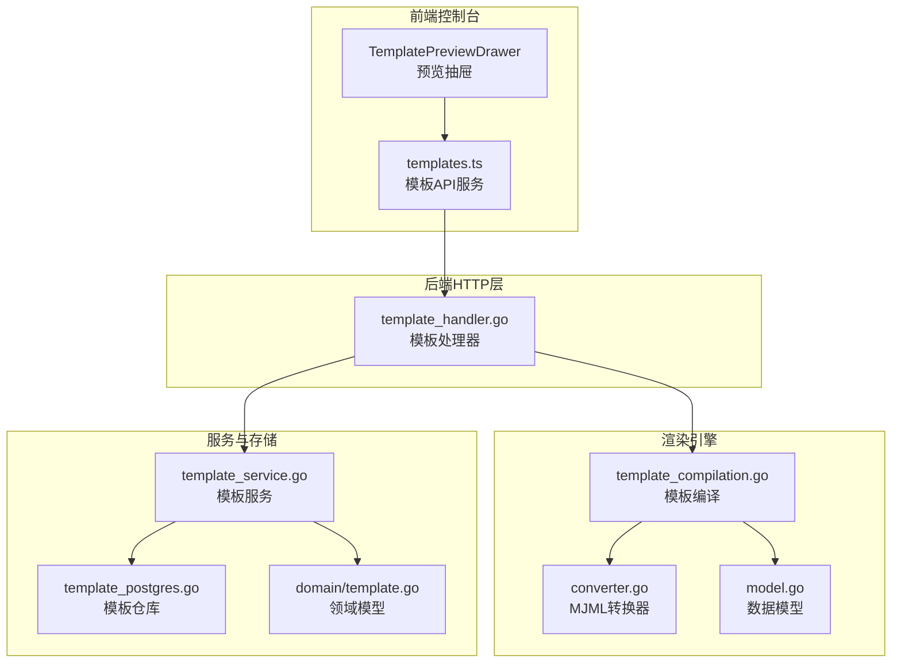
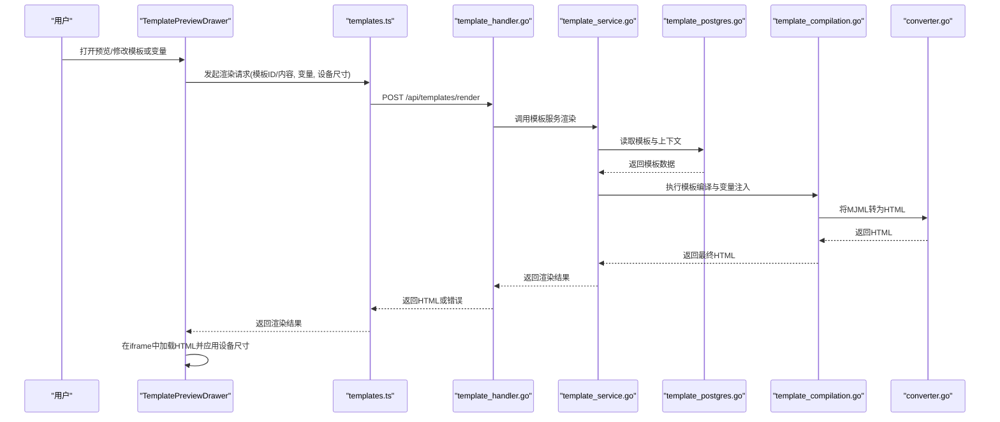
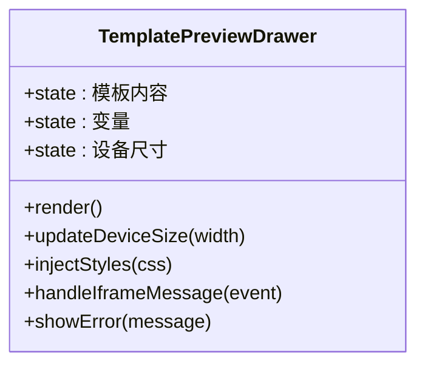
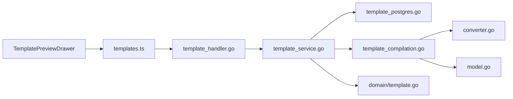

# 模板预览功能

<cite>
**本文引用的文件**   
- [notifuse/console/src/components/template/TemplatePreviewDrawer.tsx](file://notifuse/console/src/components/template/TemplatePreviewDrawer.tsx)
- [notifuse/console/src/services/api/templates.ts](file://notifuse/console/src/services/api/templates.ts)
- [notifuse/internal/http/template_handler.go](file://notifuse/internal/http/template_handler.go)
- [notifuse/pkg/notifuse_mjml/converter.go](file://notifuse/pkg/notifuse_mjml/converter.go)
- [notifuse/pkg/notifuse_mjml/model.go](file://notifuse/pkg/notifuse_mjml/model.go)
- [notifuse/pkg/notifuse_mjml/template_compilation.go](file://notifuse/pkg/notifuse_mjml/template_compilation.go)
- [notifuse/internal/service/template_service.go](file://notifuse/internal/service/template_service.go)
- [notifuse/internal/repository/template_postgres.go](file://notifuse/internal/repository/template_postgres.go)
- [notifuse/internal/domain/template.go](file://notifuse/internal/domain/template.go)
</cite>

## 目录
1. [简介](#简介)
2. [项目结构](#项目结构)
3. [核心组件](#核心组件)
4. [架构总览](#架构总览)
5. [详细组件分析](#详细组件分析)
6. [依赖关系分析](#依赖关系分析)
7. [性能考虑](#性能考虑)
8. [故障排查指南](#故障排查指南)
9. [结论](#结论)
10. [附录](#附录)

## 简介
本文件面向 Notifuse 的“模板预览”能力，聚焦 TemplatePreviewDrawer 预览抽屉的实现原理与使用方式。内容覆盖：
- MJML 到 HTML 的实时转换流程
- 多设备预览模拟（桌面端、移动端、平板）
- 响应式测试与跨客户端兼容性验证思路
- 预览沙箱环境的安全隔离、iframe 通信机制与性能优化策略
- 预览缓存机制、增量更新与错误诊断
- 预览配置选项、自定义样式注入与调试工具使用指南

## 项目结构
与模板预览相关的前后端代码主要分布在以下位置：
- 前端控制台（console）：包含模板编辑与预览 UI，如 TemplatePreviewDrawer 组件、模板 API 服务
- 后端 HTTP 层：提供模板渲染与预览接口
- 渲染引擎：MJML 转换与模板编译逻辑
- 领域与服务层：模板数据模型、服务编排与持久化

图表来源
- [notifuse/console/src/components/template/TemplatePreviewDrawer.tsx](file://notifuse/console/src/components/template/TemplatePreviewDrawer.tsx)
- [notifuse/console/src/services/api/templates.ts](file://notifuse/console/src/services/api/templates.ts)
- [notifuse/internal/http/template_handler.go](file://notifuse/internal/http/template_handler.go)
- [notifuse/pkg/notifuse_mjml/converter.go](file://notifuse/pkg/notifuse_mjml/converter.go)
- [notifuse/pkg/notifuse_mjml/template_compilation.go](file://notifuse/pkg/notifuse_mjml/template_compilation.go)
- [notifuse/pkg/notifuse_mjml/model.go](file://notifuse/pkg/notifuse_mjml/model.go)
- [notifuse/internal/service/template_service.go](file://notifuse/internal/service/template_service.go)
- [notifuse/internal/repository/template_postgres.go](file://notifuse/internal/repository/template_postgres.go)
- [notifuse/internal/domain/template.go](file://notifuse/internal/domain/template.go)

章节来源
- [notifuse/console/src/components/template/TemplatePreviewDrawer.tsx](file://notifuse/console/src/components/template/TemplatePreviewDrawer.tsx)
- [notifuse/console/src/services/api/templates.ts](file://notifuse/console/src/services/api/templates.ts)
- [notifuse/internal/http/template_handler.go](file://notifuse/internal/http/template_handler.go)
- [notifuse/pkg/notifuse_mjml/converter.go](file://notifuse/pkg/notifuse_mjml/converter.go)
- [notifuse/pkg/notifuse_mjml/template_compilation.go](file://notifuse/pkg/notifuse_mjml/template_compilation.go)
- [notifuse/pkg/notifuse_mjml/model.go](file://notifuse/pkg/notifuse_mjml/model.go)
- [notifuse/internal/service/template_service.go](file://notifuse/internal/service/template_service.go)
- [notifuse/internal/repository/template_postgres.go](file://notifuse/internal/repository/template_postgres.go)
- [notifuse/internal/domain/template.go](file://notifuse/internal/domain/template.go)

## 核心组件
- 预览抽屉（TemplatePreviewDrawer）
  - 负责展示模板预览面板，支持切换设备尺寸、注入变量与样式、触发渲染与刷新
  - 通过 iframe 安全加载渲染结果，并处理与父页面的消息通信
- 模板API服务（templates.ts）
  - 封装对后端的模板渲染/预览接口调用，统一请求参数与错误处理
- 模板处理器（template_handler.go）
  - 接收渲染请求，校验输入，调用模板服务进行渲染，返回HTML或错误信息
- MJML转换器（converter.go）
  - 将 MJML 转换为 HTML，可结合模板编译阶段完成变量替换与片段合并
- 模板编译（template_compilation.go）
  - 负责模板解析、变量注入、片段组合等，输出最终HTML
- 数据模型（model.go / domain/template.go）
  - 定义模板、渲染上下文、预览请求/响应结构
- 模板服务（template_service.go）
  - 编排渲染流程，协调仓库访问与渲染引擎
- 模板仓库（template_postgres.go）
  - 持久化模板内容与版本信息

章节来源
- [notifuse/console/src/components/template/TemplatePreviewDrawer.tsx](file://notifuse/console/src/components/template/TemplatePreviewDrawer.tsx)
- [notifuse/console/src/services/api/templates.ts](file://notifuse/console/src/services/api/templates.ts)
- [notifuse/internal/http/template_handler.go](file://notifuse/internal/http/template_handler.go)
- [notifuse/pkg/notifuse_mjml/converter.go](file://notifuse/pkg/notifuse_mjml/converter.go)
- [notifuse/pkg/notifuse_mjml/template_compilation.go](file://notifuse/pkg/notifuse_mjml/template_compilation.go)
- [notifuse/pkg/notifuse_mjml/model.go](file://notifuse/pkg/notifuse_mjml/model.go)
- [notifuse/internal/service/template_service.go](file://notifuse/internal/service/template_service.go)
- [notifuse/internal/repository/template_postgres.go](file://notifuse/internal/repository/template_postgres.go)
- [notifuse/internal/domain/template.go](file://notifuse/internal/domain/template.go)

## 架构总览
预览功能的端到端流程如下：用户在预览抽屉中编辑模板与变量，前端调用模板渲染接口；后端在安全环境中执行模板编译与 MJML 转换，生成HTML并通过响应返回；前端以 iframe 形式加载渲染结果，实现沙箱隔离与多设备尺寸模拟。

图表来源
- [notifuse/console/src/components/template/TemplatePreviewDrawer.tsx](file://notifuse/console/src/components/template/TemplatePreviewDrawer.tsx)
- [notifuse/console/src/services/api/templates.ts](file://notifuse/console/src/services/api/templates.ts)
- [notifuse/internal/http/template_handler.go](file://notifuse/internal/http/template_handler.go)
- [notifuse/internal/service/template_service.go](file://notifuse/internal/service/template_service.go)
- [notifuse/internal/repository/template_postgres.go](file://notifuse/internal/repository/template_postgres.go)
- [notifuse/pkg/notifuse_mjml/template_compilation.go](file://notifuse/pkg/notifuse_mjml/template_compilation.go)
- [notifuse/pkg/notifuse_mjml/converter.go](file://notifuse/pkg/notifuse_mjml/converter.go)

## 详细组件分析

### 预览抽屉（TemplatePreviewDrawer）
职责与行为
- 管理预览状态：模板内容、变量、设备尺寸、是否显示错误
- 触发渲染：根据当前模板与变量调用模板渲染接口
- 设备模拟：通过容器宽度与媒体查询模拟桌面端、移动端、平板
- 安全加载：使用 iframe 加载渲染结果，避免污染主应用样式与脚本
- 通信机制：与 iframe 子页面通过 postMessage 交换事件（如点击链接、表单提交拦截）
- 性能优化：防抖/节流渲染触发、增量更新（仅变更部分重渲染）、本地缓存最近一次渲染结果
- 错误诊断：捕获渲染错误并展示，支持查看原始请求/响应摘要

关键交互
- 用户输入变化 -> 防抖 -> 触发渲染 -> 更新 iframe 内容
- 设备尺寸切换 -> 调整容器宽度 -> 触发响应式重排
- 自定义样式注入 -> 向 iframe 注入额外CSS -> 验证兼容性与冲突

章节来源
- [notifuse/console/src/components/template/TemplatePreviewDrawer.tsx](file://notifuse/console/src/components/template/TemplatePreviewDrawer.tsx)

#### 类图（概念映射）

图表来源
- [notifuse/console/src/components/template/TemplatePreviewDrawer.tsx](file://notifuse/console/src/components/template/TemplatePreviewDrawer.tsx)

### 模板API服务（templates.ts）
职责与行为
- 封装渲染接口调用，统一请求体结构（模板ID/内容、变量、设备尺寸、样式注入）
- 处理网络错误与业务错误，向上抛出结构化错误对象
- 可选：携带缓存键以避免重复渲染相同内容

章节来源
- [notifuse/console/src/services/api/templates.ts](file://notifuse/console/src/services/api/templates.ts)

### 模板处理器（template_handler.go）
职责与行为
- 校验请求参数（模板ID或内容、变量、设备尺寸）
- 调用模板服务执行渲染
- 返回HTML或错误信息，附带必要的诊断字段（如错误类型、提示）

章节来源
- [notifuse/internal/http/template_handler.go](file://notifuse/internal/http/template_handler.go)

### 模板服务（template_service.go）
职责与行为
- 编排渲染流程：读取模板、准备上下文、执行编译、返回HTML
- 集成缓存：基于模板内容与变量的哈希命中缓存
- 错误处理：包装底层错误为统一的业务错误

章节来源
- [notifuse/internal/service/template_service.go](file://notifuse/internal/service/template_service.go)

### 模板仓库（template_postgres.go）
职责与行为
- 持久化模板内容与版本信息
- 提供按ID或条件查询模板的能力

章节来源
- [notifuse/internal/repository/template_postgres.go](file://notifuse/internal/repository/template_postgres.go)

### 领域模型（domain/template.go）
职责与行为
- 定义模板实体、渲染上下文、预览请求/响应结构
- 作为前后端数据契约的基础

章节来源
- [notifuse/internal/domain/template.go](file://notifuse/internal/domain/template.go)

### 模板编译（template_compilation.go）
职责与行为
- 解析模板语法，合并片段，注入变量
- 输出中间表示或直接生成HTML
- 与 MJML 转换器协作，确保布局与样式正确

章节来源
- [notifuse/pkg/notifuse_mjml/template_compilation.go](file://notifuse/pkg/notifuse_mjml/template_compilation.go)

### MJML转换器（converter.go）
职责与行为
- 将 MJML 转换为 HTML
- 支持常见邮件客户端特性与限制
- 与模板编译阶段配合，保证最终HTML的可渲染性

章节来源
- [notifuse/pkg/notifuse_mjml/converter.go](file://notifuse/pkg/notifuse_mjml/converter.go)

### 数据模型（model.go）
职责与行为
- 定义渲染请求/响应、预览配置、设备尺寸枚举等数据结构
- 为前后端与内部模块提供一致的类型约定

章节来源
- [notifuse/pkg/notifuse_mjml/model.go](file://notifuse/pkg/notifuse_mjml/model.go)

## 依赖关系分析
- 前端依赖后端模板渲染接口
- 后端HTTP层依赖模板服务
- 模板服务依赖仓库与渲染引擎（模板编译与 MJML 转换）
- 渲染引擎依赖数据模型

图表来源
- [notifuse/console/src/components/template/TemplatePreviewDrawer.tsx](file://notifuse/console/src/components/template/TemplatePreviewDrawer.tsx)
- [notifuse/console/src/services/api/templates.ts](file://notifuse/console/src/services/api/templates.ts)
- [notifuse/internal/http/template_handler.go](file://notifuse/internal/http/template_handler.go)
- [notifuse/internal/service/template_service.go](file://notifuse/internal/service/template_service.go)
- [notifuse/internal/repository/template_postgres.go](file://notifuse/internal/repository/template_postgres.go)
- [notifuse/pkg/notifuse_mjml/template_compilation.go](file://notifuse/pkg/notifuse_mjml/template_compilation.go)
- [notifuse/pkg/notifuse_mjml/converter.go](file://notifuse/pkg/notifuse_mjml/converter.go)
- [notifuse/pkg/notifuse_mjml/model.go](file://notifuse/pkg/notifuse_mjml/model.go)
- [notifuse/internal/domain/template.go](file://notifuse/internal/domain/template.go)

## 性能考虑
- 防抖/节流：在模板或变量频繁变化时，减少不必要的渲染调用
- 增量更新：仅对变更区域进行重渲染，避免整页重建
- 缓存策略：基于模板内容与变量的哈希命中缓存，降低重复计算
- 设备尺寸切换：优先复用已渲染HTML，仅调整容器宽度与媒体查询
- 资源加载：在 iframe 内禁用不必要的外部资源，减少首屏时间
- 错误快速失败：对无效输入尽早返回错误，避免长耗时渲染

[本节为通用指导，不直接分析具体文件]

## 故障排查指南
常见问题与定位步骤
- 渲染失败
  - 检查请求参数是否完整（模板ID/内容、变量、设备尺寸）
  - 查看后端返回的错误类型与提示
  - 确认模板语法与 MJML 合法性
- 样式异常
  - 检查自定义样式注入是否冲突
  - 在不同设备尺寸下验证媒体查询
- 性能问题
  - 观察渲染耗时与缓存命中率
  - 评估是否存在大量外部资源加载
- 安全隔离
  - 确认 iframe 的 sandbox 属性设置合理
  - 验证 postMessage 白名单与消息格式

章节来源
- [notifuse/internal/http/template_handler.go](file://notifuse/internal/http/template_handler.go)
- [notifuse/pkg/notifuse_mjml/converter.go](file://notifuse/pkg/notifuse_mjml/converter.go)
- [notifuse/pkg/notifuse_mjml/template_compilation.go](file://notifuse/pkg/notifuse_mjml/template_compilation.go)

## 结论
模板预览功能通过清晰的分层架构与安全隔离的 iframe 沙箱，实现了高效的 MJML 到 HTML 实时转换与多设备预览。借助缓存与增量更新策略，系统在保持用户体验的同时兼顾了性能。建议在生产环境中完善错误诊断与监控指标，持续优化渲染路径与兼容性验证流程。

[本节为总结，不直接分析具体文件]

## 附录

### 预览配置选项
- 设备尺寸：桌面端、移动端、平板（通过容器宽度与媒体查询模拟）
- 变量注入：支持动态变量替换，用于个性化内容预览
- 自定义样式：允许注入额外CSS，便于主题与品牌定制
- 沙箱模式：启用 iframe sandbox 以限制危险能力（如弹窗、导航）
- 调试开关：开启详细日志与错误堆栈，便于定位问题

章节来源
- [notifuse/console/src/components/template/TemplatePreviewDrawer.tsx](file://notifuse/console/src/components/template/TemplatePreviewDrawer.tsx)
- [notifuse/pkg/notifuse_mjml/model.go](file://notifuse/pkg/notifuse_mjml/model.go)

### 调试工具使用指南
- 浏览器开发者工具
  - Network：查看渲染请求与响应
  - Console：查看错误信息与警告
  - Elements：检查 iframe 内的DOM结构与样式
- 自定义调试面板
  - 显示最近一次渲染的输入摘要与耗时
  - 提供一键复制请求体的能力
  - 记录错误堆栈与上下文

章节来源
- [notifuse/console/src/components/template/TemplatePreviewDrawer.tsx](file://notifuse/console/src/components/template/TemplatePreviewDrawer.tsx)
- [notifuse/internal/http/template_handler.go](file://notifuse/internal/http/template_handler.go)