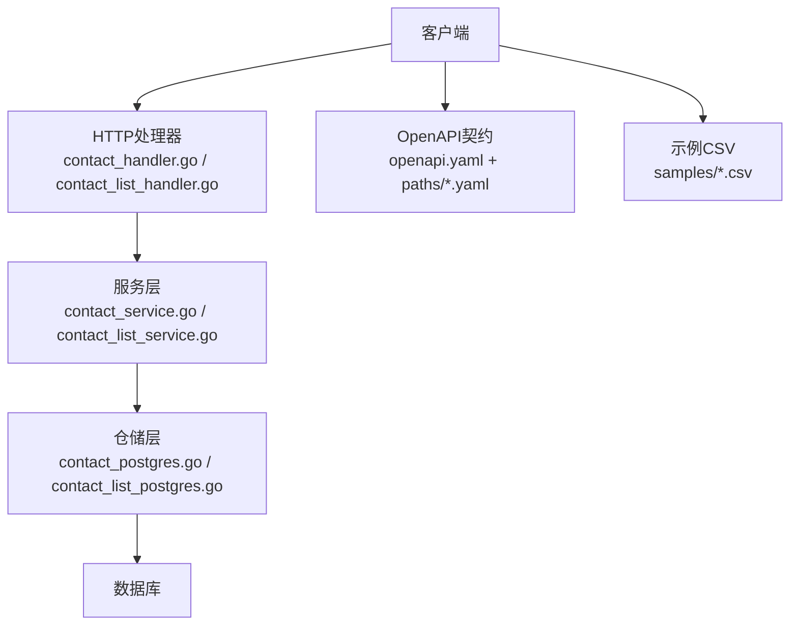
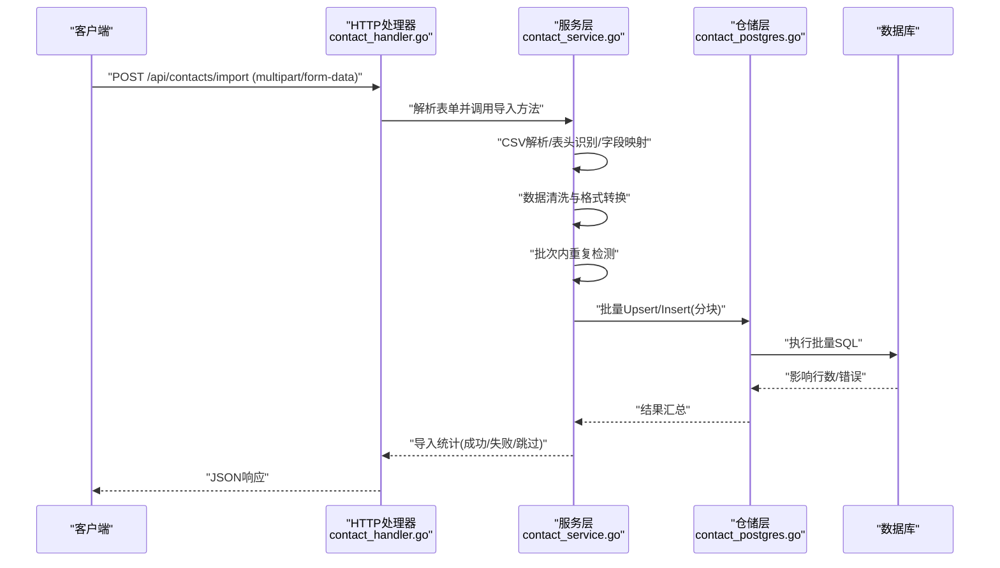
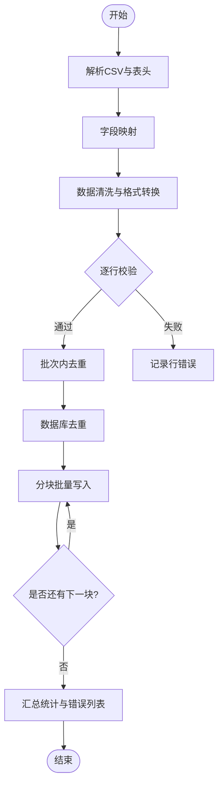
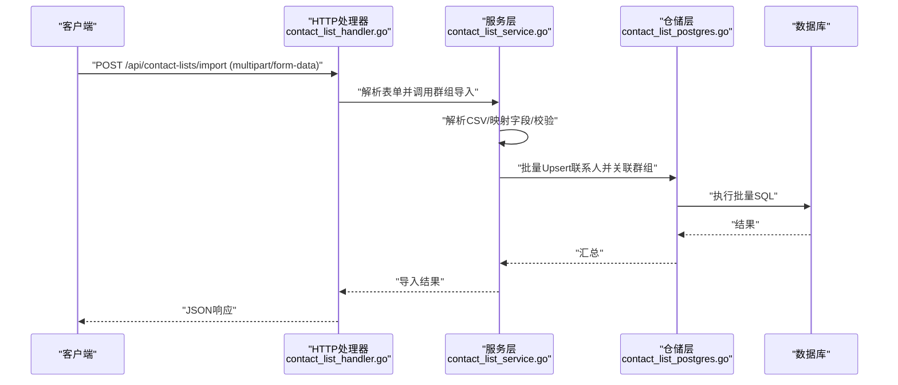
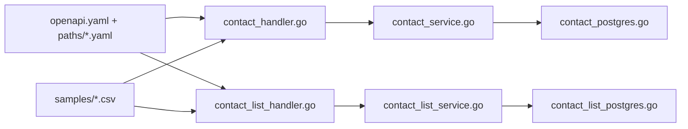

# CSV导入导出

<cite>
**本文引用的文件**   
- [contact_handler.go](file://notifuse/internal/http/contact_handler.go)
- [contact_service.go](file://notifuse/internal/service/contact_service.go)
- [contact_postgres.go](file://notifuse/internal/repository/contact_postgres.go)
- [contact_list_handler.go](file://notifuse/internal/http/contact_list_handler.go)
- [contact_list_service.go](file://notifuse/internal/service/contact_list_service.go)
- [contact_list_postgres.go](file://notifuse/internal/repository/contact_list_postgres.go)
- [openapi.yaml](file://notifuse/openapi/openapi.yaml)
- [contacts.yaml](file://notifuse/openapi/paths/contacts.yaml)
- [contact-lists.yaml](file://notifuse/openapi/paths/contact-lists.yaml)
- [sample_contacts.csv](file://notifuse/samples/sample_contacts.csv)
- [1000_contacts.csv](file://notifuse/samples/1000_contacts.csv)
</cite>

## 目录
1. [简介](#简介)
2. [项目结构](#项目结构)
3. [核心组件](#核心组件)
4. [架构总览](#架构总览)
5. [详细组件分析](#详细组件分析)
6. [依赖关系分析](#依赖关系分析)
7. [性能考虑](#性能考虑)
8. [故障排查指南](#故障排查指南)
9. [结论](#结论)
10. [附录](#附录)

## 简介
本文件围绕CSV导入导出能力，重点梳理联系人（Contacts）与联系人群组（Contact Lists）的导入流程、解析与映射机制、数据校验规则、大文件处理策略以及批量写入优化。文档同时提供CSV模板规范、字段映射配置建议与性能调优实践，帮助使用者高效完成大批量数据的导入与导出。

## 项目结构
本项目采用分层架构：HTTP层负责请求解析与响应封装；Service层实现业务逻辑（含CSV解析、清洗、去重、批量插入等）；Repository层负责数据库访问。OpenAPI定义暴露了导入导出的接口契约，samples目录提供示例CSV模板。

图表来源
- [contact_handler.go](file://notifuse/internal/http/contact_handler.go)
- [contact_list_handler.go](file://notifuse/internal/http/contact_list_handler.go)
- [contact_service.go](file://notifuse/internal/service/contact_service.go)
- [contact_list_service.go](file://notifuse/internal/service/contact_list_service.go)
- [contact_postgres.go](file://notifuse/internal/repository/contact_postgres.go)
- [contact_list_postgres.go](file://notifuse/internal/repository/contact_list_postgres.go)
- [openapi.yaml](file://notifuse/openapi/openapi.yaml)
- [contacts.yaml](file://notifuse/openapi/paths/contacts.yaml)
- [contact-lists.yaml](file://notifuse/openapi/paths/contact-lists.yaml)
- [sample_contacts.csv](file://notifuse/samples/sample_contacts.csv)
- [1000_contacts.csv](file://notifuse/samples/1000_contacts.csv)

章节来源
- [contact_handler.go](file://notifuse/internal/http/contact_handler.go)
- [contact_list_handler.go](file://notifuse/internal/http/contact_list_handler.go)
- [contact_service.go](file://notifuse/internal/service/contact_service.go)
- [contact_list_service.go](file://notifuse/internal/service/contact_list_service.go)
- [contact_postgres.go](file://notifuse/internal/repository/contact_postgres.go)
- [contact_list_postgres.go](file://notifuse/internal/repository/contact_list_postgres.go)
- [openapi.yaml](file://notifuse/openapi/openapi.yaml)
- [contacts.yaml](file://notifuse/openapi/paths/contacts.yaml)
- [contact-lists.yaml](file://notifuse/openapi/paths/contact-lists.yaml)
- [sample_contacts.csv](file://notifuse/samples/sample_contacts.csv)
- [1000_contacts.csv](file://notifuse/samples/1000_contacts.csv)

## 核心组件
- HTTP处理器
  - 联系人导入：接收multipart/form-data中的CSV文件，调用服务层进行解析与入库。
  - 联系人群组导入：接收CSV并关联到指定群组。
- 服务层
  - CSV解析：按分隔符读取行、识别表头、构建字段映射。
  - 数据清洗：去除首尾空白、规范化邮箱大小写、统一日期格式、空值处理。
  - 重复检测：基于唯一键（如邮箱或外部ID）在批次内与数据库中查重。
  - 批量插入：分块写入数据库，降低单次事务压力。
- 仓储层
  - 批量Upsert/Insert：使用PostgreSQL批量语句提升吞吐。
- OpenAPI契约
  - 定义导入端点、参数、返回码与错误模型，便于前后端对齐。
- 示例CSV
  - samples目录提供标准模板，用于快速上手与自动化测试。

章节来源
- [contact_handler.go](file://notifuse/internal/http/contact_handler.go)
- [contact_list_handler.go](file://notifuse/internal/http/contact_list_handler.go)
- [contact_service.go](file://notifuse/internal/service/contact_service.go)
- [contact_list_service.go](file://notifuse/internal/service/contact_list_service.go)
- [contact_postgres.go](file://notifuse/internal/repository/contact_postgres.go)
- [contact_list_postgres.go](file://notifuse/internal/repository/contact_list_postgres.go)
- [openapi.yaml](file://notifuse/openapi/openapi.yaml)
- [contacts.yaml](file://notifuse/openapi/paths/contacts.yaml)
- [contact-lists.yaml](file://notifuse/openapi/paths/contact-lists.yaml)
- [sample_contacts.csv](file://notifuse/samples/sample_contacts.csv)
- [1000_contacts.csv](file://notifuse/samples/1000_contacts.csv)

## 架构总览
以下序列图展示联系人CSV导入的关键调用链：从HTTP接收文件，到服务层解析、校验、去重、批量写入，再到数据库持久化。

图表来源
- [contact_handler.go](file://notifuse/internal/http/contact_handler.go)
- [contact_service.go](file://notifuse/internal/service/contact_service.go)
- [contact_postgres.go](file://notifuse/internal/repository/contact_postgres.go)

章节来源
- [contact_handler.go](file://notifuse/internal/http/contact_handler.go)
- [contact_service.go](file://notifuse/internal/service/contact_service.go)
- [contact_postgres.go](file://notifuse/internal/repository/contact_postgres.go)

## 详细组件分析

### 联系人CSV导入流程
- 入口
  - HTTP处理器接收CSV文件，校验MIME类型与文件大小上限，提取表单字段（如目标群组ID）。
- 解析与映射
  - 自动识别分隔符（逗号/制表符/分号），读取首行作为表头，建立“列索引→系统字段”的映射。
  - 支持自定义字段映射：将CSV列名映射到系统字段（如email、name、phone、custom_*等）。
- 清洗与验证
  - 去除空白、标准化邮箱大小写、校验必填字段、正则校验邮箱/电话、日期格式归一化。
  - 对未知列或非法值记录为行级错误，不影响整批导入。
- 重复检测
  - 以邮箱或外部ID为唯一键，先做批次内去重，再查询数据库去重。
- 批量写入
  - 将有效记录按固定大小分块（例如每批N条），通过仓储层批量Upsert/Insert。
- 进度与恢复
  - 服务端可返回累计进度（已处理行数/总数），失败行单独列出以便重试。
  - 支持断点续传式重试：仅重新提交失败行对应的CSV片段。

图表来源
- [contact_service.go](file://notifuse/internal/service/contact_service.go)
- [contact_postgres.go](file://notifuse/internal/repository/contact_postgres.go)

章节来源
- [contact_handler.go](file://notifuse/internal/http/contact_handler.go)
- [contact_service.go](file://notifuse/internal/service/contact_service.go)
- [contact_postgres.go](file://notifuse/internal/repository/contact_postgres.go)

### 联系人群组CSV导入流程
- 入口
  - 通过群组导入端点上传CSV，携带群组标识。
- 解析与映射
  - 复用联系人解析器，但额外要求包含群组关联字段（如list_id或名称映射）。
- 写入策略
  - 若联系人不存在则创建，存在则更新；确保群组关系正确维护。
- 错误处理
  - 行级错误不中断整体导入，最终返回成功/失败明细。

图表来源
- [contact_list_handler.go](file://notifuse/internal/http/contact_list_handler.go)
- [contact_list_service.go](file://notifuse/internal/service/contact_list_service.go)
- [contact_list_postgres.go](file://notifuse/internal/repository/contact_list_postgres.go)

章节来源
- [contact_list_handler.go](file://notifuse/internal/http/contact_list_handler.go)
- [contact_list_service.go](file://notifuse/internal/service/contact_list_service.go)
- [contact_list_postgres.go](file://notifuse/internal/repository/contact_list_postgres.go)

### CSV文件格式规范与字段映射
- 通用规范
  - 编码：UTF-8。
  - 分隔符：逗号、制表符或分号（自动识别）。
  - 首行：表头行，必须包含至少一个唯一键列（如邮箱或外部ID）。
  - 引号：文本字段可使用双引号包裹以包含分隔符或换行。
- 推荐字段
  - 唯一键：email 或 external_id。
  - 基础信息：first_name、last_name、name、phone、company、title。
  - 群组：list_id 或 list_name（用于群组导入）。
  - 自定义字段：custom_前缀（如 custom_tag、custom_score）。
- 字段映射配置
  - 支持在请求中传入映射表，将CSV列名映射到系统字段。
  - 未映射列将被忽略；缺失必填列将导致行级错误。
- 示例模板
  - 参考 samples 目录下的CSV模板，了解标准列名与样例数据。

章节来源
- [contacts.yaml](file://notifuse/openapi/paths/contacts.yaml)
- [contact-lists.yaml](file://notifuse/openapi/paths/contact-lists.yaml)
- [sample_contacts.csv](file://notifuse/samples/sample_contacts.csv)
- [1000_contacts.csv](file://notifuse/samples/1000_contacts.csv)

### 数据验证规则
- 必填校验：唯一键（email或external_id）不可为空。
- 格式校验：邮箱需符合RFC风格基本校验；电话可选正则校验。
- 枚举与范围：状态、优先级等字段需在允许范围内。
- 长度限制：字符串字段有最大长度约束。
- 行级错误：单行失败不影响其他行，最终返回错误明细。

章节来源
- [contact_service.go](file://notifuse/internal/service/contact_service.go)
- [contact_list_service.go](file://notifuse/internal/service/contact_list_service.go)

### 大文件处理：分块上传、进度跟踪与错误恢复
- 分块上传
  - 前端可将大文件切分为多个块，逐个上传；后端聚合后统一解析。
  - 每个块附带序号与总量，用于顺序重组与完整性校验。
- 进度跟踪
  - 服务端在处理过程中累积已处理行数，返回进度百分比与当前块状态。
- 错误恢复
  - 失败块可独立重试；行级错误记录到错误清单，支持下载失败报告并重试。
  - 支持幂等：同一批次多次提交不会重复写入。

章节来源
- [contact_handler.go](file://notifuse/internal/http/contact_handler.go)
- [contact_service.go](file://notifuse/internal/service/contact_service.go)
- [contact_postgres.go](file://notifuse/internal/repository/contact_postgres.go)

### 数据清洗、重复检测与批量插入优化
- 数据清洗
  - 去除首尾空白、转义字符清理、统一日期与时区、邮箱小写化。
- 重复检测
  - 批次内先去重，再查库去重；避免重复写入与主键冲突。
- 批量插入优化
  - 使用批量Upsert/Insert减少往返次数；合理设置批次大小平衡内存与吞吐。
  - 必要时开启事务合并，提高一致性并降低锁竞争。

章节来源
- [contact_service.go](file://notifuse/internal/service/contact_service.go)
- [contact_postgres.go](file://notifuse/internal/repository/contact_postgres.go)

### CSV模板定制与自定义字段映射
- 模板定制
  - 基于官方模板扩展自定义列，保持唯一键列不变。
- 自定义映射
  - 在导入请求中声明列名到系统字段的映射，支持别名与转换函数（如trim、lower）。
- 兼容性
  - 旧模板与新模板并存时，通过映射表平滑迁移。

章节来源
- [contacts.yaml](file://notifuse/openapi/paths/contacts.yaml)
- [contact-service.go](file://notifuse/internal/service/contact_service.go)

### 性能调优指南
- 调整批次大小：根据服务器内存与数据库负载动态调整。
- 并行度控制：限制并发导入任务数，避免资源争用。
- 索引与约束：确保唯一键索引存在，加速去重与Upsert。
- 网络与I/O：启用压缩传输、合理设置超时与重试。
- 监控与告警：关注慢查询、锁等待与错误率。

章节来源
- [contact_postgres.go](file://notifuse/internal/repository/contact_postgres.go)
- [contact_service.go](file://notifuse/internal/service/contact_service.go)

## 依赖关系分析
- HTTP层依赖服务层，服务层依赖仓储层；OpenAPI契约驱动接口设计；samples提供测试数据。
- 关键耦合点：
  - 字段映射与校验逻辑集中在服务层，便于复用与扩展。
  - 批量写入策略由仓储层抽象，便于替换不同存储后端。

图表来源
- [contact_handler.go](file://notifuse/internal/http/contact_handler.go)
- [contact_list_handler.go](file://notifuse/internal/http/contact_list_handler.go)
- [contact_service.go](file://notifuse/internal/service/contact_service.go)
- [contact_list_service.go](file://notifuse/internal/service/contact_list_service.go)
- [contact_postgres.go](file://notifuse/internal/repository/contact_postgres.go)
- [contact_list_postgres.go](file://notifuse/internal/repository/contact_list_postgres.go)
- [openapi.yaml](file://notifuse/openapi/openapi.yaml)
- [contacts.yaml](file://notifuse/openapi/paths/contacts.yaml)
- [contact-lists.yaml](file://notifuse/openapi/paths/contact-lists.yaml)
- [sample_contacts.csv](file://notifuse/samples/sample_contacts.csv)
- [1000_contacts.csv](file://notifuse/samples/1000_contacts.csv)

章节来源
- [contact_handler.go](file://notifuse/internal/http/contact_handler.go)
- [contact_list_handler.go](file://notifuse/internal/http/contact_list_handler.go)
- [contact_service.go](file://notifuse/internal/service/contact_service.go)
- [contact_list_service.go](file://notifuse/internal/service/contact_list_service.go)
- [contact_postgres.go](file://notifuse/internal/repository/contact_postgres.go)
- [contact_list_postgres.go](file://notifuse/internal/repository/contact_list_postgres.go)
- [openapi.yaml](file://notifuse/openapi/openapi.yaml)
- [contacts.yaml](file://notifuse/openapi/paths/contacts.yaml)
- [contact-lists.yaml](file://notifuse/openapi/paths/contact-lists.yaml)
- [sample_contacts.csv](file://notifuse/samples/sample_contacts.csv)
- [1000_contacts.csv](file://notifuse/samples/1000_contacts.csv)

## 性能考虑
- 合理设置分块大小与并发度，避免内存峰值过高。
- 利用数据库批量操作与索引优化，减少锁竞争与IO开销。
- 对大文件采用流式解析，避免一次性加载全部数据到内存。
- 监控慢查询与错误率，及时扩容或调优。

[本节为通用指导，无需特定文件引用]

## 故障排查指南
- 常见错误
  - 文件过大或MIME类型不正确：检查请求头与文件大小限制。
  - 表头缺失或列名不匹配：确认CSV首行与映射配置。
  - 唯一键冲突：检查邮箱或外部ID重复情况。
  - 行级校验失败：查看错误明细，修正对应行数据。
- 定位步骤
  - 核对OpenAPI契约，确认接口参数与返回结构。
  - 查看服务层日志，定位解析与校验阶段问题。
  - 检查仓储层批量写入错误，确认数据库约束与索引。
- 恢复策略
  - 下载失败报告，修复后仅重试失败行。
  - 对于分块上传，仅重传失败块。

章节来源
- [contact_handler.go](file://notifuse/internal/http/contact_handler.go)
- [contact_service.go](file://notifuse/internal/service/contact_service.go)
- [contact_postgres.go](file://notifuse/internal/repository/contact_postgres.go)
- [openapi.yaml](file://notifuse/openapi/openapi.yaml)
- [contacts.yaml](file://notifuse/openapi/paths/contacts.yaml)

## 结论
通过分层架构与清晰的职责划分，本项目实现了稳定高效的CSV导入导出能力。服务层集中处理解析、清洗、去重与批量写入，仓储层提供高性能数据库操作，OpenAPI契约保障接口一致性。结合分块上传、进度跟踪与错误恢复机制，能够胜任大规模数据导入场景。建议在生产环境结合监控与压测持续优化批次大小与并发度，以获得最佳性能与稳定性。

[本节为总结性内容，无需特定文件引用]

## 附录
- 示例CSV模板路径
  - [sample_contacts.csv](file://notifuse/samples/sample_contacts.csv)
  - [1000_contacts.csv](file://notifuse/samples/1000_contacts.csv)
- OpenAPI契约
  - [openapi.yaml](file://notifuse/openapi/openapi.yaml)
  - [contacts.yaml](file://notifuse/openapi/paths/contacts.yaml)
  - [contact-lists.yaml](file://notifuse/openapi/paths/contact-lists.yaml)