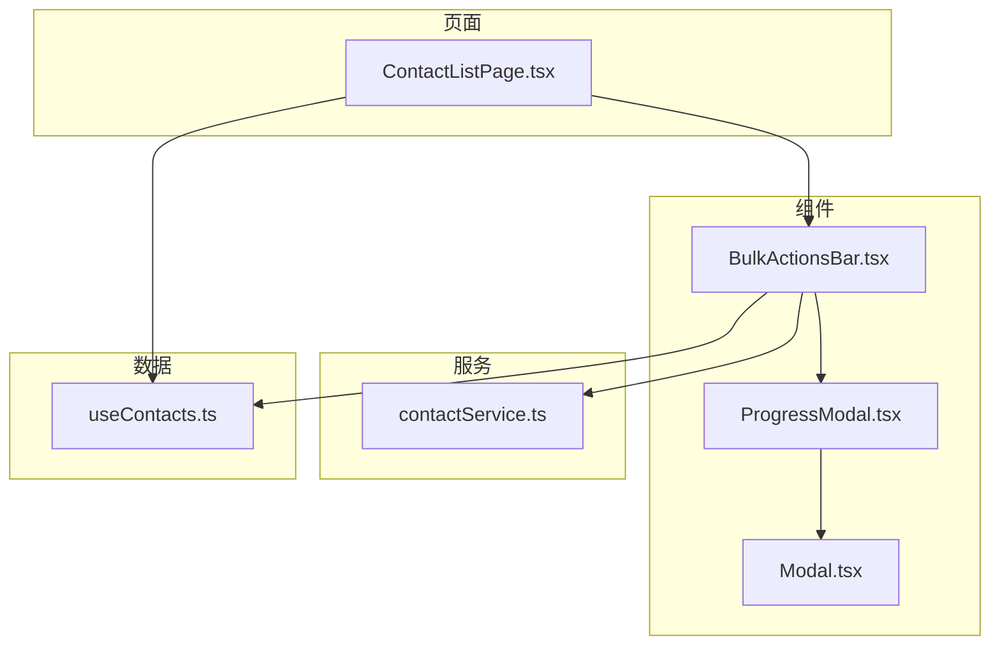
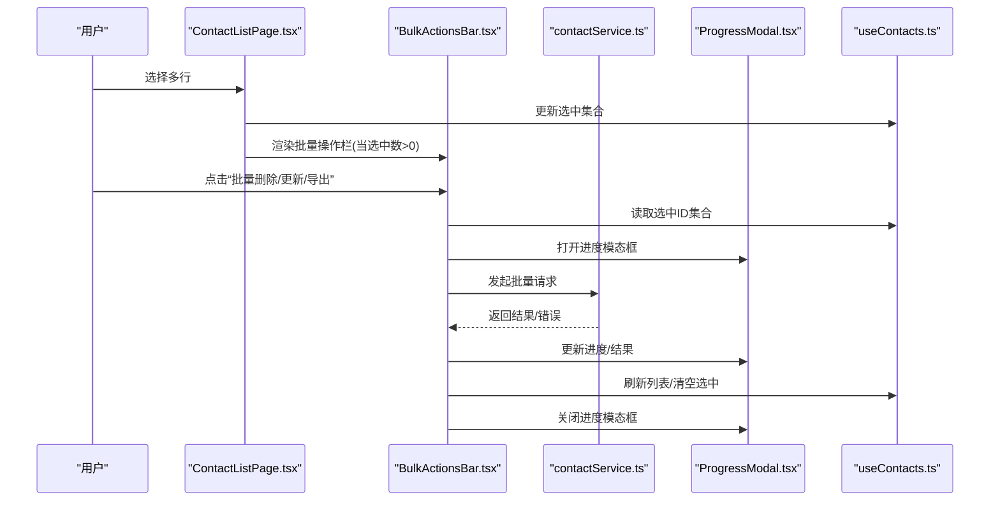
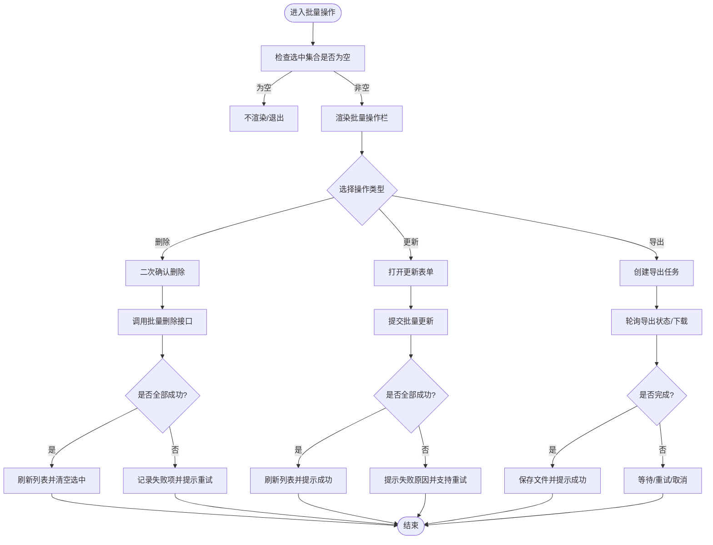
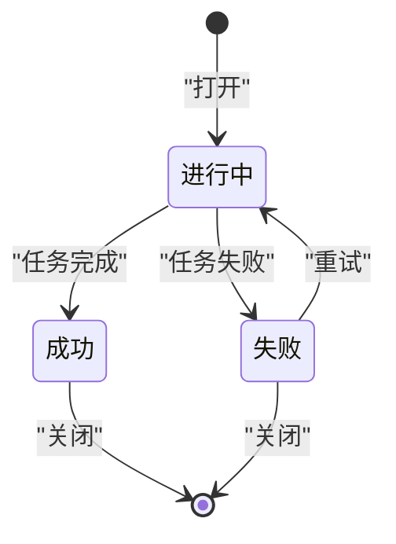
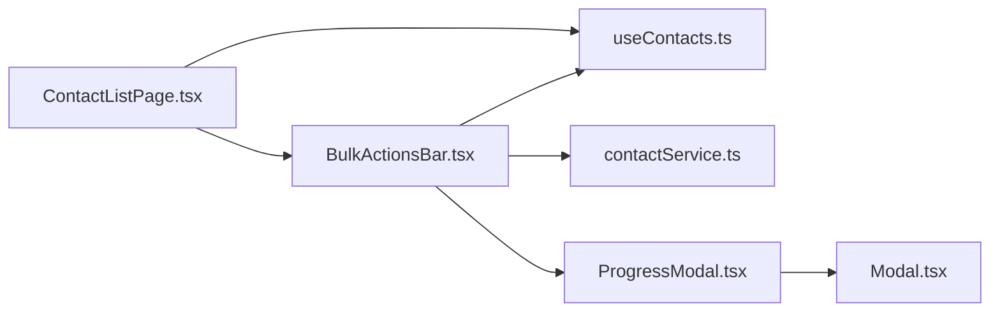

# 批量操作栏

<cite>
**本文引用的文件**   
- [BulkActionsBar.tsx](file://notifuse/console/src/components/BulkActionsBar.tsx)
- [ContactListPage.tsx](file://notifuse/console/src/pages/ContactListPage.tsx)
- [contactService.ts](file://notifuse/console/src/services/api/contactService.ts)
- [useContacts.ts](file://notifuse/console/src/hooks/useContacts.ts)
- [Modal.tsx](file://notifuse/console/src/components/ui/Modal.tsx)
- [ProgressModal.tsx](file://notifuse/console/src/components/ProgressModal.tsx)
</cite>

## 目录
1. [简介](#简介)
2. [项目结构](#项目结构)
3. [核心组件](#核心组件)
4. [架构总览](#架构总览)
5. [详细组件分析](#详细组件分析)
6. [依赖关系分析](#依赖关系分析)
7. [性能考虑](#性能考虑)
8. [故障排查指南](#故障排查指南)
9. [结论](#结论)
10. [附录](#附录)

## 简介
本文件围绕“批量操作栏”（BulkActionsBar）组件，系统性梳理其设计模式、选中状态管理、批量操作执行流程与进度反馈机制。重点覆盖批量删除、批量更新、批量导出等典型场景的实现逻辑；解释进度模态框的状态显示、异步任务处理与用户反馈；并给出大数据量处理的性能优化、内存管理与错误重试策略，以及最佳实践与异常处理方案。

## 项目结构
该功能位于前端控制台项目中，涉及页面、通用 UI、服务层与数据钩子：
- 页面层：联系人列表页承载表格与批量操作入口
- 组件层：批量操作栏与进度模态框提供交互与反馈
- 服务层：封装批量 API 调用
- 数据层：通过 hooks 管理分页、筛选与选中项

图表来源
- [ContactListPage.tsx](file://notifuse/console/src/pages/ContactListPage.tsx)
- [BulkActionsBar.tsx](file://notifuse/console/src/components/BulkActionsBar.tsx)
- [ProgressModal.tsx](file://notifuse/console/src/components/ProgressModal.tsx)
- [Modal.tsx](file://notifuse/console/src/components/ui/Modal.tsx)
- [contactService.ts](file://notifuse/console/src/services/api/contactService.ts)
- [useContacts.ts](file://notifuse/console/src/hooks/useContacts.ts)

章节来源
- [ContactListPage.tsx](file://notifuse/console/src/pages/ContactListPage.tsx)
- [BulkActionsBar.tsx](file://notifuse/console/src/components/BulkActionsBar.tsx)
- [ProgressModal.tsx](file://notifuse/console/src/components/ProgressModal.tsx)
- [Modal.tsx](file://notifuse/console/src/components/ui/Modal.tsx)
- [contactService.ts](file://notifuse/console/src/services/api/contactService.ts)
- [useContacts.ts](file://notifuse/console/src/hooks/useContacts.ts)

## 核心组件
- BulkActionsBar：在选中行数量大于 0 时出现，提供批量删除、批量更新、批量导出等操作入口，负责聚合选中 ID、触发服务层批量接口、驱动进度模态框展示与关闭。
- ProgressModal：基于 Modal 的轻量封装，用于展示长耗时任务的进度、成功/失败结果与重试入口。
- contactService：集中实现批量删除、批量更新、批量导出等 API 调用，统一错误处理与参数校验。
- useContacts：维护当前页数据、全局选中集合、全选/反选、分页与筛选，供页面与批量操作栏共享。

章节来源
- [BulkActionsBar.tsx](file://notifuse/console/src/components/BulkActionsBar.tsx)
- [ProgressModal.tsx](file://notifuse/console/src/components/ProgressModal.tsx)
- [contactService.ts](file://notifuse/console/src/services/api/contactService.ts)
- [useContacts.ts](file://notifuse/console/src/hooks/useContacts.ts)

## 架构总览
批量操作的端到端流程如下：用户在表格中勾选若干条目 → 批量操作栏出现并提供操作按钮 → 点击后由组件收集选中 ID 并调用服务层批量接口 → 进度模态框展示任务状态与结果 → 完成后刷新列表或提示用户。

图表来源
- [ContactListPage.tsx](file://notifuse/console/src/pages/ContactListPage.tsx)
- [BulkActionsBar.tsx](file://notifuse/console/src/components/BulkActionsBar.tsx)
- [contactService.ts](file://notifuse/console/src/services/api/contactService.ts)
- [ProgressModal.tsx](file://notifuse/console/src/components/ProgressModal.tsx)
- [useContacts.ts](file://notifuse/console/src/hooks/useContacts.ts)

## 详细组件分析

### 批量操作栏（BulkActionsBar）
- 设计模式
  - 受控式交互：选中状态由上层数据源（useContacts）提供，组件仅消费与触发回调。
  - 组合式 UI：将“操作入口 + 进度反馈”解耦，通过模态框承载长时间任务。
  - 幂等与可重试：对网络抖动与部分失败提供重试能力。
- 选中状态管理
  - 从 useContacts 获取已选中的 ID 集合，仅在 size > 0 时渲染。
  - 支持“全选/反选”联动，避免重复 ID 与越界访问。
- 批量操作执行流程
  - 批量删除：校验选中数量 → 二次确认 → 调用批量删除接口 → 成功后刷新列表并清空选中。
  - 批量更新：弹出更新表单（如标签/状态）→ 提交变更 → 根据响应更新本地缓存或直接刷新。
  - 批量导出：生成导出任务 → 轮询/回调下载 → 完成后提示并清理临时状态。
- 进度模态框集成
  - 打开时设置“进行中”状态与初始进度。
  - 根据服务端返回逐步推进进度条，最终呈现成功/失败摘要。
  - 失败时提供“重试”按钮，支持指数退避与最大重试次数限制。
- 错误处理与用户反馈
  - 网络错误：提示重试或稍后再试。
  - 业务错误：解析错误码并给出明确原因（如权限不足、资源不存在）。
  - 部分失败：汇总失败明细，允许单独重试失败项。

图表来源
- [BulkActionsBar.tsx](file://notifuse/console/src/components/BulkActionsBar.tsx)
- [contactService.ts](file://notifuse/console/src/services/api/contactService.ts)
- [ProgressModal.tsx](file://notifuse/console/src/components/ProgressModal.tsx)
- [useContacts.ts](file://notifuse/console/src/hooks/useContacts.ts)

章节来源
- [BulkActionsBar.tsx](file://notifuse/console/src/components/BulkActionsBar.tsx)
- [contactService.ts](file://notifuse/console/src/services/api/contactService.ts)
- [ProgressModal.tsx](file://notifuse/console/src/components/ProgressModal.tsx)
- [useContacts.ts](file://notifuse/console/src/hooks/useContacts.ts)

### 进度模态框（ProgressModal）
- 职责
  - 作为通用长任务容器，接收任务标题、进度百分比、状态消息与操作按钮。
  - 与 Modal 组合复用，确保遮罩、焦点管理与键盘事件一致。
- 状态机
  - 进行中：显示进度条与动态文案。
  - 成功：展示完成信息，提供关闭或跳转动作。
  - 失败：展示错误详情与重试入口。
- 与批量操作栏协作
  - 批量操作栏在发起请求前打开模态框，并在请求完成后更新状态与关闭。

图表来源
- [ProgressModal.tsx](file://notifuse/console/src/components/ProgressModal.tsx)
- [Modal.tsx](file://notifuse/console/src/components/ui/Modal.tsx)

章节来源
- [ProgressModal.tsx](file://notifuse/console/src/components/ProgressModal.tsx)
- [Modal.tsx](file://notifuse/console/src/components/ui/Modal.tsx)

### 服务层（contactService）
- 批量删除
  - 输入：选中 ID 数组
  - 行为：批量删除请求，返回成功计数与失败明细
  - 输出：统一结果对象，便于批量操作栏汇总与重试
- 批量更新
  - 输入：选中 ID 数组 + 更新字段
  - 行为：批量更新请求，返回成功/失败统计
- 批量导出
  - 输入：筛选条件与导出字段
  - 行为：创建导出任务，支持轮询或回调下载
- 错误处理
  - 网络异常：抛出可识别的错误类型
  - 业务异常：携带错误码与消息，便于界面展示

章节来源
- [contactService.ts](file://notifuse/console/src/services/api/contactService.ts)

### 数据层（useContacts）
- 维护选中集合：支持新增、移除、清空、全选/反选
- 与分页/筛选联动：在切换页或修改筛选时保持选中一致性
- 提供刷新方法：批量操作成功后自动刷新列表

章节来源
- [useContacts.ts](file://notifuse/console/src/hooks/useContacts.ts)

### 页面层（ContactListPage）
- 承载表格与批量操作栏
- 将 useContacts 的选中集合传递给批量操作栏
- 在批量操作完成后触发刷新或导航

章节来源
- [ContactListPage.tsx](file://notifuse/console/src/pages/ContactListPage.tsx)

## 依赖关系分析
- 组件耦合
  - BulkActionsBar 依赖 useContacts 提供的选中状态与刷新能力，依赖 contactService 进行批量调用，依赖 ProgressModal 进行进度反馈。
  - ProgressModal 依赖 Modal 提供基础弹窗能力。
- 外部依赖
  - 网络请求库（HTTP 客户端）
  - 国际化与通知组件（可选）
- 潜在循环依赖
  - 组件与服务之间单向依赖，无循环引用风险。

图表来源
- [BulkActionsBar.tsx](file://notifuse/console/src/components/BulkActionsBar.tsx)
- [useContacts.ts](file://notifuse/console/src/hooks/useContacts.ts)
- [contactService.ts](file://notifuse/console/src/services/api/contactService.ts)
- [ProgressModal.tsx](file://notifuse/console/src/components/ProgressModal.tsx)
- [Modal.tsx](file://notifuse/console/src/components/ui/Modal.tsx)
- [ContactListPage.tsx](file://notifuse/console/src/pages/ContactListPage.tsx)

章节来源
- [BulkActionsBar.tsx](file://notifuse/console/src/components/BulkActionsBar.tsx)
- [useContacts.ts](file://notifuse/console/src/hooks/useContacts.ts)
- [contactService.ts](file://notifuse/console/src/services/api/contactService.ts)
- [ProgressModal.tsx](file://notifuse/console/src/components/ProgressModal.tsx)
- [Modal.tsx](file://notifuse/console/src/components/ui/Modal.tsx)
- [ContactListPage.tsx](file://notifuse/console/src/pages/ContactListPage.tsx)

## 性能考虑
- 大数据量处理
  - 分批提交：将大批量 ID 切分为固定大小的批次（例如每批 50~200），降低单次请求体积与服务器压力。
  - 并发控制：使用信号量或队列限制并发数，避免浏览器线程阻塞与后端限流。
  - 增量更新：优先采用局部状态更新而非整表重渲染，减少 React 重排与重绘。
- 内存管理
  - 及时释放：批量完成后清空选中集合与中间变量，避免闭包持有大对象。
  - 去重与索引：使用 Set 存储选中 ID，O(1) 判断存在性，避免 O(n) 查找。
- 错误重试策略
  - 指数退避：对瞬时错误采用指数退避重试，限制最大重试次数。
  - 部分失败隔离：仅重试失败的子批次，不影响已成功批次。
- 用户体验
  - 可取消：为长任务提供取消入口，避免无效等待。
  - 进度可视化：按批次粒度更新进度条，提升感知准确性。

[本节为通用指导，无需源码引用]

## 故障排查指南
- 常见问题
  - 选中集合不同步：检查 useContacts 的全选/反选逻辑是否与表格行渲染绑定一致。
  - 批量接口超时：确认分批大小与并发度，必要时调整批次阈值。
  - 进度不更新：确认进度模态框的状态更新是否在正确的作用域内触发。
  - 重复提交：为批量操作添加防抖或禁用按钮，防止多次点击。
- 定位建议
  - 在服务层打印请求参数与响应体，核对 ID 集合与业务字段。
  - 在进度模态框中记录关键状态转换日志，辅助复现问题。
  - 针对部分失败场景，输出失败明细以便快速定位。

章节来源
- [BulkActionsBar.tsx](file://notifuse/console/src/components/BulkActionsBar.tsx)
- [contactService.ts](file://notifuse/console/src/services/api/contactService.ts)
- [ProgressModal.tsx](file://notifuse/console/src/components/ProgressModal.tsx)
- [useContacts.ts](file://notifuse/console/src/hooks/useContacts.ts)

## 结论
批量操作栏通过受控状态、组合式 UI 与进度反馈机制，实现了稳定且可扩展的批量处理能力。结合分批提交、并发控制、指数退避与部分失败隔离等策略，可在大数据量场景下兼顾性能与用户体验。建议在后续迭代中完善国际化、无障碍支持与更细粒度的审计日志。

[本节为总结性内容，无需源码引用]

## 附录
- 最佳实践清单
  - 始终校验选中集合非空再渲染批量操作栏
  - 对危险操作（如删除）增加二次确认
  - 为长任务提供取消与重试能力
  - 使用 Set 管理选中 ID，避免重复与越界
  - 分批与限流并行使用，保护前后端稳定性
  - 失败明细可导出，便于事后复盘
- 相关实现参考路径
  - 批量操作入口与流程：[BulkActionsBar.tsx](file://notifuse/console/src/components/BulkActionsBar.tsx)
  - 进度反馈与状态机：[ProgressModal.tsx](file://notifuse/console/src/components/ProgressModal.tsx)
  - 批量 API 封装：[contactService.ts](file://notifuse/console/src/services/api/contactService.ts)
  - 选中状态与刷新：[useContacts.ts](file://notifuse/console/src/hooks/useContacts.ts)
  - 页面集成点：[ContactListPage.tsx](file://notifuse/console/src/pages/ContactListPage.tsx)