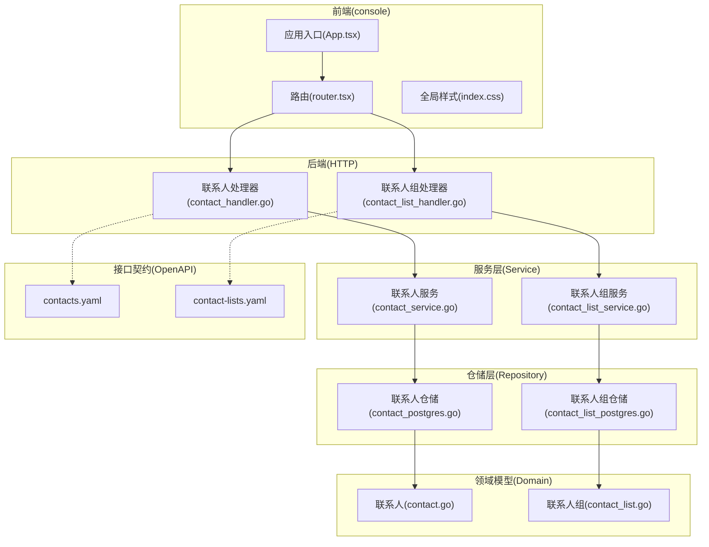
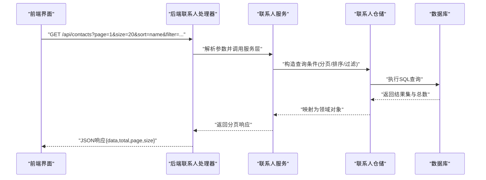
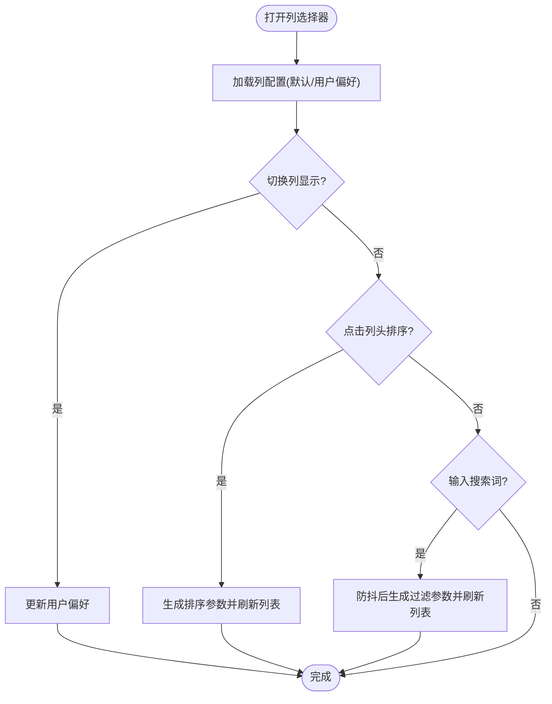
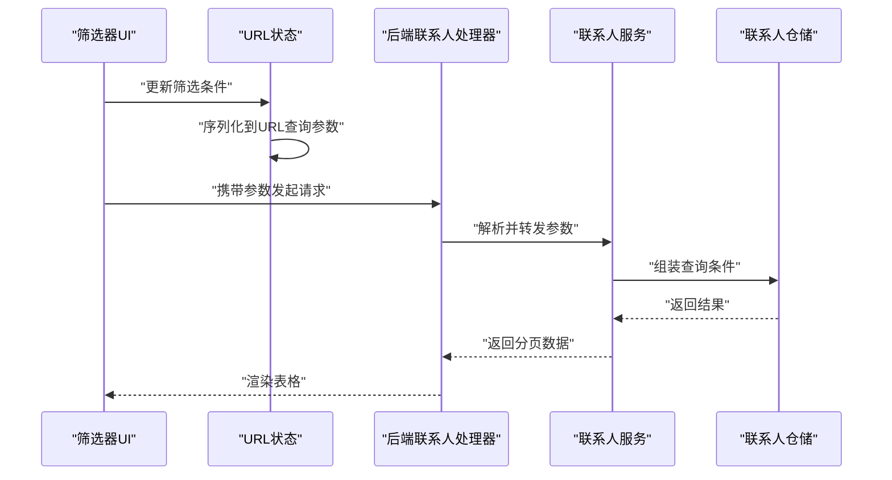
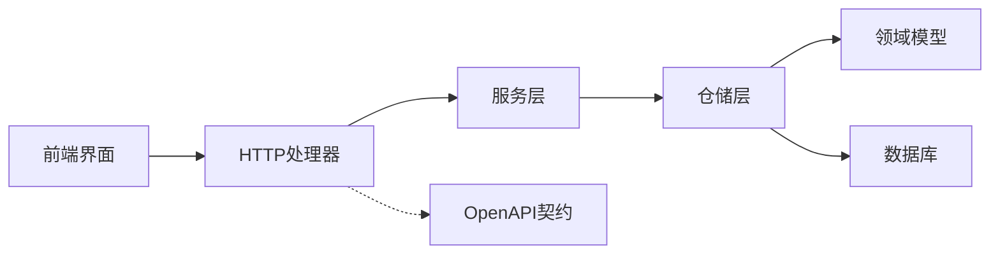

# 联系人列表管理

<cite>
**本文引用的文件**   
- [contact_handler.go](file://notifuse/internal/http/contact_handler.go)
- [contact_list_handler.go](file://notifuse/internal/http/contact_list_handler.go)
- [contact_service.go](file://notifuse/internal/service/contact_service.go)
- [contact_list_service.go](file://notifuse/internal/service/contact_list_service.go)
- [contact_postgres.go](file://notifuse/internal/repository/contact_postgres.go)
- [contact_list_postgres.go](file://notifuse/internal/repository/contact_list_postgres.go)
- [contact.go](file://notifuse/internal/domain/contact.go)
- [contact_list.go](file://notifuse/internal/domain/contact_list.go)
- [contacts.yaml](file://notifuse/openapi/paths/contacts.yaml)
- [contact-lists.yaml](file://notifuse/openapi/paths/contact-lists.yaml)
- [App.tsx](file://notifuse/console/src/App.tsx)
- [router.tsx](file://notifuse/console/src/router.tsx)
- [index.css](file://notifuse/console/src/index.css)
</cite>

## 目录
1. [简介](#简介)
2. [项目结构](#项目结构)
3. [核心组件](#核心组件)
4. [架构总览](#架构总览)
5. [详细组件分析](#详细组件分析)
6. [依赖分析](#依赖分析)
7. [性能考虑](#性能考虑)
8. [故障排查指南](#故障排查指南)
9. [结论](#结论)
10. [附录](#附录)

## 简介
本文件围绕“联系人列表管理”功能，系统性梳理前后端实现与交互：包括联系人表格渲染机制、分页加载与虚拟滚动优化；列选择器组件的动态列配置、字段排序与搜索过滤；高级筛选器的构建逻辑、查询参数序列化与URL状态同步；以及大数据量场景下的性能优化、内存管理与渲染效率提升。文档同时提供自定义列配置、筛选条件组合与用户体验优化的实践建议。

## 项目结构
该仓库采用前后端分离的架构：
- 前端（console）基于 React + TypeScript，负责页面路由、UI 组件、数据请求与状态管理。
- 后端（Go）提供 HTTP API，服务层封装业务逻辑，仓储层对接数据库。
- OpenAPI 定义接口契约，便于前后端对齐。

图表来源
- [App.tsx](file://notifuse/console/src/App.tsx)
- [router.tsx](file://notifuse/console/src/router.tsx)
- [contact_handler.go](file://notifuse/internal/http/contact_handler.go)
- [contact_list_handler.go](file://notifuse/internal/http/contact_list_handler.go)
- [contact_service.go](file://notifuse/internal/service/contact_service.go)
- [contact_list_service.go](file://notifuse/internal/service/contact_list_service.go)
- [contact_postgres.go](file://notifuse/internal/repository/contact_postgres.go)
- [contact_list_postgres.go](file://notifuse/internal/repository/contact_list_postgres.go)
- [contact.go](file://notifuse/internal/domain/contact.go)
- [contact_list.go](file://notifuse/internal/domain/contact_list.go)
- [contacts.yaml](file://notifuse/openapi/paths/contacts.yaml)
- [contact-lists.yaml](file://notifuse/openapi/paths/contact-lists.yaml)

章节来源
- [App.tsx](file://notifuse/console/src/App.tsx)
- [router.tsx](file://notifuse/console/src/router.tsx)
- [index.css](file://notifuse/console/src/index.css)

## 核心组件
- 联系人列表页：承载表格渲染、分页、排序、搜索与高级筛选，并与 URL 状态保持同步。
- 列选择器：支持动态列配置、显示/隐藏列、列宽与顺序调整。
- 高级筛选器：组合多条件筛选，生成查询参数并持久化到 URL。
- 后端联系人 API：提供分页、排序、过滤、统计等能力。
- 联系人组管理：用于将联系人分组，并在列表中展示所属组信息。

章节来源
- [contact_handler.go](file://notifuse/internal/http/contact_handler.go)
- [contact_list_handler.go](file://notifuse/internal/http/contact_list_handler.go)
- [contact_service.go](file://notifuse/internal/service/contact_service.go)
- [contact_list_service.go](file://notifuse/internal/service/contact_list_service.go)
- [contact_postgres.go](file://notifuse/internal/repository/contact_postgres.go)
- [contact_list_postgres.go](file://notifuse/internal/repository/contact_list_postgres.go)
- [contact.go](file://notifuse/internal/domain/contact.go)
- [contact_list.go](file://notifuse/internal/domain/contact_list.go)
- [contacts.yaml](file://notifuse/openapi/paths/contacts.yaml)
- [contact-lists.yaml](file://notifuse/openapi/paths/contact-lists.yaml)

## 架构总览
以下序列图展示了从前端发起“获取联系人列表”到后端返回数据的完整调用链，涵盖分页、排序与过滤参数的传递与处理。

图表来源
- [contact_handler.go](file://notifuse/internal/http/contact_handler.go)
- [contact_service.go](file://notifuse/internal/service/contact_service.go)
- [contact_postgres.go](file://notifuse/internal/repository/contact_postgres.go)
- [contacts.yaml](file://notifuse/openapi/paths/contacts.yaml)

## 详细组件分析

### 联系人表格渲染机制
- 数据源：通过后端分页接口获取当前页数据与总数。
- 渲染策略：
  - 小数据量：直接渲染整页行。
  - 大数据量：启用虚拟滚动，仅渲染可视区域行，减少 DOM 节点数量。
- 行级优化：使用稳定 key（如 ID），避免不必要的重渲染。
- 列渲染：根据列配置动态渲染单元格内容，支持格式化与自定义渲染函数。

章节来源
- [contact_handler.go](file://notifuse/internal/http/contact_handler.go)
- [contact_service.go](file://notifuse/internal/service/contact_service.go)
- [contact_postgres.go](file://notifuse/internal/repository/contact_postgres.go)
- [contacts.yaml](file://notifuse/openapi/paths/contacts.yaml)

### 分页加载与虚拟滚动优化
- 分页参数：
  - page：页码
  - size：每页条数
  - total：总数（用于计算总页数）
- 虚拟滚动要点：
  - 容器高度固定，按行高估算总高度。
  - 只渲染可视窗口内的行，滚动时动态替换可见区间。
  - 对不可见行进行占位，保证滚动条长度正确。
- 性能指标：
  - 首屏渲染时间显著降低。
  - 滚动帧率稳定，避免卡顿。

章节来源
- [contact_handler.go](file://notifuse/internal/http/contact_handler.go)
- [contact_service.go](file://notifuse/internal/service/contact_service.go)
- [contact_postgres.go](file://notifuse/internal/repository/contact_postgres.go)
- [contacts.yaml](file://notifuse/openapi/paths/contacts.yaml)

### 列选择器组件：动态列配置、排序与搜索过滤
- 动态列配置：
  - 列定义来源于后端或本地配置，支持显示/隐藏、顺序调整、宽度设置。
  - 用户偏好存储于本地存储或后端，下次进入自动恢复。
- 字段排序：
  - 点击列头触发排序，向服务端发送 sort 参数。
  - 支持单列升/降序与多列复合排序（若后端支持）。
- 搜索过滤：
  - 输入关键词后，按指定字段模糊匹配，向后端发送 filter 参数。
  - 防抖处理，避免频繁请求。

图表来源
- [contact_handler.go](file://notifuse/internal/http/contact_handler.go)
- [contact_service.go](file://notifuse/internal/service/contact_service.go)
- [contact_postgres.go](file://notifuse/internal/repository/contact_postgres.go)
- [contacts.yaml](file://notifuse/openapi/paths/contacts.yaml)

章节来源
- [contact_handler.go](file://notifuse/internal/http/contact_handler.go)
- [contact_service.go](file://notifuse/internal/service/contact_service.go)
- [contact_postgres.go](file://notifuse/internal/repository/contact_postgres.go)
- [contacts.yaml](file://notifuse/openapi/paths/contacts.yaml)

### 高级筛选器：构建逻辑、查询参数序列化与URL状态同步
- 构建逻辑：
  - 多个筛选条件以 AND/OR 组合，支持范围、枚举、包含/不包含等类型。
  - 条件校验与默认值填充在提交前完成。
- 查询参数序列化：
  - 将筛选条件序列化为 URL 查询字符串，确保可分享与可回退。
  - 支持嵌套结构与数组参数编码。
- URL 状态同步：
  - 监听 URL 变化，反向驱动筛选器 UI 状态。
  - 浏览器前进/后退时，自动恢复筛选状态。

图表来源
- [contact_handler.go](file://notifuse/internal/http/contact_handler.go)
- [contact_service.go](file://notifuse/internal/service/contact_service.go)
- [contact_postgres.go](file://notifuse/internal/repository/contact_postgres.go)
- [contacts.yaml](file://notifuse/openapi/paths/contacts.yaml)

章节来源
- [contact_handler.go](file://notifuse/internal/http/contact_handler.go)
- [contact_service.go](file://notifuse/internal/service/contact_service.go)
- [contact_postgres.go](file://notifuse/internal/repository/contact_postgres.go)
- [contacts.yaml](file://notifuse/openapi/paths/contacts.yaml)

### 联系人组管理
- 联系人组用于组织联系人，可在列表中展示所属组信息。
- 支持创建、编辑、删除组，并将联系人分配到组。
- 列表筛选可按组过滤，提高查找效率。

章节来源
- [contact_list_handler.go](file://notifuse/internal/http/contact_list_handler.go)
- [contact_list_service.go](file://notifuse/internal/service/contact_list_service.go)
- [contact_list_postgres.go](file://notifuse/internal/repository/contact_list_postgres.go)
- [contact_list.go](file://notifuse/internal/domain/contact_list.go)
- [contact-lists.yaml](file://notifuse/openapi/paths/contact-lists.yaml)

## 依赖分析
- 组件耦合：
  - 前端页面依赖路由与服务调用，服务调用依赖后端 API。
  - 后端处理器依赖服务层，服务层依赖仓储层，仓储层依赖领域模型与数据库。
- 外部依赖：
  - 数据库（PostgreSQL）用于持久化联系人及组信息。
  - OpenAPI 作为接口契约，约束前后端数据结构。

图表来源
- [contact_handler.go](file://notifuse/internal/http/contact_handler.go)
- [contact_service.go](file://notifuse/internal/service/contact_service.go)
- [contact_postgres.go](file://notifuse/internal/repository/contact_postgres.go)
- [contact.go](file://notifuse/internal/domain/contact.go)
- [contacts.yaml](file://notifuse/openapi/paths/contacts.yaml)

章节来源
- [contact_handler.go](file://notifuse/internal/http/contact_handler.go)
- [contact_service.go](file://notifuse/internal/service/contact_service.go)
- [contact_postgres.go](file://notifuse/internal/repository/contact_postgres.go)
- [contact.go](file://notifuse/internal/domain/contact.go)
- [contacts.yaml](file://notifuse/openapi/paths/contacts.yaml)

## 性能考虑
- 大数据量表格优化：
  - 启用虚拟滚动，限制渲染行数。
  - 使用稳定的行 key，减少 Diff 开销。
  - 合并多次状态更新，避免频繁重渲染。
- 内存管理：
  - 及时释放不再使用的引用，避免内存泄漏。
  - 取消未完成的网络请求，防止竞态条件。
- 渲染效率：
  - 列渲染函数缓存，避免重复计算。
  - 图片与富文本懒加载，减少首屏压力。
- 网络优化：
  - 合理设置分页大小，平衡首屏与后续加载。
  - 使用 ETag/Cache-Control 减少重复传输。

[本节为通用性能指导，不直接分析具体文件]

## 故障排查指南
- 常见问题：
  - 列表不刷新：检查 URL 状态同步与请求去重逻辑。
  - 排序异常：确认后端排序字段映射与空值处理。
  - 筛选无效：验证查询参数序列化与后端解析一致性。
  - 滚动卡顿：检查虚拟滚动行高估算与占位是否正确。
- 调试建议：
  - 开启网络面板，观察请求参数与响应结构。
  - 使用浏览器性能面板分析渲染耗时。
  - 在后端日志中定位 SQL 执行时间与慢查询。

章节来源
- [contact_handler.go](file://notifuse/internal/http/contact_handler.go)
- [contact_service.go](file://notifuse/internal/service/contact_service.go)
- [contact_postgres.go](file://notifuse/internal/repository/contact_postgres.go)
- [contacts.yaml](file://notifuse/openapi/paths/contacts.yaml)

## 结论
联系人列表管理功能通过前后端协作实现了高效的数据展示与交互。借助虚拟滚动、分页加载、动态列配置与高级筛选，系统在大数据量场景下仍能提供流畅体验。遵循本文的性能优化与排障建议，可进一步提升稳定性与可用性。

[本节为总结性内容，不直接分析具体文件]

## 附录
- 自定义列配置：
  - 在列定义中扩展渲染函数与格式化规则。
  - 将用户偏好持久化，实现个性化体验。
- 筛选条件组合：
  - 支持复杂逻辑表达式，注意参数序列化与兼容性。
- 用户体验优化：
  - 提供加载骨架屏与错误提示。
  - 支持键盘导航与无障碍访问。

[本节为概念性内容，不直接分析具体文件]