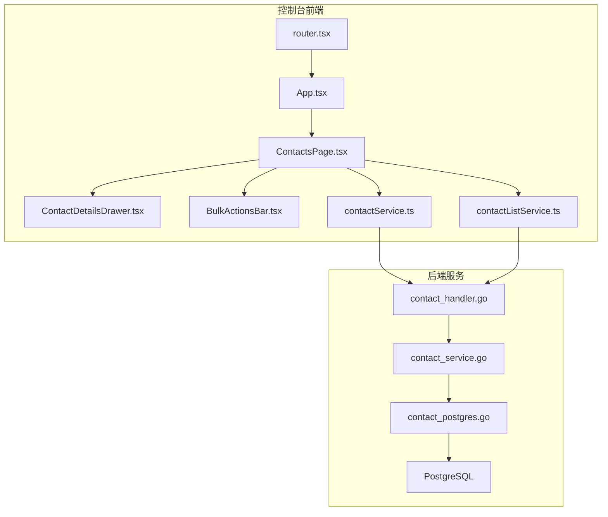
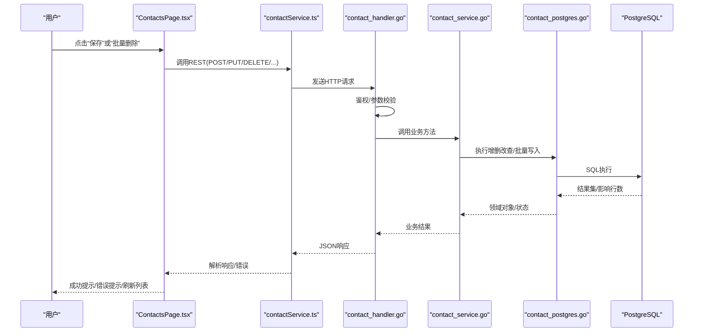
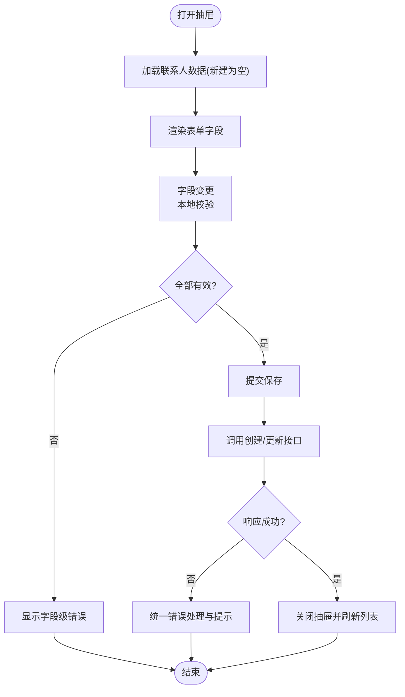
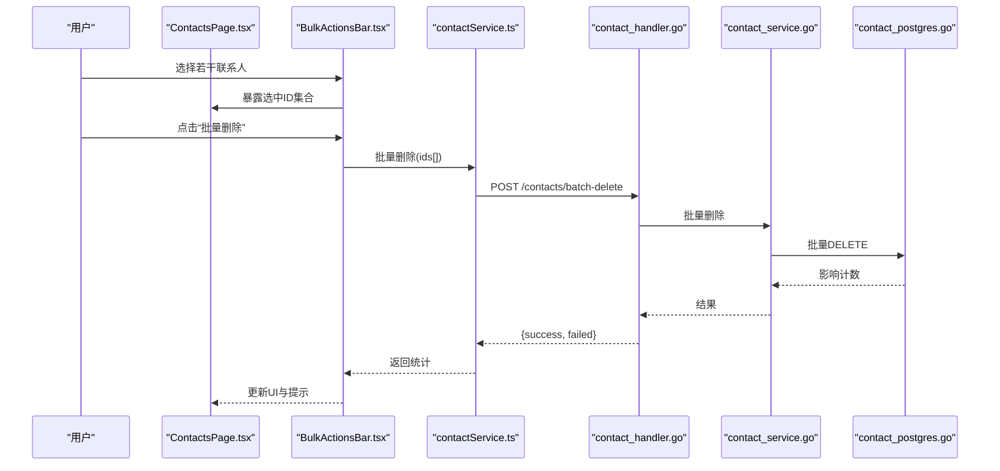
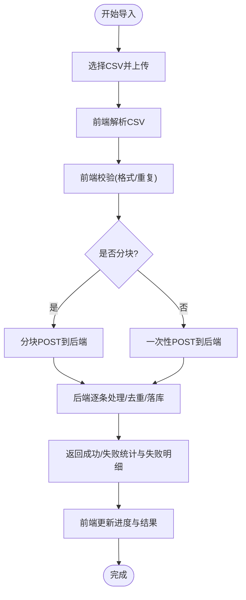
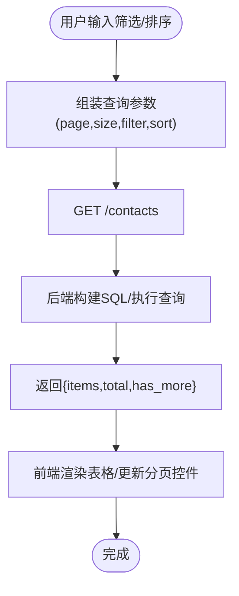
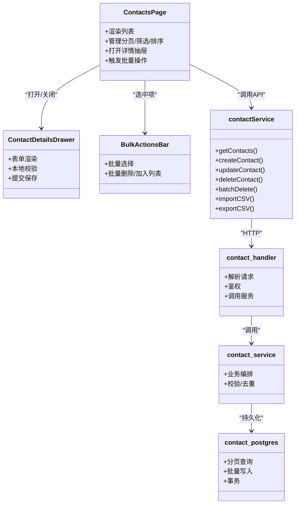

# 联系人管理页面

<cite>
**本文引用的文件**   
- [contact_handler.go](file://notifuse/internal/http/contact_handler.go)
- [contact_service.go](file://notifuse/internal/service/contact_service.go)
- [contact_postgres.go](file://notifuse/internal/repository/contact_postgres.go)
- [contact.go](file://notifuse/internal/domain/contact.go)
- [contacts.yaml](file://notifuse/openapi/paths/contacts.yaml)
- [router.tsx](file://notifuse/console/src/router.tsx)
- [App.tsx](file://notifuse/console/src/App.tsx)
- [ContactDetailsDrawer.tsx](file://notifuse/console/src/components/contacts/ContactDetailsDrawer.tsx)
- [BulkActionsBar.tsx](file://notifuse/console/src/components/contacts/BulkActionsBar.tsx)
- [ContactsPage.tsx](file://notifuse/console/src/pages/ContactsPage.tsx)
- [contactService.ts](file://notifuse/console/src/services/api/contactService.ts)
- [contactListService.ts](file://notifuse/console/src/services/api/contactListService.ts)
- [contact_list_service.go](file://notifuse/internal/service/contact_list_service.go)
- [contact_list_postgres.go](file://notifuse/internal/repository/contact_list_postgres.go)
- [contact_list.go](file://notifuse/internal/domain/contact_list.go)
</cite>

## 目录
1. [简介](#简介)
2. [项目结构](#项目结构)
3. [核心组件](#核心组件)
4. [架构总览](#架构总览)
5. [详细组件分析](#详细组件分析)
6. [依赖关系分析](#依赖关系分析)
7. [性能考虑](#性能考虑)
8. [故障排查指南](#故障排查指南)
9. [结论](#结论)
10. [附录](#附录)

## 简介
本文件面向Notifuse控制台“联系人管理”页面，系统性梳理联系人CRUD、批量操作、CSV导入导出、分页加载、搜索过滤、排序与字段自定义配置的实现方案。文档同时覆盖表单验证、数据校验、错误处理与用户反馈机制，并提供大数据量场景下的内存优化与用户体验提升建议。

## 项目结构
前端（console）负责联系人列表展示、交互与API调用；后端（Go）提供HTTP接口、领域服务、仓储层与数据库访问；OpenAPI定义对外契约。关键路径如下：
- 路由与入口：console/src/router.tsx、console/src/App.tsx
- 页面与组件：console/src/pages/ContactsPage.tsx、console/src/components/contacts/ContactDetailsDrawer.tsx、console/src/components/contacts/BulkActionsBar.tsx
- API客户端：console/src/services/api/contactService.ts、console/src/services/api/contactListService.ts
- HTTP处理器：internal/http/contact_handler.go
- 业务服务：internal/service/contact_service.go
- 仓储实现：internal/repository/contact_postgres.go
- 领域模型：internal/domain/contact.go
- OpenAPI契约：openapi/paths/contacts.yaml

图表来源
- [router.tsx](file://notifuse/console/src/router.tsx)
- [App.tsx](file://notifuse/console/src/App.tsx)
- [ContactsPage.tsx](file://notifuse/console/src/pages/ContactsPage.tsx)
- [ContactDetailsDrawer.tsx](file://notifuse/console/src/components/contacts/ContactDetailsDrawer.tsx)
- [BulkActionsBar.tsx](file://notifuse/console/src/components/contacts/BulkActionsBar.tsx)
- [contactService.ts](file://notifuse/console/src/services/api/contactService.ts)
- [contactListService.ts](file://notifuse/console/src/services/api/contactListService.ts)
- [contact_handler.go](file://notifuse/internal/http/contact_handler.go)
- [contact_service.go](file://notifuse/internal/service/contact_service.go)
- [contact_postgres.go](file://notifuse/internal/repository/contact_postgres.go)

章节来源
- [router.tsx](file://notifuse/console/src/router.tsx)
- [App.tsx](file://notifuse/console/src/App.tsx)
- [ContactsPage.tsx](file://notifuse/console/src/pages/ContactsPage.tsx)
- [contact_handler.go](file://notifuse/internal/http/contact_handler.go)
- [contact_service.go](file://notifuse/internal/service/contact_service.go)
- [contact_postgres.go](file://notifuse/internal/repository/contact_postgres.go)
- [contact.go](file://notifuse/internal/domain/contact.go)
- [contacts.yaml](file://notifuse/openapi/paths/contacts.yaml)

## 核心组件
- 联系人详情抽屉 ContactDetailsDrawer：用于新增/编辑联系人的侧边抽屉，承载表单渲染、本地校验、提交与错误回显。
- 批量操作栏 BulkActionsBar：在选中多条联系人后出现，支持批量删除、批量加入/移出列表等聚合操作。
- 联系人列表页 ContactsPage：集成分页、搜索、排序、列显示配置、批量选择与详情抽屉联动。
- 前端API客户端 contactService.ts：封装联系人相关REST调用，统一错误处理与响应转换。
- 后端处理器 contact_handler.go：解析请求参数、鉴权、调用服务层并返回JSON。
- 业务服务 contact_service.go：编排业务逻辑（含去重、关联列表、审计日志等）。
- 仓储 contact_postgres.go：执行SQL查询、事务与批量写入。
- 领域模型 contact.go：定义联系人实体与约束。
- OpenAPI contacts.yaml：定义联系人接口的入参出参与错误码。

章节来源
- [ContactDetailsDrawer.tsx](file://notifuse/console/src/components/contacts/ContactDetailsDrawer.tsx)
- [BulkActionsBar.tsx](file://notifuse/console/src/components/contacts/BulkActionsBar.tsx)
- [ContactsPage.tsx](file://notifuse/console/src/pages/ContactsPage.tsx)
- [contactService.ts](file://notifuse/console/src/services/api/contactService.ts)
- [contact_handler.go](file://notifuse/internal/http/contact_handler.go)
- [contact_service.go](file://notifuse/internal/service/contact_service.go)
- [contact_postgres.go](file://notifuse/internal/repository/contact_postgres.go)
- [contact.go](file://notifuse/internal/domain/contact.go)
- [contacts.yaml](file://notifuse/openapi/paths/contacts.yaml)

## 架构总览
从浏览器到数据库的端到端流程：
- 前端通过contactService.ts发起REST请求（创建、更新、删除、批量操作、导入导出、分页查询）。
- 后端contact_handler.go接收请求，进行参数校验与权限控制，委托contact_service.go执行业务规则。
- contact_service.go调用contact_postgres.go完成持久化，必要时与联系人列表服务协作。
- 数据库为PostgreSQL，使用索引与分页查询优化大表性能。

图表来源
- [ContactsPage.tsx](file://notifuse/console/src/pages/ContactsPage.tsx)
- [contactService.ts](file://notifuse/console/src/services/api/contactService.ts)
- [contact_handler.go](file://notifuse/internal/http/contact_handler.go)
- [contact_service.go](file://notifuse/internal/service/contact_service.go)
- [contact_postgres.go](file://notifuse/internal/repository/contact_postgres.go)

## 详细组件分析

### 联系人详情抽屉 ContactDetailsDrawer
职责与设计模式
- 受控表单：由父组件传入联系人数据与回调，内部维护本地编辑态，避免不必要的重渲染。
- 校验策略：前端即时校验（必填、邮箱格式、长度限制），提交前二次校验，失败时高亮字段并提示。
- 提交流程：新建走创建接口，编辑走更新接口；成功后关闭抽屉并触发父组件刷新。
- 错误处理：网络异常、业务校验失败均捕获并展示友好提示。

图表来源
- [ContactDetailsDrawer.tsx](file://notifuse/console/src/components/contacts/ContactDetailsDrawer.tsx)
- [contactService.ts](file://notifuse/console/src/services/api/contactService.ts)

章节来源
- [ContactDetailsDrawer.tsx](file://notifuse/console/src/components/contacts/ContactDetailsDrawer.tsx)
- [contactService.ts](file://notifuse/console/src/services/api/contactService.ts)

### 批量操作栏 BulkActionsBar
职责与交互
- 多选触发：当选中数量大于0时显示批量操作按钮组。
- 常见操作：批量删除、批量加入/移出指定联系人列表。
- 并发与幂等：对批量删除采用分批提交，确保部分失败可重试；服务端保证幂等性。
- 反馈机制：进行中显示进度，完成后汇总成功/失败统计。

图表来源
- [BulkActionsBar.tsx](file://notifuse/console/src/components/contacts/BulkActionsBar.tsx)
- [ContactsPage.tsx](file://notifuse/console/src/pages/ContactsPage.tsx)
- [contactService.ts](file://notifuse/console/src/services/api/contactService.ts)
- [contact_handler.go](file://notifuse/internal/http/contact_handler.go)
- [contact_service.go](file://notifuse/internal/service/contact_service.go)
- [contact_postgres.go](file://notifuse/internal/repository/contact_postgres.go)

章节来源
- [BulkActionsBar.tsx](file://notifuse/console/src/components/contacts/BulkActionsBar.tsx)
- [ContactsPage.tsx](file://notifuse/console/src/pages/ContactsPage.tsx)
- [contactService.ts](file://notifuse/console/src/services/api/contactService.ts)
- [contact_handler.go](file://notifuse/internal/http/contact_handler.go)
- [contact_service.go](file://notifuse/internal/service/contact_service.go)
- [contact_postgres.go](file://notifuse/internal/repository/contact_postgres.go)

### CSV导入与导出
导入流程
- 前端上传CSV文件，按行解析为联系人记录数组，进行前端基础校验（空值、重复邮箱等）。
- 将数据分块发送到后端，后端逐条插入或更新，记录成功/失败明细并返回汇总。
- 失败项生成下载链接供用户修正后重新导入。

导出流程
- 前端发起导出请求，后端流式读取联系人数据并按需拼接CSV字段。
- 前端接收流式响应并构建Blob，触发浏览器下载。

图表来源
- [contactService.ts](file://notifuse/console/src/services/api/contactService.ts)
- [contact_handler.go](file://notifuse/internal/http/contact_handler.go)
- [contact_service.go](file://notifuse/internal/service/contact_service.go)
- [contact_postgres.go](file://notifuse/internal/repository/contact_postgres.go)

章节来源
- [contactService.ts](file://notifuse/console/src/services/api/contactService.ts)
- [contact_handler.go](file://notifuse/internal/http/contact_handler.go)
- [contact_service.go](file://notifuse/internal/service/contact_service.go)
- [contact_postgres.go](file://notifuse/internal/repository/contact_postgres.go)

### 分页、搜索、排序与字段自定义
- 分页：前端传递page/page_size，后端基于游标或偏移分页返回数据与总数。
- 搜索：支持按邮箱、姓名、标签等多条件组合，后端使用LIKE/IN/JSONB查询。
- 排序：支持按创建时间、更新时间、名称等字段升/降序。
- 字段自定义：前端维护列可见性与顺序，仅请求必要字段以减少带宽。

图表来源
- [ContactsPage.tsx](file://notifuse/console/src/pages/ContactsPage.tsx)
- [contactService.ts](file://notifuse/console/src/services/api/contactService.ts)
- [contact_handler.go](file://notifuse/internal/http/contact_handler.go)
- [contact_postgres.go](file://notifuse/internal/repository/contact_postgres.go)

章节来源
- [ContactsPage.tsx](file://notifuse/console/src/pages/ContactsPage.tsx)
- [contactService.ts](file://notifuse/console/src/services/api/contactService.ts)
- [contact_handler.go](file://notifuse/internal/http/contact_handler.go)
- [contact_postgres.go](file://notifuse/internal/repository/contact_postgres.go)

### 表单验证、数据校验与错误处理
- 前端校验：必填、邮箱格式、长度、枚举值等，实时反馈。
- 后端校验：遵循OpenAPI契约，拒绝非法输入并返回结构化错误。
- 错误分类：网络错误、业务校验错误、系统错误分别处理，用户可见提示与重试入口。

章节来源
- [contact_handler.go](file://notifuse/internal/http/contact_handler.go)
- [contacts.yaml](file://notifuse/openapi/paths/contacts.yaml)

## 依赖关系分析
- 前端模块耦合：ContactsPage依赖ContactDetailsDrawer与BulkActionsBar，通过props与事件通信；contactService集中封装API。
- 前后端契约：由contacts.yaml定义，确保接口稳定演进。
- 后端分层：handler→service→repository→DB，职责清晰，便于测试与替换实现。

图表来源
- [ContactsPage.tsx](file://notifuse/console/src/pages/ContactsPage.tsx)
- [ContactDetailsDrawer.tsx](file://notifuse/console/src/components/contacts/ContactDetailsDrawer.tsx)
- [BulkActionsBar.tsx](file://notifuse/console/src/components/contacts/BulkActionsBar.tsx)
- [contactService.ts](file://notifuse/console/src/services/api/contactService.ts)
- [contact_handler.go](file://notifuse/internal/http/contact_handler.go)
- [contact_service.go](file://notifuse/internal/service/contact_service.go)
- [contact_postgres.go](file://notifuse/internal/repository/contact_postgres.go)

章节来源
- [ContactsPage.tsx](file://notifuse/console/src/pages/ContactsPage.tsx)
- [ContactDetailsDrawer.tsx](file://notifuse/console/src/components/contacts/ContactDetailsDrawer.tsx)
- [BulkActionsBar.tsx](file://notifuse/console/src/components/contacts/BulkActionsBar.tsx)
- [contactService.ts](file://notifuse/console/src/services/api/contactService.ts)
- [contact_handler.go](file://notifuse/internal/http/contact_handler.go)
- [contact_service.go](file://notifuse/internal/service/contact_service.go)
- [contact_postgres.go](file://notifuse/internal/repository/contact_postgres.go)

## 性能考虑
- 分页与懒加载：默认小页大小，按需加载更多；详情页按需拉取扩展字段。
- 只请求必要字段：通过字段白名单减少响应体大小。
- 批量操作分片：大批量删除/导入分批次提交，降低单次负载与超时风险。
- 索引优化：对常用筛选字段建立索引（如邮箱、创建时间、所属列表ID）。
- 前端虚拟滚动：超大数据量时使用虚拟列表减少DOM节点。
- 缓存策略：对不频繁变化的联系人列表做短期缓存，结合版本号失效。
- 流式导出：后端以流式方式输出CSV，前端边收边写，避免大对象驻留内存。

[本节为通用性能建议，无需特定文件引用]

## 故障排查指南
- 导入失败定位：查看后端返回的失败明细，核对CSV列名与映射；检查唯一键冲突与格式错误。
- 批量操作部分失败：确认服务端返回的成功/失败统计，针对失败项重试或人工修正。
- 分页异常：检查page/page_size边界条件与total一致性。
- 搜索无结果：确认筛选条件与索引命中情况，逐步缩小范围定位问题。
- 网络错误：检查跨域、鉴权头与网关限流策略。

章节来源
- [contact_handler.go](file://notifuse/internal/http/contact_handler.go)
- [contact_service.go](file://notifuse/internal/service/contact_service.go)
- [contact_postgres.go](file://notifuse/internal/repository/contact_postgres.go)

## 结论
联系人管理页面通过清晰的组件拆分与前后端分层设计，实现了完整的CRUD、批量操作与CSV导入导出能力。配合分页、搜索、排序与字段自定义，满足日常运营需求。在大体量数据场景下，通过分页、索引、分片与流式处理等手段保障性能与稳定性。

## 附录

### 联系人列表与分组（可选增强）
联系人通常归属于一个或多个联系人列表，以下文件涉及联系人列表的服务与仓储实现，可作为联系人管理的扩展参考。

章节来源
- [contact_list_service.go](file://notifuse/internal/service/contact_list_service.go)
- [contact_list_postgres.go](file://notifuse/internal/repository/contact_list_postgres.go)
- [contact_list.go](file://notifuse/internal/domain/contact_list.go)
- [contactListService.ts](file://notifuse/console/src/services/api/contactListService.ts)