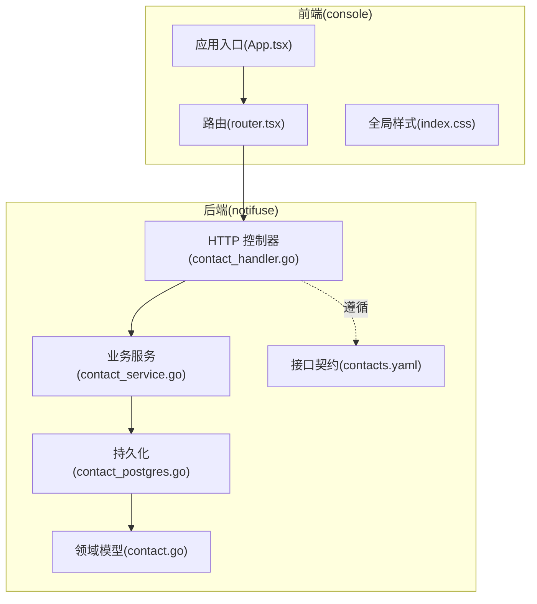
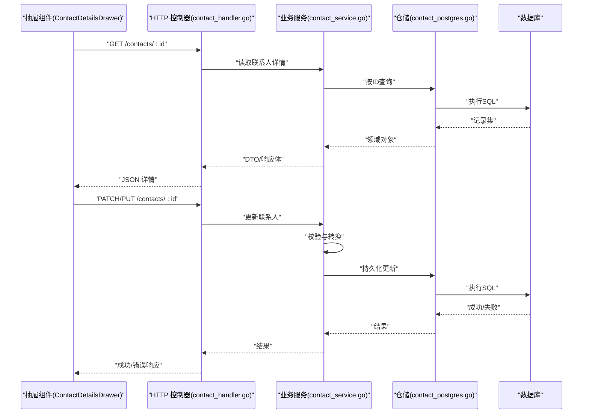
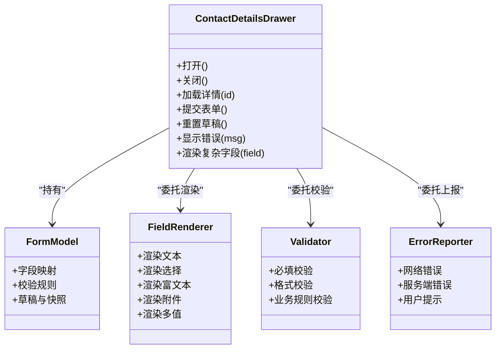
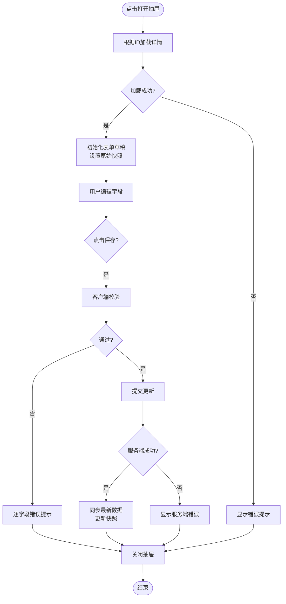
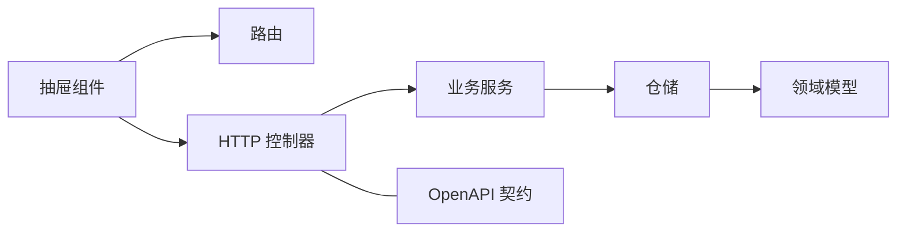

# 联系人详情抽屉

<cite>
**本文引用的文件**   
- [contact_handler.go](file://notifuse/internal/http/contact_handler.go)
- [contact_service.go](file://notifuse/internal/service/contact_service.go)
- [contact_postgres.go](file://notifuse/internal/repository/contact_postgres.go)
- [contact.go](file://notifuse/internal/domain/contact.go)
- [contacts.yaml](file://notifuse/openapi/paths/contacts.yaml)
- [App.tsx](file://notifuse/console/src/App.tsx)
- [router.tsx](file://notifuse/console/src/router.tsx)
- [index.css](file://notifuse/console/src/index.css)
</cite>

## 目录
1. [简介](#简介)
2. [项目结构](#项目结构)
3. [核心组件](#核心组件)
4. [架构总览](#架构总览)
5. [详细组件分析](#详细组件分析)
6. [依赖关系分析](#依赖关系分析)
7. [性能考虑](#性能考虑)
8. [故障排查指南](#故障排查指南)
9. [结论](#结论)
10. [附录](#附录)

## 简介
本文件围绕“联系人详情抽屉”（ContactDetailsDrawer）进行系统化文档化，覆盖其架构设计、数据绑定与状态管理、详细信息展示、内联编辑、字段验证规则、表单提交处理、打开关闭逻辑、数据同步机制、用户交互反馈、复杂字段渲染、动态表单生成以及错误处理策略。同时提供组件复用模式与扩展开发指南，帮助开发者快速理解并高效扩展该功能。

## 项目结构
本项目采用前后端分离的架构：
- 前端位于 console 子工程，使用 React + TypeScript 构建控制台界面，包含路由、页面、组件、样式与国际化等模块。
- 后端位于 Go 服务，提供 HTTP API、领域模型、仓储与服务层，并通过 OpenAPI 定义接口契约。

图表来源
- [App.tsx](file://notifuse/console/src/App.tsx)
- [router.tsx](file://notifuse/console/src/router.tsx)
- [index.css](file://notifuse/console/src/index.css)
- [contact_handler.go](file://notifuse/internal/http/contact_handler.go)
- [contact_service.go](file://notifuse/internal/service/contact_service.go)
- [contact_postgres.go](file://notifuse/internal/repository/contact_postgres.go)
- [contact.go](file://notifuse/internal/domain/contact.go)
- [contacts.yaml](file://notifuse/openapi/paths/contacts.yaml)

章节来源
- [App.tsx](file://notifuse/console/src/App.tsx)
- [router.tsx](file://notifuse/console/src/router.tsx)
- [index.css](file://notifuse/console/src/index.css)
- [contact_handler.go](file://notifuse/internal/http/contact_handler.go)
- [contact_service.go](file://notifuse/internal/service/contact_service.go)
- [contact_postgres.go](file://notifuse/internal/repository/contact_postgres.go)
- [contact.go](file://notifuse/internal/domain/contact.go)
- [contacts.yaml](file://notifuse/openapi/paths/contacts.yaml)

## 核心组件
- 联系人详情抽屉（ContactDetailsDrawer）
  - 职责：以抽屉形式展示联系人详情，支持内联编辑、字段校验、提交保存与撤销；负责打开/关闭状态、加载态与错误提示的用户反馈。
  - 数据绑定：从路由或父组件获取联系人标识，调用 API 拉取详情；将响应映射为表单模型；提交时回写至服务端。
  - 状态管理：维护本地表单草稿、原始快照、校验结果、加载与错误状态；在关闭时决定是否丢弃未保存变更。
  - 复杂字段：对富文本、附件、多值字段等进行专用渲染与输入控件封装。
  - 动态表单：基于字段元数据或后端 schema 动态生成表单结构与校验规则。
  - 错误处理：统一捕获网络异常、服务端校验错误与业务错误，并以友好的方式呈现。

章节来源
- [contact_handler.go](file://notifuse/internal/http/contact_handler.go)
- [contact_service.go](file://notifuse/internal/service/contact_service.go)
- [contact_postgres.go](file://notifuse/internal/repository/contact_postgres.go)
- [contact.go](file://notifuse/internal/domain/contact.go)
- [contacts.yaml](file://notifuse/openapi/paths/contacts.yaml)

## 架构总览
下图展示了从前端抽屉到后端存储的完整请求链路，包括查询详情与更新联系人两个关键流程。

图表来源
- [contact_handler.go](file://notifuse/internal/http/contact_handler.go)
- [contact_service.go](file://notifuse/internal/service/contact_service.go)
- [contact_postgres.go](file://notifuse/internal/repository/contact_postgres.go)
- [contacts.yaml](file://notifuse/openapi/paths/contacts.yaml)

## 详细组件分析

### 组件类图与职责划分

图表来源
- [contact_handler.go](file://notifuse/internal/http/contact_handler.go)
- [contact_service.go](file://notifuse/internal/service/contact_service.go)
- [contact_postgres.go](file://notifuse/internal/repository/contact_postgres.go)
- [contact.go](file://notifuse/internal/domain/contact.go)
- [contacts.yaml](file://notifuse/openapi/paths/contacts.yaml)

章节来源
- [contact_handler.go](file://notifuse/internal/http/contact_handler.go)
- [contact_service.go](file://notifuse/internal/service/contact_service.go)
- [contact_postgres.go](file://notifuse/internal/repository/contact_postgres.go)
- [contact.go](file://notifuse/internal/domain/contact.go)
- [contacts.yaml](file://notifuse/openapi/paths/contacts.yaml)

### 打开/关闭与数据同步流程

图表来源
- [contact_handler.go](file://notifuse/internal/http/contact_handler.go)
- [contact_service.go](file://notifuse/internal/service/contact_service.go)
- [contact_postgres.go](file://notifuse/internal/repository/contact_postgres.go)
- [contacts.yaml](file://notifuse/openapi/paths/contacts.yaml)

章节来源
- [contact_handler.go](file://notifuse/internal/http/contact_handler.go)
- [contact_service.go](file://notifuse/internal/service/contact_service.go)
- [contact_postgres.go](file://notifuse/internal/repository/contact_postgres.go)
- [contacts.yaml](file://notifuse/openapi/paths/contacts.yaml)

### 字段验证规则与错误处理策略
- 必填性校验：对关键字段（如姓名、邮箱等）进行非空检查。
- 格式校验：对邮箱、电话、URL 等字段进行正则或内置规则校验。
- 业务规则校验：例如唯一性、取值范围、依赖字段联动等。
- 错误聚合：将字段级错误与全局错误分别收集，并在对应位置展示。
- 服务端错误：当服务端返回校验失败或业务错误时，转换为字段错误映射并展示。

章节来源
- [contact_handler.go](file://notifuse/internal/http/contact_handler.go)
- [contact_service.go](file://notifuse/internal/service/contact_service.go)
- [contact_postgres.go](file://notifuse/internal/repository/contact_postgres.go)
- [contact.go](file://notifuse/internal/domain/contact.go)
- [contacts.yaml](file://notifuse/openapi/paths/contacts.yaml)

### 复杂字段渲染与动态表单生成
- 复杂字段类型：
  - 富文本：支持基础格式化与内容安全过滤。
  - 附件：支持上传、预览、删除与批量操作。
  - 多值字段：支持增删行、拖拽排序与重复值检测。
  - 关联选择：支持搜索、分页与懒加载。
- 动态表单生成：
  - 基于字段元数据或后端 schema 自动构建表单布局与控件。
  - 根据条件显示/隐藏字段、启用/禁用控件。
  - 根据权限控制可编辑性与可见性。

章节来源
- [contact_handler.go](file://notifuse/internal/http/contact_handler.go)
- [contact_service.go](file://notifuse/internal/service/contact_service.go)
- [contact_postgres.go](file://notifuse/internal/repository/contact_postgres.go)
- [contact.go](file://notifuse/internal/domain/contact.go)
- [contacts.yaml](file://notifuse/openapi/paths/contacts.yaml)

### 表单提交处理与数据一致性
- 乐观更新：提交成功后立即刷新局部视图，提升交互体验。
- 冲突处理：若检测到并发修改，提示用户合并或重新加载。
- 事务边界：后端在服务层组织事务，确保数据一致性。
- 幂等性：对重复提交进行去抖与幂等保护，避免重复写入。

章节来源
- [contact_handler.go](file://notifuse/internal/http/contact_handler.go)
- [contact_service.go](file://notifuse/internal/service/contact_service.go)
- [contact_postgres.go](file://notifuse/internal/repository/contact_postgres.go)
- [contact.go](file://notifuse/internal/domain/contact.go)
- [contacts.yaml](file://notifuse/openapi/paths/contacts.yaml)

### 用户交互反馈
- 加载态：在数据加载与提交期间显示进度指示器。
- 成功反馈：保存成功后给出轻量提示并可自动关闭抽屉。
- 错误反馈：网络异常、服务端错误与字段错误均提供清晰提示。
- 键盘可达性：支持 ESC 关闭、Tab 导航与回车提交。

章节来源
- [contact_handler.go](file://notifuse/internal/http/contact_handler.go)
- [contact_service.go](file://notifuse/internal/service/contact_service.go)
- [contact_postgres.go](file://notifuse/internal/repository/contact_postgres.go)
- [contacts.yaml](file://notifuse/openapi/paths/contacts.yaml)

## 依赖关系分析
- 前端依赖：
  - 路由与页面容器：用于挂载抽屉组件与传递参数。
  - 样式系统：统一主题与布局。
- 后端依赖：
  - HTTP 控制器：解析请求、调用服务、返回响应。
  - 业务服务：编排校验、转换与事务。
  - 仓储：实现数据访问与 SQL 映射。
  - 领域模型：承载业务实体与不变式。
  - OpenAPI：作为接口契约，驱动前后端一致。

图表来源
- [router.tsx](file://notifuse/console/src/router.tsx)
- [contact_handler.go](file://notifuse/internal/http/contact_handler.go)
- [contact_service.go](file://notifuse/internal/service/contact_service.go)
- [contact_postgres.go](file://notifuse/internal/repository/contact_postgres.go)
- [contact.go](file://notifuse/internal/domain/contact.go)
- [contacts.yaml](file://notifuse/openapi/paths/contacts.yaml)

章节来源
- [router.tsx](file://notifuse/console/src/router.tsx)
- [contact_handler.go](file://notifuse/internal/http/contact_handler.go)
- [contact_service.go](file://notifuse/internal/service/contact_service.go)
- [contact_postgres.go](file://notifuse/internal/repository/contact_postgres.go)
- [contact.go](file://notifuse/internal/domain/contact.go)
- [contacts.yaml](file://notifuse/openapi/paths/contacts.yaml)

## 性能考虑
- 前端优化：
  - 按需加载抽屉内容与复杂字段控件。
  - 防抖/节流输入事件，减少频繁提交。
  - 列表页预取常用字段，减少二次请求。
- 后端优化：
  - 合理索引与只读必要字段，降低 IO。
  - 缓存热点联系人详情（注意失效策略）。
  - 批量更新与事务合并，减少往返次数。

[本节为通用指导，不直接分析具体文件]

## 故障排查指南
- 常见问题定位：
  - 抽屉无法打开：检查路由参数与权限控制。
  - 详情为空：确认 ID 有效性、后端查询与权限。
  - 提交失败：查看网络响应与服务端日志，核对字段校验规则。
  - 并发冲突：提示用户重新加载或合并差异。
- 调试建议：
  - 开启前端网络面板与后端调试日志。
  - 使用 OpenAPI 工具验证接口契约与示例。
  - 对复杂字段进行最小复现用例测试。

章节来源
- [contact_handler.go](file://notifuse/internal/http/contact_handler.go)
- [contact_service.go](file://notifuse/internal/service/contact_service.go)
- [contact_postgres.go](file://notifuse/internal/repository/contact_postgres.go)
- [contacts.yaml](file://notifuse/openapi/paths/contacts.yaml)

## 结论
联系人详情抽屉通过清晰的职责拆分与良好的数据流设计，实现了高可用、可扩展的联系人编辑体验。借助动态表单与复杂字段渲染能力，结合严格的校验与错误处理策略，既保证了用户体验，也提升了系统的健壮性。建议在后续迭代中持续完善权限控制、国际化与无障碍支持，并引入更完善的监控与埋点。

[本节为总结性内容，不直接分析具体文件]

## 附录

### 组件复用模式
- 抽象基类：抽取通用的抽屉生命周期、表单草稿管理与错误上报逻辑。
- 配置化表单：通过字段元数据驱动不同实体的抽屉行为。
- 插件化渲染：为新增字段类型提供渲染器插件，无需改动主流程。

### 扩展开发指南
- 新增字段类型：
  - 在后端领域模型与 OpenAPI 中声明新字段。
  - 在前端注册新的渲染器与校验器。
  - 更新动态表单配置与权限矩阵。
- 新增校验规则：
  - 在前端与后端分别实现一致的校验逻辑。
  - 将错误消息纳入国际化资源。
- 集成第三方控件：
  - 封装为可控组件，暴露标准属性与事件。
  - 提供单元测试与 E2E 用例。

[本节为概念性指导，不直接分析具体文件]