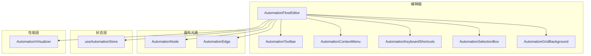
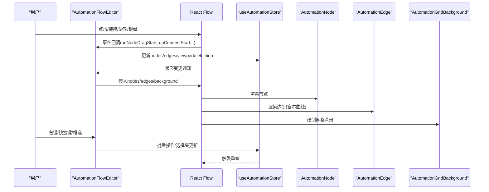
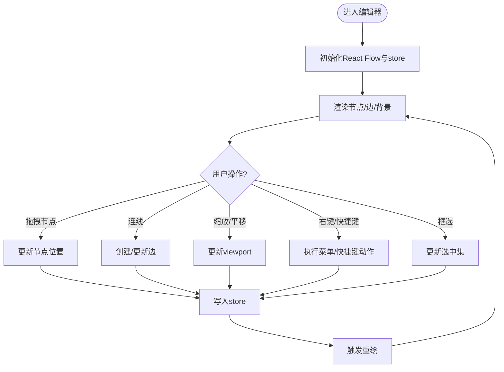
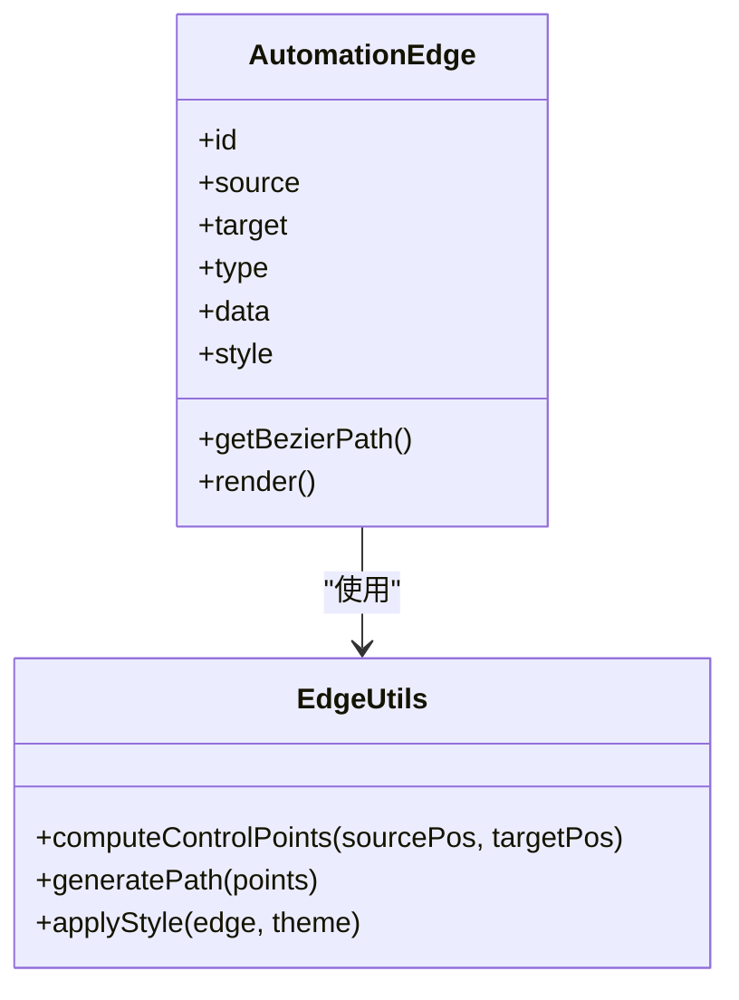
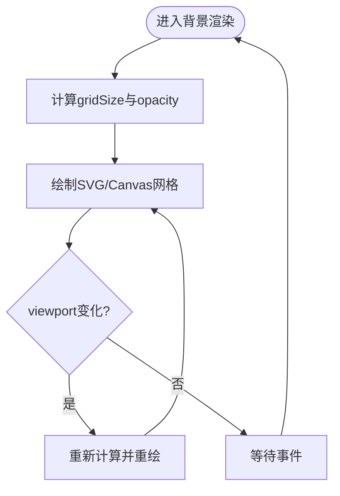
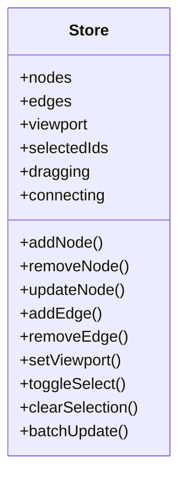
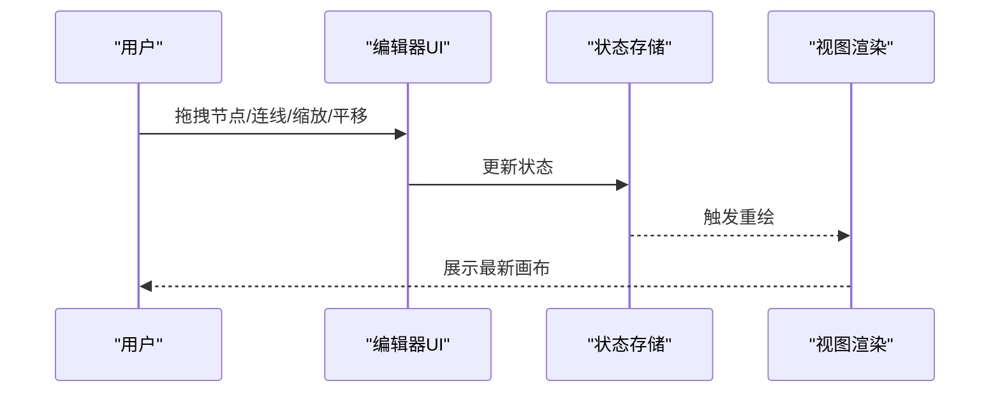
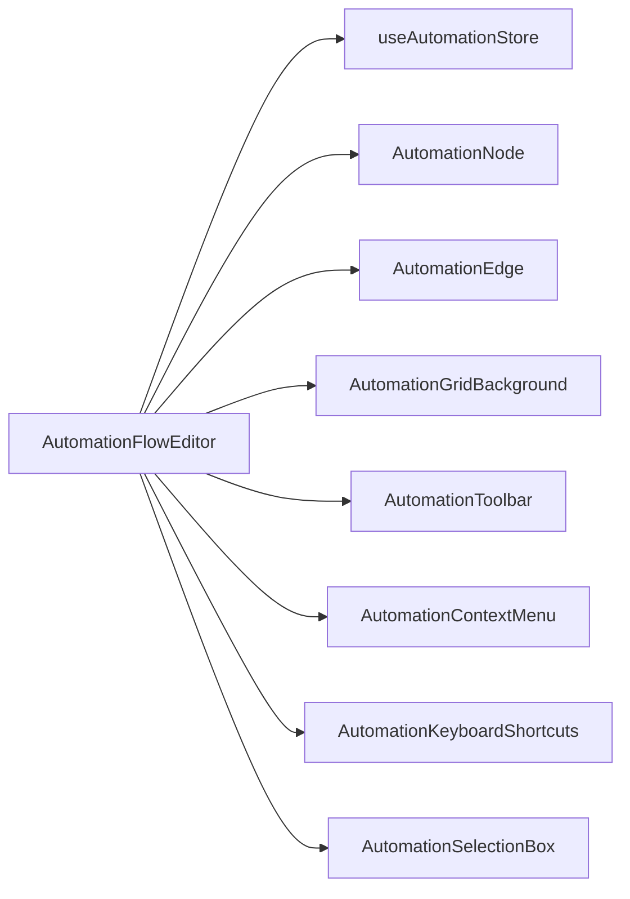

# 可视化工作流编辑器

<cite>
**本文引用的文件**   
- [notifuse/console/src/components/automation/AutomationFlowEditor.tsx](file://notifuse/console/src/components/automation/AutomationFlowEditor.tsx)
- [notifuse/console/src/components/automation/AutomationNode.tsx](file://notifuse/console/src/components/automation/AutomationNode.tsx)
- [notifuse/console/src/components/automation/AutomationEdge.tsx](file://notifuse/console/src/components/automation/AutomationEdge.tsx)
- [notifuse/console/src/components/automation/useAutomationStore.ts](file://notifuse/console/src/components/automation/useAutomationStore.ts)
- [notifuse/console/src/components/automation/AutomationToolbar.tsx](file://notifuse/console/src/components/automation/AutomationToolbar.tsx)
- [notifuse/console/src/components/automation/AutomationContextMenu.tsx](file://notifuse/console/src/components/automation/AutomationContextMenu.tsx)
- [notifuse/console/src/components/automation/AutomationKeyboardShortcuts.tsx](file://notifuse/console/src/components/automation/AutomationKeyboardShortcuts.tsx)
- [notifuse/console/src/components/automation/AutomationGridBackground.tsx](file://notifuse/console/src/components/automation/AutomationGridBackground.tsx)
- [notifuse/console/src/components/automation/AutomationSelectionBox.tsx](file://notifuse/console/src/components/automation/AutomationSelectionBox.tsx)
- [notifuse/console/src/components/automation/AutomationVirtualizer.tsx](file://notifuse/console/src/components/automation/AutomationVirtualizer.tsx)
</cite>

## 目录
1. [简介](#简介)
2. [项目结构](#项目结构)
3. [核心组件](#核心组件)
4. [架构总览](#架构总览)
5. [详细组件分析](#详细组件分析)
6. [依赖关系分析](#依赖关系分析)
7. [性能考虑](#性能考虑)
8. [故障排查指南](#故障排查指南)
9. [结论](#结论)
10. [附录](#附录)

## 简介
本文件面向“自动化工作流编辑器”的实现与使用，聚焦于 AutomationFlowEditor 组件及其周边能力：React Flow 集成配置、画布状态管理、节点拖拽与连线编辑、缩放和平移、网格背景、自定义边（贝塞尔曲线、连接点计算、样式定制）、键盘快捷键、右键菜单、选择框多选与批量操作，以及性能优化策略（虚拟滚动、节点懒加载、内存管理）。文档以代码级视角展开，并辅以架构图、流程图与时序图帮助理解。

## 项目结构
前端位于 notifuse/console 子项目中，自动化工作流编辑器相关代码集中在 components/automation 目录下。整体采用“功能域+职责分层”的组织方式：
- 顶层容器：AutomationFlowEditor 负责 React Flow 的初始化、事件绑定、全局状态同步与工具栏/上下文菜单/快捷键等子模块装配。
- 画布元素：AutomationNode（节点渲染）、AutomationEdge（自定义边）、AutomationGridBackground（网格背景）。
- 交互增强：AutomationContextMenu（右键菜单）、AutomationKeyboardShortcuts（快捷键）、AutomationSelectionBox（框选）。
- 状态与数据：useAutomationStore（基于 zustand 的轻量状态库）集中管理节点、边、视图变换、选中集等。
- 工具与扩展：AutomationToolbar（快捷操作入口）、AutomationVirtualizer（大规模节点时的虚拟化渲染）。

图表来源
- [AutomationFlowEditor.tsx](file://notifuse/console/src/components/automation/AutomationFlowEditor.tsx)
- [AutomationNode.tsx](file://notifuse/console/src/components/automation/AutomationNode.tsx)
- [AutomationEdge.tsx](file://notifuse/console/src/components/automation/AutomationEdge.tsx)
- [AutomationGridBackground.tsx](file://notifuse/console/src/components/automation/AutomationGridBackground.tsx)
- [AutomationToolbar.tsx](file://notifuse/console/src/components/automation/AutomationToolbar.tsx)
- [AutomationContextMenu.tsx](file://notifuse/console/src/components/automation/AutomationContextMenu.tsx)
- [AutomationKeyboardShortcuts.tsx](file://notifuse/console/src/components/automation/AutomationKeyboardShortcuts.tsx)
- [AutomationSelectionBox.tsx](file://notifuse/console/src/components/automation/AutomationSelectionBox.tsx)
- [AutomationVirtualizer.tsx](file://notifuse/console/src/components/automation/AutomationVirtualizer.tsx)
- [useAutomationStore.ts](file://notifuse/console/src/components/automation/useAutomationStore.ts)

章节来源
- [AutomationFlowEditor.tsx](file://notifuse/console/src/components/automation/AutomationFlowEditor.tsx)
- [useAutomationStore.ts](file://notifuse/console/src/components/automation/useAutomationStore.ts)

## 核心组件
- AutomationFlowEditor
  - 职责：作为根容器，初始化 React Flow 实例，注册节点/边类型、背景、快捷键、上下文菜单、选择框、工具栏；订阅 store 变更并驱动视图更新；处理节点增删改、连线创建与删除、视图变换（平移/缩放）等。
  - 关键点：通过 useReactFlow API 获取当前视图变换；将 store 中的 nodes/edges 与 React Flow 保持双向同步；在合适时机触发重排或持久化。
- useAutomationStore
  - 职责：集中管理 nodes、edges、viewport、selectedIds、dragging、connecting 等状态；提供 add/remove/update 节点、add/remove 边、setViewport、toggleSelect、clearSelection 等方法；支持 undo/redo 快照（可选）。
  - 关键点：使用 zustand 的 subscribeWithSelector 或中间件实现细粒度订阅；对频繁更新的 viewport 做节流/防抖；避免不必要的 re-render。
- AutomationNode
  - 职责：渲染单个流程节点，包含标题、描述、输入输出端口、选中态高亮、拖拽手柄等。
  - 关键点：为每个端口定义唯一 id；根据节点类型动态渲染内容；在 onConnectStart/onConnectEnd 中参与连线逻辑。
- AutomationEdge
  - 职责：自定义边渲染，默认使用平滑贝塞尔曲线；支持端点吸附、箭头方向、选中态高亮、悬停提示。
  - 关键点：通过 getBezierPath 或 react-flow 内置 edge 函数生成路径；根据源/目标端口位置计算控制点；支持虚线/实线/颜色主题。
- AutomationGridBackground
  - 职责：绘制网格背景，随缩放/平移自适应间距与透明度。
  - 关键点：根据 viewport 计算 gridScale/gridSize；使用 SVG pattern 或 Canvas 绘制以提升性能。
- AutomationToolbar / AutomationContextMenu / AutomationKeyboardShortcuts / AutomationSelectionBox
  - 职责：提供常用操作入口（添加节点、删除、复制粘贴、对齐、批量删除等），响应键盘事件与鼠标右键，支持框选多节点。
  - 关键点：与 store 联动，确保 UI 与状态一致；快捷键需考虑焦点与冲突；框选区域需与节点边界求交。

章节来源
- [AutomationFlowEditor.tsx](file://notifuse/console/src/components/automation/AutomationFlowEditor.tsx)
- [useAutomationStore.ts](file://notifuse/console/src/components/automation/useAutomationStore.ts)
- [AutomationNode.tsx](file://notifuse/console/src/components/automation/AutomationNode.tsx)
- [AutomationEdge.tsx](file://notifuse/console/src/components/automation/AutomationEdge.tsx)
- [AutomationGridBackground.tsx](file://notifuse/console/src/components/automation/AutomationGridBackground.tsx)
- [AutomationToolbar.tsx](file://notifuse/console/src/components/automation/AutomationToolbar.tsx)
- [AutomationContextMenu.tsx](file://notifuse/console/src/components/automation/AutomationContextMenu.tsx)
- [AutomationKeyboardShortcuts.tsx](file://notifuse/console/src/components/automation/AutomationKeyboardShortcuts.tsx)
- [AutomationSelectionBox.tsx](file://notifuse/console/src/components/automation/AutomationSelectionBox.tsx)

## 架构总览
下图展示了编辑器各模块之间的协作关系与数据流向。

图表来源
- [AutomationFlowEditor.tsx](file://notifuse/console/src/components/automation/AutomationFlowEditor.tsx)
- [useAutomationStore.ts](file://notifuse/console/src/components/automation/useAutomationStore.ts)
- [AutomationNode.tsx](file://notifuse/console/src/components/automation/AutomationNode.tsx)
- [AutomationEdge.tsx](file://notifuse/console/src/components/automation/AutomationEdge.tsx)
- [AutomationGridBackground.tsx](file://notifuse/console/src/components/automation/AutomationGridBackground.tsx)

## 详细组件分析

### AutomationFlowEditor 组件
- 初始化与配置
  - 注册自定义节点类型与边类型；设置 defaultEdgeOptions（如曲线类型、箭头、样式）；启用网格背景与最小/最大缩放范围。
  - 通过 useReactFlow 获取 setViewport、getViewport、fitView 等能力，结合 store 的 setViewport 进行统一控制。
- 画布状态管理
  - 监听 nodes/edges 变化，必要时调用 fitView 或自动布局；对 viewport 变更进行节流，避免高频重绘。
  - 维护 selectedIds 集合，支持单选/多选/反选；与 SelectionBox 联动完成框选。
- 节点拖拽与连线编辑
  - 在 onNodeDragStart/onNodeDrag/onNodeDragStop 中更新节点位置；在 onConnectStart/onConnect 中创建新边；在 onEdgeDelete/onNodeRemove 中清理关联边。
- 缩放与平移
  - 通过 React Flow 的内置行为与 store 的 viewport 保持一致；提供工具栏按钮执行放大/缩小/重置视图。
- 网格背景显示
  - 注入 AutomationGridBackground，根据 viewport 动态调整网格密度与透明度。
- 快捷键与右键菜单
  - 注册 Delete/Ctrl+A/Ctrl+C/V/Z/Y 等快捷键；右键菜单提供删除、复制、粘贴、分组等操作。
- 选择框与批量操作
  - 在空白区域按下鼠标左键拖动时启动 SelectionBox；计算与节点包围盒的交集，更新 selectedIds；支持批量删除/移动/复制。

图表来源
- [AutomationFlowEditor.tsx](file://notifuse/console/src/components/automation/AutomationFlowEditor.tsx)
- [useAutomationStore.ts](file://notifuse/console/src/components/automation/useAutomationStore.ts)

章节来源
- [AutomationFlowEditor.tsx](file://notifuse/console/src/components/automation/AutomationFlowEditor.tsx)
- [AutomationSelectionBox.tsx](file://notifuse/console/src/components/automation/AutomationSelectionBox.tsx)
- [AutomationContextMenu.tsx](file://notifuse/console/src/components/automation/AutomationContextMenu.tsx)
- [AutomationKeyboardShortcuts.tsx](file://notifuse/console/src/components/automation/AutomationKeyboardShortcuts.tsx)

### 自定义边 AutomationEdge
- 贝塞尔曲线绘制
  - 使用平滑曲线算法（如三次贝塞尔）计算源/目标端口中心与控制点，生成 path 字符串；支持不同曲线风格（直线、正交、曲线）。
- 连接点计算
  - 根据节点尺寸与端口偏移计算精确连接点；在拖拽过程中实时更新路径，保证视觉连贯。
- 样式定制
  - 支持颜色、线宽、虚线、箭头形状、选中高亮、悬停提示；可通过 defaultEdgeOptions 或 per-edge 配置覆盖。
- 交互增强
  - 支持点击选中、双击编辑属性、拖拽中间点调整曲率（可选）。

图表来源
- [AutomationEdge.tsx](file://notifuse/console/src/components/automation/AutomationEdge.tsx)

章节来源
- [AutomationEdge.tsx](file://notifuse/console/src/components/automation/AutomationEdge.tsx)

### 网格背景 AutomationGridBackground
- 自适应网格
  - 根据 viewport.scale 与 gridSize 计算网格间距；scale 较小时降低密度，提升可读性。
- 渲染策略
  - 优先使用 SVG pattern 或 Canvas 绘制，减少 DOM 节点数量；在缩放/平移时按需刷新。
- 主题与可配置项
  - 支持主色/辅色、透明度、是否显示刻度标记等。

图表来源
- [AutomationGridBackground.tsx](file://notifuse/console/src/components/automation/AutomationGridBackground.tsx)

章节来源
- [AutomationGridBackground.tsx](file://notifuse/console/src/components/automation/AutomationGridBackground.tsx)

### 状态管理 useAutomationStore
- 数据结构
  - nodes: 节点列表（id、position、type、data、selected...）
  - edges: 边列表（id、source、target、type、style...）
  - viewport: {x, y, zoom}
  - selectedIds: 选中节点ID集合
  - dragging/connecting: 交互标志位
- 关键方法
  - addNode/removeNode/updateNode
  - addEdge/removeEdge
  - setViewport
  - toggleSelect/clearSelection/addToSelection
  - batchUpdate（批量修改节点/边）
- 性能要点
  - 对 viewport 更新进行节流；使用 selector 订阅减少重渲染；对大集合操作使用不可变更新模式。

图表来源
- [useAutomationStore.ts](file://notifuse/console/src/components/automation/useAutomationStore.ts)

章节来源
- [useAutomationStore.ts](file://notifuse/console/src/components/automation/useAutomationStore.ts)

### 工具与交互增强
- 工具栏 AutomationToolbar
  - 提供新增节点、删除、复制、粘贴、撤销/重做、对齐、清空画布等快捷入口。
- 右键菜单 AutomationContextMenu
  - 针对节点/边/空白区域提供差异化菜单；支持批量操作。
- 快捷键 AutomationKeyboardShortcuts
  - 注册常用快捷键；处理焦点与组合键冲突；支持可配置映射。
- 选择框 AutomationSelectionBox
  - 在空白区域拖拽绘制矩形框；与节点包围盒求交，更新选中集；支持 Shift 多选与 Ctrl 反选。

章节来源
- [AutomationToolbar.tsx](file://notifuse/console/src/components/automation/AutomationToolbar.tsx)
- [AutomationContextMenu.tsx](file://notifuse/console/src/components/automation/AutomationContextMenu.tsx)
- [AutomationKeyboardShortcuts.tsx](file://notifuse/console/src/components/automation/AutomationKeyboardShortcuts.tsx)
- [AutomationSelectionBox.tsx](file://notifuse/console/src/components/automation/AutomationSelectionBox.tsx)

### 概念性概览
以下为一个通用的工作流编辑交互流程示意，不直接对应具体源码文件。

[此图为概念流程示意，无需图表来源]

## 依赖关系分析
- 内部依赖
  - AutomationFlowEditor 依赖 useAutomationStore、AutomationNode、AutomationEdge、AutomationGridBackground、AutomationToolbar、AutomationContextMenu、AutomationKeyboardShortcuts、AutomationSelectionBox。
  - AutomationNode 与 AutomationEdge 通过 React Flow 的节点/边机制进行渲染与交互。
  - 所有交互最终汇聚到 useAutomationStore，形成单一事实来源。
- 外部依赖
  - React Flow：提供画布、节点、边、背景、事件系统。
  - zustand：用于轻量状态管理。
  - 可选：react-virtuoso/react-window 用于大规模节点虚拟化（见下节）。

图表来源
- [AutomationFlowEditor.tsx](file://notifuse/console/src/components/automation/AutomationFlowEditor.tsx)
- [useAutomationStore.ts](file://notifuse/console/src/components/automation/useAutomationStore.ts)
- [AutomationNode.tsx](file://notifuse/console/src/components/automation/AutomationNode.tsx)
- [AutomationEdge.tsx](file://notifuse/console/src/components/automation/AutomationEdge.tsx)
- [AutomationGridBackground.tsx](file://notifuse/console/src/components/automation/AutomationGridBackground.tsx)
- [AutomationToolbar.tsx](file://notifuse/console/src/components/automation/AutomationToolbar.tsx)
- [AutomationContextMenu.tsx](file://notifuse/console/src/components/automation/AutomationContextMenu.tsx)
- [AutomationKeyboardShortcuts.tsx](file://notifuse/console/src/components/automation/AutomationKeyboardShortcuts.tsx)
- [AutomationSelectionBox.tsx](file://notifuse/console/src/components/automation/AutomationSelectionBox.tsx)

章节来源
- [AutomationFlowEditor.tsx](file://notifuse/console/src/components/automation/AutomationFlowEditor.tsx)
- [useAutomationStore.ts](file://notifuse/console/src/components/automation/useAutomationStore.ts)

## 性能考虑
- 虚拟滚动
  - 当节点数量较大时，使用 AutomationVirtualizer 仅渲染可视区域内的节点，显著降低 DOM 压力与重绘开销。
  - 建议配合节点懒加载：在进入视口附近时再加载节点详情或复杂子树。
- 节点懒加载
  - 对重型节点内容（如图表、表格、表单）延迟渲染；仅在选中或可见时挂载真实组件。
- 内存管理
  - 及时移除不再使用的节点/边引用；在卸载时清理事件监听与定时器；避免闭包持有大对象。
- 视图变换优化
  - 对 viewport 更新进行节流/防抖；在缩放/平移过程中减少非必要计算。
- 渲染优化
  - 使用 memo 包裹节点与边组件；避免在每次渲染中创建新的对象/函数；合理拆分背景与前景图层。

章节来源
- [AutomationVirtualizer.tsx](file://notifuse/console/src/components/automation/AutomationVirtualizer.tsx)
- [useAutomationStore.ts](file://notifuse/console/src/components/automation/useAutomationStore.ts)

## 故障排查指南
- 常见问题
  - 节点无法拖拽：检查 onNodeDragStart 是否正确阻止默认行为；确认节点未禁用 draggable。
  - 连线失败：确认端口 id 唯一且匹配；检查 onConnect 参数与 store 的 addEdge 逻辑。
  - 视图异常：检查 viewport 更新是否被节流过度；确认 fitView 的参数与边界条件。
  - 右键菜单不出现：确认 contextmenu 事件未被父容器捕获；检查菜单定位计算。
  - 快捷键冲突：检查 keydown 事件冒泡与 preventDefault 的使用；避免与浏览器默认行为冲突。
  - 框选无效：确认选择框绘制区域与节点包围盒求交逻辑正确；检查 selectedIds 更新是否触发重绘。
- 调试建议
  - 在 store 变更处打印 diff；使用 React Flow 的开发者面板查看节点/边状态；对贝塞尔路径输出坐标辅助定位。

章节来源
- [AutomationFlowEditor.tsx](file://notifuse/console/src/components/automation/AutomationFlowEditor.tsx)
- [AutomationContextMenu.tsx](file://notifuse/console/src/components/automation/AutomationContextMenu.tsx)
- [AutomationKeyboardShortcuts.tsx](file://notifuse/console/src/components/automation/AutomationKeyboardShortcuts.tsx)
- [AutomationSelectionBox.tsx](file://notifuse/console/src/components/automation/AutomationSelectionBox.tsx)
- [useAutomationStore.ts](file://notifuse/console/src/components/automation/useAutomationStore.ts)

## 结论
AutomationFlowEditor 通过 React Flow 提供了强大的可视化工作流编辑能力，结合 zustand 的状态管理与一系列交互增强组件，实现了从基础拖拽连线的完整体验。通过对贝塞尔曲线边的定制、网格背景的自适应、快捷键与右键菜单的支持，以及选择框批量操作，编辑器在易用性与可扩展性之间取得良好平衡。面对大规模场景，借助虚拟滚动与懒加载策略，可有效保障性能与稳定性。

## 附录
- 术语
  - 节点：流程中的一个步骤或动作。
  - 边：连接两个节点的有向关系。
  - 端口：节点上的连接点，用于建立边。
  - 视图变换：平移与缩放操作。
- 最佳实践
  - 为每个端口定义稳定唯一的 id。
  - 对高频更新（viewport、拖拽）进行节流/防抖。
  - 使用不可变更新模式，便于追踪与撤销/重做。
  - 对重型组件实施懒加载与缓存。