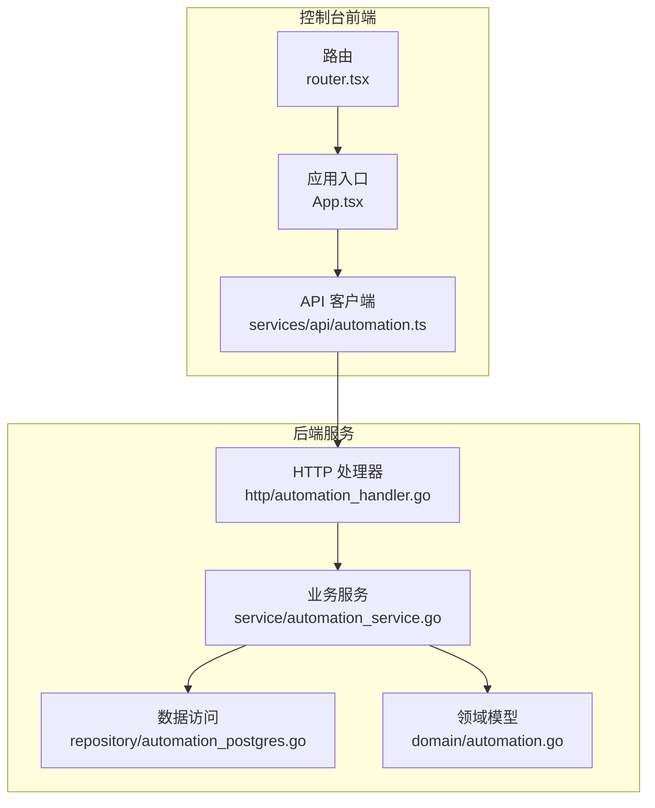
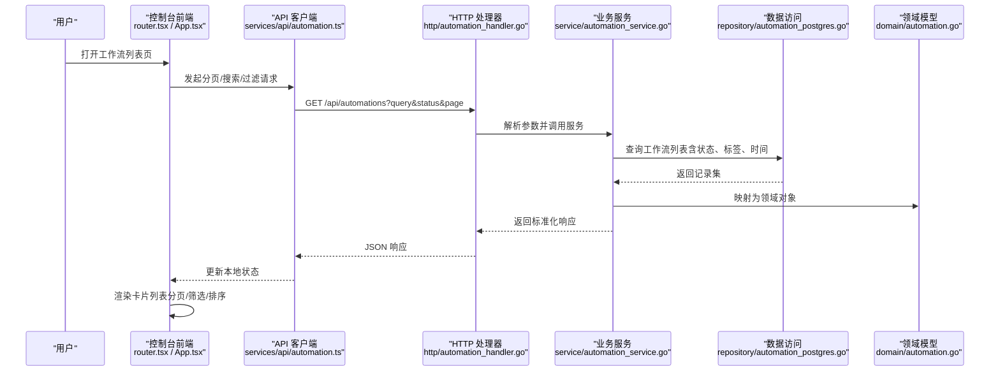
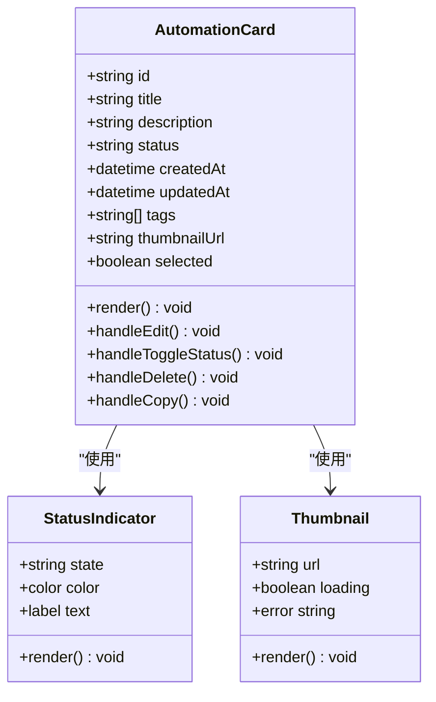
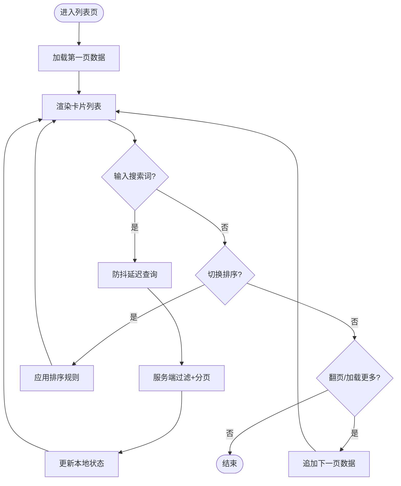
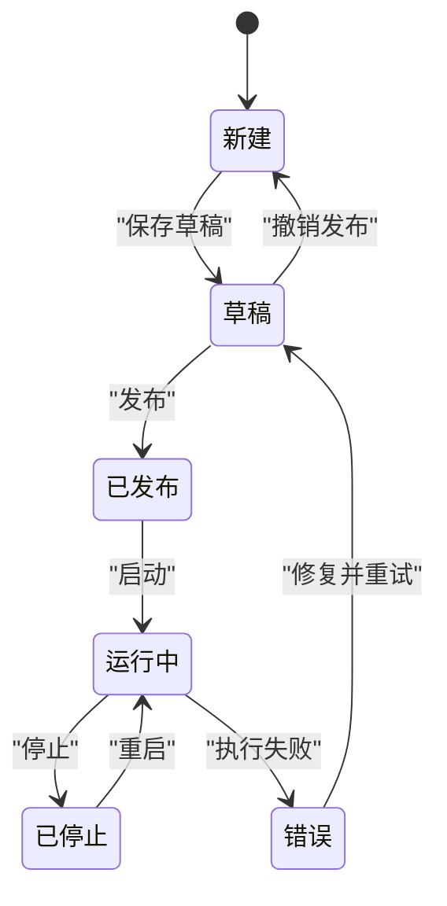
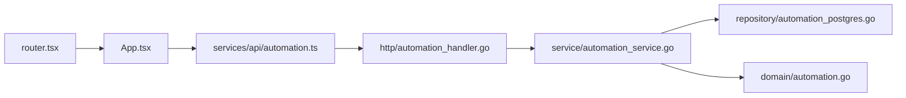

# 工作流卡片列表

<cite>
**本文引用的文件**   
- [automation_handler.go](file://notifuse/internal/http/automation_handler.go)
- [automation_service.go](file://notifuse/internal/service/automation_service.go)
- [automation_postgres.go](file://notifuse/internal/repository/automation_postgres.go)
- [automation.go](file://notifuse/internal/domain/automation.go)
- [router.tsx](file://notifuse/console/src/router.tsx)
- [App.tsx](file://notifuse/console/src/App.tsx)
- [automation.ts](file://notifuse/console/src/services/api/automation.ts)
</cite>

## 目录
1. [简介](#简介)
2. [项目结构](#项目结构)
3. [核心组件](#核心组件)
4. [架构总览](#架构总览)
5. [详细组件分析](#详细组件分析)
6. [依赖分析](#依赖分析)
7. [性能考虑](#性能考虑)
8. [故障排查指南](#故障排查指南)
9. [结论](#结论)
10. [附录](#附录)

## 简介
本文件围绕“自动化工作流卡片列表”的前端展示与后端能力，系统性梳理从页面路由、API 服务到领域模型与数据访问的完整链路。重点覆盖：
- 工作流信息展示（名称、描述、状态、创建时间等）
- 状态指示器（运行中、已启用、已禁用、错误等）
- 操作按钮（编辑、复制、删除、启停、导入导出）
- 预览缩略图（工作流拓扑或首节点截图）
- 列表渲染优化（虚拟滚动、分页加载、增量更新）
- 搜索与过滤（关键词、状态、标签、排序）
- 生命周期状态管理（新建、草稿、已发布、运行中、停止、错误）
- 权限控制（基于角色与工作空间的访问控制）
- 操作反馈（成功/失败提示、批量操作结果）
- 排序、筛选、批量操作与导入导出
- 主题定制与响应式适配方案

## 项目结构
前端控制台位于 console 子工程，后端 API 与服务逻辑位于 internal 目录。关键路径如下：
- 前端路由与入口：console/src/router.tsx、console/src/App.tsx
- 前端 API 客户端：console/src/services/api/automation.ts
- 后端 HTTP 处理器：internal/http/automation_handler.go
- 后端业务服务：internal/service/automation_service.go
- 后端数据访问：internal/repository/automation_postgres.go
- 领域模型：internal/domain/automation.go

图表来源
- [router.tsx](file://notifuse/console/src/router.tsx)
- [App.tsx](file://notifuse/console/src/App.tsx)
- [automation.ts](file://notifuse/console/src/services/api/automation.ts)
- [automation_handler.go](file://notifuse/internal/http/automation_handler.go)
- [automation_service.go](file://notifuse/internal/service/automation_service.go)
- [automation_postgres.go](file://notifuse/internal/repository/automation_postgres.go)
- [automation.go](file://notifuse/internal/domain/automation.go)

章节来源
- [router.tsx](file://notifuse/console/src/router.tsx)
- [App.tsx](file://notifuse/console/src/App.tsx)
- [automation.ts](file://notifuse/console/src/services/api/automation.ts)
- [automation_handler.go](file://notifuse/internal/http/automation_handler.go)
- [automation_service.go](file://notifuse/internal/service/automation_service.go)
- [automation_postgres.go](file://notifuse/internal/repository/automation_postgres.go)
- [automation.go](file://notifuse/internal/domain/automation.go)

## 核心组件
- AutomationCard 组件（前端）
  - 职责：渲染单条工作流卡片，包含标题、描述、状态指示器、操作按钮、预览缩略图、标签与更新时间等。
  - 交互：点击打开编辑器；悬停显示快捷操作；支持多选参与批量操作。
  - 可访问性：键盘导航、ARIA 标签、焦点顺序。
- 卡片列表容器（前端）
  - 职责：聚合卡片、提供搜索框、筛选面板、排序选择器、分页控件、批量操作栏。
  - 性能：分页加载、懒加载缩略图、可选虚拟滚动。
- 工作流状态机（前后端协同）
  - 状态：新建、草稿、已发布、运行中、已停止、错误。
  - 转换：由用户操作触发，经权限校验后调用后端服务更新。
- 权限与上下文（前后端）
  - 前端：根据当前用户角色与工作空间决定可见操作。
  - 后端：在处理器或服务层校验工作空间与角色。

章节来源
- [automation_handler.go](file://notifuse/internal/http/automation_handler.go)
- [automation_service.go](file://notifuse/internal/service/automation_service.go)
- [automation_postgres.go](file://notifuse/internal/repository/automation_postgres.go)
- [automation.go](file://notifuse/internal/domain/automation.go)
- [automation.ts](file://notifuse/console/src/services/api/automation.ts)

## 架构总览
以下序列图展示了“获取工作流列表并渲染卡片”的典型流程，涵盖前端请求、后端处理、数据访问与返回。

图表来源
- [automation.ts](file://notifuse/console/src/services/api/automation.ts)
- [automation_handler.go](file://notifuse/internal/http/automation_handler.go)
- [automation_service.go](file://notifuse/internal/service/automation_service.go)
- [automation_postgres.go](file://notifuse/internal/repository/automation_postgres.go)
- [automation.go](file://notifuse/internal/domain/automation.go)

## 详细组件分析

### 卡片组件 AutomationCard
- 展示字段
  - 标题、描述摘要、状态指示器、创建/更新时间、标签、预览缩略图。
- 状态指示器
  - 颜色与文案随状态变化（如：运行中=绿色脉冲、错误=红色）。
- 操作按钮
  - 编辑、复制、删除、启停、查看日志、分享链接。
  - 受权限控制：仅拥有相应角色的用户可见。
- 预览缩略图
  - 懒加载，占位骨架屏，失败回退至默认图标。
- 交互细节
  - 悬停显示操作菜单；点击卡片进入编辑器；支持多选参与批量操作。

图表来源
- [automation_handler.go](file://notifuse/internal/http/automation_handler.go)
- [automation_service.go](file://notifuse/internal/service/automation_service.go)
- [automation_postgres.go](file://notifuse/internal/repository/automation_postgres.go)
- [automation.go](file://notifuse/internal/domain/automation.go)

章节来源
- [automation_handler.go](file://notifuse/internal/http/automation_handler.go)
- [automation_service.go](file://notifuse/internal/service/automation_service.go)
- [automation_postgres.go](file://notifuse/internal/repository/automation_postgres.go)
- [automation.go](file://notifuse/internal/domain/automation.go)

### 卡片列表容器与渲染优化
- 渲染策略
  - 分页加载：每页固定数量，避免一次性渲染大量 DOM。
  - 虚拟滚动：当数据量较大时，仅渲染可视区域卡片。
  - 图片懒加载：缩略图按需加载，减少带宽与内存占用。
- 搜索与过滤
  - 关键词搜索：匹配标题、描述、标签。
  - 状态筛选：按运行中/已启用/已禁用/错误等过滤。
  - 标签筛选：多标签组合过滤。
  - 排序：按创建时间、更新时间、名称字母序。
- 批量操作
  - 全选/反选、批量启停、批量删除、批量导出。
  - 操作前二次确认，完成后统一反馈。

图表来源
- [automation.ts](file://notifuse/console/src/services/api/automation.ts)
- [automation_handler.go](file://notifuse/internal/http/automation_handler.go)
- [automation_service.go](file://notifuse/internal/service/automation_service.go)
- [automation_postgres.go](file://notifuse/internal/repository/automation_postgres.go)

章节来源
- [automation.ts](file://notifuse/console/src/services/api/automation.ts)
- [automation_handler.go](file://notifuse/internal/http/automation_handler.go)
- [automation_service.go](file://notifuse/internal/service/automation_service.go)
- [automation_postgres.go](file://notifuse/internal/repository/automation_postgres.go)

### 工作流生命周期与状态管理
- 状态定义
  - 新建、草稿、已发布、运行中、已停止、错误。
- 状态转换规则
  - 新建→草稿：保存未发布版本。
  - 草稿→已发布：提交并发布。
  - 已发布→运行中：启动执行器。
  - 运行中→已停止：手动停止或异常恢复。
  - 任何状态→错误：执行失败或校验不通过。
- 前端状态同步
  - 乐观更新：先更新 UI，再异步调用后端，失败则回滚。
  - 全局通知：成功/失败提示，错误详情可展开。
- 后端一致性
  - 事务保护：状态变更与审计日志写入在同一事务。
  - 幂等性：重复请求不会导致多次状态切换。

图表来源
- [automation.go](file://notifuse/internal/domain/automation.go)
- [automation_service.go](file://notifuse/internal/service/automation_service.go)
- [automation_handler.go](file://notifuse/internal/http/automation_handler.go)

章节来源
- [automation.go](file://notifuse/internal/domain/automation.go)
- [automation_service.go](file://notifuse/internal/service/automation_service.go)
- [automation_handler.go](file://notifuse/internal/http/automation_handler.go)

### 权限控制与操作反馈
- 前端权限
  - 根据当前用户角色与工作空间动态显示操作按钮。
  - 无权限时隐藏或禁用按钮，并提供提示。
- 后端权限
  - 处理器在服务调用前校验工作空间归属与角色。
  - 越权访问直接拒绝并返回标准错误码。
- 操作反馈
  - 成功：轻量 Toast 提示。
  - 失败：错误弹窗，支持重试与查看详情。
  - 批量操作：汇总结果，逐项失败可单独重试。

章节来源
- [automation_handler.go](file://notifuse/internal/http/automation_handler.go)
- [automation_service.go](file://notifuse/internal/service/automation_service.go)

### 导入与导出
- 导入
  - 支持 JSON/YAML 格式的工作流定义上传。
  - 校验语法与依赖，冲突时给出合并建议。
  - 导入后可选择覆盖或另存为新版本。
- 导出
  - 支持导出选中工作流的定义与配置。
  - 批量导出打包为压缩包下载。

章节来源
- [automation_handler.go](file://notifuse/internal/http/automation_handler.go)
- [automation_service.go](file://notifuse/internal/service/automation_service.go)

### 主题定制与响应式适配
- 主题定制
  - 通过 CSS 变量或主题上下文提供颜色、圆角、阴影、间距等可调项。
  - 支持明暗模式切换，状态指示器颜色自适应。
- 响应式适配
  - 网格布局：大屏多列、平板双列、手机单列。
  - 卡片内容自适应：长文本截断、缩略图比例保持。
  - 触摸友好：增大点击区域与手势支持。

章节来源
- [automation.ts](file://notifuse/console/src/services/api/automation.ts)
- [App.tsx](file://notifuse/console/src/App.tsx)

## 依赖分析
- 前端依赖
  - router.tsx 与 App.tsx 负责路由与应用初始化。
  - automation.ts 封装 API 请求，提供分页、搜索、过滤、排序等方法。
- 后端依赖
  - automation_handler.go 接收 HTTP 请求，解析参数，调用服务层。
  - automation_service.go 实现业务逻辑，包括状态转换、权限校验、导入导出。
  - automation_postgres.go 负责数据库查询与分页。
  - automation.go 定义领域模型与枚举。

图表来源
- [router.tsx](file://notifuse/console/src/router.tsx)
- [App.tsx](file://notifuse/console/src/App.tsx)
- [automation.ts](file://notifuse/console/src/services/api/automation.ts)
- [automation_handler.go](file://notifuse/internal/http/automation_handler.go)
- [automation_service.go](file://notifuse/internal/service/automation_service.go)
- [automation_postgres.go](file://notifuse/internal/repository/automation_postgres.go)
- [automation.go](file://notifuse/internal/domain/automation.go)

章节来源
- [router.tsx](file://notifuse/console/src/router.tsx)
- [App.tsx](file://notifuse/console/src/App.tsx)
- [automation.ts](file://notifuse/console/src/services/api/automation.ts)
- [automation_handler.go](file://notifuse/internal/http/automation_handler.go)
- [automation_service.go](file://notifuse/internal/service/automation_service.go)
- [automation_postgres.go](file://notifuse/internal/repository/automation_postgres.go)
- [automation.go](file://notifuse/internal/domain/automation.go)

## 性能考虑
- 列表渲染
  - 分页加载优先于全量拉取；大数据量场景启用虚拟滚动。
  - 卡片组件拆分，避免不必要的重渲染。
- 网络请求
  - 请求去重与缓存：相同参数的请求复用结果。
  - 防抖与节流：搜索输入与窗口尺寸变化事件。
- 资源加载
  - 缩略图懒加载与占位骨架屏。
  - 静态资源压缩与 CDN 加速。
- 后端优化
  - 数据库索引：按工作空间、状态、更新时间建立索引。
  - 分页 SQL 优化：只选取必要字段，避免 N+1 查询。

[本节为通用指导，无需特定文件来源]

## 故障排查指南
- 常见问题
  - 列表空白：检查分页参数与权限；确认后端返回结构与前端期望一致。
  - 状态不同步：检查状态转换接口是否幂等；确认前端乐观更新回滚逻辑。
  - 缩略图加载失败：检查资源 URL 与跨域策略；提供降级图标。
  - 批量操作部分失败：定位失败项的错误码与原因，支持单项重试。
- 调试建议
  - 前端：开启网络面板，观察请求与响应；打印本地状态快照。
  - 后端：记录关键步骤日志，包括参数校验、权限校验、状态变更。
  - 数据库：慢查询分析与索引命中情况。

章节来源
- [automation_handler.go](file://notifuse/internal/http/automation_handler.go)
- [automation_service.go](file://notifuse/internal/service/automation_service.go)
- [automation_postgres.go](file://notifuse/internal/repository/automation_postgres.go)

## 结论
工作流卡片列表通过清晰的分层架构与良好的前端交互设计，实现了高效的信息展示与丰富的操作能力。结合分页、搜索、排序、批量操作与导入导出，满足复杂场景下的管理与协作需求。通过权限控制与完善的错误反馈机制，保障系统的安全性与用户体验。后续可在虚拟滚动、缓存策略与数据库索引方面持续优化，以应对更大规模的数据与更高并发。

[本节为总结性内容，无需特定文件来源]

## 附录
- 术语表
  - 工作流：由多个节点组成的自动化任务流程。
  - 状态指示器：用于直观表达工作流当前状态的视觉元素。
  - 预览缩略图：工作流拓扑或首节点的可视化缩略图。
- 最佳实践
  - 前端：组件职责单一、状态集中管理、错误边界兜底。
  - 后端：接口幂等、事务一致、日志可追踪。
  - 数据库：合理索引、分页查询、避免大事务。

[本节为补充说明，无需特定文件来源]