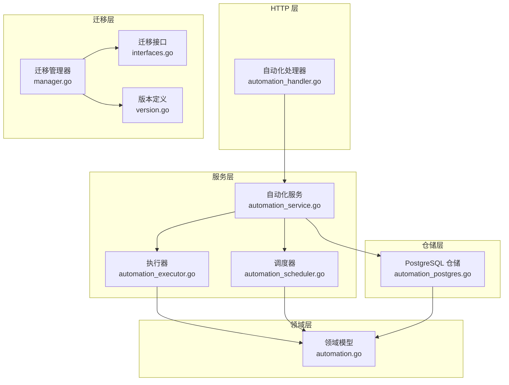
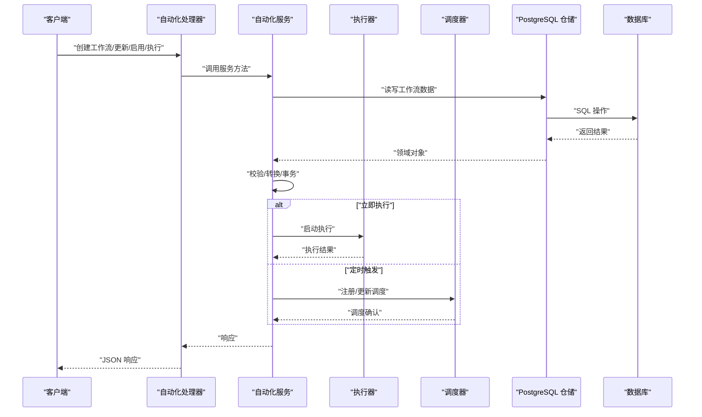
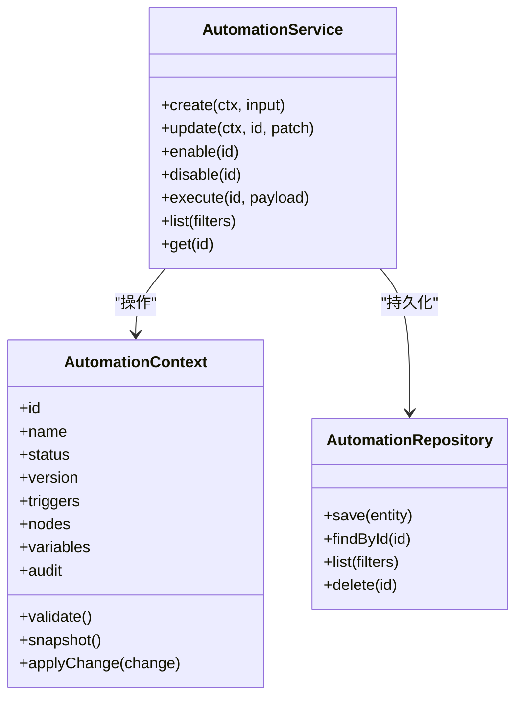
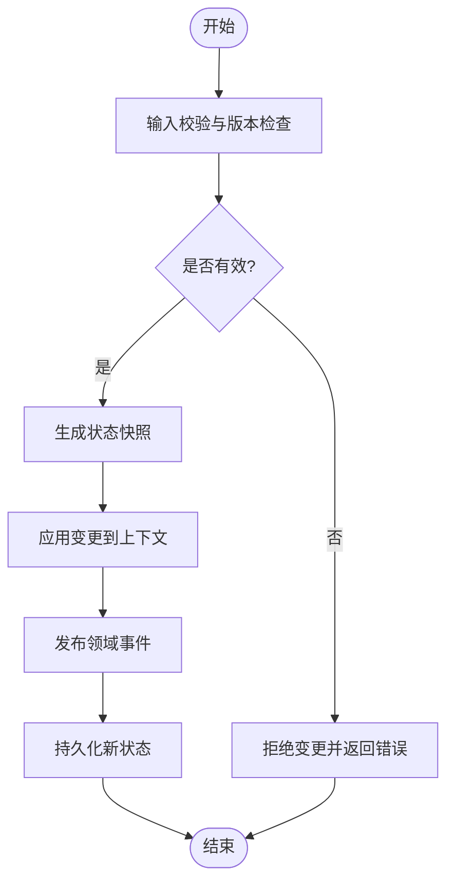
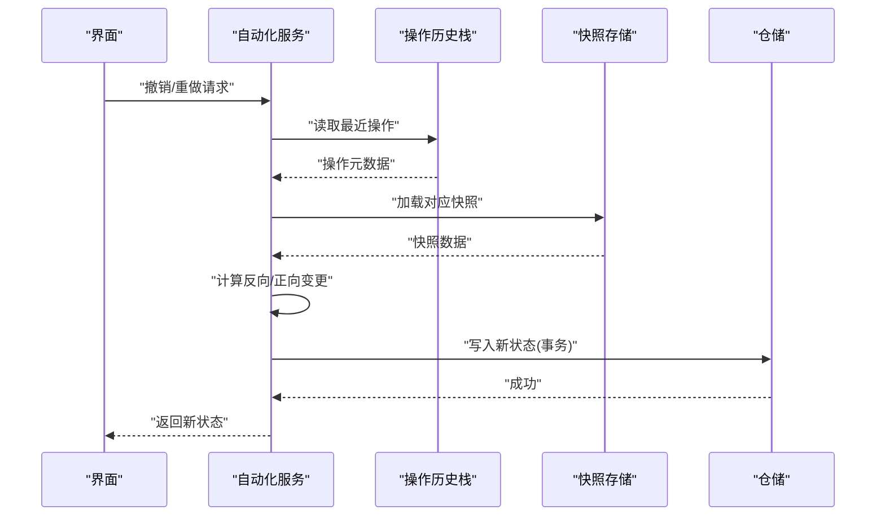
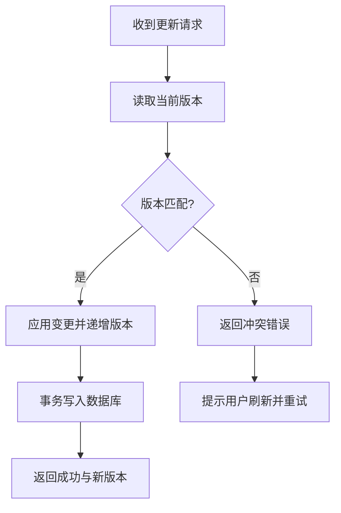
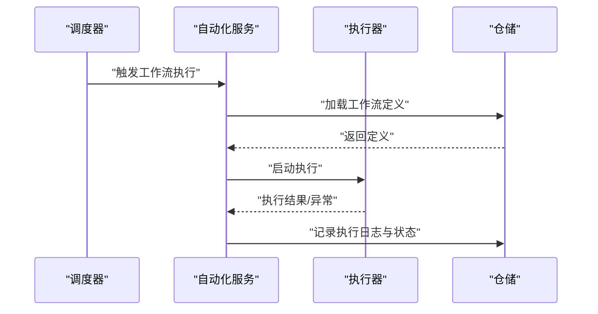
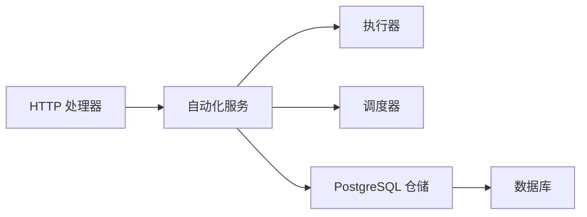

# 工作流状态管理

<cite>
**本文引用的文件**   
- [automation.go](file://notifuse/internal/domain/automation.go)
- [automation_service.go](file://notifuse/internal/service/automation_service.go)
- [automation_executor.go](file://notifuse/internal/service/automation_executor.go)
- [automation_scheduler.go](file://notifuse/internal/service/automation_scheduler.go)
- [automation_handler.go](file://notifuse/internal/http/automation_handler.go)
- [automation_postgres.go](file://notifuse/internal/repository/automation_postgres.go)
- [migrations/interfaces.go](file://notifuse/internal/migrations/interfaces.go)
- [migrations/manager.go](file://notifuse/internal/migrations/manager.go)
- [migrations/version.go](file://notifuse/internal/migrations/version.go)
</cite>

## 目录
1. [简介](#简介)
2. [项目结构](#项目结构)
3. [核心组件](#核心组件)
4. [架构总览](#架构总览)
5. [详细组件分析](#详细组件分析)
6. [依赖关系分析](#依赖关系分析)
7. [性能考虑](#性能考虑)
8. [故障排查指南](#故障排查指南)
9. [结论](#结论)
10. [附录](#附录)

## 简介
本文件围绕“工作流状态管理系统”进行系统化文档化，聚焦于自动化上下文（AutomationContext）的状态设计、变更管理与事件订阅机制；深入阐述撤销/重做实现原理（操作历史栈、状态快照与重放）；并覆盖工作流的保存/加载、版本控制与并发编辑冲突解决。同时给出状态持久化、增量同步与数据一致性保证策略，以及性能优化与调试工具使用建议。

## 项目结构
本项目采用分层架构：领域模型位于 domain 层，服务编排在 service 层，HTTP 接口在 http 层，数据访问在 repository 层，数据库迁移在 migrations 层。自动化工作流相关代码主要分布在以下路径：
- 领域模型：internal/domain/automation.go
- 服务层：internal/service/automation_*.go
- HTTP 层：internal/http/automation_handler.go
- 仓储层：internal/repository/automation_postgres.go
- 迁移层：internal/migrations/*.go

图表来源
- [automation_handler.go](file://notifuse/internal/http/automation_handler.go)
- [automation_service.go](file://notifuse/internal/service/automation_service.go)
- [automation_executor.go](file://notifuse/internal/service/automation_executor.go)
- [automation_scheduler.go](file://notifuse/internal/service/automation_scheduler.go)
- [automation.go](file://notifuse/internal/domain/automation.go)
- [automation_postgres.go](file://notifuse/internal/repository/automation_postgres.go)
- [migrations/interfaces.go](file://notifuse/internal/migrations/interfaces.go)
- [migrations/manager.go](file://notifuse/internal/migrations/manager.go)
- [migrations/version.go](file://notifuse/internal/migrations/version.go)

章节来源
- [automation.go](file://notifuse/internal/domain/automation.go)
- [automation_service.go](file://notifuse/internal/service/automation_service.go)
- [automation_executor.go](file://notifuse/internal/service/automation_executor.go)
- [automation_scheduler.go](file://notifuse/internal/service/automation_scheduler.go)
- [automation_handler.go](file://notifuse/internal/http/automation_handler.go)
- [automation_postgres.go](file://notifuse/internal/repository/automation_postgres.go)
- [migrations/interfaces.go](file://notifuse/internal/migrations/interfaces.go)
- [migrations/manager.go](file://notifuse/internal/migrations/manager.go)
- [migrations/version.go](file://notifuse/internal/migrations/version.go)

## 核心组件
- 领域模型（AutomationContext）：承载工作流定义、运行时上下文、触发条件、节点配置、执行结果与审计信息。其字段与行为是状态管理的基石。
- 自动化服务（AutomationService）：协调工作流的创建、更新、启用/禁用、执行、查询与生命周期管理，封装业务规则与事务边界。
- 执行器（AutomationExecutor）：负责将工作流实例化并驱动节点执行，处理错误、重试与回调。
- 调度器（AutomationScheduler）：基于时间或外部事件触发工作流，维护定时任务与幂等性。
- HTTP 处理器（AutomationHandler）：暴露 REST API，接收前端请求，调用服务层完成状态变更。
- PostgreSQL 仓储（AutomationRepository）：提供工作流数据的持久化、查询与分页能力。
- 迁移系统（Migrations）：管理数据库 schema 演进，确保版本一致性与可回滚。

章节来源
- [automation.go](file://notifuse/internal/domain/automation.go)
- [automation_service.go](file://notifuse/internal/service/automation_service.go)
- [automation_executor.go](file://notifuse/internal/service/automation_executor.go)
- [automation_scheduler.go](file://notifuse/internal/service/automation_scheduler.go)
- [automation_handler.go](file://notifuse/internal/http/automation_handler.go)
- [automation_postgres.go](file://notifuse/internal/repository/automation_postgres.go)
- [migrations/interfaces.go](file://notifuse/internal/migrations/interfaces.go)
- [migrations/manager.go](file://notifuse/internal/migrations/manager.go)
- [migrations/version.go](file://notifuse/internal/migrations/version.go)

## 架构总览
下图展示了从 HTTP 请求到领域模型与持久化的完整链路，以及执行与调度的关键交互。

图表来源
- [automation_handler.go](file://notifuse/internal/http/automation_handler.go)
- [automation_service.go](file://notifuse/internal/service/automation_service.go)
- [automation_executor.go](file://notifuse/internal/service/automation_executor.go)
- [automation_scheduler.go](file://notifuse/internal/service/automation_scheduler.go)
- [automation_postgres.go](file://notifuse/internal/repository/automation_postgres.go)

## 详细组件分析

### 领域模型与上下文设计（AutomationContext）
- 职责：描述工作流的结构与运行时上下文，包括触发器、节点图、变量环境、执行日志与状态标记。
- 状态设计要点：
  - 显式状态机：如未启用、已启用、运行中、暂停、失败等，避免隐式状态漂移。
  - 不可变快照：对关键变更点生成快照，用于撤销/重做与审计。
  - 版本化：每次变更附带版本号与变更摘要，便于合并与冲突检测。
- 复杂度与数据结构：
  - 节点图通常以有向无环图表示，遍历时需避免循环引用。
  - 上下文变量采用作用域隔离，减少副作用传播。

章节来源
- [automation.go](file://notifuse/internal/domain/automation.go)

#### 类图（领域模型与服务交互）

图表来源
- [automation.go](file://notifuse/internal/domain/automation.go)
- [automation_service.go](file://notifuse/internal/service/automation_service.go)
- [automation_postgres.go](file://notifuse/internal/repository/automation_postgres.go)

### 状态变更管理与事件订阅
- 变更入口：通过服务层的 update/patch 方法统一进入，内部进行校验、版本检查与事务包裹。
- 事件订阅：
  - 工作流状态变更时发布领域事件（如“工作流启用”、“节点失败”）。
  - 订阅者可以是审计记录、指标上报、通知中心等。
- 幂等与去抖：
  - 基于版本号与唯一约束防止重复提交。
  - 对高频事件进行聚合与节流，降低下游压力。

图表来源
- [automation_service.go](file://notifuse/internal/service/automation_service.go)
- [automation.go](file://notifuse/internal/domain/automation.go)

章节来源
- [automation_service.go](file://notifuse/internal/service/automation_service.go)
- [automation.go](file://notifuse/internal/domain/automation.go)

### 撤销/重做功能实现原理
- 操作历史栈：
  - 每次成功变更入栈一条“操作元数据”（包含变更摘要、时间戳、用户标识、前后快照指针）。
  - 限制栈大小，避免内存膨胀；支持按工作流维度隔离。
- 状态快照：
  - 在关键节点（启用/禁用、重大结构变更）生成快照，存储为只读副本。
  - 快照压缩策略：仅保留差异字段或增量编码，降低存储成本。
- 重放机制：
  - 撤销：弹出最近操作，加载前快照并应用反向变更。
  - 重做：重新应用被撤销的操作，恢复后快照。
- 一致性保障：
  - 撤销/重做需在事务内完成，确保原子性。
  - 并发场景下使用乐观锁（版本号）避免覆盖。

图表来源
- [automation_service.go](file://notifuse/internal/service/automation_service.go)
- [automation.go](file://notifuse/internal/domain/automation.go)

章节来源
- [automation_service.go](file://notifuse/internal/service/automation_service.go)
- [automation.go](file://notifuse/internal/domain/automation.go)

### 保存、加载、版本控制与并发编辑冲突解决
- 保存与加载：
  - 保存：在服务层组装领域对象，交由仓储持久化。
  - 加载：根据 ID 或过滤器查询，转换为领域对象供上层使用。
- 版本控制：
  - 每个工作流实体携带版本号，更新时需匹配期望版本。
  - 变更日志记录摘要与时间线，便于回溯。
- 并发冲突解决：
  - 乐观锁：比较版本号，若不一致则拒绝并提示刷新。
  - 合并策略：对于结构化变更（如节点增删），可采用三方合并算法；简单场景建议强制刷新后人工合并。

图表来源
- [automation_service.go](file://notifuse/internal/service/automation_service.go)
- [automation_postgres.go](file://notifuse/internal/repository/automation_postgres.go)

章节来源
- [automation_service.go](file://notifuse/internal/service/automation_service.go)
- [automation_postgres.go](file://notifuse/internal/repository/automation_postgres.go)

### 状态持久化、增量同步与数据一致性
- 持久化：
  - 使用 PostgreSQL 作为主存储，仓储层封装 SQL 与映射逻辑。
  - 对大字段（如节点图、变量）采用 JSON/JSONB 类型，结合索引提升查询效率。
- 增量同步：
  - 对外暴露变更事件或增量拉取接口，支持下游系统按需同步。
  - 使用版本号或时间戳作为游标，避免全量扫描。
- 一致性：
  - 事务边界清晰，跨表写操作置于同一事务。
  - 幂等键与唯一约束防止重复写入。
  - 读写分离时注意最终一致性与缓存失效策略。

章节来源
- [automation_postgres.go](file://notifuse/internal/repository/automation_postgres.go)
- [automation_service.go](file://notifuse/internal/service/automation_service.go)

### 执行与调度（执行器与调度器）
- 执行器：
  - 将工作流实例化为可执行的节点序列，处理分支、并行与错误重试。
  - 提供执行上下文注入（变量、环境变量、凭据）。
- 调度器：
  - 支持定时触发（Cron）与事件触发（Webhook/消息队列）。
  - 维护任务状态与重试策略，确保可靠性。

图表来源
- [automation_scheduler.go](file://notifuse/internal/service/automation_scheduler.go)
- [automation_executor.go](file://notifuse/internal/service/automation_executor.go)
- [automation_service.go](file://notifuse/internal/service/automation_service.go)
- [automation_postgres.go](file://notifuse/internal/repository/automation_postgres.go)

章节来源
- [automation_scheduler.go](file://notifuse/internal/service/automation_scheduler.go)
- [automation_executor.go](file://notifuse/internal/service/automation_executor.go)
- [automation_service.go](file://notifuse/internal/service/automation_service.go)
- [automation_postgres.go](file://notifuse/internal/repository/automation_postgres.go)

### 数据库迁移与版本管理
- 迁移接口与管理器：
  - 定义统一的迁移接口，管理器负责顺序执行与回滚。
  - 版本文件集中管理，确保部署一致性。
- 最佳实践：
  - 迁移脚本幂等，支持多次运行不破坏数据。
  - 生产环境变更前进行预演与备份。

章节来源
- [migrations/interfaces.go](file://notifuse/internal/migrations/interfaces.go)
- [migrations/manager.go](file://notifuse/internal/migrations/manager.go)
- [migrations/version.go](file://notifuse/internal/migrations/version.go)

## 依赖关系分析
- 组件耦合：
  - HTTP 层仅依赖服务层，保持薄控制器。
  - 服务层组合执行器、调度器与仓储，职责清晰。
  - 领域模型独立于基础设施，便于测试与替换。
- 外部依赖：
  - PostgreSQL 作为持久化后端。
  - 可选的消息队列/定时器用于调度扩展。

图表来源
- [automation_handler.go](file://notifuse/internal/http/automation_handler.go)
- [automation_service.go](file://notifuse/internal/service/automation_service.go)
- [automation_executor.go](file://notifuse/internal/service/automation_executor.go)
- [automation_scheduler.go](file://notifuse/internal/service/automation_scheduler.go)
- [automation_postgres.go](file://notifuse/internal/repository/automation_postgres.go)

章节来源
- [automation_handler.go](file://notifuse/internal/http/automation_handler.go)
- [automation_service.go](file://notifuse/internal/service/automation_service.go)
- [automation_executor.go](file://notifuse/internal/service/automation_executor.go)
- [automation_scheduler.go](file://notifuse/internal/service/automation_scheduler.go)
- [automation_postgres.go](file://notifuse/internal/repository/automation_postgres.go)

## 性能考虑
- 快照与历史栈：
  - 限制历史栈长度，定期清理旧快照。
  - 使用增量编码与压缩减少存储体积。
- 查询优化：
  - 对工作流常用过滤字段建立索引。
  - 分页与懒加载大图结构（节点、变量）。
- 执行与调度：
  - 批量执行与批处理窗口，避免瞬时峰值。
  - 重试退避与熔断，保护下游依赖。
- 缓存策略：
  - 热点工作流定义缓存，设置合理 TTL 与失效策略。
  - 事件聚合与去抖，降低下游负载。

[本节为通用指导，无需特定文件来源]

## 故障排查指南
- 常见问题定位：
  - 版本冲突：检查更新时的版本号是否匹配，必要时刷新后再试。
  - 执行失败：查看执行日志与节点输出，定位具体失败节点。
  - 调度异常：确认定时表达式与系统时钟，检查任务队列健康。
- 调试建议：
  - 开启详细日志，记录关键状态变更与事件。
  - 使用快照对比工具快速识别差异。
  - 对高并发场景进行压测，观察锁竞争与超时情况。

章节来源
- [automation_service.go](file://notifuse/internal/service/automation_service.go)
- [automation_executor.go](file://notifuse/internal/service/automation_executor.go)
- [automation_scheduler.go](file://notifuse/internal/service/automation_scheduler.go)

## 结论
本工作流状态管理系统以清晰的领域模型为核心，通过服务层编排、执行器驱动与调度器触发，实现了可靠的状态变更、撤销/重做、版本控制与并发冲突处理。配合迁移系统与持久化策略，保障了数据一致性与可演进性。在生产环境中，应重视快照与历史栈的容量规划、查询与执行的性能优化，以及完善的监控与调试手段。

[本节为总结，无需特定文件来源]

## 附录
- 术语说明：
  - 工作流：由触发器与节点组成的可执行流程。
  - 上下文：工作流运行时的变量与环境集合。
  - 快照：某一时刻状态的只读副本。
  - 操作历史栈：记录变更操作的有序列表，支持撤销/重做。
- 参考实现路径：
  - 领域模型与上下文：[automation.go](file://notifuse/internal/domain/automation.go)
  - 服务编排与事务：[automation_service.go](file://notifuse/internal/service/automation_service.go)
  - 执行与调度：[automation_executor.go](file://notifuse/internal/service/automation_executor.go)、[automation_scheduler.go](file://notifuse/internal/service/automation_scheduler.go)
  - HTTP 接口：[automation_handler.go](file://notifuse/internal/http/automation_handler.go)
  - 持久化：[automation_postgres.go](file://notifuse/internal/repository/automation_postgres.go)
  - 迁移管理：[migrations/interfaces.go](file://notifuse/internal/migrations/interfaces.go)、[migrations/manager.go](file://notifuse/internal/migrations/manager.go)、[migrations/version.go](file://notifuse/internal/migrations/version.go)