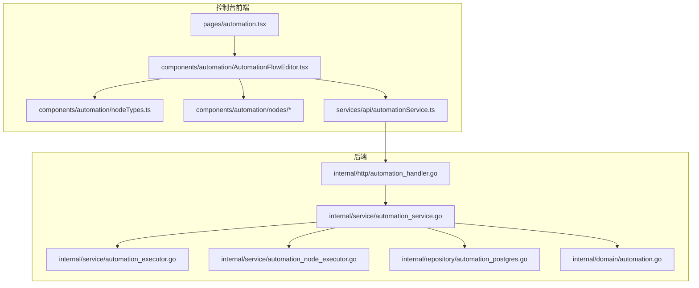
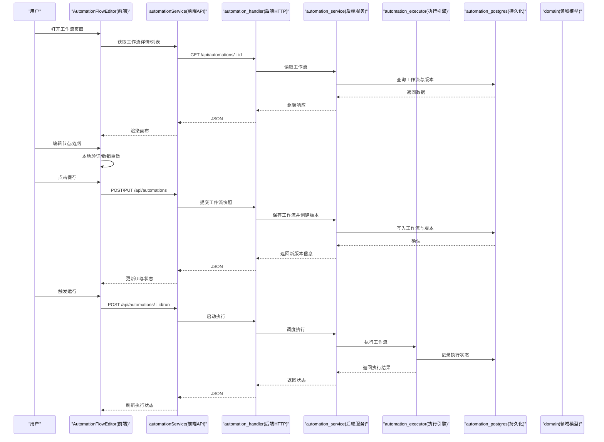
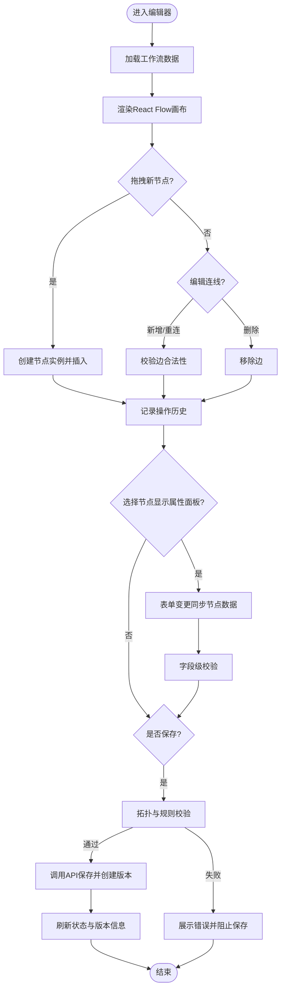
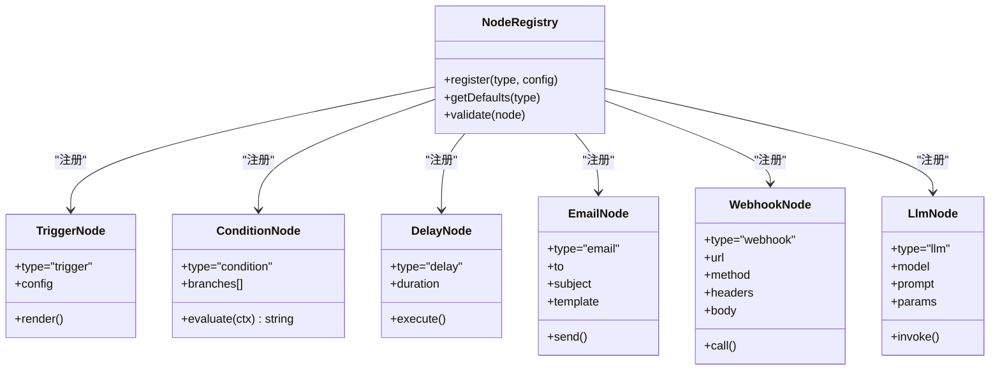
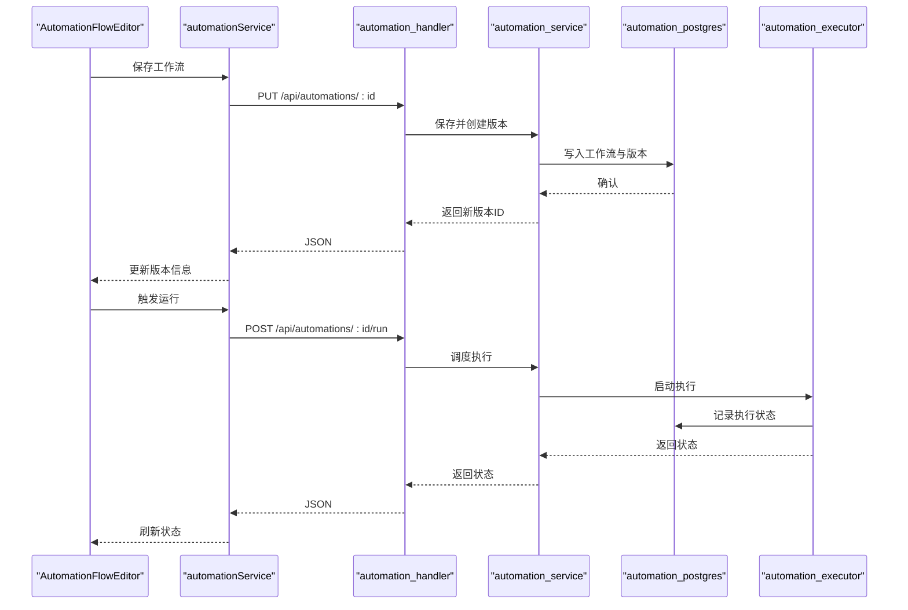
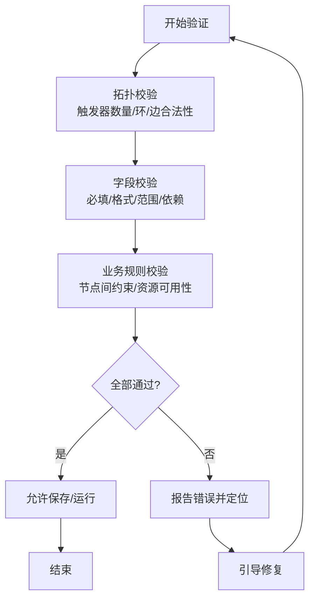
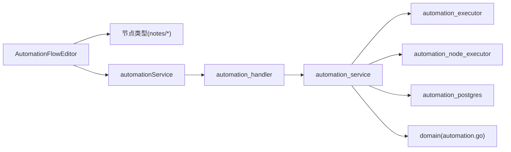

# 自动化工作流页面

<cite>
**本文引用的文件**   
- [automation.tsx](file://notifuse/console/src/pages/automation.tsx)
- [AutomationFlowEditor.tsx](file://notifuse/console/src/components/automation/AutomationFlowEditor.tsx)
- [nodeTypes.ts](file://notifuse/console/src/components/automation/nodeTypes.ts)
- [triggerNode.tsx](file://notifuse/console/src/components/automation/nodes/triggerNode.tsx)
- [conditionNode.tsx](file://notifuse/console/src/components/automation/nodes/conditionNode.tsx)
- [delayNode.tsx](file://notifuse/console/src/components/automation/nodes/delayNode.tsx)
- [emailNode.tsx](file://notifuse/console/src/components/automation/nodes/emailNode.tsx)
- [webhookNode.tsx](file://notifuse/console/src/components/automation/nodes/webhookNode.tsx)
- [llmNode.tsx](file://notifuse/console/src/components/automation/nodes/llmNode.tsx)
- [automationService.ts](file://notifuse/console/src/services/api/automationService.ts)
- [automationHandler.go](file://notifuse/internal/http/automation_handler.go)
- [automation_service.go](file://notifuse/internal/service/automation_service.go)
- [automation_executor.go](file://notifuse/internal/service/automation_executor.go)
- [automation_node_executor.go](file://notifuse/internal/service/automation_node_executor.go)
- [automation_postgres.go](file://notifuse/internal/repository/automation_postgres.go)
- [automation.go](file://notifuse/internal/domain/automation.go)
</cite>

## 目录
1. [简介](#简介)
2. [项目结构](#项目结构)
3. [核心组件](#核心组件)
4. [架构总览](#架构总览)
5. [详细组件分析](#详细组件分析)
6. [依赖关系分析](#依赖关系分析)
7. [性能考虑](#性能考虑)
8. [故障排查指南](#故障排查指南)
9. [结论](#结论)
10. [附录](#附录)

## 简介
本文件面向 Notifuse 控制台“自动化工作流”页面的前端实现与后端协作，重点围绕可视化工作流编辑器 AutomationFlowEditor 的核心实现进行系统化说明。内容涵盖：
- React Flow 的使用方式、节点拖拽、连线编辑与流程图渲染
- 各类节点类型（触发器、条件分支、延迟执行、邮件发送、Webhook、LLM 等）的实现要点
- 工作流的保存、加载、版本控制与执行状态管理
- 工作流验证、错误检测、撤销重做与协作编辑支持
- 复杂流程图的性能优化与用户体验改进方案

## 项目结构
自动化工作流相关的前端代码主要位于 console 子工程内，关键目录与职责如下：
- pages/automation.tsx：工作流页面入口，负责路由挂载、权限校验、数据加载与全局状态协调
- components/automation/AutomationFlowEditor.tsx：可视化编辑器主容器，集成 React Flow、工具栏、属性面板、撤销重做、验证与保存
- components/automation/nodeTypes.ts：节点类型注册表，统一声明节点 ID、默认配置、图标与分类
- components/automation/nodes/*：各节点类型的自定义 Node 组件与属性表单
- services/api/automationService.ts：工作流 CRUD、版本、执行与状态查询的 API 封装
- internal/http/automation_handler.go：HTTP 层处理函数，解析请求并调用服务层
- internal/service/automation_service.go：业务编排与服务接口
- internal/service/automation_executor.go / automation_node_executor.go：工作流与节点执行引擎
- internal/repository/automation_postgres.go：持久化访问层
- internal/domain/automation.go：领域模型定义（工作流、节点、边、版本、状态等）

图表来源
- [automation.tsx:1-200](file://notifuse/console/src/pages/automation.tsx#L1-L200)
- [AutomationFlowEditor.tsx:1-200](file://notifuse/console/src/components/automation/AutomationFlowEditor.tsx#L1-L200)
- [nodeTypes.ts:1-200](file://notifuse/console/src/components/automation/nodeTypes.ts#L1-L200)
- [automationService.ts:1-200](file://notifuse/console/src/services/api/automationService.ts#L1-L200)
- [automation_handler.go:1-200](file://notifuse/internal/http/automation_handler.go#L1-L200)
- [automation_service.go:1-200](file://notifuse/internal/service/automation_service.go#L1-L200)
- [automation_executor.go:1-200](file://notifuse/internal/service/automation_executor.go#L1-L200)
- [automation_node_executor.go:1-200](file://notifuse/internal/service/automation_node_executor.go#L1-L200)
- [automation_postgres.go:1-200](file://notifuse/internal/repository/automation_postgres.go#L1-L200)
- [automation.go:1-200](file://notifuse/internal/domain/automation.go#L1-L200)

章节来源
- [automation.tsx:1-200](file://notifuse/console/src/pages/automation.tsx#L1-L200)
- [AutomationFlowEditor.tsx:1-200](file://notifuse/console/src/components/automation/AutomationFlowEditor.tsx#L1-L200)
- [nodeTypes.ts:1-200](file://notifuse/console/src/components/automation/nodeTypes.ts#L1-L200)
- [automationService.ts:1-200](file://notifuse/console/src/services/api/automationService.ts#L1-L200)
- [automation_handler.go:1-200](file://notifuse/internal/http/automation_handler.go#L1-L200)
- [automation_service.go:1-200](file://notifuse/internal/service/automation_service.go#L1-L200)
- [automation_executor.go:1-200](file://notifuse/internal/service/automation_executor.go#L1-L200)
- [automation_node_executor.go:1-200](file://notifuse/internal/service/automation_node_executor.go#L1-L200)
- [automation_postgres.go:1-200](file://notifuse/internal/repository/automation_postgres.go#L1-L200)
- [automation.go:1-200](file://notifuse/internal/domain/automation.go#L1-L200)

## 核心组件
- 可视化编辑器 AutomationFlowEditor
  - 基于 React Flow 构建，提供画布、节点、边、工具栏、属性面板、撤销重做、验证与保存能力
  - 通过 nodeTypes 注册中心统一管理节点类型、默认值与 UI 行为
  - 将画布状态映射为领域模型，供保存与执行使用
- 节点类型体系
  - 触发器节点：事件源（如 Webhook、定时任务、外部系统回调）
  - 条件分支：根据表达式或上下文数据进行分流
  - 延迟执行：延时等待后继续流程
  - 动作节点：发送邮件、调用 Webhook、调用 LLM 等
- 服务层与持久化
  - 前端通过 automationService 调用后端 API
  - 后端由 handler 接收请求，service 编排业务逻辑，executor 驱动执行，repository 读写数据库
  - domain 定义工作流、节点、边、版本与状态等核心数据结构

章节来源
- [AutomationFlowEditor.tsx:1-200](file://notifuse/console/src/components/automation/AutomationFlowEditor.tsx#L1-L200)
- [nodeTypes.ts:1-200](file://notifuse/console/src/components/automation/nodeTypes.ts#L1-L200)
- [automationService.ts:1-200](file://notifuse/console/src/services/api/automationService.ts#L1-L200)
- [automation_handler.go:1-200](file://notifuse/internal/http/automation_handler.go#L1-L200)
- [automation_service.go:1-200](file://notifuse/internal/service/automation_service.go#L1-L200)
- [automation_executor.go:1-200](file://notifuse/internal/service/automation_executor.go#L1-L200)
- [automation_node_executor.go:1-200](file://notifuse/internal/service/automation_node_executor.go#L1-L200)
- [automation_postgres.go:1-200](file://notifuse/internal/repository/automation_postgres.go#L1-L200)
- [automation.go:1-200](file://notifuse/internal/domain/automation.go#L1-L200)

## 架构总览
下图展示了从前端到后端的端到端交互路径，包括保存、加载、版本管理与执行状态查询。

图表来源
- [automation.tsx:1-200](file://notifuse/console/src/pages/automation.tsx#L1-L200)
- [AutomationFlowEditor.tsx:1-200](file://notifuse/console/src/components/automation/AutomationFlowEditor.tsx#L1-L200)
- [automationService.ts:1-200](file://notifuse/console/src/services/api/automationService.ts#L1-L200)
- [automation_handler.go:1-200](file://notifuse/internal/http/automation_handler.go#L1-L200)
- [automation_service.go:1-200](file://notifuse/internal/service/automation_service.go#L1-L200)
- [automation_executor.go:1-200](file://notifuse/internal/service/automation_executor.go#L1-L200)
- [automation_postgres.go:1-200](file://notifuse/internal/repository/automation_postgres.go#L1-L200)
- [automation.go:1-200](file://notifuse/internal/domain/automation.go#L1-L200)

## 详细组件分析

### 可视化编辑器 AutomationFlowEditor
- 功能要点
  - 集成 React Flow 画布，支持节点拖拽、多选、删除、缩放与平移
  - 连线编辑：新增、删除、重连；对非法连接进行约束与提示
  - 属性面板：选中节点后展示对应表单，实时同步到画布状态
  - 撤销重做：维护操作历史栈，支持快捷键与按钮操作
  - 工作流验证：在保存前进行拓扑与字段级校验，阻止无效图
  - 保存与加载：将画布状态转换为领域模型，调用 API 完成持久化
- 关键交互流程
  - 节点添加：从侧边栏拖入 -> 生成节点实例 -> 插入画布 -> 更新历史记录
  - 连线编辑：从输出端口拖出 -> 吸附到输入端口 -> 校验连通性 -> 更新边集合
  - 属性修改：表单变更 -> 局部更新节点数据 -> 联动验证 -> 可选自动保存草稿
  - 保存：收集节点与边 -> 校验 -> 序列化 -> 调用 API -> 更新版本与状态

图表来源
- [AutomationFlowEditor.tsx:1-200](file://notifuse/console/src/components/automation/AutomationFlowEditor.tsx#L1-L200)
- [nodeTypes.ts:1-200](file://notifuse/console/src/components/automation/nodeTypes.ts#L1-L200)
- [automationService.ts:1-200](file://notifuse/console/src/services/api/automationService.ts#L1-L200)

章节来源
- [AutomationFlowEditor.tsx:1-200](file://notifuse/console/src/components/automation/AutomationFlowEditor.tsx#L1-L200)
- [nodeTypes.ts:1-200](file://notifuse/console/src/components/automation/nodeTypes.ts#L1-L200)
- [automationService.ts:1-200](file://notifuse/console/src/services/api/automationService.ts#L1-L200)

### 节点类型体系与实现
- 节点注册与默认配置
  - 通过 nodeTypes 集中声明所有节点类型，包含唯一 ID、标题、图标、分组、默认属性与校验规则
  - 便于扩展新节点类型，保持 UI 与行为一致
- 触发器节点（Trigger）
  - 作为工作流起点，绑定事件源（如 Webhook、定时任务、外部回调）
  - 属性包括事件类型、过滤条件、重试策略等
- 条件分支（Condition）
  - 支持多分支出口，每个分支可配置条件表达式
  - 运行时根据上下文数据决定流向
- 延迟执行（Delay）
  - 设置等待时长或时间点，用于异步任务或限流场景
- 邮件发送（Email）
  - 配置收件人、主题、模板变量、附件等
- Webhook 节点
  - 发起外部 HTTP 请求，支持方法、头、体、超时与重试
- LLM 节点
  - 调用大模型能力，支持模型选择、提示词模板、温度与最大令牌数

图表来源
- [nodeTypes.ts:1-200](file://notifuse/console/src/components/automation/nodeTypes.ts#L1-L200)
- [triggerNode.tsx:1-200](file://notifuse/console/src/components/automation/nodes/triggerNode.tsx#L1-L200)
- [conditionNode.tsx:1-200](file://notifuse/console/src/components/automation/nodes/conditionNode.tsx#L1-L200)
- [delayNode.tsx:1-200](file://notifuse/console/src/components/automation/nodes/delayNode.tsx#L1-L200)
- [emailNode.tsx:1-200](file://notifuse/console/src/components/automation/nodes/emailNode.tsx#L1-L200)
- [webhookNode.tsx:1-200](file://notifuse/console/src/components/automation/nodes/webhookNode.tsx#L1-L200)
- [llmNode.tsx:1-200](file://notifuse/console/src/components/automation/nodes/llmNode.tsx#L1-L200)

章节来源
- [nodeTypes.ts:1-200](file://notifuse/console/src/components/automation/nodeTypes.ts#L1-L200)
- [triggerNode.tsx:1-200](file://notifuse/console/src/components/automation/nodes/triggerNode.tsx#L1-L200)
- [conditionNode.tsx:1-200](file://notifuse/console/src/components/automation/nodes/conditionNode.tsx#L1-L200)
- [delayNode.tsx:1-200](file://notifuse/console/src/components/automation/nodes/delayNode.tsx#L1-L200)
- [emailNode.tsx:1-200](file://notifuse/console/src/components/automation/nodes/emailNode.tsx#L1-L200)
- [webhookNode.tsx:1-200](file://notifuse/console/src/components/automation/nodes/webhookNode.tsx#L1-L200)
- [llmNode.tsx:1-200](file://notifuse/console/src/components/automation/nodes/llmNode.tsx#L1-L200)

### 工作流保存、加载、版本控制与执行状态
- 保存与加载
  - 前端将画布状态序列化为领域模型，调用 API 保存；加载时反序列化为画布数据
- 版本控制
  - 每次保存创建新版本，支持回滚与对比
- 执行状态管理
  - 提供运行、停止、查看执行日志与状态的能力
  - 状态包括待执行、运行中、成功、失败、已取消等

图表来源
- [automationService.ts:1-200](file://notifuse/console/src/services/api/automationService.ts#L1-L200)
- [automation_handler.go:1-200](file://notifuse/internal/http/automation_handler.go#L1-L200)
- [automation_service.go:1-200](file://notifuse/internal/service/automation_service.go#L1-L200)
- [automation_executor.go:1-200](file://notifuse/internal/service/automation_executor.go#L1-L200)
- [automation_postgres.go:1-200](file://notifuse/internal/repository/automation_postgres.go#L1-L200)

章节来源
- [automationService.ts:1-200](file://notifuse/console/src/services/api/automationService.ts#L1-L200)
- [automation_handler.go:1-200](file://notifuse/internal/http/automation_handler.go#L1-L200)
- [automation_service.go:1-200](file://notifuse/internal/service/automation_service.go#L1-L200)
- [automation_executor.go:1-200](file://notifuse/internal/service/automation_executor.go#L1-L200)
- [automation_postgres.go:1-200](file://notifuse/internal/repository/automation_postgres.go#L1-L200)

### 工作流验证、错误检测、撤销重做与协作编辑
- 验证与错误检测
  - 拓扑校验：确保存在且仅有一个触发器、无环、边合法
  - 字段校验：必填项、格式、范围、依赖关系
  - 保存前预检：即时反馈错误位置与修复建议
- 撤销重做
  - 维护操作栈，支持批量操作合并与边界保护
- 协作编辑支持
  - 基于操作转换或冲突解决策略，允许多用户同时编辑
  - 实时同步与冲突提示，保证最终一致性

图表来源
- [AutomationFlowEditor.tsx:1-200](file://notifuse/console/src/components/automation/AutomationFlowEditor.tsx#L1-L200)
- [nodeTypes.ts:1-200](file://notifuse/console/src/components/automation/nodeTypes.ts#L1-L200)

章节来源
- [AutomationFlowEditor.tsx:1-200](file://notifuse/console/src/components/automation/AutomationFlowEditor.tsx#L1-L200)
- [nodeTypes.ts:1-200](file://notifuse/console/src/components/automation/nodeTypes.ts#L1-L200)

## 依赖关系分析
- 前端内部依赖
  - AutomationFlowEditor 依赖 nodeTypes 与具体节点组件，并通过 automationService 与后端通信
- 前后端契约
  - 通过 REST API 交换工作流、版本与执行状态数据
- 后端内部依赖
  - handler 调用 service，service 编排 executor 与 repository，domain 贯穿全链路

图表来源
- [AutomationFlowEditor.tsx:1-200](file://notifuse/console/src/components/automation/AutomationFlowEditor.tsx#L1-L200)
- [nodeTypes.ts:1-200](file://notifuse/console/src/components/automation/nodeTypes.ts#L1-L200)
- [automationService.ts:1-200](file://notifuse/console/src/services/api/automationService.ts#L1-L200)
- [automation_handler.go:1-200](file://notifuse/internal/http/automation_handler.go#L1-L200)
- [automation_service.go:1-200](file://notifuse/internal/service/automation_service.go#L1-L200)
- [automation_executor.go:1-200](file://notifuse/internal/service/automation_executor.go#L1-L200)
- [automation_node_executor.go:1-200](file://notifuse/internal/service/automation_node_executor.go#L1-L200)
- [automation_postgres.go:1-200](file://notifuse/internal/repository/automation_postgres.go#L1-L200)
- [automation.go:1-200](file://notifuse/internal/domain/automation.go#L1-L200)

章节来源
- [AutomationFlowEditor.tsx:1-200](file://notifuse/console/src/components/automation/AutomationFlowEditor.tsx#L1-L200)
- [nodeTypes.ts:1-200](file://notifuse/console/src/components/automation/nodeTypes.ts#L1-L200)
- [automationService.ts:1-200](file://notifuse/console/src/services/api/automationService.ts#L1-L200)
- [automation_handler.go:1-200](file://notifuse/internal/http/automation_handler.go#L1-L200)
- [automation_service.go:1-200](file://notifuse/internal/service/automation_service.go#L1-L200)
- [automation_executor.go:1-200](file://notifuse/internal/service/automation_executor.go#L1-L200)
- [automation_node_executor.go:1-200](file://notifuse/internal/service/automation_node_executor.go#L1-L200)
- [automation_postgres.go:1-200](file://notifuse/internal/repository/automation_postgres.go#L1-L200)
- [automation.go:1-200](file://notifuse/internal/domain/automation.go#L1-L200)

## 性能考虑
- 渲染性能
  - 节点虚拟化与懒加载：仅渲染可视区域节点，减少初始渲染开销
  - 节点去重与稳定键：避免不必要的重绘
  - 批量更新：合并多次属性变更，降低重排次数
- 交互体验
  - 防抖与节流：拖拽、缩放、搜索等高频操作的节流
  - 预览与草稿：自动保存草稿，避免频繁网络请求
- 执行性能
  - 节点并行度控制：限制并发，防止下游服务过载
  - 超时与重试：合理配置超时与退避策略
  - 状态缓存：热点工作流元数据缓存，加速加载

[本节为通用性能指导，不直接分析具体文件]

## 故障排查指南
- 常见问题
  - 无法保存：检查拓扑与字段校验错误，确认必填项与依赖关系
  - 连线异常：确认端口类型匹配，避免自环与重复边
  - 执行失败：查看执行日志与节点输出，确认外部服务可达性与鉴权
- 调试建议
  - 启用详细日志：记录关键步骤与错误堆栈
  - 断点与回放：复现问题路径，定位根因
  - 版本对比：对比最近两次版本差异，快速定位回归

章节来源
- [AutomationFlowEditor.tsx:1-200](file://notifuse/console/src/components/automation/AutomationFlowEditor.tsx#L1-L200)
- [automation_handler.go:1-200](file://notifuse/internal/http/automation_handler.go#L1-L200)
- [automation_service.go:1-200](file://notifuse/internal/service/automation_service.go#L1-L200)
- [automation_executor.go:1-200](file://notifuse/internal/service/automation_executor.go#L1-L200)

## 结论
本文件系统性梳理了 Notifuse 控制台自动化工作流页面的前端实现与后端协作机制。通过模块化节点类型、完善的验证与版本控制、以及稳健的执行引擎，实现了高可用、可扩展的可视化工作流平台。后续可在协作编辑、实时同步与更丰富的节点生态方面持续演进。

## 附录
- 术语
  - 工作流：由节点与边组成的有向图，描述自动化流程
  - 节点：流程中的最小执行单元
  - 边：节点之间的连接，表示数据与控制流
  - 版本：工作流的不可变快照，支持回滚与对比
  - 执行状态：工作流运行的生命周期状态

[本节为概念性补充，不直接分析具体文件]