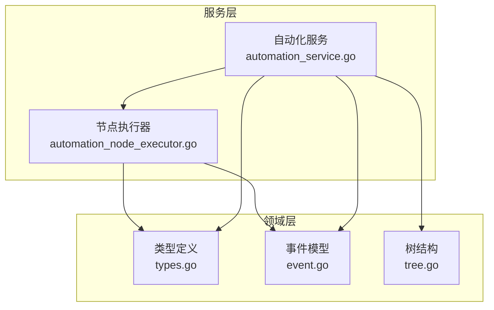
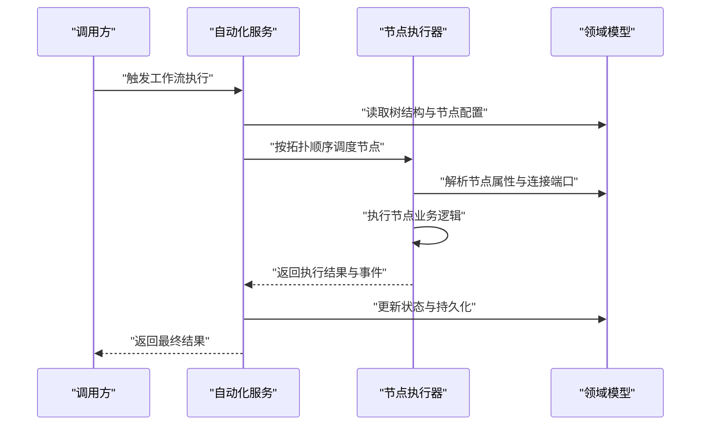
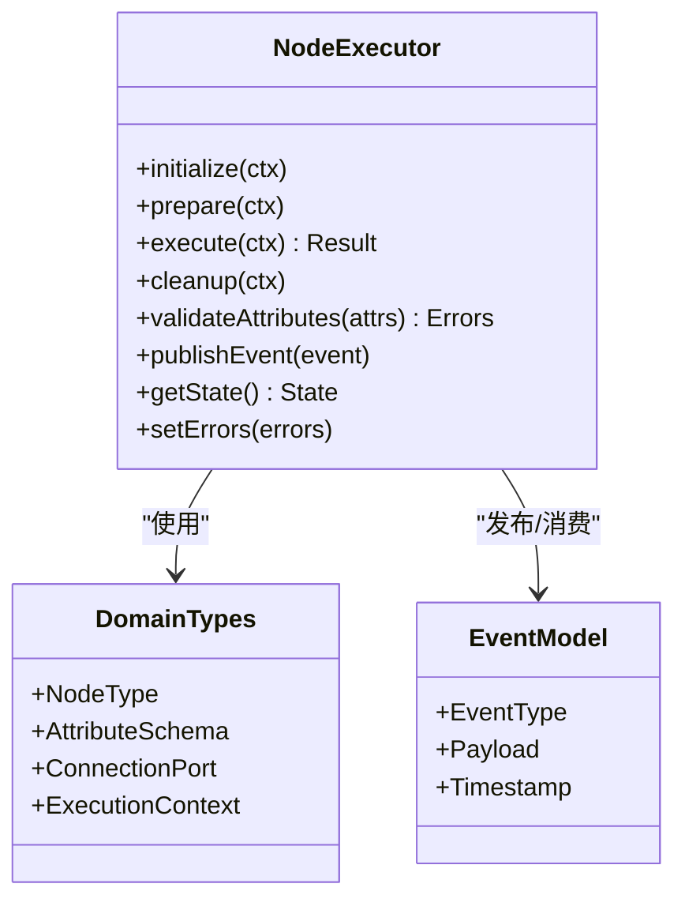
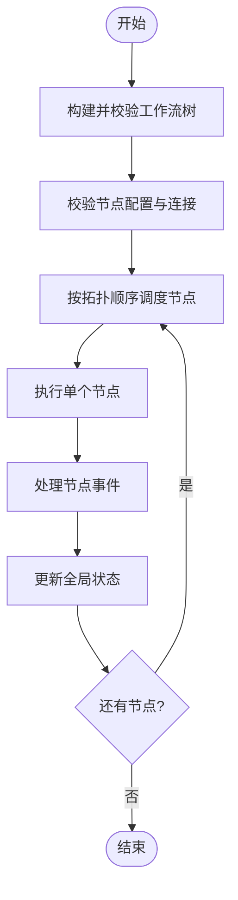
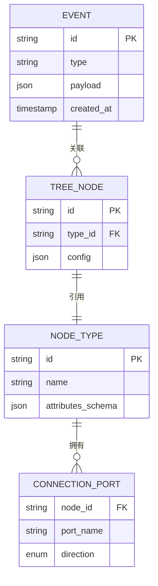
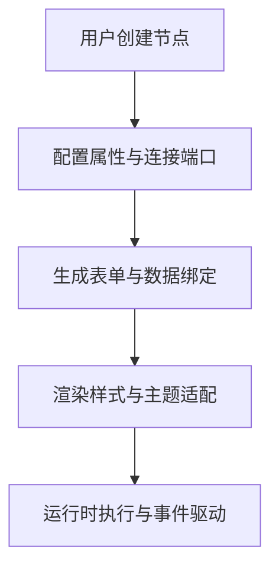
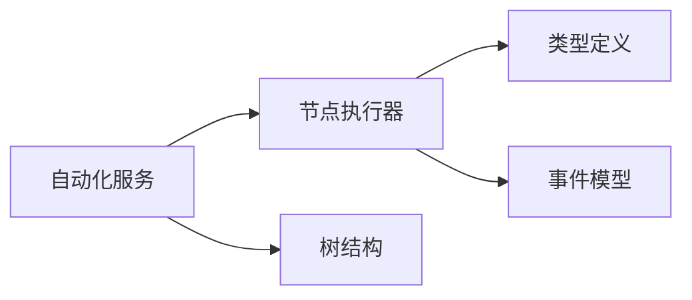

# 基础节点架构

<cite>
**本文引用的文件**   
- [automation_node_executor.go](file://notifuse/internal/service/automation_node_executor.go)
- [automation_service.go](file://notifuse/internal/service/automation_service.go)
- [types.go](file://notifuse/internal/domain/types.go)
- [event.go](file://notifuse/internal/domain/event.go)
- [tree.go](file://notifuse/internal/domain/tree.go)
</cite>

## 目录
1. [简介](#简介)
2. [项目结构](#项目结构)
3. [核心组件](#核心组件)
4. [架构总览](#架构总览)
5. [详细组件分析](#详细组件分析)
6. [依赖分析](#依赖分析)
7. [性能考虑](#性能考虑)
8. [故障排查指南](#故障排查指南)
9. [结论](#结论)
10. [附录](#附录)

## 简介
本文件围绕“基础节点架构”展开，聚焦于自动化执行引擎中的节点抽象与通用能力。文档从系统架构、组件关系、数据流、处理逻辑、集成点、错误处理与性能特征等维度进行系统化说明，并给出可视化图示与最佳实践建议，帮助读者快速理解并扩展节点能力。

## 项目结构
该仓库包含多个子系统，其中与“节点架构”直接相关的代码位于 notifuse/internal/service 与 notifuse/internal/domain 两个目录：
- internal/service：实现自动化服务的编排与节点执行器，负责调度、状态管理与事件分发。
- internal/domain：定义领域模型（类型、事件、树结构），为节点提供统一的数据契约。

图表来源
- [automation_service.go](file://notifuse/internal/service/automation_service.go)
- [automation_node_executor.go](file://notifuse/internal/service/automation_node_executor.go)
- [types.go](file://notifuse/internal/domain/types.go)
- [event.go](file://notifuse/internal/domain/event.go)
- [tree.go](file://notifuse/internal/domain/tree.go)

章节来源
- [automation_service.go](file://notifuse/internal/service/automation_service.go)
- [automation_node_executor.go](file://notifuse/internal/service/automation_node_executor.go)
- [types.go](file://notifuse/internal/domain/types.go)
- [event.go](file://notifuse/internal/domain/event.go)
- [tree.go](file://notifuse/internal/domain/tree.go)

## 核心组件
- 节点执行器：负责节点的加载、生命周期管理、输入输出校验、连接端口解析、错误收集与结果传播。
- 自动化服务：维护工作流树结构，协调节点执行顺序，处理事件总线与状态同步。
- 领域类型：定义节点元数据、属性模式、连接端口、事件与上下文等通用数据结构。
- 事件模型：定义节点间通信的事件载体与语义。
- 树结构：描述节点之间的拓扑关系与遍历策略。

章节来源
- [automation_node_executor.go](file://notifuse/internal/service/automation_node_executor.go)
- [automation_service.go](file://notifuse/internal/service/automation_service.go)
- [types.go](file://notifuse/internal/domain/types.go)
- [event.go](file://notifuse/internal/domain/event.go)
- [tree.go](file://notifuse/internal/domain/tree.go)

## 架构总览
下图展示了自动化服务与节点执行器的交互关系，以及领域模型的参与方式。

图表来源
- [automation_service.go](file://notifuse/internal/service/automation_service.go)
- [automation_node_executor.go](file://notifuse/internal/service/automation_node_executor.go)
- [types.go](file://notifuse/internal/domain/types.go)
- [event.go](file://notifuse/internal/domain/event.go)
- [tree.go](file://notifuse/internal/domain/tree.go)

## 详细组件分析

### 节点执行器（BaseNode 抽象）
节点执行器承担以下职责：
- 生命周期管理：初始化、准备、运行、清理阶段钩子。
- 属性验证机制：基于类型定义的属性模式进行校验，确保输入合法。
- 事件处理系统：在关键阶段发布/订阅事件，支持外部监听与调试。
- 状态管理模式：维护节点运行状态、错误信息与中间结果。
- 通用接口定义：统一的节点入口方法、上下文传递与返回值约定。
- 拖拽行为与连接端口管理：解析上游/下游连接，构建数据流路径。
- 错误处理策略：捕获异常、记录日志、聚合错误并向上游传播。

图表来源
- [automation_node_executor.go](file://notifuse/internal/service/automation_node_executor.go)
- [types.go](file://notifuse/internal/domain/types.go)
- [event.go](file://notifuse/internal/domain/event.go)

章节来源
- [automation_node_executor.go](file://notifuse/internal/service/automation_node_executor.go)
- [types.go](file://notifuse/internal/domain/types.go)
- [event.go](file://notifuse/internal/domain/event.go)

### 自动化服务（编排与状态）
自动化服务负责：
- 工作流树的构建与校验。
- 节点调度与并行度控制。
- 事件总线与状态同步。
- 错误聚合与重试策略。

图表来源
- [automation_service.go](file://notifuse/internal/service/automation_service.go)
- [tree.go](file://notifuse/internal/domain/tree.go)

章节来源
- [automation_service.go](file://notifuse/internal/service/automation_service.go)
- [tree.go](file://notifuse/internal/domain/tree.go)

### 领域模型（类型、事件、树）
- 类型定义：节点类型、属性模式、连接端口、执行上下文等。
- 事件模型：事件类型、负载、时间戳等字段，用于跨节点通信。
- 树结构：节点集合、边关系、根节点与遍历算法。

图表来源
- [types.go](file://notifuse/internal/domain/types.go)
- [event.go](file://notifuse/internal/domain/event.go)
- [tree.go](file://notifuse/internal/domain/tree.go)

章节来源
- [types.go](file://notifuse/internal/domain/types.go)
- [event.go](file://notifuse/internal/domain/event.go)
- [tree.go](file://notifuse/internal/domain/tree.go)

### 概念性概览（非代码映射）
以下为概念性工作流示意，不直接对应具体源码文件：

[本节为概念性内容，无需列出图表来源]

## 依赖分析
- 服务层依赖领域层提供的类型与事件模型。
- 节点执行器依赖类型定义进行属性校验与端口解析。
- 自动化服务依赖树结构进行拓扑排序与调度。

图表来源
- [automation_service.go](file://notifuse/internal/service/automation_service.go)
- [automation_node_executor.go](file://notifuse/internal/service/automation_node_executor.go)
- [types.go](file://notifuse/internal/domain/types.go)
- [event.go](file://notifuse/internal/domain/event.go)
- [tree.go](file://notifuse/internal/domain/tree.go)

章节来源
- [automation_service.go](file://notifuse/internal/service/automation_service.go)
- [automation_node_executor.go](file://notifuse/internal/service/automation_node_executor.go)
- [types.go](file://notifuse/internal/domain/types.go)
- [event.go](file://notifuse/internal/domain/event.go)
- [tree.go](file://notifuse/internal/domain/tree.go)

## 性能考虑
- 批量校验：对节点属性进行批量校验以减少往返开销。
- 并行执行：在无依赖的节点间启用并发执行，提升吞吐。
- 事件去重：避免重复事件导致的状态抖动。
- 缓存热点：对只读配置与静态资源进行缓存。
- 错误聚合：合并错误信息，减少日志写入与网络传输成本。

[本节提供一般性指导，无需列出章节来源]

## 故障排查指南
- 属性校验失败：检查节点属性模式与实际值是否匹配，关注必填项与类型约束。
- 连接端口未解析：确认上下游节点端口名称与方向一致。
- 事件丢失或重复：核对事件发布/订阅时机与幂等性设计。
- 状态不一致：查看全局状态更新路径与事务边界。
- 错误传播：定位错误来源节点，检查错误聚合与上报链路。

章节来源
- [automation_node_executor.go](file://notifuse/internal/service/automation_node_executor.go)
- [automation_service.go](file://notifuse/internal/service/automation_service.go)
- [types.go](file://notifuse/internal/domain/types.go)
- [event.go](file://notifuse/internal/domain/event.go)
- [tree.go](file://notifuse/internal/domain/tree.go)

## 结论
通过统一的节点抽象、严格的属性校验、清晰的事件系统与稳健的错误处理，基础节点架构提供了可扩展、可维护且高性能的自动化执行平台。遵循本文的最佳实践与优化建议，可以显著提升节点开发效率与系统稳定性。

[本节为总结性内容，无需列出章节来源]

## 附录
- 节点开发最佳实践
  - 明确节点职责，保持单一功能原则。
  - 使用强类型属性模式，避免运行时歧义。
  - 在关键阶段发布事件，便于监控与调试。
  - 对副作用操作进行幂等设计。
- 性能优化建议
  - 合理划分任务粒度，避免过大或过小的节点。
  - 利用缓存与批处理降低外部依赖压力。
  - 监控关键指标（延迟、吞吐、错误率）。

[本节为补充性内容，无需列出章节来源]