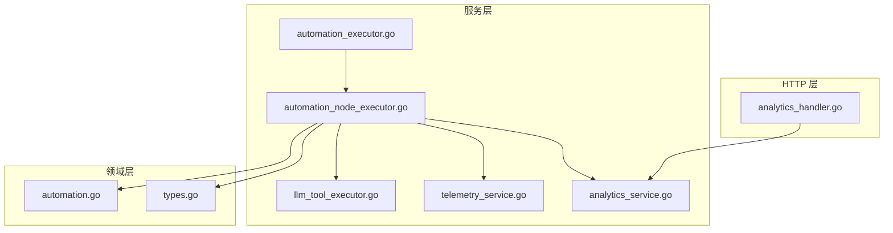
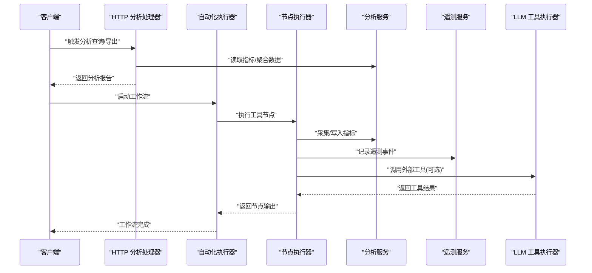
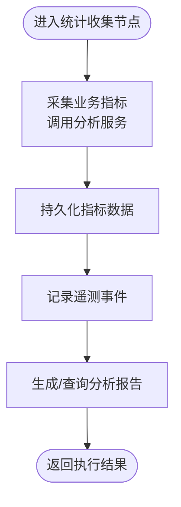
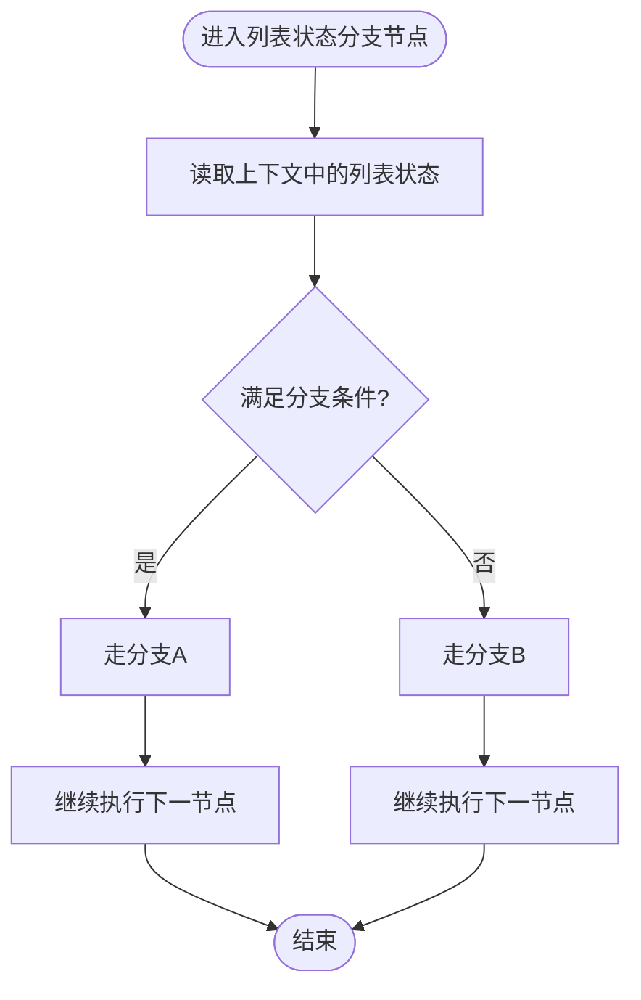
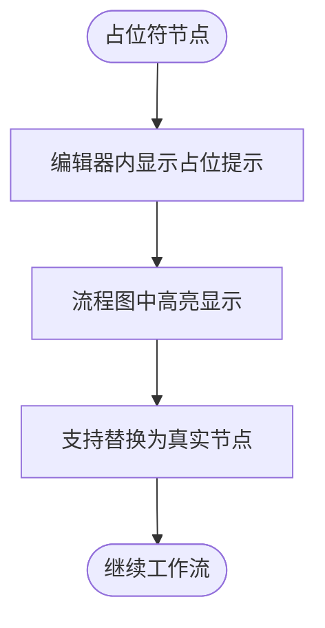
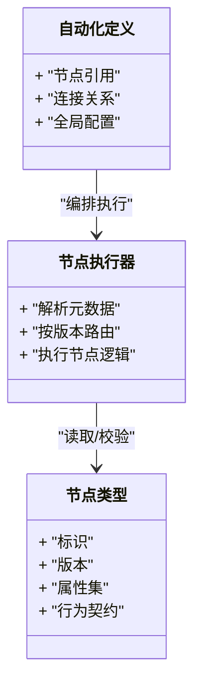
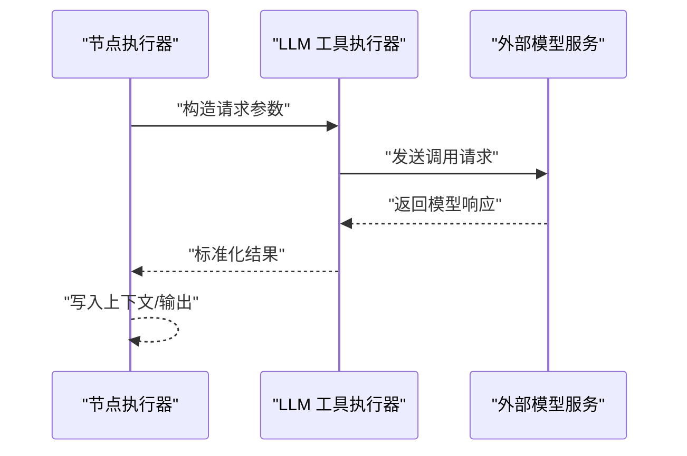
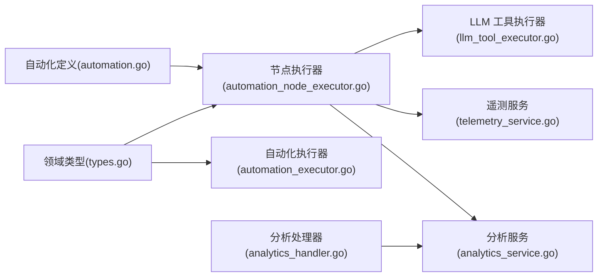

# 工具节点

<cite>
**本文引用的文件**   
- [automation_node_executor.go](file://notifuse/internal/service/automation_node_executor.go)
- [automation_executor.go](file://notifuse/internal/service/automation_executor.go)
- [llm_tool_executor.go](file://notifuse/internal/service/llm_tool_executor.go)
- [analytics_service.go](file://notifuse/internal/service/analytics_service.go)
- [telemetry_service.go](file://notifuse/internal/service/telemetry_service.go)
- [analytics_handler.go](file://notifuse/internal/http/analytics_handler.go)
- [types.go](file://notifuse/internal/domain/types.go)
- [automation.go](file://notifuse/internal/domain/automation.go)
</cite>

## 目录
1. [简介](#简介)
2. [项目结构](#项目结构)
3. [核心组件](#核心组件)
4. [架构总览](#架构总览)
5. [详细组件分析](#详细组件分析)
6. [依赖关系分析](#依赖关系分析)
7. [性能考虑](#性能考虑)
8. [故障排查指南](#故障排查指南)
9. [结论](#结论)
10. [附录](#附录)

## 简介
本文件围绕“工具节点”展开，聚焦以下三类能力：
- 统计收集节点：指标采集、数据存储与分析报告生成。
- 列表状态分支节点：基于列表状态的判断逻辑与流程控制机制。
- 占位符节点：用途、编辑辅助功能与流程图可视化增强。

同时覆盖节点元数据管理、版本兼容性与向后兼容性保证，并提供使用场景与扩展开发指南。

## 项目结构
本项目在内部服务层提供了自动化执行器与 LLM 工具执行器，用于驱动工作流中的各类节点；在领域层定义了自动化类型与通用类型；在 HTTP 层暴露了分析相关接口。这些共同构成了“工具节点”的运行时基础。

图表来源
- [analytics_handler.go](file://notifuse/internal/http/analytics_handler.go)
- [automation_executor.go](file://notifuse/internal/service/automation_executor.go)
- [automation_node_executor.go](file://notifuse/internal/service/automation_node_executor.go)
- [llm_tool_executor.go](file://notifuse/internal/service/llm_tool_executor.go)
- [analytics_service.go](file://notifuse/internal/service/analytics_service.go)
- [telemetry_service.go](file://notifuse/internal/service/telemetry_service.go)
- [types.go](file://notifuse/internal/domain/types.go)
- [automation.go](file://notifuse/internal/domain/automation.go)

章节来源
- [automation_executor.go](file://notifuse/internal/service/automation_executor.go)
- [automation_node_executor.go](file://notifuse/internal/service/automation_node_executor.go)
- [llm_tool_executor.go](file://notifuse/internal/service/llm_tool_executor.go)
- [analytics_service.go](file://notifuse/internal/service/analytics_service.go)
- [telemetry_service.go](file://notifuse/internal/service/telemetry_service.go)
- [analytics_handler.go](file://notifuse/internal/http/analytics_handler.go)
- [types.go](file://notifuse/internal/domain/types.go)
- [automation.go](file://notifuse/internal/domain/automation.go)

## 核心组件
- 自动化执行器：负责编排工作流执行，调度节点执行器并维护上下文。
- 节点执行器：实现具体节点的运行逻辑，包括统计收集、分支判断、LLM 工具调用等。
- 分析服务：提供指标采集、存储与分析查询能力。
- 遥测服务：提供系统级遥测与追踪能力。
- LLM 工具执行器：封装外部大模型工具的调用与结果处理。
- 领域类型与自动化定义：描述节点类型、属性、版本与行为契约。

章节来源
- [automation_executor.go](file://notifuse/internal/service/automation_executor.go)
- [automation_node_executor.go](file://notifuse/internal/service/automation_node_executor.go)
- [analytics_service.go](file://notifuse/internal/service/analytics_service.go)
- [telemetry_service.go](file://notifuse/internal/service/telemetry_service.go)
- [llm_tool_executor.go](file://notifuse/internal/service/llm_tool_executor.go)
- [types.go](file://notifuse/internal/domain/types.go)
- [automation.go](file://notifuse/internal/domain/automation.go)

## 架构总览
下图展示了从 HTTP 请求到节点执行的端到端路径，以及工具节点如何与分析和遥测服务交互。

图表来源
- [analytics_handler.go](file://notifuse/internal/http/analytics_handler.go)
- [automation_executor.go](file://notifuse/internal/service/automation_executor.go)
- [automation_node_executor.go](file://notifuse/internal/service/automation_node_executor.go)
- [analytics_service.go](file://notifuse/internal/service/analytics_service.go)
- [telemetry_service.go](file://notifuse/internal/service/telemetry_service.go)
- [llm_tool_executor.go](file://notifuse/internal/service/llm_tool_executor.go)

## 详细组件分析

### 统计收集节点（指标采集、数据存储、分析报告）
- 指标采集
  - 由节点执行器在工作流执行期间调用分析服务进行指标采集与持久化。
  - 可结合遥测服务记录关键事件与耗时，便于后续分析与排障。
- 数据存储
  - 分析服务负责将指标写入底层存储，并提供查询与聚合能力。
- 分析报告生成
  - HTTP 分析处理器对外暴露查询接口，供前端或下游系统获取报告数据。

图表来源
- [automation_node_executor.go](file://notifuse/internal/service/automation_node_executor.go)
- [analytics_service.go](file://notifuse/internal/service/analytics_service.go)
- [telemetry_service.go](file://notifuse/internal/service/telemetry_service.go)
- [analytics_handler.go](file://notifuse/internal/http/analytics_handler.go)

章节来源
- [automation_node_executor.go](file://notifuse/internal/service/automation_node_executor.go)
- [analytics_service.go](file://notifuse/internal/service/analytics_service.go)
- [telemetry_service.go](file://notifuse/internal/service/telemetry_service.go)
- [analytics_handler.go](file://notifuse/internal/http/analytics_handler.go)

### 列表状态分支节点（判断逻辑与流程控制）
- 判断逻辑
  - 节点执行器根据当前上下文中的列表状态字段进行条件判定，选择对应分支。
- 流程控制
  - 自动化执行器负责维持工作流上下文，并在分支选择后继续调度下一个节点。
- 典型场景
  - 根据联系人列表是否已加入某名单、标签集合是否满足规则等，决定后续动作。

图表来源
- [automation_node_executor.go](file://notifuse/internal/service/automation_node_executor.go)
- [automation_executor.go](file://notifuse/internal/service/automation_executor.go)
- [types.go](file://notifuse/internal/domain/types.go)
- [automation.go](file://notifuse/internal/domain/automation.go)

章节来源
- [automation_node_executor.go](file://notifuse/internal/service/automation_node_executor.go)
- [automation_executor.go](file://notifuse/internal/service/automation_executor.go)
- [types.go](file://notifuse/internal/domain/types.go)
- [automation.go](file://notifuse/internal/domain/automation.go)

### 占位符节点（用途、编辑辅助与可视化增强）
- 用途
  - 作为流程中的临时占位，便于快速搭建骨架、预留扩展点或在调试阶段保持链路完整。
- 编辑辅助
  - 在编辑器中提供默认配置与校验提示，减少误配风险。
- 可视化增强
  - 在流程图中以特殊样式显示，帮助识别未实现或待替换的节点位置。

说明
- 该图为概念性示意，不直接映射到具体源码文件，因此无图表来源。

章节来源
- [types.go](file://notifuse/internal/domain/types.go)
- [automation.go](file://notifuse/internal/domain/automation.go)

### 节点元数据管理、版本兼容性与向后兼容
- 元数据管理
  - 通过领域类型统一描述节点标识、版本、属性与行为契约，确保执行器能正确解析与运行。
- 版本兼容
  - 执行器依据节点版本选择相应实现或迁移策略，避免破坏旧版工作流。
- 向后兼容
  - 新增字段采用可选或默认值策略，缺失时回退到安全默认行为，保障历史流程稳定运行。

图表来源
- [types.go](file://notifuse/internal/domain/types.go)
- [automation.go](file://notifuse/internal/domain/automation.go)
- [automation_node_executor.go](file://notifuse/internal/service/automation_node_executor.go)

章节来源
- [types.go](file://notifuse/internal/domain/types.go)
- [automation.go](file://notifuse/internal/domain/automation.go)
- [automation_node_executor.go](file://notifuse/internal/service/automation_node_executor.go)

### LLM 工具节点（可选扩展）
- 作用
  - 在工作流中调用外部大模型工具，完成文本生成、分类、摘要等任务。
- 集成方式
  - 节点执行器通过 LLM 工具执行器发起调用，并将结果写回上下文供后续节点使用。

图表来源
- [automation_node_executor.go](file://notifuse/internal/service/automation_node_executor.go)
- [llm_tool_executor.go](file://notifuse/internal/service/llm_tool_executor.go)

章节来源
- [automation_node_executor.go](file://notifuse/internal/service/automation_node_executor.go)
- [llm_tool_executor.go](file://notifuse/internal/service/llm_tool_executor.go)

## 依赖关系分析
- 组件耦合
  - 节点执行器对分析服务与遥测服务存在直接依赖，用于指标与事件记录。
  - HTTP 分析处理器依赖分析服务，提供对外查询能力。
  - 领域类型与自动化定义被执行器广泛消费，构成稳定的契约层。
- 潜在循环
  - 当前分层清晰，未见明显循环依赖。
- 外部依赖
  - LLM 工具执行器可能依赖外部模型服务，需关注超时与重试策略。

图表来源
- [types.go](file://notifuse/internal/domain/types.go)
- [automation.go](file://notifuse/internal/domain/automation.go)
- [automation_executor.go](file://notifuse/internal/service/automation_executor.go)
- [automation_node_executor.go](file://notifuse/internal/service/automation_node_executor.go)
- [analytics_service.go](file://notifuse/internal/service/analytics_service.go)
- [telemetry_service.go](file://notifuse/internal/service/telemetry_service.go)
- [llm_tool_executor.go](file://notifuse/internal/service/llm_tool_executor.go)
- [analytics_handler.go](file://notifuse/internal/http/analytics_handler.go)

章节来源
- [types.go](file://notifuse/internal/domain/types.go)
- [automation.go](file://notifuse/internal/domain/automation.go)
- [automation_executor.go](file://notifuse/internal/service/automation_executor.go)
- [automation_node_executor.go](file://notifuse/internal/service/automation_node_executor.go)
- [analytics_service.go](file://notifuse/internal/service/analytics_service.go)
- [telemetry_service.go](file://notifuse/internal/service/telemetry_service.go)
- [llm_tool_executor.go](file://notifuse/internal/service/llm_tool_executor.go)
- [analytics_handler.go](file://notifuse/internal/http/analytics_handler.go)

## 性能考虑
- 指标采集
  - 批量写入与异步落盘可降低主流程延迟。
- 分支判断
  - 提前缓存列表状态与索引，减少重复计算。
- LLM 调用
  - 设置合理超时与重试上限，必要时引入熔断与降级策略。
- 报告生成
  - 预聚合与分页查询提升响应速度。

[本节为通用指导，无需源码引用]

## 故障排查指南
- 指标缺失
  - 检查节点执行器是否正确调用分析服务，确认遥测事件是否记录。
- 分支错误
  - 核对上下文中的列表状态字段是否与预期一致，验证条件表达式。
- LLM 失败
  - 查看工具执行器的错误码与日志，确认外部服务可用性与鉴权配置。
- 报告不可用
  - 确认分析处理器权限与后端服务健康状态。

章节来源
- [automation_node_executor.go](file://notifuse/internal/service/automation_node_executor.go)
- [analytics_service.go](file://notifuse/internal/service/analytics_service.go)
- [telemetry_service.go](file://notifuse/internal/service/telemetry_service.go)
- [llm_tool_executor.go](file://notifuse/internal/service/llm_tool_executor.go)
- [analytics_handler.go](file://notifuse/internal/http/analytics_handler.go)

## 结论
工具节点通过统一的执行框架与领域契约，实现了统计收集、分支判断与占位扩展等能力。配合分析服务与遥测服务，可在复杂工作流中提供可靠的观测与治理能力。遵循版本与向后兼容策略，有助于平滑演进与持续交付。

[本节为总结性内容，无需源码引用]

## 附录
- 使用场景
  - 营销自动化：基于列表状态进行人群分流与触达策略选择。
  - 数据分析流水线：在流程中嵌入指标采集与报告生成步骤。
  - AI 增强流程：在关键节点调用 LLM 工具完成智能处理。
- 扩展开发指南
  - 新增节点类型：在领域类型中声明新节点，实现节点执行器逻辑，注册到执行器路由。
  - 兼容策略：为新版本字段提供默认值与迁移逻辑，确保旧工作流不受影响。
  - 测试建议：为分支条件与指标采集编写单元测试与集成测试，覆盖异常路径。

[本节为通用指导，无需源码引用]