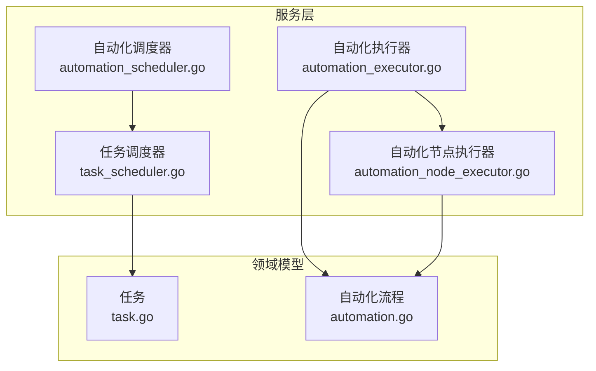
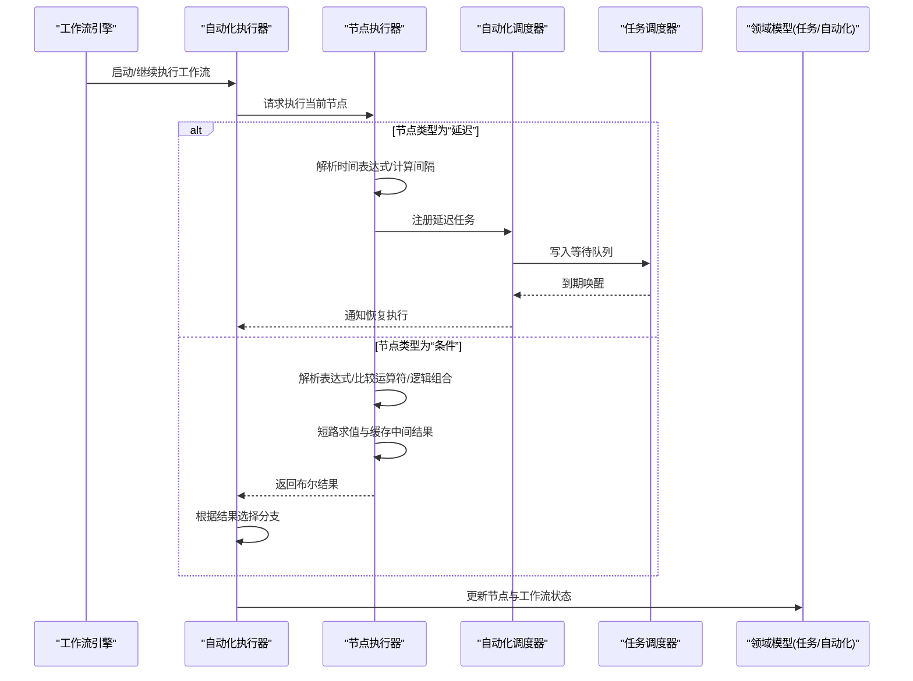
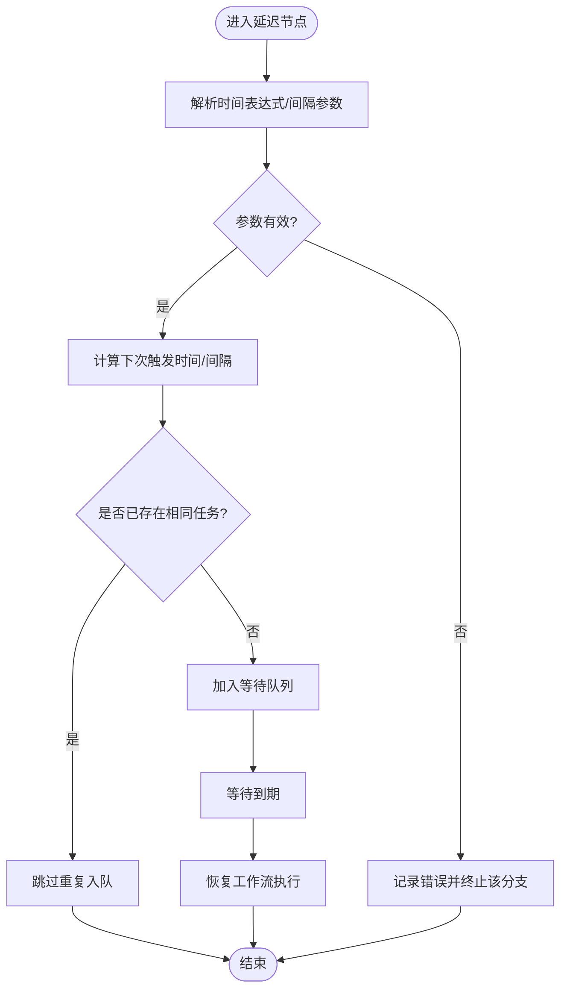
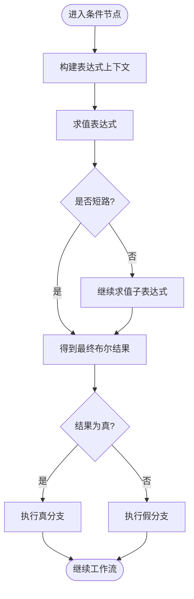
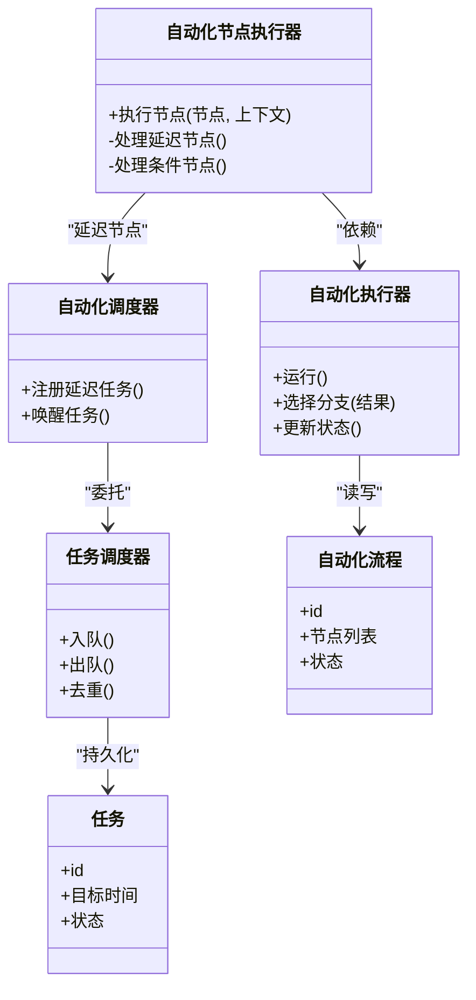

# 延迟与条件节点

<cite>
**本文引用的文件**   
- [automation_node_executor.go](file://notifuse/internal/service/automation_node_executor.go)
- [automation_executor.go](file://notifuse/internal/service/automation_executor.go)
- [automation_scheduler.go](file://notifuse/internal/service/automation_scheduler.go)
- [task_scheduler.go](file://notifuse/internal/service/task_scheduler.go)
- [task.go](file://notifuse/internal/domain/task.go)
- [automation.go](file://notifuse/internal/domain/automation.go)
</cite>

## 目录
1. [简介](#简介)
2. [项目结构](#项目结构)
3. [核心组件](#核心组件)
4. [架构总览](#架构总览)
5. [详细组件分析](#详细组件分析)
6. [依赖关系分析](#依赖关系分析)
7. [性能考虑](#性能考虑)
8. [故障排查指南](#故障排查指南)
9. [结论](#结论)
10. [附录](#附录)

## 简介
本文件聚焦于自动化工作流中的“延迟”和“条件”两类节点类型，系统性阐述其配置、执行路径、时间表达式解析、条件验证与调试方法，并提供复杂业务场景的组合示例与最佳实践。文档面向具备一定技术背景但希望快速上手的用户，同时为深入开发者提供实现细节与优化建议。

## 项目结构
与延迟与条件节点相关的核心代码位于内部服务层与领域模型中：
- 节点执行器负责调度与执行具体节点逻辑（含延迟与条件）
- 自动化执行器负责编排工作流图与分支选择
- 任务与调度子系统负责定时触发、等待队列与重试
- 领域模型定义自动化流程、任务实体及状态流转

图表来源
- [automation_node_executor.go](file://notifuse/internal/service/automation_node_executor.go)
- [automation_executor.go](file://notifuse/internal/service/automation_executor.go)
- [automation_scheduler.go](file://notifuse/internal/service/automation_scheduler.go)
- [task_scheduler.go](file://notifuse/internal/service/task_scheduler.go)
- [task.go](file://notifuse/internal/domain/task.go)
- [automation.go](file://notifuse/internal/domain/automation.go)

章节来源
- [automation_node_executor.go](file://notifuse/internal/service/automation_node_executor.go)
- [automation_executor.go](file://notifuse/internal/service/automation_executor.go)
- [automation_scheduler.go](file://notifuse/internal/service/automation_scheduler.go)
- [task_scheduler.go](file://notifuse/internal/service/task_scheduler.go)
- [task.go](file://notifuse/internal/domain/task.go)
- [automation.go](file://notifuse/internal/domain/automation.go)

## 核心组件
- 自动化节点执行器：统一入口，按节点类型分发到对应处理器；对延迟与条件节点分别进行参数校验、上下文注入与结果产出。
- 自动化执行器：维护工作流图、节点状态与上下文，驱动节点执行并处理分支跳转。
- 自动化调度器：将需要延后执行的节点转化为可调度任务，交由任务调度器管理。
- 任务调度器：基于时间或事件触发任务，维护等待队列、去重与幂等性，确保延迟节点在正确时机恢复执行。
- 领域模型：任务与自动化流程的持久化结构与状态机，支撑延迟与条件的可观测性与可恢复性。

章节来源
- [automation_node_executor.go](file://notifuse/internal/service/automation_node_executor.go)
- [automation_executor.go](file://notifuse/internal/service/automation_executor.go)
- [automation_scheduler.go](file://notifuse/internal/service/automation_scheduler.go)
- [task_scheduler.go](file://notifuse/internal/service/task_scheduler.go)
- [task.go](file://notifuse/internal/domain/task.go)
- [automation.go](file://notifuse/internal/domain/automation.go)

## 架构总览
下图展示了从工作流触发到延迟/条件节点落地的端到端流程，包括时间表达式解析、条件求值与分支选择。

图表来源
- [automation_node_executor.go](file://notifuse/internal/service/automation_node_executor.go)
- [automation_executor.go](file://notifuse/internal/service/automation_executor.go)
- [automation_scheduler.go](file://notifuse/internal/service/automation_scheduler.go)
- [task_scheduler.go](file://notifuse/internal/service/task_scheduler.go)
- [task.go](file://notifuse/internal/domain/task.go)
- [automation.go](file://notifuse/internal/domain/automation.go)

## 详细组件分析

### 延迟节点
延迟节点用于在工作流中引入可控的时间停顿或定时触发。关键能力包括：
- 定时配置：支持绝对时间点与相对间隔两种模式
- 时间表达式解析：解析常见时间表达式（如 cron 风格），转换为下一次触发时刻
- 时间间隔计算：基于当前时间与目标时间差，生成等待时长
- 等待队列管理：将延迟任务入队，保证幂等与去重，避免重复唤醒

图表来源
- [automation_node_executor.go](file://notifuse/internal/service/automation_node_executor.go)
- [automation_scheduler.go](file://notifuse/internal/service/automation_scheduler.go)
- [task_scheduler.go](file://notifuse/internal/service/task_scheduler.go)
- [task.go](file://notifuse/internal/domain/task.go)

章节来源
- [automation_node_executor.go](file://notifuse/internal/service/automation_node_executor.go)
- [automation_scheduler.go](file://notifuse/internal/service/automation_scheduler.go)
- [task_scheduler.go](file://notifuse/internal/service/task_scheduler.go)
- [task.go](file://notifuse/internal/domain/task.go)

#### 时间表达式与间隔计算要点
- 表达式解析：优先使用标准库或成熟解析器，确保时区与夏令时兼容
- 间隔计算：以当前时间为基准，计算距离下次触发的毫秒级差值，避免累积误差
- 边界情况：处理零间隔、负间隔、非法表达式与越界时间戳
- 幂等性：通过唯一键（如工作流ID+节点ID+目标时间）去重，防止重复入队

章节来源
- [automation_node_executor.go](file://notifuse/internal/service/automation_node_executor.go)
- [task_scheduler.go](file://notifuse/internal/service/task_scheduler.go)

#### 等待队列管理策略
- 优先级与批处理：批量拉取即将到期的任务，降低调度开销
- 失败重试与退避：对唤醒失败的任务采用指数退避与最大重试次数
- 监控指标：入队/出队速率、过期率、平均等待时长、重复入队拦截数

章节来源
- [task_scheduler.go](file://notifuse/internal/service/task_scheduler.go)
- [task.go](file://notifuse/internal/domain/task.go)

### 条件节点
条件节点用于在工作流中进行分支决策，核心能力包括：
- 表达式语法：支持变量引用、字面量、函数调用与操作符
- 比较运算符：数值、字符串、日期、布尔与集合相关比较
- 逻辑组合：与、或、非以及括号分组，支持短路求值
- 执行路径选择：根据布尔结果选择真/假分支，未命中则走默认分支

图表来源
- [automation_node_executor.go](file://notifuse/internal/service/automation_node_executor.go)
- [automation_executor.go](file://notifuse/internal/service/automation_executor.go)

章节来源
- [automation_node_executor.go](file://notifuse/internal/service/automation_node_executor.go)
- [automation_executor.go](file://notifuse/internal/service/automation_executor.go)

#### 表达式语法与比较运算符
- 变量与上下文：支持读取工作流上下文、上游节点输出与系统变量
- 字面量：数字、字符串、布尔、空值与数组/对象
- 函数：时间转换、字符串处理、数学运算等常用函数
- 比较运算符：等于、不等于、大于、小于、包含、匹配正则、为空/非空
- 逻辑组合：and、or、not 与括号优先级控制

章节来源
- [automation_node_executor.go](file://notifuse/internal/service/automation_node_executor.go)

#### 短路求值与性能优化
- 短路规则：and 遇到第一个假即返回假；or 遇到第一个真即返回真
- 中间结果缓存：对昂贵子表达式结果缓存，避免重复计算
- 上下文预检查：在进入求值前做必要字段存在性与类型检查，减少异常路径
- 表达式复杂度限制：限制嵌套深度与操作符数量，防止滥用导致性能问题

章节来源
- [automation_node_executor.go](file://notifuse/internal/service/automation_node_executor.go)
- [automation_executor.go](file://notifuse/internal/service/automation_executor.go)

#### 条件验证与调试工具
- 静态校验：在保存工作流时对表达式进行语法与语义校验，提前发现错误
- 运行时日志：记录表达式文本、上下文快照、求值步骤与中间结果
- 沙箱测试：提供在线预览与单元测试框架，便于回归验证
- 断点与回放：支持在条件节点处暂停，查看上下文并逐步执行

章节来源
- [automation_node_executor.go](file://notifuse/internal/service/automation_node_executor.go)
- [automation_executor.go](file://notifuse/internal/service/automation_executor.go)

### 条件分支的执行路径选择
- 分支判定：条件节点返回布尔结果，执行器据此选择真/假分支
- 默认分支：当无显式分支时，可配置默认路径以保证流程完整性
- 多分支合并：多个条件后可汇聚至同一后续节点，需保证所有路径可达
- 循环与回跳：谨慎使用，避免死循环；必要时引入最大迭代次数

章节来源
- [automation_executor.go](file://notifuse/internal/service/automation_executor.go)

## 依赖关系分析
延迟与条件节点涉及的模块耦合如下：
- 节点执行器依赖自动化执行器的上下文与状态管理
- 延迟节点依赖调度器与任务调度器完成时间驱动
- 条件节点依赖表达式求值器与上下文提供者
- 领域模型贯穿始终，提供持久化与一致性保障

图表来源
- [automation_node_executor.go](file://notifuse/internal/service/automation_node_executor.go)
- [automation_executor.go](file://notifuse/internal/service/automation_executor.go)
- [automation_scheduler.go](file://notifuse/internal/service/automation_scheduler.go)
- [task_scheduler.go](file://notifuse/internal/service/task_scheduler.go)
- [task.go](file://notifuse/internal/domain/task.go)
- [automation.go](file://notifuse/internal/domain/automation.go)

章节来源
- [automation_node_executor.go](file://notifuse/internal/service/automation_node_executor.go)
- [automation_executor.go](file://notifuse/internal/service/automation_executor.go)
- [automation_scheduler.go](file://notifuse/internal/service/automation_scheduler.go)
- [task_scheduler.go](file://notifuse/internal/service/task_scheduler.go)
- [task.go](file://notifuse/internal/domain/task.go)
- [automation.go](file://notifuse/internal/domain/automation.go)

## 性能考虑
- 延迟节点
  - 批量调度：合并相近时间的任务，减少唤醒次数
  - 去重策略：基于唯一键避免重复入队，降低内存占用
  - 超时与清理：过期任务及时清理，避免堆积
- 条件节点
  - 短路求值：尽早返回，减少不必要的计算
  - 表达式缓存：对稳定上下文的结果进行缓存
  - 复杂度上限：限制表达式长度与嵌套层级，防止雪崩
- 通用
  - 指标采集：入队/出队速率、等待时长分布、条件命中率
  - 资源隔离：不同工作流的延迟任务分片，避免热点

[本节为通用指导，不直接分析具体文件]

## 故障排查指南
- 延迟节点常见问题
  - 时间表达式无效：检查语法与时区设置
  - 重复入队：确认去重键是否正确
  - 唤醒失败：查看任务状态与重试计数
- 条件节点常见问题
  - 表达式报错：启用静态校验与运行时日志
  - 分支未命中：检查默认分支与上下文字段是否存在
  - 性能退化：评估表达式复杂度与缓存命中率
- 调试建议
  - 开启详细日志，记录表达式文本与上下文快照
  - 使用沙箱测试用例覆盖边界条件
  - 对关键路径添加埋点，追踪耗时与失败原因

章节来源
- [automation_node_executor.go](file://notifuse/internal/service/automation_node_executor.go)
- [automation_executor.go](file://notifuse/internal/service/automation_executor.go)
- [task_scheduler.go](file://notifuse/internal/service/task_scheduler.go)

## 结论
延迟与条件节点是构建灵活、可靠自动化工作流的关键构件。通过规范的时间表达式解析、严格的条件求值与高效的等待队列管理，可以在保证性能的同时提升系统的可维护性与可观测性。建议在设计与实现中遵循上述最佳实践，并结合监控与调试工具持续优化。

[本节为总结性内容，不直接分析具体文件]

## 附录
- 复杂业务场景组合示例
  - 用户注册后延迟发送欢迎邮件，并在发送前根据用户标签进行条件过滤
  - 订单支付成功后延迟核对库存，若库存不足则转入人工审核分支
  - 周期性数据同步任务，结合条件判断是否增量更新
- 最佳实践清单
  - 明确区分绝对时间与相对间隔的使用场景
  - 为条件表达式编写单测与回归用例
  - 对延迟任务建立去重与幂等机制
  - 为关键路径配置告警与降级策略

[本节为概念性内容，不直接分析具体文件]