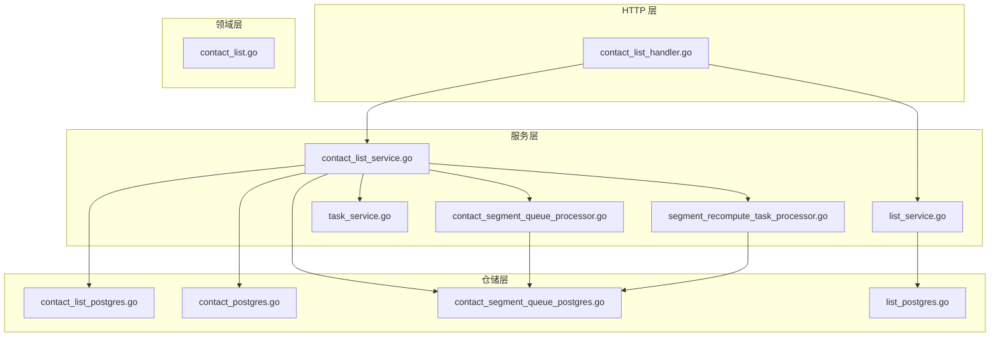
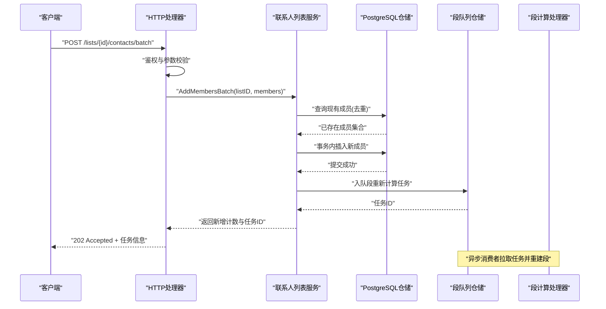
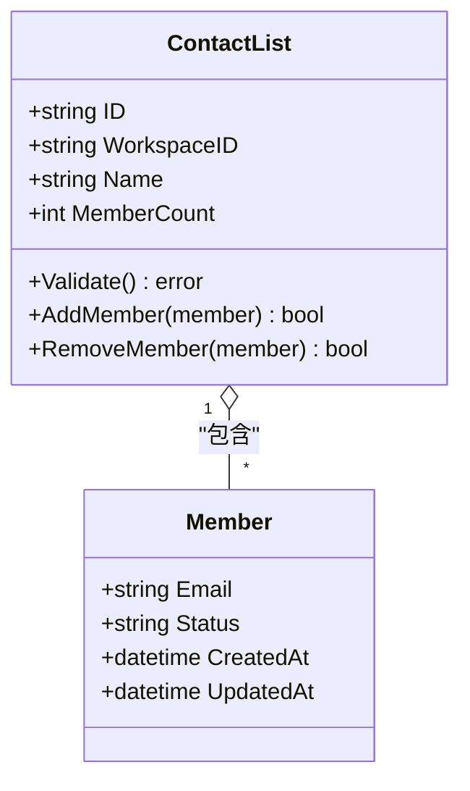
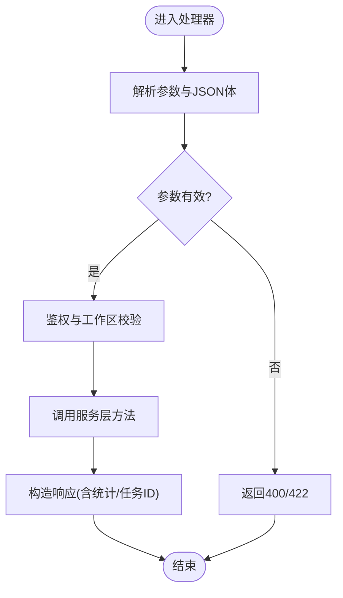
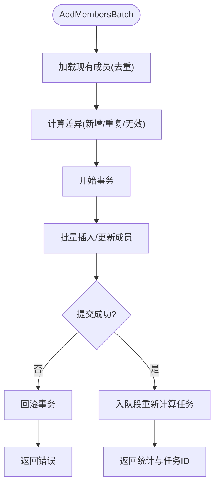
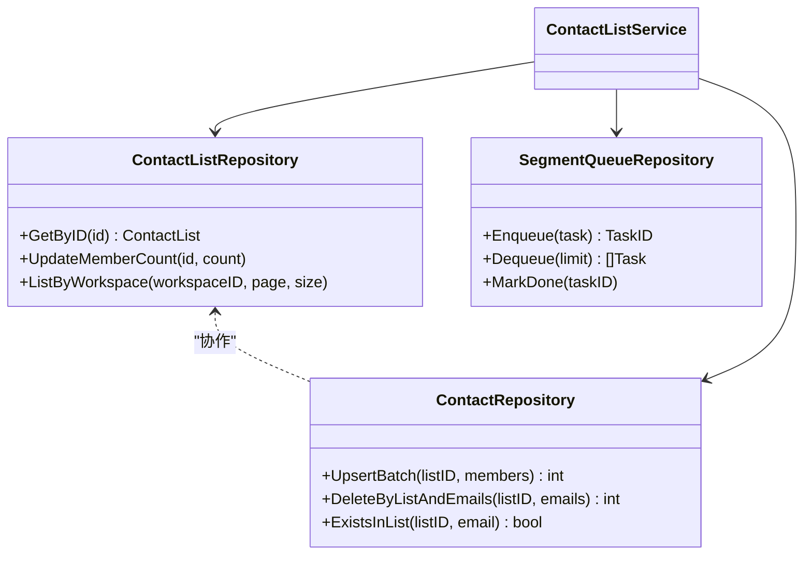
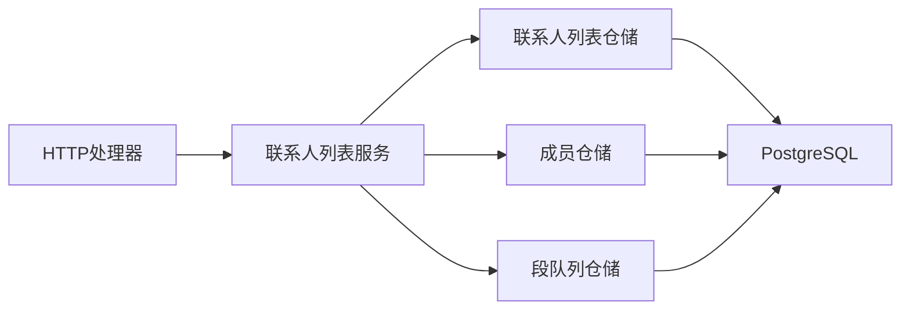

# 数据管理节点

<cite>
**本文引用的文件**   
- [contact_list.go](file://notifuse/internal/domain/contact_list.go)
- [contact_list_test.go](file://notifuse/internal/domain/contact_list_test.go)
- [contact_list_handler.go](file://notifuse/internal/http/contact_list_handler.go)
- [contact_list_handler_test.go](file://notifuse/internal/http/contact_list_handler_test.go)
- [contact_list_service.go](file://notifuse/internal/service/contact_list_service.go)
- [contact_list_service_test.go](file://notifuse/internal/service/contact_list_service_test.go)
- [contact_list_postgres.go](file://notifuse/internal/repository/contact_list_postgres.go)
- [contact_list_postgres_test.go](file://notifuse/internal/repository/contact_list_postgres_test.go)
- [contact_postgres.go](file://notifuse/internal/repository/contact_postgres.go)
- [contact_postgres_test.go](file://notifuse/internal/repository/contact_postgres_test.go)
- [contact_segment_queue_postgres.go](file://notifuse/internal/repository/contact_segment_queue_postgres.go)
- [contact_segment_queue_processor.go](file://notifuse/internal/service/contact_segment_queue_processor.go)
- [segment_recompute_task_processor.go](file://notifuse/internal/service/segment_recompute_task_processor.go)
- [task_scheduler.go](file://notifuse/internal/service/task_scheduler.go)
- [task_service.go](file://notifuse/internal/service/task_service.go)
- [list_service.go](file://notifuse/internal/service/list_service.go)
- [list_service_test.go](file://notifuse/internal/service/list_service_test.go)
- [list_postgres.go](file://notifuse/internal/repository/list_postgres.go)
- [workspace_users_operations_test.go](file://notifuse/internal/repository/workspace_users_operations_test.go)
</cite>

## 目录
1. [简介](#简介)
2. [项目结构](#项目结构)
3. [核心组件](#核心组件)
4. [架构总览](#架构总览)
5. [详细组件分析](#详细组件分析)
6. [依赖关系分析](#依赖关系分析)
7. [性能与并发优化](#性能与并发优化)
8. [故障排查指南](#故障排查指南)
9. [结论](#结论)
10. [附录](#附录)

## 简介
本文件聚焦“数据管理节点类型”中的联系人列表操作，围绕以下目标展开：
- 实现添加成员、移除成员与批量操作的完整链路
- 明确列表ID映射、成员去重机制与数据同步策略
- 解释异步任务处理、错误回滚与事务一致性保证
- 覆盖数据验证规则、权限控制与审计日志记录
- 提供大规模数据处理优化方案与并发控制策略

## 项目结构
本项目采用分层架构：HTTP 层暴露接口，服务层编排业务逻辑，仓储层负责持久化，领域模型定义数据结构与不变式。联系人列表相关代码主要分布在 domain、service、repository 与 http 四个层次中。

图表来源
- [contact_list_handler.go](file://notifuse/internal/http/contact_list_handler.go)
- [contact_list_service.go](file://notifuse/internal/service/contact_list_service.go)
- [list_service.go](file://notifuse/internal/service/list_service.go)
- [contact_list_postgres.go](file://notifuse/internal/repository/contact_list_postgres.go)
- [list_postgres.go](file://notifuse/internal/repository/list_postgres.go)
- [contact_postgres.go](file://notifuse/internal/repository/contact_postgres.go)
- [contact_segment_queue_postgres.go](file://notifuse/internal/repository/contact_segment_queue_postgres.go)
- [contact_segment_queue_processor.go](file://notifuse/internal/service/contact_segment_queue_processor.go)
- [segment_recompute_task处理器.go](file://notifuse/internal/service/segment_recompute_task_processor.go)
- [task_service.go](file://notifuse/internal/service/task_service.go)
- [contact_list.go](file://notifuse/internal/domain/contact_list.go)

章节来源
- [contact_list_handler.go](file://notifuse/internal/http/contact_list_handler.go)
- [contact_list_service.go](file://notifuse/internal/service/contact_list_service.go)
- [contact_list_postgres.go](file://notifuse/internal/repository/contact_list_postgres.go)
- [contact_list.go](file://notifuse/internal/domain/contact_list.go)

## 核心组件
- 领域模型（联系人列表）：定义列表实体、成员集合、唯一性约束与基本校验规则。
- HTTP 处理器：接收请求参数，进行基础校验与鉴权上下文注入，调用服务层。
- 服务层：编排添加/移除/批量操作，执行去重、事务边界、异步任务派发与结果聚合。
- 仓储层：封装数据库访问，提供增删改查与批量写入能力，确保事务与幂等。
- 队列与任务：将段计算或增量同步任务入队，由调度器与处理器异步消费。

章节来源
- [contact_list.go](file://notifuse/internal/domain/contact_list.go)
- [contact_list_handler.go](file://notifuse/internal/http/contact_list_handler.go)
- [contact_list_service.go](file://notifuse/internal/service/contact_list_service.go)
- [contact_list_postgres.go](file://notifuse/internal/repository/contact_list_postgres.go)
- [contact_segment_queue_postgres.go](file://notifuse/internal/repository/contact_segment_queue_postgres.go)
- [contact_segment_queue_processor.go](file://notifuse/internal/service/contact_segment_queue_processor.go)
- [segment_recompute_task_processor.go](file://notifuse/internal/service/segment_recompute_task_processor.go)
- [task_service.go](file://notifuse/internal/service/task_service.go)

## 架构总览
下图展示一次“批量添加成员”的端到端流程，包括输入校验、去重、事务写入、段任务入队与异步处理。

图表来源
- [contact_list_handler.go](file://notifuse/internal/http/contact_list_handler.go)
- [contact_list_service.go](file://notifuse/internal/service/contact_list_service.go)
- [contact_list_postgres.go](file://notifuse/internal/repository/contact_list_postgres.go)
- [contact_segment_queue_postgres.go](file://notifuse/internal/repository/contact_segment_queue_postgres.go)
- [contact_segment_queue_processor.go](file://notifuse/internal/service/contact_segment_queue_processor.go)

## 详细组件分析

### 领域模型：联系人列表
- 职责：定义列表实体、成员集合、唯一键（如邮箱+列表ID）、基础校验（非空、格式）。
- 不变式：同一列表中成员唯一；成员状态与时间戳维护。
- 复杂度：成员去重通常基于哈希集合，O(n) 时间、O(n) 空间。

图表来源
- [contact_list.go](file://notifuse/internal/domain/contact_list.go)

章节来源
- [contact_list.go](file://notifuse/internal/domain/contact_list.go)
- [contact_list_test.go](file://notifuse/internal/domain/contact_list_test.go)

### HTTP 处理器：联系人列表
- 职责：解析路径与查询参数、鉴权（工作区/资源级）、调用服务层、统一响应与错误码。
- 关键接口：
  - 添加单个成员
  - 移除单个成员
  - 批量添加/移除成员
  - 获取成员分页列表
- 校验与权限：
  - 必填字段校验、邮箱格式校验
  - 工作区隔离与资源可见性检查

图表来源
- [contact_list_handler.go](file://notifuse/internal/http/contact_list_handler.go)
- [contact_list_handler_test.go](file://notifuse/internal/http/contact_list_handler_test.go)

章节来源
- [contact_list_handler.go](file://notifuse/internal/http/contact_list_handler.go)
- [contact_list_handler_test.go](file://notifuse/internal/http/contact_list_handler_test.go)

### 服务层：联系人列表服务
- 职责：编排业务逻辑，包括：
  - 读取现有成员集合用于去重
  - 构建待插入/删除的差异集
  - 在事务中执行批量写入
  - 触发段重新计算任务（异步）
  - 返回统计信息与任务标识
- 事务与一致性：
  - 使用数据库事务包裹所有写操作
  - 失败时自动回滚，避免部分更新
- 异步任务：
  - 将段重新计算任务入队，交由调度器与处理器执行
  - 支持重试与幂等处理

图表来源
- [contact_list_service.go](file://notifuse/internal/service/contact_list_service.go)
- [contact_segment_queue_processor.go](file://notifuse/internal/service/contact_segment_queue_processor.go)
- [segment_recompute_task_processor.go](file://notifuse/internal/service/segment_recompute_task_processor.go)
- [task_service.go](file://notifuse/internal/service/task_service.go)

章节来源
- [contact_list_service.go](file://notifuse/internal/service/contact_list_service.go)
- [contact_list_service_test.go](file://notifuse/internal/service/contact_list_service_test.go)

### 仓储层：联系人列表与成员
- 联系人列表仓储：
  - 列表CRUD、成员计数更新、按条件查询
- 成员仓储：
  - 批量插入/删除、按列表ID与邮箱查询
  - 唯一约束保障（邮箱+列表ID），防止重复
- 段队列仓储：
  - 段重新计算任务的入队、出队与状态更新

图表来源
- [contact_list_postgres.go](file://notifuse/internal/repository/contact_list_postgres.go)
- [contact_postgres.go](file://notifuse/internal/repository/contact_postgres.go)
- [contact_segment_queue_postgres.go](file://notifuse/internal/repository/contact_segment_queue_postgres.go)

章节来源
- [contact_list_postgres.go](file://notifuse/internal/repository/contact_list_postgres.go)
- [contact_list_postgres_test.go](file://notifuse/internal/repository/contact_list_postgres_test.go)
- [contact_postgres.go](file://notifuse/internal/repository/contact_postgres.go)
- [contact_postgres_test.go](file://notifuse/internal/repository/contact_postgres_test.go)
- [contact_segment_queue_postgres.go](file://notifuse/internal/repository/contact_segment_queue_postgres.go)

### 列表服务与通用列表能力
- 列表服务提供跨实体的通用能力（如分页、排序、过滤），联系人列表服务可复用其能力。
- 与仓库层 list_postgres.go 交互，确保一致的查询模式与事务边界。

章节来源
- [list_service.go](file://notifuse/internal/service/list_service.go)
- [list_service_test.go](file://notifuse/internal/service/list_service_test.go)
- [list_postgres.go](file://notifuse/internal/repository/list_postgres.go)

### 权限控制与审计
- 权限控制：
  - 工作区隔离：通过工作区ID限定资源范围
  - 资源级鉴权：仅允许拥有者或具备相应角色的用户操作
- 审计日志：
  - 对关键变更（添加/移除成员、批量操作）记录审计事件，便于追踪与合规

章节来源
- [workspace_users_operations_test.go](file://notifuse/internal/repository/workspace_users_operations_test.go)

## 依赖关系分析
- 耦合度：
  - HTTP 层仅依赖服务层，保持薄控制器
  - 服务层组合多个仓储，职责清晰
  - 仓储层直接对接数据库，屏蔽SQL细节
- 外部依赖：
  - PostgreSQL 作为主存储
  - 任务队列（内部实现）用于段重新计算
- 潜在循环依赖：
  - 当前分层清晰，未见循环导入风险

图表来源
- [contact_list_handler.go](file://notifuse/internal/http/contact_list_handler.go)
- [contact_list_service.go](file://notifuse/internal/service/contact_list_service.go)
- [contact_list_postgres.go](file://notifuse/internal/repository/contact_list_postgres.go)
- [contact_postgres.go](file://notifuse/internal/repository/contact_postgres.go)
- [contact_segment_queue_postgres.go](file://notifuse/internal/repository/contact_segment_queue_postgres.go)

章节来源
- [contact_list_handler.go](file://notifuse/internal/http/contact_list_handler.go)
- [contact_list_service.go](file://notifuse/internal/service/contact_list_service.go)
- [contact_list_postgres.go](file://notifuse/internal/repository/contact_list_postgres.go)
- [contact_postgres.go](file://notifuse/internal/repository/contact_postgres.go)
- [contact_segment_queue_postgres.go](file://notifuse/internal/repository/contact_segment_queue_postgres.go)

## 性能与并发优化
- 批量写入：
  - 使用批量插入/删除减少往返次数
  - 预去重降低重复写入与索引冲突
- 事务粒度：
  - 合理划分事务边界，避免长事务导致锁竞争
- 异步处理：
  - 段重新计算任务异步化，提升响应速度
  - 消费者侧限流与重试，避免雪崩
- 并发控制：
  - 针对同一列表的并发写入使用行级锁或唯一约束保证一致性
  - 使用分布式锁或队列串行化大任务
- 大规模数据：
  - 分片/分页拉取与批处理
  - 索引优化（列表ID+邮箱联合唯一索引）
  - 读写分离与缓存热点数据（如成员计数）

[本节为通用指导，不直接分析具体文件]

## 故障排查指南
- 常见问题定位：
  - 参数校验失败：检查HTTP处理器校验逻辑与错误码
  - 权限不足：检查工作区隔离与角色判断
  - 重复成员：确认唯一约束与去重逻辑
  - 事务失败：查看仓储层事务回滚与错误传播
  - 任务堆积：检查段队列仓储与处理器消费速率
- 建议排查步骤：
  - 启用详细日志与追踪ID
  - 复现最小用例，逐步缩小范围
  - 核对数据库约束与索引状态
  - 观察任务队列积压与消费者健康状态

章节来源
- [contact_list_handler_test.go](file://notifuse/internal/http/contact_list_handler_test.go)
- [contact_list_service_test.go](file://notifuse/internal/service/contact_list_service_test.go)
- [contact_list_postgres_test.go](file://notifuse/internal/repository/contact_list_postgres_test.go)
- [contact_postgres_test.go](file://notifuse/internal/repository/contact_postgres_test.go)

## 结论
联系人列表的数据管理节点以清晰的层次结构与明确的职责分工实现了高可靠、可扩展的成员管理能力。通过事务一致性、异步任务与严格的权限控制，系统在保证一致性的同时具备良好的吞吐与扩展性。面向大规模场景，建议在批量写入、索引设计与任务调度方面持续优化。

[本节为总结性内容，不直接分析具体文件]

## 附录
- 术语说明：
  - 列表ID映射：将外部ID转换为内部唯一ID，确保跨系统一致性
  - 成员去重：基于邮箱+列表ID的唯一性判定
  - 数据同步策略：增量差异计算与异步段重建
- 最佳实践：
  - 始终在事务中执行批量写
  - 对关键变更记录审计日志
  - 使用幂等键避免重复处理
  - 监控任务队列与消费者延迟

[本节为概念性内容，不直接分析具体文件]