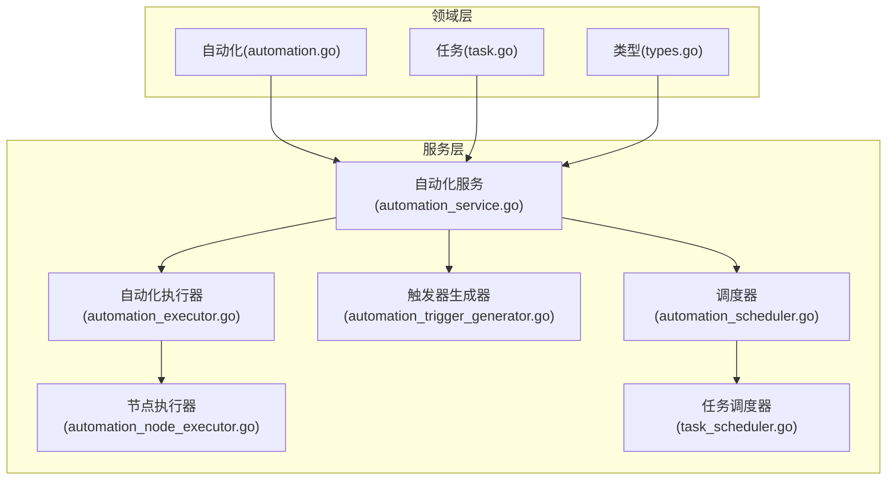
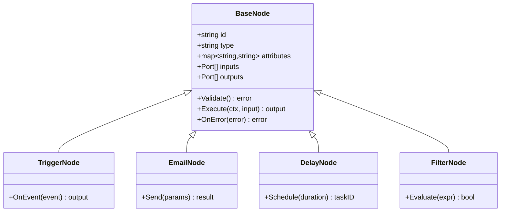
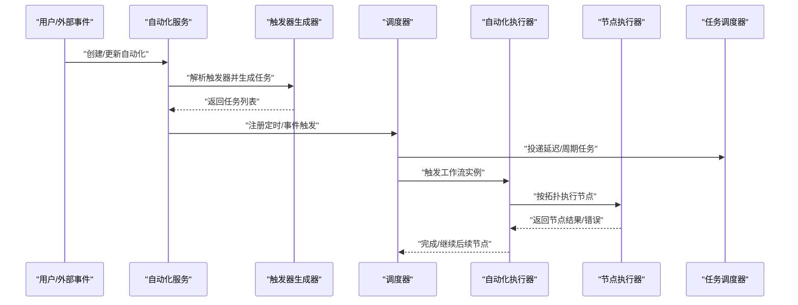
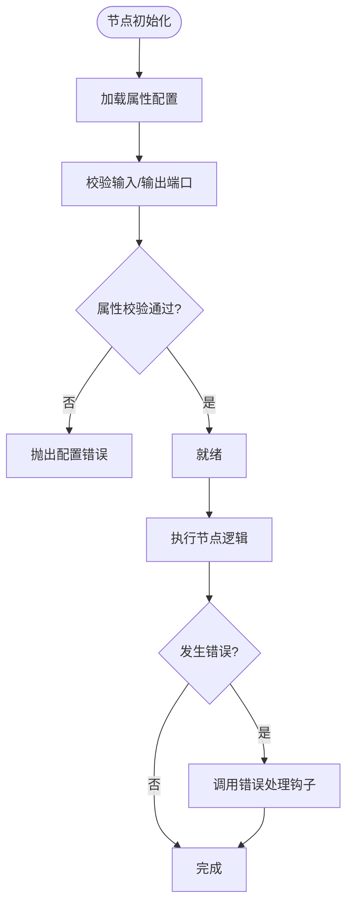
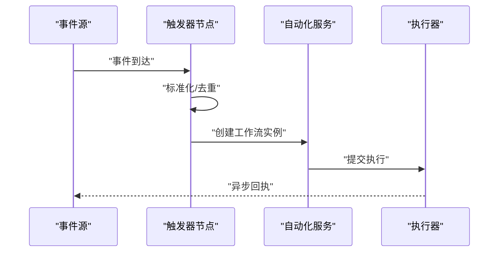
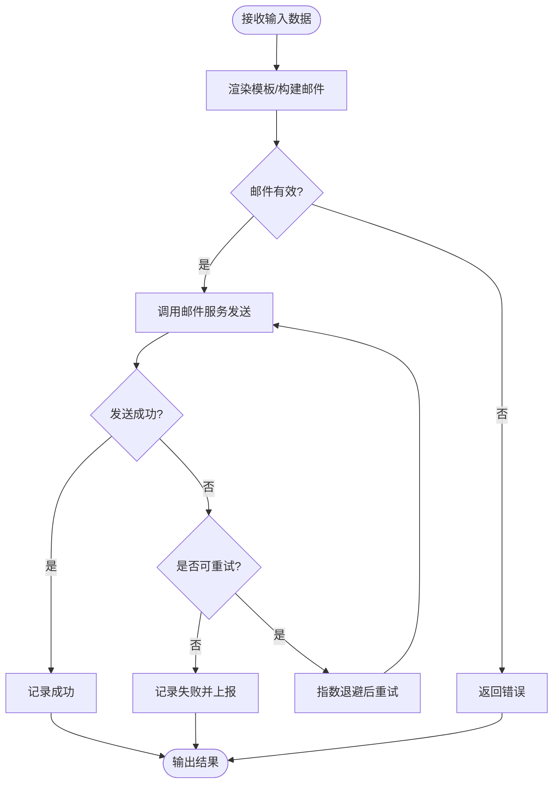
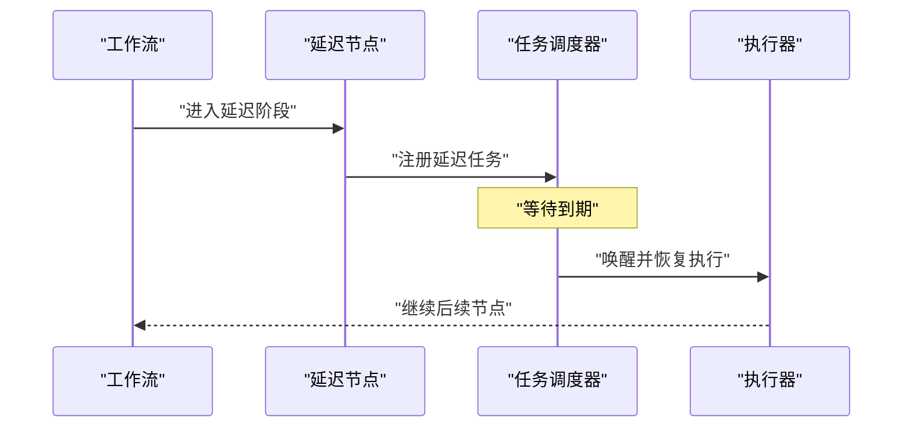
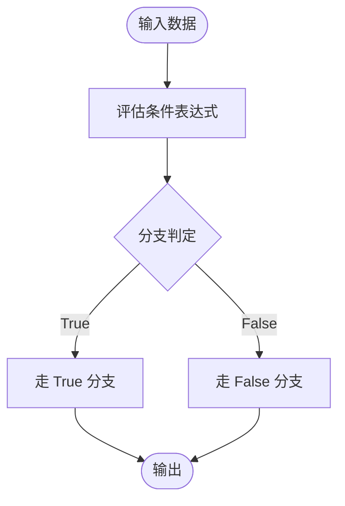
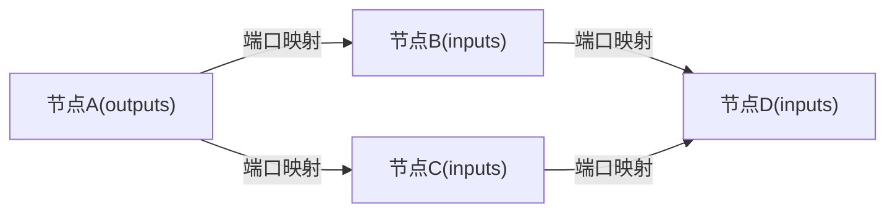
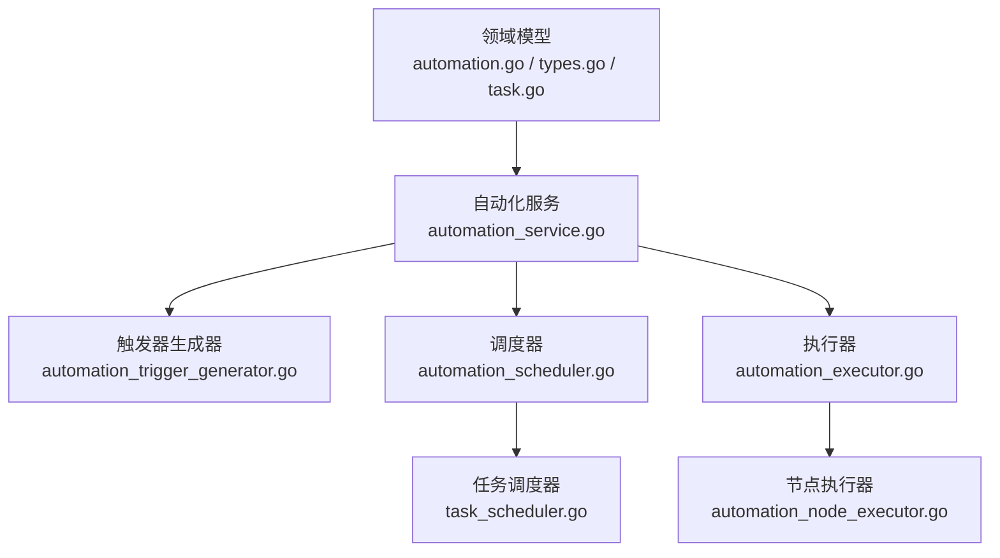

# 节点类型系统

<cite>
**本文引用的文件**   
- [automation_node_executor.go](file://notifuse/internal/service/automation_node_executor.go)
- [automation_executor.go](file://notifuse/internal/service/automation_executor.go)
- [automation_service.go](file://notifuse/internal/service/automation_service.go)
- [automation_trigger_generator.go](file://notifuse/internal/service/automation_trigger_generator.go)
- [automation_scheduler.go](file://notifuse/internal/service/automation_scheduler.go)
- [task_scheduler.go](file://notifuse/internal/service/task_scheduler.go)
- [task.go](file://notifuse/internal/domain/task.go)
- [automation.go](file://notifuse/internal/domain/automation.go)
- [types.go](file://notifuse/internal/domain/types.go)
</cite>

## 目录
1. [简介](#简介)
2. [项目结构](#项目结构)
3. [核心组件](#核心组件)
4. [架构总览](#架构总览)
5. [详细组件分析](#详细组件分析)
6. [依赖关系分析](#依赖关系分析)
7. [性能考量](#性能考量)
8. [故障排查指南](#故障排查指南)
9. [结论](#结论)
10. [附录](#附录)

## 简介
本文件围绕自动化工作流“节点类型系统”进行系统化文档化，重点覆盖：
- BaseNode 基础节点的抽象设计与通用能力（属性配置、输入输出端口、验证与错误处理）
- 内置节点类型的实现与职责边界：触发器节点（TriggerNode）、邮件发送节点（EmailNode）、延迟执行节点（DelayNode）、条件过滤节点（FilterNode）等
- 节点注册机制、节点间数据传递模式
- 自定义节点开发指南
- 节点样式定制与主题适配方案

为保证可追溯性，所有涉及具体代码实现的章节均附带“章节来源”，并在需要时提供映射到源码文件的架构图与时序图。

## 项目结构
与节点类型系统直接相关的核心代码位于 internal/service 与 internal/domain 两个层次：
- internal/domain：定义自动化工作流、任务、类型等核心领域模型与常量
- internal/service：编排调度、触发器生成、节点执行器等运行时逻辑

图表来源
- [automation.go:1-200](file://notifuse/internal/domain/automation.go#L1-L200)
- [task.go:1-200](file://notifuse/internal/domain/task.go#L1-L200)
- [types.go:1-200](file://notifuse/internal/domain/types.go#L1-L200)
- [automation_service.go:1-200](file://notifuse/internal/service/automation_service.go#L1-L200)
- [automation_executor.go:1-200](file://notifuse/internal/service/automation_executor.go#L1-L200)
- [automation_node_executor.go:1-200](file://notifuse/internal/service/automation_node_executor.go#L1-L200)
- [automation_trigger_generator.go:1-200](file://notifuse/internal/service/automation_trigger_generator.go#L1-L200)
- [automation_scheduler.go:1-200](file://notifuse/internal/service/automation_scheduler.go#L1-L200)
- [task_scheduler.go:1-200](file://notifuse/internal/service/task_scheduler.go#L1-L200)

章节来源
- [automation.go:1-200](file://notifuse/internal/domain/automation.go#L1-L200)
- [task.go:1-200](file://notifuse/internal/domain/task.go#L1-L200)
- [types.go:1-200](file://notifuse/internal/domain/types.go#L1-L200)
- [automation_service.go:1-200](file://notifuse/internal/service/automation_service.go#L1-L200)
- [automation_executor.go:1-200](file://notifuse/internal/service/automation_executor.go#L1-L200)
- [automation_node_executor.go:1-200](file://notifuse/internal/service/automation_node_executor.go#L1-L200)
- [automation_trigger_generator.go:1-200](file://notifuse/internal/service/automation_trigger_generator.go#L1-L200)
- [automation_scheduler.go:1-200](file://notifuse/internal/service/automation_scheduler.go#L1-L200)
- [task_scheduler.go:1-200](file://notifuse/internal/service/task_scheduler.go#L1-L200)

## 核心组件
本节聚焦节点类型系统的抽象与通用能力，包括：
- BaseNode 基础节点：统一描述节点元信息、属性配置、输入输出端口、校验规则、错误处理策略
- 节点注册中心：集中管理节点类型与实例化工厂
- 节点执行上下文：在节点间传递运行期状态与数据
- 节点执行器：按拓扑顺序驱动节点执行，并处理分支、重试、超时、失败路径

为便于理解，下图给出一个概念性的类关系图（不直接映射到具体源码文件）：

说明
- BaseNode 定义了节点的最小公共接口：属性、端口、验证、执行与错误处理钩子
- 各内置节点继承或组合 BaseNode 的能力，扩展特定业务行为
- 节点注册中心负责将 type 字符串映射到具体节点构造器
- 节点执行上下文承载工作流实例的共享数据与运行期状态

[本节为概念性说明，未直接分析具体文件，故无“章节来源”]

## 架构总览
从“触发—编排—执行—调度”的角度，节点类型系统与运行时的交互如下：

图表来源
- [automation_service.go:1-200](file://notifuse/internal/service/automation_service.go#L1-L200)
- [automation_trigger_generator.go:1-200](file://notifuse/internal/service/automation_trigger_generator.go#L1-L200)
- [automation_scheduler.go:1-200](file://notifuse/internal/service/automation_scheduler.go#L1-L200)
- [task_scheduler.go:1-200](file://notifuse/internal/service/task_scheduler.go#L1-L200)
- [automation_executor.go:1-200](file://notifuse/internal/service/automation_executor.go#L1-L200)
- [automation_node_executor.go:1-200](file://notifuse/internal/service/automation_node_executor.go#L1-L200)

章节来源
- [automation_service.go:1-200](file://notifuse/internal/service/automation_service.go#L1-L200)
- [automation_trigger_generator.go:1-200](file://notifuse/internal/service/automation_trigger_generator.go#L1-L200)
- [automation_scheduler.go:1-200](file://notifuse/internal/service/automation_scheduler.go#L1-L200)
- [task_scheduler.go:1-200](file://notifuse/internal/service/task_scheduler.go#L1-L200)
- [automation_executor.go:1-200](file://notifuse/internal/service/automation_executor.go#L1-L200)
- [automation_node_executor.go:1-200](file://notifuse/internal/service/automation_node_executor.go#L1-L200)

## 详细组件分析

### BaseNode 基础节点
BaseNode 作为所有节点的抽象基座，提供以下通用能力：
- 属性配置：以键值对形式存储节点参数，支持默认值与类型约束
- 输入/输出端口：声明式定义数据契约，用于上游/下游节点的数据绑定
- 验证规则：在节点实例化与工作流启动阶段进行静态校验
- 错误处理：统一的错误捕获、日志记录、告警与降级策略
- 生命周期钩子：初始化、预热、销毁等扩展点

建议的字段与行为（概念性）：
- 标识与元信息：id、type、name、version
- 属性字典：attributes
- 端口集合：inputs、outputs
- 方法：Validate、Execute、OnError

图表来源
- [automation_node_executor.go:1-200](file://notifuse/internal/service/automation_node_executor.go#L1-L200)
- [automation_executor.go:1-200](file://notifuse/internal/service/automation_executor.go#L1-L200)

章节来源
- [automation_node_executor.go:1-200](file://notifuse/internal/service/automation_node_executor.go#L1-L200)
- [automation_executor.go:1-200](file://notifuse/internal/service/automation_executor.go#L1-L200)

### 触发器节点（TriggerNode）
触发器节点负责将外部事件或定时信号转换为工作流实例的启动信号。其关键职责：
- 事件监听：订阅外部事件源（如 Webhook、消息队列、数据库变更等）
- 触发转换：将原始事件规范化为工作流输入数据
- 去重与幂等：避免重复触发导致的工作流重复执行
- 路由分发：根据事件类型选择对应工作流模板

典型流程（概念性）：

图表来源
- [automation_trigger_generator.go:1-200](file://notifuse/internal/service/automation_trigger_generator.go#L1-L200)
- [automation_service.go:1-200](file://notifuse/internal/service/automation_service.go#L1-L200)
- [automation_executor.go:1-200](file://notifuse/internal/service/automation_executor.go#L1-L200)

章节来源
- [automation_trigger_generator.go:1-200](file://notifuse/internal/service/automation_trigger_generator.go#L1-L200)
- [automation_service.go:1-200](file://notifuse/internal/service/automation_service.go#L1-L200)
- [automation_executor.go:1-200](file://notifuse/internal/service/automation_executor.go#L1-L200)

### 邮件发送节点（EmailNode）
邮件发送节点负责将工作流中的数据渲染为邮件内容并通过邮件服务发送。关注点：
- 模板渲染：基于模板引擎与上下文变量生成正文与主题
- 附件与富文本：支持图片、HTML、MJML 等格式
- 发送通道：对接多种邮件提供商（SMTP、SES、SendGrid、Mailgun 等）
- 失败重试与退避：网络抖动或服务限流下的自动重试
- 追踪与审计：记录发送状态、投递结果与错误码

图表来源
- [automation_node_executor.go:1-200](file://notifuse/internal/service/automation_node_executor.go#L1-L200)
- [automation_executor.go:1-200](file://notifuse/internal/service/automation_executor.go#L1-L200)

章节来源
- [automation_node_executor.go:1-200](file://notifuse/internal/service/automation_node_executor.go#L1-L200)
- [automation_executor.go:1-200](file://notifuse/internal/service/automation_executor.go#L1-L200)

### 延迟执行节点（DelayNode）
延迟执行节点用于在工作流中引入时间等待或定时触发。关键点：
- 延迟策略：固定时长、相对时间、Cron 表达式
- 任务持久化：将延迟任务写入任务表，由任务调度器按时唤醒
- 幂等与取消：支持任务取消与重复投递防护
- 监控与告警：统计延迟分布、积压情况与失败率

图表来源
- [task_scheduler.go:1-200](file://notifuse/internal/service/task_scheduler.go#L1-L200)
- [automation_executor.go:1-200](file://notifuse/internal/service/automation_executor.go#L1-L200)

章节来源
- [task_scheduler.go:1-200](file://notifuse/internal/service/task_scheduler.go#L1-L200)
- [automation_executor.go:1-200](file://notifuse/internal/service/automation_executor.go#L1-L200)

### 条件过滤节点（FilterNode）
条件过滤节点依据表达式或规则对工作流数据进行分流。要点：
- 表达式语言：支持布尔表达式、函数库与上下文访问
- 多分支输出：True/False 或其他命名分支
- 短路优化：当某分支不可达时跳过后续计算
- 调试与可视化：展示命中路径与中间变量

图表来源
- [automation_node_executor.go:1-200](file://notifuse/internal/service/automation_node_executor.go#L1-L200)
- [automation_executor.go:1-200](file://notifuse/internal/service/automation_executor.go#L1-L200)

章节来源
- [automation_node_executor.go:1-200](file://notifuse/internal/service/automation_node_executor.go#L1-L200)
- [automation_executor.go:1-200](file://notifuse/internal/service/automation_executor.go#L1-L200)

### 节点注册机制与数据传递模式
- 节点注册：通过类型字符串（type）映射到节点构造器，支持热插拔与版本兼容
- 数据传递：采用“端口—连接”模型，上游节点的 outputs 与下游节点的 inputs 通过名称匹配建立数据管道
- 上下文共享：工作流级上下文用于跨节点共享只读数据；节点私有状态通过节点实例持有
- 错误传播：节点错误沿控制流向上传播，同时保留局部错误上下文以便定位

[此图为概念性示意，未直接映射到具体源码文件，故无“图表来源”]

章节来源
- [automation_node_executor.go:1-200](file://notifuse/internal/service/automation_node_executor.go#L1-L200)
- [automation_executor.go:1-200](file://notifuse/internal/service/automation_executor.go#L1-L200)

### 自定义节点开发指南
步骤概览：
1. 定义节点类型与属性：在类型系统中注册新的 type 与属性 schema
2. 实现节点逻辑：继承 BaseNode 或组合其能力，实现 Execute 与 Validate
3. 定义端口契约：明确 inputs/outputs 的名称与数据类型
4. 编写测试用例：覆盖正常路径、异常路径与边界条件
5. 集成注册：在节点注册中心登记新类型，确保运行时可发现
6. 文档与示例：提供使用示例与最佳实践

注意事项：
- 保持幂等与可重试：避免副作用导致的重复执行问题
- 资源清理：在 OnError 或销毁钩子中释放外部资源
- 性能敏感操作：尽量异步化与批量化，避免阻塞主执行路径

[本节为通用指导，未直接分析具体文件，故无“章节来源”]

### 节点样式定制与主题适配方案
- 样式维度：节点形状、颜色、图标、边框、阴影、动画
- 主题适配：支持明暗主题、品牌色板、高对比度模式
- 动态样式：根据节点状态（运行中、成功、失败）切换视觉反馈
- 可扩展性：通过主题配置文件或 API 注入自定义样式

建议实现方式（概念性）：
- 将样式与节点类型解耦，通过主题管理器按需加载
- 为每个节点类型提供默认样式，允许覆盖
- 在编辑器侧渲染时读取主题配置，实时预览

[本节为概念性说明，未直接分析具体文件，故无“章节来源”]

## 依赖关系分析
节点类型系统的关键依赖关系如下：

图表来源
- [automation.go:1-200](file://notifuse/internal/domain/automation.go#L1-L200)
- [types.go:1-200](file://notifuse/internal/domain/types.go#L1-L200)
- [task.go:1-200](file://notifuse/internal/domain/task.go#L1-L200)
- [automation_service.go:1-200](file://notifuse/internal/service/automation_service.go#L1-L200)
- [automation_trigger_generator.go:1-200](file://notifuse/internal/service/automation_trigger_generator.go#L1-L200)
- [automation_scheduler.go:1-200](file://notifuse/internal/service/automation_scheduler.go#L1-L200)
- [task_scheduler.go:1-200](file://notifuse/internal/service/task_scheduler.go#L1-L200)
- [automation_executor.go:1-200](file://notifuse/internal/service/automation_executor.go#L1-L200)
- [automation_node_executor.go:1-200](file://notifuse/internal/service/automation_node_executor.go#L1-L200)

章节来源
- [automation.go:1-200](file://notifuse/internal/domain/automation.go#L1-L200)
- [types.go:1-200](file://notifuse/internal/domain/types.go#L1-L200)
- [task.go:1-200](file://notifuse/internal/domain/task.go#L1-L200)
- [automation_service.go:1-200](file://notifuse/internal/service/automation_service.go#L1-L200)
- [automation_trigger_generator.go:1-200](file://notifuse/internal/service/automation_trigger_generator.go#L1-L200)
- [automation_scheduler.go:1-200](file://notifuse/internal/service/automation_scheduler.go#L1-L200)
- [task_scheduler.go:1-200](file://notifuse/internal/service/task_scheduler.go#L1-L200)
- [automation_executor.go:1-200](file://notifuse/internal/service/automation_executor.go#L1-L200)
- [automation_node_executor.go:1-200](file://notifuse/internal/service/automation_node_executor.go#L1-L200)

## 性能考量
- 并发执行：在安全范围内并行执行无依赖节点，提升吞吐
- 背压与限流：对外部服务（如邮件发送）实施速率限制与熔断
- 缓存复用：对模板编译、配置加载等昂贵操作进行缓存
- 批量处理：合并小任务为批次，减少调度开销
- 监控指标：采集节点执行耗时、成功率、错误分类与队列长度

[本节为通用指导，未直接分析具体文件，故无“章节来源”]

## 故障排查指南
常见问题与定位思路：
- 节点配置错误：检查属性 schema 与默认值，确认必填项与类型约束
- 端口不匹配：核对上下游端口名称与数据类型一致性
- 触发器未生效：确认事件源接入、去重策略与工作流绑定是否正确
- 延迟任务堆积：检查任务调度器健康状态与任务表索引
- 邮件发送失败：查看错误码与重试次数，确认凭据与网络连通性

建议的排障步骤：
1. 启用详细日志与链路追踪
2. 复现最小工作流，逐步隔离问题节点
3. 检查节点执行上下文与中间输出
4. 审查错误处理钩子与告警通知

章节来源
- [automation_node_executor.go:1-200](file://notifuse/internal/service/automation_node_executor.go#L1-L200)
- [automation_executor.go:1-200](file://notifuse/internal/service/automation_executor.go#L1-L200)

## 结论
节点类型系统通过 BaseNode 抽象与统一的执行框架，实现了灵活、可扩展且可维护的自动化工作流能力。内置节点覆盖了触发、延时、条件与通信等常见场景，配合注册机制与端口数据模型，使得自定义节点的开发与集成变得直观高效。在生产环境中，应重点关注性能、可靠性与可观测性，结合监控与告警体系保障稳定运行。

[本节为总结性内容，未直接分析具体文件，故无“章节来源”]

## 附录
- 术语表
  - 节点：工作流中的最小执行单元
  - 端口：节点输入/输出的数据契约
  - 上下文：工作流运行期的共享数据
  - 触发器：将外部事件转换为工作流实例的入口
  - 延迟任务：在指定时间点后触发的执行单元
- 参考文件
  - 领域模型：automation.go、types.go、task.go
  - 服务层：automation_service.go、automation_trigger_generator.go、automation_scheduler.go、task_scheduler.go、automation_executor.go、automation_node_executor.go

[本节为补充信息，未直接分析具体文件，故无“章节来源”]