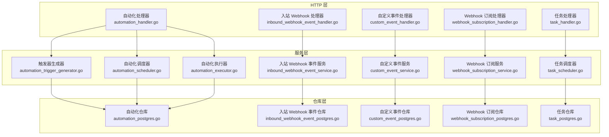
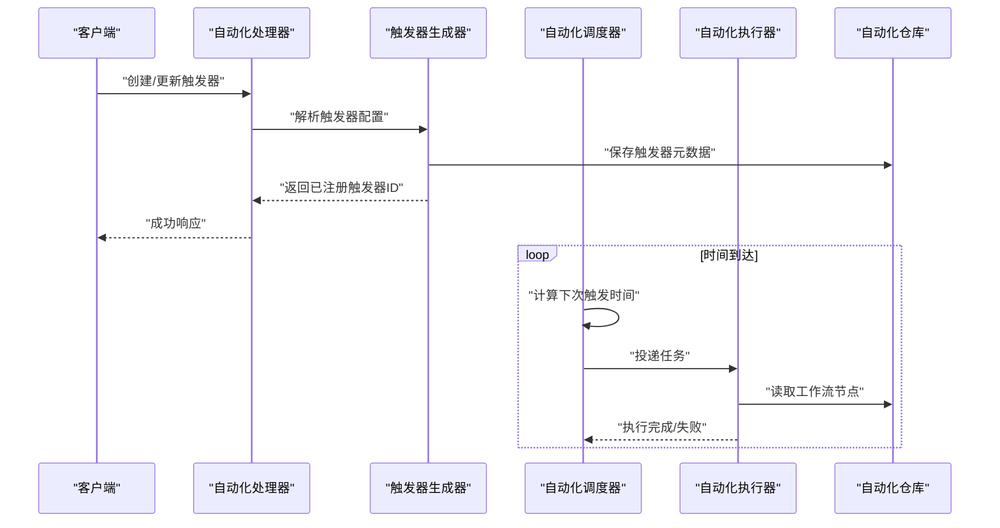
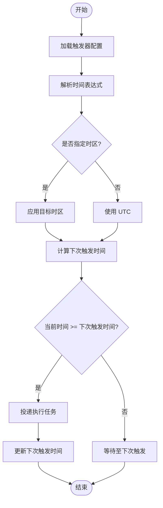
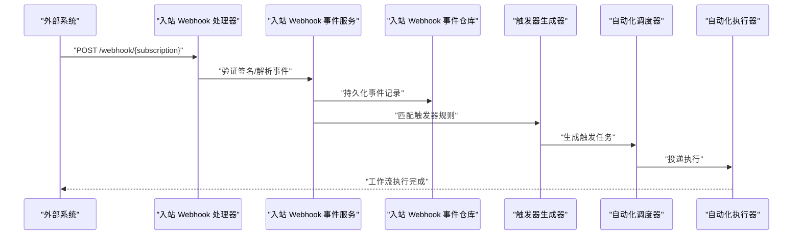
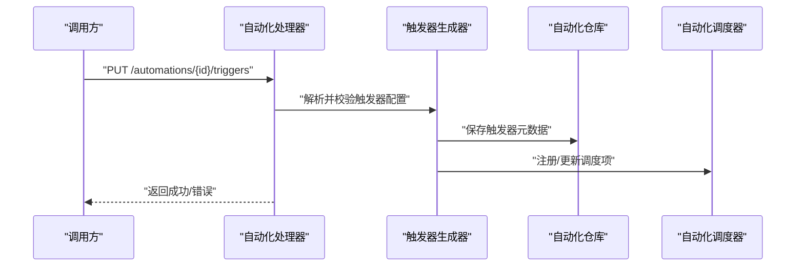
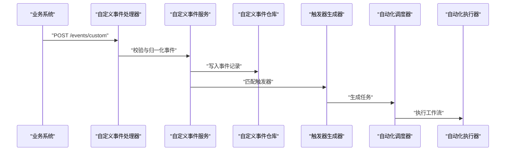
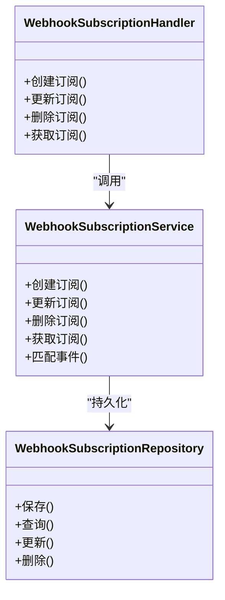
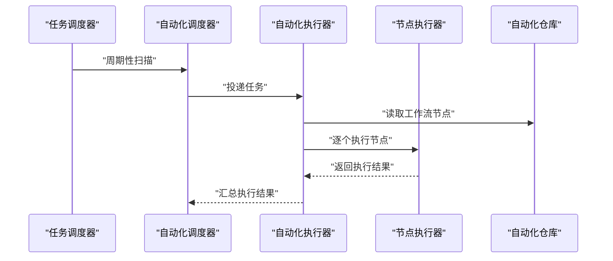
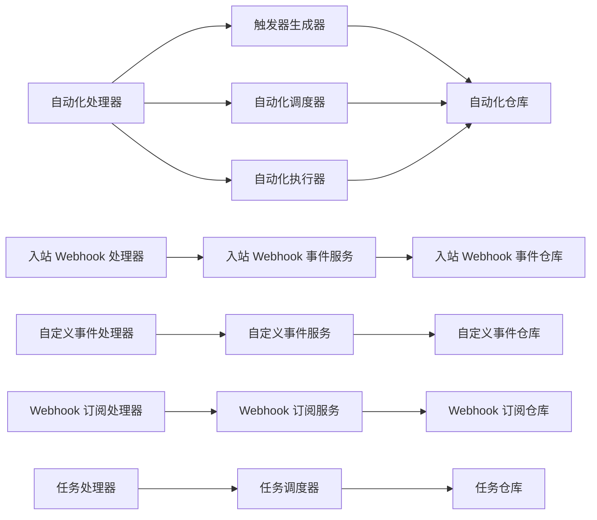

# 触发器节点

<cite>
**本文引用的文件**   
- [automation_trigger_generator.go](file://notifuse/internal/service/automation_trigger_generator.go)
- [automation_scheduler.go](file://notifuse/internal/service/automation_scheduler.go)
- [automation_executor.go](file://notifuse/internal/service/automation_executor.go)
- [task_scheduler.go](file://notifuse/internal/service/task_scheduler.go)
- [inbound_webhook_event_service.go](file://notifuse/internal/service/inbound_webhook_event_service.go)
- [custom_event_service.go](file://notifuse/internal/service/custom_event_service.go)
- [webhook_subscription_service.go](file://notifuse/internal/service/webhook_subscription_service.go)
- [automation_node_executor.go](file://notifuse/internal/service/automation_node_executor.go)
- [automation_handler.go](file://notifuse/internal/http/automation_handler.go)
- [inbound_webhook_event_handler.go](file://notifuse/internal/http/inbound_webhook_event_handler.go)
- [custom_event_handler.go](file://notifuse/internal/http/custom_event_handler.go)
- [webhook_subscription_handler.go](file://notifuse/internal/http/webhook_subscription_handler.go)
- [task_handler.go](file://notifuse/internal/http/task_handler.go)
- [automation_postgres.go](file://notifuse/internal/repository/automation_postgres.go)
- [inbound_webhook_event_postgres.go](file://notifuse/internal/repository/inbound_webhook_event_postgres.go)
- [custom_event_postgres.go](file://notifuse/internal/repository/custom_event_postgres.go)
- [webhook_subscription_postgres.go](file://notifuse/internal/repository/webhook_subscription_postgres.go)
- [task_postgres.go](file://notifuse/internal/repository/task_postgres.go)
- [timezones.go](file://notifuse/internal/domain/timezones.go)
- [generate_timezones.go](file://notifuse/internal/domain/generate_timezones.go)
</cite>

## 目录
1. [简介](#简介)
2. [项目结构](#项目结构)
3. [核心组件](#核心组件)
4. [架构总览](#架构总览)
5. [详细组件分析](#详细组件分析)
6. [依赖分析](#依赖分析)
7. [性能考虑](#性能考虑)
8. [故障排查指南](#故障排查指南)
9. [结论](#结论)
10. [附录](#附录)

## 简介
本文件围绕“触发器节点”进行系统化文档化，覆盖时间触发器、事件触发器与 API 触发器的实现与使用。重点包括：
- 触发条件配置方法与时区处理
- 时间表达式语法与调度算法
- 事件监听机制（Webhook、自定义事件）
- 重复执行逻辑与去重策略
- 状态监控、调试信息与故障恢复
- 自定义触发器开发指南与第三方服务集成示例路径

## 项目结构
触发器相关能力分布在领域模型、服务层、HTTP 处理器与持久化仓库中，形成清晰的分层：
- 领域模型：时间区定义、自动化任务与触发器实体
- 服务层：触发器生成、调度、执行、事件处理
- HTTP 层：对外暴露的 Webhook、自定义事件、任务与自动化接口
- 仓库层：PostgreSQL 持久化

图表来源
- [automation_handler.go](file://notifuse/internal/http/automation_handler.go)
- [inbound_webhook_event_handler.go](file://notifuse/internal/http/inbound_webhook_event_handler.go)
- [custom_event_handler.go](file://notifuse/internal/http/custom_event_handler.go)
- [webhook_subscription_handler.go](file://notifuse/internal/http/webhook_subscription_handler.go)
- [task_handler.go](file://notifuse/internal/http/task_handler.go)
- [automation_trigger_generator.go](file://notifuse/internal/service/automation_trigger_generator.go)
- [automation_scheduler.go](file://notifuse/internal/service/automation_scheduler.go)
- [automation_executor.go](file://notifuse/internal/service/automation_executor.go)
- [inbound_webhook_event_service.go](file://notifuse/internal/service/inbound_webhook_event_service.go)
- [custom_event_service.go](file://notifuse/internal/service/custom_event_service.go)
- [webhook_subscription_service.go](file://notifuse/internal/service/webhook_subscription_service.go)
- [task_scheduler.go](file://notifuse/internal/service/task_scheduler.go)
- [automation_postgres.go](file://notifuse/internal/repository/automation_postgres.go)
- [inbound_webhook_event_postgres.go](file://notifuse/internal/repository/inbound_webhook_event_postgres.go)
- [custom_event_postgres.go](file://notifuse/internal/repository/custom_event_postgres.go)
- [webhook_subscription_postgres.go](file://notifuse/internal/repository/webhook_subscription_postgres.go)
- [task_postgres.go](file://notifuse/internal/repository/task_postgres.go)

章节来源
- [automation_handler.go](file://notifuse/internal/http/automation_handler.go)
- [inbound_webhook_event_handler.go](file://notifuse/internal/http/inbound_webhook_event_handler.go)
- [custom_event_handler.go](file://notifuse/internal/http/custom_event_handler.go)
- [webhook_subscription_handler.go](file://notifuse/internal/http/webhook_subscription_handler.go)
- [task_handler.go](file://notifuse/internal/http/task_handler.go)
- [automation_trigger_generator.go](file://notifuse/internal/service/automation_trigger_generator.go)
- [automation_scheduler.go](file://notifuse/internal/service/automation_scheduler.go)
- [automation_executor.go](file://notifuse/internal/service/automation_executor.go)
- [inbound_webhook_event_service.go](file://notifuse/internal/service/inbound_webhook_event_service.go)
- [custom_event_service.go](file://notifuse/internal/service/custom_event_service.go)
- [webhook_subscription_service.go](file://notifuse/internal/service/webhook_subscription_service.go)
- [task_scheduler.go](file://notifuse/internal/service/task_scheduler.go)
- [automation_postgres.go](file://notifuse/internal/repository/automation_postgres.go)
- [inbound_webhook_event_postgres.go](file://notifuse/internal/repository/inbound_webhook_event_postgres.go)
- [custom_event_postgres.go](file://notifuse/internal/repository/custom_event_postgres.go)
- [webhook_subscription_postgres.go](file://notifuse/internal/repository/webhook_subscription_postgres.go)
- [task_postgres.go](file://notifuse/internal/repository/task_postgres.go)

## 核心组件
- 触发器生成器：将用户配置的触发器规则转换为可执行的调度项或事件订阅项，负责解析时间表达式、时区与重复策略。
- 自动化调度器：基于系统任务调度器维护定时任务队列，按时间表达式计算下一次触发时间并投递到执行通道。
- 自动化执行器：接收调度器投递的任务，加载工作流节点并顺序执行，记录执行结果与日志。
- 事件服务（入站 Webhook、自定义事件）：接收外部事件，匹配订阅规则，生成自动化触发任务。
- Webhook 订阅服务：管理第三方平台回调订阅，统一事件归一化后进入触发器匹配流程。
- 任务调度器：底层周期性任务驱动，支撑时间触发器的轮询与延迟执行。
- 仓库层：持久化自动化、事件、订阅与任务等数据，提供查询与更新能力。

章节来源
- [automation_trigger_generator.go](file://notifuse/internal/service/automation_trigger_generator.go)
- [automation_scheduler.go](file://notifuse/internal/service/automation_scheduler.go)
- [automation_executor.go](file://notifuse/internal/service/automation_executor.go)
- [inbound_webhook_event_service.go](file://notifuse/internal/service/inbound_webhook_event_service.go)
- [custom_event_service.go](file://notifuse/internal/service/custom_event_service.go)
- [webhook_subscription_service.go](file://notifuse/internal/service/webhook_subscription_service.go)
- [task_scheduler.go](file://notifuse/internal/service/task_scheduler.go)
- [automation_postgres.go](file://notifuse/internal/repository/automation_postgres.go)
- [inbound_webhook_event_postgres.go](file://notifuse/internal/repository/inbound_webhook_event_postgres.go)
- [custom_event_postgres.go](file://notifuse/internal/repository/custom_event_postgres.go)
- [webhook_subscription_postgres.go](file://notifuse/internal/repository/webhook_subscription_postgres.go)
- [task_postgres.go](file://notifuse/internal/repository/task_postgres.go)

## 架构总览
触发器节点在系统中的整体交互如下：
- 时间触发器：由调度器根据时间表达式周期性地生成任务，交由执行器运行工作流。
- 事件触发器：外部事件通过 HTTP 入口进入，经事件服务匹配订阅规则后生成任务。
- API 触发器：通过统一的自动化 API 创建/更新触发器配置，内部复用相同调度与执行管线。

图表来源
- [automation_handler.go](file://notifuse/internal/http/automation_handler.go)
- [automation_trigger_generator.go](file://notifuse/internal/service/automation_trigger_generator.go)
- [automation_scheduler.go](file://notifuse/internal/service/automation_scheduler.go)
- [automation_executor.go](file://notifuse/internal/service/automation_executor.go)
- [automation_postgres.go](file://notifuse/internal/repository/automation_postgres.go)

## 详细组件分析

### 时间触发器
- 配置要点
  - 时间表达式：支持标准 Cron 风格表达式，包含分钟、小时、日、月、周几等字段。
  - 时区：支持指定时区标识符，默认采用 UTC；时区列表来源于域模型中的时间区定义。
  - 重复策略：支持一次性、每日、每周、每月等重复模式，结合 Cron 表达式精确控制。
- 调度算法
  - 基于任务调度器周期性扫描待执行任务，按 Cron 表达式计算下一次触发时间。
  - 若当前时间超过计划时间且未执行，则立即投递执行；否则等待至下一个时间窗口。
- 时区处理
  - 所有时间计算均在目标时区内进行，避免跨时区导致的偏移问题。
  - 夏令时切换场景下，调度器会依据时区库重新计算最近一次有效触发点。
- 重复执行逻辑
  - 每次触发后更新任务的“下次触发时间”，确保循环稳定推进。
  - 对并发重复触发具备幂等保护，避免同一时刻重复执行。

图表来源
- [automation_trigger_generator.go](file://notifuse/internal/service/automation_trigger_generator.go)
- [automation_scheduler.go](file://notifuse/internal/service/automation_scheduler.go)
- [task_scheduler.go](file://notifuse/internal/service/task_scheduler.go)
- [timezones.go](file://notifuse/internal/domain/timezones.go)
- [generate_timezones.go](file://notifuse/internal/domain/generate_timezones.go)

章节来源
- [automation_trigger_generator.go](file://notifuse/internal/service/automation_trigger_generator.go)
- [automation_scheduler.go](file://notifuse/internal/service/automation_scheduler.go)
- [task_scheduler.go](file://notifuse/internal/service/task_scheduler.go)
- [timezones.go](file://notifuse/internal/domain/timezones.go)
- [generate_timezones.go](file://notifuse/internal/domain/generate_timezones.go)

### 事件触发器（入站 Webhook 与自定义事件）
- 事件来源
  - 入站 Webhook：第三方平台回调到系统提供的 Webhook 端点。
  - 自定义事件：业务侧通过 API 主动上报事件。
- 事件匹配
  - 事件服务将原始事件归一化为内部结构，与订阅规则进行匹配。
  - 匹配成功后生成自动化触发任务，进入调度与执行管线。
- 去重与限流
  - 对相同事件键值进行去重，防止风暴式重复触发。
  - 可选限流策略保障系统稳定性。

图表来源
- [inbound_webhook_event_handler.go](file://notifuse/internal/http/inbound_webhook_event_handler.go)
- [inbound_webhook_event_service.go](file://notifuse/internal/service/inbound_webhook_event_service.go)
- [inbound_webhook_event_postgres.go](file://notifuse/internal/repository/inbound_webhook_event_postgres.go)
- [automation_trigger_generator.go](file://notifuse/internal/service/automation_trigger_generator.go)
- [automation_scheduler.go](file://notifuse/internal/service/automation_scheduler.go)
- [automation_executor.go](file://notifuse/internal/service/automation_executor.go)

章节来源
- [inbound_webhook_event_handler.go](file://notifuse/internal/http/inbound_webhook_event_handler.go)
- [inbound_webhook_event_service.go](file://notifuse/internal/service/inbound_webhook_event_service.go)
- [inbound_webhook_event_postgres.go](file://notifuse/internal/repository/inbound_webhook_event_postgres.go)
- [automation_trigger_generator.go](file://notifuse/internal/service/automation_trigger_generator.go)
- [automation_scheduler.go](file://notifuse/internal/service/automation_scheduler.go)
- [automation_executor.go](file://notifuse/internal/service/automation_executor.go)

### API 触发器（自动化 API）
- 功能范围
  - 通过自动化处理器提供 RESTful 接口，用于创建、更新、删除触发器与工作流。
  - 支持批量操作与状态查询，便于运维与监控。
- 安全与鉴权
  - 请求需携带鉴权信息，服务端校验权限后方可执行。
- 错误处理
  - 对非法参数、资源不存在、权限不足等情况返回明确错误码与消息。

图表来源
- [automation_handler.go](file://notifuse/internal/http/automation_handler.go)
- [automation_trigger_generator.go](file://notifuse/internal/service/automation_trigger_generator.go)
- [automation_postgres.go](file://notifuse/internal/repository/automation_postgres.go)
- [automation_scheduler.go](file://notifuse/internal/service/automation_scheduler.go)

章节来源
- [automation_handler.go](file://notifuse/internal/http/automation_handler.go)
- [automation_trigger_generator.go](file://notifuse/internal/service/automation_trigger_generator.go)
- [automation_postgres.go](file://notifuse/internal/repository/automation_postgres.go)
- [automation_scheduler.go](file://notifuse/internal/service/automation_scheduler.go)

### 自定义事件触发器
- 事件上报
  - 通过自定义事件处理器接收业务事件，并进行基础校验与持久化。
- 匹配与触发
  - 事件服务根据事件类型、属性与阈值匹配触发器规则，生成任务。
- 审计与追踪
  - 事件全链路记录，便于问题定位与审计。

图表来源
- [custom_event_handler.go](file://notifuse/internal/http/custom_event_handler.go)
- [custom_event_service.go](file://notifuse/internal/service/custom_event_service.go)
- [custom_event_postgres.go](file://notifuse/internal/repository/custom_event_postgres.go)
- [automation_trigger_generator.go](file://notifuse/internal/service/automation_trigger_generator.go)
- [automation_scheduler.go](file://notifuse/internal/service/automation_scheduler.go)
- [automation_executor.go](file://notifuse/internal/service/automation_executor.go)

章节来源
- [custom_event_handler.go](file://notifuse/internal/http/custom_event_handler.go)
- [custom_event_service.go](file://notifuse/internal/service/custom_event_service.go)
- [custom_event_postgres.go](file://notifuse/internal/repository/custom_event_postgres.go)
- [automation_trigger_generator.go](file://notifuse/internal/service/automation_trigger_generator.go)
- [automation_scheduler.go](file://notifuse/internal/service/automation_scheduler.go)
- [automation_executor.go](file://notifuse/internal/service/automation_executor.go)

### Webhook 订阅与第三方集成
- 订阅管理
  - 通过 Webhook 订阅处理器与服务管理第三方平台的回调地址、签名密钥与事件类型。
- 事件归一化
  - 不同平台的事件格式差异较大，服务层将其归一化为内部结构，提高匹配效率。
- 重试与失败处理
  - 对失败的回调进行重试与告警，保障可靠性。

图表来源
- [webhook_subscription_handler.go](file://notifuse/internal/http/webhook_subscription_handler.go)
- [webhook_subscription_service.go](file://notifuse/internal/service/webhook_subscription_service.go)
- [webhook_subscription_postgres.go](file://notifuse/internal/repository/webhook_subscription_postgres.go)

章节来源
- [webhook_subscription_handler.go](file://notifuse/internal/http/webhook_subscription_handler.go)
- [webhook_subscription_service.go](file://notifuse/internal/service/webhook_subscription_service.go)
- [webhook_subscription_postgres.go](file://notifuse/internal/repository/webhook_subscription_postgres.go)

### 任务调度与执行
- 任务调度器
  - 提供周期性任务驱动，支撑时间触发器的轮询与延迟执行。
- 自动化执行器
  - 接收调度器投递的任务，加载工作流节点并按序执行，记录执行结果与日志。
- 节点执行器
  - 封装具体节点类型的执行逻辑，支持扩展新节点类型。

图表来源
- [task_scheduler.go](file://notifuse/internal/service/task_scheduler.go)
- [automation_scheduler.go](file://notifuse/internal/service/automation_scheduler.go)
- [automation_executor.go](file://notifuse/internal/service/automation_executor.go)
- [automation_node_executor.go](file://notifuse/internal/service/automation_node_executor.go)
- [automation_postgres.go](file://notifuse/internal/repository/automation_postgres.go)

章节来源
- [task_scheduler.go](file://notifuse/internal/service/task_scheduler.go)
- [automation_scheduler.go](file://notifuse/internal/service/automation_scheduler.go)
- [automation_executor.go](file://notifuse/internal/service/automation_executor.go)
- [automation_node_executor.go](file://notifuse/internal/service/automation_node_executor.go)
- [automation_postgres.go](file://notifuse/internal/repository/automation_postgres.go)

## 依赖分析
- 组件耦合
  - HTTP 处理器仅依赖服务层，服务层依赖仓库层，层次清晰，降低耦合度。
- 直接依赖
  - 触发器生成器依赖自动化仓库与调度器；事件服务依赖对应事件仓库。
- 间接依赖
  - 调度器依赖任务调度器与仓库；执行器依赖节点执行器与仓库。
- 外部依赖
  - 第三方平台通过 Webhook 订阅接入，事件归一化在服务层完成。

图表来源
- [automation_handler.go](file://notifuse/internal/http/automation_handler.go)
- [inbound_webhook_event_handler.go](file://notifuse/internal/http/inbound_webhook_event_handler.go)
- [custom_event_handler.go](file://notifuse/internal/http/custom_event_handler.go)
- [webhook_subscription_handler.go](file://notifuse/internal/http/webhook_subscription_handler.go)
- [task_handler.go](file://notifuse/internal/http/task_handler.go)
- [automation_trigger_generator.go](file://notifuse/internal/service/automation_trigger_generator.go)
- [automation_scheduler.go](file://notifuse/internal/service/automation_scheduler.go)
- [automation_executor.go](file://notifuse/internal/service/automation_executor.go)
- [inbound_webhook_event_service.go](file://notifuse/internal/service/inbound_webhook_event_service.go)
- [custom_event_service.go](file://notifuse/internal/service/custom_event_service.go)
- [webhook_subscription_service.go](file://notifuse/internal/service/webhook_subscription_service.go)
- [task_scheduler.go](file://notifuse/internal/service/task_scheduler.go)
- [automation_postgres.go](file://notifuse/internal/repository/automation_postgres.go)
- [inbound_webhook_event_postgres.go](file://notifuse/internal/repository/inbound_webhook_event_postgres.go)
- [custom_event_postgres.go](file://notifuse/internal/repository/custom_event_postgres.go)
- [webhook_subscription_postgres.go](file://notifuse/internal/repository/webhook_subscription_postgres.go)
- [task_postgres.go](file://notifuse/internal/repository/task_postgres.go)

章节来源
- [automation_handler.go](file://notifuse/internal/http/automation_handler.go)
- [inbound_webhook_event_handler.go](file://notifuse/internal/http/inbound_webhook_event_handler.go)
- [custom_event_handler.go](file://notifuse/internal/http/custom_event_handler.go)
- [webhook_subscription_handler.go](file://notifuse/internal/http/webhook_subscription_handler.go)
- [task_handler.go](file://notifuse/internal/http/task_handler.go)
- [automation_trigger_generator.go](file://notifuse/internal/service/automation_trigger_generator.go)
- [automation_scheduler.go](file://notifuse/internal/service/automation_scheduler.go)
- [automation_executor.go](file://notifuse/internal/service/automation_executor.go)
- [inbound_webhook_event_service.go](file://notifuse/internal/service/inbound_webhook_event_service.go)
- [custom_event_service.go](file://notifuse/internal/service/custom_event_service.go)
- [webhook_subscription_service.go](file://notifuse/internal/service/webhook_subscription_service.go)
- [task_scheduler.go](file://notifuse/internal/service/task_scheduler.go)
- [automation_postgres.go](file://notifuse/internal/repository/automation_postgres.go)
- [inbound_webhook_event_postgres.go](file://notifuse/internal/repository/inbound_webhook_event_postgres.go)
- [custom_event_postgres.go](file://notifuse/internal/repository/custom_event_postgres.go)
- [webhook_subscription_postgres.go](file://notifuse/internal/repository/webhook_subscription_postgres.go)
- [task_postgres.go](file://notifuse/internal/repository/task_postgres.go)

## 性能考虑
- 调度粒度
  - 合理设置 Cron 表达式与最小轮询间隔，避免频繁扫描导致 CPU 占用过高。
- 事件风暴防护
  - 对高频事件启用去重与限流，必要时引入缓冲队列削峰填谷。
- 时区计算优化
  - 缓存常用时区转换结果，减少重复计算开销。
- 执行并行度
  - 对无副作用的工作流节点可适度并行执行，提升吞吐。
- 存储压力
  - 对事件与任务记录进行归档与清理，控制表规模增长。

[本节为通用指导，不直接分析具体文件]

## 故障排查指南
- 常见问题
  - 触发器未生效：检查时间表达式是否正确、时区是否匹配、调度器是否正常运行。
  - 事件未触发：确认 Webhook 签名校验通过、事件结构与匹配规则一致。
  - 执行失败：查看执行日志与节点输出，定位具体失败原因。
- 诊断步骤
  - 查询触发器状态与最近执行记录。
  - 核对事件入库与匹配日志。
  - 检查任务调度器健康状态与队列积压情况。
- 恢复策略
  - 对失败任务进行重试与补偿。
  - 对异常触发器进行暂停与修复后再启用。

章节来源
- [automation_executor.go](file://notifuse/internal/service/automation_executor.go)
- [automation_scheduler.go](file://notifuse/internal/service/automation_scheduler.go)
- [inbound_webhook_event_service.go](file://notifuse/internal/service/inbound_webhook_event_service.go)
- [custom_event_service.go](file://notifuse/internal/service/custom_event_service.go)
- [task_scheduler.go](file://notifuse/internal/service/task_scheduler.go)

## 结论
触发器节点通过时间、事件与 API 三种方式驱动自动化工作流，具备完善的调度、匹配与执行机制。系统在时区处理、重复执行与故障恢复方面提供了可靠保障。建议在生产环境关注性能与稳定性指标，并结合业务需求定制触发器与节点类型。

[本节为总结性内容，不直接分析具体文件]

## 附录

### 时间表达式语法说明
- 字段含义
  - 分钟（0-59）、小时（0-23）、日（1-31）、月（1-12）、周几（0-6，周日为 0）。
- 特殊字符
  - * 表示任意值，/ 表示步长，, 表示多选，- 表示范围。
- 示例
  - 每 5 分钟执行：*/5 * * * *
  - 每天 9:30 执行：30 9 * * *
  - 每周一 10:00 执行：0 10 * * 1

[本节为概念性说明，不直接分析具体文件]

### 自定义触发器开发指南
- 设计原则
  - 遵循服务层与仓库层分离，新增触发器类型仅需扩展生成器与匹配逻辑。
- 开发步骤
  - 定义触发器配置结构体与校验规则。
  - 在触发器生成器中增加解析与注册逻辑。
  - 在事件服务或调度器中实现匹配与投递。
  - 编写单元测试覆盖边界条件与异常路径。
- 集成第三方服务
  - 通过 Webhook 订阅服务注册回调地址与签名密钥。
  - 在服务层实现事件归一化与匹配规则。
  - 参考现有 Webhook 订阅与事件服务的实现路径进行扩展。

章节来源
- [automation_trigger_generator.go](file://notifuse/internal/service/automation_trigger_generator.go)
- [inbound_webhook_event_service.go](file://notifuse/internal/service/inbound_webhook_event_service.go)
- [custom_event_service.go](file://notifuse/internal/service/custom_event_service.go)
- [webhook_subscription_service.go](file://notifuse/internal/service/webhook_subscription_service.go)