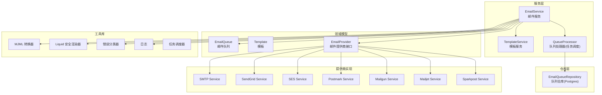
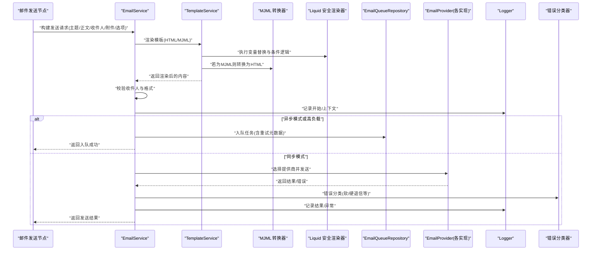
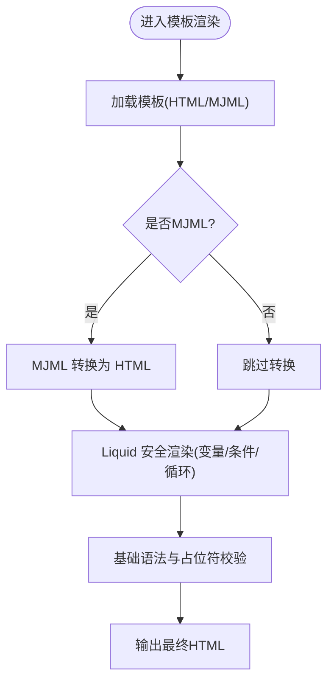
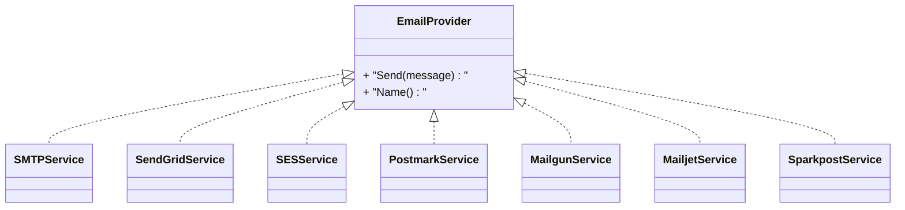
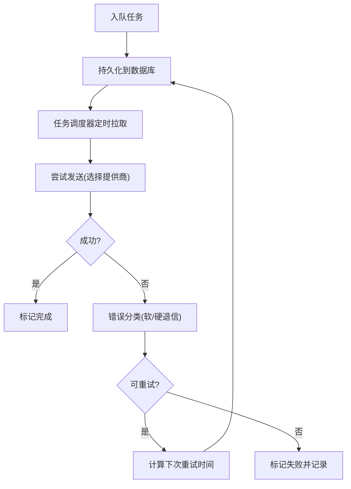
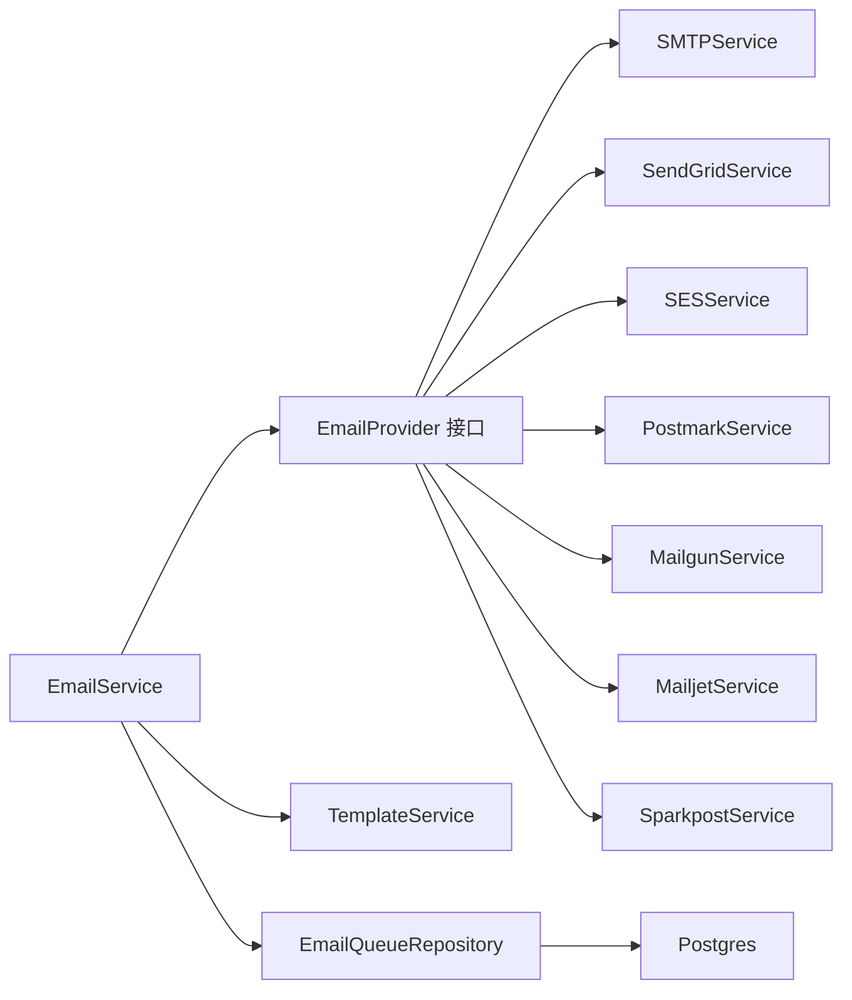

# 邮件发送节点

<cite>
**本文引用的文件**   
- [email_service.go](file://notifuse/internal/service/email_service.go)
- [email_queue.go](file://notifuse/internal/domain/email_queue.go)
- [email_queue_postgres.go](file://notifuse/internal/repository/email_queue_postgres.go)
- [template_service.go](file://notifuse/internal/service/template_service.go)
- [template.go](file://notifuse/internal/domain/template.go)
- [liquid_secure.go](file://notifuse/pkg/notifuse_mjml/liquid_secure.go)
- [converter.go](file://notifuse/pkg/notifuse_mjml/converter.go)
- [mailer.go](file://notifuse/pkg/mailer/mailer.go)
- [smtp_service.go](file://notifuse/internal/service/smtp_service.go)
- [sendgrid_service.go](file://notifuse/internal/service/sendgrid_service.go)
- [ses_service.go](file://notifuse/internal/service/ses_service.go)
- [postmark_service.go](file://notifuse/internal/service/postmark_service.go)
- [mailgun_service.go](file://notifuse/internal/service/mailgun_service.go)
- [mailjet_service.go](file://notifuse/internal/service/mailjet_service.go)
- [sparkpost_service.go](file://notifuse/internal/service/sparkpost_service.go)
- [email_provider.go](file://notifuse/internal/domain/email_provider.go)
- [emailerror/classifier.go](file://notifuse/pkg/emailerror/classifier.go)
- [emailerror/error.go](file://notifuse/pkg/emailerror/error.go)
- [logger.go](file://notifuse/pkg/logger/logger.go)
- [task_scheduler.go](file://notifuse/internal/service/task_scheduler.go)
- [automation_node_executor.go](file://notifuse/internal/service/automation_node_executor.go)
</cite>

## 目录
1. [简介](#简介)
2. [项目结构](#项目结构)
3. [核心组件](#核心组件)
4. [架构总览](#架构总览)
5. [详细组件分析](#详细组件分析)
6. [依赖关系分析](#依赖关系分析)
7. [性能考虑](#性能考虑)
8. [故障排查指南](#故障排查指南)
9. [结论](#结论)
10. [附录](#附录)

## 简介
本文件围绕“邮件发送节点”提供系统化文档，覆盖模板渲染（含 Liquid 语法与 MJML 转换）、收件人与发送选项配置、多提供商集成、队列与重试策略、格式校验与预览、移动端适配检查、失败处理、日志记录与性能监控等关键主题。读者可据此理解从编排到投递的完整链路，并在自动化流程中正确配置和使用该节点。

## 项目结构
邮件发送能力由领域模型、服务层、仓库层与外部提供商实现共同组成：
- 领域模型：定义邮件队列、模板、邮件提供商接口等核心概念
- 服务层：编排模板渲染、收件人解析、附件组装、队列入队与发送调度
- 仓库层：持久化邮件队列任务
- 提供商实现：SMTP、SendGrid、SES、Postmark、Mailgun、Mailjet、SparkPost 等
- 工具库：MJML 转 HTML、Liquid 安全渲染、错误分类、日志与任务调度

图表来源
- [email_service.go:1-200](file://notifuse/internal/service/email_service.go#L1-L200)
- [email_queue.go:1-120](file://notifuse/internal/domain/email_queue.go#L1-L120)
- [email_queue_postgres.go:1-120](file://notifuse/internal/repository/email_queue_postgres.go#L1-L120)
- [template_service.go:1-120](file://notifuse/internal/service/template_service.go#L1-L120)
- [template.go:1-120](file://notifuse/internal/domain/template.go#L1-L120)
- [liquid_secure.go:1-120](file://notifuse/pkg/notifuse_mjml/liquid_secure.go#L1-L120)
- [converter.go:1-120](file://notifuse/pkg/notifuse_mjml/converter.go#L1-L120)
- [mailer.go:1-120](file://notifuse/pkg/mailer/mailer.go#L1-L120)
- [smtp_service.go:1-120](file://notifuse/internal/service/smtp_service.go#L1-L120)
- [sendgrid_service.go:1-120](file://notifuse/internal/service/sendgrid_service.go#L1-L120)
- [ses_service.go:1-120](file://notifuse/internal/service/ses_service.go#L1-L120)
- [postmark_service.go:1-120](file://notifuse/internal/service/postmark_service.go#L1-L120)
- [mailgun_service.go:1-120](file://notifuse/internal/service/mailgun_service.go#L1-L120)
- [mailjet_service.go:1-120](file://notifuse/internal/service/mailjet_service.go#L1-L120)
- [sparkpost_service.go:1-120](file://notifuse/internal/service/sparkpost_service.go#L1-L120)
- [email_provider.go:1-120](file://notifuse/internal/domain/email_provider.go#L1-L120)
- [classifier.go:1-120](file://notifuse/pkg/emailerror/classifier.go#L1-L120)
- [error.go:1-120](file://notifuse/pkg/emailerror/error.go#L1-L120)
- [logger.go:1-120](file://notifuse/pkg/logger/logger.go#L1-L120)
- [task_scheduler.go:1-120](file://notifuse/internal/service/task_scheduler.go#L1-L120)

章节来源
- [email_service.go:1-200](file://notifuse/internal/service/email_service.go#L1-L200)
- [email_queue.go:1-120](file://notifuse/internal/domain/email_queue.go#L1-L120)
- [email_queue_postgres.go:1-120](file://notifuse/internal/repository/email_queue_postgres.go#L1-L120)
- [template_service.go:1-120](file://notifuse/internal/service/template_service.go#L1-L120)
- [template.go:1-120](file://notifuse/internal/domain/template.go#L1-L120)
- [liquid_secure.go:1-120](file://notifuse/pkg/notifuse_mjml/liquid_secure.go#L1-L120)
- [converter.go:1-120](file://notifuse/pkg/notifuse_mjml/converter.go#L1-L120)
- [mailer.go:1-120](file://notifuse/pkg/mailer/mailer.go#L1-L120)
- [smtp_service.go:1-120](file://notifuse/internal/service/smtp_service.go#L1-L120)
- [sendgrid_service.go:1-120](file://notifuse/internal/service/sendgrid_service.go#L1-L120)
- [ses_service.go:1-120](file://notifuse/internal/service/ses_service.go#L1-L120)
- [postmark_service.go:1-120](file://notifuse/internal/service/postmark_service.go#L1-L120)
- [mailgun_service.go:1-120](file://notifuse/internal/service/mailgun_service.go#L1-L120)
- [mailjet_service.go:1-120](file://notifuse/internal/service/mailjet_service.go#L1-L120)
- [sparkpost_service.go:1-120](file://notifuse/internal/service/sparkpost_service.go#L1-L120)
- [email_provider.go:1-120](file://notifuse/internal/domain/email_provider.go#L1-L120)
- [classifier.go:1-120](file://notifuse/pkg/emailerror/classifier.go#L1-L120)
- [error.go:1-120](file://notifuse/pkg/emailerror/error.go#L1-L120)
- [logger.go:1-120](file://notifuse/pkg/logger/logger.go#L1-L120)
- [task_scheduler.go:1-120](file://notifuse/internal/service/task_scheduler.go#L1-L120)

## 核心组件
- 邮件服务 EmailService：负责将模板渲染为最终内容、组装收件人与附件、选择并调用具体邮件提供商、记录日志与指标、必要时入队异步发送。
- 模板服务 TemplateService：加载模板、执行变量替换与条件逻辑、支持 MJML 模板编译与 Liquid 安全渲染。
- 邮件队列 EmailQueue：表示待发送的邮件任务，包含目标、主题、正文、附件、提供商选择、优先级与重试元数据。
- 邮件提供商接口 EmailProvider：统一抽象不同后端（SMTP、SendGrid、SES、Postmark、Mailgun、Mailjet、SparkPost）的发送能力。
- 队列仓库 EmailQueueRepository：基于 Postgres 持久化队列任务，供任务调度器消费。
- 工具库：MJML 转换器、Liquid 安全渲染器、错误分类器、日志与任务调度器。

章节来源
- [email_service.go:1-200](file://notifuse/internal/service/email_service.go#L1-L200)
- [template_service.go:1-120](file://notifuse/internal/service/template_service.go#L1-L120)
- [email_queue.go:1-120](file://notifuse/internal/domain/email_queue.go#L1-L120)
- [email_provider.go:1-120](file://notifuse/internal/domain/email_provider.go#L1-L120)
- [email_queue_postgres.go:1-120](file://notifuse/internal/repository/email_queue_postgres.go#L1-L120)
- [liquid_secure.go:1-120](file://notifuse/pkg/notifuse_mjml/liquid_secure.go#L1-L120)
- [converter.go:1-120](file://notifuse/pkg/notifuse_mjml/converter.go#L1-L120)
- [classifier.go:1-120](file://notifuse/pkg/emailerror/classifier.go#L1-L120)
- [logger.go:1-120](file://notifuse/pkg/logger/logger.go#L1-L120)
- [task_scheduler.go:1-120](file://notifuse/internal/service/task_scheduler.go#L1-L120)

## 架构总览
下图展示了从“邮件发送节点”触发到实际投递的关键路径，包括模板渲染、收件人解析、附件处理、队列入队与重试、以及多提供商投递。

图表来源
- [email_service.go:1-200](file://notifuse/internal/service/email_service.go#L1-L200)
- [template_service.go:1-120](file://notifuse/internal/service/template_service.go#L1-L120)
- [liquid_secure.go:1-120](file://notifuse/pkg/notifuse_mjml/liquid_secure.go#L1-L120)
- [converter.go:1-120](file://notifuse/pkg/notifuse_mjml/converter.go#L1-L120)
- [email_queue_postgres.go:1-120](file://notifuse/internal/repository/email_queue_postgres.go#L1-L120)
- [email_provider.go:1-120](file://notifuse/internal/domain/email_provider.go#L1-L120)
- [smtp_service.go:1-120](file://notifuse/internal/service/smtp_service.go#L1-L120)
- [sendgrid_service.go:1-120](file://notifuse/internal/service/sendgrid_service.go#L1-L120)
- [ses_service.go:1-120](file://notifuse/internal/service/ses_service.go#L1-L120)
- [postmark_service.go:1-120](file://notifuse/internal/service/postmark_service.go#L1-L120)
- [mailgun_service.go:1-120](file://notifuse/internal/service/mailgun_service.go#L1-L120)
- [mailjet_service.go:1-120](file://notifuse/internal/service/mailjet_service.go#L1-L120)
- [sparkpost_service.go:1-120](file://notifuse/internal/service/sparkpost_service.go#L1-L120)
- [logger.go:1-120](file://notifuse/pkg/logger/logger.go#L1-L120)
- [classifier.go:1-120](file://notifuse/pkg/emailerror/classifier.go#L1-L120)

## 详细组件分析

### 模板渲染与动态内容
- 模板类型：支持纯 HTML 与 MJML；MJML 会在服务端转换为 HTML 后再进行渲染。
- 变量与条件：通过 Liquid 安全渲染器执行变量替换、循环与条件分支，避免不安全函数与全局访问。
- 动态内容：可从联系人属性、工作区设置、事件上下文中注入变量，用于个性化主题与正文。
- 预览与校验：在 UI 侧可对模板进行预览；服务端可在渲染前对模板语法进行基础校验，减少运行时错误。

图表来源
- [template_service.go:1-120](file://notifuse/internal/service/template_service.go#L1-L120)
- [template.go:1-120](file://notifuse/internal/domain/template.go#L1-L120)
- [liquid_secure.go:1-120](file://notifuse/pkg/notifuse_mjml/liquid_secure.go#L1-L120)
- [converter.go:1-120](file://notifuse/pkg/notifuse_mjml/converter.go#L1-L120)

章节来源
- [template_service.go:1-120](file://notifuse/internal/service/template_service.go#L1-L120)
- [template.go:1-120](file://notifuse/internal/domain/template.go#L1-L120)
- [liquid_secure.go:1-120](file://notifuse/pkg/notifuse_mjml/liquid_secure.go#L1-L120)
- [converter.go:1-120](file://notifuse/pkg/notifuse_mjml/converter.go#L1-L120)

### 收件人配置与发送选项
- 收件人：支持 To/Cc/Bcc，允许来自联系人列表、分段筛选或动态表达式计算的结果。
- 发送选项：可指定发件人地址、回复地址、主题、优先级、标签、自定义头、跟踪开关等。
- 格式验证：在服务端对邮箱格式、主题长度、正文大小等进行前置校验，降低下游失败概率。
- 移动端适配：建议优先使用 MJML 模板以获得更好的跨客户端兼容性；也可在预览阶段进行基本响应式检查。

章节来源
- [email_service.go:1-200](file://notifuse/internal/service/email_service.go#L1-L200)
- [mailer.go:1-120](file://notifuse/pkg/mailer/mailer.go#L1-L120)

### 附件处理机制
- 支持多种附件来源：内联 Base64、URL 下载、本地文件路径等。
- 大小限制：对单附件与总大小进行限制，防止内存溢出与超时。
- 安全扫描：对附件扩展名与 MIME 类型进行白名单校验，拒绝潜在危险类型。
- 流式上传：对于大附件，优先采用流式传输以减少峰值内存占用。

章节来源
- [email_service.go:1-200](file://notifuse/internal/service/email_service.go#L1-L200)
- [mailer.go:1-120](file://notifuse/pkg/mailer/mailer.go#L1-L120)

### 邮件提供商集成
系统通过统一的 EmailProvider 接口对接多家提供商，便于切换与扩展：
- SMTP：通用协议，适合自建或企业网关
- SendGrid、SES、Postmark、Mailgun、Mailjet、SparkPost：云服务商 API

图表来源
- [email_provider.go:1-120](file://notifuse/internal/domain/email_provider.go#L1-L120)
- [smtp_service.go:1-120](file://notifuse/internal/service/smtp_service.go#L1-L120)
- [sendgrid_service.go:1-120](file://notifuse/internal/service/sendgrid_service.go#L1-L120)
- [ses_service.go:1-120](file://notifuse/internal/service/ses_service.go#L1-L120)
- [postmark_service.go:1-120](file://notifuse/internal/service/postmark_service.go#L1-L120)
- [mailgun_service.go:1-120](file://notifuse/internal/service/mailgun_service.go#L1-L120)
- [mailjet_service.go:1-120](file://notifuse/internal/service/mailjet_service.go#L1-L120)
- [sparkpost_service.go:1-120](file://notifuse/internal/service/sparkpost_service.go#L1-L120)

章节来源
- [email_provider.go:1-120](file://notifuse/internal/domain/email_provider.go#L1-L120)
- [smtp_service.go:1-120](file://notifuse/internal/service/smtp_service.go#L1-L120)
- [sendgrid_service.go:1-120](file://notifuse/internal/service/sendgrid_service.go#L1-L120)
- [ses_service.go:1-120](file://notifuse/internal/service/ses_service.go#L1-L120)
- [postmark_service.go:1-120](file://notifuse/internal/service/postmark_service.go#L1-L120)
- [mailgun_service.go:1-120](file://notifuse/internal/service/mailgun_service.go#L1-L120)
- [mailjet_service.go:1-120](file://notifuse/internal/service/mailjet_service.go#L1-L120)
- [sparkpost_service.go:1-120](file://notifuse/internal/service/sparkpost_service.go#L1-L120)

### 发送队列管理与重试策略
- 队列模型：EmailQueue 记录目标、内容、提供商、优先级、创建时间、尝试次数与下次重试时间等。
- 持久化：通过 EmailQueueRepository 将任务写入 Postgres，确保可靠性。
- 调度与重试：TaskScheduler 周期性拉取到期任务，按指数退避或固定间隔重试，达到最大次数后标记失败并告警。
- 幂等性：任务携带唯一 ID，避免重复投递。

图表来源
- [email_queue.go:1-120](file://notifuse/internal/domain/email_queue.go#L1-L120)
- [email_queue_postgres.go:1-120](file://notifuse/internal/repository/email_queue_postgres.go#L1-L120)
- [task_scheduler.go:1-120](file://notifuse/internal/service/task_scheduler.go#L1-L120)
- [classifier.go:1-120](file://notifuse/pkg/emailerror/classifier.go#L1-L120)

章节来源
- [email_queue.go:1-120](file://notifuse/internal/domain/email_queue.go#L1-L120)
- [email_queue_postgres.go:1-120](file://notifuse/internal/repository/email_queue_postgres.go#L1-L120)
- [task_scheduler.go:1-120](file://notifuse/internal/service/task_scheduler.go#L1-L120)
- [classifier.go:1-120](file://notifuse/pkg/emailerror/classifier.go#L1-L120)

### 错误处理与日志记录
- 错误分类：根据提供商返回码与消息区分软错误（如限流、临时网络问题）与硬错误（如无效地址、域名不可达），决定重试与否。
- 日志记录：在关键路径记录结构化日志，包含任务 ID、提供商、状态码、耗时与错误信息，便于追踪与审计。
- 指标上报：可结合 Tracing 与 Telemetry 上报成功率、延迟分布与错误率。

章节来源
- [emailerror/classifier.go:1-120](file://notifuse/pkg/emailerror/classifier.go#L1-L120)
- [emailerror/error.go:1-120](file://notifuse/pkg/emailerror/error.go#L1-L120)
- [logger.go:1-120](file://notifuse/pkg/logger/logger.go#L1-L120)

### 与自动化节点的集成
- 邮件发送节点可作为自动化流程中的一个步骤，接收上游节点提供的上下文数据，用于模板变量填充与收件人选择。
- 节点可配置为同步或异步模式：同步适用于低延迟场景，异步通过队列提升吞吐与容错。

章节来源
- [automation_node_executor.go:1-200](file://notifuse/internal/service/automation_node_executor.go#L1-L200)
- [email_service.go:1-200](file://notifuse/internal/service/email_service.go#L1-L200)

## 依赖关系分析
- 松耦合设计：EmailService 通过 EmailProvider 接口与具体提供商解耦，新增提供商只需实现接口。
- 内部依赖：模板服务与工具库（MJML/Liquid）被 EmailService 组合使用，职责清晰。
- 外部依赖：Postgres 作为队列存储；各提供商 API 作为外部系统。
- 潜在风险：需关注第三方 API 限流与可用性，通过队列与重试缓解。

图表来源
- [email_service.go:1-200](file://notifuse/internal/service/email_service.go#L1-L200)
- [email_provider.go:1-120](file://notifuse/internal/domain/email_provider.go#L1-L120)
- [email_queue_postgres.go:1-120](file://notifuse/internal/repository/email_queue_postgres.go#L1-L120)
- [smtp_service.go:1-120](file://notifuse/internal/service/smtp_service.go#L1-L120)
- [sendgrid_service.go:1-120](file://notifuse/internal/service/sendgrid_service.go#L1-L120)
- [ses_service.go:1-120](file://notifuse/internal/service/ses_service.go#L1-L120)
- [postmark_service.go:1-120](file://notifuse/internal/service/postmark_service.go#L1-L120)
- [mailgun_service.go:1-120](file://notifuse/internal/service/mailgun_service.go#L1-L120)
- [mailjet_service.go:1-120](file://notifuse/internal/service/mailjet_service.go#L1-L120)
- [sparkpost_service.go:1-120](file://notifuse/internal/service/sparkpost_service.go#L1-L120)

章节来源
- [email_service.go:1-200](file://notifuse/internal/service/email_service.go#L1-L200)
- [email_provider.go:1-120](file://notifuse/internal/domain/email_provider.go#L1-L120)
- [email_queue_postgres.go:1-120](file://notifuse/internal/repository/email_queue_postgres.go#L1-L120)

## 性能考虑
- 并发控制：对同一提供商的连接池与并发度进行限制，避免触发限流。
- 批量化：批量发送时尽量复用连接与认证上下文，减少握手开销。
- 资源限制：对附件大小、正文长度、变量数量进行上限控制，防止内存与 CPU 峰值过高。
- 缓存策略：对静态模板片段或公共变量进行缓存，减少重复渲染成本。
- 异步化：高负载场景下默认走队列异步发送，削峰填谷。

[本节为通用指导，不直接分析具体文件]

## 故障排查指南
- 常见错误分类：
  - 软错误：网络抖动、限流、暂时不可用；应自动重试
  - 硬错误：无效邮箱、域名不存在、权限不足；不应重试并记录告警
- 定位步骤：
  - 查看任务 ID 对应的日志，确认提供商返回码与错误消息
  - 检查收件人格式与模板变量是否缺失
  - 核对附件大小与类型是否在白名单内
  - 观察队列重试次数与下次重试时间
- 恢复措施：
  - 调整提供商配额与重试策略
  - 修正模板与收件人数据
  - 清理或归档失败任务，必要时人工重投

章节来源
- [emailerror/classifier.go:1-120](file://notifuse/pkg/emailerror/classifier.go#L1-L120)
- [emailerror/error.go:1-120](file://notifuse/pkg/emailerror/error.go#L1-L120)
- [logger.go:1-120](file://notifuse/pkg/logger/logger.go#L1-L120)
- [email_queue.go:1-120](file://notifuse/internal/domain/email_queue.go#L1-L120)

## 结论
邮件发送节点以清晰的层次与接口抽象实现了模板渲染、收件人管理、附件处理、多提供商集成、队列与重试、错误分类与日志记录等关键能力。通过 MJML 与 Liquid 的组合，既保证了跨客户端兼容性与强大的动态内容能力，又通过队列与重试提升了系统的鲁棒性与可扩展性。在生产环境中，建议结合监控与告警，持续优化性能与稳定性。

[本节为总结，不直接分析具体文件]

## 附录
- 最佳实践清单：
  - 使用 MJML 模板以提升移动端与多客户端一致性
  - 对所有输入进行前置校验，减少下游失败
  - 合理设置重试退避与最大重试次数
  - 对敏感信息进行脱敏与最小化暴露
  - 建立完善的日志与指标采集体系

[本节为补充说明，不直接分析具体文件]