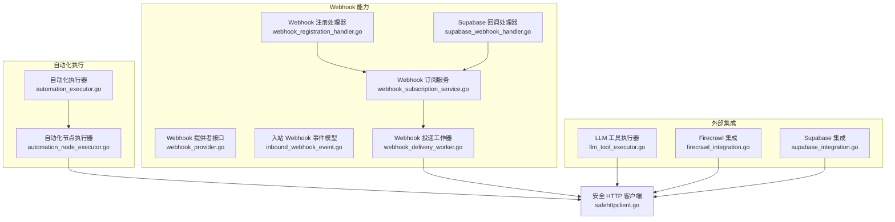
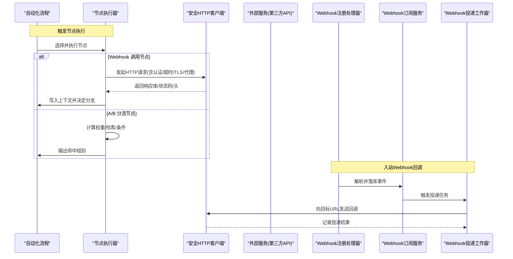
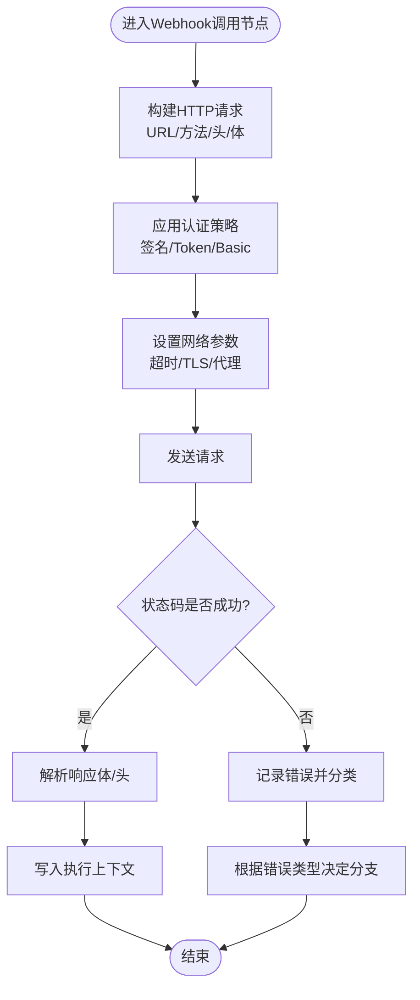
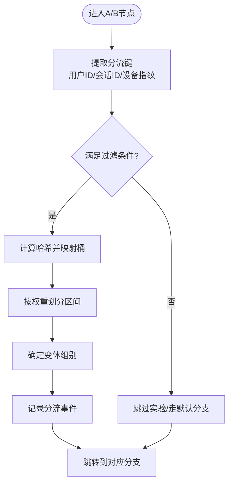
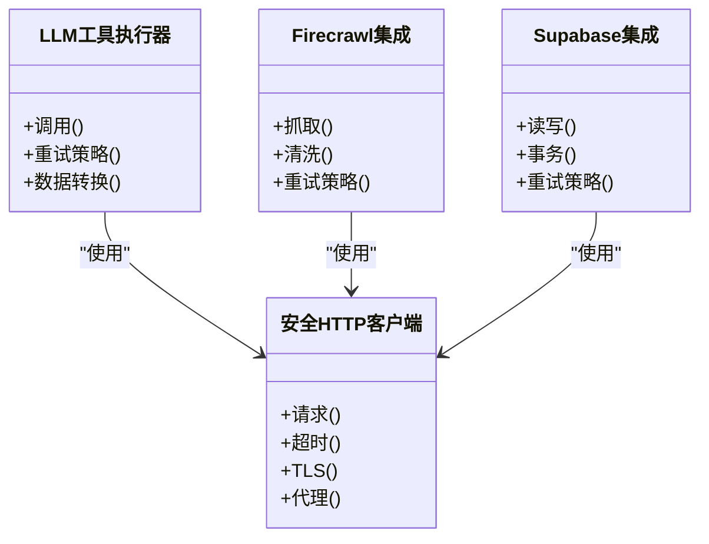
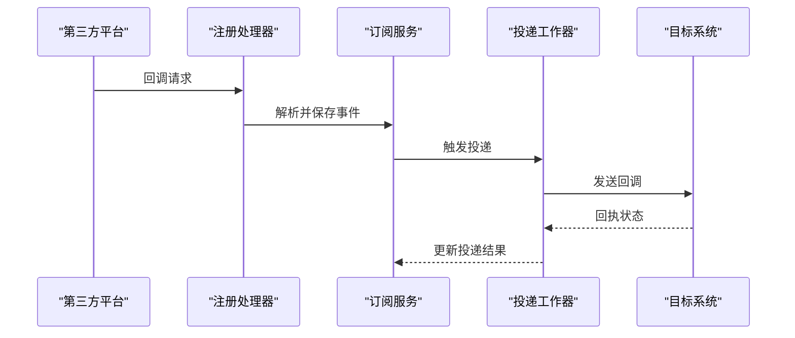
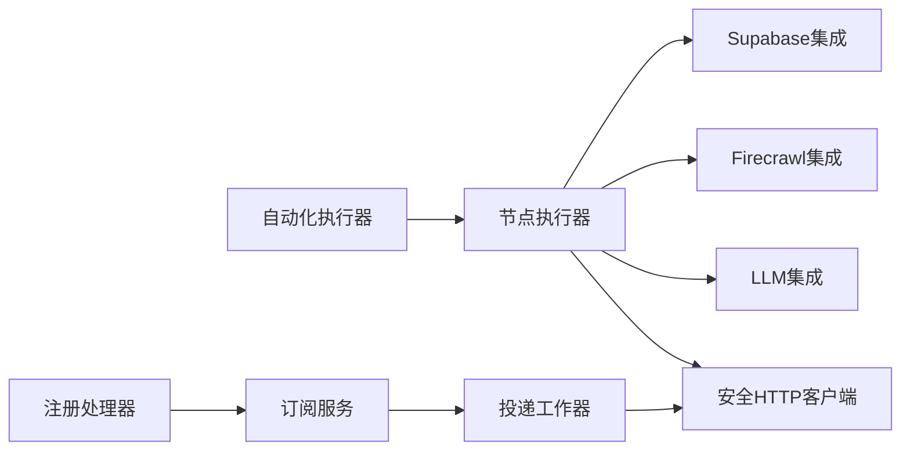

# 集成节点

<cite>
**本文引用的文件**   
- [automation_node_executor.go](file://notifuse/internal/service/automation_node_executor.go)
- [automation_executor.go](file://notifuse/internal/service/automation_executor.go)
- [safehttpclient.go](file://notifuse/pkg/safehttpclient/safehttpclient.go)
- [webhook_provider.go](file://notifuse/internal/domain/webhook_provider.go)
- [inbound_webhook_event.go](file://notifuse/internal/domain/inbound_webhook_event.go)
- [webhook_subscription_service.go](file://notifuse/internal/service/webhook_subscription_service.go)
- [webhook_delivery_worker.go](file://notifuse/internal/service/webhook_delivery_worker.go)
- [webhook_registration_handler.go](file://notifuse/internal/http/webhook_registration_handler.go)
- [supabase_webhook_handler.go](file://notifuse/internal/http/supabase_webhook_handler.go)
- [llm_tool_executor.go](file://notifuse/internal/service/llm_tool_executor.go)
- [firecrawl_integration.go](file://notifuse/internal/domain/firecrawl_integration.go)
- [supabase_integration.go](file://notifuse/internal/domain/supabase_integration.go)
</cite>

## 目录
1. [简介](#简介)
2. [项目结构](#项目结构)
3. [核心组件](#核心组件)
4. [架构总览](#架构总览)
5. [详细组件分析](#详细组件分析)
6. [依赖关系分析](#依赖关系分析)
7. [性能考虑](#性能考虑)
8. [故障排查指南](#故障排查指南)
9. [结论](#结论)
10. [附录](#附录)

## 简介
本文件面向“集成节点”类型，聚焦以下能力：
- Webhook 调用节点的 HTTP 请求配置、认证机制与响应处理
- A/B 测试节点的流量分配算法、结果统计与决策逻辑
- 外部 API 集成（LLM、Firecrawl、Supabase 等）的数据转换与错误重试策略
- 网络超时处理、SSL 证书验证与代理配置
- 第三方服务集成的安全考量与性能优化建议

## 项目结构
围绕“集成节点”，代码主要分布在以下模块：
- 自动化执行层：负责编排节点执行、HTTP 调用、重试与上下文传递
- 安全 HTTP 客户端：统一封装超时、TLS、代理、重试等网络特性
- Webhook 领域与服务：定义事件模型、订阅注册、入站解析与出站投递
- 外部集成域对象：封装 LLM、Firecrawl、Supabase 等第三方服务的调用与数据转换
- HTTP 处理器：暴露注册回调、平台回调入口等接口

图表来源
- [automation_node_executor.go](file://notifuse/internal/service/automation_node_executor.go)
- [automation_executor.go](file://notifuse/internal/service/automation_executor.go)
- [webhook_provider.go](file://notifuse/internal/domain/webhook_provider.go)
- [inbound_webhook_event.go](file://notifuse/internal/domain/inbound_webhook_event.go)
- [webhook_subscription_service.go](file://notifuse/internal/service/webhook_subscription_service.go)
- [webhook_delivery_worker.go](file://notifuse/internal/service/webhook_delivery_worker.go)
- [webhook_registration_handler.go](file://notifuse/internal/http/webhook_registration_handler.go)
- [supabase_webhook_handler.go](file://notifuse/internal/http/supabase_webhook_handler.go)
- [llm_tool_executor.go](file://notifuse/internal/service/llm_tool_executor.go)
- [firecrawl_integration.go](file://notifuse/internal/domain/firecrawl_integration.go)
- [supabase_integration.go](file://notifuse/internal/domain/supabase_integration.go)
- [safehttpclient.go](file://notifuse/pkg/safehttpclient/safehttpclient.go)

章节来源
- [automation_node_executor.go](file://notifuse/internal/service/automation_node_executor.go)
- [automation_executor.go](file://notifuse/internal/service/automation_executor.go)
- [webhook_provider.go](file://notifuse/internal/domain/webhook_provider.go)
- [inbound_webhook_event.go](file://notifuse/internal/domain/inbound_webhook_event.go)
- [webhook_subscription_service.go](file://notifuse/internal/service/webhook_subscription_service.go)
- [webhook_delivery_worker.go](file://notifuse/internal/service/webhook_delivery_worker.go)
- [webhook_registration_handler.go](file://notifuse/internal/http/webhook_registration_handler.go)
- [supabase_webhook_handler.go](file://notifuse/internal/http/supabase_webhook_handler.go)
- [llm_tool_executor.go](file://notifuse/internal/service/llm_tool_executor.go)
- [firecrawl_integration.go](file://notifuse/internal/domain/firecrawl_integration.go)
- [supabase_integration.go](file://notifuse/internal/domain/supabase_integration.go)
- [safehttpclient.go](file://notifuse/pkg/safehttpclient/safehttpclient.go)

## 核心组件
- 自动化节点执行器：负责按图遍历节点、构建上下文、调度具体节点实现（包括 Webhook 调用、A/B 分流、外部 API 调用等），并处理错误与分支跳转。
- 安全 HTTP 客户端：提供统一的 HTTP 客户端实例，集中管理连接池、超时、TLS 校验、代理、重试与指标埋点。
- Webhook 提供者与事件模型：抽象不同平台的入站事件格式，统一转换为内部事件；订阅服务负责路由与持久化；投递工作器负责出站到目标 URL。
- 外部集成域对象：对 LLM、Firecrawl、Supabase 等第三方服务进行封装，完成鉴权、参数组装、响应解析与错误分类。

章节来源
- [automation_node_executor.go](file://notifuse/internal/service/automation_node_executor.go)
- [safehttpclient.go](file://notifuse/pkg/safehttpclient/safehttpclient.go)
- [webhook_provider.go](file://notifuse/internal/domain/webhook_provider.go)
- [inbound_webhook_event.go](file://notifuse/internal/domain/inbound_webhook_event.go)
- [webhook_subscription_service.go](file://notifuse/internal/service/webhook_subscription_service.go)
- [webhook_delivery_worker.go](file://notifuse/internal/service/webhook_delivery_worker.go)
- [llm_tool_executor.go](file://notifuse/internal/service/llm_tool_executor.go)
- [firecrawl_integration.go](file://notifuse/internal/domain/firecrawl_integration.go)
- [supabase_integration.go](file://notifuse/internal/domain/supabase_integration.go)

## 架构总览
下图展示从“自动化执行”到“外部集成”的关键路径，以及 Webhook 的入站/出站流程。

图表来源
- [automation_node_executor.go](file://notifuse/internal/service/automation_node_executor.go)
- [automation_executor.go](file://notifuse/internal/service/automation_executor.go)
- [safehttpclient.go](file://notifuse/pkg/safehttpclient/safehttpclient.go)
- [webhook_registration_handler.go](file://notifuse/internal/http/webhook_registration_handler.go)
- [webhook_subscription_service.go](file://notifuse/internal/service/webhook_subscription_service.go)
- [webhook_delivery_worker.go](file://notifuse/internal/service/webhook_delivery_worker.go)

## 详细组件分析

### Webhook 调用节点
- HTTP 请求配置
  - 通过安全 HTTP 客户端统一创建请求，支持自定义方法、URL、头部、查询参数与请求体。
  - 支持设置连接/读写超时、TLS 证书校验、代理转发。
- 认证机制
  - 支持在请求前注入签名、Token、Basic Auth 或自定义 Header。
  - 可结合密钥存储与模板变量动态生成签名。
- 响应处理
  - 根据状态码与响应体内容判定成功/失败，并将关键信息写回执行上下文，供后续节点使用。
  - 对幂等性敏感的操作需记录请求 ID 与去重键。

图表来源
- [automation_node_executor.go](file://notifuse/internal/service/automation_node_executor.go)
- [safehttpclient.go](file://notifuse/pkg/safehttpclient/safehttpclient.go)

章节来源
- [automation_node_executor.go](file://notifuse/internal/service/automation_node_executor.go)
- [safehttpclient.go](file://notifuse/pkg/safehttpclient/safehttpclient.go)

### A/B 测试节点
- 流量分配算法
  - 基于用户标识或会话标识的哈希值映射到桶区间，结合权重比例进行分组。
  - 支持按条件过滤（如地区、设备、时间窗口）后再进行分流。
- 结果统计
  - 将每次分流的实验名、变体、用户标识、时间戳与业务事件上报至分析系统。
- 决策逻辑
  - 根据命中变体选择后续分支，或在同一分支内注入差异化参数。

图表来源
- [automation_node_executor.go](file://notifuse/internal/service/automation_node_executor.go)

章节来源
- [automation_node_executor.go](file://notifuse/internal/service/automation_node_executor.go)

### 外部 API 集成（LLM / Firecrawl / Supabase）
- 数据转换
  - 将上游上下文中的字段映射为第三方 API 所需参数，并对响应进行结构化解析。
- 错误重试策略
  - 针对瞬时错误（如限流、网络抖动）采用指数退避与最大重试次数控制。
  - 区分可重试与不可重试错误，避免无效重试放大负载。
- 安全与合规
  - 凭据通过安全存储注入，禁止硬编码；对外部响应做最小必要字段透传。

图表来源
- [llm_tool_executor.go](file://notifuse/internal/service/llm_tool_executor.go)
- [firecrawl_integration.go](file://notifuse/internal/domain/firecrawl_integration.go)
- [supabase_integration.go](file://notifuse/internal/domain/supabase_integration.go)
- [safehttpclient.go](file://notifuse/pkg/safehttpclient/safehttpclient.go)

章节来源
- [llm_tool_executor.go](file://notifuse/internal/service/llm_tool_executor.go)
- [firecrawl_integration.go](file://notifuse/internal/domain/firecrawl_integration.go)
- [supabase_integration.go](file://notifuse/internal/domain/supabase_integration.go)
- [safehttpclient.go](file://notifuse/pkg/safehttpclient/safehttpclient.go)

### Webhook 入站与出站
- 入站
  - 注册处理器接收第三方回调，解析平台特定格式为内部事件模型，并持久化。
  - 订阅服务根据事件类型与规则匹配，触发投递任务。
- 出站
  - 投递工作器按订阅配置向目标 URL 发送回调，记录投递结果与重试状态。

图表来源
- [webhook_registration_handler.go](file://notifuse/internal/http/webhook_registration_handler.go)
- [inbound_webhook_event.go](file://notifuse/internal/domain/inbound_webhook_event.go)
- [webhook_subscription_service.go](file://notifuse/internal/service/webhook_subscription_service.go)
- [webhook_delivery_worker.go](file://notifuse/internal/service/webhook_delivery_worker.go)
- [supabase_webhook_handler.go](file://notifuse/internal/http/supabase_webhook_handler.go)

章节来源
- [webhook_registration_handler.go](file://notifuse/internal/http/webhook_registration_handler.go)
- [inbound_webhook_event.go](file://notifuse/internal/domain/inbound_webhook_event.go)
- [webhook_subscription_service.go](file://notifuse/internal/service/webhook_subscription_service.go)
- [webhook_delivery_worker.go](file://notifuse/internal/service/webhook_delivery_worker.go)
- [supabase_webhook_handler.go](file://notifuse/internal/http/supabase_webhook_handler.go)

## 依赖关系分析
- 耦合与内聚
  - 节点执行器与外部集成通过安全 HTTP 客户端解耦，便于替换实现与统一监控。
  - Webhook 入站/出站由处理器、订阅服务与工作器分层协作，职责清晰。
- 直接/间接依赖
  - 自动化执行层依赖节点实现与安全 HTTP 客户端；Webhook 子系统依赖数据库与消息队列（若存在）。
- 外部依赖
  - 第三方服务（LLM、Firecrawl、Supabase、邮件/短信平台等）通过域对象隔离，降低变更影响面。

图表来源
- [automation_executor.go](file://notifuse/internal/service/automation_executor.go)
- [automation_node_executor.go](file://notifuse/internal/service/automation_node_executor.go)
- [safehttpclient.go](file://notifuse/pkg/safehttpclient/safehttpclient.go)
- [llm_tool_executor.go](file://notifuse/internal/service/llm_tool_executor.go)
- [firecrawl_integration.go](file://notifuse/internal/domain/firecrawl_integration.go)
- [supabase_integration.go](file://notifuse/internal/domain/supabase_integration.go)
- [webhook_registration_handler.go](file://notifuse/internal/http/webhook_registration_handler.go)
- [webhook_subscription_service.go](file://notifuse/internal/service/webhook_subscription_service.go)
- [webhook_delivery_worker.go](file://notifuse/internal/service/webhook_delivery_worker.go)

章节来源
- [automation_executor.go](file://notifuse/internal/service/automation_executor.go)
- [automation_node_executor.go](file://notifuse/internal/service/automation_node_executor.go)
- [safehttpclient.go](file://notifuse/pkg/safehttpclient/safehttpclient.go)
- [llm_tool_executor.go](file://notifuse/internal/service/llm_tool_executor.go)
- [firecrawl_integration.go](file://notifuse/internal/domain/firecrawl_integration.go)
- [supabase_integration.go](file://notifuse/internal/domain/supabase_integration.go)
- [webhook_registration_handler.go](file://notifuse/internal/http/webhook_registration_handler.go)
- [webhook_subscription_service.go](file://notifuse/internal/service/webhook_subscription_service.go)
- [webhook_delivery_worker.go](file://notifuse/internal/service/webhook_delivery_worker.go)

## 性能考虑
- 连接复用与并发
  - 复用 HTTP 连接池，合理设置最大空闲连接与每主机连接数，避免频繁握手。
  - 对批量调用采用扇出并行，但限制并发度以避免下游限流。
- 超时与背压
  - 细粒度设置连接、读、写超时；对慢下游启用整体请求超时。
  - 当检测到下游延迟升高时，主动降级或短路非关键调用。
- 缓存与幂等
  - 对只读外部数据引入短期缓存；对写操作使用幂等键与去重表。
- 序列化与传输
  - 优先使用紧凑二进制或压缩传输；减少不必要的大字段透传。
- 观测性
  - 记录端到端耗时、错误率、重试次数与下游状态码分布，用于容量规划与问题定位。

[本节为通用指导，不直接分析具体文件]

## 故障排查指南
- 常见错误分类
  - 网络类：DNS 解析失败、连接超时、读写超时、TLS 握手失败、代理不可用。
  - 协议类：4xx/5xx 状态码、签名校验失败、JSON 解析异常。
  - 业务类：下游限流、配额不足、资源不存在。
- 定位步骤
  - 检查安全 HTTP 客户端配置（超时、TLS、代理）是否正确。
  - 查看节点执行日志与上下文快照，确认请求构造与认证注入。
  - 核对第三方平台回调签名与时间戳，确保时钟同步。
  - 对于重试场景，观察重试间隔与最大次数，避免雪崩。
- 恢复策略
  - 对可重试错误启用指数退避；对不可重试错误快速失败并告警。
  - 对关键路径增加熔断与降级开关，保障主流程可用。

章节来源
- [safehttpclient.go](file://notifuse/pkg/safehttpclient/safehttpclient.go)
- [automation_node_executor.go](file://notifuse/internal/service/automation_node_executor.go)
- [webhook_delivery_worker.go](file://notifuse/internal/service/webhook_delivery_worker.go)

## 结论
通过将 HTTP 调用、认证、重试、超时与 TLS 等网络能力收敛到安全 HTTP 客户端，并在自动化执行层以节点形式组合 Webhook、A/B 分流与外部 API 集成，系统在可扩展性、可观测性与稳定性方面具备良好基础。配合合理的重试与降级策略、严格的凭据管理与最小权限原则，可在保证安全的前提下提升第三方服务集成的可靠性与性能。

[本节为总结性内容，不直接分析具体文件]

## 附录
- 术语
  - 节点：自动化流程中的一个可执行单元，如 Webhook 调用、A/B 分流、外部 API 调用等。
  - 上下文：跨节点共享的状态与数据载体，包含输入、中间结果与元数据。
  - 幂等：多次执行产生相同结果且不会引起副作用的特性。
- 最佳实践清单
  - 所有外部调用均通过安全 HTTP 客户端发起，统一配置超时与 TLS。
  - 凭据与密钥通过安全存储注入，禁止明文落地。
  - 对下游限流与错误进行分类处理，实施指数退避与最大重试上限。
  - 为关键路径添加指标与追踪，覆盖端到端耗时与错误分布。
  - 对 A/B 分流提供可观测的统计面板，便于评估效果与回滚。

[本节为补充说明，不直接分析具体文件]