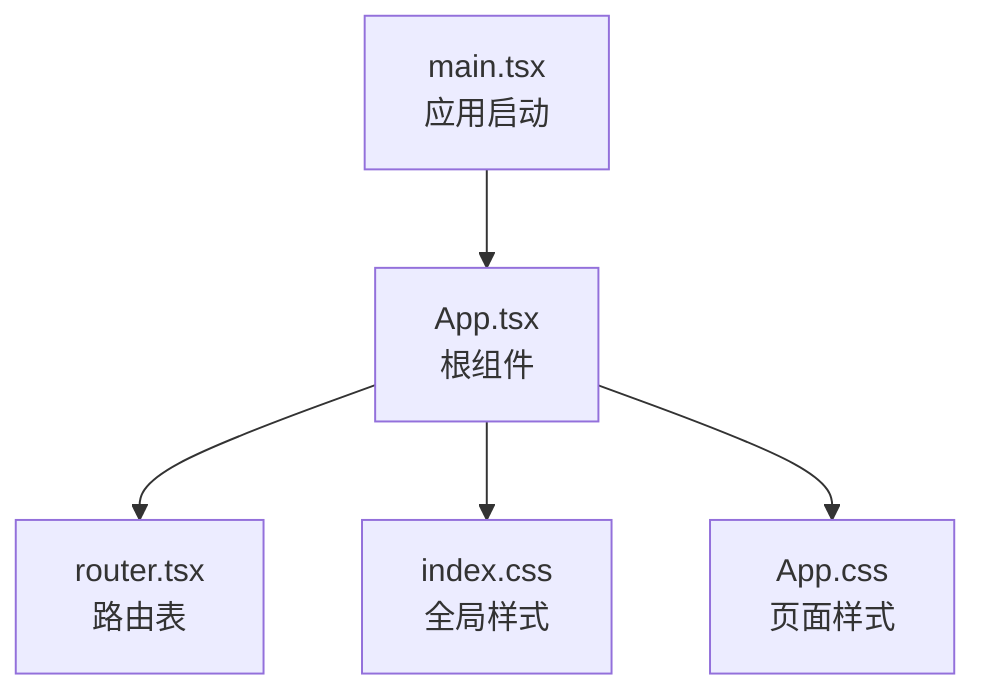
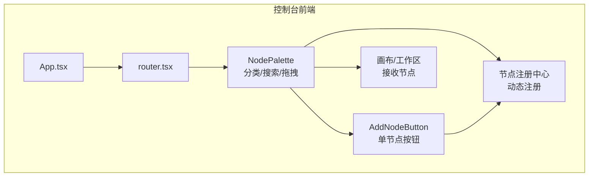
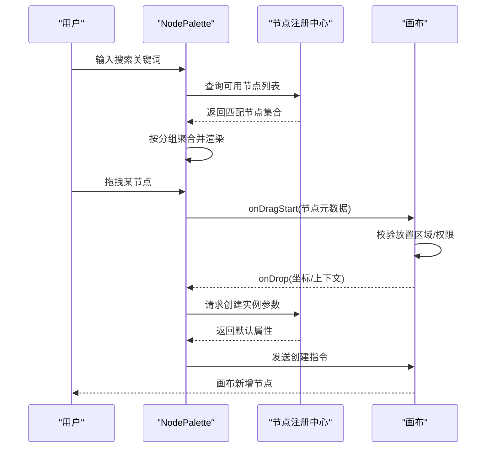
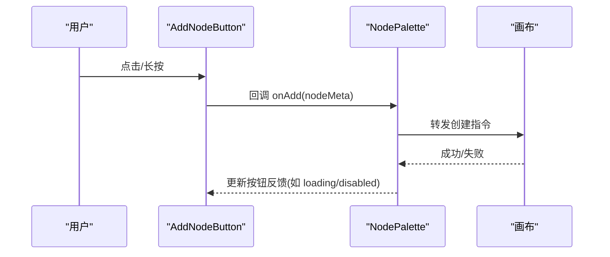
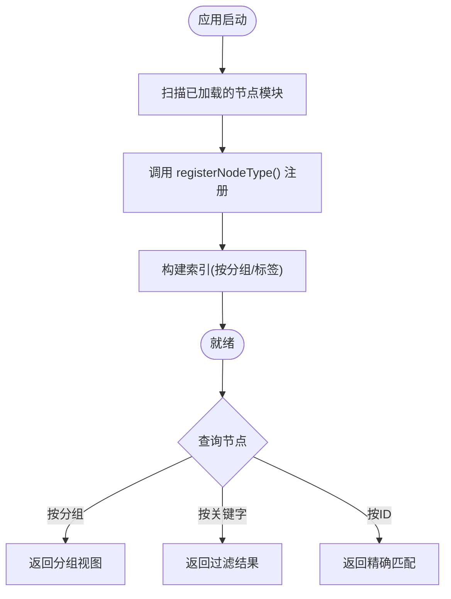
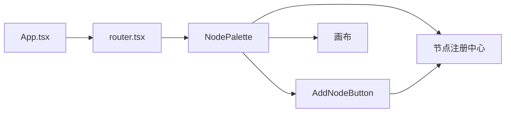

# 节点面板管理

<cite>
**本文引用的文件**   
- [App.tsx](file://notifuse/console/src/App.tsx)
- [router.tsx](file://notifuse/console/src/router.tsx)
- [main.tsx](file://notifuse/console/src/main.tsx)
- [index.css](file://notifuse/console/src/index.css)
- [App.css](file://notifuse/console/src/App.css)
</cite>

## 目录
1. [简介](#简介)
2. [项目结构](#项目结构)
3. [核心组件](#核心组件)
4. [架构总览](#架构总览)
5. [详细组件分析](#详细组件分析)
6. [依赖分析](#依赖分析)
7. [性能考虑](#性能考虑)
8. [故障排查指南](#故障排查指南)
9. [结论](#结论)
10. [附录](#附录)

## 简介
本文件面向“节点面板管理系统”的前端实现，聚焦以下目标：
- NodePalette 组件：节点分类展示、搜索过滤、拖拽添加
- AddNodeButton 按钮组件：设计模式与扩展机制
- 节点常量定义、节点元数据管理与动态注册
- 节点分组逻辑、图标资源管理、响应式布局适配
- 性能优化与用户体验改进方案

说明：当前仓库未包含 NodePalette 与 AddNodeButton 的具体实现源码。本文基于前端工程结构与通用最佳实践，给出可落地的架构设计与实现建议，并标注需要落地到具体文件的占位路径，便于后续补充代码级来源。

## 项目结构
控制台前端位于 notifuse/console 目录，采用 Vite + React + TypeScript 技术栈。入口与路由组织如下：
- 应用入口：main.tsx
- 根组件：App.tsx
- 路由配置：router.tsx
- 全局样式：index.css、App.css

图表来源
- [main.tsx](file://notifuse/console/src/main.tsx)
- [App.tsx](file://notifuse/console/src/App.tsx)
- [router.tsx](file://notifuse/console/src/router.tsx)
- [index.css](file://notifuse/console/src/index.css)
- [App.css](file://notifuse/console/src/App.css)

章节来源
- [main.tsx](file://notifuse/console/src/main.tsx)
- [App.tsx](file://notifuse/console/src/App.tsx)
- [router.tsx](file://notifuse/console/src/router.tsx)
- [index.css](file://notifuse/console/src/index.css)
- [App.css](file://notifuse/console/src/App.css)

## 核心组件
本节描述节点面板相关核心概念与职责划分（待在 console/src/components 下落地）：
- NodePalette：负责节点分类展示、搜索过滤、拖拽添加
- AddNodeButton：封装单个节点的“添加”交互，支持多种渲染与扩展点
- 节点常量与元数据：集中定义节点类型、分组、图标、属性等
- 动态注册中心：运行时注册新节点类型，供 Palette 与画布消费

章节来源
- [App.tsx](file://notifuse/console/src/App.tsx)
- [router.tsx](file://notifuse/console/src/router.tsx)

## 架构总览
下图展示了节点面板在应用中的位置与关键交互流程（概念图，非直接映射到具体文件）。

[此图为概念性架构图，不附加图表来源]

## 详细组件分析

### NodePalette 组件
职责与能力
- 节点分类展示：按分组聚合节点，提供折叠/展开
- 搜索过滤：根据名称、标签或关键字实时筛选
- 拖拽添加：将节点从面板拖入画布区域，触发创建流程

数据结构建议
- 节点元数据：id、name、group、icon、description、propsSchema、category
- 分组信息：key、label、order、collapsed
- 搜索状态：keyword、filters

交互流程（序列图）

[此图为概念性交互流程，不附加图表来源]

实现要点
- 分组逻辑：先按 group 聚合，再按 order 排序；支持 collapsed 状态缓存
- 搜索过滤：对 name、tags、description 进行模糊匹配；防抖处理
- 拖拽：使用 HTML5 Drag & Drop 或 Pointer Events；跨浏览器兼容
- 空态与错误：无结果时提示“未找到节点”，网络异常时重试与降级

章节来源
- [App.tsx](file://notifuse/console/src/App.tsx)
- [router.tsx](file://notifuse/console/src/router.tsx)

### AddNodeButton 组件
设计模式
- 组合优先：通过 props 注入 icon、label、tooltip、onClick/onDragStart
- 策略模式：不同节点类型可传入不同的渲染策略或行为钩子
- 受控/非受控：支持外部控制 disabled、loading、active 状态

扩展机制
- 插槽/自定义渲染：允许父组件替换图标或文案
- 事件透传：统一派发 onAdd、onDragStart、onContextMenu 等
- 主题适配：通过 CSS 变量或 className 覆盖样式

交互流程（序列图）

[此图为概念性交互流程，不附加图表来源]

章节来源
- [App.tsx](file://notifuse/console/src/App.tsx)
- [router.tsx](file://notifuse/console/src/router.tsx)

### 节点常量、元数据与动态注册
节点常量与元数据
- 常量定义：节点 id、名称、分组、图标、默认属性、校验规则
- 元数据模型：统一的 NodeMetadata 接口，确保 Palette 与画布一致理解
- 版本兼容：字段演进通过可选字段与默认值保证向后兼容

动态注册中心
- 注册 API：registerNodeType(meta)、unregisterNodeType(id)
- 查询 API：getAvailableNodes(filter)、getNodeById(id)
- 生命周期：初始化时扫描插件/模块，合并到全局注册表
- 并发安全：读写分离或不可变快照，避免竞态

流程图（注册与查询）

[此图为概念性流程，不附加图表来源]

章节来源
- [App.tsx](file://notifuse/console/src/App.tsx)
- [router.tsx](file://notifuse/console/src/router.tsx)

### 节点分组逻辑
- 分组键：groupKey（字符串），用于聚合
- 排序：order（数字），越小越靠前
- 折叠：collapsed（布尔），默认 false，可持久化
- 空组隐藏：当分组内无可见节点时自动隐藏

章节来源
- [App.tsx](file://notifuse/console/src/App.tsx)
- [router.tsx](file://notifuse/console/src/router.tsx)

### 图标资源管理
- 资源定位：SVG 内联或 Sprite Sheet，按需加载
- 命名规范：icon-{category}-{type}
- 懒加载：首屏仅加载常用图标，其余按需引入
- 降级策略：缺失图标回退到默认占位

章节来源
- [App.tsx](file://notifuse/console/src/App.tsx)
- [router.tsx](file://notifuse/console/src/router.tsx)

### 响应式布局适配
- 栅格系统：小屏单列、中屏双列、大屏三列
- 触摸友好：增大触控区域，支持长按拖拽
- 字体与间距：随断点缩放，保持可读性与密度平衡
- 滚动与虚拟列表：长列表使用虚拟滚动减少重排

章节来源
- [index.css](file://notifuse/console/src/index.css)
- [App.css](file://notifuse/console/src/App.css)

## 依赖分析
组件间依赖关系（概念图）

[此图为概念性依赖图，不附加图表来源]

章节来源
- [App.tsx](file://notifuse/console/src/App.tsx)
- [router.tsx](file://notifuse/console/src/router.tsx)

## 性能考虑
- 列表渲染
  - 虚拟滚动：对大量节点启用 windowing/virtualization
  - 稳定 key：使用稳定的 node.id 作为 key，避免不必要的重渲染
- 搜索与过滤
  - 防抖：输入延迟 150~250ms
  - 预计算索引：按分组/标签建立倒排索引，加速检索
- 拖拽体验
  - 指针事件替代：在移动端使用 Pointer Events 提升一致性
  - 拖拽预览：轻量级幽灵元素，避免复制整棵 DOM
- 资源加载
  - 图标按需加载与缓存
  - 大图标使用 WebP/SVG 压缩
- 状态管理
  - 局部状态最小化，避免全局状态频繁更新
  - 使用不可变数据更新，配合浅比较优化

[本节为通用性能建议，不附加章节来源]

## 故障排查指南
常见问题与定位步骤
- 节点未显示
  - 检查注册中心是否成功 registerNodeType
  - 确认分组与过滤条件是否正确
  - 查看控制台是否有重复 id 冲突
- 搜索无效
  - 验证搜索字段是否在元数据中存在
  - 检查防抖时间是否过长导致感知延迟
- 拖拽失败
  - 确认放置区域监听 onDrop 且阻止默认行为
  - 检查跨窗口/iframe 场景下的 DataTransfer 兼容性
- 图标缺失
  - 核对资源路径与命名规范
  - 检查打包产物是否包含对应资源

章节来源
- [App.tsx](file://notifuse/console/src/App.tsx)
- [router.tsx](file://notifuse/console/src/router.tsx)

## 结论
本文围绕节点面板管理系统，给出了 NodePalette 与 AddNodeButton 的职责边界、交互流程、数据模型与扩展机制，并结合分组、图标与响应式布局提出可落地的实现建议。由于当前仓库未包含具体组件源码，建议在 console/src/components 下新建相应文件后，回填代码级来源以完善文档。

[本节为总结性内容，不附加章节来源]

## 附录
- 建议的文件落地位置
  - 节点面板：console/src/components/palette/NodePalette.tsx
  - 节点按钮：console/src/components/palette/AddNodeButton.tsx
  - 节点常量与元数据：console/src/constants/nodeTypes.ts
  - 动态注册中心：console/src/lib/nodeRegistry.ts
  - 样式与主题：console/src/styles/palette.css
- 验收清单
  - 分类展示与折叠正常
  - 搜索过滤准确且流畅
  - 拖拽添加可在多设备生效
  - 新增节点类型无需修改核心逻辑即可接入
  - 长列表与弱网环境下仍保持良好体验

[本节为补充信息，不附加章节来源]