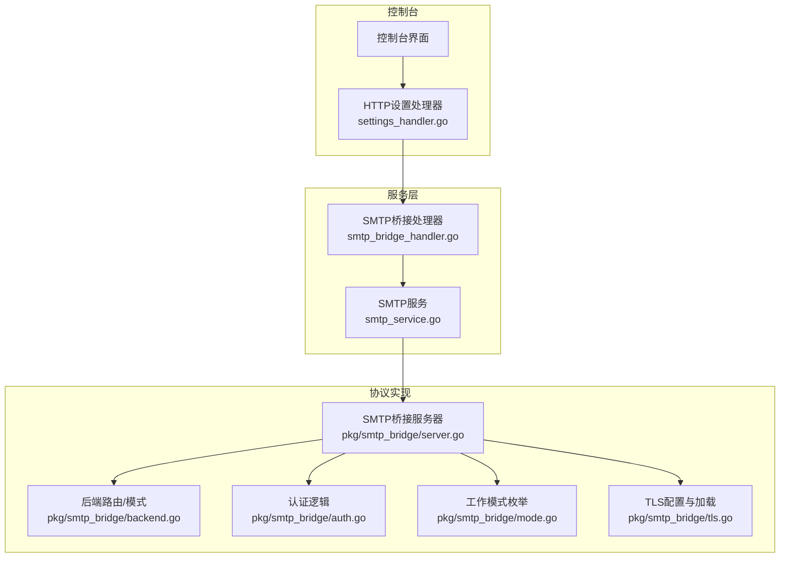
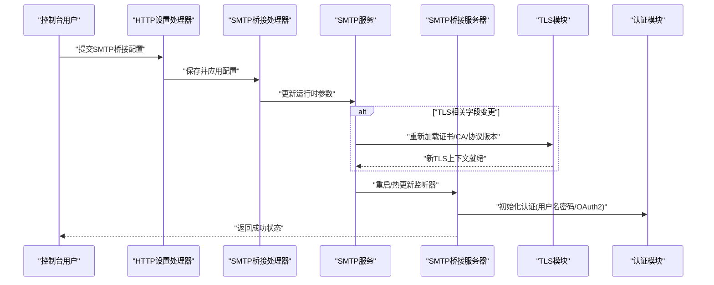
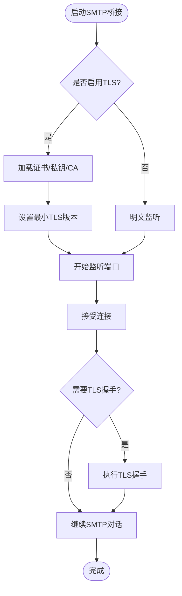
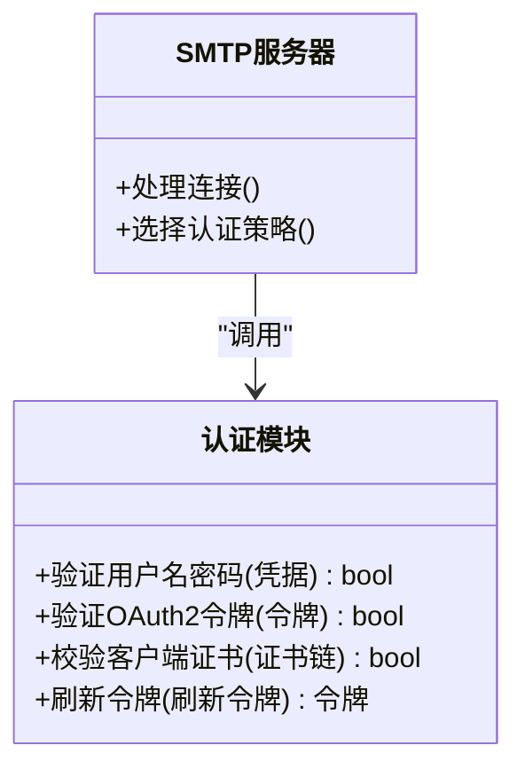
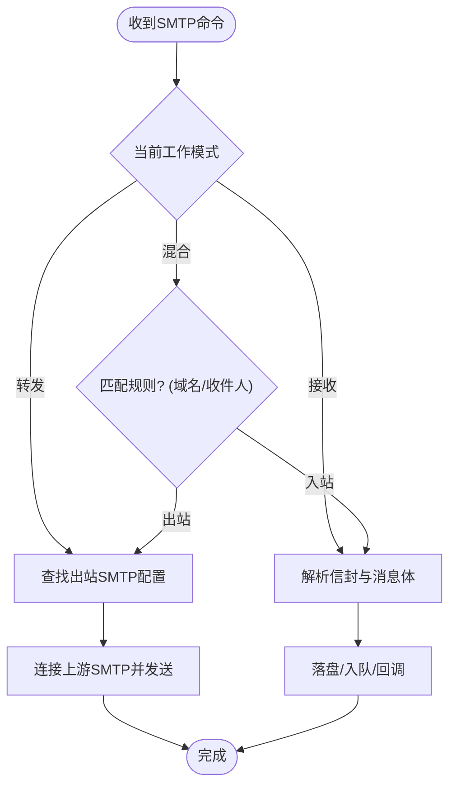
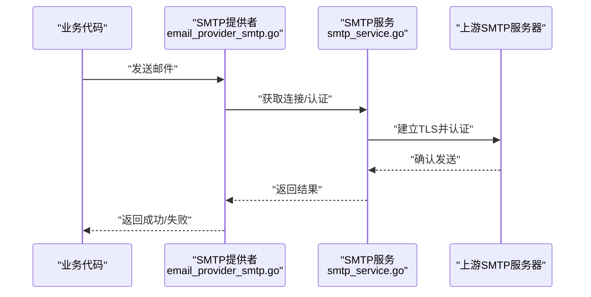
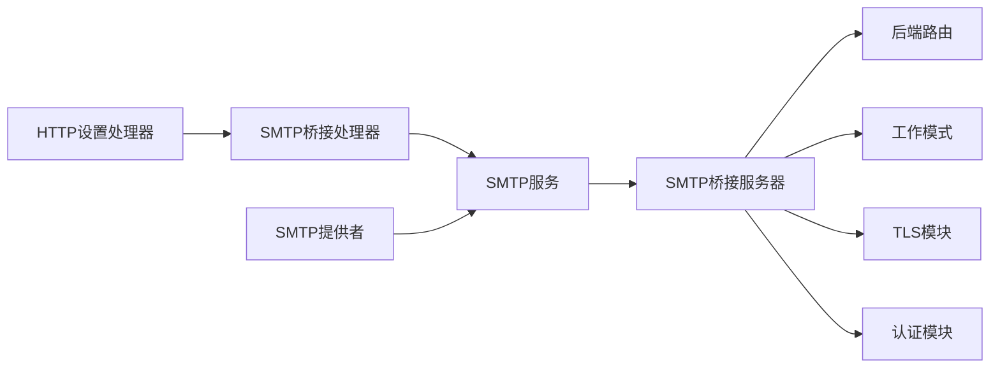

# SMTP桥接设置

<cite>
**本文引用的文件**   
- [smtp_bridge_handler.go](file://notifuse/internal/service/smtp_bridge_handler.go)
- [smtp_bridge_handler_test.go](file://notifuse/internal/service/smtp_bridge_handler_test.go)
- [server.go](file://notifuse/pkg/smtp_bridge/server.go)
- [backend.go](file://notifuse/pkg/smtp_bridge/backend.go)
- [auth.go](file://notifuse/pkg/smtp_bridge/auth.go)
- [mode.go](file://notifuse/pkg/smtp_bridge/mode.go)
- [tls.go](file://notifuse/pkg/smtp_bridge/tls.go)
- [smtp_service.go](file://notifuse/internal/service/smtp_service.go)
- [email_provider_smtp.go](file://notifuse/internal/domain/email_provider_smtp.go)
- [config.go](file://notifuse/config/config.go)
- [smtp_bridge_tls_test.go](file://notifuse/config/smtp_bridge_tls_test.go)
- [settings_handler.go](file://notifuse/internal/http/settings_handler.go)
- [logger.go](file://notifuse/pkg/logger/logger.go)
</cite>

## 目录
1. [简介](#简介)
2. [项目结构](#项目结构)
3. [核心组件](#核心组件)
4. [架构总览](#架构总览)
5. [详细组件分析](#详细组件分析)
6. [依赖关系分析](#依赖关系分析)
7. [性能与连接池](#性能与连接池)
8. [监控、日志与故障诊断](#监控日志与故障诊断)
9. [结论](#结论)
10. [附录：配置项参考](#附录配置项参考)

## 简介
本文件面向Notifuse控制台的SMTP桥接设置模块，系统性阐述SMTP服务器的配置管理（服务器地址、端口、认证方式、TLS）、桥接工作模式（转发、接收、混合）的差异与安全机制（用户名密码、OAuth2、证书验证），并给出连接池管理、性能调优与故障转移策略。同时提供监控指标、日志记录与故障诊断方法，帮助运维与开发者快速落地与排障。

## 项目结构
SMTP桥接能力由“控制台HTTP接口层”、“服务编排层”、“协议实现层”三部分构成：
- 控制台HTTP接口层：负责暴露设置API，读写SMTP桥接配置。
- 服务编排层：将配置转换为运行时参数，驱动SMTP桥接服务启动/更新。
- 协议实现层：实现SMTP协议处理、TLS、认证与工作模式路由。

图表来源
- [settings_handler.go](file://notifuse/internal/http/settings_handler.go)
- [smtp_bridge_handler.go](file://notifuse/internal/service/smtp_bridge_handler.go)
- [smtp_service.go](file://notifuse/internal/service/smtp_service.go)
- [server.go](file://notifuse/pkg/smtp_bridge/server.go)
- [backend.go](file://notifuse/pkg/smtp_bridge/backend.go)
- [auth.go](file://notifuse/pkg/smtp_bridge/auth.go)
- [mode.go](file://notifuse/pkg/smtp_bridge/mode.go)
- [tls.go](file://notifuse/pkg/smtp_bridge/tls.go)

章节来源
- [settings_handler.go](file://notifuse/internal/http/settings_handler.go)
- [smtp_bridge_handler.go](file://notifuse/internal/service/smtp_bridge_handler.go)
- [smtp_service.go](file://notifuse/internal/service/smtp_service.go)
- [server.go](file://notifuse/pkg/smtp_bridge/server.go)
- [backend.go](file://notifuse/pkg/smtp_bridge/backend.go)
- [auth.go](file://notifuse/pkg/smtp_bridge/auth.go)
- [mode.go](file://notifuse/pkg/smtp_bridge/mode.go)
- [tls.go](file://notifuse/pkg/smtp_bridge/tls.go)

## 核心组件
- SMTP桥接处理器：负责从控制台请求中解析SMTP桥接配置，持久化并触发服务热更新。
- SMTP服务：维护SMTP桥接实例生命周期，持有监听地址、TLS、认证与工作模式等运行时参数。
- SMTP桥接服务器：实现SMTP协议会话处理，按工作模式决定入站/出站行为。
- 后端路由：根据模式与目标域名/收件人规则进行邮件分发或本地处理。
- 认证模块：支持用户名/密码与OAuth2（含令牌刷新与缓存），以及可选的客户端证书校验。
- TLS模块：集中管理证书、私钥、CA与最小协议版本，支持动态重载。
- 工作模式：定义转发、接收、混合三种模式的语义与路由差异。

章节来源
- [smtp_bridge_handler.go](file://notifuse/internal/service/smtp_bridge_handler.go)
- [smtp_service.go](file://notifuse/internal/service/smtp_service.go)
- [server.go](file://notifuse/pkg/smtp_bridge/server.go)
- [backend.go](file://notifuse/pkg/smtp_bridge/backend.go)
- [auth.go](file://notifuse/pkg/smtp_bridge/auth.go)
- [mode.go](file://notifuse/pkg/smtp_bridge/mode.go)
- [tls.go](file://notifuse/pkg/smtp_bridge/tls.go)

## 架构总览
下图展示一次典型设置变更到SMTP桥接生效的流程，包括配置校验、持久化、服务重启与TLS重载。

图表来源
- [settings_handler.go](file://notifuse/internal/http/settings_handler.go)
- [smtp_bridge_handler.go](file://notifuse/internal/service/smtp_bridge_handler.go)
- [smtp_service.go](file://notifuse/internal/service/smtp_service.go)
- [server.go](file://notifuse/pkg/smtp_bridge/server.go)
- [tls.go](file://notifuse/pkg/smtp_bridge/tls.go)
- [auth.go](file://notifuse/pkg/smtp_bridge/auth.go)

## 详细组件分析

### SMTP服务器与TLS
- 监听与握手：服务器在指定地址与端口上监听，根据TLS开关决定是否启用STARTTLS或强制TLS。
- 证书与CA：支持PEM格式的证书与私钥，可配置自定义CA以信任私有根证书；支持最小协议版本限制。
- 动态重载：当证书或CA变更时，TLS模块应能安全地替换上下文，避免中断现有会话。

图表来源
- [server.go](file://notifuse/pkg/smtp_bridge/server.go)
- [tls.go](file://notifuse/pkg/smtp_bridge/tls.go)

章节来源
- [server.go](file://notifuse/pkg/smtp_bridge/server.go)
- [tls.go](file://notifuse/pkg/smtp_bridge/tls.go)
- [smtp_bridge_tls_test.go](file://notifuse/config/smtp_bridge_tls_test.go)

### 认证机制
- 用户名/密码：对入站连接进行身份校验，支持不同域名的凭据映射。
- OAuth2：支持Bearer令牌校验与自动刷新，建议配合令牌缓存以降低外部依赖压力。
- 客户端证书：可选开启双向TLS，要求客户端提供受信任证书。

图表来源
- [auth.go](file://notifuse/pkg/smtp_bridge/auth.go)
- [server.go](file://notifuse/pkg/smtp_bridge/server.go)

章节来源
- [auth.go](file://notifuse/pkg/smtp_bridge/auth.go)
- [server.go](file://notifuse/pkg/smtp_bridge/server.go)

### 工作模式（转发/接收/混合）
- 转发模式：仅作为出站代理，将系统发出的邮件转发至上游SMTP服务器。
- 接收模式：作为入站SMTP网关，接收外部投递的邮件并进行本地处理（如写入队列、回调）。
- 混合模式：同时支持入站与出站，依据域名或收件人规则分流。

图表来源
- [mode.go](file://notifuse/pkg/smtp_bridge/mode.go)
- [backend.go](file://notifuse/pkg/smtp_bridge/backend.go)
- [server.go](file://notifuse/pkg/smtp_bridge/server.go)

章节来源
- [mode.go](file://notifuse/pkg/smtp_bridge/mode.go)
- [backend.go](file://notifuse/pkg/smtp_bridge/backend.go)
- [server.go](file://notifuse/pkg/smtp_bridge/server.go)

### 出站SMTP集成（与业务发送通道）
- 业务侧通过统一的SMTP提供者抽象发送邮件，底层使用配置的SMTP服务器与认证信息。
- 该路径与桥接入站相对独立，但共享相同的认证与TLS能力。

图表来源
- [email_provider_smtp.go](file://notifuse/internal/domain/email_provider_smtp.go)
- [smtp_service.go](file://notifuse/internal/service/smtp_service.go)

章节来源
- [email_provider_smtp.go](file://notifuse/internal/domain/email_provider_smtp.go)
- [smtp_service.go](file://notifuse/internal/service/smtp_service.go)

## 依赖关系分析
- 控制台HTTP设置处理器依赖SMTP桥接处理器进行配置持久化与应用。
- SMTP服务依赖桥接服务器、TLS与认证模块，负责生命周期管理与参数注入。
- 桥接服务器依赖后端路由与工作模式，决定入站/出站流程。
- 业务发送路径依赖SMTP提供者与服务层，复用认证与TLS能力。

图表来源
- [settings_handler.go](file://notifuse/internal/http/settings_handler.go)
- [smtp_bridge_handler.go](file://notifuse/internal/service/smtp_bridge_handler.go)
- [smtp_service.go](file://notifuse/internal/service/smtp_service.go)
- [server.go](file://notifuse/pkg/smtp_bridge/server.go)
- [backend.go](file://notifuse/pkg/smtp_bridge/backend.go)
- [mode.go](file://notifuse/pkg/smtp_bridge/mode.go)
- [tls.go](file://notifuse/pkg/smtp_bridge/tls.go)
- [auth.go](file://notifuse/pkg/smtp_bridge/auth.go)
- [email_provider_smtp.go](file://notifuse/internal/domain/email_provider_smtp.go)

章节来源
- [settings_handler.go](file://notifuse/internal/http/settings_handler.go)
- [smtp_bridge_handler.go](file://notifuse/internal/service/smtp_bridge_handler.go)
- [smtp_service.go](file://notifuse/internal/service/smtp_service.go)
- [server.go](file://notifuse/pkg/smtp_bridge/server.go)
- [backend.go](file://notifuse/pkg/smtp_bridge/backend.go)
- [mode.go](file://notifuse/pkg/smtp_bridge/mode.go)
- [tls.go](file://notifuse/pkg/smtp_bridge/tls.go)
- [auth.go](file://notifuse/pkg/smtp_bridge/auth.go)
- [email_provider_smtp.go](file://notifuse/internal/domain/email_provider_smtp.go)

## 性能与连接池
- 连接复用：为出站SMTP连接建立连接池，减少握手与TLS开销，提升吞吐。
- 并发控制：限制单实例最大并发连接数，防止上游限流导致雪崩。
- 超时与重试：合理设置连接、读写与命令超时；对瞬态错误实施指数退避重试。
- 背压与队列：入站邮件进入队列后异步处理，避免阻塞SMTP会话。
- 资源隔离：按域名或租户隔离连接池，避免热点域名影响全局。

优化建议
- 根据上游SMTP的并发限制与带宽，调整连接池大小与每连接并发度。
- 在高延迟网络环境下增大超时阈值，并启用重试与熔断。
- 对频繁失败的域名启用快速失败与降级策略，优先走备用上游。

[本节为通用性能指导，不直接分析具体文件]

## 监控、日志与故障诊断
- 关键指标
  - 入站/出站连接数、成功率、平均耗时、P95/P99延迟。
  - TLS握手失败率、证书过期告警。
  - 认证失败次数、OAuth2令牌刷新失败次数。
  - 队列积压、出队速率、重投次数。
- 日志要点
  - 连接建立/断开、TLS协商结果、认证阶段事件。
  - 入站/出站消息ID、信封收发者、主题摘要（脱敏）。
  - 错误码与堆栈，便于定位上游响应与协议错误。
- 故障诊断
  - 证书问题：检查证书链完整性、中间证书缺失、时间同步。
  - 认证失败：核对用户名/密码、OAuth2范围与权限、令牌有效期。
  - 连接超时：检查防火墙/NAT、DNS解析、上游限流与配额。
  - 模式异常：确认工作模式与路由规则是否匹配预期域名/收件人。

章节来源
- [logger.go](file://notifuse/pkg/logger/logger.go)
- [smtp_bridge_handler_test.go](file://notifuse/internal/service/smtp_bridge_handler_test.go)

## 结论
通过统一的工作模式、灵活的认证与TLS能力、完善的连接池与监控日志，Notifuse的SMTP桥接模块能够稳定支撑入站与出站场景。在生产环境中，建议结合上游SMTP的限制与SLA，精细化调优连接池、超时与重试策略，并持续观测关键指标以保障高可用。

[本节为总结性内容，不直接分析具体文件]

## 附录：配置项参考
以下为SMTP桥接常见配置项说明（字段名以实际实现为准）：
- 服务器地址与端口
  - 监听地址：用于入站SMTP服务的IP与端口。
  - 出站服务器：上游SMTP主机名或IP。
  - 出站端口：通常为25/465/587，依TLS策略而定。
- 认证方式
  - 用户名/密码：适用于大多数企业邮箱与自建SMTP。
  - OAuth2：适用于云厂商或支持OAuth2的上游，需配置客户端ID/密钥与授权端点。
  - 客户端证书：双向TLS场景下启用，需上传客户端证书与私钥。
- TLS配置
  - 启用TLS：是否强制TLS或支持STARTTLS。
  - 证书与私钥：PEM格式文件路径或内容。
  - CA证书：用于验证服务端或客户端证书的可信根。
  - 最小TLS版本：建议不低于1.2。
- 工作模式
  - 转发：仅出站转发。
  - 接收：仅入站接收。
  - 混合：同时支持入站与出站，按规则分流。
- 高级选项
  - 连接池大小、最大并发、超时、重试次数与退避策略。
  - 域名/收件人路由规则，用于混合模式下的分流。
  - 健康检查与探针端点，用于负载均衡与健康探测。

章节来源
- [config.go](file://notifuse/config/config.go)
- [smtp_bridge_handler.go](file://notifuse/internal/service/smtp_bridge_handler.go)
- [server.go](file://notifuse/pkg/smtp_bridge/server.go)
- [tls.go](file://notifuse/pkg/smtp_bridge/tls.go)
- [auth.go](file://notifuse/pkg/smtp_bridge/auth.go)
- [mode.go](file://notifuse/pkg/smtp_bridge/mode.go)
- [smtp_bridge_tls_test.go](file://notifuse/config/smtp_bridge_tls_test.go)