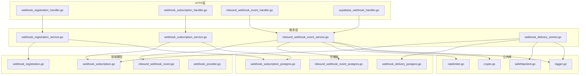
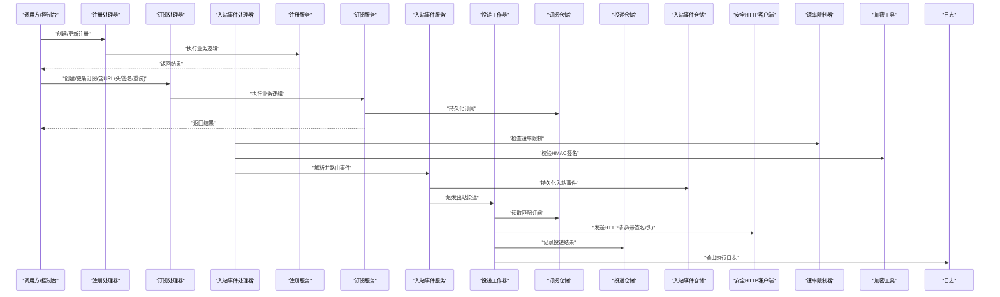
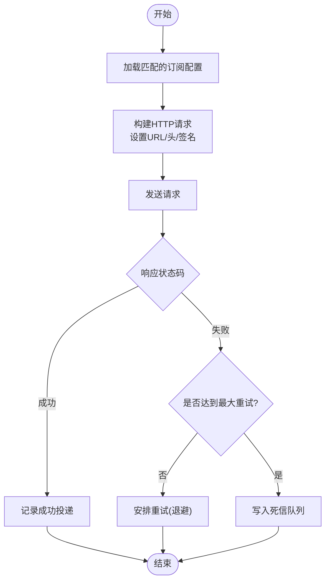
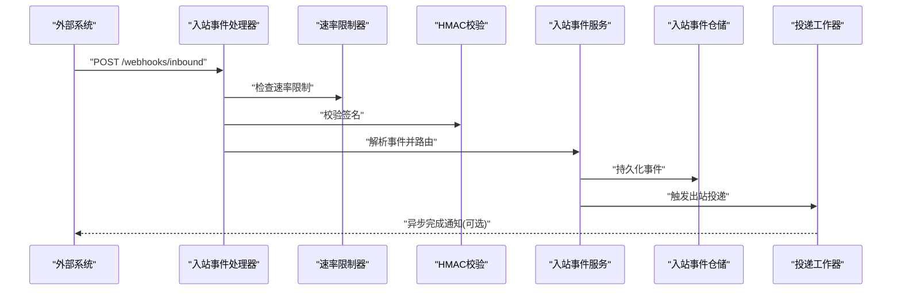
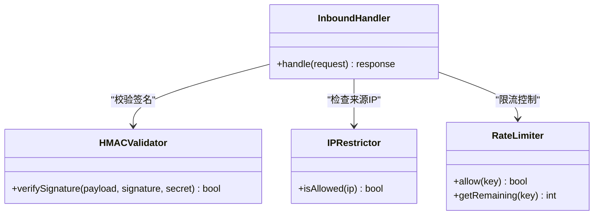
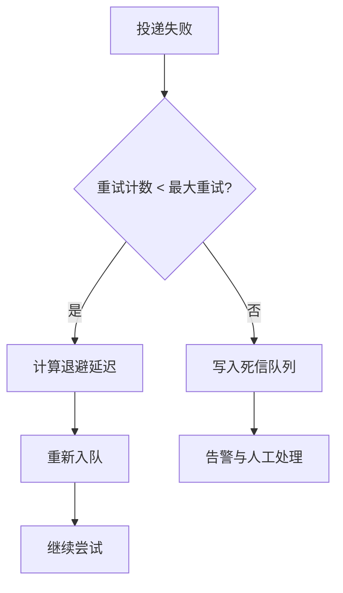
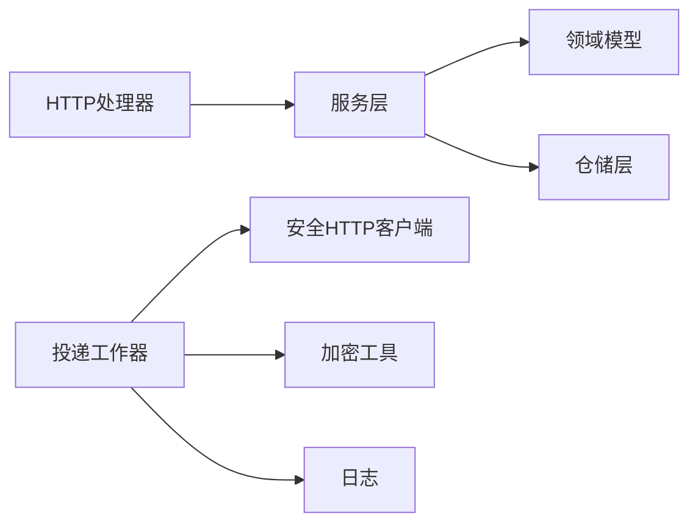

# Webhook设置

<cite>
**本文引用的文件**   
- [webhook_provider.go](file://notifuse/internal/domain/webhook_provider.go)
- [webhook_registration.go](file://notifuse/internal/domain/webhook_registration.go)
- [webhook_subscription.go](file://notifuse/internal/domain/webhook_subscription.go)
- [inbound_webhook_event.go](file://notifuse/internal/domain/inbound_webhook_event.go)
- [webhook_delivery_postgres.go](file://notifuse/internal/repository/webhook_delivery_postgres.go)
- [webhook_subscription_postgres.go](file://notifuse/internal/repository/webhook_subscription_postgres.go)
- [inbound_webhook_event_postgres.go](file://notifuse/internal/repository/inbound_webhook_event_postgres.go)
- [webhook_registration_handler.go](file://notifuse/internal/http/webhook_registration_handler.go)
- [webhook_subscription_handler.go](file://notifuse/internal/http/webhook_subscription_handler.go)
- [inbound_webhook_event_handler.go](file://notifuse/internal/http/inbound_webhook_event_handler.go)
- [supabase_webhook_handler.go](file://notifuse/internal/http/supabase_webhook_handler.go)
- [webhook_delivery_worker.go](file://notifuse/internal/service/webhook_delivery_worker.go)
- [webhook_registration_service.go](file://notifuse/internal/service/webhook_registration_service.go)
- [webhook_subscription_service.go](file://notifuse/internal/service/webhook_subscription_service.go)
- [inbound_webhook_event_service.go](file://notifuse/internal/service/inbound_webhook_event_service.go)
- [safehttpclient.go](file://notifuse/pkg/safehttpclient/safehttpclient.go)
- [ratelimiter.go](file://notifuse/pkg/ratelimiter/ratelimiter.go)
- [crypto.go](file://notifuse/pkg/crypto/crypto.go)
- [logger.go](file://notifuse/pkg/logger/logger.go)
- [openapi.yaml](file://notifuse/openapi/openapi.yaml)
- [webhook-subscriptions.yaml](file://notifuse/openapi/paths/webhook-subscriptions.yaml)
</cite>

## 目录
1. [简介](#简介)
2. [项目结构](#项目结构)
3. [核心组件](#核心组件)
4. [架构总览](#架构总览)
5. [详细组件分析](#详细组件分析)
6. [依赖关系分析](#依赖关系分析)
7. [性能考虑](#性能考虑)
8. [故障排查指南](#故障排查指南)
9. [结论](#结论)
10. [附录](#附录)

## 简介
本文件面向Notifuse控制台Webhook设置模块，系统性阐述出站与入站Webhook的配置管理、事件处理、安全机制、重试与死信策略、日志与调试方法。文档以代码仓库中的领域模型、HTTP处理器、服务层、仓储实现以及公共库为依据，帮助读者快速理解并正确使用Webhook能力。

## 项目结构
与Webhook相关的代码主要分布在以下层次：
- 领域模型：定义注册、订阅、事件等核心实体与行为
- HTTP层：提供REST API与入站事件接收端点
- 服务层：编排业务逻辑（如投递、验证、路由）
- 仓储层：持久化投递记录、订阅配置、入站事件
- 公共库：HTTP客户端、速率限制、加密工具、日志

图表来源
- [webhook_registration_handler.go](file://notifuse/internal/http/webhook_registration_handler.go)
- [webhook_subscription_handler.go](file://notifuse/internal/http/webhook_subscription_handler.go)
- [inbound_webhook_event_handler.go](file://notifuse/internal/http/inbound_webhook_event_handler.go)
- [supabase_webhook_handler.go](file://notifuse/internal/http/supabase_webhook_handler.go)
- [webhook_registration_service.go](file://notifuse/internal/service/webhook_registration_service.go)
- [webhook_subscription_service.go](file://notifuse/internal/service/webhook_subscription_service.go)
- [inbound_webhook_event_service.go](file://notifuse/internal/service/inbound_webhook_event_service.go)
- [webhook_delivery_worker.go](file://notifuse/internal/service/webhook_delivery_worker.go)
- [webhook_registration.go](file://notifuse/internal/domain/webhook_registration.go)
- [webhook_subscription.go](file://notifuse/internal/domain/webhook_subscription.go)
- [inbound_webhook_event.go](file://notifuse/internal/domain/inbound_webhook_event.go)
- [webhook_provider.go](file://notifuse/internal/domain/webhook_provider.go)
- [webhook_delivery_postgres.go](file://notifuse/internal/repository/webhook_delivery_postgres.go)
- [webhook_subscription_postgres.go](file://notifuse/internal/repository/webhook_subscription_postgres.go)
- [inbound_webhook_event_postgres.go](file://notifuse/internal/repository/inbound_webhook_event_postgres.go)
- [safehttpclient.go](file://notifuse/pkg/safehttpclient/safehttpclient.go)
- [ratelimiter.go](file://notifuse/pkg/ratelimiter/ratelimiter.go)
- [crypto.go](file://notifuse/pkg/crypto/crypto.go)
- [logger.go](file://notifuse/pkg/logger/logger.go)

章节来源
- [webhook_registration_handler.go](file://notifuse/internal/http/webhook_registration_handler.go)
- [webhook_subscription_handler.go](file://notifuse/internal/http/webhook_subscription_handler.go)
- [inbound_webhook_event_handler.go](file://notifuse/internal/http/inbound_webhook_event_handler.go)
- [supabase_webhook_handler.go](file://notifuse/internal/http/supabase_webhook_handler.go)
- [webhook_registration_service.go](file://notifuse/internal/service/webhook_registration_service.go)
- [webhook_subscription_service.go](file://notifuse/internal/service/webhook_subscription_service.go)
- [inbound_webhook_event_service.go](file://notifuse/internal/service/inbound_webhook_event_service.go)
- [webhook_delivery_worker.go](file://notifuse/internal/service/webhook_delivery_worker.go)
- [webhook_registration.go](file://notifuse/internal/domain/webhook_registration.go)
- [webhook_subscription.go](file://notifuse/internal/domain/webhook_subscription.go)
- [inbound_webhook_event.go](file://notifuse/internal/domain/inbound_webhook_event.go)
- [webhook_provider.go](file://notifuse/internal/domain/webhook_provider.go)
- [webhook_delivery_postgres.go](file://notifuse/internal/repository/webhook_delivery_postgres.go)
- [webhook_subscription_postgres.go](file://notifuse/internal/repository/webhook_subscription_postgres.go)
- [inbound_webhook_event_postgres.go](file://notifuse/internal/repository/inbound_webhook_event_postgres.go)
- [safehttpclient.go](file://notifuse/pkg/safehttpclient/safehttpclient.go)
- [ratelimiter.go](file://notifuse/pkg/ratelimiter/ratelimiter.go)
- [crypto.go](file://notifuse/pkg/crypto/crypto.go)
- [logger.go](file://notifuse/pkg/logger/logger.go)

## 核心组件
- 注册与提供者
  - 注册用于描述外部系统对Webhook的接入方式与元信息；提供者抽象了不同来源的事件提供方。
- 订阅与投递
  - 订阅定义了目标URL、请求头、签名策略、过滤条件与重试策略；投递负责将事件按订阅规则发送到目标端点。
- 入站事件
  - 入站事件表示从外部系统收到的原始事件，包含事件类型、时间戳、负载与来源标识。
- 安全与限流
  - HMAC签名校验、IP白名单、速率限制在入站侧保障安全性与稳定性。
- 持久化与可观测性
  - 投递记录、订阅配置、入站事件均持久化；统一日志输出便于追踪。

章节来源
- [webhook_registration.go](file://notifuse/internal/domain/webhook_registration.go)
- [webhook_provider.go](file://notifuse/internal/domain/webhook_provider.go)
- [webhook_subscription.go](file://notifuse/internal/domain/webhook_subscription.go)
- [inbound_webhook_event.go](file://notifuse/internal/domain/inbound_webhook_event.go)
- [webhook_delivery_postgres.go](file://notifuse/internal/repository/webhook_delivery_postgres.go)
- [webhook_subscription_postgres.go](file://notifuse/internal/repository/webhook_subscription_postgres.go)
- [inbound_webhook_event_postgres.go](file://notifuse/internal/repository/inbound_webhook_event_postgres.go)
- [safehttpclient.go](file://notifuse/pkg/safehttpclient/safehttpclient.go)
- [ratelimiter.go](file://notifuse/pkg/ratelimiter/ratelimiter.go)
- [crypto.go](file://notifuse/pkg/crypto/crypto.go)
- [logger.go](file://notifuse/pkg/logger/logger.go)

## 架构总览
整体流程分为两条主线：
- 出站Webhook：根据订阅规则生成请求，携带签名与自定义头，执行重试与失败记录。
- 入站Webhook：接收外部事件，进行鉴权、限流、解析与路由，持久化并触发后续处理。

图表来源
- [webhook_registration_handler.go](file://notifuse/internal/http/webhook_registration_handler.go)
- [webhook_subscription_handler.go](file://notifuse/internal/http/webhook_subscription_handler.go)
- [inbound_webhook_event_handler.go](file://notifuse/internal/http/inbound_webhook_event_handler.go)
- [webhook_registration_service.go](file://notifuse/internal/service/webhook_registration_service.go)
- [webhook_subscription_service.go](file://notifuse/internal/service/webhook_subscription_service.go)
- [inbound_webhook_event_service.go](file://notifuse/internal/service/inbound_webhook_event_service.go)
- [webhook_delivery_worker.go](file://notifuse/internal/service/webhook_delivery_worker.go)
- [webhook_subscription_postgres.go](file://notifuse/internal/repository/webhook_subscription_postgres.go)
- [webhook_delivery_postgres.go](file://notifuse/internal/repository/webhook_delivery_postgres.go)
- [inbound_webhook_event_postgres.go](file://notifuse/internal/repository/inbound_webhook_event_postgres.go)
- [safehttpclient.go](file://notifuse/pkg/safehttpclient/safehttpclient.go)
- [ratelimiter.go](file://notifuse/pkg/ratelimiter/ratelimiter.go)
- [crypto.go](file://notifuse/pkg/crypto/crypto.go)
- [logger.go](file://notifuse/pkg/logger/logger.go)

## 详细组件分析

### 出站Webhook：订阅与投递
- 订阅配置要点
  - URL端点：目标回调地址
  - 请求头：支持自定义键值对
  - 签名验证：基于HMAC的签名算法与密钥
  - 重试策略：最大重试次数、退避策略、超时控制
- 投递流程
  - 根据事件匹配订阅
  - 组装请求头与签名
  - 通过安全HTTP客户端发送
  - 记录投递结果与错误
  - 失败进入重试或死信队列

图表来源
- [webhook_subscription.go](file://notifuse/internal/domain/webhook_subscription.go)
- [webhook_delivery_worker.go](file://notifuse/internal/service/webhook_delivery_worker.go)
- [webhook_delivery_postgres.go](file://notifuse/internal/repository/webhook_delivery_postgres.go)
- [safehttpclient.go](file://notifuse/pkg/safehttpclient/safehttpclient.go)
- [crypto.go](file://notifuse/pkg/crypto/crypto.go)
- [logger.go](file://notifuse/pkg/logger/logger.go)

章节来源
- [webhook_subscription.go](file://notifuse/internal/domain/webhook_subscription.go)
- [webhook_delivery_worker.go](file://notifuse/internal/service/webhook_delivery_worker.go)
- [webhook_delivery_postgres.go](file://notifuse/internal/repository/webhook_delivery_postgres.go)
- [safehttpclient.go](file://notifuse/pkg/safehttpclient/safehttpclient.go)
- [crypto.go](file://notifuse/pkg/crypto/crypto.go)
- [logger.go](file://notifuse/pkg/logger/logger.go)

### 入站Webhook：事件接收与路由
- 事件类型定义
  - 事件类型字段用于区分不同业务场景
  - 事件负载遵循统一的JSON结构规范
- 数据格式规范
  - 标准字段包括事件ID、时间戳、来源、负载等
  - 可选扩展字段由具体事件类型决定
- 路由规则
  - 根据事件类型与订阅过滤条件匹配目标订阅
  - 支持多订阅并行投递

图表来源
- [inbound_webhook_event_handler.go](file://notifuse/internal/http/inbound_webhook_event_handler.go)
- [inbound_webhook_event_service.go](file://notifuse/internal/service/inbound_webhook_event_service.go)
- [inbound_webhook_event_postgres.go](file://notifuse/internal/repository/inbound_webhook_event_postgres.go)
- [inbound_webhook_event.go](file://notifuse/internal/domain/inbound_webhook_event.go)
- [ratelimiter.go](file://notifuse/pkg/ratelimiter/ratelimiter.go)
- [crypto.go](file://notifuse/pkg/crypto/crypto.go)
- [webhook_delivery_worker.go](file://notifuse/internal/service/webhook_delivery_worker.go)

章节来源
- [inbound_webhook_event_handler.go](file://notifuse/internal/http/inbound_webhook_event_handler.go)
- [inbound_webhook_event_service.go](file://notifuse/internal/service/inbound_webhook_event_service.go)
- [inbound_webhook_event_postgres.go](file://notifuse/internal/repository/inbound_webhook_event_postgres.go)
- [inbound_webhook_event.go](file://notifuse/internal/domain/inbound_webhook_event.go)
- [ratelimiter.go](file://notifuse/pkg/ratelimiter/ratelimiter.go)
- [crypto.go](file://notifuse/pkg/crypto/crypto.go)
- [webhook_delivery_worker.go](file://notifuse/internal/service/webhook_delivery_worker.go)

### 安全机制：HMAC签名、IP白名单与速率限制
- HMAC签名验证
  - 使用共享密钥对请求体与头部进行签名计算
  - 服务端校验签名一致性，防止篡改
- IP白名单
  - 仅允许来自受信任IP段的请求
  - 结合网络层与中间件双重校验
- 速率限制
  - 基于IP或租户维度的令牌桶/滑动窗口限流
  - 超限返回适当的状态码与提示

图表来源
- [crypto.go](file://notifuse/pkg/crypto/crypto.go)
- [ratelimiter.go](file://notifuse/pkg/ratelimiter/ratelimiter.go)
- [inbound_webhook_event_handler.go](file://notifuse/internal/http/inbound_webhook_event_handler.go)

章节来源
- [crypto.go](file://notifuse/pkg/crypto/crypto.go)
- [ratelimiter.go](file://notifuse/pkg/ratelimiter/ratelimiter.go)
- [inbound_webhook_event_handler.go](file://notifuse/internal/http/inbound_webhook_event_handler.go)

### 执行日志、失败重试与死信队列
- 执行日志
  - 统一结构化日志记录请求、响应、错误与上下文
- 失败重试
  - 指数退避与抖动策略
  - 可配置最大重试次数与超时
- 死信队列
  - 超过重试上限的消息转入死信队列
  - 支持人工干预与二次处理

图表来源
- [webhook_delivery_worker.go](file://notifuse/internal/service/webhook_delivery_worker.go)
- [webhook_delivery_postgres.go](file://notifuse/internal/repository/webhook_delivery_postgres.go)
- [logger.go](file://notifuse/pkg/logger/logger.go)

章节来源
- [webhook_delivery_worker.go](file://notifuse/internal/service/webhook_delivery_worker.go)
- [webhook_delivery_postgres.go](file://notifuse/internal/repository/webhook_delivery_postgres.go)
- [logger.go](file://notifuse/pkg/logger/logger.go)

### 控制台API与OpenAPI契约
- 控制台提供的Webhook相关API
  - 注册管理：创建、更新、删除外部注册
  - 订阅管理：创建、更新、删除订阅，查看投递历史
  - 入站事件：查询事件列表与详情
- OpenAPI契约
  - 路径与参数定义见OpenAPI文档
  - 示例请求与响应可在OpenAPI文件中查阅

章节来源
- [webhook_registration_handler.go](file://notifuse/internal/http/webhook_registration_handler.go)
- [webhook_subscription_handler.go](file://notifuse/internal/http/webhook_subscription_handler.go)
- [inbound_webhook_event_handler.go](file://notifuse/internal/http/inbound_webhook_event_handler.go)
- [openapi.yaml](file://notifuse/openapi/openapi.yaml)
- [webhook-subscriptions.yaml](file://notifuse/openapi/paths/webhook-subscriptions.yaml)

## 依赖关系分析
- 组件耦合
  - HTTP处理器依赖服务层，服务层依赖领域模型与仓储
  - 投递工作器依赖安全HTTP客户端与加密工具
- 外部依赖
  - 数据库PostgreSQL用于持久化
  - 速率限制器与日志库为横切关注点

图表来源
- [webhook_registration_handler.go](file://notifuse/internal/http/webhook_registration_handler.go)
- [webhook_subscription_handler.go](file://notifuse/internal/http/webhook_subscription_handler.go)
- [inbound_webhook_event_handler.go](file://notifuse/internal/http/inbound_webhook_event_handler.go)
- [webhook_registration_service.go](file://notifuse/internal/service/webhook_registration_service.go)
- [webhook_subscription_service.go](file://notifuse/internal/service/webhook_subscription_service.go)
- [inbound_webhook_event_service.go](file://notifuse/internal/service/inbound_webhook_event_service.go)
- [webhook_delivery_worker.go](file://notifuse/internal/service/webhook_delivery_worker.go)
- [webhook_registration.go](file://notifuse/internal/domain/webhook_registration.go)
- [webhook_subscription.go](file://notifuse/internal/domain/webhook_subscription.go)
- [inbound_webhook_event.go](file://notifuse/internal/domain/inbound_webhook_event.go)
- [webhook_delivery_postgres.go](file://notifuse/internal/repository/webhook_delivery_postgres.go)
- [webhook_subscription_postgres.go](file://notifuse/internal/repository/webhook_subscription_postgres.go)
- [inbound_webhook_event_postgres.go](file://notifuse/internal/repository/inbound_webhook_event_postgres.go)
- [safehttpclient.go](file://notifuse/pkg/safehttpclient/safehttpclient.go)
- [crypto.go](file://notifuse/pkg/crypto/crypto.go)
- [logger.go](file://notifuse/pkg/logger/logger.go)

章节来源
- [webhook_registration_handler.go](file://notifuse/internal/http/webhook_registration_handler.go)
- [webhook_subscription_handler.go](file://notifuse/internal/http/webhook_subscription_handler.go)
- [inbound_webhook_event_handler.go](file://notifuse/internal/http/inbound_webhook_event_handler.go)
- [webhook_registration_service.go](file://notifuse/internal/service/webhook_registration_service.go)
- [webhook_subscription_service.go](file://notifuse/internal/service/webhook_subscription_service.go)
- [inbound_webhook_event_service.go](file://notifuse/internal/service/inbound_webhook_event_service.go)
- [webhook_delivery_worker.go](file://notifuse/internal/service/webhook_delivery_worker.go)
- [webhook_registration.go](file://notifuse/internal/domain/webhook_registration.go)
- [webhook_subscription.go](file://notifuse/internal/domain/webhook_subscription.go)
- [inbound_webhook_event.go](file://notifuse/internal/domain/inbound_webhook_event.go)
- [webhook_delivery_postgres.go](file://notifuse/internal/repository/webhook_delivery_postgres.go)
- [webhook_subscription_postgres.go](file://notifuse/internal/repository/webhook_subscription_postgres.go)
- [inbound_webhook_event_postgres.go](file://notifuse/internal/repository/inbound_webhook_event_postgres.go)
- [safehttpclient.go](file://notifuse/pkg/safehttpclient/safehttpclient.go)
- [crypto.go](file://notifuse/pkg/crypto/crypto.go)
- [logger.go](file://notifuse/pkg/logger/logger.go)

## 性能考虑
- 并发投递
  - 使用工作器池提升吞吐，避免阻塞主线程
- 连接复用
  - 安全HTTP客户端启用连接池与Keep-Alive
- 重试优化
  - 指数退避与抖动降低雪崩风险
- 限流保护
  - 入站侧限流避免过载
- 日志采样
  - 高频场景下采用采样策略减少I/O开销

[本节为通用指导，不直接分析具体文件]

## 故障排查指南
- 常见问题
  - 签名校验失败：检查共享密钥、签名算法与请求体一致性
  - IP被拒绝：确认来源IP在白名单中
  - 速率限制触发：降低请求频率或调整阈值
  - 投递失败：查看投递记录与错误原因，必要时人工介入死信队列
- 定位步骤
  - 查看结构化日志，检索事件ID与订阅ID
  - 核对订阅配置（URL、头、签名、重试策略）
  - 检查外部端点可达性与响应状态
- 辅助工具
  - 使用控制台API查询订阅与投递历史
  - 使用OpenAPI文档构造测试请求

章节来源
- [webhook_delivery_worker.go](file://notifuse/internal/service/webhook_delivery_worker.go)
- [webhook_delivery_postgres.go](file://notifuse/internal/repository/webhook_delivery_postgres.go)
- [inbound_webhook_event_handler.go](file://notifuse/internal/http/inbound_webhook_event_handler.go)
- [webhook_subscription_handler.go](file://notifuse/internal/http/webhook_subscription_handler.go)
- [openapi.yaml](file://notifuse/openapi/openapi.yaml)
- [webhook-subscriptions.yaml](file://notifuse/openapi/paths/webhook-subscriptions.yaml)

## 结论
Notifuse的Webhook模块通过清晰的领域模型与服务编排，提供了完整的出站与入站能力。借助HMAC签名、IP白名单与速率限制，系统在安全性与稳定性方面具备良好保障；配合重试与死信队列，提升了可靠性与可运维性。建议在生产环境充分配置日志与监控，并结合OpenAPI契约进行持续集成测试。

[本节为总结，不直接分析具体文件]

## 附录
- 术语
  - 注册：外部系统的接入元信息
  - 订阅：目标端点与投递策略的组合
  - 入站事件：从外部系统收到的事件
  - 死信队列：投递失败的最终落点
- 参考文件
  - OpenAPI契约：[openapi.yaml](file://notifuse/openapi/openapi.yaml)、[webhook-subscriptions.yaml](file://notifuse/openapi/paths/webhook-subscriptions.yaml)

[本节为补充说明，不直接分析具体文件]