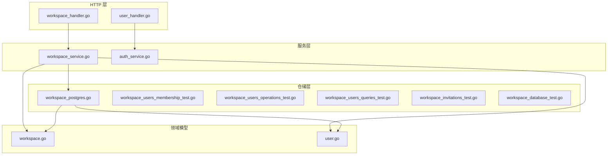
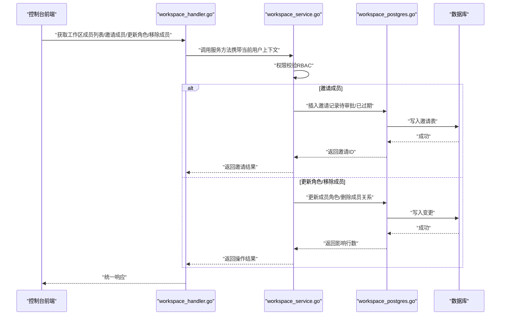
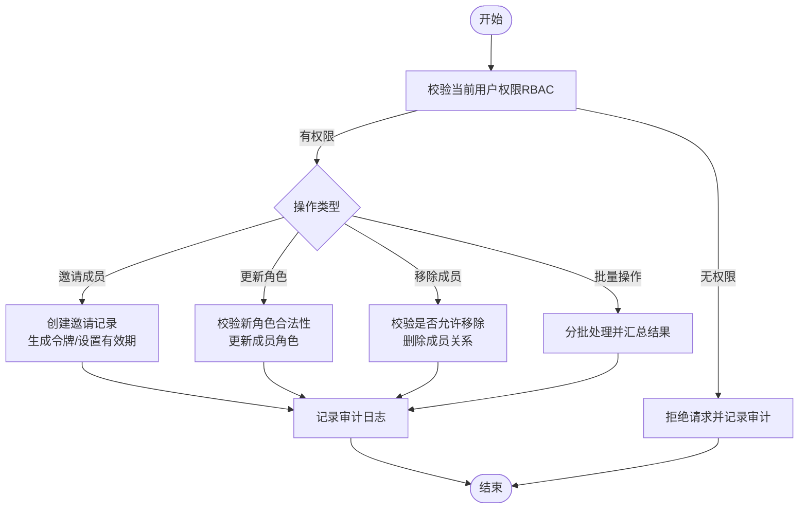
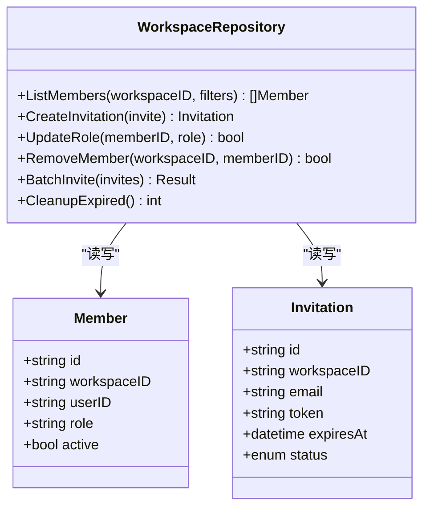
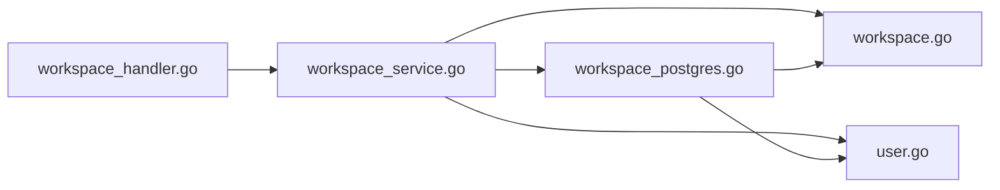

# 工作区成员管理

<cite>
**本文引用的文件**   
- [workspace_handler.go](file://notifuse/internal/http/workspace_handler.go)
- [workspace_service.go](file://notifuse/internal/service/workspace_service.go)
- [workspace_users_service_test.go](file://notifuse/internal/service/workspace_users_service_test.go)
- [workspace_postgres.go](file://notifuse/internal/repository/workspace_postgres.go)
- [workspace_users_membership_test.go](file://notifuse/internal/repository/workspace_users_membership_test.go)
- [workspace_users_operations_test.go](file://notifuse/internal/repository/workspace_users_operations_test.go)
- [workspace_users_queries_test.go](file://notifuse/internal/repository/workspace_users_queries_test.go)
- [workspace_invitations_test.go](file://notifuse/internal/repository/workspace_invitations_test.go)
- [user_handler.go](file://notifuse/internal/http/user_handler.go)
- [auth_service.go](file://notifuse/internal/service/auth_service.go)
- [workspace.go](file://notifuse/internal/domain/workspace.go)
- [user.go](file://notifuse/internal/domain/user.go)
- [workspace_database_test.go](file://notifuse/internal/repository/workspace_database_test.go)
</cite>

## 目录
1. [简介](#简介)
2. [项目结构](#项目结构)
3. [核心组件](#核心组件)
4. [架构总览](#架构总览)
5. [详细组件分析](#详细组件分析)
6. [依赖关系分析](#依赖关系分析)
7. [性能考虑](#性能考虑)
8. [故障排查指南](#故障排查指南)
9. [结论](#结论)
10. [附录](#附录)

## 简介
本文件面向 Notifuse 控制台的工作区成员管理功能，系统性梳理团队成员的增删改查（CRUD）、基于角色的访问控制（RBAC）模型、用户邀请流程（注册审批、激活确认、会话管理）、批量操作、审计日志与安全策略。文档以代码仓库中的 HTTP 层、服务层、仓储层与领域模型为依据，提供架构图、时序图与流程图，帮助读者快速理解并安全地扩展该能力。

## 项目结构
工作区成员管理涉及三层：HTTP 接口层、业务服务层、数据仓储层，以及领域模型定义。关键路径如下：
- HTTP 层：暴露工作区成员相关 API（如列出成员、邀请成员、更新角色、移除成员等）。
- 服务层：编排业务逻辑，校验权限、处理邀请状态机、调用仓储完成持久化。
- 仓储层：封装数据库访问，执行成员、邀请、角色等数据的读写。
- 领域模型：定义工作区、用户、成员关系、邀请记录等实体与约束。

图表来源
- [workspace_handler.go](file://notifuse/internal/http/workspace_handler.go)
- [workspace_service.go](file://notifuse/internal/service/workspace_service.go)
- [workspace_postgres.go](file://notifuse/internal/repository/workspace_postgres.go)
- [workspace_users_membership_test.go](file://notifuse/internal/repository/workspace_users_membership_test.go)
- [workspace_users_operations_test.go](file://notifuse/internal/repository/workspace_users_operations_test.go)
- [workspace_users_queries_test.go](file://notifuse/internal/repository/workspace_users_queries_test.go)
- [workspace_invitations_test.go](file://notifuse/internal/repository/workspace_invitations_test.go)
- [workspace_database_test.go](file://notifuse/internal/repository/workspace_database_test.go)
- [workspace.go](file://notifuse/internal/domain/workspace.go)
- [user.go](file://notifuse/internal/domain/user.go)

章节来源
- [workspace_handler.go](file://notifuse/internal/http/workspace_handler.go)
- [workspace_service.go](file://notifuse/internal/service/workspace_service.go)
- [workspace_postgres.go](file://notifuse/internal/repository/workspace_postgres.go)
- [workspace_users_membership_test.go](file://notifuse/internal/repository/workspace_users_membership_test.go)
- [workspace_users_operations_test.go](file://notifuse/internal/repository/workspace_users_operations_test.go)
- [workspace_users_queries_test.go](file://notifuse/internal/repository/workspace_users_queries_test.go)
- [workspace_invitations_test.go](file://notifuse/internal/repository/workspace_invitations_test.go)
- [workspace_database_test.go](file://notifuse/internal/repository/workspace_database_test.go)
- [workspace.go](file://notifuse/internal/domain/workspace.go)
- [user.go](file://notifuse/internal/domain/user.go)

## 核心组件
- 工作区成员管理入口（HTTP 处理器）
  - 负责解析请求参数、鉴权上下文、调用服务层方法，返回统一响应。
- 工作区服务（业务编排）
  - 实现成员列表查询、邀请创建、角色变更、成员移除、批量操作等业务流程；协调权限校验、邀请状态流转与审计事件生成。
- 工作区仓储（数据访问）
  - 提供成员、邀请、角色等实体的持久化操作；包含事务边界与并发安全保证。
- 领域模型
  - 定义工作区、用户、成员关系、邀请记录等数据结构与不变式。

章节来源
- [workspace_handler.go](file://notifuse/internal/http/workspace_handler.go)
- [workspace_service.go](file://notifuse/internal/service/workspace_service.go)
- [workspace_postgres.go](file://notifuse/internal/repository/workspace_postgres.go)
- [workspace.go](file://notifuse/internal/domain/workspace.go)
- [user.go](file://notifuse/internal/domain/user.go)

## 架构总览
下图展示从控制台到后端的数据流与控制流，涵盖成员 CRUD、邀请流程与 RBAC 校验。

图表来源
- [workspace_handler.go](file://notifuse/internal/http/workspace_handler.go)
- [workspace_service.go](file://notifuse/internal/service/workspace_service.go)
- [workspace_postgres.go](file://notifuse/internal/repository/workspace_postgres.go)

## 详细组件分析

### 成员管理 API（HTTP 层）
- 职责
  - 接收控制台请求，提取工作区 ID、目标用户标识、角色信息、批量操作参数等。
  - 注入当前登录用户上下文，进行基础参数校验后转发至服务层。
  - 将服务层返回的结果转换为统一的 HTTP 响应格式。
- 典型端点
  - 列出成员：按工作区维度分页返回成员及角色。
  - 邀请成员：支持单条或批量邀请，生成邀请链接或邮件通知。
  - 更新角色：在具备管理员权限时调整成员角色。
  - 移除成员：在具备管理员权限时移除成员关系。
- 错误处理
  - 对未授权、资源不存在、重复邀请、非法角色等场景返回明确错误码与消息。

章节来源
- [workspace_handler.go](file://notifuse/internal/http/workspace_handler.go)

### 工作区服务（业务编排）
- 职责
  - 编排成员管理的完整流程：权限检查、邀请生命周期管理、角色变更、批量操作、审计事件记录。
  - 确保跨仓储操作的原子性与一致性（例如邀请创建与通知发送）。
- 权限模型（RBAC）
  - 管理员：可管理所有成员、分配/修改角色、移除成员、查看审计日志。
  - 编辑者：可添加成员（受限制）、修改非敏感配置，通常不可移除管理员或更改自身最高权限。
  - 观察者：只读访问成员列表与基本信息，无写权限。
- 邀请流程
  - 创建邀请：校验邮箱唯一性、生成一次性令牌、设置有效期、写入邀请记录。
  - 审批与激活：被邀请人通过链接完成注册/绑定，系统验证令牌有效性并建立成员关系。
  - 过期与清理：定时任务或惰性检查清理过期邀请。
- 批量操作
  - 支持批量邀请、批量角色更新、批量移除；内部采用事务分批提交，失败回滚并汇总错误。
- 审计日志
  - 记录关键操作（邀请、角色变更、移除），包含操作者、时间、目标对象、前后差异。

图表来源
- [workspace_service.go](file://notifuse/internal/service/workspace_service.go)

章节来源
- [workspace_service.go](file://notifuse/internal/service/workspace_service.go)
- [workspace_users_service_test.go](file://notifuse/internal/service/workspace_users_service_test.go)

### 工作区仓储（数据访问）
- 职责
  - 提供成员、邀请、角色等实体的增删改查接口。
  - 维护事务边界，确保复杂操作的一致性。
- 关键能力
  - 成员关系查询：按工作区、角色过滤、分页。
  - 邀请记录管理：创建、查询、更新状态、清理过期。
  - 角色变更与移除：原子更新成员关系，防止竞态条件。
- 测试覆盖
  - 成员关系、操作、查询、邀请等用例均提供单元测试与集成测试，保障正确性与健壮性。

图表来源
- [workspace_postgres.go](file://notifuse/internal/repository/workspace_postgres.go)
- [workspace_users_membership_test.go](file://notifuse/internal/repository/workspace_users_membership_test.go)
- [workspace_users_operations_test.go](file://notifuse/internal/repository/workspace_users_operations_test.go)
- [workspace_users_queries_test.go](file://notifuse/internal/repository/workspace_users_queries_test.go)
- [workspace_invitations_test.go](file://notifuse/internal/repository/workspace_invitations_test.go)

章节来源
- [workspace_postgres.go](file://notifuse/internal/repository/workspace_postgres.go)
- [workspace_users_membership_test.go](file://notifuse/internal/repository/workspace_users_membership_test.go)
- [workspace_users_operations_test.go](file://notifuse/internal/repository/workspace_users_operations_test.go)
- [workspace_users_queries_test.go](file://notifuse/internal/repository/workspace_users_queries_test.go)
- [workspace_invitations_test.go](file://notifuse/internal/repository/workspace_invitations_test.go)

### 领域模型（工作区与用户）
- 工作区
  - 标识、名称、描述、创建者、状态等元数据。
- 用户
  - 标识、邮箱、显示名、认证来源、状态等。
- 成员关系
  - 工作区与用户的关联，包含角色、加入时间、活跃状态。
- 邀请记录
  - 邮箱、令牌、有效期、状态（待审批/已接受/已拒绝/已过期）。

章节来源
- [workspace.go](file://notifuse/internal/domain/workspace.go)
- [user.go](file://notifuse/internal/domain/user.go)

### 用户认证与会话（辅助）
- 作用
  - 为成员管理提供身份认证与会话上下文，确保每次请求能识别当前用户及其权限。
- 关键点
  - 会话令牌签发与校验、OIDC/OAuth2 集成、多租户隔离。

章节来源
- [user_handler.go](file://notifuse/internal/http/user_handler.go)
- [auth_service.go](file://notifuse/internal/service/auth_service.go)

## 依赖关系分析
- 耦合度
  - HTTP 层仅依赖服务层，服务层依赖仓储层与领域模型，层次清晰、内聚度高。
- 外部依赖
  - 数据库（PostgreSQL）、邮件服务（用于邀请通知）、可选 OIDC 提供商。
- 潜在循环依赖
  - 当前分层避免循环依赖；若引入缓存或事件总线，需保持单向依赖。

图表来源
- [workspace_handler.go](file://notifuse/internal/http/workspace_handler.go)
- [workspace_service.go](file://notifuse/internal/service/workspace_service.go)
- [workspace_postgres.go](file://notifuse/internal/repository/workspace_postgres.go)
- [workspace.go](file://notifuse/internal/domain/workspace.go)
- [user.go](file://notifuse/internal/domain/user.go)

章节来源
- [workspace_handler.go](file://notifuse/internal/http/workspace_handler.go)
- [workspace_service.go](file://notifuse/internal/service/workspace_service.go)
- [workspace_postgres.go](file://notifuse/internal/repository/workspace_postgres.go)
- [workspace.go](file://notifuse/internal/domain/workspace.go)
- [user.go](file://notifuse/internal/domain/user.go)

## 性能考虑
- 分页与索引
  - 成员列表应使用分页与索引优化（工作区 ID、角色、活跃状态）。
- 批量操作
  - 分批提交、合并错误、避免长事务；必要时使用异步队列处理大规模邀请。
- 缓存
  - 对频繁读取的成员列表与角色映射可加短期缓存，注意失效策略。
- 并发安全
  - 角色变更与移除需加行级锁或乐观锁，避免竞态导致不一致。

[本节为通用指导，不直接分析具体文件]

## 故障排查指南
- 常见问题
  - 重复邀请：检查邀请记录的唯一约束与幂等键。
  - 权限不足：核对当前用户角色与工作区权限矩阵。
  - 邀请过期：确认令牌有效期与清理任务是否正常。
  - 批量失败：定位失败批次与原因，支持重试与补偿。
- 诊断建议
  - 启用审计日志与结构化日志，记录操作者与变更差异。
  - 使用测试套件复现问题（参考仓储与服务层测试）。

章节来源
- [workspace_users_service_test.go](file://notifuse/internal/service/workspace_users_service_test.go)
- [workspace_users_membership_test.go](file://notifuse/internal/repository/workspace_users_membership_test.go)
- [workspace_users_operations_test.go](file://notifuse/internal/repository/workspace_users_operations_test.go)
- [workspace_users_queries_test.go](file://notifuse/internal/repository/workspace_users_queries_test.go)
- [workspace_invitations_test.go](file://notifuse/internal/repository/workspace_invitations_test.go)
- [workspace_database_test.go](file://notifuse/internal/repository/workspace_database_test.go)

## 结论
Notifuse 的工作区成员管理采用清晰的三层架构与明确的 RBAC 模型，支持完整的成员 CRUD、邀请流程与批量操作。通过仓储层的完善测试与领域模型的强约束，系统在安全性与可维护性方面具备良好基础。建议在后续迭代中持续强化审计追踪、速率限制与最小权限原则，以提升整体安全水位。

[本节为总结，不直接分析具体文件]

## 附录
- 最佳实践
  - 最小权限：默认授予观察者角色，按需提升。
  - 邀请安全：短有效期、一次性令牌、IP/设备指纹校验。
  - 审计合规：保留关键操作日志，定期审查异常行为。
  - 批量稳健：分片处理、失败重试、幂等设计。
- 安全建议
  - 强制 HTTPS、令牌加密存储、防重放攻击。
  - 敏感操作二次确认与双人复核（针对管理员操作）。
  - 定期轮换密钥与审计导出。

[本节为通用指导，不直接分析具体文件]