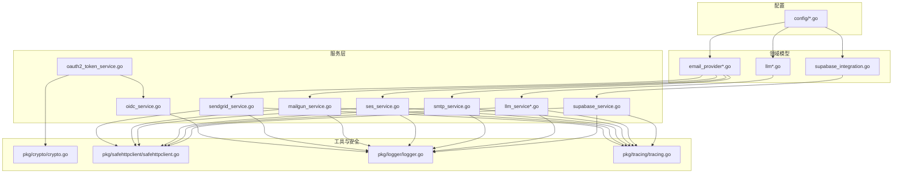
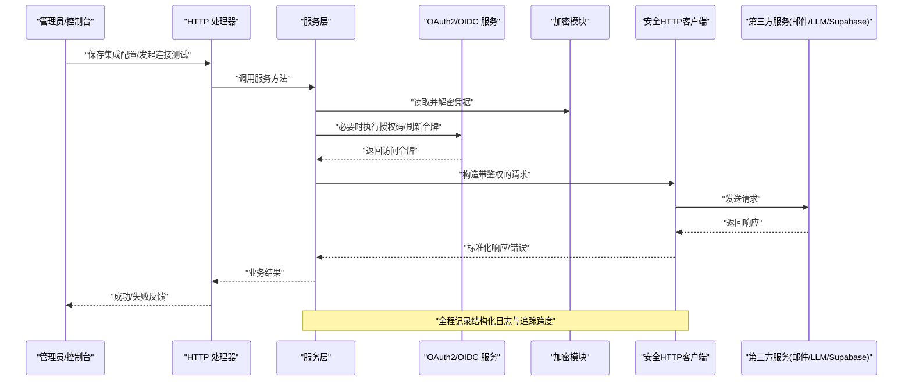
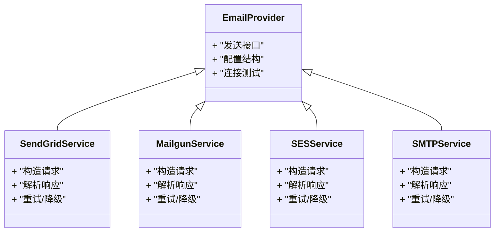
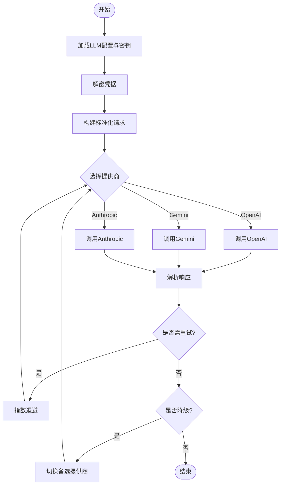
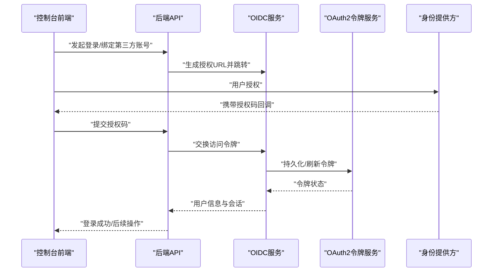
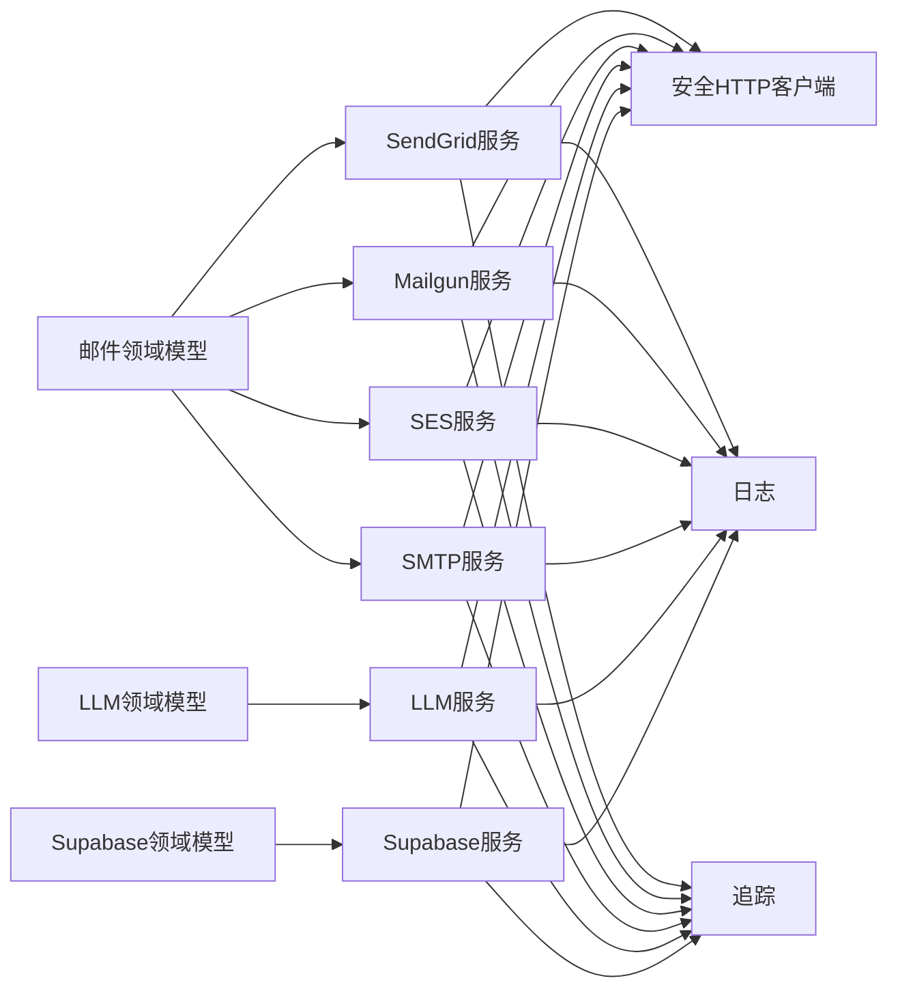

# 第三方集成

<cite>
**本文引用的文件**   
- [config.go](file://notifuse/config/config.go)
- [oidc.go](file://notifuse/config/oidc.go)
- [platform.go](file://notifuse/config/platform.go)
- [root_email.go](file://notifuse/config/root_email.go)
- [email_provider.go](file://notifuse/internal/domain/email_provider.go)
- [email_provider_sendgrid.go](file://notifuse/internal/domain/email_provider_sendgrid.go)
- [email_provider_mailgun.go](file://notifuse/internal/domain/email_provider_mailgun.go)
- [email_provider_ses.go](file://notifuse/internal/domain/email_provider_ses.go)
- [email_provider_smtp.go](file://notifuse/internal/domain/email_provider_smtp.go)
- [llm.go](file://notifuse/internal/domain/llm.go)
- [llm_provider.go](file://notifuse/internal/domain/llm_provider.go)
- [llm_provider_openai.go](file://notifuse/internal/domain/llm_provider_openai.go)
- [llm_provider_gemini.go](file://notifuse/internal/domain/llm_provider_gemini.go)
- [llm_provider_anthropic.go](file://notifuse/internal/domain/llm_provider_anthropic.go)
- [supabase_integration.go](file://notifuse/internal/domain/supabase_integration.go)
- [oauth2_token_service.go](file://notifuse/internal/service/oauth2_token_service.go)
- [oidc_service.go](file://notifuse/internal/service/oidc_service.go)
- [sendgrid_service.go](file://notifuse/internal/service/sendgrid_service.go)
- [mailgun_service.go](file://notifuse/internal/service/mailgun_service.go)
- [ses_service.go](file://notifuse/internal/service/ses_service.go)
- [smtp_service.go](file://notifuse/internal/service/smtp_service.go)
- [supabase_service.go](file://notifuse/internal/service/supabase_service.go)
- [llm_service.go](file://notifuse/internal/service/llm_service.go)
- [llm_service_openai.go](file://notifuse/internal/service/llm_service_openai.go)
- [llm_service_gemini.go](file://notifuse/internal/service/llm_service_gemini.go)
- [crypto.go](file://notifuse/pkg/crypto/crypto.go)
- [safehttpclient.go](file://notifuse/pkg/safehttpclient/safehttpclient.go)
- [logger.go](file://notifuse/pkg/logger/logger.go)
- [tracing.go](file://notifuse/pkg/tracing/tracing.go)
</cite>

## 目录
1. [简介](#简介)
2. [项目结构](#项目结构)
3. [核心组件](#核心组件)
4. [架构总览](#架构总览)
5. [详细组件分析](#详细组件分析)
6. [依赖分析](#依赖分析)
7. [性能考虑](#性能考虑)
8. [故障排查指南](#故障排查指南)
9. [结论](#结论)
10. [附录](#附录)

## 简介
本文件面向 Notifuse 控制台的“第三方集成”能力，系统性梳理外部服务配置管理、认证与密钥管理、连接测试与状态监控、错误处理与重试降级策略，以及自定义集成扩展的开发指南。覆盖的集成域包括：
- 邮件提供商：SendGrid、Mailgun、AWS SES、SMTP 等
- LLM 服务：OpenAI、Gemini、Anthropic
- 数据库与平台集成：Supabase
- 统一 OAuth2/OIDC 认证流程
- API 密钥加密存储、权限控制与访问日志记录

## 项目结构
Notifuse 在内部采用分层组织：领域模型（domain）、HTTP 处理器（http）、服务层（service）、持久化仓库（repository）与通用工具包（pkg）。第三方集成的关键代码主要分布在以下位置：
- 配置与平台信息：config/*
- 领域模型：internal/domain/*（邮件、LLM、Supabase 等）
- 服务实现：internal/service/*（各第三方服务的客户端封装、令牌管理、OIDC 流程等）
- 安全与可观测性：pkg/crypto、pkg/safehttpclient、pkg/logger、pkg/tracing

图表来源
- [config.go:1-200](file://notifuse/config/config.go#L1-L200)
- [email_provider.go:1-200](file://notifuse/internal/domain/email_provider.go#L1-L200)
- [llm.go:1-200](file://notifuse/internal/domain/llm.go#L1-L200)
- [supabase_integration.go:1-200](file://notifuse/internal/domain/supabase_integration.go#L1-L200)
- [oauth2_token_service.go:1-200](file://notifuse/internal/service/oauth2_token_service.go#L1-L200)
- [oidc_service.go:1-200](file://notifuse/internal/service/oidc_service.go#L1-L200)
- [sendgrid_service.go:1-200](file://notifuse/internal/service/sendgrid_service.go#L1-L200)
- [mailgun_service.go:1-200](file://notifuse/internal/service/mailgun_service.go#L1-L200)
- [ses_service.go:1-200](file://notifuse/internal/service/ses_service.go#L1-L200)
- [smtp_service.go:1-200](file://notifuse/internal/service/smtp_service.go#L1-L200)
- [supabase_service.go:1-200](file://notifuse/internal/service/supabase_service.go#L1-L200)
- [llm_service.go:1-200](file://notifuse/internal/service/llm_service.go#L1-L200)
- [llm_service_openai.go:1-200](file://notifuse/internal/service/llm_service_openai.go#L1-L200)
- [llm_service_gemini.go:1-200](file://notifuse/internal/service/llm_service_gemini.go#L1-L200)
- [crypto.go:1-200](file://notifuse/pkg/crypto/crypto.go#L1-L200)
- [safehttpclient.go:1-200](file://notifuse/pkg/safehttpclient/safehttpclient.go#L1-L200)
- [logger.go:1-200](file://notifuse/pkg/logger/logger.go#L1-L200)
- [tracing.go:1-200](file://notifuse/pkg/tracing/tracing.go#L1-L200)

章节来源
- [config.go:1-200](file://notifuse/config/config.go#L1-L200)
- [platform.go:1-200](file://notifuse/config/platform.go#L1-L200)
- [root_email.go:1-200](file://notifuse/config/root_email.go#L1-L200)

## 核心组件
本节聚焦第三方集成的关键抽象与服务实现，说明其职责边界与交互方式。

- 邮件提供商抽象与实现
  - 抽象定义：提供统一的发送接口、配置结构与校验逻辑。
  - 具体实现：SendGrid、Mailgun、SES、SMTP 等各自封装了鉴权、请求构造与响应解析。
- LLM 服务抽象与实现
  - 抽象定义：统一对话/补全调用入口、参数映射与结果归一化。
  - 具体实现：OpenAI、Gemini、Anthropic 分别适配各自的 SDK/REST 协议。
- Supabase 集成
  - 领域模型描述 Supabase 相关实体与关系；服务层负责连接、模板同步与通知通道。
- OAuth2/OIDC 与令牌管理
  - OIDC 服务负责授权端点发现、授权码流转与用户信息拉取。
  - OAuth2 令牌服务负责令牌获取、刷新、缓存与生命周期管理。
- 安全与可观测性
  - 加密：敏感字段（如 API Key、Secret）使用加密库进行加解密。
  - HTTP 客户端：统一超时、重试、TLS 与错误包装。
  - 日志与追踪：结构化日志与分布式追踪贯穿各服务调用。

章节来源
- [email_provider.go:1-200](file://notifuse/internal/domain/email_provider.go#L1-L200)
- [email_provider_sendgrid.go:1-200](file://notifuse/internal/domain/email_provider_sendgrid.go#L1-L200)
- [email_provider_mailgun.go:1-200](file://notifuse/internal/domain/email_provider_mailgun.go#L1-L200)
- [email_provider_ses.go:1-200](file://notifuse/internal/domain/email_provider_ses.go#L1-L200)
- [email_provider_smtp.go:1-200](file://notifuse/internal/domain/email_provider_smtp.go#L1-L200)
- [llm.go:1-200](file://notifuse/internal/domain/llm.go#L1-L200)
- [llm_provider.go:1-200](file://notifuse/internal/domain/llm_provider.go#L1-L200)
- [llm_provider_openai.go:1-200](file://notifuse/internal/domain/llm_provider_openai.go#L1-L200)
- [llm_provider_gemini.go:1-200](file://notifuse/internal/domain/llm_provider_gemini.go#L1-L200)
- [llm_provider_anthropic.go:1-200](file://notifuse/internal/domain/llm_provider_anthropic.go#L1-L200)
- [supabase_integration.go:1-200](file://notifuse/internal/domain/supabase_integration.go#L1-L200)
- [oauth2_token_service.go:1-200](file://notifuse/internal/service/oauth2_token_service.go#L1-L200)
- [oidc_service.go:1-200](file://notifuse/internal/service/oidc_service.go#L1-L200)
- [sendgrid_service.go:1-200](file://notifuse/internal/service/sendgrid_service.go#L1-L200)
- [mailgun_service.go:1-200](file://notifuse/internal/service/mailgun_service.go#L1-L200)
- [ses_service.go:1-200](file://notifuse/internal/service/ses_service.go#L1-L200)
- [smtp_service.go:1-200](file://notifuse/internal/service/smtp_service.go#L1-L200)
- [supabase_service.go:1-200](file://notifuse/internal/service/supabase_service.go#L1-L200)
- [llm_service.go:1-200](file://notifuse/internal/service/llm_service.go#L1-L200)
- [llm_service_openai.go:1-200](file://notifuse/internal/service/llm_service_openai.go#L1-L200)
- [llm_service_gemini.go:1-200](file://notifuse/internal/service/llm_service_gemini.go#L1-L200)
- [crypto.go:1-200](file://notifuse/pkg/crypto/crypto.go#L1-L200)
- [safehttpclient.go:1-200](file://notifuse/pkg/safehttpclient/safehttpclient.go#L1-L200)
- [logger.go:1-200](file://notifuse/pkg/logger/logger.go#L1-L200)
- [tracing.go:1-200](file://notifuse/pkg/tracing/tracing.go#L1-L200)

## 架构总览
下图展示了控制台侧第三方集成的端到端数据流与控制流：从配置加载、凭据解密、OAuth2/OIDC 授权到各第三方服务调用，并贯穿日志与追踪。

图表来源
- [oidc_service.go:1-200](file://notifuse/internal/service/oidc_service.go#L1-L200)
- [oauth2_token_service.go:1-200](file://notifuse/internal/service/oauth2_token_service.go#L1-L200)
- [sendgrid_service.go:1-200](file://notifuse/internal/service/sendgrid_service.go#L1-L200)
- [mailgun_service.go:1-200](file://notifuse/internal/service/mailgun_service.go#L1-L200)
- [ses_service.go:1-200](file://notifuse/internal/service/ses_service.go#L1-L200)
- [smtp_service.go:1-200](file://notifuse/internal/service/smtp_service.go#L1-L200)
- [llm_service.go:1-200](file://notifuse/internal/service/llm_service.go#L1-L200)
- [llm_service_openai.go:1-200](file://notifuse/internal/service/llm_service_openai.go#L1-L200)
- [llm_service_gemini.go:1-200](file://notifuse/internal/service/llm_service_gemini.go#L1-L200)
- [supabase_service.go:1-200](file://notifuse/internal/service/supabase_service.go#L1-L200)
- [crypto.go:1-200](file://notifuse/pkg/crypto/crypto.go#L1-L200)
- [safehttpclient.go:1-200](file://notifuse/pkg/safehttpclient/safehttpclient.go#L1-L200)
- [logger.go:1-200](file://notifuse/pkg/logger/logger.go#L1-L200)
- [tracing.go:1-200](file://notifuse/pkg/tracing/tracing.go#L1-L200)

## 详细组件分析

### 邮件提供商集成（SendGrid、Mailgun、AWS SES、SMTP）
- 配置管理
  - 通过配置模块加载各提供商的连接参数（如 API Key、区域、SMTP 主机/端口/用户名/密码等），并进行基础格式校验。
- 认证与密钥
  - 敏感字段在存储前加密，调用时按需解密；不同提供商的鉴权头或签名方式在服务层统一封装。
- 连接测试与状态监控
  - 提供轻量级连通性检查（例如最小请求或握手），用于控制台“测试连接”功能。
  - 结合日志与追踪输出关键指标（耗时、错误码、重试次数）。
- 错误处理与重试
  - 对网络抖动、限流等瞬时错误实施指数退避重试；对不可恢复错误快速失败并上报。
- 降级策略
  - 当主提供商不可用时，可按策略回退至备用提供商（如 SMTP 作为兜底）。

图表来源
- [email_provider.go:1-200](file://notifuse/internal/domain/email_provider.go#L1-L200)
- [email_provider_sendgrid.go:1-200](file://notifuse/internal/domain/email_provider_sendgrid.go#L1-L200)
- [email_provider_mailgun.go:1-200](file://notifuse/internal/domain/email_provider_mailgun.go#L1-L200)
- [email_provider_ses.go:1-200](file://notifuse/internal/domain/email_provider_ses.go#L1-L200)
- [email_provider_smtp.go:1-200](file://notifuse/internal/domain/email_provider_smtp.go#L1-L200)
- [sendgrid_service.go:1-200](file://notifuse/internal/service/sendgrid_service.go#L1-L200)
- [mailgun_service.go:1-200](file://notifuse/internal/service/mailgun_service.go#L1-L200)
- [ses_service.go:1-200](file://notifuse/internal/service/ses_service.go#L1-L200)
- [smtp_service.go:1-200](file://notifuse/internal/service/smtp_service.go#L1-L200)

章节来源
- [email_provider.go:1-200](file://notifuse/internal/domain/email_provider.go#L1-L200)
- [email_provider_sendgrid.go:1-200](file://notifuse/internal/domain/email_provider_sendgrid.go#L1-L200)
- [email_provider_mailgun.go:1-200](file://notifuse/internal/domain/email_provider_mailgun.go#L1-L200)
- [email_provider_ses.go:1-200](file://notifuse/internal/domain/email_provider_ses.go#L1-L200)
- [email_provider_smtp.go:1-200](file://notifuse/internal/domain/email_provider_smtp.go#L1-L200)
- [sendgrid_service.go:1-200](file://notifuse/internal/service/sendgrid_service.go#L1-L200)
- [mailgun_service.go:1-200](file://notifuse/internal/service/mailgun_service.go#L1-L200)
- [ses_service.go:1-200](file://notifuse/internal/service/ses_service.go#L1-L200)
- [smtp_service.go:1-200](file://notifuse/internal/service/smtp_service.go#L1-L200)

### LLM 服务集成（OpenAI、Gemini、Anthropic）
- 配置管理
  - 为每个提供商维护独立的配置项（如 Base URL、模型名、速率限制等），支持多实例切换。
- 认证与密钥
  - 使用统一加密存储；服务层在调用前注入鉴权头或签名。
- 调用流程
  - 将上层业务输入转换为各提供商的标准请求体，并对响应进行归一化处理。
- 错误处理与重试
  - 针对配额超限、临时网络错误进行重试；对模型不可用等错误触发降级（切换到其他提供商或本地缓存）。
- 可观测性
  - 记录提示词摘要（脱敏）、耗时、Token 用量与错误分类，便于成本与稳定性分析。

图表来源
- [llm.go:1-200](file://notifuse/internal/domain/llm.go#L1-L200)
- [llm_provider.go:1-200](file://notifuse/internal/domain/llm_provider.go#L1-L200)
- [llm_provider_openai.go:1-200](file://notifuse/internal/domain/llm_provider_openai.go#L1-L200)
- [llm_provider_gemini.go:1-200](file://notifuse/internal/domain/llm_provider_gemini.go#L1-L200)
- [llm_provider_anthropic.go:1-200](file://notifuse/internal/domain/llm_provider_anthropic.go#L1-L200)
- [llm_service.go:1-200](file://notifuse/internal/service/llm_service.go#L1-L200)
- [llm_service_openai.go:1-200](file://notifuse/internal/service/llm_service_openai.go#L1-L200)
- [llm_service_gemini.go:1-200](file://notifuse/internal/service/llm_service_gemini.go#L1-L200)

章节来源
- [llm.go:1-200](file://notifuse/internal/domain/llm.go#L1-L200)
- [llm_provider.go:1-200](file://notifuse/internal/domain/llm_provider.go#L1-L200)
- [llm_provider_openai.go:1-200](file://notifuse/internal/domain/llm_provider_openai.go#L1-L200)
- [llm_provider_gemini.go:1-200](file://notifuse/internal/domain/llm_provider_gemini.go#L1-L200)
- [llm_provider_anthropic.go:1-200](file://notifuse/internal/domain/llm_provider_anthropic.go#L1-L200)
- [llm_service.go:1-200](file://notifuse/internal/service/llm_service.go#L1-L200)
- [llm_service_openai.go:1-200](file://notifuse/internal/service/llm_service_openai.go#L1-L200)
- [llm_service_gemini.go:1-200](file://notifuse/internal/service/llm_service_gemini.go#L1-L200)

### Supabase 集成
- 配置与连接
  - 管理 Supabase URL、匿名/服务密钥等，建立受控连接。
- 数据与模板
  - 提供模板同步、通知通道对接等能力，确保与业务对象一致。
- 安全与审计
  - 所有访问均记录审计日志，敏感操作具备权限校验。

章节来源
- [supabase_integration.go:1-200](file://notifuse/internal/domain/supabase_integration.go#L1-L200)
- [supabase_service.go:1-200](file://notifuse/internal/service/supabase_service.go#L1-L200)

### OAuth2/OIDC 认证流程
- 授权端点发现与配置
  - 根据配置动态发现授权服务器元数据，完成回调地址、作用域等设置。
- 授权码流转
  - 引导用户跳转至授权页面，接收授权码后换取访问令牌与刷新令牌。
- 令牌管理与刷新
  - 集中管理令牌生命周期，自动刷新并在过期前续期。
- 权限控制
  - 基于角色与作用域进行资源访问控制，确保仅授权主体可访问敏感配置。

图表来源
- [oidc_service.go:1-200](file://notifuse/internal/service/oidc_service.go#L1-L200)
- [oauth2_token_service.go:1-200](file://notifuse/internal/service/oauth2_token_service.go#L1-L200)

章节来源
- [oidc_service.go:1-200](file://notifuse/internal/service/oidc_service.go#L1-L200)
- [oauth2_token_service.go:1-200](file://notifuse/internal/service/oauth2_token_service.go#L1-L200)

### API 密钥管理与加密存储
- 加密策略
  - 所有敏感字段（API Key、Secret、证书等）在入库前加密，读取时按需解密。
- 密钥轮换
  - 支持新旧密钥并存与平滑轮换，避免服务中断。
- 访问控制
  - 基于工作区/角色的细粒度权限控制，防止越权访问。

章节来源
- [crypto.go:1-200](file://notifuse/pkg/crypto/crypto.go#L1-L200)
- [config.go:1-200](file://notifuse/config/config.go#L1-L200)

### 连接测试与状态监控
- 连接测试
  - 对邮件/LLM/Supabase 提供最小化连通性检测，返回健康状态与诊断信息。
- 状态监控
  - 聚合各集成健康度、错误率、延迟分布，供控制台展示与告警。

章节来源
- [sendgrid_service.go:1-200](file://notifuse/internal/service/sendgrid_service.go#L1-L200)
- [mailgun_service.go:1-200](file://notifuse/internal/service/mailgun_service.go#L1-L200)
- [ses_service.go:1-200](file://notifuse/internal/service/ses_service.go#L1-L200)
- [smtp_service.go:1-200](file://notifuse/internal/service/smtp_service.go#L1-L200)
- [llm_service.go:1-200](file://notifuse/internal/service/llm_service.go#L1-L200)
- [supabase_service.go:1-200](file://notifuse/internal/service/supabase_service.go#L1-L200)

## 依赖分析
第三方服务依赖关系如下：服务层依赖领域模型定义，并通过安全 HTTP 客户端访问外部 API；同时依赖加密模块与日志/追踪组件。

图表来源
- [email_provider.go:1-200](file://notifuse/internal/domain/email_provider.go#L1-L200)
- [llm.go:1-200](file://notifuse/internal/domain/llm.go#L1-L200)
- [supabase_integration.go:1-200](file://notifuse/internal/domain/supabase_integration.go#L1-L200)
- [sendgrid_service.go:1-200](file://notifuse/internal/service/sendgrid_service.go#L1-L200)
- [mailgun_service.go:1-200](file://notifuse/internal/service/mailgun_service.go#L1-L200)
- [ses_service.go:1-200](file://notifuse/internal/service/ses_service.go#L1-L200)
- [smtp_service.go:1-200](file://notifuse/internal/service/smtp_service.go#L1-L200)
- [llm_service.go:1-200](file://notifuse/internal/service/llm_service.go#L1-L200)
- [supabase_service.go:1-200](file://notifuse/internal/service/supabase_service.go#L1-L200)
- [safehttpclient.go:1-200](file://notifuse/pkg/safehttpclient/safehttpclient.go#L1-L200)
- [logger.go:1-200](file://notifuse/pkg/logger/logger.go#L1-L200)
- [tracing.go:1-200](file://notifuse/pkg/tracing/tracing.go#L1-L200)

章节来源
- [safehttpclient.go:1-200](file://notifuse/pkg/safehttpclient/safehttpclient.go#L1-L200)
- [logger.go:1-200](file://notifuse/pkg/logger/logger.go#L1-L200)
- [tracing.go:1-200](file://notifuse/pkg/tracing/tracing.go#L1-L200)

## 性能考虑
- 连接复用与池化
  - 复用 HTTP 连接，减少握手开销；合理设置最大空闲连接数与超时。
- 并发与限流
  - 按提供商配额设置并发上限与令牌桶限流，避免触发远端限流。
- 重试与退避
  - 对瞬态错误采用指数退避与抖动，限制最大重试次数，避免雪崩。
- 缓存
  - 对不频繁变更的配置与令牌进行短期缓存，降低外部依赖压力。
- 可观测性
  - 采集关键指标（QPS、延迟分位、错误率、重试率）以便容量规划与问题定位。

[本节为通用指导，无需源码引用]

## 故障排查指南
- 常见问题定位
  - 鉴权失败：检查密钥是否已正确加密存储且未被轮换破坏；确认作用域与回调地址。
  - 连接超时：检查网络可达性与 TLS 配置；查看安全 HTTP 客户端的超时与重试策略。
  - 限流与配额：观察错误码与日志中的限流标记，调整并发与重试参数。
  - 降级未生效：确认降级策略配置与优先级，验证备选提供商连通性。
- 日志与追踪
  - 利用结构化日志关键字段（请求ID、提供商、错误码）快速定位。
  - 借助分布式追踪链路，跨服务串联问题根因。

章节来源
- [logger.go:1-200](file://notifuse/pkg/logger/logger.go#L1-L200)
- [tracing.go:1-200](file://notifuse/pkg/tracing/tracing.go#L1-L200)
- [safehttpclient.go:1-200](file://notifuse/pkg/safehttpclient/safehttpclient.go#L1-L200)

## 结论
Notifuse 的第三方集成以领域模型为中心，通过服务层统一封装各外部服务差异，配合加密存储、OAuth2/OIDC 认证、安全 HTTP 客户端与完善的日志追踪，形成高可用、可扩展的集成体系。建议在生产环境启用多提供商冗余与降级策略，持续完善可观测性与自动化运维能力。

[本节为总结，无需源码引用]

## 附录

### 自定义集成扩展开发指南
- 新增领域模型
  - 在领域层定义统一的接口与配置结构，明确必填字段、校验规则与默认值。
- 实现服务层
  - 在服务层实现具体的鉴权、请求构造、响应解析与错误分类；复用安全 HTTP 客户端与日志/追踪组件。
- 集成测试
  - 编写单元测试与集成测试，覆盖正常路径、错误分支、重试与降级场景。
- 配置与权限
  - 在配置模块注册新集成项，确保权限控制与审计日志覆盖。
- 文档与示例
  - 补充使用说明、环境变量/配置项说明与故障排查要点。

章节来源
- [email_provider.go:1-200](file://notifuse/internal/domain/email_provider.go#L1-L200)
- [llm_provider.go:1-200](file://notifuse/internal/domain/llm_provider.go#L1-L200)
- [supabase_integration.go:1-200](file://notifuse/internal/domain/supabase_integration.go#L1-L200)
- [sendgrid_service.go:1-200](file://notifuse/internal/service/sendgrid_service.go#L1-L200)
- [llm_service.go:1-200](file://notifuse/internal/service/llm_service.go#L1-L200)
- [supabase_service.go:1-200](file://notifuse/internal/service/supabase_service.go#L1-L200)
- [config.go:1-200](file://notifuse/config/config.go#L1-L200)
- [logger.go:1-200](file://notifuse/pkg/logger/logger.go#L1-L200)
- [tracing.go:1-200](file://notifuse/pkg/tracing/tracing.go#L1-L200)