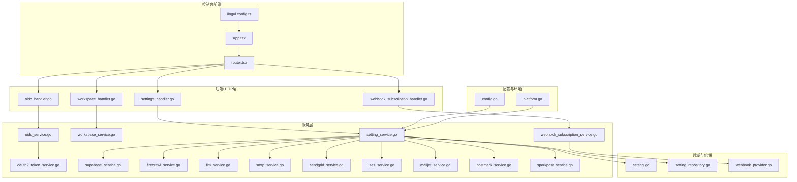
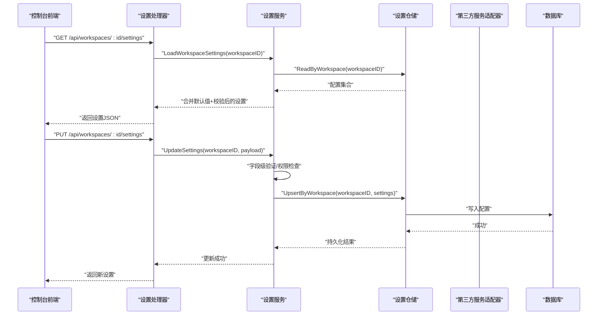
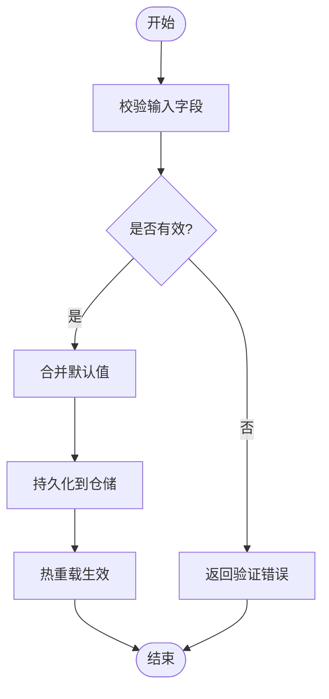
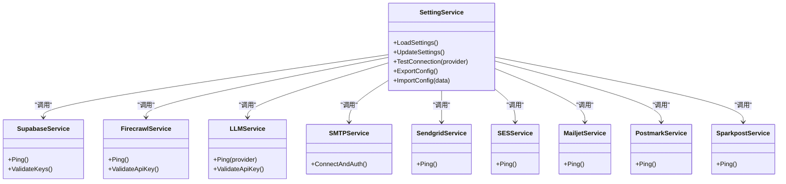
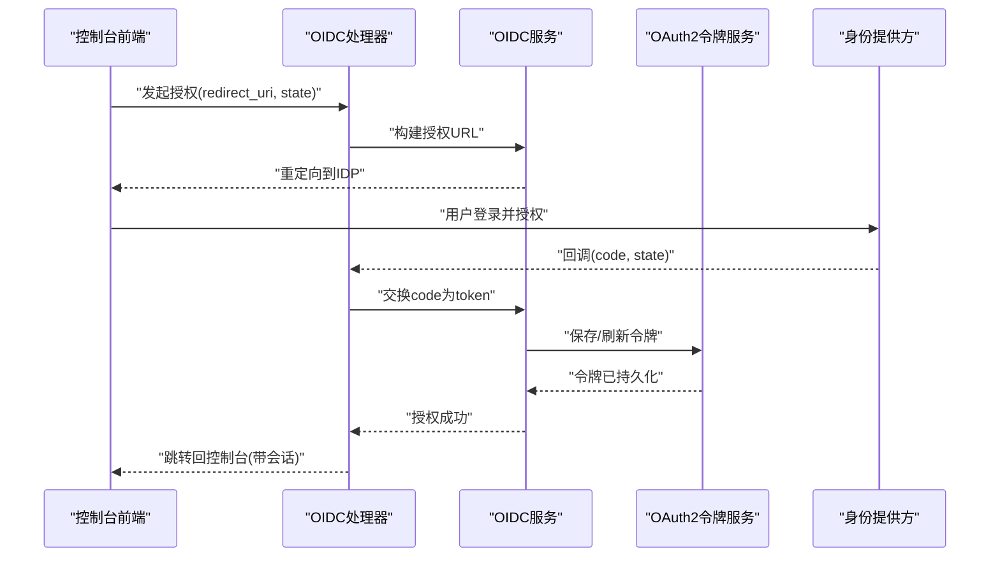
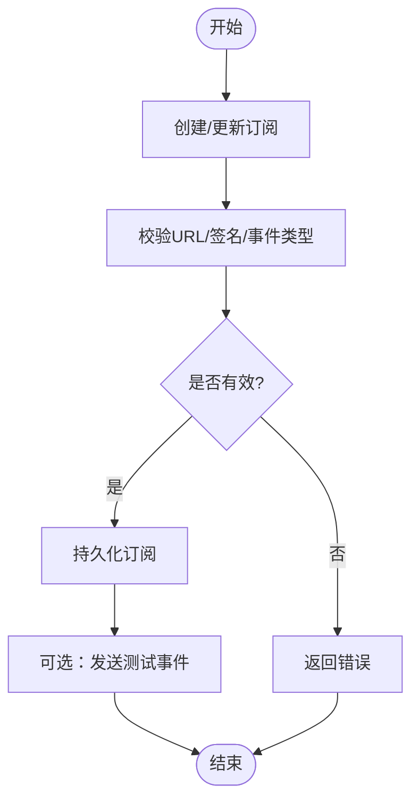
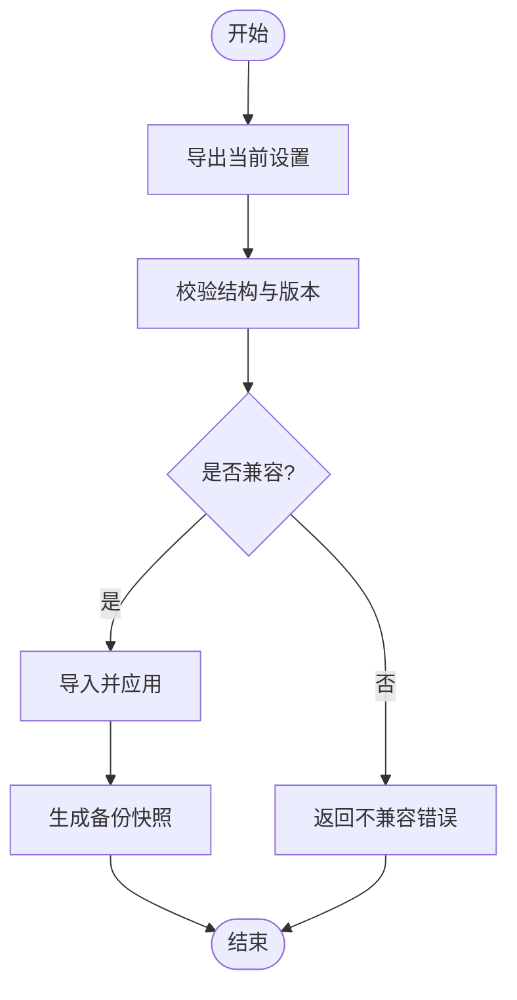
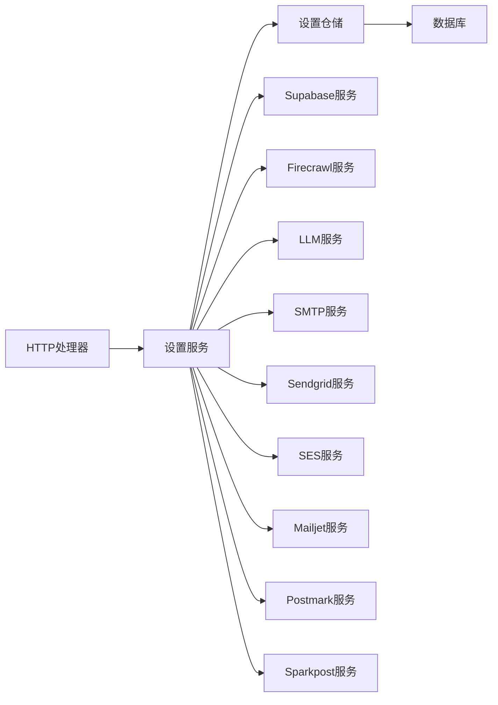

# 设置管理页面

<cite>
**本文引用的文件**   
- [settings_handler.go](file://notifuse/internal/http/settings_handler.go)
- [setting_service.go](file://notifuse/internal/service/setting_service.go)
- [setting_repository.go](file://notifuse/internal/repository/setting_repository.go)
- [setting.go](file://notifuse/internal/domain/setting.go)
- [workspace_handler.go](file://notifuse/internal/http/workspace_handler.go)
- [workspace_service.go](file://notifuse/internal/service/workspace_service.go)
- [oauth2_token_service.go](file://notifuse/internal/service/oauth2_token_service.go)
- [oidc_handler.go](file://notifuse/internal/http/oidc_handler.go)
- [oidc_service.go](file://notifuse/internal/service/oidc_service.go)
- [webhook_subscription_handler.go](file://notifuse/internal/http/webhook_subscription_handler.go)
- [webhook_subscription_service.go](file://notifuse/internal/service/webhook_subscription_service.go)
- [webhook_provider.go](file://notifuse/internal/domain/webhook_provider.go)
- [supabase_service.go](file://notifuse/internal/service/supabase_service.go)
- [firecrawl_service.go](file://notifuse/internal/service/firecrawl_service.go)
- [llm_service.go](file://notifuse/internal/service/llm_service.go)
- [smtp_service.go](file://notifuse/internal/service/smtp_service.go)
- [sendgrid_service.go](file://notifuse/internal/service/sendgrid_service.go)
- [ses_service.go](file://notifuse/internal/service/ses_service.go)
- [mailjet_service.go](file://notifuse/internal/service/mailjet_service.go)
- [postmark_service.go](file://notifuse/internal/service/postmark_service.go)
- [sparkpost_service.go](file://notifuse/internal/service/sparkpost_service.go)
- [config.go](file://notifuse/config/config.go)
- [platform.go](file://notifuse/config/platform.go)
- [router.tsx](file://notifuse/console/src/router.tsx)
- [App.tsx](file://notifuse/console/src/App.tsx)
- [lingui.config.ts](file://notifuse/console/lingui.config.ts)
</cite>

## 目录
1. [简介](#简介)
2. [项目结构](#项目结构)
3. [核心组件](#核心组件)
4. [架构总览](#架构总览)
5. [详细组件分析](#详细组件分析)
6. [依赖关系分析](#依赖关系分析)
7. [性能考虑](#性能考虑)
8. [故障排查指南](#故障排查指南)
9. [结论](#结论)
10. [附录](#附录)

## 简介
本文件面向Notifuse控制台“设置管理”页面，系统性梳理工作区设置的配置管理方案与实现。重点覆盖：
- 通用设置（GeneralSettings）
- 第三方集成（Integrations）
- Webhooks回调（WebhooksSettings）
并深入说明：
- 各设置项的验证规则、持久化存储、环境隔离与安全权限控制
- 第三方服务集成的OAuth2认证流程、API密钥管理与连接测试能力
- 设置导入导出、配置备份恢复与多语言支持
- 配置热重载、设置验证与错误处理机制

## 项目结构
控制台前端路由与应用入口位于console目录；后端HTTP处理器、领域模型、服务层与仓储层分别位于internal/http、internal/domain、internal/service、internal/repository；配置加载与环境变量解析位于config目录。

图表来源
- [router.tsx](file://notifuse/console/src/router.tsx)
- [App.tsx](file://notifuse/console/src/App.tsx)
- [settings_handler.go](file://notifuse/internal/http/settings_handler.go)
- [setting_service.go](file://notifuse/internal/service/setting_service.go)
- [setting_repository.go](file://notifuse/internal/repository/setting_repository.go)
- [setting.go](file://notifuse/internal/domain/setting.go)
- [workspace_handler.go](file://notifuse/internal/http/workspace_handler.go)
- [workspace_service.go](file://notifuse/internal/service/workspace_service.go)
- [oidc_handler.go](file://notifuse/internal/http/oidc_handler.go)
- [oidc_service.go](file://notifuse/internal/service/oidc_service.go)
- [oauth2_token_service.go](file://notifuse/internal/service/oauth2_token_service.go)
- [webhook_subscription_handler.go](file://notifuse/internal/http/webhook_subscription_handler.go)
- [webhook_subscription_service.go](file://notifuse/internal/service/webhook_subscription_service.go)
- [webhook_provider.go](file://notifuse/internal/domain/webhook_provider.go)
- [supabase_service.go](file://notifuse/internal/service/supabase_service.go)
- [firecrawl_service.go](file://notifuse/internal/service/firecrawl_service.go)
- [llm_service.go](file://notifuse/internal/service/llm_service.go)
- [smtp_service.go](file://notifuse/internal/service/smtp_service.go)
- [sendgrid_service.go](file://notifuse/internal/service/sendgrid_service.go)
- [ses_service.go](file://notifuse/internal/service/ses_service.go)
- [mailjet_service.go](file://notifuse/internal/service/mailjet_service.go)
- [postmark_service.go](file://notifuse/internal/service/postmark_service.go)
- [sparkpost_service.go](file://notifuse/internal/service/sparkpost_service.go)
- [config.go](file://notifuse/config/config.go)
- [platform.go](file://notifuse/config/platform.go)

章节来源
- [router.tsx](file://notifuse/console/src/router.tsx)
- [App.tsx](file://notifuse/console/src/App.tsx)
- [lingui.config.ts](file://notifuse/console/lingui.config.ts)

## 核心组件
- 设置处理器（HTTP层）
  - 负责接收控制台前端的设置请求，校验输入参数，调用服务层完成读取、更新、测试连接等操作，并返回统一响应。
- 设置服务（Service层）
  - 封装业务逻辑：合并默认值、执行字段级验证、按工作区隔离读写、触发第三方连接测试、处理导入导出与热重载。
- 设置仓储（Repository层）
  - 提供配置的持久化接口，按工作区维度存取键值对或结构化配置。
- 领域模型（Domain）
  - 定义设置项的结构、枚举与约束，如通用设置、集成类型、Webhook订阅等。
- 工作区服务
  - 与工作区上下文绑定，确保所有设置操作在正确的租户边界内执行。
- OAuth2/OIDC与令牌服务
  - 负责第三方平台授权码流转、令牌获取与刷新、安全存储与访问。
- Webhook订阅服务
  - 管理事件订阅、签名校验、重试策略与投递状态。
- 第三方服务适配器
  - Supabase、Firecrawl、LLM提供商、SMTP及各类邮件发送服务的连接测试与基础能力校验。

章节来源
- [settings_handler.go](file://notifuse/internal/http/settings_handler.go)
- [setting_service.go](file://notifuse/internal/service/setting_service.go)
- [setting_repository.go](file://notifuse/internal/repository/setting_repository.go)
- [setting.go](file://notifuse/internal/domain/setting.go)
- [workspace_service.go](file://notifuse/internal/service/workspace_service.go)
- [oauth2_token_service.go](file://notifuse/internal/service/oauth2_token_service.go)
- [oidc_service.go](file://notifuse/internal/service/oidc_service.go)
- [webhook_subscription_service.go](file://notifuse/internal/service/webhook_subscription_service.go)
- [webhook_provider.go](file://notifuse/internal/domain/webhook_provider.go)
- [supabase_service.go](file://notifuse/internal/service/supabase_service.go)
- [firecrawl_service.go](file://notifuse/internal/service/firecrawl_service.go)
- [llm_service.go](file://notifuse/internal/service/llm_service.go)
- [smtp_service.go](file://notifuse/internal/service/smtp_service.go)
- [sendgrid_service.go](file://notifuse/internal/service/sendgrid_service.go)
- [ses_service.go](file://notifuse/internal/service/ses_service.go)
- [mailjet_service.go](file://notifuse/internal/service/mailjet_service.go)
- [postmark_service.go](file://notifuse/internal/service/postmark_service.go)
- [sparkpost_service.go](file://notifuse/internal/service/sparkpost_service.go)

## 架构总览
设置管理采用分层架构：前端通过路由进入设置页，调用后端HTTP处理器；处理器委托服务层执行业务逻辑；服务层根据设置类型选择对应仓储或第三方服务进行持久化或连通性测试；所有操作受工作区上下文与权限控制约束。

图表来源
- [settings_handler.go](file://notifuse/internal/http/settings_handler.go)
- [setting_service.go](file://notifuse/internal/service/setting_service.go)
- [setting_repository.go](file://notifuse/internal/repository/setting_repository.go)
- [setting.go](file://notifuse/internal/domain/setting.go)

## 详细组件分析

### 通用设置（GeneralSettings）
- 职责
  - 管理工作区名称、时区、语言、主题、通知偏好等基础运行参数。
- 验证规则
  - 必填字段非空校验、格式校验（如邮箱、URL）、范围校验（数值区间）、枚举值白名单。
- 持久化
  - 以工作区为键空间，增量更新或全量替换，避免并发冲突。
- 环境隔离
  - 所有读取/写入均携带工作区ID，禁止跨区访问。
- 权限控制
  - 仅允许具备管理员或设置编辑权限的用户修改。
- 热重载
  - 更新后刷新内存缓存，使运行时生效，无需重启。
- 多语言
  - 结合控制台i18n资源，动态切换界面文案。

图表来源
- [setting_service.go](file://notifuse/internal/service/setting_service.go)
- [setting_repository.go](file://notifuse/internal/repository/setting_repository.go)
- [setting.go](file://notifuse/internal/domain/setting.go)

章节来源
- [setting_service.go](file://notifuse/internal/service/setting_service.go)
- [setting_repository.go](file://notifuse/internal/repository/setting_repository.go)
- [setting.go](file://notifuse/internal/domain/setting.go)

### 第三方集成（Integrations）
- 覆盖范围
  - Supabase、Firecrawl、LLM提供商（OpenAI/Gemini/Anthropic等）、SMTP与邮件发送服务（SendGrid、SES、Mailjet、Postmark、Sparkpost）。
- 配置项
  - API密钥、端点地址、区域/项目标识、可选高级参数。
- 连接测试
  - 针对每个集成提供“测试连接”能力，快速验证凭据与网络可达性。
- 安全与权限
  - 敏感字段加密存储；最小权限原则；审计日志记录变更。
- 导入导出
  - 支持将当前工作区的集成配置导出为可迁移文件；导入时进行版本兼容与冲突处理。

图表来源
- [setting_service.go](file://notifuse/internal/service/setting_service.go)
- [supabase_service.go](file://notifuse/internal/service/supabase_service.go)
- [firecrawl_service.go](file://notifuse/internal/service/firecrawl_service.go)
- [llm_service.go](file://notifuse/internal/service/llm_service.go)
- [smtp_service.go](file://notifuse/internal/service/smtp_service.go)
- [sendgrid_service.go](file://notifuse/internal/service/sendgrid_service.go)
- [ses_service.go](file://notifuse/internal/service/ses_service.go)
- [mailjet_service.go](file://notifuse/internal/service/mailjet_service.go)
- [postmark_service.go](file://notifuse/internal/service/postmark_service.go)
- [sparkpost_service.go](file://notifuse/internal/service/sparkpost_service.go)

章节来源
- [setting_service.go](file://notifuse/internal/service/setting_service.go)
- [supabase_service.go](file://notifuse/internal/service/supabase_service.go)
- [firecrawl_service.go](file://notifuse/internal/service/firecrawl_service.go)
- [llm_service.go](file://notifuse/internal/service/llm_service.go)
- [smtp_service.go](file://notifuse/internal/service/smtp_service.go)
- [sendgrid_service.go](file://notifuse/internal/service/sendgrid_service.go)
- [ses_service.go](file://notifuse/internal/service/ses_service.go)
- [mailjet_service.go](file://notifuse/internal/service/mailjet_service.go)
- [postmark_service.go](file://notifuse/internal/service/postmark_service.go)
- [sparkpost_service.go](file://notifuse/internal/service/sparkpost_service.go)

### OAuth2/OIDC集成与令牌管理
- 流程要点
  - 前端发起授权请求至后端OIDC处理器；后端使用OIDC服务与提供方交互；令牌获取与刷新由OAuth2令牌服务统一管理；最终将令牌安全存储并在工作区上下文中可用。
- 安全要求
  - 使用HTTPS；严格校验state与nonce；令牌最小生命周期；失败重试与幂等保护。
- 错误处理
  - 区分网络错误、授权拒绝、令牌过期等场景，返回明确错误码与提示。

图表来源
- [oidc_handler.go](file://notifuse/internal/http/oidc_handler.go)
- [oidc_service.go](file://notifuse/internal/service/oidc_service.go)
- [oauth2_token_service.go](file://notifuse/internal/service/oauth2_token_service.go)

章节来源
- [oidc_handler.go](file://notifuse/internal/http/oidc_handler.go)
- [oidc_service.go](file://notifuse/internal/service/oidc_service.go)
- [oauth2_token_service.go](file://notifuse/internal/service/oauth2_token_service.go)

### Webhooks回调（WebhooksSettings）
- 功能范围
  - 创建/更新/删除事件订阅；配置目标URL、签名算法、重试策略；查看投递历史与状态。
- 验证规则
  - URL合法性、域名白名单（可选）、签名密钥强度、事件类型白名单。
- 安全与权限
  - 仅工作区成员可见；管理员可修改；传输TLS；服务端校验签名。
- 可靠性
  - 指数退避重试；死信队列；失败告警。

图表来源
- [webhook_subscription_handler.go](file://notifuse/internal/http/webhook_subscription_handler.go)
- [webhook_subscription_service.go](file://notifuse/internal/service/webhook_subscription_service.go)
- [webhook_provider.go](file://notifuse/internal/domain/webhook_provider.go)

章节来源
- [webhook_subscription_handler.go](file://notifuse/internal/http/webhook_subscription_handler.go)
- [webhook_subscription_service.go](file://notifuse/internal/service/webhook_subscription_service.go)
- [webhook_provider.go](file://notifuse/internal/domain/webhook_provider.go)

### 设置导入导出与备份恢复
- 导出
  - 将当前工作区设置打包为结构化数据，包含通用设置、集成配置、Webhook订阅等。
- 导入
  - 校验版本兼容性；处理字段缺失与新增；冲突策略（覆盖/跳过/合并）。
- 备份恢复
  - 支持定时快照与手动恢复；保留历史版本以便回滚。

图表来源
- [setting_service.go](file://notifuse/internal/service/setting_service.go)
- [setting_repository.go](file://notifuse/internal/repository/setting_repository.go)

章节来源
- [setting_service.go](file://notifuse/internal/service/setting_service.go)
- [setting_repository.go](file://notifuse/internal/repository/setting_repository.go)

### 多语言支持
- 前端国际化
  - 基于控制台i18n配置，动态加载翻译资源，支持运行时切换语言。
- 后端影响
  - 设置中可记录用户语言偏好，用于后续渲染与消息模板。

章节来源
- [lingui.config.ts](file://notifuse/console/lingui.config.ts)

## 依赖关系分析
- 组件耦合
  - 设置服务作为编排中心，聚合多个第三方服务适配器；仓储层解耦具体存储实现。
- 外部依赖
  - 第三方服务（Supabase、邮件服务商、LLM提供商、OIDC提供方）；数据库；缓存（用于热重载）。
- 潜在循环依赖
  - 服务层不应反向依赖HTTP层；仓储层只暴露数据接口，避免引入业务逻辑。

图表来源
- [settings_handler.go](file://notifuse/internal/http/settings_handler.go)
- [setting_service.go](file://notifuse/internal/service/setting_service.go)
- [setting_repository.go](file://notifuse/internal/repository/setting_repository.go)
- [supabase_service.go](file://notifuse/internal/service/supabase_service.go)
- [firecrawl_service.go](file://notifuse/internal/service/firecrawl_service.go)
- [llm_service.go](file://notifuse/internal/service/llm_service.go)
- [smtp_service.go](file://notifuse/internal/service/smtp_service.go)
- [sendgrid_service.go](file://notifuse/internal/service/sendgrid_service.go)
- [ses_service.go](file://notifuse/internal/service/ses_service.go)
- [mailjet_service.go](file://notifuse/internal/service/mailjet_service.go)
- [postmark_service.go](file://notifuse/internal/service/postmark_service.go)
- [sparkpost_service.go](file://notifuse/internal/service/sparkpost_service.go)

章节来源
- [settings_handler.go](file://notifuse/internal/http/settings_handler.go)
- [setting_service.go](file://notifuse/internal/service/setting_service.go)
- [setting_repository.go](file://notifuse/internal/repository/setting_repository.go)

## 性能考虑
- 缓存与热重载
  - 常用设置读路径走内存缓存，写路径更新缓存并落库，减少数据库压力。
- 批量操作
  - 导入导出采用流式处理，避免一次性加载过大配置。
- 连接测试
  - 异步执行并限制并发，防止阻塞主线程；超时与重试策略合理配置。
- 数据库索引
  - 对工作区ID与设置键建立索引，提升查询效率。

[本节为通用指导，不涉及具体文件分析]

## 故障排查指南
- 常见错误
  - 验证失败：检查字段格式、必填项、枚举值。
  - 权限不足：确认用户角色与工作区成员关系。
  - 第三方连接失败：核对API密钥、网络可达性与证书。
  - 令牌过期：检查OIDC配置与令牌刷新逻辑。
- 定位方法
  - 查看处理器与服务层日志；检查仓储层SQL执行；追踪第三方服务返回码。
- 恢复建议
  - 使用导入导出功能回滚到上一稳定版本；必要时从备份快照恢复。

章节来源
- [settings_handler.go](file://notifuse/internal/http/settings_handler.go)
- [setting_service.go](file://notifuse/internal/service/setting_service.go)
- [setting_repository.go](file://notifuse/internal/repository/setting_repository.go)

## 结论
设置管理页面通过清晰的分层设计与严格的验证、权限与隔离策略，提供了稳定可靠的配置管理能力。借助OAuth2/OIDC与第三方服务适配器的连接测试，运维与开发者可以快速完成集成与排障。导入导出与备份恢复增强了系统的可移植性与容灾能力。多语言支持与热重载提升了用户体验与系统可用性。

[本节为总结性内容，不涉及具体文件分析]

## 附录
- 环境变量与平台配置
  - 全局配置与环境变量解析位于config目录，平台相关设置由platform模块提供。
- 工作区上下文
  - 工作区处理器与服务确保所有设置操作在正确的工作区边界内执行。

章节来源
- [config.go](file://notifuse/config/config.go)
- [platform.go](file://notifuse/config/platform.go)
- [workspace_handler.go](file://notifuse/internal/http/workspace_handler.go)
- [workspace_service.go](file://notifuse/internal/service/workspace_service.go)