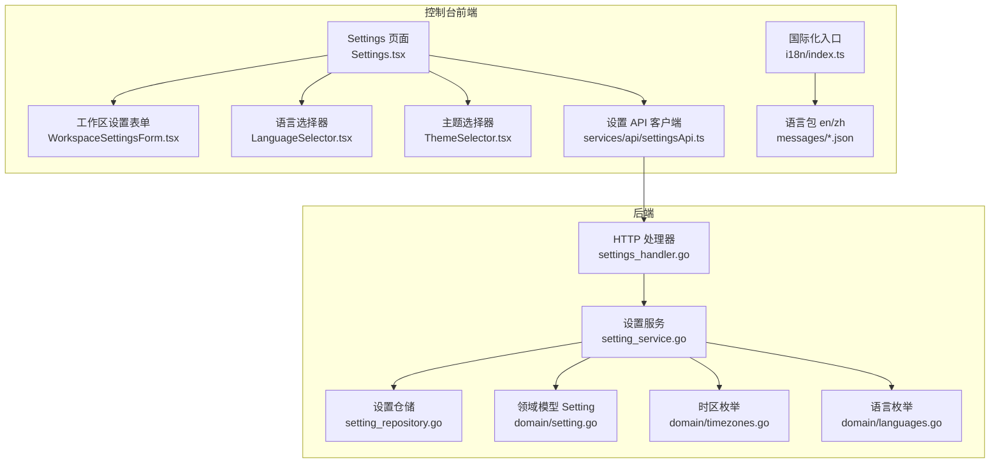
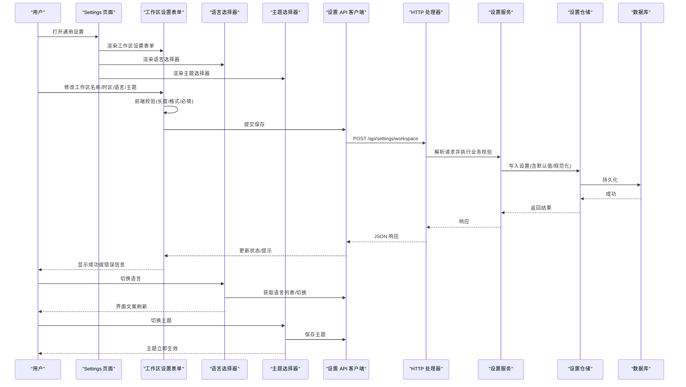
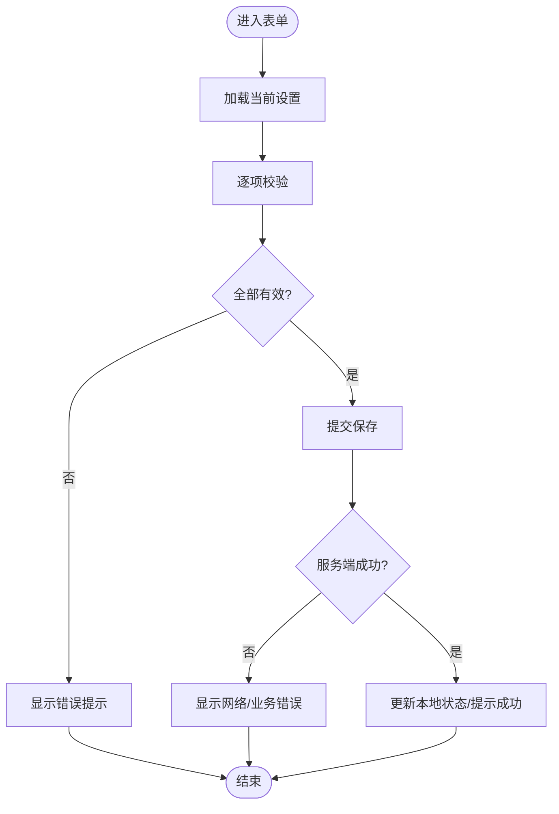
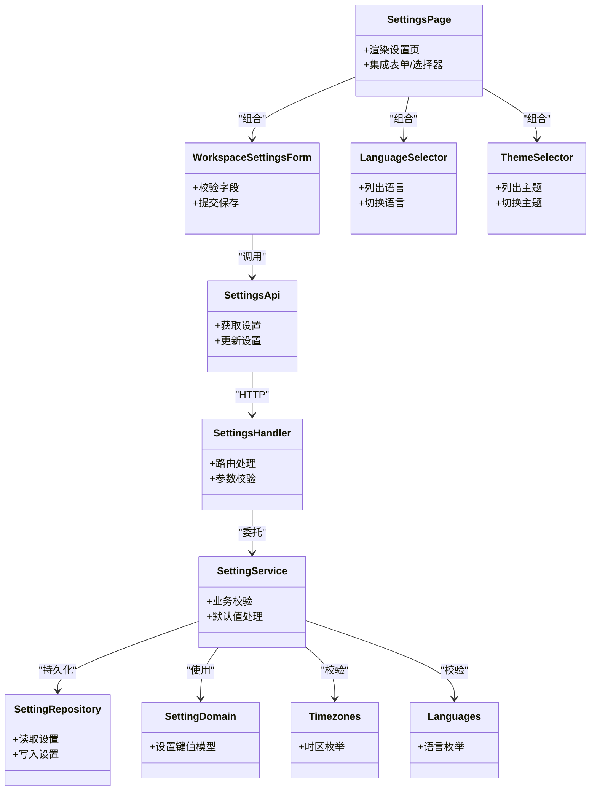

# 通用设置

<cite>
**本文引用的文件**   
- [console/src/pages/Settings.tsx](file://notifuse/console/src/pages/Settings.tsx)
- [console/src/components/settings/WorkspaceSettingsForm.tsx](file://notifuse/console/src/components/settings/WorkspaceSettingsForm.tsx)
- [console/src/components/settings/LanguageSelector.tsx](file://notifuse/console/src/components/settings/LanguageSelector.tsx)
- [console/src/components/settings/ThemeSelector.tsx](file://notifuse/console/src/components/settings/ThemeSelector.tsx)
- [console/src/i18n/index.ts](file://notifuse/console/src/i18n/index.ts)
- [console/src/i18n/messages/en.json](file://notifuse/console/src/i18n/messages/en.json)
- [console/src/i18n/messages/zh.json](file://notifuse/console/src/i18n/messages/zh.json)
- [console/src/services/api/settingsApi.ts](file://notifuse/console/src/services/api/settingsApi.ts)
- [internal/domain/setting.go](file://notifuse/internal/domain/setting.go)
- [internal/service/setting_service.go](file://notifuse/internal/service/setting_service.go)
- [internal/repository/setting_repository.go](file://notifuse/internal/repository/setting_repository.go)
- [internal/http/settings_handler.go](file://notifuse/internal/http/settings_handler.go)
- [internal/domain/timezones.go](file://notifuse/internal/domain/timezones.go)
- [internal/domain/languages.go](file://notifuse/internal/domain/languages.go)
</cite>

## 目录
1. [简介](#简介)
2. [项目结构](#项目结构)
3. [核心组件](#核心组件)
4. [架构总览](#架构总览)
5. [详细组件分析](#详细组件分析)
6. [依赖关系分析](#依赖关系分析)
7. [性能考虑](#性能考虑)
8. [故障排查指南](#故障排查指南)
9. [结论](#结论)
10. [附录](#附录)

## 简介
本文件面向 Notifuse 控制台“通用设置”模块，聚焦工作区基础配置管理，包括工作区名称、时区、语言偏好与主题等核心参数。文档将系统阐述：
- 各配置项的数据验证规则、默认值处理与本地存储机制
- 多语言支持（i18n）的实现方式：语言包加载、动态切换与国际化文本渲染
- 配置热重载、设置变更监听与表单验证反馈
- 配置的导入导出、批量设置与重置功能实现方案

## 项目结构
通用设置模块由前端控制台页面、设置表单组件、国际化资源、API 服务以及后端领域模型、服务层、仓储层与 HTTP 处理器共同组成。整体采用前后端分离的架构，前端通过 REST API 与后端交互，后端以领域驱动设计组织代码。

图表来源
- [console/src/pages/Settings.tsx](file://notifuse/console/src/pages/Settings.tsx)
- [console/src/components/settings/WorkspaceSettingsForm.tsx](file://notifuse/console/src/components/settings/WorkspaceSettingsForm.tsx)
- [console/src/components/settings/LanguageSelector.tsx](file://notifuse/console/src/components/settings/LanguageSelector.tsx)
- [console/src/components/settings/ThemeSelector.tsx](file://notifuse/console/src/components/settings/ThemeSelector.tsx)
- [console/src/i18n/index.ts](file://notifuse/console/src/i18n/index.ts)
- [console/src/i18n/messages/en.json](file://notifuse/console/src/i18n/messages/en.json)
- [console/src/i18n/messages/zh.json](file://notifuse/console/src/i18n/messages/zh.json)
- [console/src/services/api/settingsApi.ts](file://notifuse/console/src/services/api/settingsApi.ts)
- [internal/http/settings_handler.go](file://notifuse/internal/http/settings_handler.go)
- [internal/service/setting_service.go](file://notifuse/internal/service/setting_service.go)
- [internal/repository/setting_repository.go](file://notifuse/internal/repository/setting_repository.go)
- [internal/domain/setting.go](file://notifuse/internal/domain/setting.go)
- [internal/domain/timezones.go](file://notifuse/internal/domain/timezones.go)
- [internal/domain/languages.go](file://notifuse/internal/domain/languages.go)

章节来源
- [console/src/pages/Settings.tsx](file://notifuse/console/src/pages/Settings.tsx)
- [console/src/components/settings/WorkspaceSettingsForm.tsx](file://notifuse/console/src/components/settings/WorkspaceSettingsForm.tsx)
- [console/src/components/settings/LanguageSelector.tsx](file://notifuse/console/src/components/settings/LanguageSelector.tsx)
- [console/src/components/settings/ThemeSelector.tsx](file://notifuse/console/src/components/settings/ThemeSelector.tsx)
- [console/src/i18n/index.ts](file://notifuse/console/src/i18n/index.ts)
- [console/src/i18n/messages/en.json](file://notifuse/console/src/i18n/messages/en.json)
- [console/src/i18n/messages/zh.json](file://notifuse/console/src/i18n/messages/zh.json)
- [console/src/services/api/settingsApi.ts](file://notifuse/console/src/services/api/settingsApi.ts)
- [internal/http/settings_handler.go](file://notifuse/internal/http/settings_handler.go)
- [internal/service/setting_service.go](file://notifuse/internal/service/setting_service.go)
- [internal/repository/setting_repository.go](file://notifuse/internal/repository/setting_repository.go)
- [internal/domain/setting.go](file://notifuse/internal/domain/setting.go)
- [internal/domain/timezones.go](file://notifuse/internal/domain/timezones.go)
- [internal/domain/languages.go](file://notifuse/internal/domain/languages.go)

## 核心组件
- 工作区设置表单：负责收集并校验工作区名称、时区、语言偏好、主题等字段，提供即时反馈与保存流程。
- 语言选择器：封装语言列表展示与切换逻辑，联动 i18n 上下文完成界面文案刷新。
- 主题选择器：封装主题枚举与持久化策略，支持暗色/亮色或品牌主题切换。
- 设置 API 客户端：统一封装获取/更新设置的请求与错误处理。
- 后端设置服务与仓储：承载业务校验、默认值填充、数据持久化与缓存策略。
- 领域模型与枚举：定义支持的时区集合、语言集合及设置键值规范。

章节来源
- [console/src/components/settings/WorkspaceSettingsForm.tsx](file://notifuse/console/src/components/settings/WorkspaceSettingsForm.tsx)
- [console/src/components/settings/LanguageSelector.tsx](file://notifuse/console/src/components/settings/LanguageSelector.tsx)
- [console/src/components/settings/ThemeSelector.tsx](file://notifuse/console/src/components/settings/ThemeSelector.tsx)
- [console/src/services/api/settingsApi.ts](file://notifuse/console/src/services/api/settingsApi.ts)
- [internal/service/setting_service.go](file://notifuse/internal/service/setting_service.go)
- [internal/repository/setting_repository.go](file://notifuse/internal/repository/setting_repository.go)
- [internal/domain/setting.go](file://notifuse/internal/domain/setting.go)
- [internal/domain/timezones.go](file://notifuse/internal/domain/timezones.go)
- [internal/domain/languages.go](file://notifuse/internal/domain/languages.go)

## 架构总览
通用设置从 UI 到持久化的调用链如下：

图表来源
- [console/src/pages/Settings.tsx](file://notifuse/console/src/pages/Settings.tsx)
- [console/src/components/settings/WorkspaceSettingsForm.tsx](file://notifuse/console/src/components/settings/WorkspaceSettingsForm.tsx)
- [console/src/components/settings/LanguageSelector.tsx](file://notifuse/console/src/components/settings/LanguageSelector.tsx)
- [console/src/components/settings/ThemeSelector.tsx](file://notifuse/console/src/components/settings/ThemeSelector.tsx)
- [console/src/services/api/settingsApi.ts](file://notifuse/console/src/services/api/settingsApi.ts)
- [internal/http/settings_handler.go](file://notifuse/internal/http/settings_handler.go)
- [internal/service/setting_service.go](file://notifuse/internal/service/setting_service.go)
- [internal/repository/setting_repository.go](file://notifuse/internal/repository/setting_repository.go)

## 详细组件分析

### 工作区设置表单（WorkspaceSettingsForm）
职责
- 渲染工作区名称、时区、语言偏好、主题等输入控件
- 执行前端校验（非空、长度、格式）
- 触发保存流程，处理成功/失败反馈
- 维护本地草稿与自动保存开关（可选）

关键行为
- 工作区名称：限制最大长度，去除首尾空白；为空时提示必填
- 时区：仅允许来自后端枚举的有效值；未选择时使用默认时区
- 语言偏好：仅允许已注册的语言码；切换后触发界面重渲染
- 主题：仅允许受支持的主题值；切换后立即应用

图表来源
- [console/src/components/settings/WorkspaceSettingsForm.tsx](file://notifuse/console/src/components/settings/WorkspaceSettingsForm.tsx)
- [console/src/services/api/settingsApi.ts](file://notifuse/console/src/services/api/settingsApi.ts)
- [internal/http/settings_handler.go](file://notifuse/internal/http/settings_handler.go)
- [internal/service/setting_service.go](file://notifuse/internal/service/setting_service.go)
- [internal/repository/setting_repository.go](file://notifuse/internal/repository/setting_repository.go)

章节来源
- [console/src/components/settings/WorkspaceSettingsForm.tsx](file://notifuse/console/src/components/settings/WorkspaceSettingsForm.tsx)
- [console/src/services/api/settingsApi.ts](file://notifuse/console/src/services/api/settingsApi.ts)
- [internal/http/settings_handler.go](file://notifuse/internal/http/settings_handler.go)
- [internal/service/setting_service.go](file://notifuse/internal/service/setting_service.go)
- [internal/repository/setting_repository.go](file://notifuse/internal/repository/setting_repository.go)

### 语言选择器（LanguageSelector）
职责
- 展示可用语言列表
- 触发语言切换，更新 i18n 上下文
- 保持语言偏好至本地存储与服务端

实现要点
- 语言列表来源于后端枚举或静态清单
- 切换成功后刷新界面文案
- 支持回退到默认语言

章节来源
- [console/src/components/settings/LanguageSelector.tsx](file://notifuse/console/src/components/settings/LanguageSelector.tsx)
- [console/src/i18n/index.ts](file://notifuse/console/src/i18n/index.ts)
- [console/src/i18n/messages/en.json](file://notifuse/console/src/i18n/messages/en.json)
- [console/src/i18n/messages/zh.json](file://notifuse/console/src/i18n/messages/zh.json)
- [internal/domain/languages.go](file://notifuse/internal/domain/languages.go)

### 主题选择器（ThemeSelector）
职责
- 展示可用主题选项
- 切换主题并持久化
- 实时应用主题样式

实现要点
- 主题值需在后端白名单中
- 切换后同步至本地存储与服务端
- 支持跟随系统主题（可选）

章节来源
- [console/src/components/settings/ThemeSelector.tsx](file://notifuse/console/src/components/settings/ThemeSelector.tsx)
- [console/src/services/api/settingsApi.ts](file://notifuse/console/src/services/api/settingsApi.ts)

### 国际化（i18n）
职责
- 管理语言包加载与切换
- 提供翻译函数与占位符插值
- 在路由/布局级别确保全局生效

实现要点
- 语言包按模块拆分，按需加载
- 切换语言时触发全局重渲染
- 缺失翻译键时回退到默认语言

章节来源
- [console/src/i18n/index.ts](file://notifuse/console/src/i18n/index.ts)
- [console/src/i18n/messages/en.json](file://notifuse/console/src/i18n/messages/en.json)
- [console/src/i18n/messages/zh.json](file://notifuse/console/src/i18n/messages/zh.json)

### 设置 API 客户端（settingsApi）
职责
- 封装获取/更新工作区设置的接口
- 统一错误处理与重试策略（可选）
- 提供类型安全的请求/响应结构

章节来源
- [console/src/services/api/settingsApi.ts](file://notifuse/console/src/services/api/settingsApi.ts)
- [internal/http/settings_handler.go](file://notifuse/internal/http/settings_handler.go)

### 后端设置服务与仓储（Setting Service & Repository）
职责
- 服务层：业务校验、默认值填充、规范化、事件通知
- 仓储层：读写设置键值对，支持事务与并发安全

数据结构与复杂度
- 设置键值模型：O(1) 查找/更新（基于索引键）
- 批量更新：按键集合进行批量写入，时间复杂度 O(n)

章节来源
- [internal/service/setting_service.go](file://notifuse/internal/service/setting_service.go)
- [internal/repository/setting_repository.go](file://notifuse/internal/repository/setting_repository.go)
- [internal/domain/setting.go](file://notifuse/internal/domain/setting.go)

### 领域枚举（时区与语言）
职责
- 定义系统支持的时区与语言集合
- 为前端下拉框与后端校验提供权威来源

章节来源
- [internal/domain/timezones.go](file://notifuse/internal/domain/timezones.go)
- [internal/domain/languages.go](file://notifuse/internal/domain/languages.go)

## 依赖关系分析
通用设置模块的前后端依赖关系如下：

图表来源
- [console/src/pages/Settings.tsx](file://notifuse/console/src/pages/Settings.tsx)
- [console/src/components/settings/WorkspaceSettingsForm.tsx](file://notifuse/console/src/components/settings/WorkspaceSettingsForm.tsx)
- [console/src/components/settings/LanguageSelector.tsx](file://notifuse/console/src/components/settings/LanguageSelector.tsx)
- [console/src/components/settings/ThemeSelector.tsx](file://notifuse/console/src/components/settings/ThemeSelector.tsx)
- [console/src/services/api/settingsApi.ts](file://notifuse/console/src/services/api/settingsApi.ts)
- [internal/http/settings_handler.go](file://notifuse/internal/http/settings_handler.go)
- [internal/service/setting_service.go](file://notifuse/internal/service/setting_service.go)
- [internal/repository/setting_repository.go](file://notifuse/internal/repository/setting_repository.go)
- [internal/domain/setting.go](file://notifuse/internal/domain/setting.go)
- [internal/domain/timezones.go](file://notifuse/internal/domain/timezones.go)
- [internal/domain/languages.go](file://notifuse/internal/domain/languages.go)

章节来源
- [console/src/pages/Settings.tsx](file://notifuse/console/src/pages/Settings.tsx)
- [console/src/components/settings/WorkspaceSettingsForm.tsx](file://notifuse/console/src/components/settings/WorkspaceSettingsForm.tsx)
- [console/src/components/settings/LanguageSelector.tsx](file://notifuse/console/src/components/settings/LanguageSelector.tsx)
- [console/src/components/settings/ThemeSelector.tsx](file://notifuse/console/src/components/settings/ThemeSelector.tsx)
- [console/src/services/api/settingsApi.ts](file://notifuse/console/src/services/api/settingsApi.ts)
- [internal/http/settings_handler.go](file://notifuse/internal/http/settings_handler.go)
- [internal/service/setting_service.go](file://notifuse/internal/service/setting_service.go)
- [internal/repository/setting_repository.go](file://notifuse/internal/repository/setting_repository.go)
- [internal/domain/setting.go](file://notifuse/internal/domain/setting.go)
- [internal/domain/timezones.go](file://notifuse/internal/domain/timezones.go)
- [internal/domain/languages.go](file://notifuse/internal/domain/languages.go)

## 性能考虑
- 前端
  - 语言包按需加载，避免首屏过大
  - 主题切换尽量使用 CSS 变量，减少重排
  - 表单防抖保存，降低频繁请求
- 后端
  - 设置读写走键值索引，避免全表扫描
  - 批量更新合并写操作，减少锁竞争
  - 热点设置可加入内存缓存，注意失效策略

[本节为通用指导，不直接分析具体文件]

## 故障排查指南
常见问题与定位步骤
- 保存失败
  - 检查前端校验是否通过
  - 查看 API 响应码与错误消息
  - 确认后端服务日志与数据库连接
- 语言切换无效
  - 确认语言包是否加载成功
  - 检查 i18n 上下文是否刷新
  - 核对语言码是否在支持列表中
- 主题未生效
  - 检查主题值是否合法
  - 确认样式注入顺序与优先级
  - 查看浏览器控制台是否有样式冲突

章节来源
- [console/src/services/api/settingsApi.ts](file://notifuse/console/src/services/api/settingsApi.ts)
- [internal/http/settings_handler.go](file://notifuse/internal/http/settings_handler.go)
- [internal/service/setting_service.go](file://notifuse/internal/service/setting_service.go)

## 结论
通用设置模块围绕工作区基础配置提供了完整的前后端能力：清晰的表单校验与反馈、稳定的多语言与主题切换、可靠的持久化与默认值处理。通过模块化设计与明确的依赖边界，系统具备良好的可维护性与扩展性。后续可在导入导出、批量设置与热重载方面进一步增强用户体验与运维效率。

[本节为总结性内容，不直接分析具体文件]

## 附录

### 配置项说明与验证规则
- 工作区名称
  - 必填，最大长度限制，去除首尾空白
  - 默认值：首次创建时自动生成
- 时区
  - 仅允许后端枚举中的有效值
  - 默认值：系统默认时区
- 语言偏好
  - 仅允许已注册语言码
  - 默认值：根据浏览器语言或站点默认
- 主题
  - 仅允许受支持主题值
  - 默认值：跟随系统或站点默认

章节来源
- [internal/domain/timezones.go](file://notifuse/internal/domain/timezones.go)
- [internal/domain/languages.go](file://notifuse/internal/domain/languages.go)
- [internal/domain/setting.go](file://notifuse/internal/domain/setting.go)

### 本地存储机制
- 前端
  - 使用浏览器本地存储缓存草稿与临时状态
  - 切换语言/主题后同步至服务端
- 后端
  - 设置持久化至数据库，键值索引访问
  - 提供一致性保障与并发控制

章节来源
- [console/src/services/api/settingsApi.ts](file://notifuse/console/src/services/api/settingsApi.ts)
- [internal/repository/setting_repository.go](file://notifuse/internal/repository/setting_repository.go)

### 多语言支持实现
- 语言包加载：按模块拆分，按需引入
- 动态切换：更新 i18n 上下文，触发界面重渲染
- 国际化文本渲染：使用翻译函数与占位符插值

章节来源
- [console/src/i18n/index.ts](file://notifuse/console/src/i18n/index.ts)
- [console/src/i18n/messages/en.json](file://notifuse/console/src/i18n/messages/en.json)
- [console/src/i18n/messages/zh.json](file://notifuse/console/src/i18n/messages/zh.json)

### 配置热重载与变更监听
- 前端
  - 监听设置变更事件，局部刷新相关区域
  - 主题切换即时生效，无需刷新页面
- 后端
  - 设置变更后触发缓存失效或广播通知（可选）

章节来源
- [console/src/components/settings/ThemeSelector.tsx](file://notifuse/console/src/components/settings/ThemeSelector.tsx)
- [console/src/components/settings/LanguageSelector.tsx](file://notifuse/console/src/components/settings/LanguageSelector.tsx)
- [internal/service/setting_service.go](file://notifuse/internal/service/setting_service.go)

### 表单验证反馈
- 即时校验：失焦或输入时触发
- 错误提示：字段级与全局提示并存
- 成功反馈：保存成功后给出明确提示

章节来源
- [console/src/components/settings/WorkspaceSettingsForm.tsx](file://notifuse/console/src/components/settings/WorkspaceSettingsForm.tsx)

### 导入导出、批量设置与重置
- 导入导出
  - 导出：打包当前工作区设置为结构化文件
  - 导入：校验并合并导入的配置，冲突策略可配置
- 批量设置
  - 支持一次性更新多个键值，减少往返次数
- 重置
  - 恢复至默认值或指定快照版本

章节来源
- [console/src/services/api/settingsApi.ts](file://notifuse/console/src/services/api/settingsApi.ts)
- [internal/service/setting_service.go](file://notifuse/internal/service/setting_service.go)
- [internal/repository/setting_repository.go](file://notifuse/internal/repository/setting_repository.go)