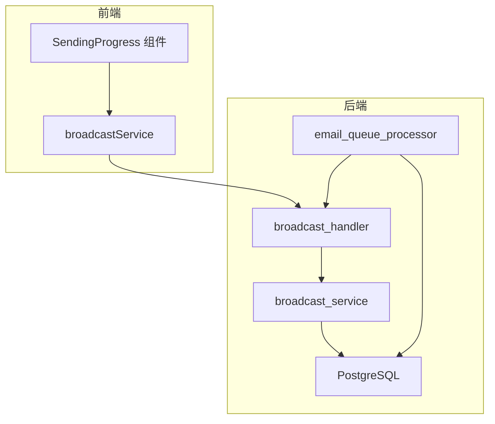
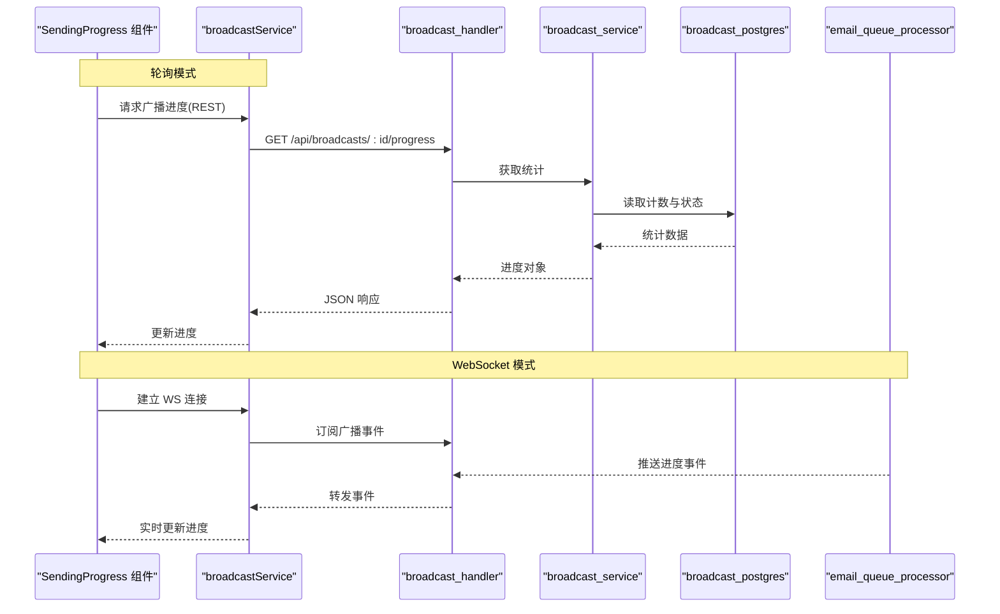
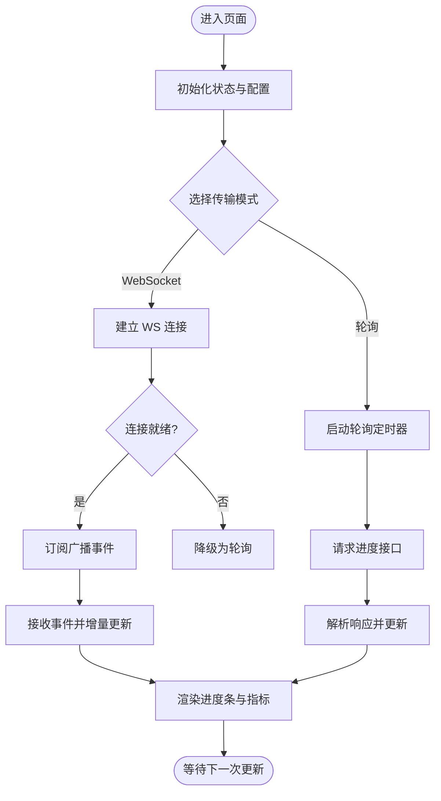
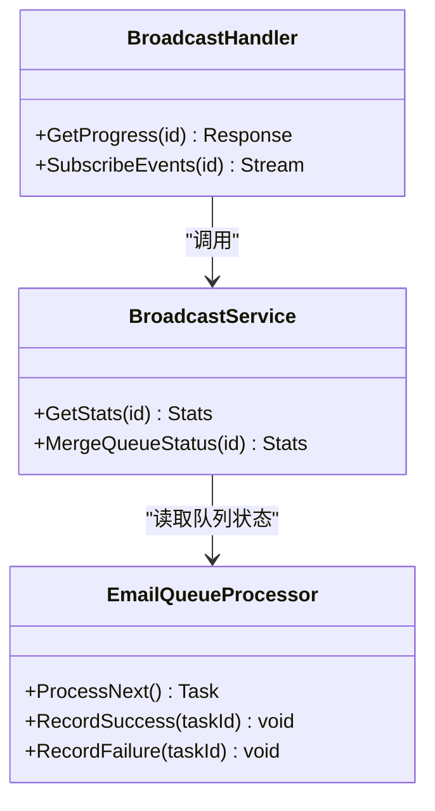
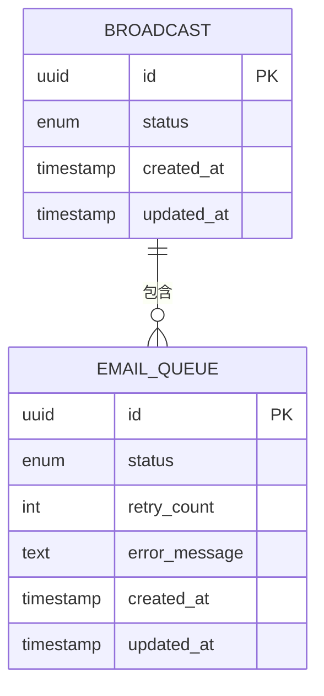
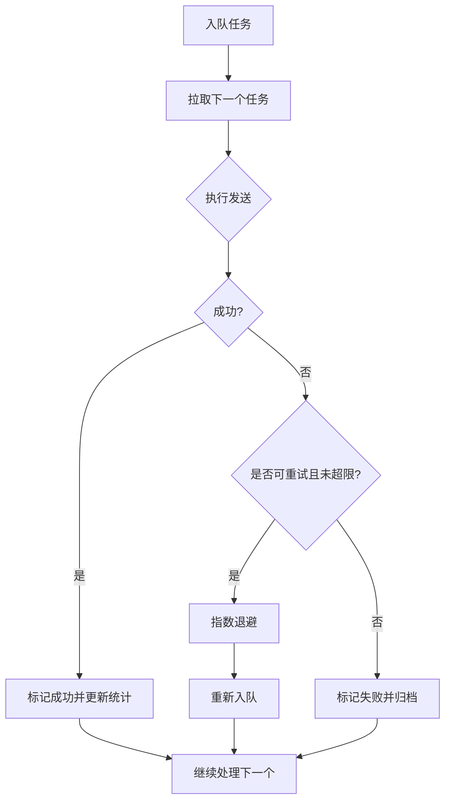
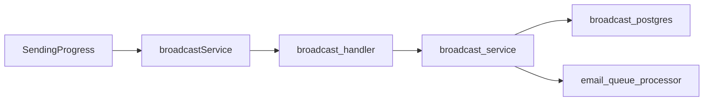

# 发送进度监控

<cite>
**本文引用的文件**   
- [console/src/components/broadcast/SendingProgress.tsx](file://notifuse/console/src/components/broadcast/SendingProgress.tsx)
- [console/src/services/api/broadcastService.ts](file://notifuse/console/src/services/api/broadcastService.ts)
- [internal/http/broadcast_handler.go](file://notifuse/internal/http/broadcast_handler.go)
- [internal/service/broadcast_service.go](file://notifuse/internal/service/broadcast_service.go)
- [internal/domain/broadcast.go](file://notifuse/internal/domain/broadcast.go)
- [internal/repository/broadcast_postgres.go](file://notifuse/internal/repository/broadcast_postgres.go)
- [internal/service/queue/email_queue_processor.go](file://notifuse/internal/service/queue/email_queue_processor.go)
- [internal/domain/email_queue.go](file://notifuse/internal/domain/email_queue.go)
</cite>

## 目录
1. [简介](#简介)
2. [项目结构](#项目结构)
3. [核心组件](#核心组件)
4. [架构总览](#架构总览)
5. [详细组件分析](#详细组件分析)
6. [依赖关系分析](#依赖关系分析)
7. [性能考虑](#性能考虑)
8. [故障排查指南](#故障排查指南)
9. [结论](#结论)
10. [附录](#附录)

## 简介
本文件面向 Notifuse 控制台“邮件广播发送进度监控”功能，聚焦 SendingProgress 组件的实现与前后端协作机制。文档覆盖：
- 实时进度更新、状态轮询机制与 WebSocket 连接管理
- 发送队列的状态跟踪、并发控制策略与错误重试逻辑
- 进度条渲染优化、性能监控指标收集与用户体验优化
- 断线重连、错误恢复与异常处理方案
- 实时监控数据获取方式与前端展示最佳实践

## 项目结构
该功能涉及前端控制台组件、API 服务层、HTTP 处理器、领域模型、仓库实现以及后台队列处理器等模块。整体分层如下：
- 前端：SendingProgress 组件负责订阅广播任务进度并渲染 UI
- API 层：broadcastService 封装对后端的 REST/WebSocket 调用
- HTTP 层：broadcast_handler 暴露查询接口与事件推送通道
- 服务层：broadcast_service 聚合广播业务逻辑与统计
- 领域层：broadcast 与 email_queue 定义状态、计数与任务模型
- 仓库层：broadcast_postgres 持久化广播与队列统计
- 队列层：email_queue_processor 驱动并发发送与重试

图表来源
- [console/src/components/broadcast/SendingProgress.tsx](file://notifuse/console/src/components/broadcast/SendingProgress.tsx)
- [console/src/services/api/broadcastService.ts](file://notifuse/console/src/services/api/broadcastService.ts)
- [internal/http/broadcast_handler.go](file://notifuse/internal/http/broadcast_handler.go)
- [internal/service/broadcast_service.go](file://notifuse/internal/service/broadcast_service.go)
- [internal/repository/broadcast_postgres.go](file://notifuse/internal/repository/broadcast_postgres.go)
- [internal/service/queue/email_queue_processor.go](file://notifuse/internal/service/queue/email_queue_processor.go)

章节来源
- [console/src/components/broadcast/SendingProgress.tsx](file://notifuse/console/src/components/broadcast/SendingProgress.tsx)
- [console/src/services/api/broadcastService.ts](file://notifuse/console/src/services/api/broadcastService.ts)
- [internal/http/broadcast_handler.go](file://notifuse/internal/http/broadcast_handler.go)
- [internal/service/broadcast_service.go](file://notifuse/internal/service/broadcast_service.go)
- [internal/repository/broadcast_postgres.go](file://notifuse/internal/repository/broadcast_postgres.go)
- [internal/service/queue/email_queue_processor.go](file://notifuse/internal/service/queue/email_queue_processor.go)

## 核心组件
- SendingProgress 组件
  - 职责：订阅广播任务的实时进度，维护本地状态，渲染进度条与关键指标（总数、成功、失败、待处理）
  - 能力：支持轮询与 WebSocket 两种模式；具备防抖与节流；提供断线重连与错误提示
- broadcastService
  - 职责：封装对后端的 REST 查询与 WebSocket 订阅方法；统一错误处理与重试策略
- broadcast_handler
  - 职责：提供广播进度查询接口；在需要时转发或推送实时事件
- broadcast_service
  - 职责：汇总广播任务统计信息；协调仓库与队列状态
- email_queue_processor
  - 职责：从队列拉取任务、并发执行发送、记录成功/失败计数、触发重试与退避

章节来源
- [console/src/components/broadcast/SendingProgress.tsx](file://notifuse/console/src/components/broadcast/SendingProgress.tsx)
- [console/src/services/api/broadcastService.ts](file://notifuse/console/src/services/api/broadcastService.ts)
- [internal/http/broadcast_handler.go](file://notifuse/internal/http/broadcast_handler.go)
- [internal/service/broadcast_service.go](file://notifuse/internal/service/broadcast_service.go)
- [internal/service/queue/email_queue_processor.go](file://notifuse/internal/service/queue/email_queue_processor.go)

## 架构总览
下图展示了从前端到后端再到数据库与队列的端到端流程，包括轮询与 WebSocket 两条路径。

图表来源
- [console/src/components/broadcast/SendingProgress.tsx](file://notifuse/console/src/components/broadcast/SendingProgress.tsx)
- [console/src/services/api/broadcastService.ts](file://notifuse/console/src/services/api/broadcastService.ts)
- [internal/http/broadcast_handler.go](file://notifuse/internal/http/broadcast_handler.go)
- [internal/service/broadcast_service.go](file://notifuse/internal/service/broadcast_service.go)
- [internal/repository/broadcast_postgres.go](file://notifuse/internal/repository/broadcast_postgres.go)
- [internal/service/queue/email_queue_processor.go](file://notifuse/internal/service/queue/email_queue_processor.go)

## 详细组件分析

### SendingProgress 组件
- 实时进度更新
  - 支持轮询与 WebSocket 双通道；根据配置与网络状况自动切换
  - 使用防抖/节流减少频繁渲染，避免主线程阻塞
- 状态轮询机制
  - 可配置间隔；指数退避与最大重试次数；网络异常时降级为轮询
- WebSocket 连接管理
  - 连接建立、心跳保活、断线检测、自动重连与幂等消息处理
- 进度条渲染优化
  - 增量更新与虚拟滚动（当列表较大时）；颜色与动画按需启用
- 性能监控指标
  - 采集渲染帧率、更新延迟、WS 重连次数、轮询耗时等
- 用户体验优化
  - 骨架屏与占位符；错误提示与重试按钮；完成态高亮与通知

图表来源
- [console/src/components/broadcast/SendingProgress.tsx](file://notifuse/console/src/components/broadcast/SendingProgress.tsx)
- [console/src/services/api/broadcastService.ts](file://notifuse/console/src/services/api/broadcastService.ts)

章节来源
- [console/src/components/broadcast/SendingProgress.tsx](file://notifuse/console/src/components/broadcast/SendingProgress.tsx)
- [console/src/services/api/broadcastService.ts](file://notifuse/console/src/services/api/broadcastService.ts)

### 广播服务与 HTTP 处理器
- broadcast_handler
  - 暴露进度查询接口；在支持的情况下转发 WebSocket 事件
- broadcast_service
  - 聚合统计：计算总数、成功、失败、待处理；合并队列与持久化状态
- 错误处理
  - 统一错误码与消息；客户端侧进行友好提示与重试

图表来源
- [internal/http/broadcast_handler.go](file://notifuse/internal/http/broadcast_handler.go)
- [internal/service/broadcast_service.go](file://notifuse/internal/service/broadcast_service.go)
- [internal/service/queue/email_queue_processor.go](file://notifuse/internal/service/queue/email_queue_processor.go)

章节来源
- [internal/http/broadcast_handler.go](file://notifuse/internal/http/broadcast_handler.go)
- [internal/service/broadcast_service.go](file://notifuse/internal/service/broadcast_service.go)

### 领域模型与仓库
- 领域模型
  - broadcast：定义广播任务 ID、状态、时间戳等
  - email_queue：定义任务 ID、状态、重试次数、错误信息等
- 仓库实现
  - broadcast_postgres：提供按 ID 查询统计与计数的 SQL 操作

图表来源
- [internal/domain/broadcast.go](file://notifuse/internal/domain/broadcast.go)
- [internal/domain/email_queue.go](file://notifuse/internal/domain/email_queue.go)
- [internal/repository/broadcast_postgres.go](file://notifuse/internal/repository/broadcast_postgres.go)

章节来源
- [internal/domain/broadcast.go](file://notifuse/internal/domain/broadcast.go)
- [internal/domain/email_queue.go](file://notifuse/internal/domain/email_queue.go)
- [internal/repository/broadcast_postgres.go](file://notifuse/internal/repository/broadcast_postgres.go)

### 发送队列：状态跟踪、并发控制与错误重试
- 状态跟踪
  - 每个任务有明确状态机：待处理、进行中、成功、失败；广播级统计由仓库聚合
- 并发控制
  - 基于工作池与信号量限制并发度；防止过载与资源争用
- 错误重试
  - 指数退避与最大重试上限；区分可重试与不可重试错误；失败归档便于审计

图表来源
- [internal/service/queue/email_queue_processor.go](file://notifuse/internal/service/queue/email_queue_processor.go)
- [internal/domain/email_queue.go](file://notifuse/internal/domain/email_queue.go)

章节来源
- [internal/service/queue/email_queue_processor.go](file://notifuse/internal/service/queue/email_queue_processor.go)
- [internal/domain/email_queue.go](file://notifuse/internal/domain/email_queue.go)

## 依赖关系分析
- 组件耦合
  - SendingProgress 仅依赖 broadcastService，屏蔽底层传输细节
  - broadcastService 同时依赖 REST 与 WebSocket 通道，内部做容错与降级
  - HTTP 处理器与服务层解耦，服务层再与仓库和队列交互
- 外部依赖
  - PostgreSQL 用于持久化统计与队列状态
  - 可选的消息总线用于事件推送（若采用 WS 直连则不依赖额外总线）

图表来源
- [console/src/components/broadcast/SendingProgress.tsx](file://notifuse/console/src/components/broadcast/SendingProgress.tsx)
- [console/src/services/api/broadcastService.ts](file://notifuse/console/src/services/api/broadcastService.ts)
- [internal/http/broadcast_handler.go](file://notifuse/internal/http/broadcast_handler.go)
- [internal/service/broadcast_service.go](file://notifuse/internal/service/broadcast_service.go)
- [internal/repository/broadcast_postgres.go](file://notifuse/internal/repository/broadcast_postgres.go)
- [internal/service/queue/email_queue_processor.go](file://notifuse/internal/service/queue/email_queue_processor.go)

章节来源
- [console/src/components/broadcast/SendingProgress.tsx](file://notifuse/console/src/components/broadcast/SendingProgress.tsx)
- [console/src/services/api/broadcastService.ts](file://notifuse/console/src/services/api/broadcastService.ts)
- [internal/http/broadcast_handler.go](file://notifuse/internal/http/broadcast_handler.go)
- [internal/service/broadcast_service.go](file://notifuse/internal/service/broadcast_service.go)
- [internal/repository/broadcast_postgres.go](file://notifuse/internal/repository/broadcast_postgres.go)
- [internal/service/queue/email_queue_processor.go](file://notifuse/internal/service/queue/email_queue_processor.go)

## 性能考虑
- 前端渲染
  - 使用增量更新与批处理；避免整树重绘；必要时开启虚拟化
  - 将动画与样式变更放入 requestAnimationFrame 批次
- 网络与轮询
  - 动态调整轮询间隔；在网络抖动时增大间隔与退避
  - 优先使用 WebSocket；仅在不可用时回退轮询
- 后端统计
  - 使用物化视图或缓存热点统计；避免每次请求都全表扫描
  - 队列统计尽量内存聚合后落库，降低 IO 压力
- 监控指标
  - 采集：进度更新延迟、WS 重连次数、轮询成功率、渲染帧率、错误率

[本节为通用指导，无需源码引用]

## 故障排查指南
- 常见问题
  - 进度不更新：检查 WS 连接状态与心跳；确认广播 ID 是否正确；查看浏览器控制台与后端日志
  - 频繁重连：检查网络质量与服务器证书；确认服务端是否限流
  - 进度不一致：核对仓库统计与队列状态；检查并发写入是否存在竞争
- 定位步骤
  - 前端：打开网络面板，观察轮询请求与 WS 事件；查看自定义指标
  - 后端：查看广播处理器与服务层日志；检查数据库统计与队列任务状态
  - 队列：检查失败任务的重试次数与错误信息，判断是否为可重试错误
- 恢复策略
  - 自动重试与退避；用户手动重试入口；失败任务批量重放

章节来源
- [console/src/components/broadcast/SendingProgress.tsx](file://notifuse/console/src/components/broadcast/SendingProgress.tsx)
- [console/src/services/api/broadcastService.ts](file://notifuse/console/src/services/api/broadcastService.ts)
- [internal/http/broadcast_handler.go](file://notifuse/internal/http/broadcast_handler.go)
- [internal/service/broadcast_service.go](file://notifuse/internal/service/broadcast_service.go)
- [internal/service/queue/email_queue_processor.go](file://notifuse/internal/service/queue/email_queue_processor.go)

## 结论
通过 SendingProgress 组件与后端广播服务、队列处理器的协同，Notifuse 控制台实现了稳定、低延迟的邮件广播发送进度监控。结合轮询与 WebSocket 的双通道设计、完善的错误重试与断线重连机制，以及前端渲染优化与性能监控，系统在大规模发送场景下仍能提供良好的用户体验与可观测性。

[本节为总结，无需源码引用]

## 附录
- 实时监控数据获取方式
  - REST：GET 广播进度接口，返回当前统计快照
  - WebSocket：订阅广播事件流，接收增量更新
- 前端展示最佳实践
  - 使用骨架屏与渐进式加载；错误态提供重试与反馈；完成态给予明确提示
  - 合理设置刷新频率与动画开关，兼顾流畅性与资源消耗

[本节为补充说明，无需源码引用]