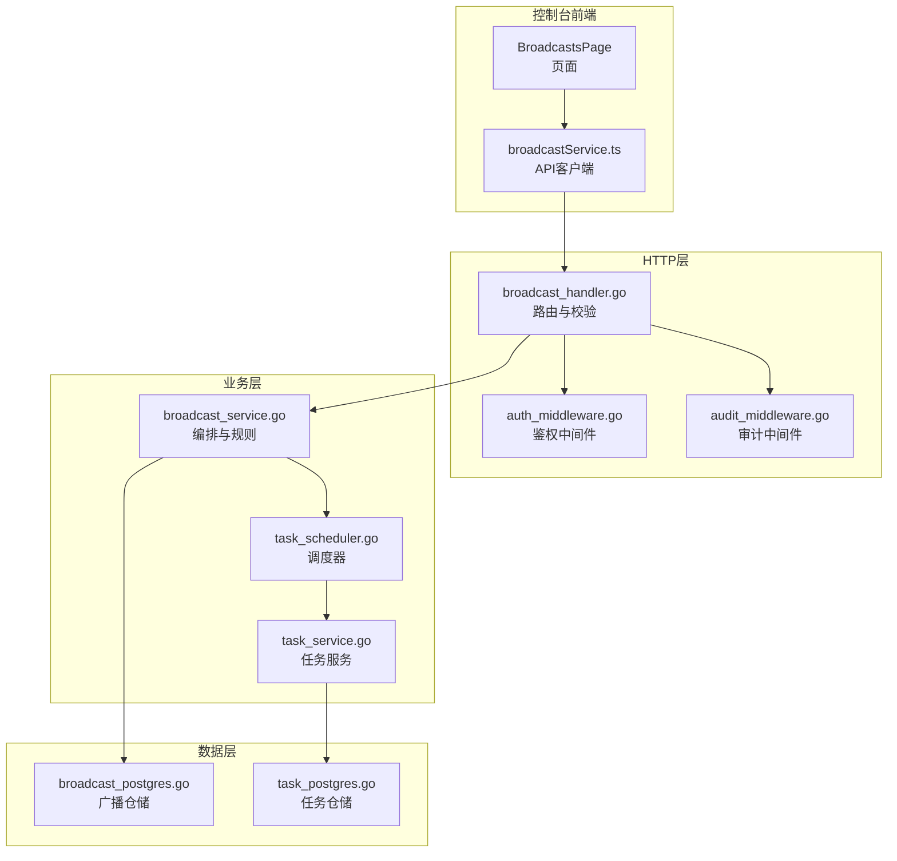
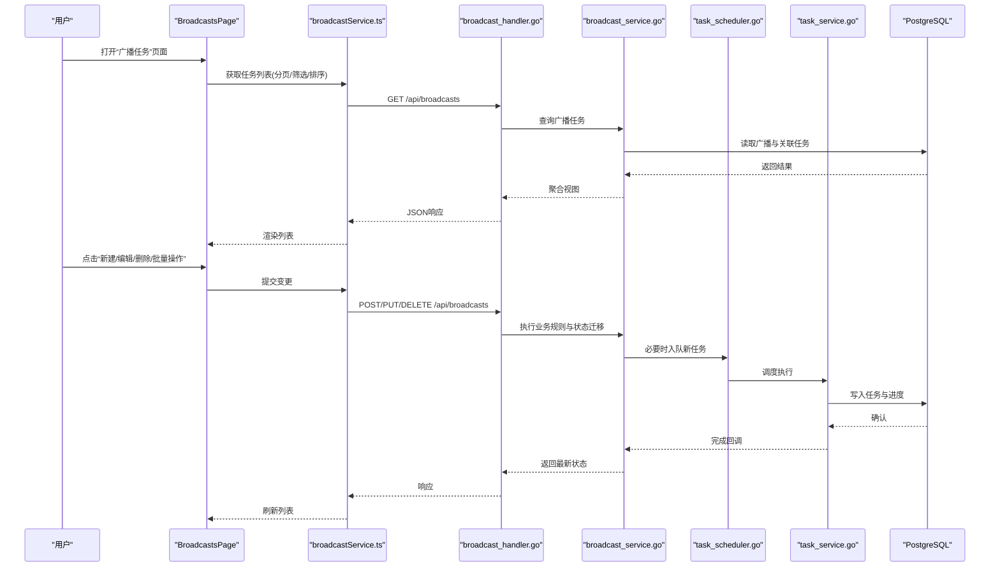
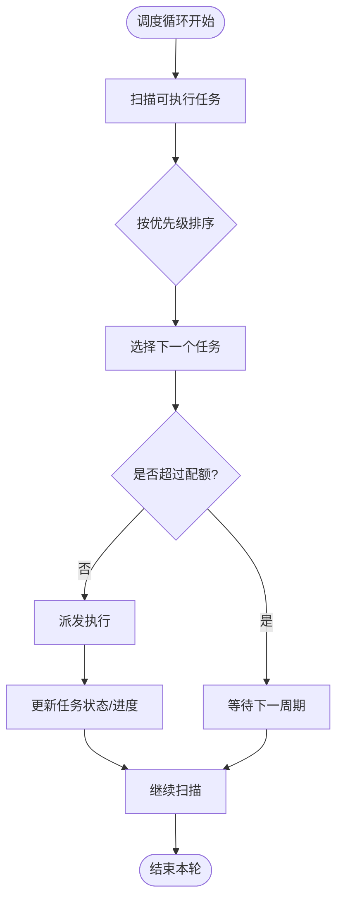
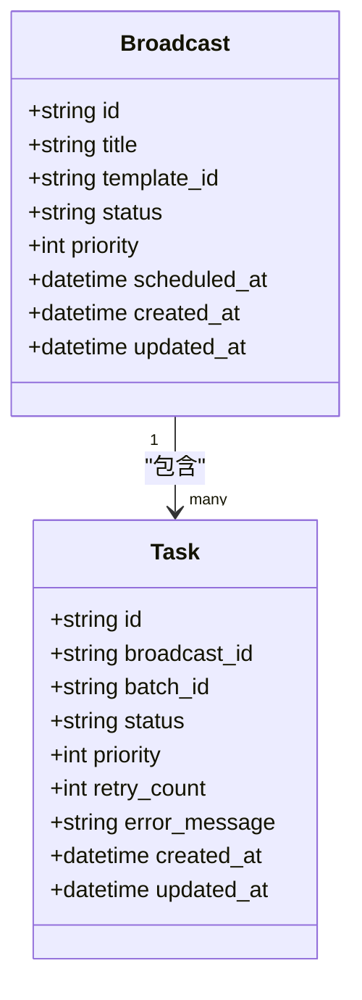
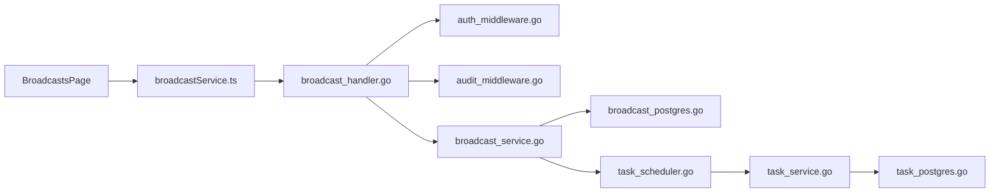

# 广播任务管理

<cite>
**本文引用的文件**   
- [console/src/pages/BroadcastsPage.tsx](file://notifuse/console/src/pages/BroadcastsPage.tsx)
- [console/src/services/api/broadcastService.ts](file://notifuse/console/src/services/api/broadcastService.ts)
- [internal/http/broadcast_handler.go](file://notifuse/internal/http/broadcast_handler.go)
- [internal/service/broadcast_service.go](file://notifuse/internal/service/broadcast_service.go)
- [internal/repository/broadcast_postgres.go](file://notifuse/internal/repository/broadcast_postgres.go)
- [internal/domain/broadcast.go](file://notifuse/internal/domain/broadcast.go)
- [internal/service/task_scheduler.go](file://notifuse/internal/service/task_scheduler.go)
- [internal/service/task_service.go](file://notifuse/internal/service/task_service.go)
- [internal/repository/task_postgres.go](file://notifuse/internal/repository/task_postgres.go)
- [internal/domain/task.go](file://notifuse/internal/domain/task.go)
- [internal/http/middleware/auth_middleware.go](file://notifuse/internal/http/middleware/auth_middleware.go)
- [internal/http/middleware/audit_middleware.go](file://notifuse/internal/http/middleware/audit_middleware.go)
- [openapi/paths/broadcasts.yaml](file://notifuse/openapi/paths/broadcasts.yaml)
</cite>

## 目录
1. [简介](#简介)
2. [项目结构](#项目结构)
3. [核心组件](#核心组件)
4. [架构总览](#架构总览)
5. [详细组件分析](#详细组件分析)
6. [依赖关系分析](#依赖关系分析)
7. [性能考虑](#性能考虑)
8. [故障排查指南](#故障排查指南)
9. [结论](#结论)
10. [附录](#附录)

## 简介
本文件面向Notifuse控制台“邮件广播任务管理”功能，聚焦BroadcastsPage页面及其后端支撑能力。内容涵盖：
- 页面整体架构与交互流程（列表展示、批量操作、搜索过滤）
- 广播任务的CRUD、状态管理与生命周期控制
- 任务调度机制、优先级排序与资源分配策略
- 暂停、恢复、取消与删除操作流程
- 监控、日志查看与故障排查方法
- 权限控制、审计日志与安全加固建议

## 项目结构
前端控制台位于 console 目录，广播任务页面为 BroadcastsPage；API服务层由 Go 实现，包含HTTP处理器、领域模型、仓储与服务编排；OpenAPI定义在 openapi 目录中用于契约与文档生成。

图表来源
- [console/src/pages/BroadcastsPage.tsx](file://notifuse/console/src/pages/BroadcastsPage.tsx)
- [console/src/services/api/broadcastService.ts](file://notifuse/console/src/services/api/broadcastService.ts)
- [internal/http/broadcast_handler.go](file://notifuse/internal/http/broadcast_handler.go)
- [internal/http/middleware/auth_middleware.go](file://notifuse/internal/http/middleware/auth_middleware.go)
- [internal/http/middleware/audit_middleware.go](file://notifuse/internal/http/middleware/audit_middleware.go)
- [internal/service/broadcast_service.go](file://notifuse/internal/service/broadcast_service.go)
- [internal/service/task_scheduler.go](file://notifuse/internal/service/task_scheduler.go)
- [internal/service/task_service.go](file://notifuse/internal/service/task_service.go)
- [internal/repository/broadcast_postgres.go](file://notifuse/internal/repository/broadcast_postgres.go)
- [internal/repository/task_postgres.go](file://notifuse/internal/repository/task_postgres.go)

章节来源
- [console/src/pages/BroadcastsPage.tsx](file://notifuse/console/src/pages/BroadcastsPage.tsx)
- [console/src/services/api/broadcastService.ts](file://notifuse/console/src/services/api/broadcastService.ts)
- [internal/http/broadcast_handler.go](file://notifuse/internal/http/broadcast_handler.go)
- [internal/service/broadcast_service.go](file://notifuse/internal/service/broadcast_service.go)
- [internal/service/task_scheduler.go](file://notifuse/internal/service/task_scheduler.go)
- [internal/service/task_service.go](file://notifuse/internal/service/task_service.go)
- [internal/repository/broadcast_postgres.go](file://notifuse/internal/repository/broadcast_postgres.go)
- [internal/repository/task_postgres.go](file://notifuse/internal/repository/task_postgres.go)
- [openapi/paths/broadcasts.yaml](file://notifuse/openapi/paths/broadcasts.yaml)

## 核心组件
- 页面组件 BroadcastsPage：负责渲染任务列表、提供创建/编辑/删除入口、批量操作工具栏、搜索与筛选控件、分页与排序。
- API客户端 broadcastService：封装对后端的REST调用，统一错误处理与重试策略。
- HTTP处理器 broadcast_handler：路由注册、请求参数校验、响应序列化、错误码映射。
- 广播服务 broadcast_service：聚合领域逻辑，协调仓储与调度器，维护任务状态机与生命周期。
- 任务调度器 task_scheduler：周期性扫描可执行任务，按优先级与资源配额派发工作单元。
- 任务服务 task_service：任务实例的增删改查、状态推进、重试与补偿。
- 广播仓储 broadcast_postgres：广播实体的持久化查询与更新。
- 任务仓储 task_postgres：任务实例的持久化查询与更新。
- 领域模型 domain/broadcast 与 domain/task：实体定义、约束与不变式。
- 中间件 auth_middleware 与 audit_middleware：鉴权与审计记录。

章节来源
- [console/src/pages/BroadcastsPage.tsx](file://notifuse/console/src/pages/BroadcastsPage.tsx)
- [console/src/services/api/broadcastService.ts](file://notifuse/console/src/services/api/broadcastService.ts)
- [internal/http/broadcast_handler.go](file://notifuse/internal/http/broadcast_handler.go)
- [internal/service/broadcast_service.go](file://notifuse/internal/service/broadcast_service.go)
- [internal/service/task_scheduler.go](file://notifuse/internal/service/task_scheduler.go)
- [internal/service/task_service.go](file://notifuse/internal/service/task_service.go)
- [internal/repository/broadcast_postgres.go](file://notifuse/internal/repository/broadcast_postgres.go)
- [internal/repository/task_postgres.go](file://notifuse/internal/repository/task_postgres.go)
- [internal/domain/broadcast.go](file://notifuse/internal/domain/broadcast.go)
- [internal/domain/task.go](file://notifuse/internal/domain/task.go)
- [internal/http/middleware/auth_middleware.go](file://notifuse/internal/http/middleware/auth_middleware.go)
- [internal/http/middleware/audit_middleware.go](file://notifuse/internal/http/middleware/audit_middleware.go)

## 架构总览
广播任务从控制台发起，经API层进入业务编排，再由调度器驱动任务执行，最终落库并对外暴露监控与日志接口。

图表来源
- [console/src/pages/BroadcastsPage.tsx](file://notifuse/console/src/pages/BroadcastsPage.tsx)
- [console/src/services/api/broadcastService.ts](file://notifuse/console/src/services/api/broadcastService.ts)
- [internal/http/broadcast_handler.go](file://notifuse/internal/http/broadcast_handler.go)
- [internal/service/broadcast_service.go](file://notifuse/internal/service/broadcast_service.go)
- [internal/service/task_scheduler.go](file://notifuse/internal/service/task_scheduler.go)
- [internal/service/task_service.go](file://notifuse/internal/service/task_service.go)
- [internal/repository/broadcast_postgres.go](file://notifuse/internal/repository/broadcast_postgres.go)
- [internal/repository/task_postgres.go](file://notifuse/internal/repository/task_postgres.go)

## 详细组件分析

### BroadcastsPage 页面组件
- 职责
  - 展示广播任务列表（标题、状态、创建时间、发送范围等）
  - 提供新建/编辑/删除入口
  - 支持批量选择与批量操作（如批量暂停/恢复/删除）
  - 提供搜索框与筛选条件（按状态、时间范围、关键词等）
  - 分页与排序（按更新时间或优先级）
- 交互要点
  - 列表加载时触发一次初始查询，后续通过轮询或WebSocket增量更新
  - 批量操作前进行二次确认与权限校验提示
  - 搜索与筛选变化时防抖触发查询
- 错误处理
  - 网络异常与超时重试
  - 服务端错误码映射为用户友好提示
  - 空状态与加载态占位

章节来源
- [console/src/pages/BroadcastsPage.tsx](file://notifuse/console/src/pages/BroadcastsPage.tsx)
- [console/src/services/api/broadcastService.ts](file://notifuse/console/src/services/api/broadcastService.ts)

### API 客户端 broadcastService
- 职责
  - 封装所有与广播相关的HTTP调用
  - 统一请求头（鉴权令牌）、错误解析与重试
  - 将后端响应转换为前端类型
- 关键方法
  - 列表查询：支持分页、排序、筛选参数
  - 单条操作：创建、更新、删除
  - 批量操作：批量暂停/恢复/删除
  - 详情与统计：任务进度、成功/失败计数
- 安全与健壮性
  - 敏感信息不落地
  - 幂等键与去重保护（针对重复提交）
  - 限流与退避策略

章节来源
- [console/src/services/api/broadcastService.ts](file://notifuse/console/src/services/api/broadcastService.ts)

### HTTP 处理器 broadcast_handler
- 职责
  - 路由注册与路径匹配
  - 请求体校验、参数绑定、错误码标准化
  - 调用服务层并返回JSON
- 典型端点
  - 列表：GET /api/broadcasts
  - 详情：GET /api/broadcasts/:id
  - 创建：POST /api/broadcasts
  - 更新：PUT /api/broadcasts/:id
  - 删除：DELETE /api/broadcasts/:id
  - 批量操作：POST /api/broadcasts/batch
- 中间件集成
  - 鉴权中间件：校验用户身份与角色
  - 审计中间件：记录关键操作上下文

章节来源
- [internal/http/broadcast_handler.go](file://notifuse/internal/http/broadcast_handler.go)
- [internal/http/middleware/auth_middleware.go](file://notifuse/internal/http/middleware/auth_middleware.go)
- [internal/http/middleware/audit_middleware.go](file://notifuse/internal/http/middleware/audit_middleware.go)
- [openapi/paths/broadcasts.yaml](file://notifuse/openapi/paths/broadcasts.yaml)

### 广播服务 broadcast_service
- 职责
  - 编排广播任务的生命周期：草稿→待发送→进行中→已完成/失败
  - 校验业务规则（模板有效性、收件人范围、频率限制等）
  - 与任务调度器协作，将广播拆分为可执行任务
- 关键流程
  - 创建：校验输入→持久化→生成任务计划
  - 更新：版本控制与冲突检测
  - 删除：级联清理未执行任务
  - 批量操作：事务边界与部分失败回滚策略
- 并发与一致性
  - 使用乐观锁避免覆盖更新
  - 任务入队采用幂等键防止重复

章节来源
- [internal/service/broadcast_service.go](file://notifuse/internal/service/broadcast_service.go)
- [internal/domain/broadcast.go](file://notifuse/internal/domain/broadcast.go)
- [internal/repository/broadcast_postgres.go](file://notifuse/internal/repository/broadcast_postgres.go)

### 任务调度器 task_scheduler 与任务服务 task_service
- 调度器
  - 定时扫描可执行任务队列
  - 依据优先级与资源配额挑选任务
  - 支持速率限制与背压
- 任务服务
  - 任务实例的CRUD与状态推进
  - 重试与补偿逻辑
  - 进度上报与失败归因
- 优先级与资源分配
  - 优先级字段决定出队顺序
  - 全局并发上限与工作池大小
  - 按租户/工作空间隔离配额

图表来源
- [internal/service/task_scheduler.go](file://notifuse/internal/service/task_scheduler.go)
- [internal/service/task_service.go](file://notifuse/internal/service/task_service.go)
- [internal/repository/task_postgres.go](file://notifuse/internal/repository/task_postgres.go)
- [internal/domain/task.go](file://notifuse/internal/domain/task.go)

章节来源
- [internal/service/task_scheduler.go](file://notifuse/internal/service/task_scheduler.go)
- [internal/service/task_service.go](file://notifuse/internal/service/task_service.go)
- [internal/repository/task_postgres.go](file://notifuse/internal/repository/task_postgres.go)
- [internal/domain/task.go](file://notifuse/internal/domain/task.go)

### 领域模型与仓储
- 领域模型
  - 广播实体：标识、标题、模板、目标受众、状态、优先级、时间窗口、审计字段
  - 任务实体：所属广播、批次、状态、优先级、重试次数、错误信息、时间戳
- 仓储
  - 广播仓储：复杂查询（分页、筛选、排序）、批量更新
  - 任务仓储：按广播ID与状态查询、原子状态推进

图表来源
- [internal/domain/broadcast.go](file://notifuse/internal/domain/broadcast.go)
- [internal/domain/task.go](file://notifuse/internal/domain/task.go)

章节来源
- [internal/domain/broadcast.go](file://notifuse/internal/domain/broadcast.go)
- [internal/domain/task.go](file://notifuse/internal/domain/task.go)
- [internal/repository/broadcast_postgres.go](file://notifuse/internal/repository/broadcast_postgres.go)
- [internal/repository/task_postgres.go](file://notifuse/internal/repository/task_postgres.go)

### 权限控制与审计
- 权限控制
  - 基于角色的访问控制（RBAC），仅允许具备相应角色的用户创建/修改/删除广播
  - 工作空间级别隔离，确保跨租户不可见
- 审计日志
  - 记录操作者、动作、资源ID、IP、时间戳与结果
  - 敏感字段脱敏存储

章节来源
- [internal/http/middleware/auth_middleware.go](file://notifuse/internal/http/middleware/auth_middleware.go)
- [internal/http/middleware/audit_middleware.go](file://notifuse/internal/http/middleware/audit_middleware.go)

## 依赖关系分析
- 前端到后端
  - BroadcastsPage 依赖 broadcastService 进行数据交互
  - broadcastService 依赖 HTTP 处理器暴露的REST端点
- 后端内部
  - HTTP处理器依赖鉴权与审计中间件
  - 广播服务依赖广播仓储与任务调度器
  - 任务调度器依赖任务服务与任务仓储
- 外部依赖
  - PostgreSQL数据库
  - 可选：消息队列/延迟队列（若采用异步解耦）

图表来源
- [console/src/pages/BroadcastsPage.tsx](file://notifuse/console/src/pages/BroadcastsPage.tsx)
- [console/src/services/api/broadcastService.ts](file://notifuse/console/src/services/api/broadcastService.ts)
- [internal/http/broadcast_handler.go](file://notifuse/internal/http/broadcast_handler.go)
- [internal/http/middleware/auth_middleware.go](file://notifuse/internal/http/middleware/auth_middleware.go)
- [internal/http/middleware/audit_middleware.go](file://notifuse/internal/http/middleware/audit_middleware.go)
- [internal/service/broadcast_service.go](file://notifuse/internal/service/broadcast_service.go)
- [internal/service/task_scheduler.go](file://notifuse/internal/service/task_scheduler.go)
- [internal/service/task_service.go](file://notifuse/internal/service/task_service.go)
- [internal/repository/broadcast_postgres.go](file://notifuse/internal/repository/broadcast_postgres.go)
- [internal/repository/task_postgres.go](file://notifuse/internal/repository/task_postgres.go)

章节来源
- [internal/http/broadcast_handler.go](file://notifuse/internal/http/broadcast_handler.go)
- [internal/service/broadcast_service.go](file://notifuse/internal/service/broadcast_service.go)
- [internal/service/task_scheduler.go](file://notifuse/internal/service/task_scheduler.go)
- [internal/service/task_service.go](file://notifuse/internal/service/task_service.go)
- [internal/repository/broadcast_postgres.go](file://notifuse/internal/repository/broadcast_postgres.go)
- [internal/repository/task_postgres.go](file://notifuse/internal/repository/task_postgres.go)

## 性能考虑
- 列表查询优化
  - 合理索引：按状态、更新时间、优先级建立复合索引
  - 分页游标替代偏移量，提升大数据集性能
- 批量操作
  - 分批提交，避免长事务与锁竞争
  - 使用幂等键与去重表防止重复执行
- 调度与并发
  - 根据CPU与IO瓶颈调整工作池大小
  - 引入速率限制与背压，避免雪崩
- 缓存与预取
  - 热点配置与模板缓存
  - 前端短轮询间隔与增量更新结合

[本节为通用指导，无需代码来源]

## 故障排查指南
- 常见问题定位
  - 任务未执行：检查调度器是否运行、任务状态是否为可执行、是否有配额限制
  - 发送失败：查看任务错误信息与重试次数，核对SMTP/第三方服务配置
  - 列表加载慢：检查SQL执行计划与索引命中情况
- 监控与日志
  - 任务进度与成功率仪表盘
  - 关键操作审计日志检索（操作者、时间、资源ID）
  - 错误分类与告警阈值
- 排障步骤
  - 复现问题并收集上下文（请求ID、任务ID、时间窗口）
  - 检查中间件鉴权与审计记录
  - 验证仓储层数据一致性与事务边界
  - 逐步缩小范围至具体服务或外部依赖

章节来源
- [internal/http/middleware/audit_middleware.go](file://notifuse/internal/http/middleware/audit_middleware.go)
- [internal/service/task_service.go](file://notifuse/internal/service/task_service.go)
- [internal/repository/task_postgres.go](file://notifuse/internal/repository/task_postgres.go)

## 结论
广播任务管理以清晰的层次划分与明确的职责边界实现高内聚低耦合：前端页面专注交互与展示，API层负责契约与校验，服务层承载业务规则与编排，调度器保障稳定执行，仓储层保证数据一致。通过权限控制与审计日志，系统具备良好的安全性与可观测性。在生产环境中，应重点关注索引设计、并发配额与错误重试策略，以获得稳定高效的广播能力。

[本节为总结，无需代码来源]

## 附录

### 任务状态与生命周期
- 状态集合
  - 草稿：尚未提交发送
  - 待发送：已提交，等待调度
  - 进行中：正在执行
  - 已完成：全部成功
  - 失败：存在不可恢复的错误
- 生命周期控制
  - 暂停：停止新任务入队，保留已有任务继续执行
  - 恢复：重新允许入队
  - 取消：终止未执行任务，已执行任务不受影响
  - 删除：移除广播与未执行任务

章节来源
- [internal/domain/broadcast.go](file://notifuse/internal/domain/broadcast.go)
- [internal/service/broadcast_service.go](file://notifuse/internal/service/broadcast_service.go)

### 批量操作与搜索过滤
- 批量操作
  - 批量暂停/恢复/删除：支持多选与全选，带二次确认
  - 部分失败：返回明细错误，支持重试单个失败项
- 搜索与过滤
  - 关键词：标题模糊匹配
  - 状态：多值选择
  - 时间范围：创建时间与更新时间
  - 排序：按更新时间或优先级

章节来源
- [console/src/pages/BroadcastsPage.tsx](file://notifuse/console/src/pages/BroadcastsPage.tsx)
- [console/src/services/api/broadcastService.ts](file://notifuse/console/src/services/api/broadcastService.ts)
- [internal/http/broadcast_handler.go](file://notifuse/internal/http/broadcast_handler.go)

### OpenAPI 契约参考
- 端点定义与请求/响应结构详见OpenAPI路径文件，便于前后端对齐与自动化测试。

章节来源
- [openapi/paths/broadcasts.yaml](file://notifuse/openapi/paths/broadcasts.yaml)