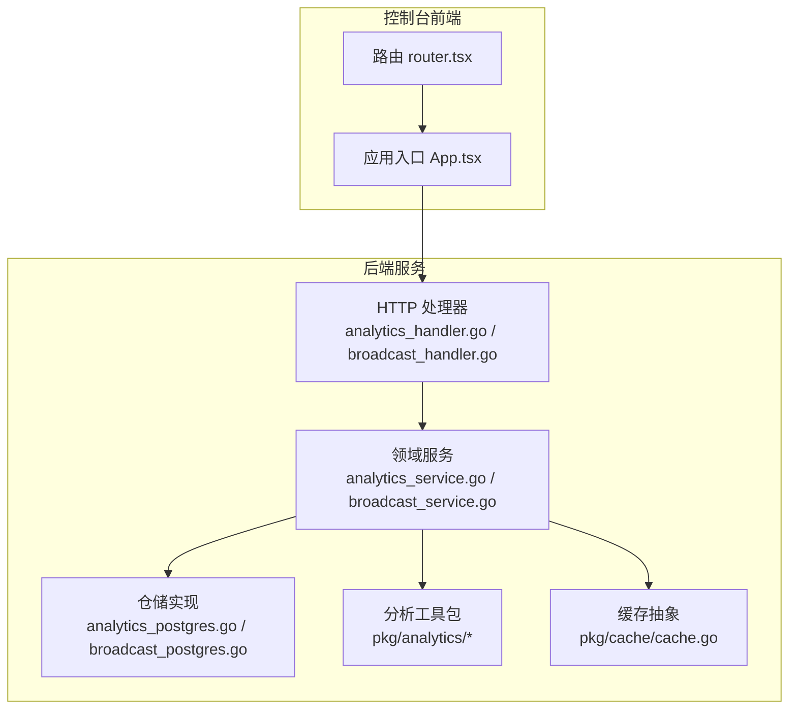
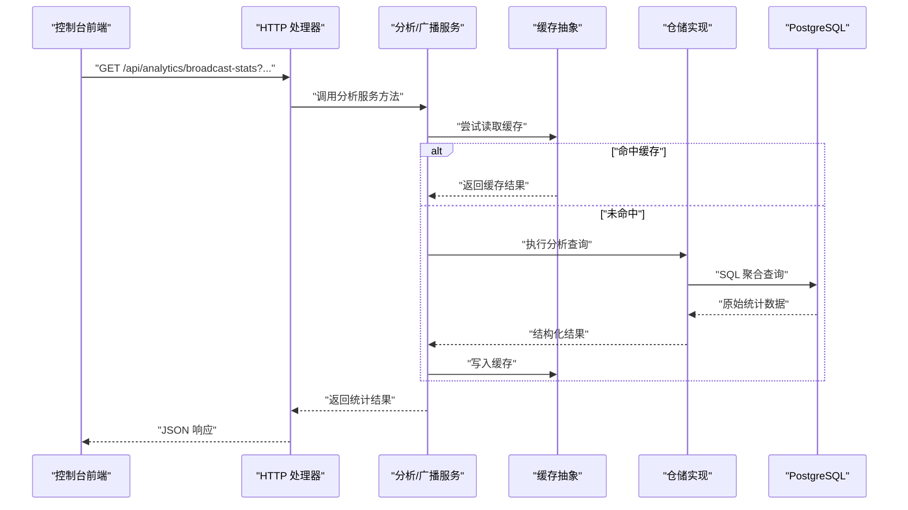
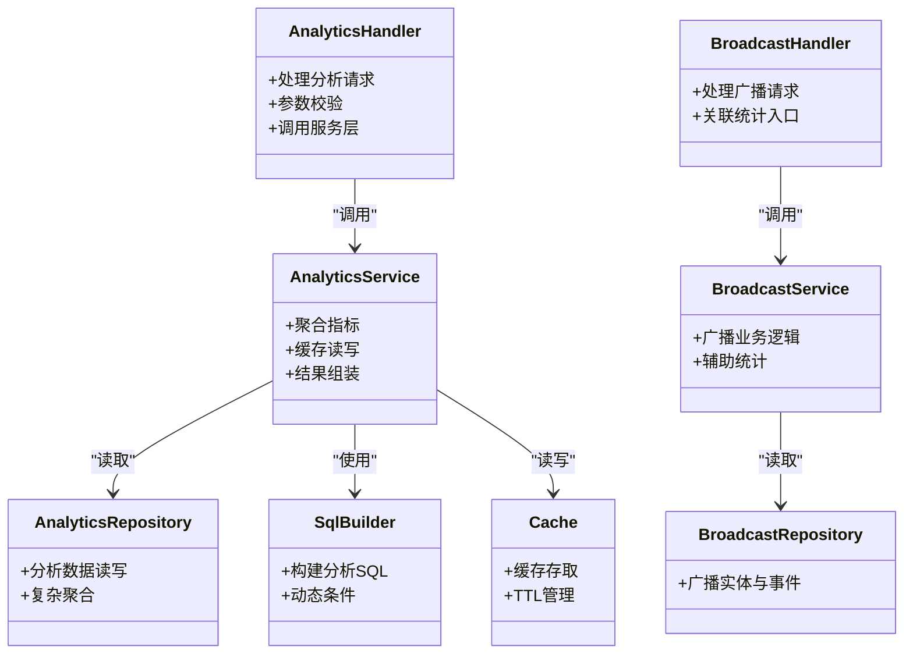

# 广播统计分析

<cite>
**本文引用的文件**   
- [analytics_handler.go](file://notifuse/internal/http/analytics_handler.go)
- [broadcast_handler.go](file://notifuse/internal/http/broadcast_handler.go)
- [analytics_service.go](file://notifuse/internal/service/analytics_service.go)
- [broadcast_service.go](file://notifuse/internal/service/broadcast_service.go)
- [analytics_postgres.go](file://notifuse/internal/repository/analytics_postgres.go)
- [broadcast_postgres.go](file://notifuse/internal/repository/broadcast_postgres.go)
- [sql_builder.go](file://notifuse/pkg/analytics/sql_builder.go)
- [types.go](file://notifuse/pkg/analytics/types.go)
- [validation.go](file://notifuse/pkg/analytics/validation.go)
- [cache.go](file://notifuse/pkg/cache/cache.go)
- [router.tsx](file://notifuse/console/src/router.tsx)
- [App.tsx](file://notifuse/console/src/App.tsx)
</cite>

## 目录
1. [简介](#简介)
2. [项目结构](#项目结构)
3. [核心组件](#核心组件)
4. [架构总览](#架构总览)
5. [详细组件分析](#详细组件分析)
6. [依赖关系分析](#依赖关系分析)
7. [性能考量](#性能考量)
8. [故障排查指南](#故障排查指南)
9. [结论](#结论)
10. [附录](#附录)

## 简介
本文件面向 Notifuse 控制台的“广播统计分析”能力，聚焦 BroadcastStats 相关的数据可视化与后端统计链路。内容涵盖：
- 关键指标定义与计算：发送成功率、打开率、点击率等
- 图表组件选择与配置建议（前端）
- 数据聚合算法与缓存策略（后端）
- 实时数据分析、历史趋势对比与性能瓶颈识别的实现思路
- 数据导出、自定义报表与多维度分析能力
- 数据分析 API 使用方式与性能优化建议

## 项目结构
本项目采用前后端分离的架构：
- 控制台前端位于 console 目录，负责页面路由、UI 渲染与图表展示
- 后端服务位于 internal 目录，包含 HTTP 层、领域服务、仓储实现与通用包
- 分析相关的 SQL 构建与类型定义位于 pkg/analytics
- 缓存抽象位于 pkg/cache

图示来源
- [router.tsx](file://notifuse/console/src/router.tsx)
- [App.tsx](file://notifuse/console/src/App.tsx)
- [analytics_handler.go](file://notifuse/internal/http/analytics_handler.go)
- [broadcast_handler.go](file://notifuse/internal/http/broadcast_handler.go)
- [analytics_service.go](file://notifuse/internal/service/analytics_service.go)
- [broadcast_service.go](file://notifuse/internal/service/broadcast_service.go)
- [analytics_postgres.go](file://notifuse/internal/repository/analytics_postgres.go)
- [broadcast_postgres.go](file://notifuse/internal/repository/broadcast_postgres.go)
- [sql_builder.go](file://notifuse/pkg/analytics/sql_builder.go)
- [types.go](file://notifuse/pkg/analytics/types.go)
- [validation.go](file://notifuse/pkg/analytics/validation.go)
- [cache.go](file://notifuse/pkg/cache/cache.go)

章节来源
- [router.tsx](file://notifuse/console/src/router.tsx)
- [App.tsx](file://notifuse/console/src/App.tsx)
- [analytics_handler.go](file://notifuse/internal/http/analytics_handler.go)
- [broadcast_handler.go](file://notifuse/internal/http/broadcast_handler.go)
- [analytics_service.go](file://notifuse/internal/service/analytics_service.go)
- [broadcast_service.go](file://notifuse/internal/service/broadcast_service.go)
- [analytics_postgres.go](file://notifuse/internal/repository/analytics_postgres.go)
- [broadcast_postgres.go](file://notifuse/internal/repository/broadcast_postgres.go)
- [sql_builder.go](file://notifuse/pkg/analytics/sql_builder.go)
- [types.go](file://notifuse/pkg/analytics/types.go)
- [validation.go](file://notifuse/pkg/analytics/validation.go)
- [cache.go](file://notifuse/pkg/cache/cache.go)

## 核心组件
- HTTP 层
  - analytics_handler.go：提供分析类接口，接收查询参数并调用服务层
  - broadcast_handler.go：提供广播相关接口，可能包含广播列表、详情及关联统计入口
- 服务层
  - analytics_service.go：封装分析逻辑，协调仓储与缓存，输出统一的结构化结果
  - broadcast_service.go：广播业务逻辑，支撑广播维度统计
- 仓储层
  - analytics_postgres.go：基于 PostgreSQL 的分析数据读写
  - broadcast_postgres.go：广播实体与事件数据的持久化访问
- 分析工具包
  - sql_builder.go：动态构建分析 SQL，支持时间窗口、分组、过滤
  - types.go：分析结果与请求参数的类型定义
  - validation.go：参数校验与边界检查
- 缓存层
  - cache.go：统一的缓存抽象，供服务层按 key 存取聚合结果

章节来源
- [analytics_handler.go](file://notifuse/internal/http/analytics_handler.go)
- [broadcast_handler.go](file://notifuse/internal/http/broadcast_handler.go)
- [analytics_service.go](file://notifuse/internal/service/analytics_service.go)
- [broadcast_service.go](file://notifuse/internal/service/broadcast_service.go)
- [analytics_postgres.go](file://notifuse/internal/repository/analytics_postgres.go)
- [broadcast_postgres.go](file://notifuse/internal/repository/broadcast_postgres.go)
- [sql_builder.go](file://notifuse/pkg/analytics/sql_builder.go)
- [types.go](file://notifuse/pkg/analytics/types.go)
- [validation.go](file://notifuse/pkg/analytics/validation.go)
- [cache.go](file://notifuse/pkg/cache/cache.go)

## 架构总览
下图展示了从控制台到数据库的端到端调用路径，以及缓存与分析工具包的参与点。

图示来源
- [analytics_handler.go](file://notifuse/internal/http/analytics_handler.go)
- [analytics_service.go](file://notifuse/internal/service/analytics_service.go)
- [analytics_postgres.go](file://notifuse/internal/repository/analytics_postgres.go)
- [cache.go](file://notifuse/pkg/cache/cache.go)

## 详细组件分析

### 组件一：BroadcastStats 数据模型与指标
- 目标
  - 为每个广播提供可量化的关键指标：发送成功率、打开率、点击率，以及可选的退信率、投诉率等
- 指标定义（建议）
  - 发送成功率 = 成功投递数 / 总投递数
  - 打开率 = 打开事件数 / 成功投递数
  - 点击率 = 点击事件数 / 成功投递数
  - 退信率 = 硬退信数 / 成功投递数
- 数据来源
  - 广播投递记录与状态（成功、失败、重试）
  - 用户行为事件（打开、点击）
  - 退信分类与原因（用于退信率与归因）
- 数据结构
  - 请求参数：时间范围、工作区、广播 ID、维度（如渠道、模板、地区）
  - 返回结果：汇总指标、分时段序列、分维度明细

章节来源
- [types.go](file://notifuse/pkg/analytics/types.go)
- [validation.go](file://notifuse/pkg/analytics/validation.go)

### 组件二：HTTP 层与路由
- 职责
  - 解析查询参数、鉴权、限流、日志
  - 将请求映射至服务层方法
- 典型流程
  - 校验时间窗口与维度参数
  - 调用分析服务获取结果
  - 返回 JSON 给前端
- 扩展点
  - 新增导出或报表接口时，复用现有校验与上下文注入逻辑

章节来源
- [analytics_handler.go](file://notifuse/internal/http/analytics_handler.go)
- [broadcast_handler.go](file://notifuse/internal/http/broadcast_handler.go)
- [router.tsx](file://notifuse/console/src/router.tsx)

### 组件三：服务层（AnalyticsService / BroadcastService）
- 职责
  - 组合缓存与仓储，完成指标计算与结果组装
  - 处理维度聚合与时序切片
- 缓存策略
  - Key 设计：包含工作区、广播 ID、时间窗口、维度、排序与分页参数
  - TTL：根据数据新鲜度要求设置合理过期时间
  - 失效：广播重发、模板更新、事件批量导入后主动失效
- 聚合算法
  - 先通过仓储层进行粗粒度聚合（GROUP BY 时间/维度）
  - 在服务层进行比率计算与异常值处理（除零保护、缺失补全）
- 错误处理
  - 区分网络/权限/参数/数据不一致等错误，返回明确状态码与消息

章节来源
- [analytics_service.go](file://notifuse/internal/service/analytics_service.go)
- [broadcast_service.go](file://notifuse/internal/service/broadcast_service.go)
- [cache.go](file://notifuse/pkg/cache/cache.go)

### 组件四：仓储层与 SQL 构建（PostgreSQL）
- 职责
  - 将服务层的查询条件转换为高效 SQL
  - 提供时序聚合、维度分组、去噪与过滤
- SQL 构建器
  - 动态拼接 WHERE/GROUP BY/ORDER BY/LIMIT
  - 支持时间窗口滑动、多通道合并、事件去重
- 索引与分区
  - 建议在事件表上建立 (workspace_id, broadcast_id, event_type, created_at) 复合索引
  - 对大表按时间分区以提升聚合性能
- 性能优化
  - 预聚合物化视图（小时级/天级）
  - 增量更新与批处理导入

章节来源
- [analytics_postgres.go](file://notifuse/internal/repository/analytics_postgres.go)
- [broadcast_postgres.go](file://notifuse/internal/repository/broadcast_postgres.go)
- [sql_builder.go](file://notifuse/pkg/analytics/sql_builder.go)

### 组件五：前端可视化与交互
- 图表组件选择（建议）
  - 折线图：展示打开率、点击率的时序趋势
  - 柱状图：不同渠道/模板的成功率对比
  - 饼图/环形图：事件分布（打开、点击、退信、其他）
  - 表格：明细数据与导出入口
- 交互设计
  - 时间范围选择器（最近 7/30/90 天、自定义）
  - 维度筛选（渠道、模板、地区、语言）
  - 下钻：从汇总到广播级别再到联系人级别
- 数据加载与刷新
  - 首次加载拉取最新数据
  - 定时轮询或 WebSocket 推送实现准实时更新
  - 骨架屏与错误重试提示

章节来源
- [router.tsx](file://notifuse/console/src/router.tsx)
- [App.tsx](file://notifuse/console/src/App.tsx)

### 组件六：实时分析与历史趋势
- 实时分析
  - 通过短轮询或事件流订阅，将新到达的打开/点击事件快速反映在图表中
  - 服务端侧以分钟级窗口聚合，降低前端压力
- 历史趋势对比
  - 支持同比/环比，自动对齐时间窗口
  - 平滑曲线与异常点标注
- 性能瓶颈识别
  - 监控各阶段耗时：HTTP 处理、缓存命中、SQL 执行、序列化
  - 慢查询定位与索引优化建议

章节来源
- [analytics_handler.go](file://notifuse/internal/http/analytics_handler.go)
- [analytics_service.go](file://notifuse/internal/service/analytics_service.go)
- [analytics_postgres.go](file://notifuse/internal/repository/analytics_postgres.go)

### 组件七：数据导出与自定义报表
- 导出格式
  - CSV/Excel：适合离线分析
  - JSON：便于二次加工与集成
- 自定义报表
  - 保存常用筛选与维度组合
  - 定时生成与邮件分发
- 多维分析
  - 交叉维度：渠道 × 模板 × 地区
  - 漏斗分析：送达 → 打开 → 点击 → 转化

章节来源
- [analytics_handler.go](file://notifuse/internal/http/analytics_handler.go)
- [analytics_service.go](file://notifuse/internal/service/analytics_service.go)

## 依赖关系分析

图示来源
- [analytics_handler.go](file://notifuse/internal/http/analytics_handler.go)
- [broadcast_handler.go](file://notifuse/internal/http/broadcast_handler.go)
- [analytics_service.go](file://notifuse/internal/service/analytics_service.go)
- [broadcast_service.go](file://notifuse/internal/service/broadcast_service.go)
- [analytics_postgres.go](file://notifuse/internal/repository/analytics_postgres.go)
- [broadcast_postgres.go](file://notifuse/internal/repository/broadcast_postgres.go)
- [sql_builder.go](file://notifuse/pkg/analytics/sql_builder.go)
- [cache.go](file://notifuse/pkg/cache/cache.go)

章节来源
- [analytics_handler.go](file://notifuse/internal/http/analytics_handler.go)
- [broadcast_handler.go](file://notifuse/internal/http/broadcast_handler.go)
- [analytics_service.go](file://notifuse/internal/service/analytics_service.go)
- [broadcast_service.go](file://notifuse/internal/service/broadcast_service.go)
- [analytics_postgres.go](file://notifuse/internal/repository/analytics_postgres.go)
- [broadcast_postgres.go](file://notifuse/internal/repository/broadcast_postgres.go)
- [sql_builder.go](file://notifuse/pkg/analytics/sql_builder.go)
- [cache.go](file://notifuse/pkg/cache/cache.go)

## 性能考量
- 缓存命中率优先
  - 合理设置 TTL，避免频繁重建聚合
  - 针对热点广播与工作区单独缓存键
- 数据库层面
  - 使用预聚合物化视图减少在线聚合开销
  - 复合索引覆盖常见查询模式
  - 时间分区提升扫描效率
- 服务层
  - 并行读取多个维度的子集，再合并
  - 对比率计算做除零保护与缺失值填充
- 前端
  - 按需加载与懒渲染
  - 图表数据降采样与增量更新

[本节为通用指导，不直接分析具体文件]

## 故障排查指南
- 常见问题
  - 指标异常波动：检查事件去重与时间窗口对齐
  - 打开/点击率为零：确认追踪像素与链接埋点是否生效
  - 导出超时：评估数据量与分页策略
- 诊断步骤
  - 查看 HTTP 层日志与参数校验结果
  - 检查缓存键与 TTL 是否命中
  - 分析 SQL 执行计划与慢查询
- 恢复措施
  - 清理热点缓存键
  - 调整索引或增加物化视图
  - 限制导出时间范围与维度数量

章节来源
- [analytics_handler.go](file://notifuse/internal/http/analytics_handler.go)
- [analytics_service.go](file://notifuse/internal/service/analytics_service.go)
- [analytics_postgres.go](file://notifuse/internal/repository/analytics_postgres.go)

## 结论
通过对 BroadcastStats 的数据模型、服务编排、SQL 构建与缓存策略的系统化设计，Notifuse 控制台可实现稳定高效的广播统计分析能力。结合前端可视化与导出功能，既能满足实时监控与趋势对比，也能支撑深度多维分析与离线报告。后续可在物化视图、增量聚合与实时事件流方面持续优化，进一步提升性能与体验。

[本节为总结性内容，不直接分析具体文件]

## 附录

### API 使用示例（概念说明）
- 获取广播统计
  - 方法：GET
  - 路径：/api/analytics/broadcast-stats
  - 参数：workspace_id、broadcast_id、start_time、end_time、dimensions
  - 返回：汇总指标、时序序列、维度明细
- 导出报表
  - 方法：GET
  - 路径：/api/analytics/export
  - 参数：同上，另加 format=csv|json
  - 返回：文件下载或流式响应

[本节为概念性说明，不直接分析具体文件]