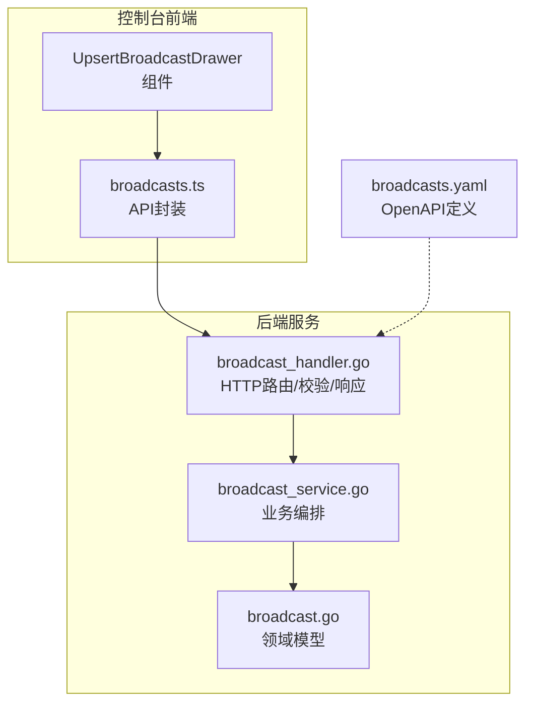
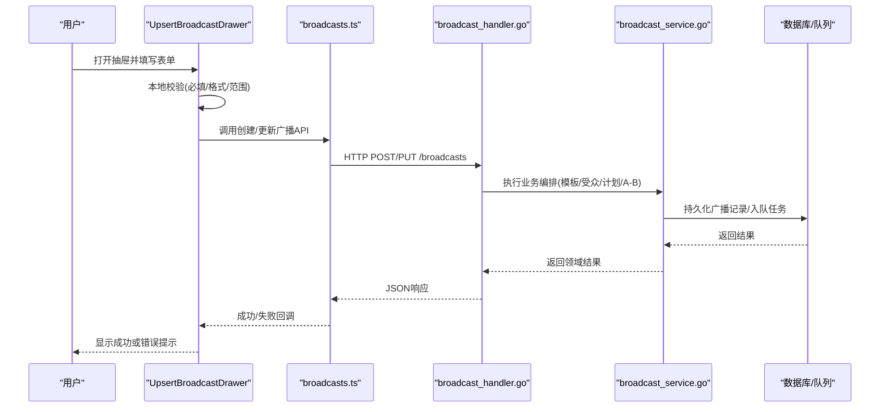
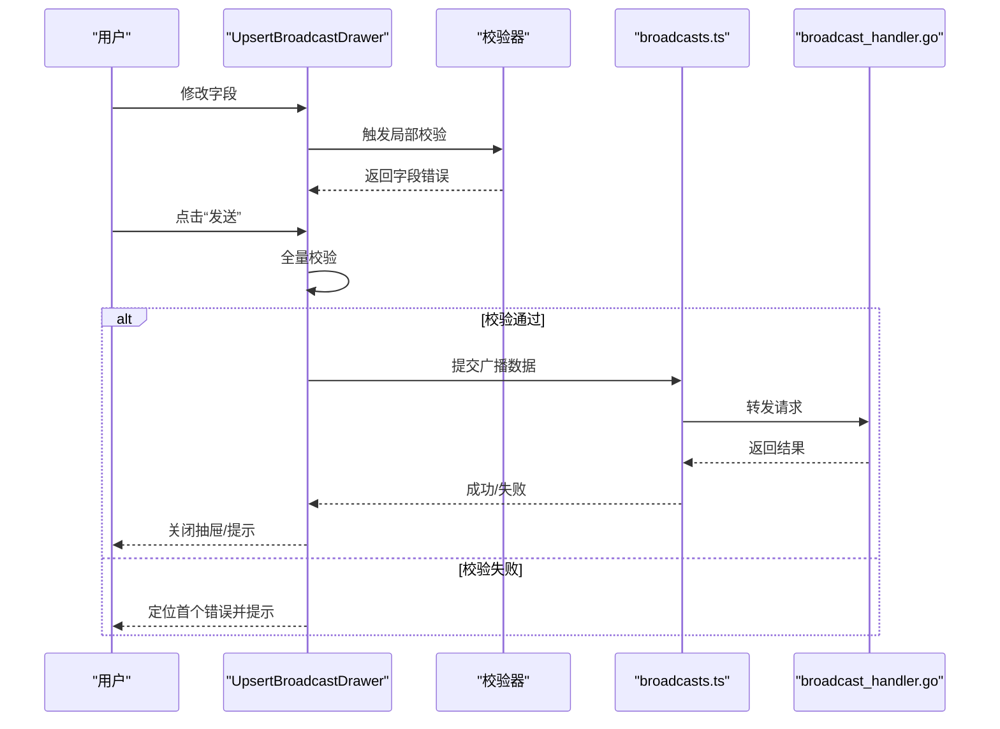
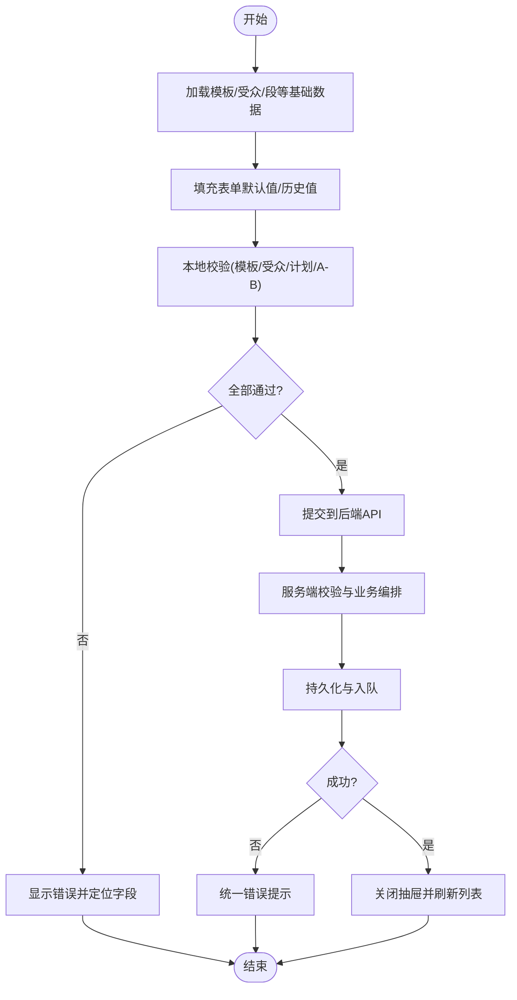
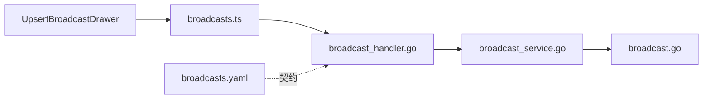

# 邮件广播创建

<cite>
**本文引用的文件**   
- [console/src/components/broadcasts/UpsertBroadcastDrawer.tsx](file://notifuse/console/src/components/broadcasts/UpsertBroadcastDrawer.tsx)
- [console/src/services/api/broadcasts.ts](file://notifuse/console/src/services/api/broadcasts.ts)
- [internal/domain/broadcast.go](file://notifuse/internal/domain/broadcast.go)
- [internal/http/broadcast_handler.go](file://notifuse/internal/http/broadcast_handler.go)
- [internal/service/broadcast_service.go](file://notifuse/internal/service/broadcast_service.go)
- [openapi/paths/broadcasts.yaml](file://notifuse/openapi/paths/broadcasts.yaml)
</cite>

## 目录
1. [简介](#简介)
2. [项目结构](#项目结构)
3. [核心组件](#核心组件)
4. [架构总览](#架构总览)
5. [详细组件分析](#详细组件分析)
6. [依赖分析](#依赖分析)
7. [性能考虑](#性能考虑)
8. [故障排查指南](#故障排查指南)
9. [结论](#结论)
10. [附录](#附录)

## 简介
本文件面向Notifuse控制台“邮件广播创建”功能，重点围绕 UpsertBroadcastDrawer 组件的设计模式与实现逻辑，系统阐述表单验证、数据绑定、状态管理、模板选择、收件人列表配置、发送计划设置以及A/B测试参数配置。同时说明与后端API的集成方式、数据提交流程和异步操作处理，并提供可复用的使用模式与扩展建议，帮助开发者快速理解并二次开发该能力。

## 项目结构
控制台前端位于 notifuse/console，广播相关的前端组件与服务封装在 components/broadcasts 与 services/api 下；后端领域模型、HTTP处理器与服务层分别位于 internal/domain、internal/http 与 internal/service；OpenAPI定义位于 openapi/paths。

图表来源
- [console/src/components/broadcasts/UpsertBroadcastDrawer.tsx](file://notifuse/console/src/components/broadcasts/UpsertBroadcastDrawer.tsx)
- [console/src/services/api/broadcasts.ts](file://notifuse/console/src/services/api/broadcasts.ts)
- [internal/http/broadcast_handler.go](file://notifuse/internal/http/broadcast_handler.go)
- [internal/service/broadcast_service.go](file://notifuse/internal/service/broadcast_service.go)
- [internal/domain/broadcast.go](file://notifuse/internal/domain/broadcast.go)
- [openapi/paths/broadcasts.yaml](file://notifuse/openapi/paths/broadcasts.yaml)

章节来源
- [console/src/components/broadcasts/UpsertBroadcastDrawer.tsx](file://notifuse/console/src/components/broadcasts/UpsertBroadcastDrawer.tsx)
- [console/src/services/api/broadcasts.ts](file://notifuse/console/src/services/api/broadcasts.ts)
- [internal/http/broadcast_handler.go](file://notifuse/internal/http/broadcast_handler.go)
- [internal/service/broadcast_service.go](file://notifuse/internal/service/broadcast_service.go)
- [internal/domain/broadcast.go](file://notifuse/internal/domain/broadcast.go)
- [openapi/paths/broadcasts.yaml](file://notifuse/openapi/paths/broadcasts.yaml)

## 核心组件
- UpsertBroadcastDrawer：负责“新建/编辑”广播的抽屉式表单交互，包含模板选择、收件人群组、发送计划、A/B测试等模块，统一进行本地校验、错误提示与提交控制。
- broadcasts.ts：封装与后端的广播相关API调用（如获取模板、联系人列表、创建/更新广播等），提供统一的请求/响应类型与错误处理。
- broadcast_handler.go：暴露HTTP接口，解析请求体、执行权限校验、调用服务层并返回标准化响应。
- broadcast_service.go：承载广播创建/更新的核心业务逻辑，包括模板渲染准备、受众计算、调度策略、A/B实验拆分等。
- broadcast.go：定义广播领域模型与约束（如主题、正文、受众、计划时间、A/B比例等）。
- broadcasts.yaml：描述广播相关API契约，作为前后端联调与代码生成的依据。

章节来源
- [console/src/components/broadcasts/UpsertBroadcastDrawer.tsx](file://notifuse/console/src/components/broadcasts/UpsertBroadcastDrawer.tsx)
- [console/src/services/api/broadcasts.ts](file://notifuse/console/src/services/api/broadcasts.ts)
- [internal/http/broadcast_handler.go](file://notifuse/internal/http/broadcast_handler.go)
- [internal/service/broadcast_service.go](file://notifuse/internal/service/broadcast_service.go)
- [internal/domain/broadcast.go](file://notifuse/internal/domain/broadcast.go)
- [openapi/paths/broadcasts.yaml](file://notifuse/openapi/paths/broadcasts.yaml)

## 架构总览
从用户点击“新建广播”到成功提交，整体流程如下：

图表来源
- [console/src/components/broadcasts/UpsertBroadcastDrawer.tsx](file://notifuse/console/src/components/broadcasts/UpsertBroadcastDrawer.tsx)
- [console/src/services/api/broadcasts.ts](file://notifuse/console/src/services/api/broadcasts.ts)
- [internal/http/broadcast_handler.go](file://notifuse/internal/http/broadcast_handler.go)
- [internal/service/broadcast_service.go](file://notifuse/internal/service/broadcast_service.go)

## 详细组件分析

### UpsertBroadcastDrawer 组件设计
- 设计模式
  - 受控表单：所有输入字段通过状态驱动，确保UI与数据一致。
  - 分步/分区校验：按区域（模板、受众、计划、A/B）独立校验，减少一次性校验成本。
  - 副作用隔离：将网络请求与UI状态解耦，便于测试与复用。
- 关键职责
  - 模板选择：支持从已存模板中选择或新建跳转，展示预览摘要。
  - 收件人列表：支持联系人列表、动态段、手动邮箱集合等多种来源。
  - 发送计划：支持立即发送或定时发送，含时区与重复规则（若适用）。
  - A/B测试：支持变量名、分组比例、指标选择与统计开关。
  - 错误反馈：字段级错误、全局错误、加载态与禁用态控制。
- 数据绑定与状态管理
  - 使用集中状态对象保存表单值，变更事件统一归口处理。
  - 对复杂字段（如多收件人来源）采用组合键+映射表维护选中项。
  - 提交前执行全量校验，失败则阻止提交并高亮错误字段。
- 与API集成
  - 调用创建/更新广播接口，携带模板ID、受众、计划时间与A/B参数。
  - 根据响应码与消息体决定成功路径或错误分支。
- 典型交互序列

图表来源
- [console/src/components/broadcasts/UpsertBroadcastDrawer.tsx](file://notifuse/console/src/components/broadcasts/UpsertBroadcastDrawer.tsx)
- [console/src/services/api/broadcasts.ts](file://notifuse/console/src/services/api/broadcasts.ts)
- [internal/http/broadcast_handler.go](file://notifuse/internal/http/broadcast_handler.go)

章节来源
- [console/src/components/broadcasts/UpsertBroadcastDrawer.tsx](file://notifuse/console/src/components/broadcasts/UpsertBroadcastDrawer.tsx)
- [console/src/services/api/broadcasts.ts](file://notifuse/console/src/services/api/broadcasts.ts)
- [internal/http/broadcast_handler.go](file://notifuse/internal/http/broadcast_handler.go)

### 表单字段与验证规则
- 模板选择
  - 必填：未选择模板时禁止提交。
  - 有效性：模板ID必须存在且属于当前工作空间。
- 收件人列表
  - 至少选择一个来源（列表/段/手动邮箱）。
  - 手动邮箱需符合邮箱格式，去重与上限限制。
- 发送计划
  - 立即发送：无需额外字段。
  - 定时发送：时间必须大于当前时间，且处于有效时区。
- A/B测试
  - 启用时需指定变量名与分组比例，比例之和为100%。
  - 指标可选，但需保证至少一个指标被勾选。
- 错误处理机制
  - 字段级错误：即时反馈，聚焦输入框。
  - 全局错误：来自服务端校验失败或网络异常的统一提示。
  - 防抖与节流：避免频繁提交与重复请求。

章节来源
- [console/src/components/broadcasts/UpsertBroadcastDrawer.tsx](file://notifuse/console/src/components/broadcasts/UpsertBroadcastDrawer.tsx)

### 数据模型与领域约束
- 广播实体
  - 标识与工作空间归属
  - 模板引用与内容占位符
  - 受众来源（列表/段/手动）
  - 发送策略（立即/定时）
  - A/B实验配置（变量、比例、指标）
- 约束与不变式
  - 唯一性：同一工作空间内广播名称/标识唯一。
  - 可达性：模板、受众来源必须存在且可用。
  - 一致性：A/B比例总和为100%，指标非空。

章节来源
- [internal/domain/broadcast.go](file://notifuse/internal/domain/broadcast.go)

### 后端集成与API契约
- HTTP接口
  - 创建/更新广播：POST/PUT /broadcasts
  - 查询模板、联系人列表、段等辅助资源（由其他接口提供）
- 请求/响应要点
  - 请求体包含模板ID、受众、计划时间、A/B参数等。
  - 响应包含广播ID、状态、错误信息（若有）。
- OpenAPI契约
  - 定义路径、方法、参数、响应结构与错误码，用于前后端对齐。

章节来源
- [internal/http/broadcast_handler.go](file://notifuse/internal/http/broadcast_handler.go)
- [openapi/paths/broadcasts.yaml](file://notifuse/openapi/paths/broadcasts.yaml)

### 业务流程与算法流程
- 广播创建主流程

图表来源
- [console/src/components/broadcasts/UpsertBroadcastDrawer.tsx](file://notifuse/console/src/components/broadcasts/UpsertBroadcastDrawer.tsx)
- [console/src/services/api/broadcasts.ts](file://notifuse/console/src/services/api/broadcasts.ts)
- [internal/http/broadcast_handler.go](file://notifuse/internal/http/broadcast_handler.go)
- [internal/service/broadcast_service.go](file://notifuse/internal/service/broadcast_service.go)

章节来源
- [console/src/components/broadcasts/UpsertBroadcastDrawer.tsx](file://notifuse/console/src/components/broadcasts/UpsertBroadcastDrawer.tsx)
- [console/src/services/api/broadcasts.ts](file://notifuse/console/src/services/api/broadcasts.ts)
- [internal/http/broadcast_handler.go](file://notifuse/internal/http/broadcast_handler.go)
- [internal/service/broadcast_service.go](file://notifuse/internal/service/broadcast_service.go)

## 依赖分析
- 前端依赖
  - UpsertBroadcastDrawer 依赖 broadcasts.ts 提供的API函数。
  - 表单库与UI组件库用于渲染与校验。
- 后端依赖
  - HTTP处理器依赖服务层完成业务编排。
  - 服务层依赖领域模型与仓储/队列。
- 外部契约
  - OpenAPI定义约束前后端数据结构与错误语义。

图表来源
- [console/src/components/broadcasts/UpsertBroadcastDrawer.tsx](file://notifuse/console/src/components/broadcasts/UpsertBroadcastDrawer.tsx)
- [console/src/services/api/broadcasts.ts](file://notifuse/console/src/services/api/broadcasts.ts)
- [internal/http/broadcast_handler.go](file://notifuse/internal/http/broadcast_handler.go)
- [internal/service/broadcast_service.go](file://notifuse/internal/service/broadcast_service.go)
- [internal/domain/broadcast.go](file://notifuse/internal/domain/broadcast.go)
- [openapi/paths/broadcasts.yaml](file://notifuse/openapi/paths/broadcasts.yaml)

章节来源
- [console/src/components/broadcasts/UpsertBroadcastDrawer.tsx](file://notifuse/console/src/components/broadcasts/UpsertBroadcastDrawer.tsx)
- [console/src/services/api/broadcasts.ts](file://notifuse/console/src/services/api/broadcasts.ts)
- [internal/http/broadcast_handler.go](file://notifuse/internal/http/broadcast_handler.go)
- [internal/service/broadcast_service.go](file://notifuse/internal/service/broadcast_service.go)
- [internal/domain/broadcast.go](file://notifuse/internal/domain/broadcast.go)
- [openapi/paths/broadcasts.yaml](file://notifuse/openapi/paths/broadcasts.yaml)

## 性能考虑
- 前端
  - 懒加载基础数据（模板、段、列表），按需请求。
  - 大列表收件人采用虚拟滚动与分页。
  - 校验采用增量与防抖策略，避免阻塞输入。
- 后端
  - 受众计算尽量使用索引与预聚合。
  - 批量写入与任务入队分离，降低请求延迟。
  - A/B实验拆分在队列中异步执行，避免长事务。

## 故障排查指南
- 常见错误
  - 模板不存在或不可用：检查模板ID与工作空间归属。
  - 受众为空或无效：确认至少选择一个来源且来源有效。
  - 计划时间非法：确保时间在未来且时区正确。
  - A/B比例不合法：检查比例之和是否为100%。
- 定位步骤
  - 查看浏览器网络面板，核对请求体与响应体是否符合OpenAPI定义。
  - 检查控制台日志与服务端日志，关注校验失败与异常堆栈。
  - 使用OpenAPI文档对比字段命名与类型差异。
- 恢复建议
  - 修正表单错误后重试。
  - 对于服务端错误，记录请求ID以便追踪。

章节来源
- [console/src/components/broadcasts/UpsertBroadcastDrawer.tsx](file://notifuse/console/src/components/broadcasts/UpsertBroadcastDrawer.tsx)
- [console/src/services/api/broadcasts.ts](file://notifuse/console/src/services/api/broadcasts.ts)
- [internal/http/broadcast_handler.go](file://notifuse/internal/http/broadcast_handler.go)
- [openapi/paths/broadcasts.yaml](file://notifuse/openapi/paths/broadcasts.yaml)

## 结论
UpsertBroadcastDrawer 以受控表单为核心，结合分区校验与清晰的错误反馈，提供了良好的用户体验。通过 broadcasts.ts 与后端 handler/service/domain 的分层协作，实现了模板选择、受众配置、发送计划与A/B测试的完整闭环。遵循OpenAPI契约与分层架构，有助于后续扩展更多广播策略与指标。

## 附录
- 使用模式建议
  - 将常用模板与受众来源保存为快捷方案，提升创建效率。
  - 对大规模受众优先使用段与列表，减少手动维护成本。
  - 开启A/B测试时，合理选择变量与指标，定期复盘效果。
- 扩展点
  - 新增自定义受众来源：在前端增加选择器并在API请求中携带新字段。
  - 新增发送策略：在服务层扩展调度逻辑，保持领域模型向后兼容。
  - 增强校验规则：在前端与服务端同步添加，并通过OpenAPI更新契约。