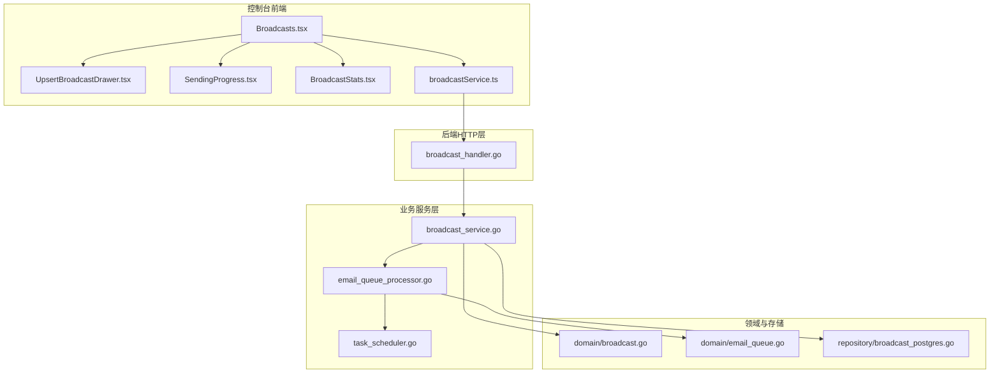
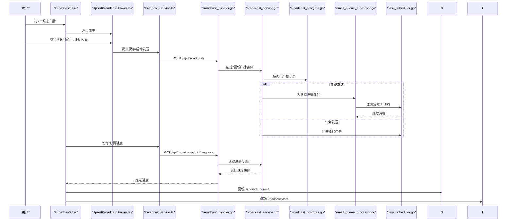
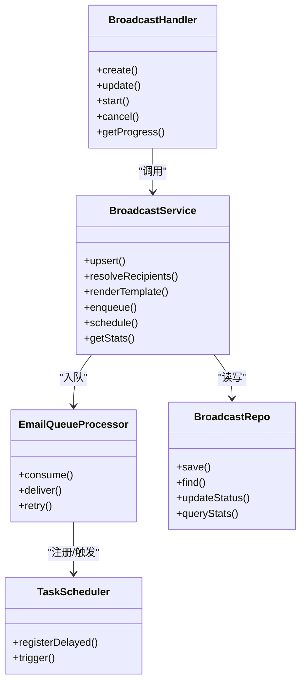
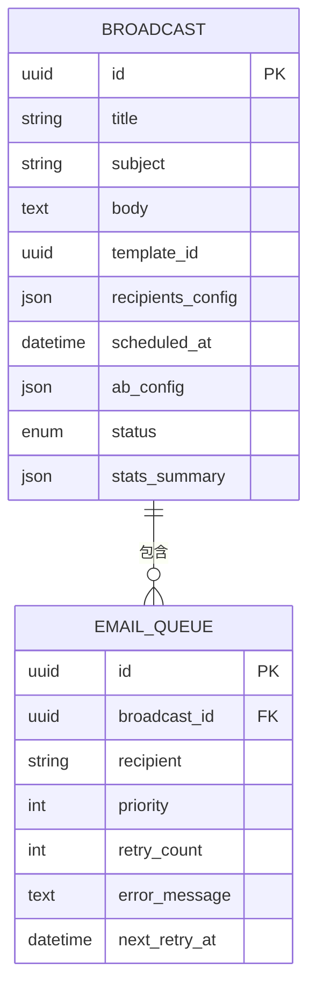
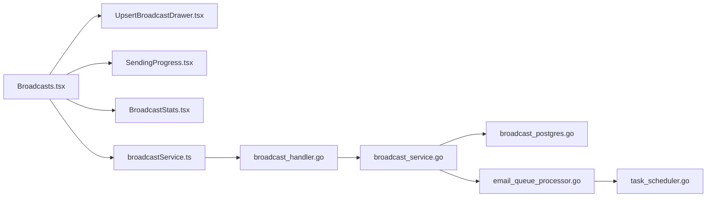

# 邮件广播页面

<cite>
**本文引用的文件**   
- [console/src/pages/Broadcasts.tsx](file://notifuse/console/src/pages/Broadcasts.tsx)
- [console/src/components/broadcast/UpsertBroadcastDrawer.tsx](file://notifuse/console/src/components/broadcast/UpsertBroadcastDrawer.tsx)
- [console/src/components/broadcast/SendingProgress.tsx](file://notifuse/console/src/components/broadcast/SendingProgress.tsx)
- [console/src/components/broadcast/BroadcastStats.tsx](file://notifuse/console/src/components/broadcast/BroadcastStats.tsx)
- [console/src/services/api/broadcastService.ts](file://notifuse/console/src/services/api/broadcastService.ts)
- [internal/http/broadcast_handler.go](file://notifuse/internal/http/broadcast_handler.go)
- [internal/service/broadcast_service.go](file://notifuse/internal/service/broadcast_service.go)
- [internal/domain/broadcast.go](file://notifuse/internal/domain/broadcast.go)
- [internal/repository/broadcast_postgres.go](file://notifuse/internal/repository/broadcast_postgres.go)
- [internal/service/queue/email_queue_processor.go](file://notifuse/internal/service/queue/email_queue_processor.go)
- [internal/service/task_scheduler.go](file://notifuse/internal/service/task_scheduler.go)
- [internal/domain/email_queue.go](file://notifuse/internal/domain/email_queue.go)
</cite>

## 目录
1. [简介](#简介)
2. [项目结构](#项目结构)
3. [核心组件](#核心组件)
4. [架构总览](#架构总览)
5. [详细组件分析](#详细组件分析)
6. [依赖分析](#依赖分析)
7. [性能考虑](#性能考虑)
8. [故障排查指南](#故障排查指南)
9. [结论](#结论)

## 简介
本文件面向Notifuse控制台“邮件广播”页面，系统性说明广播的创建、配置与发送流程。重点覆盖：
- UpsertBroadcastDrawer表单组件的设计模式与字段语义
- SendingProgress进度监控组件的实现逻辑与实时更新机制
- BroadcastStats统计面板的数据展示与指标含义
- 邮件模板集成、收件人选择、发送计划设置与A/B测试配置
- 异步任务处理、进度实时更新、错误重试机制与发送状态跟踪
- 并发控制、队列管理与性能优化方案

## 项目结构
控制台侧围绕“广播”功能形成前后端协作链路：前端通过API服务调用后端HTTP处理器，再由领域服务编排持久化、队列入队与调度执行；后端提供广播生命周期管理、统计查询与进度上报能力。

图表来源
- [console/src/pages/Broadcasts.tsx](file://notifuse/console/src/pages/Broadcasts.tsx)
- [console/src/components/broadcast/UpsertBroadcastDrawer.tsx](file://notifuse/console/src/components/broadcast/UpsertBroadcastDrawer.tsx)
- [console/src/components/broadcast/SendingProgress.tsx](file://notifuse/console/src/components/broadcast/SendingProgress.tsx)
- [console/src/components/broadcast/BroadcastStats.tsx](file://notifuse/console/src/components/broadcast/BroadcastStats.tsx)
- [console/src/services/api/broadcastService.ts](file://notifuse/console/src/services/api/broadcastService.ts)
- [internal/http/broadcast_handler.go](file://notifuse/internal/http/broadcast_handler.go)
- [internal/service/broadcast_service.go](file://notifuse/internal/service/broadcast_service.go)
- [internal/service/queue/email_queue_processor.go](file://notifuse/internal/service/queue/email_queue_processor.go)
- [internal/service/task_scheduler.go](file://notifuse/internal/service/task_scheduler.go)
- [internal/domain/broadcast.go](file://notifuse/internal/domain/broadcast.go)
- [internal/domain/email_queue.go](file://notifuse/internal/domain/email_queue.go)
- [internal/repository/broadcast_postgres.go](file://notifuse/internal/repository/broadcast_postgres.go)

章节来源
- [console/src/pages/Broadcasts.tsx](file://notifuse/console/src/pages/Broadcasts.tsx)
- [console/src/services/api/broadcastService.ts](file://notifuse/console/src/services/api/broadcastService.ts)
- [internal/http/broadcast_handler.go](file://notifuse/internal/http/broadcast_handler.go)
- [internal/service/broadcast_service.go](file://notifuse/internal/service/broadcast_service.go)
- [internal/service/queue/email_queue_processor.go](file://notifuse/internal/service/queue/email_queue_processor.go)
- [internal/service/task_scheduler.go](file://notifuse/internal/service/task_scheduler.go)
- [internal/domain/broadcast.go](file://notifuse/internal/domain/broadcast.go)
- [internal/domain/email_queue.go](file://notifuse/internal/domain/email_queue.go)
- [internal/repository/broadcast_postgres.go](file://notifuse/internal/repository/broadcast_postgres.go)

## 核心组件
- UpsertBroadcastDrawer：负责新建或编辑广播的表单交互与数据校验，支持模板选择、主题与正文编辑、收件人群体选择、发送计划与A/B测试开关等。
- SendingProgress：在广播发送期间实时展示总体进度、成功/失败计数、速率与ETA，并支持轮询或事件驱动的更新策略。
- BroadcastStats：以卡片/表格形式呈现关键指标（已发送、成功、失败、退信、打开率、点击率等），并提供筛选与分页。

章节来源
- [console/src/components/broadcast/UpsertBroadcastDrawer.tsx](file://notifuse/console/src/components/broadcast/UpsertBroadcastDrawer.tsx)
- [console/src/components/broadcast/SendingProgress.tsx](file://notifuse/console/src/components/broadcast/SendingProgress.tsx)
- [console/src/components/broadcast/BroadcastStats.tsx](file://notifuse/console/src/components/broadcast/BroadcastStats.tsx)

## 架构总览
从用户操作到邮件落地的端到端流程如下：

图表来源
- [console/src/pages/Broadcasts.tsx](file://notifuse/console/src/pages/Broadcasts.tsx)
- [console/src/components/broadcast/UpsertBroadcastDrawer.tsx](file://notifuse/console/src/components/broadcast/UpsertBroadcastDrawer.tsx)
- [console/src/components/broadcast/SendingProgress.tsx](file://notifuse/console/src/components/broadcast/SendingProgress.tsx)
- [console/src/components/broadcast/BroadcastStats.tsx](file://notifuse/console/src/components/broadcast/BroadcastStats.tsx)
- [console/src/services/api/broadcastService.ts](file://notifuse/console/src/services/api/broadcastService.ts)
- [internal/http/broadcast_handler.go](file://notifuse/internal/http/broadcast_handler.go)
- [internal/service/broadcast_service.go](file://notifuse/internal/service/broadcast_service.go)
- [internal/repository/broadcast_postgres.go](file://notifuse/internal/repository/broadcast_postgres.go)
- [internal/service/queue/email_queue_processor.go](file://notifuse/internal/service/queue/email_queue_processor.go)
- [internal/service/task_scheduler.go](file://notifuse/internal/service/task_scheduler.go)

## 详细组件分析

### UpsertBroadcastDrawer 表单组件
- 设计模式
  - 受控表单：所有输入由React状态驱动，统一校验与提交流程。
  - 分步/分区布局：将“内容（模板）”、“受众（收件人）”、“调度（计划）”、“实验（A/B）”分组呈现，降低认知负荷。
  - 可组合性：复用模板选择器、联系人列表/片段选择器、时间选择器等子组件。
- 关键字段与行为
  - 模板集成：选择已有模板或新建，支持预览与变量替换提示。
  - 收件人选择：支持按列表、标签、动态片段或CSV导入方式聚合目标受众。
  - 发送计划：支持立即发送或指定时区与时间点；支持重复周期（若实现）。
  - A/B测试：开启后定义变体比例与胜出指标（如打开率/点击率），系统自动分流与统计。
  - 校验规则：必填项、格式校验、受众规模上限提示、冲突检测（如重复收件人）。
- 交互细节
  - 草稿保存：支持暂存未完成的广播，避免丢失。
  - 变更追踪：对关键修改进行二次确认。
  - 错误反馈：行级错误提示与全局错误汇总。

章节来源
- [console/src/components/broadcast/UpsertBroadcastDrawer.tsx](file://notifuse/console/src/components/broadcast/UpsertBroadcastDrawer.tsx)

### SendingProgress 进度监控组件
- 数据源与更新策略
  - 轮询：基于定时器周期性请求进度接口，适合无WebSocket场景。
  - 事件驱动：若后端支持SSE/WebSocket，则采用事件流减少无效请求。
- 展示维度
  - 总体进度条：已完成/总数百分比。
  - 速率与ETA：当前吞吐（封/分钟）与预计完成时间。
  - 成功/失败/退信：分类计数与趋势。
  - 失败详情：最近失败样本与错误码分布。
- 容错与体验
  - 断线重连与指数退避。
  - 本地缓存上次进度，避免闪烁。
  - 暂停/取消（若允许）与二次确认。

章节来源
- [console/src/components/broadcast/SendingProgress.tsx](file://notifuse/console/src/components/broadcast/SendingProgress.tsx)

### BroadcastStats 统计面板
- 指标口径
  - 已发送：进入投递通道的数量。
  - 成功：被上游服务商确认送达的数量。
  - 失败：不可恢复的错误（如地址无效）。
  - 退信：软/硬退信分类统计。
  - 打开率/点击率：基于追踪像素/链接埋点计算。
- 过滤与导出
  - 按时间范围、模板、受众、A/B变体筛选。
  - 支持CSV导出以便离线分析。
- 可视化
  - 折线图展示成功率与速率随时间变化。
  - 饼图展示失败原因分布。

章节来源
- [console/src/components/broadcast/BroadcastStats.tsx](file://notifuse/console/src/components/broadcast/BroadcastStats.tsx)

### 后端处理链路（HTTP与服务层）
- HTTP处理器
  - 接收广播创建/更新/启动/取消/进度查询等请求。
  - 参数校验、权限检查与审计日志。
- 广播服务
  - 编排广播实体的CRUD、受众解析、模板渲染、队列入队与调度注册。
  - 维护广播状态机（草稿、排队中、发送中、已完成、失败、已取消）。
- 队列与调度
  - 将待发送邮件写入队列，交由消费者批量拉取与投递。
  - 使用任务调度器支持延迟执行与重试。

图表来源
- [internal/http/broadcast_handler.go](file://notifuse/internal/http/broadcast_handler.go)
- [internal/service/broadcast_service.go](file://notifuse/internal/service/broadcast_service.go)
- [internal/service/queue/email_queue_processor.go](file://notifuse/internal/service/queue/email_queue_processor.go)
- [internal/service/task_scheduler.go](file://notifuse/internal/service/task_scheduler.go)
- [internal/repository/broadcast_postgres.go](file://notifuse/internal/repository/broadcast_postgres.go)

章节来源
- [internal/http/broadcast_handler.go](file://notifuse/internal/http/broadcast_handler.go)
- [internal/service/broadcast_service.go](file://notifuse/internal/service/broadcast_service.go)
- [internal/service/queue/email_queue_processor.go](file://notifuse/internal/service/queue/email_queue_processor.go)
- [internal/service/task_scheduler.go](file://notifuse/internal/service/task_scheduler.go)
- [internal/repository/broadcast_postgres.go](file://notifuse/internal/repository/broadcast_postgres.go)

### 领域模型与数据流
- 广播实体
  - 标识、标题、主题、正文、模板ID、受众集合、计划时间、A/B配置、状态、统计摘要等。
- 队列条目
  - 关联广播ID、目标邮箱、优先级、重试次数、错误信息、下次尝试时间等。
- 数据流
  - 创建广播 -> 持久化 -> 生成队列条目 -> 调度消费 -> 投递 -> 回写统计与状态。

图表来源
- [internal/domain/broadcast.go](file://notifuse/internal/domain/broadcast.go)
- [internal/domain/email_queue.go](file://notifuse/internal/domain/email_queue.go)

章节来源
- [internal/domain/broadcast.go](file://notifuse/internal/domain/broadcast.go)
- [internal/domain/email_queue.go](file://notifuse/internal/domain/email_queue.go)

### 发送计划与A/B测试
- 发送计划
  - 支持立即发送与延迟发送；延迟任务由调度器注册，到期触发入队。
  - 时区敏感的时间解析与夏令时兼容。
- A/B测试
  - 定义变体内容与权重；根据受众哈希或随机分配。
  - 独立统计各变体指标，达到显著性或预设阈值后自动提升胜出者。

章节来源
- [internal/service/broadcast_service.go](file://notifuse/internal/service/broadcast_service.go)
- [internal/service/task_scheduler.go](file://notifuse/internal/service/task_scheduler.go)

### 异步任务处理、进度实时更新与错误重试
- 异步任务
  - 广播创建与启动解耦为“持久化+入队/调度”，保证高吞吐与低延迟响应。
- 进度实时更新
  - 前端定期拉取或事件订阅，服务端聚合最新统计快照返回。
- 错误重试
  - 队列条目携带重试次数与退避策略；失败分类（网络/认证/地址无效）决定重试或快速失败。
- 状态跟踪
  - 广播状态机与队列条目状态联动，确保一致性与可观测性。

章节来源
- [internal/service/queue/email_queue_processor.go](file://notifuse/internal/service/queue/email_queue_processor.go)
- [internal/service/task_scheduler.go](file://notifuse/internal/service/task_scheduler.go)
- [internal/domain/email_queue.go](file://notifuse/internal/domain/email_queue.go)

## 依赖分析
- 前端依赖
  - Broadcasts.tsx 依赖 UpsertBroadcastDrawer、SendingProgress、BroadcastStats 与 broadcastService。
- 后端依赖
  - HTTP处理器依赖广播服务；广播服务依赖仓库与队列/调度模块；队列处理器依赖调度器与领域模型。

图表来源
- [console/src/pages/Broadcasts.tsx](file://notifuse/console/src/pages/Broadcasts.tsx)
- [console/src/components/broadcast/UpsertBroadcastDrawer.tsx](file://notifuse/console/src/components/broadcast/UpsertBroadcastDrawer.tsx)
- [console/src/components/broadcast/SendingProgress.tsx](file://notifuse/console/src/components/broadcast/SendingProgress.tsx)
- [console/src/components/broadcast/BroadcastStats.tsx](file://notifuse/console/src/components/broadcast/BroadcastStats.tsx)
- [console/src/services/api/broadcastService.ts](file://notifuse/console/src/services/api/broadcastService.ts)
- [internal/http/broadcast_handler.go](file://notifuse/internal/http/broadcast_handler.go)
- [internal/service/broadcast_service.go](file://notifuse/internal/service/broadcast_service.go)
- [internal/repository/broadcast_postgres.go](file://notifuse/internal/repository/broadcast_postgres.go)
- [internal/service/queue/email_queue_processor.go](file://notifuse/internal/service/queue/email_queue_processor.go)
- [internal/service/task_scheduler.go](file://notifuse/internal/service/task_scheduler.go)

章节来源
- [console/src/pages/Broadcasts.tsx](file://notifuse/console/src/pages/Broadcasts.tsx)
- [console/src/services/api/broadcastService.ts](file://notifuse/console/src/services/api/broadcastService.ts)
- [internal/http/broadcast_handler.go](file://notifuse/internal/http/broadcast_handler.go)
- [internal/service/broadcast_service.go](file://notifuse/internal/service/broadcast_service.go)
- [internal/repository/broadcast_postgres.go](file://notifuse/internal/repository/broadcast_postgres.go)
- [internal/service/queue/email_queue_processor.go](file://notifuse/internal/service/queue/email_queue_processor.go)
- [internal/service/task_scheduler.go](file://notifuse/internal/service/task_scheduler.go)

## 性能考虑
- 并发控制
  - 队列消费者并行度可调，结合令牌桶或滑动窗口限制下游SMTP/第三方API速率。
  - 广播级别限流，防止单广播占用过多资源。
- 队列管理
  - 优先队列与死信队列分离，失败条目隔离便于人工干预。
  - 批量拉取与批处理投递，减少往返开销。
- 数据库与缓存
  - 统计聚合走物化视图或预计算表，避免实时复杂查询。
  - 热点广播元数据缓存，缩短进度查询延迟。
- 前端优化
  - 增量更新与虚拟滚动，避免大列表卡顿。
  - 去抖与合并请求，降低服务器压力。

[本节为通用指导，不直接分析具体文件]

## 故障排查指南
- 常见问题定位
  - 进度不更新：检查前端轮询间隔与后端进度接口可用性；查看队列是否堆积。
  - 发送失败率高：查看失败分类与错误消息，区分网络/认证/地址问题。
  - 计划未触发：核对调度器运行状态与任务注册日志。
- 诊断手段
  - 启用详细日志与追踪ID，串联前端请求与后端处理链路。
  - 导出失败样本与重试历史，辅助根因分析。
  - 压测脚本模拟大批量受众，验证限流与退避策略。

章节来源
- [console/src/components/broadcast/SendingProgress.tsx](file://notifuse/console/src/components/broadcast/SendingProgress.tsx)
- [console/src/components/broadcast/BroadcastStats.tsx](file://notifuse/console/src/components/broadcast/BroadcastStats.tsx)
- [internal/service/queue/email_queue_processor.go](file://notifuse/internal/service/queue/email_queue_processor.go)
- [internal/service/task_scheduler.go](file://notifuse/internal/service/task_scheduler.go)

## 结论
邮件广播页面通过清晰的组件分层与前后端协作，实现了从表单配置到异步投递的全链路闭环。借助队列与调度器，系统在大规模受众场景下仍能提供稳定的进度反馈与良好的用户体验。建议在生产环境持续完善限流、重试与可观测性能力，并结合A/B测试数据驱动内容优化。