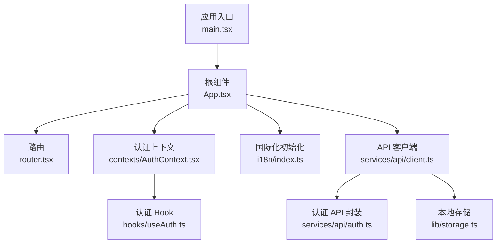
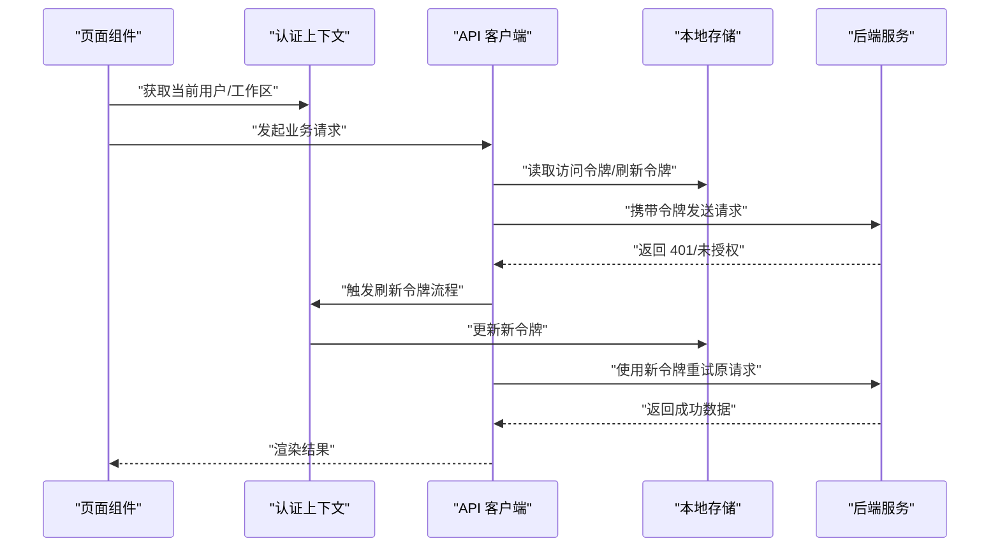
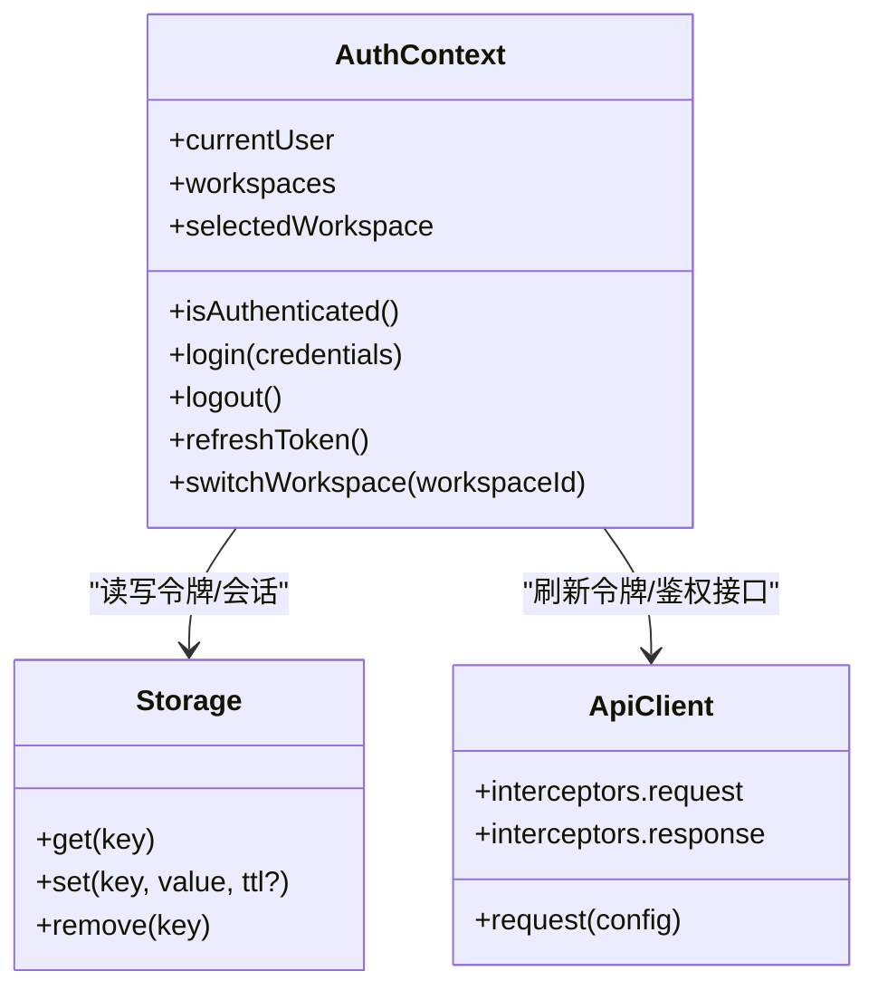
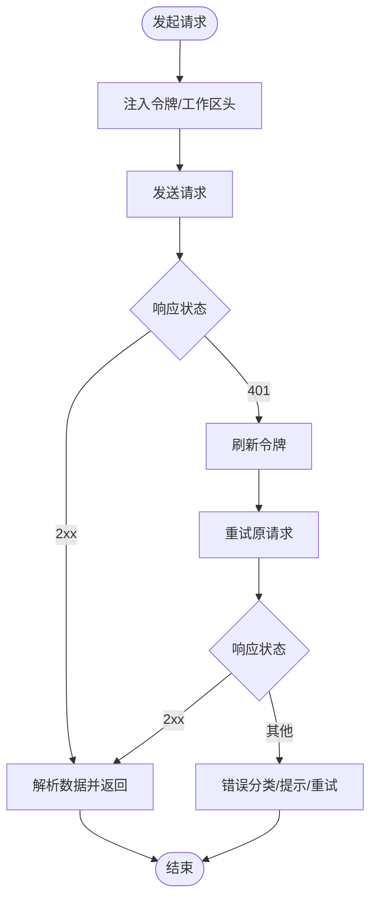
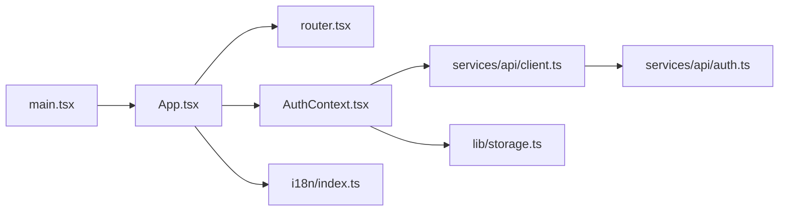

# 状态管理

<cite>
**本文引用的文件**   
- [main.tsx](file://notifuse/console/src/main.tsx)
- [App.tsx](file://notifuse/console/src/App.tsx)
- [router.tsx](file://notifuse/console/src/router.tsx)
- [contexts/AuthContext.tsx](file://notifuse/console/src/contexts/AuthContext.tsx)
- [i18n/index.ts](file://notifuse/console/src/i18n/index.ts)
- [services/api/client.ts](file://notifuse/console/src/services/api/client.ts)
- [services/api/auth.ts](file://notifuse/console/src/services/api/auth.ts)
- [lib/storage.ts](file://notifuse/console/src/lib/storage.ts)
- [hooks/useAuth.ts](file://notifuse/console/src/hooks/useAuth.ts)
</cite>

## 目录
1. [简介](#简介)
2. [项目结构](#项目结构)
3. [核心组件](#核心组件)
4. [架构总览](#架构总览)
5. [详细组件分析](#详细组件分析)
6. [依赖关系分析](#依赖关系分析)
7. [性能考虑](#性能考虑)
8. [故障排查指南](#故障排查指南)
9. [结论](#结论)
10. [附录](#附录)

## 简介
本文件面向 Notifuse 前端控制台的状态管理系统，聚焦于 React Context API 的使用模式与最佳实践，覆盖认证状态、国际化状态、全局配置等上下文设计；同时文档化 API 客户端封装（请求拦截器、响应处理、错误重试）、本地存储策略、缓存管理与服务端状态同步方案；并给出状态持久化、重置与迁移的处理方式，以及性能优化、内存泄漏防护和调试技巧。

## 项目结构
控制台采用“按领域分层 + 集中式上下文”的组织方式：
- 应用入口与根布局负责挂载全局上下文与路由
- contexts 提供认证、国际化、全局配置等上下文
- services/api 统一封装 HTTP 客户端、拦截器与业务 API
- lib 提供本地存储、加密、工具函数等基础设施
- hooks 暴露基于上下文的便捷 Hook

图表来源
- [main.tsx](file://notifuse/console/src/main.tsx)
- [App.tsx](file://notifuse/console/src/App.tsx)
- [router.tsx](file://notifuse/console/src/router.tsx)
- [contexts/AuthContext.tsx](file://notifuse/console/src/contexts/AuthContext.tsx)
- [i18n/index.ts](file://notifuse/console/src/i18n/index.ts)
- [services/api/client.ts](file://notifuse/console/src/services/api/client.ts)
- [services/api/auth.ts](file://notifuse/console/src/services/api/auth.ts)
- [lib/storage.ts](file://notifuse/console/src/lib/storage.ts)
- [hooks/useAuth.ts](file://notifuse/console/src/hooks/useAuth.ts)

章节来源
- [main.tsx](file://notifuse/console/src/main.tsx)
- [App.tsx](file://notifuse/console/src/App.tsx)
- [router.tsx](file://notifuse/console/src/router.tsx)

## 核心组件
- 认证上下文 AuthContext：维护登录态、用户信息、工作区选择、刷新令牌、登出与权限判断等
- 国际化 i18n：在应用启动时初始化语言与资源，配合上下文或 Hook 切换语言
- API 客户端 client：封装 fetch/axios，提供请求拦截器（注入 Token、租户/工作区头）、响应拦截器（统一错误、自动重试）、错误分类与提示
- 本地存储 storage：封装 localStorage/sessionStorage，提供类型安全读写、过期时间、序列化/反序列化
- 认证 Hook useAuth：从认证上下文派生常用方法（登录、登出、刷新、切换工作区）

章节来源
- [contexts/AuthContext.tsx](file://notifuse/console/src/contexts/AuthContext.tsx)
- [i18n/index.ts](file://notifuse/console/src/i18n/index.ts)
- [services/api/client.ts](file://notifuse/console/src/services/api/client.ts)
- [lib/storage.ts](file://notifuse/console/src/lib/storage.ts)
- [hooks/useAuth.ts](file://notifuse/console/src/hooks/useAuth.ts)

## 架构总览
下图展示从页面发起请求到服务端返回的完整链路，包括认证上下文、API 客户端、本地存储与服务端交互。

图表来源
- [contexts/AuthContext.tsx](file://notifuse/console/src/contexts/AuthContext.tsx)
- [services/api/client.ts](file://notifuse/console/src/services/api/client.ts)
- [services/api/auth.ts](file://notifuse/console/src/services/api/auth.ts)
- [lib/storage.ts](file://notifuse/console/src/lib/storage.ts)

## 详细组件分析

### 认证上下文 AuthContext
职责
- 维护登录态、用户信息、工作区选择、权限集合
- 提供登录、登出、刷新令牌、切换工作区等方法
- 在应用启动时尝试恢复会话（从本地存储加载令牌并校验有效性）

关键设计点
- 使用 React Context 提供跨层级共享状态，避免 props 透传
- 将敏感操作（如刷新令牌）集中在上下文内，保证幂等与并发安全
- 通过 Hook 暴露最小 API，降低组件耦合度

图表来源
- [contexts/AuthContext.tsx](file://notifuse/console/src/contexts/AuthContext.tsx)
- [lib/storage.ts](file://notifuse/console/src/lib/storage.ts)
- [services/api/client.ts](file://notifuse/console/src/services/api/client.ts)

章节来源
- [contexts/AuthContext.tsx](file://notifuse/console/src/contexts/AuthContext.tsx)
- [hooks/useAuth.ts](file://notifuse/console/src/hooks/useAuth.ts)

### 国际化状态管理
职责
- 在应用启动时初始化语言与翻译资源
- 提供语言切换能力，并在需要时持久化用户偏好

实现要点
- 在根组件中完成 i18n 初始化，确保所有子树可用
- 结合本地存储保存语言偏好，下次进入直接生效
- 对动态资源按需加载，减少首屏体积

章节来源
- [i18n/index.ts](file://notifuse/console/src/i18n/index.ts)

### API 客户端封装
职责
- 统一请求/响应处理
- 注入认证头、租户/工作区标识
- 错误分类、提示与重试
- 与认证上下文协作处理 401 场景

请求拦截器
- 自动附加访问令牌与工作区头
- 为特定请求添加追踪 ID、超时控制

响应拦截器
- 统一错误码映射与用户提示
- 针对 401 触发刷新令牌并重试一次
- 网络异常降级与重试策略（指数退避）

图表来源
- [services/api/client.ts](file://notifuse/console/src/services/api/client.ts)
- [services/api/auth.ts](file://notifuse/console/src/services/api/auth.ts)
- [contexts/AuthContext.tsx](file://notifuse/console/src/contexts/AuthContext.tsx)

章节来源
- [services/api/client.ts](file://notifuse/console/src/services/api/client.ts)
- [services/api/auth.ts](file://notifuse/console/src/services/api/auth.ts)

### 本地存储与缓存策略
职责
- 提供类型安全的键值存取
- 支持 TTL 过期、序列化/反序列化
- 作为访问令牌、刷新令牌、语言偏好等的持久层

策略建议
- 访问令牌短生命周期，刷新令牌长生命周期
- 敏感字段可加密存储（结合平台能力）
- 列表类数据可按资源维度做轻量缓存，配合失效策略

章节来源
- [lib/storage.ts](file://notifuse/console/src/lib/storage.ts)

### 服务端状态同步
- 登录成功后拉取用户与工作区信息，写入上下文与本地存储
- 工作区切换后重新加载相关资源
- 后台任务或轮询变更时，通过事件或 WebSocket 更新上下文

章节来源
- [contexts/AuthContext.tsx](file://notifuse/console/src/contexts/AuthContext.tsx)
- [services/api/auth.ts](file://notifuse/console/src/services/api/auth.ts)

## 依赖关系分析
- main.tsx 负责挂载根组件与全局上下文
- App.tsx 组合认证上下文、国际化与路由
- router.tsx 根据认证状态进行路由守卫与重定向
- AuthContext 依赖 API 客户端与本地存储
- API 客户端依赖本地存储与认证上下文（刷新令牌）

图表来源
- [main.tsx](file://notifuse/console/src/main.tsx)
- [App.tsx](file://notifuse/console/src/App.tsx)
- [router.tsx](file://notifuse/console/src/router.tsx)
- [contexts/AuthContext.tsx](file://notifuse/console/src/contexts/AuthContext.tsx)
- [i18n/index.ts](file://notifuse/console/src/i18n/index.ts)
- [services/api/client.ts](file://notifuse/console/src/services/api/client.ts)
- [services/api/auth.ts](file://notifuse/console/src/services/api/auth.ts)
- [lib/storage.ts](file://notifuse/console/src/lib/storage.ts)

章节来源
- [main.tsx](file://notifuse/console/src/main.tsx)
- [App.tsx](file://notifuse/console/src/App.tsx)
- [router.tsx](file://notifuse/console/src/router.tsx)

## 性能考虑
- 上下文拆分：将认证、国际化、全局配置拆分为独立上下文，避免单一大对象导致不必要的重渲染
- 细粒度订阅：通过自定义 Hook 仅订阅必要字段，减少组件更新范围
- 惰性加载：非关键上下文或大型资源按需加载
- 防抖与节流：高频状态更新（如搜索、滚动）需加防抖/节流
- 取消重复请求：相同参数并发请求合并，避免重复网络开销
- 内存泄漏防护：在组件卸载时清理定时器、事件监听与未完成的请求
- 调试技巧：开启 React DevTools Profiler，记录上下文更新热点；为 API 请求增加唯一 ID 便于链路追踪

[本节为通用指导，不直接分析具体文件]

## 故障排查指南
常见问题与定位思路
- 登录后仍被重定向至登录页：检查认证上下文初始化是否成功、令牌是否有效、路由守卫逻辑是否正确
- 刷新令牌失败：确认刷新接口可达、刷新令牌是否过期、是否存在并发刷新竞态
- 401 循环重试：检查重试次数上限、是否区分了刷新接口与普通接口
- 语言切换无效：确认 i18n 初始化顺序、资源是否加载成功、是否有缓存干扰
- 本地存储异常：检查存储空间大小限制、序列化格式、TTL 设置

章节来源
- [contexts/AuthContext.tsx](file://notifuse/console/src/contexts/AuthContext.tsx)
- [services/api/client.ts](file://notifuse/console/src/services/api/client.ts)
- [lib/storage.ts](file://notifuse/console/src/lib/storage.ts)

## 结论
通过以 React Context 为核心的状态管理方案，Notifuse 控制台实现了清晰的认证、国际化与全局配置管理；配合统一的 API 客户端封装与本地存储策略，形成了稳定可靠的前端状态体系。遵循本文的设计模式与最佳实践，可在保持可维护性的同时获得良好的性能与用户体验。

## 附录
- 状态持久化清单：访问令牌、刷新令牌、语言偏好、工作区选择
- 状态重置路径：登出、会话过期、环境切换
- 状态迁移建议：版本化存储键名、向后兼容迁移脚本、灰度发布策略

[本节为概念性内容，不直接分析具体文件]