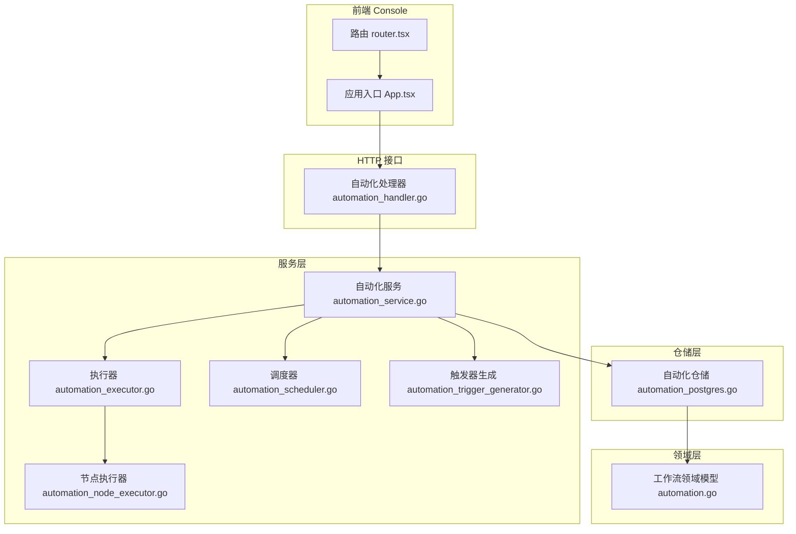
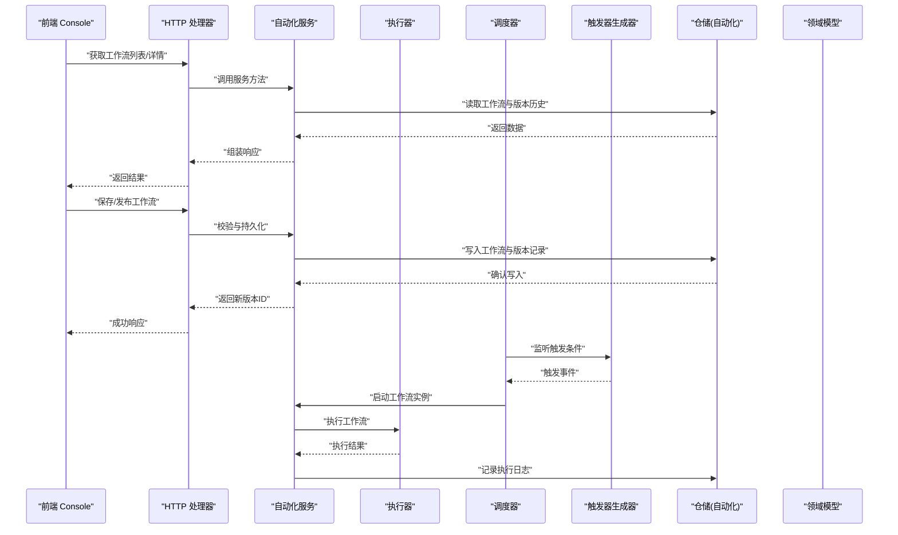
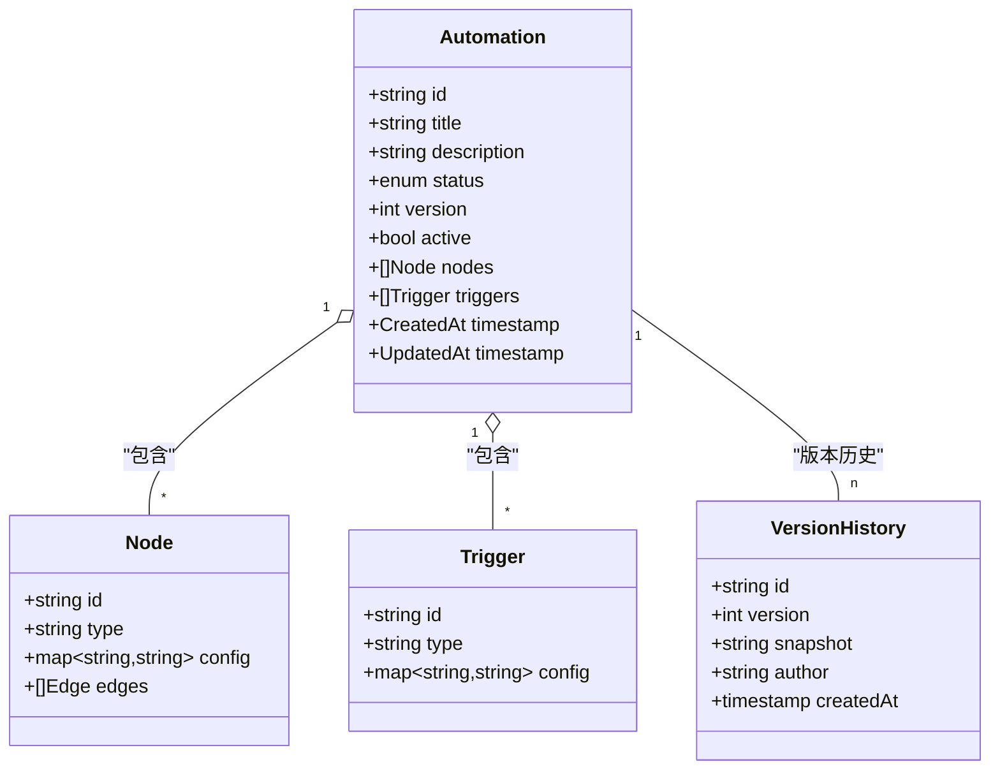
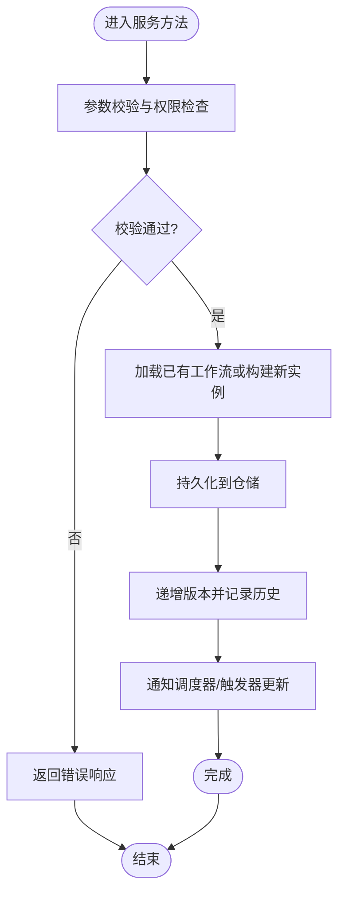
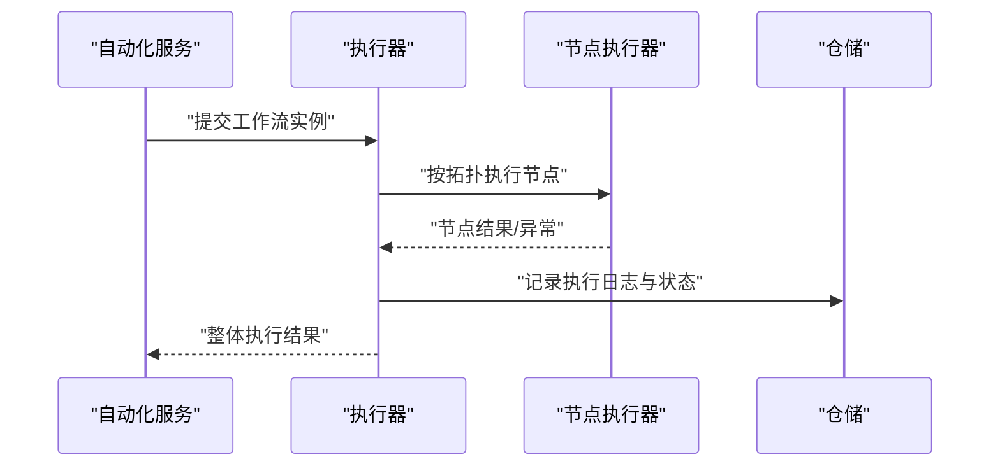
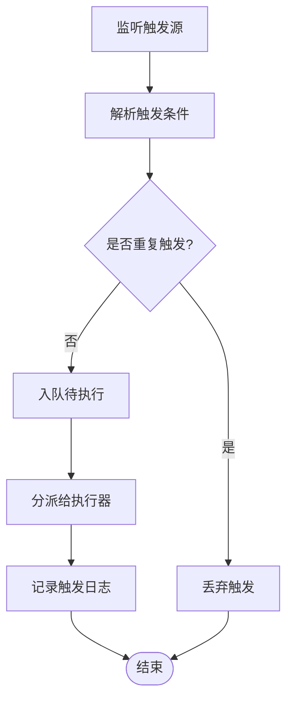
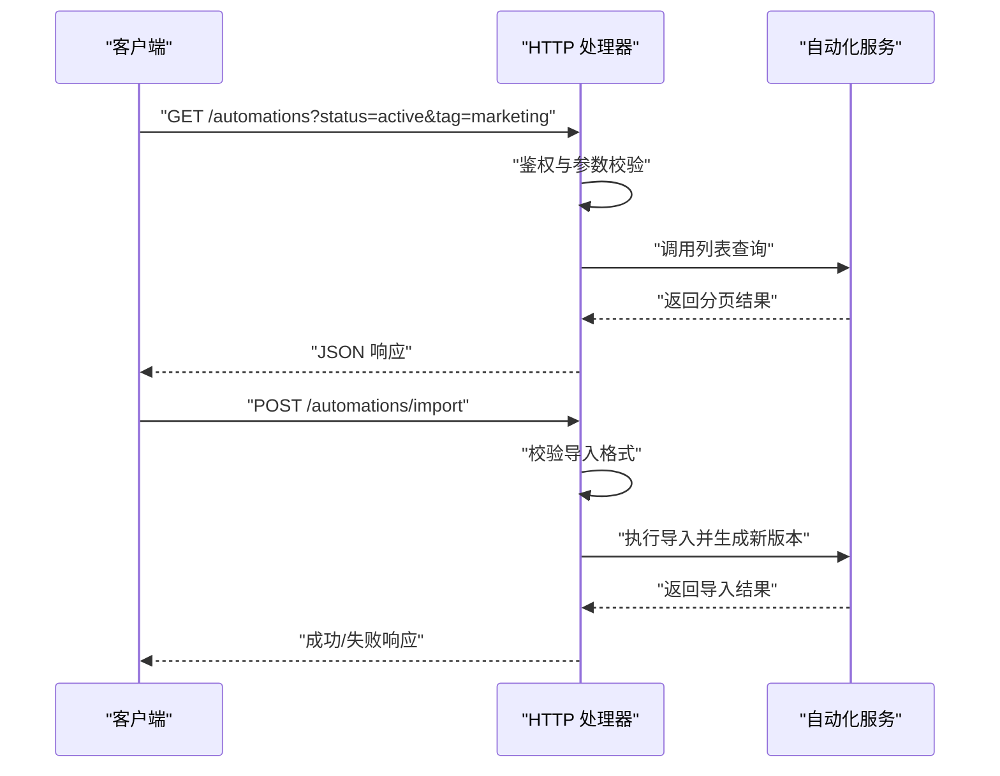
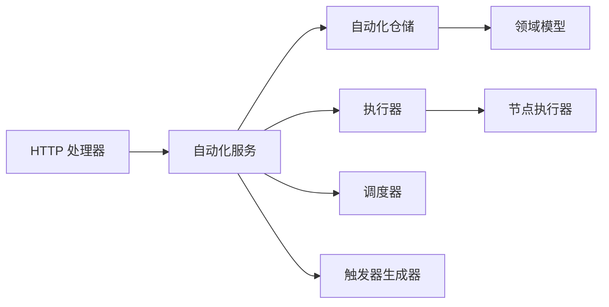

# 工作流管理功能

<cite>
**本文引用的文件**   
- [automation.go](file://notifuse/internal/domain/automation.go)
- [automation_handler.go](file://notifuse/internal/http/automation_handler.go)
- [automation_postgres.go](file://notifuse/internal/repository/automation_postgres.go)
- [automation_service.go](file://notifuse/internal/service/automation_service.go)
- [automation_executor.go](file://notifuse/internal/service/automation_executor.go)
- [automation_scheduler.go](file://notifuse/internal/service/automation_scheduler.go)
- [automation_node_executor.go](file://notifuse/internal/service/automation_node_executor.go)
- [automation_trigger_generator.go](file://notifuse/internal/service/automation_trigger_generator.go)
- [router.tsx](file://notifuse/console/src/router.tsx)
- [App.tsx](file://notifuse/console/src/App.tsx)
</cite>

## 目录
1. [简介](#简介)
2. [项目结构](#项目结构)
3. [核心组件](#核心组件)
4. [架构总览](#架构总览)
5. [详细组件分析](#详细组件分析)
6. [依赖关系分析](#依赖关系分析)
7. [性能考虑](#性能考虑)
8. [故障诊断指南](#故障诊断指南)
9. [结论](#结论)
10. [附录](#附录)

## 简介
本技术文档聚焦于自动化工作流的管理能力，覆盖前端卡片与查看器、页面级编排、后端服务与执行器、调度与触发机制、以及导入导出与版本历史等关键特性。目标读者包括前后端开发者、运维与产品人员，旨在帮助快速理解并高效使用工作流管理能力。

## 项目结构
本项目采用分层架构：
- 领域层（domain）：定义工作流实体、状态与规则
- 服务层（service）：封装业务逻辑、编排执行与调度
- 仓储层（repository）：持久化访问
- HTTP 层（http）：对外暴露 API
- 控制台前端（console）：提供工作流列表、查看器与操作入口

图表来源
- [router.tsx](file://notifuse/console/src/router.tsx)
- [App.tsx](file://notifuse/console/src/App.tsx)
- [automation_handler.go](file://notifuse/internal/http/automation_handler.go)
- [automation_service.go](file://notifuse/internal/service/automation_service.go)
- [automation_executor.go](file://notifuse/internal/service/automation_executor.go)
- [automation_scheduler.go](file://notifuse/internal/service/automation_scheduler.go)
- [automation_node_executor.go](file://notifuse/internal/service/automation_node_executor.go)
- [automation_trigger_generator.go](file://notifuse/internal/service/automation_trigger_generator.go)
- [automation_postgres.go](file://notifuse/internal/repository/automation_postgres.go)
- [automation.go](file://notifuse/internal/domain/automation.go)

章节来源
- [router.tsx](file://notifuse/console/src/router.tsx)
- [App.tsx](file://notifuse/console/src/App.tsx)
- [automation_handler.go](file://notifuse/internal/http/automation_handler.go)
- [automation_service.go](file://notifuse/internal/service/automation_service.go)
- [automation_postgres.go](file://notifuse/internal/repository/automation_postgres.go)
- [automation.go](file://notifuse/internal/domain/automation.go)

## 核心组件
- 工作流领域模型：定义工作流实体、节点、触发器、状态机与版本信息，支撑 CRUD、权限校验与版本历史。
- 自动化服务：聚合仓储与执行器，提供工作流的创建、更新、删除、启用/停用、复制、导入导出、批量操作与查询过滤。
- 执行器与节点执行器：负责按图遍历执行节点，处理分支、并行、错误策略与重试。
- 调度器与触发器生成器：基于时间或事件驱动触发工作流运行，支持定时任务与外部事件订阅。
- HTTP 处理器：将前端请求映射到服务方法，统一鉴权、参数校验与响应格式。
- 仓储实现：基于 Postgres 的持久化读写，包含工作流元数据、节点定义、版本历史与审计日志。

章节来源
- [automation.go](file://notifuse/internal/domain/automation.go)
- [automation_service.go](file://notifuse/internal/service/automation_service.go)
- [automation_executor.go](file://notifuse/internal/service/automation_executor.go)
- [automation_scheduler.go](file://notifuse/internal/service/automation_scheduler.go)
- [automation_node_executor.go](file://notifuse/internal/service/automation_node_executor.go)
- [automation_trigger_generator.go](file://notifuse/internal/service/automation_trigger_generator.go)
- [automation_handler.go](file://notifuse/internal/http/automation_handler.go)
- [automation_postgres.go](file://notifuse/internal/repository/automation_postgres.go)

## 架构总览
下图展示从前端到后端的完整调用链，涵盖只读查看、编辑保存、执行与调度。

图表来源
- [automation_handler.go](file://notifuse/internal/http/automation_handler.go)
- [automation_service.go](file://notifuse/internal/service/automation_service.go)
- [automation_executor.go](file://notifuse/internal/service/automation_executor.go)
- [automation_scheduler.go](file://notifuse/internal/service/automation_scheduler.go)
- [automation_trigger_generator.go](file://notifuse/internal/service/automation_trigger_generator.go)
- [automation_postgres.go](file://notifuse/internal/repository/automation_postgres.go)

## 详细组件分析

### 工作流领域模型与状态机
- 实体与关系：工作流包含标题、描述、可见性、标签、版本、状态、节点集合与触发器配置。
- 状态机：支持草稿、已发布、已停用、运行中、失败等状态转换，确保变更安全。
- 版本历史：每次发布生成不可变版本快照，支持回滚与对比。
- 权限控制：基于工作区与角色进行访问控制，区分查看、编辑、发布与删除权限。

图表来源
- [automation.go](file://notifuse/internal/domain/automation.go)

章节来源
- [automation.go](file://notifuse/internal/domain/automation.go)

### 自动化服务（CRUD、批量、导入导出、版本历史）
- 创建与更新：校验输入、生成唯一标识、维护版本号与审计字段。
- 删除与软删除：支持物理删除与软删除策略，保证关联数据一致性。
- 启用/停用：切换工作流活跃状态，影响调度器是否纳入计划。
- 复制与模板复用：基于现有工作流克隆为新版本，便于团队复用。
- 导入导出：支持 JSON/YAML 格式导入导出，便于迁移与共享。
- 批量操作：批量启用/停用、批量删除、批量移动至其他工作区。
- 搜索与过滤：按名称、标签、状态、更新时间等多维度筛选。

图表来源
- [automation_service.go](file://notifuse/internal/service/automation_service.go)
- [automation_postgres.go](file://notifuse/internal/repository/automation_postgres.go)

章节来源
- [automation_service.go](file://notifuse/internal/service/automation_service.go)
- [automation_postgres.go](file://notifuse/internal/repository/automation_postgres.go)

### 执行器与节点执行器（运行时）
- 执行流程：根据工作流图拓扑顺序执行节点，支持串行、并行与条件分支。
- 错误处理：节点失败可配置重试、跳过或终止策略；记录详细执行日志。
- 上下文传递：节点间通过上下文对象传递数据，支持变量注入与输出合并。
- 资源限制：对耗时节点设置超时与并发上限，避免阻塞调度器。

图表来源
- [automation_executor.go](file://notifuse/internal/service/automation_executor.go)
- [automation_node_executor.go](file://notifuse/internal/service/automation_node_executor.go)
- [automation_postgres.go](file://notifuse/internal/repository/automation_postgres.go)

章节来源
- [automation_executor.go](file://notifuse/internal/service/automation_executor.go)
- [automation_node_executor.go](file://notifuse/internal/service/automation_node_executor.go)

### 调度器与触发器生成器（定时与事件驱动）
- 定时触发：基于 Cron 表达式或固定间隔调度，支持时区与窗口控制。
- 事件触发：监听外部事件（如 Webhook、消息队列），动态生成触发任务。
- 去重与幂等：同一触发源在同一时间窗内去重，避免重复执行。
- 健康检查：监控调度器健康度，异常自动恢复与告警。

图表来源
- [automation_scheduler.go](file://notifuse/internal/service/automation_scheduler.go)
- [automation_trigger_generator.go](file://notifuse/internal/service/automation_trigger_generator.go)

章节来源
- [automation_scheduler.go](file://notifuse/internal/service/automation_scheduler.go)
- [automation_trigger_generator.go](file://notifuse/internal/service/automation_trigger_generator.go)

### HTTP 处理器（API 契约与鉴权）
- 路由映射：为工作流列表、详情、创建、更新、删除、启用/停用、复制、导入导出、批量操作提供 RESTful 接口。
- 鉴权与授权：结合工作区与角色进行访问控制，未授权请求直接拒绝。
- 参数校验：统一校验请求体与路径参数，返回标准化错误码与消息。
- 分页与排序：列表接口支持分页、排序与多条件过滤。

图表来源
- [automation_handler.go](file://notifuse/internal/http/automation_handler.go)
- [automation_service.go](file://notifuse/internal/service/automation_service.go)

章节来源
- [automation_handler.go](file://notifuse/internal/http/automation_handler.go)

### 前端路由与应用入口
- 路由注册：在工作流相关页面注册路由，如列表页、详情页、编辑器与查看器。
- 应用初始化：在应用入口挂载全局状态、国际化与主题配置。
- 导航守卫：基于用户角色与工作区权限控制页面访问。

章节来源
- [router.tsx](file://notifuse/console/src/router.tsx)
- [App.tsx](file://notifuse/console/src/App.tsx)

## 依赖关系分析
- 低耦合高内聚：服务层聚合仓储与执行器，HTTP 层仅做协议适配与鉴权。
- 外部依赖：Postgres 作为主存储；可选的消息队列用于触发器与任务分发。
- 潜在循环依赖：服务层不应反向依赖 HTTP 层；执行器与调度器通过接口解耦。

图表来源
- [automation_handler.go](file://notifuse/internal/http/automation_handler.go)
- [automation_service.go](file://notifuse/internal/service/automation_service.go)
- [automation_executor.go](file://notifuse/internal/service/automation_executor.go)
- [automation_scheduler.go](file://notifuse/internal/service/automation_scheduler.go)
- [automation_node_executor.go](file://notifuse/internal/service/automation_node_executor.go)
- [automation_trigger_generator.go](file://notifuse/internal/service/automation_trigger_generator.go)
- [automation_postgres.go](file://notifuse/internal/repository/automation_postgres.go)
- [automation.go](file://notifuse/internal/domain/automation.go)

章节来源
- [automation_handler.go](file://notifuse/internal/http/automation_handler.go)
- [automation_service.go](file://notifuse/internal/service/automation_service.go)
- [automation_postgres.go](file://notifuse/internal/repository/automation_postgres.go)
- [automation.go](file://notifuse/internal/domain/automation.go)

## 性能考虑
- 列表查询优化：合理使用索引（状态、标签、更新时间），避免全表扫描。
- 分页与游标：大数据量场景使用游标分页，减少内存占用。
- 执行并发控制：限制节点并发度与超时，防止雪崩效应。
- 缓存热点数据：工作流元数据与版本快照可短期缓存，降低数据库压力。
- 异步执行：导入导出与批量操作建议走异步任务队列，提升用户体验。

## 故障诊断指南
- 常见错误分类：
  - 权限不足：检查用户角色与工作区成员关系
  - 参数校验失败：核对必填字段与格式约束
  - 执行失败：查看节点执行日志与错误堆栈
  - 调度异常：检查触发器配置与系统时钟同步
- 定位步骤：
  - 通过 ID 检索工作流与版本历史，确认变更轨迹
  - 查看执行日志，定位失败节点与上下文数据
  - 检查调度器健康指标与最近触发记录
- 恢复策略：
  - 回滚到上一个稳定版本
  - 修正触发器或节点配置后重新发布
  - 清理卡住的执行实例并重启调度器

章节来源
- [automation_handler.go](file://notifuse/internal/http/automation_handler.go)
- [automation_service.go](file://notifuse/internal/service/automation_service.go)
- [automation_executor.go](file://notifuse/internal/service/automation_executor.go)
- [automation_scheduler.go](file://notifuse/internal/service/automation_scheduler.go)

## 结论
工作流管理功能以清晰的领域模型为基础，通过服务层整合执行与调度能力，配合 HTTP 接口与前端路由形成端到端闭环。版本历史与权限控制保障协作安全，导入导出与模板复用提升效率。建议在大规模部署中引入缓存与异步任务，进一步优化性能与稳定性。

## 附录
- 术语说明：
  - 工作流：由多个节点组成的自动化流程
  - 节点：工作流中的最小执行单元
  - 触发器：启动工作流的事件或定时条件
  - 版本历史：工作流发布的不可变快照
- 最佳实践：
  - 小步快跑：频繁发布小版本，便于回滚
  - 明确职责：每个节点只做一件事
  - 充分测试：在沙箱环境验证复杂分支与异常路径
  - 监控先行：为关键节点埋点与告警