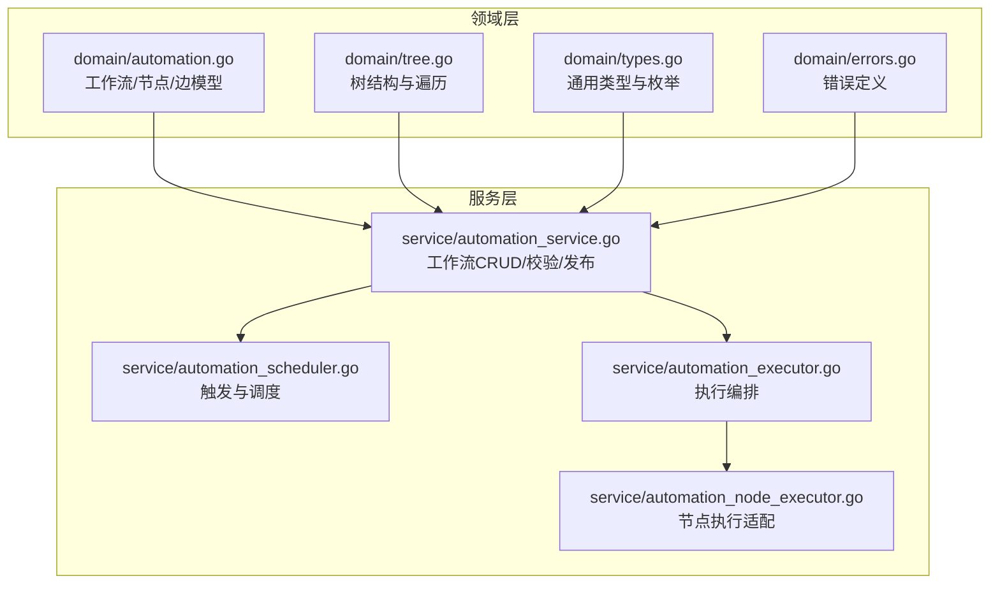
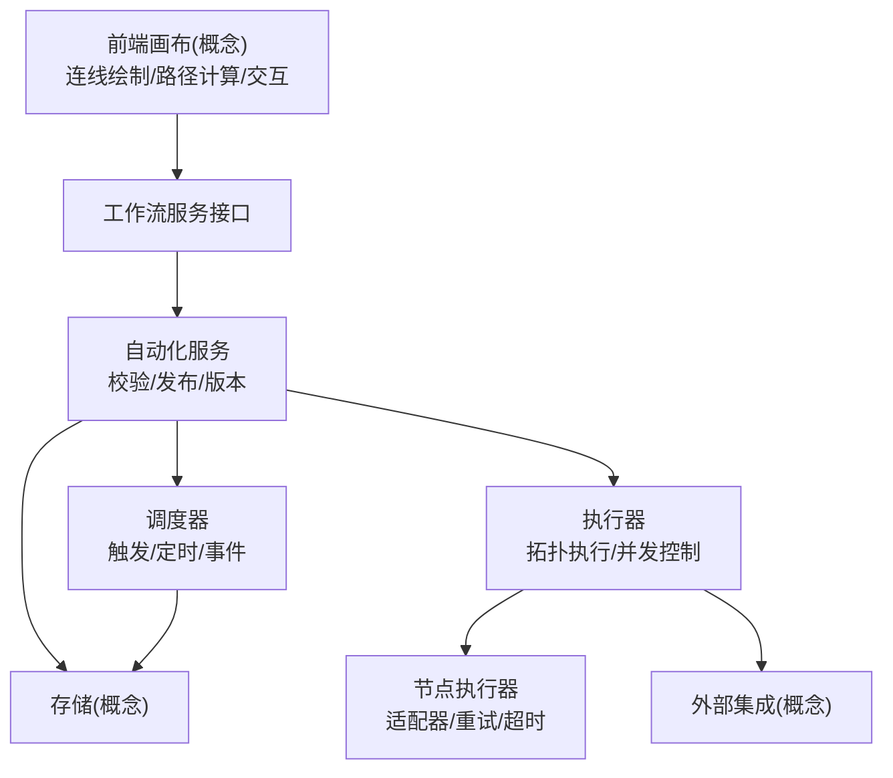
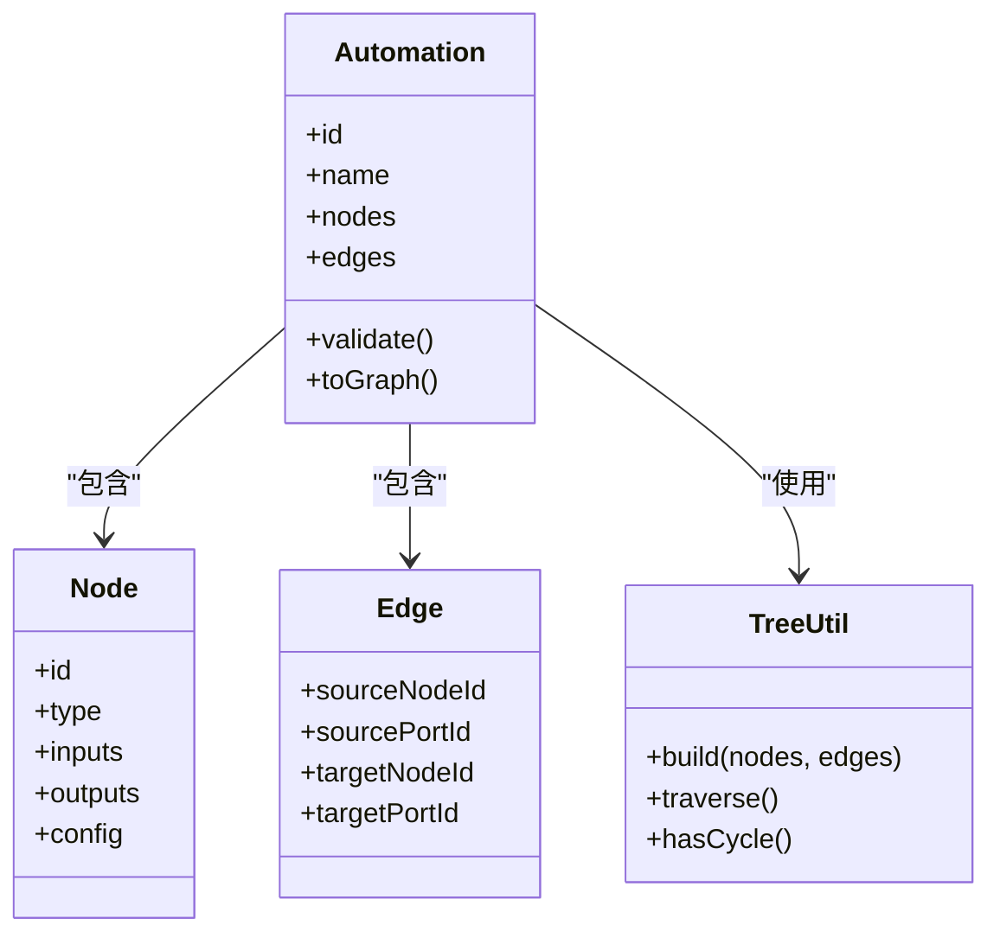
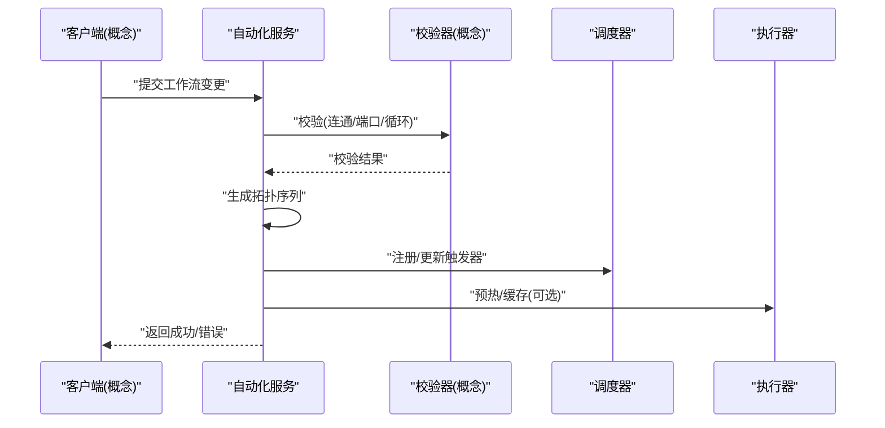
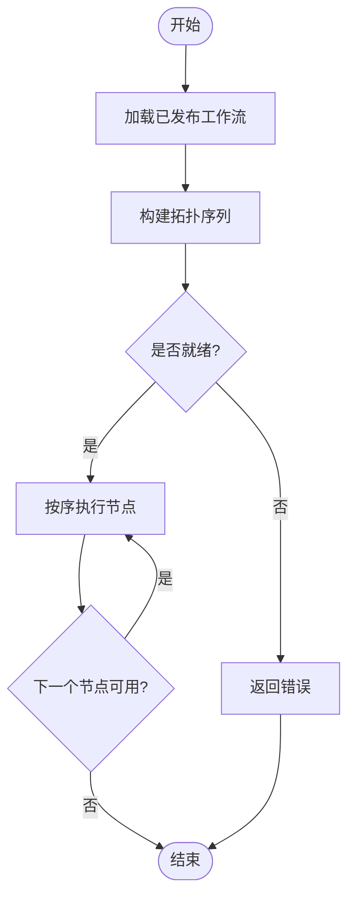
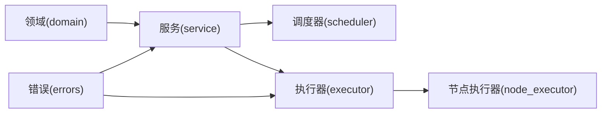

# 流程控制与连接

<cite>
**本文引用的文件**   
- [automation.go](file://notifuse/internal/domain/automation.go)
- [automation_service.go](file://notifuse/internal/service/automation_service.go)
- [automation_executor.go](file://notifuse/internal/service/automation_executor.go)
- [automation_node_executor.go](file://notifuse/internal/service/automation_node_executor.go)
- [automation_scheduler.go](file://notifuse/internal/service/automation_scheduler.go)
- [tree.go](file://notifuse/internal/domain/tree.go)
- [types.go](file://notifuse/internal/domain/types.go)
- [errors.go](file://notifuse/internal/domain/errors.go)
</cite>

## 目录
1. [简介](#简介)
2. [项目结构](#项目结构)
3. [核心组件](#核心组件)
4. [架构总览](#架构总览)
5. [详细组件分析](#详细组件分析)
6. [依赖关系分析](#依赖关系分析)
7. [性能考虑](#性能考虑)
8. [故障排查指南](#故障排查指南)
9. [结论](#结论)
10. [附录](#附录)

## 简介
本技术文档聚焦于自动化工作流的“流程控制与连接”子系统，围绕以下目标展开：
- 连线实现：绘制、路径计算与交互处理（概念性说明）
- AddNodeEdge 动态连线创建：验证、冲突检测与自动布局（概念性说明）
- flowConverter 工具函数：工作流数据转换、格式校验与兼容性处理（概念性说明）
- 连线约束规则、循环检测与工作流有效性验证
- 复杂流程图处理策略、大数据量优化与协作编辑支持
- 连线调试工具、性能监控与问题诊断方法

说明：当前仓库未包含前端可视化编辑器或连线绘制代码。本文对“连线绘制/路径计算/交互处理/AddNodeEdge/flowConverter”等前端相关能力以“概念性设计”方式呈现，并结合后端领域模型与服务层进行一致性约束与验证说明。

## 项目结构
与“流程控制与连接”相关的核心代码位于 notifuse/internal 下，主要涉及领域模型、服务编排与执行器：
- 领域模型：定义自动化工作流、节点、边、树结构与类型
- 服务层：提供工作流生命周期管理、调度与执行协调
- 执行器：负责节点级执行与上下文传递

图表来源
- [automation.go](file://notifuse/internal/domain/automation.go)
- [tree.go](file://notifuse/internal/domain/tree.go)
- [types.go](file://notifuse/internal/domain/types.go)
- [errors.go](file://notifuse/internal/domain/errors.go)
- [automation_service.go](file://notifuse/internal/service/automation_service.go)
- [automation_scheduler.go](file://notifuse/internal/service/automation_scheduler.go)
- [automation_executor.go](file://notifuse/internal/service/automation_executor.go)
- [automation_node_executor.go](file://notifuse/internal/service/automation_node_executor.go)

章节来源
- [automation.go](file://notifuse/internal/domain/automation.go)
- [automation_service.go](file://notifuse/internal/service/automation_service.go)
- [automation_executor.go](file://notifuse/internal/service/automation_executor.go)
- [automation_node_executor.go](file://notifuse/internal/service/automation_node_executor.go)
- [automation_scheduler.go](file://notifuse/internal/service/automation_scheduler.go)
- [tree.go](file://notifuse/internal/domain/tree.go)
- [types.go](file://notifuse/internal/domain/types.go)
- [errors.go](file://notifuse/internal/domain/errors.go)

## 核心组件
- 工作流与节点/边模型：用于表达有向图结构，支撑后续校验、调度与执行
- 树结构工具：提供拓扑遍历、祖先/后代查询等基础能力
- 服务编排：负责工作流保存、发布、触发与执行编排
- 执行器：按拓扑顺序驱动节点执行，维护执行上下文

章节来源
- [automation.go](file://notifuse/internal/domain/automation.go)
- [tree.go](file://notifuse/internal/domain/tree.go)
- [automation_service.go](file://notifuse/internal/service/automation_service.go)
- [automation_executor.go](file://notifuse/internal/service/automation_executor.go)
- [automation_node_executor.go](file://notifuse/internal/service/automation_node_executor.go)

## 架构总览
从“流程控制与连接”的视角，系统分为三层：
- 表示层（概念性）：前端画布、连线绘制、路径计算、交互事件
- 领域与服务层（现有）：工作流建模、约束校验、调度与执行
- 存储与外部集成（概念性）：持久化、消息总线、外部API

图表来源
- [automation_service.go](file://notifuse/internal/service/automation_service.go)
- [automation_scheduler.go](file://notifuse/internal/service/automation_scheduler.go)
- [automation_executor.go](file://notifuse/internal/service/automation_executor.go)
- [automation_node_executor.go](file://notifuse/internal/service/automation_node_executor.go)

## 详细组件分析

### 领域模型与数据结构
- 工作流实体：包含节点集合与边集合，描述有向图
- 节点实体：标识、类型、输入输出端口、配置等
- 边实体：源节点/端口到目标节点/端口的映射
- 树结构：基于节点/边的拓扑组织，便于遍历与校验

复杂度与特性
- 图的构建与遍历通常为 O(V+E)
- 循环检测可采用 DFS/拓扑排序，时间复杂度 O(V+E)
- 端口匹配与多入度/多出度校验为线性扫描或哈希索引优化

章节来源
- [automation.go](file://notifuse/internal/domain/automation.go)
- [tree.go](file://notifuse/internal/domain/tree.go)
- [types.go](file://notifuse/internal/domain/types.go)

#### 类图（概念映射到实际模块）

图表来源
- [automation.go](file://notifuse/internal/domain/automation.go)
- [tree.go](file://notifuse/internal/domain/tree.go)
- [types.go](file://notifuse/internal/domain/types.go)

### 服务层：工作流校验与发布
职责
- 接收前端提交的工作流变更（新增/删除节点与边）
- 执行约束校验（连通性、端口匹配、循环检测）
- 生成可执行的拓扑序列并持久化
- 对外暴露发布/回滚/版本管理能力

关键流程（序列图）

图表来源
- [automation_service.go](file://notifuse/internal/service/automation_service.go)
- [automation_scheduler.go](file://notifuse/internal/service/automation_scheduler.go)
- [automation_executor.go](file://notifuse/internal/service/automation_executor.go)

章节来源
- [automation_service.go](file://notifuse/internal/service/automation_service.go)
- [automation_scheduler.go](file://notifuse/internal/service/automation_scheduler.go)
- [automation_executor.go](file://notifuse/internal/service/automation_executor.go)

### 执行器：拓扑执行与并发控制
职责
- 依据拓扑顺序驱动节点执行
- 维护执行上下文，在节点间传递数据
- 支持失败重试、超时与熔断（概念性）

图表来源
- [automation_executor.go](file://notifuse/internal/service/automation_executor.go)
- [automation_node_executor.go](file://notifuse/internal/service/automation_node_executor.go)

章节来源
- [automation_executor.go](file://notifuse/internal/service/automation_executor.go)
- [automation_node_executor.go](file://notifuse/internal/service/automation_node_executor.go)

### 连线绘制、路径计算与交互处理（概念性）
- 绘制：基于 SVG/Canvas 的路径绘制，支持正交折线、贝塞尔曲线
- 路径计算：根据节点边界与端口位置计算最短可视路径，避免重叠
- 交互：拖拽创建/断开、吸附对齐、撤销重做、批量操作

注意：该部分为前端实现建议，当前仓库未包含对应源码。

### AddNodeEdge 动态连线创建逻辑（概念性）
- 连线验证：检查源/目标节点存在、端口类型兼容、重复边、自环
- 冲突检测：检测目标节点入度限制、端口占用、跨分支合并合法性
- 自动布局：在插入新边后触发局部重排，保持可读性与最小交叉

章节来源
- [automation.go](file://notifuse/internal/domain/automation.go)
- [tree.go](file://notifuse/internal/domain/tree.go)
- [types.go](file://notifuse/internal/domain/types.go)

### flowConverter 工具函数（概念性）
- 作用：将不同版本/来源的工作流数据转换为统一内部格式
- 功能：字段映射、默认值填充、弃用字段兼容、增量迁移
- 输出：通过校验后的标准工作流对象，供服务层使用

章节来源
- [automation.go](file://notifuse/internal/domain/automation.go)
- [types.go](file://notifuse/internal/domain/types.go)

### 连线约束规则、循环检测与工作流有效性验证
- 约束规则
  - 端口类型匹配：输入/输出类型一致或可转换
  - 唯一性：同一源-目标-端口组合不可重复
  - 入度/出度限制：节点端口容量与业务语义约束
- 循环检测
  - 基于 DFS 或拓扑排序判定是否存在环
  - 若存在环，拒绝发布并提示具体回路
- 有效性验证
  - 连通性：所有可达节点均能由入口节点到达
  - 完整性：所有引用节点/端口存在且未被删除
  - 配置完备：必填参数齐全、取值范围合法

章节来源
- [automation.go](file://notifuse/internal/domain/automation.go)
- [tree.go](file://notifuse/internal/domain/tree.go)
- [types.go](file://notifuse/internal/domain/types.go)

### 复杂流程图处理策略
- 分块渲染：仅渲染视口内节点与边，滚动时增量更新
- 路径简化：减少冗余拐点，采用自适应曲率
- 并行执行：无依赖子图并行执行，提升吞吐
- 增量更新：局部拓扑变化仅重算受影响区域

### 大数据量优化
- 图索引：建立邻接表与反向索引，加速查找
- 懒加载：按需加载节点详情与边权重
- 批处理：批量校验与批量写入
- 内存控制：分页/分片处理超大工作流

### 协作编辑支持（概念性）
- 操作转换：OT/CRDT 保证多人同时编辑的一致性
- 冲突解决：以边/节点为单位的最小冲突域
- 审计追踪：记录变更来源、时间与回滚点

## 依赖关系分析
- 领域层被服务层强依赖，服务层组合调度器与执行器
- 执行器依赖节点执行器完成具体任务
- 错误类型集中定义，贯穿各层

图表来源
- [automation_service.go](file://notifuse/internal/service/automation_service.go)
- [automation_scheduler.go](file://notifuse/internal/service/automation_scheduler.go)
- [automation_executor.go](file://notifuse/internal/service/automation_executor.go)
- [automation_node_executor.go](file://notifuse/internal/service/automation_node_executor.go)
- [errors.go](file://notifuse/internal/domain/errors.go)

章节来源
- [automation_service.go](file://notifuse/internal/service/automation_service.go)
- [automation_scheduler.go](file://notifuse/internal/service/automation_scheduler.go)
- [automation_executor.go](file://notifuse/internal/service/automation_executor.go)
- [automation_node_executor.go](file://notifuse/internal/service/automation_node_executor.go)
- [errors.go](file://notifuse/internal/domain/errors.go)

## 性能考虑
- 图算法复杂度控制在 O(V+E)，避免嵌套循环
- 拓扑预计算与缓存，减少重复计算
- 执行阶段采用有界并发，防止资源耗尽
- I/O 与外部调用异步化，缩短关键路径

## 故障排查指南
- 常见错误分类
  - 校验失败：端口不匹配、重复边、循环
  - 执行失败：节点异常、超时、外部依赖不可用
- 定位步骤
  - 查看工作流拓扑是否正确
  - 检查节点配置与权限
  - 核对调度器触发条件与队列状态
- 日志与指标
  - 记录关键决策点（校验、拓扑生成、执行）
  - 统计执行耗时、失败率、重试次数

章节来源
- [errors.go](file://notifuse/internal/domain/errors.go)
- [automation_service.go](file://notifuse/internal/service/automation_service.go)
- [automation_executor.go](file://notifuse/internal/service/automation_executor.go)

## 结论
本方案在后端领域与服务层提供了工作流建模、校验、调度与执行的基础能力；在前端“连线绘制/路径计算/交互处理/AddNodeEdge/flowConverter”方面给出概念性设计与最佳实践。结合约束规则、循环检测与有效性验证，可确保工作流的一致性与可执行性。针对复杂图与大数据场景，建议引入分块渲染、索引与并发控制，以提升整体性能与用户体验。

## 附录
- 术语
  - 节点：工作流中的基本执行单元
  - 边：节点间的有向连接，携带端口信息
  - 拓扑：节点的线性执行顺序
- 参考
  - 领域模型与服务接口定义见相应文件