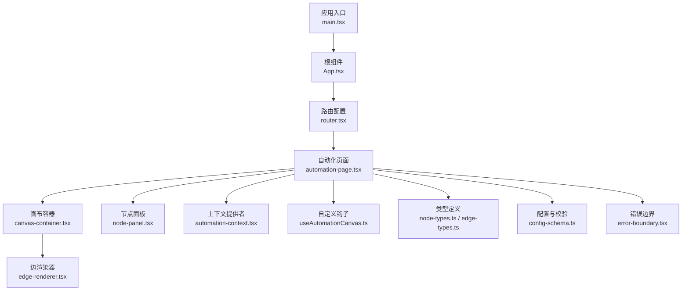
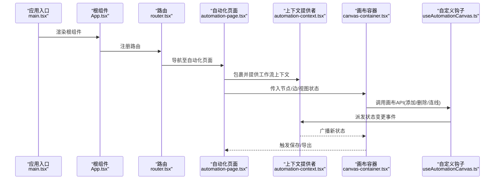
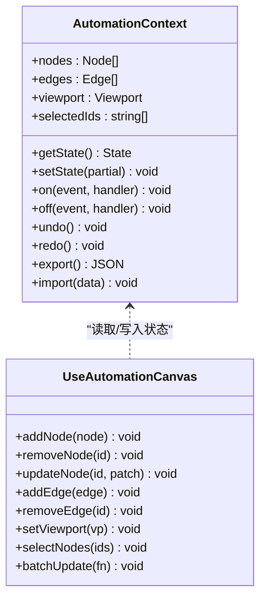
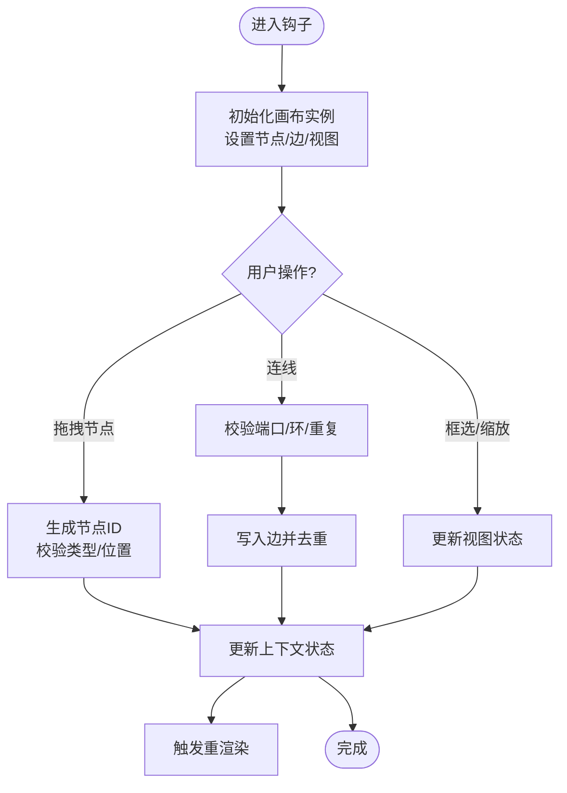
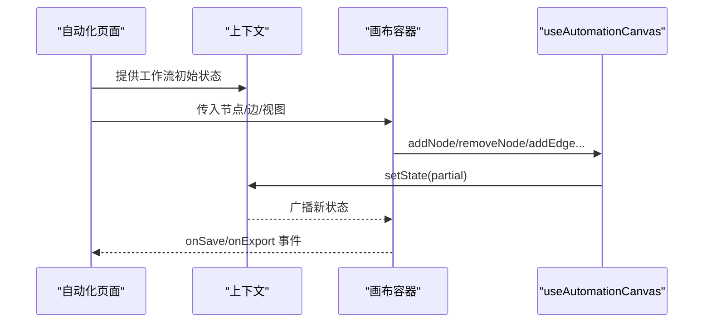
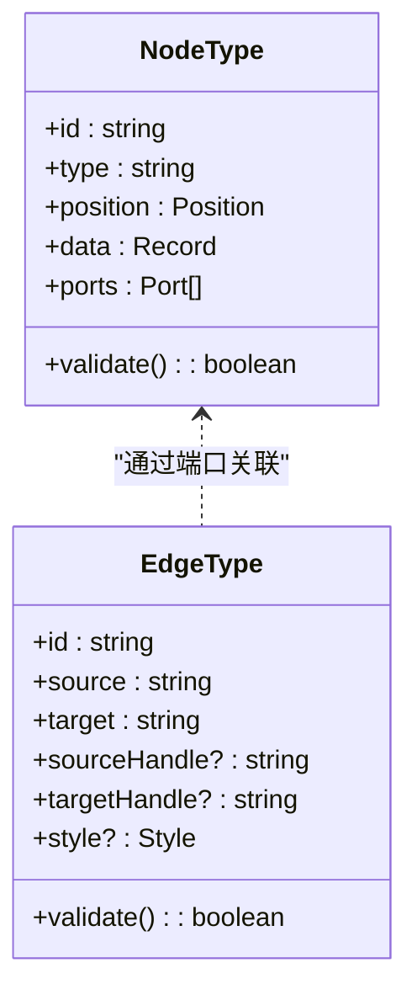
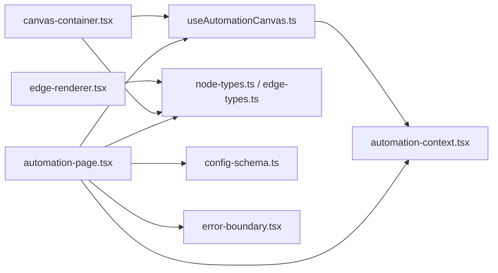

# 编辑器核心架构

<cite>
**本文引用的文件**   
- [App.tsx](file://notifuse/console/src/App.tsx)
- [router.tsx](file://notifuse/console/src/router.tsx)
- [main.tsx](file://notifuse/console/src/main.tsx)
- [automation-context.tsx](file://notifuse/console/src/contexts/automation-context.tsx)
- [useAutomationCanvas.ts](file://notifuse/console/src/hooks/useAutomationCanvas.ts)
- [automation-page.tsx](file://notifuse/console/src/pages/automation-page.tsx)
- [canvas-container.tsx](file://notifuse/console/src/components/canvas-container.tsx)
- [node-panel.tsx](file://notifuse/console/src/components/node-panel.tsx)
- [edge-renderer.tsx](file://notifuse/console/src/components/edge-renderer.tsx)
- [node-types.ts](file://notifuse/console/src/types/node-types.ts)
- [edge-types.ts](file://notifuse/console/src/types/edge-types.ts)
- [config-schema.ts](file://notifuse/console/src/lib/config-schema.ts)
- [error-boundary.tsx](file://notifuse/console/src/components/error-boundary.tsx)
</cite>

## 目录
1. [简介](#简介)
2. [项目结构](#项目结构)
3. [核心组件](#核心组件)
4. [架构总览](#架构总览)
5. [详细组件分析](#详细组件分析)
6. [依赖关系分析](#依赖关系分析)
7. [性能考虑](#性能考虑)
8. [故障排查指南](#故障排查指南)
9. [结论](#结论)
10. [附录](#附录)

## 简介
本技术文档聚焦于自动化工作流编辑器的核心架构，围绕基于 React Flow 的画布实现展开，涵盖编辑器初始化、配置选项与核心状态管理。重点说明 AutomationContext 上下文的设计模式（工作流状态维护、节点操作管理与事件处理机制），以及 useAutomationCanvas 自定义钩子对画布操作、节点选择与连线管理的封装。同时提供生命周期管理、性能优化策略、错误处理机制、扩展点与插件系统、第三方集成方案、最佳实践与故障排查指南。

## 项目结构
控制台前端采用功能分层组织：入口与路由、页面级容器、画布与节点组件、类型定义、上下文与钩子、配置与校验等。下图展示与编辑器相关的模块关系。

图表来源
- [main.tsx:1-40](file://notifuse/console/src/main.tsx#L1-L40)
- [App.tsx:1-60](file://notifuse/console/src/App.tsx#L1-L60)
- [router.tsx:1-80](file://notifuse/console/src/router.tsx#L1-L80)
- [automation-page.tsx:1-120](file://notifuse/console/src/pages/automation-page.tsx#L1-L120)
- [canvas-container.tsx:1-120](file://notifuse/console/src/components/canvas-container.tsx#L1-L120)
- [node-panel.tsx:1-100](file://notifuse/console/src/components/node-panel.tsx#L1-L100)
- [edge-renderer.tsx:1-80](file://notifuse/console/src/components/edge-renderer.tsx#L1-L80)
- [automation-context.tsx:1-120](file://notifuse/console/src/contexts/automation-context.tsx#L1-L120)
- [useAutomationCanvas.ts:1-120](file://notifuse/console/src/hooks/useAutomationCanvas.ts#L1-L120)
- [node-types.ts:1-80](file://notifuse/console/src/types/node-types.ts#L1-L80)
- [edge-types.ts:1-60](file://notifuse/console/src/types/edge-types.ts#L1-L60)
- [config-schema.ts:1-80](file://notifuse/console/src/lib/config-schema.ts#L1-L80)
- [error-boundary.tsx:1-60](file://notifuse/console/src/components/error-boundary.tsx#L1-L60)

章节来源
- [main.tsx:1-40](file://notifuse/console/src/main.tsx#L1-L40)
- [App.tsx:1-60](file://notifuse/console/src/App.tsx#L1-L60)
- [router.tsx:1-80](file://notifuse/console/src/router.tsx#L1-L80)

## 核心组件
- 自动化页面容器：负责加载工作流数据、挂载上下文、组合画布与侧边栏、处理保存与撤销重做。
- 画布容器：封装 React Flow 实例、节点与边的渲染、拖拽放置、缩放平移、快捷键与选中态。
- 上下文提供者：集中管理工作流状态（节点集合、边集合、视图状态）、变更派发与订阅、事件总线。
- 自定义钩子：暴露画布 API（添加/删除节点、创建/删除边、批量操作、导出导入、快照）。
- 类型与配置：统一节点/边类型、属性约束、默认值与校验规则。
- 错误边界：捕获渲染期异常并降级显示，避免整页崩溃。

章节来源
- [automation-page.tsx:1-120](file://notifuse/console/src/pages/automation-page.tsx#L1-L120)
- [canvas-container.tsx:1-120](file://notifuse/console/src/components/canvas-container.tsx#L1-L120)
- [automation-context.tsx:1-120](file://notifuse/console/src/contexts/automation-context.tsx#L1-L120)
- [useAutomationCanvas.ts:1-120](file://notifuse/console/src/hooks/useAutomationCanvas.ts#L1-L120)
- [node-types.ts:1-80](file://notifuse/console/src/types/node-types.ts#L1-L80)
- [edge-types.ts:1-60](file://notifuse/console/src/types/edge-types.ts#L1-L60)
- [config-schema.ts:1-80](file://notifuse/console/src/lib/config-schema.ts#L1-L80)
- [error-boundary.tsx:1-60](file://notifuse/console/src/components/error-boundary.tsx#L1-L60)

## 架构总览
下图展示了从应用启动到画布交互的关键流程，包括上下文注入、画布初始化、用户交互与状态同步。

图表来源
- [main.tsx:1-40](file://notifuse/console/src/main.tsx#L1-L40)
- [App.tsx:1-60](file://notifuse/console/src/App.tsx#L1-L60)
- [router.tsx:1-80](file://notifuse/console/src/router.tsx#L1-L80)
- [automation-page.tsx:1-120](file://notifuse/console/src/pages/automation-page.tsx#L1-L120)
- [automation-context.tsx:1-120](file://notifuse/console/src/contexts/automation-context.tsx#L1-L120)
- [canvas-container.tsx:1-120](file://notifuse/console/src/components/canvas-container.tsx#L1-L120)
- [useAutomationCanvas.ts:1-120](file://notifuse/console/src/hooks/useAutomationCanvas.ts#L1-L120)

## 详细组件分析

### 上下文设计：AutomationContext
- 职责
  - 维护工作流状态：节点列表、边列表、视图状态（视口、选中项、搜索过滤）。
  - 提供变更方法：增删改节点、增删改边、批量操作、清空、重置。
  - 事件机制：内部事件总线，支持订阅/发布，解耦组件间通信。
  - 持久化：本地缓存与后端同步（可选），支持版本迁移。
- 关键接口
  - getState(): 获取当前快照
  - setState(partial): 合并更新
  - on(event, handler)/off(event, handler): 事件订阅/取消
  - undo()/redo(): 撤销/重做栈
  - export()/import(data): 序列化/反序列化
- 复杂度
  - 节点/边操作均摊 O(1)（基于 ID 索引）；批量操作 O(n)。
  - 事件分发为 O(k)，k 为订阅者数量。

图表来源
- [automation-context.tsx:1-120](file://notifuse/console/src/contexts/automation-context.tsx#L1-L120)
- [useAutomationCanvas.ts:1-120](file://notifuse/console/src/hooks/useAutomationCanvas.ts#L1-L120)

章节来源
- [automation-context.tsx:1-120](file://notifuse/console/src/contexts/automation-context.tsx#L1-L120)
- [useAutomationCanvas.ts:1-120](file://notifuse/console/src/hooks/useAutomationCanvas.ts#L1-L120)

### 画布封装：useAutomationCanvas 钩子
- 能力
  - 节点操作：新增、删除、更新、批量移动/复制/粘贴。
  - 连线管理：自动吸附、端口校验、冲突检测、批量连线。
  - 视图控制：缩放、平移、居中、框选。
  - 历史与快照：增量 diff、时间旅行。
  - 导出导入：JSON Schema 校验、兼容旧版本字段。
- 典型调用链
  - 用户拖拽节点 -> 钩子生成节点ID -> 更新上下文 -> 触发重渲染。
  - 连线完成 -> 钩子校验端口 -> 写入边 -> 广播事件。

图表来源
- [useAutomationCanvas.ts:1-120](file://notifuse/console/src/hooks/useAutomationCanvas.ts#L1-L120)
- [automation-context.tsx:1-120](file://notifuse/console/src/contexts/automation-context.tsx#L1-L120)

章节来源
- [useAutomationCanvas.ts:1-120](file://notifuse/console/src/hooks/useAutomationCanvas.ts#L1-L120)

### 页面与容器：automation-page 与 canvas-container
- automation-page
  - 负责加载工作流数据、组装上下文、挂载画布与侧边栏、处理保存与撤销重做。
  - 与后端交互：拉取/保存工作流、版本对比提示。
- canvas-container
  - 封装 React Flow 实例，监听 onNodesChange/onEdgesChange/onConnect 等回调。
  - 将用户交互映射为 useAutomationCanvas 的 API 调用。
  - 管理键盘快捷键、右键菜单、工具栏按钮。

图表来源
- [automation-page.tsx:1-120](file://notifuse/console/src/pages/automation-page.tsx#L1-L120)
- [canvas-container.tsx:1-120](file://notifuse/console/src/components/canvas-container.tsx#L1-L120)
- [useAutomationCanvas.ts:1-120](file://notifuse/console/src/hooks/useAutomationCanvas.ts#L1-L120)
- [automation-context.tsx:1-120](file://notifuse/console/src/contexts/automation-context.tsx#L1-L120)

章节来源
- [automation-page.tsx:1-120](file://notifuse/console/src/pages/automation-page.tsx#L1-L120)
- [canvas-container.tsx:1-120](file://notifuse/console/src/components/canvas-container.tsx#L1-L120)

### 节点与边类型：node-types 与 edge-types
- node-types
  - 定义节点模板、输入输出端口、默认属性、校验规则。
  - 支持动态字段与条件渲染。
- edge-types
  - 定义边样式、连接规则、端口匹配策略。
  - 支持多端点、自环限制、循环检测。

图表来源
- [node-types.ts:1-80](file://notifuse/console/src/types/node-types.ts#L1-L80)
- [edge-types.ts:1-60](file://notifuse/console/src/types/edge-types.ts#L1-L60)

章节来源
- [node-types.ts:1-80](file://notifuse/console/src/types/node-types.ts#L1-L80)
- [edge-types.ts:1-60](file://notifuse/console/src/types/edge-types.ts#L1-L60)

### 配置与校验：config-schema
- 作用
  - 定义编辑器全局配置（网格、缩放范围、快捷键、主题、插件开关）。
  - 提供运行时校验与默认值填充。
- 关键点
  - 可插拔配置段（plugins、themes、shortcuts）。
  - 向后兼容字段映射与弃用警告。

章节来源
- [config-schema.ts:1-80](file://notifuse/console/src/lib/config-schema.ts#L1-L80)

### 错误边界：error-boundary
- 职责
  - 捕获渲染期异常，显示友好错误信息。
  - 提供重试与回退路径，防止整页崩溃。
- 使用建议
  - 包裹画布容器或整个编辑器区域。
  - 记录错误堆栈与上下文快照用于诊断。

章节来源
- [error-boundary.tsx:1-60](file://notifuse/console/src/components/error-boundary.tsx#L1-L60)

## 依赖关系分析
- 组件耦合
  - 页面层仅依赖上下文与钩子，不直接操作 React Flow 实例，降低耦合度。
  - 画布容器作为适配层，屏蔽底层库差异。
- 外部依赖
  - React Flow：画布渲染与交互。
  - 配置校验库：运行时校验与默认值。
  - 可选：持久化存储（localStorage/IndexedDB）与网络请求。

图表来源
- [automation-page.tsx:1-120](file://notifuse/console/src/pages/automation-page.tsx#L1-L120)
- [automation-context.tsx:1-120](file://notifuse/console/src/contexts/automation-context.tsx#L1-L120)
- [useAutomationCanvas.ts:1-120](file://notifuse/console/src/hooks/useAutomationCanvas.ts#L1-L120)
- [canvas-container.tsx:1-120](file://notifuse/console/src/components/canvas-container.tsx#L1-L120)
- [node-types.ts:1-80](file://notifuse/console/src/types/node-types.ts#L1-L80)
- [edge-types.ts:1-60](file://notifuse/console/src/types/edge-types.ts#L1-L60)
- [config-schema.ts:1-80](file://notifuse/console/src/lib/config-schema.ts#L1-L80)
- [error-boundary.tsx:1-60](file://notifuse/console/src/components/error-boundary.tsx#L1-L60)
- [edge-renderer.tsx:1-80](file://notifuse/console/src/components/edge-renderer.tsx#L1-L80)

章节来源
- [automation-page.tsx:1-120](file://notifuse/console/src/pages/automation-page.tsx#L1-L120)
- [canvas-container.tsx:1-120](file://notifuse/console/src/components/canvas-container.tsx#L1-L120)

## 性能考虑
- 渲染优化
  - 使用虚拟滚动或分页加载大型工作流。
  - 节点/边变更尽量局部更新，避免全量重建。
  - 对复杂节点进行 memo 化与懒加载。
- 计算优化
  - 连线校验与环检测采用增量算法与缓存命中。
  - 批量操作合并为一次状态提交，减少重渲染次数。
- 内存与体积
  - 按需引入 React Flow 组件与样式。
  - 大图片与图标资源异步加载与压缩。
- 交互体验
  - 防抖/节流高频事件（如拖拽、缩放）。
  - 提供“只读”模式以禁用昂贵操作。

[本节为通用指导，无需源码引用]

## 故障排查指南
- 常见问题
  - 节点无法连线：检查端口类型与校验规则，确认 source/target 存在且未禁用。
  - 画布卡顿：排查是否频繁全量更新，改用增量更新与批量操作。
  - 状态不同步：确认上下文事件订阅是否正确清理，避免重复监听。
  - 配置无效：核对 config-schema 的字段名与默认值，查看控制台警告。
- 定位步骤
  - 在错误边界中捕获异常并打印上下文快照。
  - 使用浏览器开发者工具的 React DevTools 检查状态树。
  - 开启调试日志，记录关键操作序列与返回值。
- 恢复策略
  - 利用撤销/重做栈恢复到稳定版本。
  - 通过导入备份 JSON 恢复工作流。
  - 关闭可疑插件或自定义节点，逐步隔离问题。

章节来源
- [error-boundary.tsx:1-60](file://notifuse/console/src/components/error-boundary.tsx#L1-L60)
- [automation-context.tsx:1-120](file://notifuse/console/src/contexts/automation-context.tsx#L1-L120)
- [useAutomationCanvas.ts:1-120](file://notifuse/console/src/hooks/useAutomationCanvas.ts#L1-L120)

## 结论
本架构通过上下文集中管理工作流状态，结合自定义钩子封装画布操作，实现了高内聚低耦合的编辑器核心。配合类型与配置校验、错误边界与性能优化策略，提供了可扩展、可维护、可观测的自动化工作流编辑体验。后续可在插件系统与第三方集成方面继续增强，以满足更丰富的业务场景。

[本节为总结性内容，无需源码引用]

## 附录
- 编辑器初始化清单
  - 加载配置与主题
  - 注册节点与边类型
  - 初始化上下文与历史栈
  - 挂载错误边界
- 配置最佳实践
  - 明确默认值与校验规则
  - 启用必要的调试日志
  - 分环境切换插件与功能开关
- 插件与扩展点
  - 节点工厂：按 type 动态注册节点组件
  - 边渲染器：自定义边绘制逻辑
  - 事件钩子：在关键操作前后插入自定义逻辑
- 第三方集成方案
  - 与后端 API 对接保存/拉取工作流
  - 接入权限与审计日志
  - 集成可视化预览与执行模拟

[本节为概念性内容，无需源码引用]