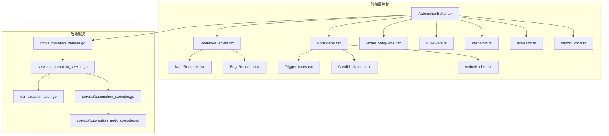
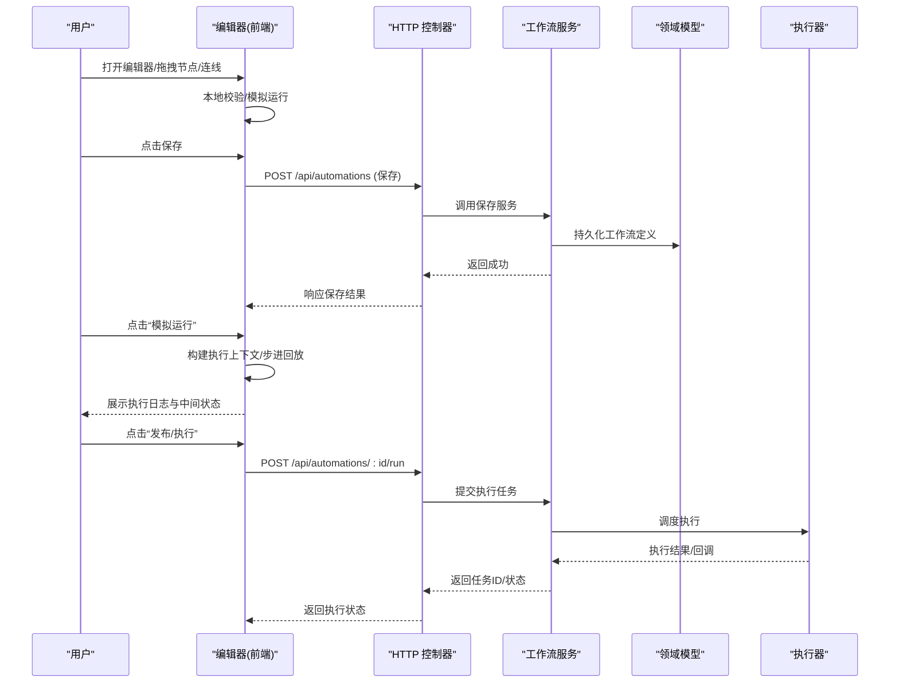
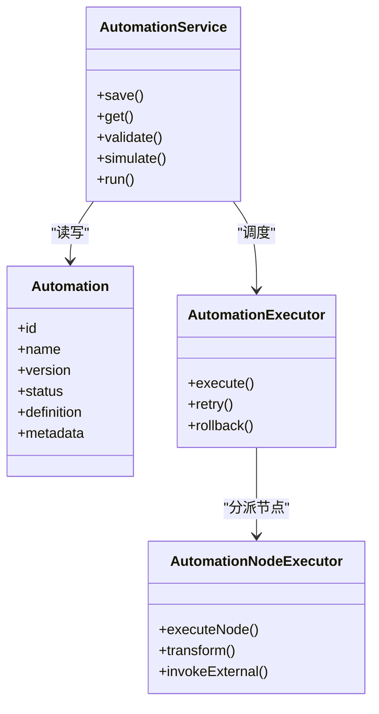
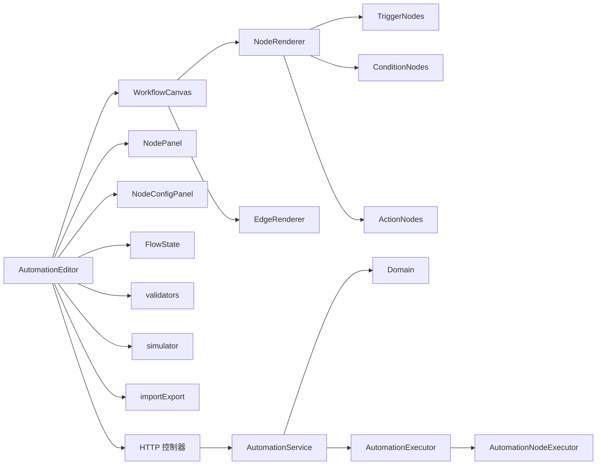

# 自动化工作流编辑器

<cite>
**本文引用的文件**   
- [notifuse/console/src/pages/AutomationEditor.tsx](file://notifuse/console/src/pages/AutomationEditor.tsx)
- [notifuse/console/src/components/automation/WorkflowCanvas.tsx](file://notifuse/console/src/components/automation/WorkflowCanvas.tsx)
- [notifuse/console/src/components/automation/NodePanel.tsx](file://notifuse/console/src/components/automation/NodePanel.tsx)
- [notifuse/console/src/components/automation/NodeRenderer.tsx](file://notifuse/console/src/components/automation/NodeRenderer.tsx)
- [notifuse/console/src/components/automation/EdgeRenderer.tsx](file://notifuse/console/src/components/automation/EdgeRenderer.tsx)
- [notifuse/console/src/components/automation/NodeConfigPanel.tsx](file://notifuse/console/src/components/automation/NodeConfigPanel.tsx)
- [notifuse/console/src/components/automation/TriggerNodes.tsx](file://notifuse/console/src/components/automation/TriggerNodes.tsx)
- [notifuse/console/src/components/automation/ConditionNodes.tsx](file://notifuse/console/src/components/automation/ConditionNodes.tsx)
- [notifuse/console/src/components/automation/ActionNodes.tsx](file://notifuse/console/src/components/automation/ActionNodes.tsx)
- [notifuse/console/src/components/automation/FlowState.ts](file://notifuse/console/src/components/automation/FlowState.ts)
- [notifuse/console/src/components/automation/validators.ts](file://notifuse/console/src/components/automation/validators.ts)
- [notifuse/console/src/components/automation/simulator.ts](file://notifuse/console/src/components/automation/simulator.ts)
- [notifuse/console/src/components/automation/importExport.ts](file://notifuse/console/src/components/automation/importExport.ts)
- [notifuse/internal/domain/automation.go](file://notifuse/internal/domain/automation.go)
- [notifuse/internal/service/automation_service.go](file://notifuse/internal/service/automation_service.go)
- [notifuse/internal/service/automation_executor.go](file://notifuse/internal/service/automation_executor.go)
- [notifuse/internal/service/automation_node_executor.go](file://notifuse/internal/service/automation_node_executor.go)
- [notifuse/internal/http/automation_handler.go](file://notifuse/internal/http/automation_handler.go)
</cite>

## 目录
1. [简介](#简介)
2. [项目结构](#项目结构)
3. [核心组件](#核心组件)
4. [架构总览](#架构总览)
5. [详细组件分析](#详细组件分析)
6. [依赖关系分析](#依赖关系分析)
7. [性能考虑](#性能考虑)
8. [故障排查指南](#故障排查指南)
9. [结论](#结论)
10. [附录](#附录)

## 简介
本技术文档面向 Notifuse 的“自动化工作流编辑器”，聚焦于基于 React Flow 的可视化工作流编辑体验。内容涵盖：
- 节点系统设计、连线逻辑与画布交互
- 触发器、条件分支、动作执行等节点类型及其配置界面与业务逻辑
- 工作流状态管理、验证规则、执行模拟与调试能力
- 节点扩展机制、自定义节点开发、导入导出
- 编辑器性能优化、大数据量处理与协作编辑支持
- 高级用法、故障排查与性能调优建议

## 项目结构
前端控制台（console）包含工作流编辑器相关页面与组件，后端（internal）提供领域模型、服务层与 HTTP 接口，支撑工作流的持久化、执行与调度。

图表来源
- [notifuse/console/src/pages/AutomationEditor.tsx](file://notifuse/console/src/pages/AutomationEditor.tsx)
- [notifuse/console/src/components/automation/WorkflowCanvas.tsx](file://notifuse/console/src/components/automation/WorkflowCanvas.tsx)
- [notifuse/console/src/components/automation/NodePanel.tsx](file://notifuse/console/src/components/automation/NodePanel.tsx)
- [notifuse/console/src/components/automation/NodeRenderer.tsx](file://notifuse/console/src/components/automation/NodeRenderer.tsx)
- [notifuse/console/src/components/automation/EdgeRenderer.tsx](file://notifuse/console/src/components/automation/EdgeRenderer.tsx)
- [notifuse/console/src/components/automation/NodeConfigPanel.tsx](file://notifuse/console/src/components/automation/NodeConfigPanel.tsx)
- [notifuse/console/src/components/automation/TriggerNodes.tsx](file://notifuse/console/src/components/automation/TriggerNodes.tsx)
- [notifuse/console/src/components/automation/ConditionNodes.tsx](file://notifuse/console/src/components/automation/ConditionNodes.tsx)
- [notifuse/console/src/components/automation/ActionNodes.tsx](file://notifuse/console/src/components/automation/ActionNodes.tsx)
- [notifuse/console/src/components/automation/FlowState.ts](file://notifuse/console/src/components/automation/FlowState.ts)
- [notifuse/console/src/components/automation/validators.ts](file://notifuse/console/src/components/automation/validators.ts)
- [notifuse/console/src/components/automation/simulator.ts](file://notifuse/console/src/components/automation/simulator.ts)
- [notifuse/console/src/components/automation/importExport.ts](file://notifuse/console/src/components/automation/importExport.ts)
- [notifuse/internal/domain/automation.go](file://notifuse/internal/domain/automation.go)
- [notifuse/internal/service/automation_service.go](file://notifuse/internal/service/automation_service.go)
- [notifuse/internal/service/automation_executor.go](file://notifuse/internal/service/automation_executor.go)
- [notifuse/internal/service/automation_node_executor.go](file://notifuse/internal/service/automation_node_executor.go)
- [notifuse/internal/http/automation_handler.go](file://notifuse/internal/http/automation_handler.go)

章节来源
- [notifuse/console/src/pages/AutomationEditor.tsx](file://notifuse/console/src/pages/AutomationEditor.tsx)
- [notifuse/console/src/components/automation/WorkflowCanvas.tsx](file://notifuse/console/src/components/automation/WorkflowCanvas.tsx)
- [notifuse/console/src/components/automation/NodePanel.tsx](file://notifuse/console/src/components/automation/NodePanel.tsx)
- [notifuse/console/src/components/automation/NodeRenderer.tsx](file://notifuse/console/src/components/automation/NodeRenderer.tsx)
- [notifuse/console/src/components/automation/EdgeRenderer.tsx](file://notifuse/console/src/components/automation/EdgeRenderer.tsx)
- [notifuse/console/src/components/automation/NodeConfigPanel.tsx](file://notifuse/console/src/components/automation/NodeConfigPanel.tsx)
- [notifuse/console/src/components/automation/TriggerNodes.tsx](file://notifuse/console/src/components/automation/TriggerNodes.tsx)
- [notifuse/console/src/components/automation/ConditionNodes.tsx](file://notifuse/console/src/components/automation/ConditionNodes.tsx)
- [notifuse/console/src/components/automation/ActionNodes.tsx](file://notifuse/console/src/components/automation/ActionNodes.tsx)
- [notifuse/console/src/components/automation/FlowState.ts](file://notifuse/console/src/components/automation/FlowState.ts)
- [notifuse/console/src/components/automation/validators.ts](file://notifuse/console/src/components/automation/validators.ts)
- [notifuse/console/src/components/automation/simulator.ts](file://notifuse/console/src/components/automation/simulator.ts)
- [notifuse/console/src/components/automation/importExport.ts](file://notifuse/console/src/components/automation/importExport.ts)
- [notifuse/internal/domain/automation.go](file://notifuse/internal/domain/automation.go)
- [notifuse/internal/service/automation_service.go](file://notifuse/internal/service/automation_service.go)
- [notifuse/internal/service/automation_executor.go](file://notifuse/internal/service/automation_executor.go)
- [notifuse/internal/service/automation_node_executor.go](file://notifuse/internal/service/automation_node_executor.go)
- [notifuse/internal/http/automation_handler.go](file://notifuse/internal/http/automation_handler.go)

## 核心组件
- 编辑器入口与编排：负责集成 React Flow 画布、侧边栏节点面板、右侧属性配置面板、顶部工具栏与快捷键；协调保存、校验、模拟与导出。
- 画布渲染：封装 React Flow 实例，统一处理节点拖拽放置、连线创建与删除、批量选择、撤销重做、缩放平移、网格吸附等。
- 节点面板与渲染：按类别组织可拖拽节点（触发器、条件、动作），为每种节点提供专属渲染与输入控件。
- 连线渲染：实现带标签的有向边，支持条件分支标注（如“是/否”）、断点高亮与错误提示。
- 状态管理：集中维护节点集合、边集合、选中态、历史栈、校验结果与模拟运行上下文。
- 验证器：对节点配置进行必填项、格式、依赖引用等校验，并生成用户可读的错误信息。
- 模拟器：在浏览器内以只读方式回放工作流，输出每步执行日志与中间变量快照。
- 导入导出：将工作流序列化为 JSON 或从 JSON 恢复，兼容版本迁移字段。

章节来源
- [notifuse/console/src/pages/AutomationEditor.tsx](file://notifuse/console/src/pages/AutomationEditor.tsx)
- [notifuse/console/src/components/automation/WorkflowCanvas.tsx](file://notifuse/console/src/components/automation/WorkflowCanvas.tsx)
- [notifuse/console/src/components/automation/NodePanel.tsx](file://notifuse/console/src/components/automation/NodePanel.tsx)
- [notifuse/console/src/components/automation/NodeRenderer.tsx](file://notifuse/console/src/components/automation/NodeRenderer.tsx)
- [notifuse/console/src/components/automation/EdgeRenderer.tsx](file://notifuse/console/src/components/automation/EdgeRenderer.tsx)
- [notifuse/console/src/components/automation/NodeConfigPanel.tsx](file://notifuse/console/src/components/automation/NodeConfigPanel.tsx)
- [notifuse/console/src/components/automation/FlowState.ts](file://notifuse/console/src/components/automation/FlowState.ts)
- [notifuse/console/src/components/automation/validators.ts](file://notifuse/console/src/components/automation/validators.ts)
- [notifuse/console/src/components/automation/simulator.ts](file://notifuse/console/src/components/automation/simulator.ts)
- [notifuse/console/src/components/automation/importExport.ts](file://notifuse/console/src/components/automation/importExport.ts)

## 架构总览
前端通过 React Flow 驱动可视化编辑，后端以领域模型与服务层承载工作流定义与执行。HTTP 层暴露 CRUD、校验、模拟与执行接口。

图表来源
- [notifuse/console/src/pages/AutomationEditor.tsx](file://notifuse/console/src/pages/AutomationEditor.tsx)
- [notifuse/internal/http/automation_handler.go](file://notifuse/internal/http/automation_handler.go)
- [notifuse/internal/service/automation_service.go](file://notifuse/internal/service/automation_service.go)
- [notifuse/internal/service/automation_executor.go](file://notifuse/internal/service/automation_executor.go)
- [notifuse/internal/domain/automation.go](file://notifuse/internal/domain/automation.go)

## 详细组件分析

### 编辑器入口与编排（AutomationEditor）
- 职责：组合画布、节点面板、配置面板；管理全局状态（节点、边、选中、历史）；对接保存、校验、模拟、导入导出。
- 关键流程：
  - 初始化：加载已存在的工作流数据，转换为 React Flow 的 nodes/edges 格式。
  - 变更监听：节点增删改、连线变化时触发校验与增量保存。
  - 模拟运行：读取当前图结构，注入测试数据，逐步推进并记录日志。
  - 导入导出：序列化/反序列化工作流，处理版本兼容字段。
- 交互要点：
  - 快捷键：复制粘贴、删除、撤销重做、全选、对齐。
  - 多端同步：可选开启协作模式，使用 CRDT/OT 策略合并冲突（见“协作编辑支持”）。

章节来源
- [notifuse/console/src/pages/AutomationEditor.tsx](file://notifuse/console/src/pages/AutomationEditor.tsx)
- [notifuse/console/src/components/automation/FlowState.ts](file://notifuse/console/src/components/automation/FlowState.ts)
- [notifuse/console/src/components/automation/validators.ts](file://notifuse/console/src/components/automation/validators.ts)
- [notifuse/console/src/components/automation/simulator.ts](file://notifuse/console/src/components/automation/simulator.ts)
- [notifuse/console/src/components/automation/importExport.ts](file://notifuse/console/src/components/automation/importExport.ts)

### 画布与连线（WorkflowCanvas、EdgeRenderer）
- 画布能力：
  - 拖放新增节点、框选多选、批量移动/删除。
  - 缩放/平移、网格吸附、背景网格开关。
  - 右键菜单、快捷键、无障碍支持。
- 连线逻辑：
  - 仅允许合法源/目标端口连接，自动去重与环检测。
  - 条件分支边带标签（如“是/否”），错误路径高亮。
  - 连线校验失败时显示错误提示与修复建议。
- 性能优化：
  - 虚拟滚动/按需渲染大图的可见区域。
  - 使用 React.memo 与 useMemo 减少重渲染。
  - 批量更新采用事务式变更，避免频繁重排。

章节来源
- [notifuse/console/src/components/automation/WorkflowCanvas.tsx](file://notifuse/console/src/components/automation/WorkflowCanvas.tsx)
- [notifuse/console/src/components/automation/EdgeRenderer.tsx](file://notifuse/console/src/components/automation/EdgeRenderer.tsx)

### 节点面板与渲染（NodePanel、NodeRenderer、TriggerNodes、ConditionNodes、ActionNodes）
- 节点分类：
  - 触发器：Webhook、定时任务、事件订阅等。
  - 条件分支：IF/ELSE、正则匹配、时间窗口等。
  - 动作执行：发送邮件、调用 API、写入数据库、消息队列等。
- 渲染与配置：
  - NodeRenderer 根据 type 分发到具体节点组件。
  - NodeConfigPanel 动态渲染对应表单控件，绑定校验规则。
  - 每个节点类型提供最小可用默认值与占位示例。
- 扩展机制：
  - 注册表模式：新增节点类型只需在注册表中声明元信息与渲染器。
  - 配置 schema：通过 JSON Schema 驱动表单生成与校验。
  - 生命周期钩子：onMount/onUnmount/onDataChange 便于副作用处理。

章节来源
- [notifuse/console/src/components/automation/NodePanel.tsx](file://notifuse/console/src/components/automation/NodePanel.tsx)
- [notifuse/console/src/components/automation/NodeRenderer.tsx](file://notifuse/console/src/components/automation/NodeRenderer.tsx)
- [notifuse/console/src/components/automation/TriggerNodes.tsx](file://notifuse/console/src/components/automation/TriggerNodes.tsx)
- [notifuse/console/src/components/automation/ConditionNodes.tsx](file://notifuse/console/src/components/automation/ConditionNodes.tsx)
- [notifuse/console/src/components/automation/ActionNodes.tsx](file://notifuse/console/src/components/automation/ActionNodes.tsx)
- [notifuse/console/src/components/automation/NodeConfigPanel.tsx](file://notifuse/console/src/components/automation/NodeConfigPanel.tsx)

### 状态管理与验证（FlowState、validators）
- 状态设计：
  - nodes/edges：React Flow 标准结构，附加业务字段（如节点配置、端口映射）。
  - selection/history：选中集与撤销重做栈。
  - validation：按节点/边维度缓存校验结果。
  - simulation：模拟运行上下文（变量、日志、断点）。
- 验证规则：
  - 必填项、数据类型、范围约束、引用完整性（如模板 ID 是否存在）。
  - 图级约束：入度/出度限制、无环检测、孤立节点提示。
  - 实时反馈：输入即校验，错误定位到具体字段与节点。

章节来源
- [notifuse/console/src/components/automation/FlowState.ts](file://notifuse/console/src/components/automation/FlowState.ts)
- [notifuse/console/src/components/automation/validators.ts](file://notifuse/console/src/components/automation/validators.ts)

### 执行模拟与调试（simulator）
- 模拟流程：
  - 构建初始上下文（触发器参数、环境变量、用户变量）。
  - 按拓扑顺序遍历节点，计算分支路径，收集日志与中间状态。
  - 支持断点、单步执行、快速跳转到错误节点。
- 调试能力：
  - 变量快照：查看每次进入/离开节点的变量变化。
  - 错误回溯：定位失败节点与原因，提供修复建议。
  - 性能统计：各节点耗时、重试次数、超时标记。

章节来源
- [notifuse/console/src/components/automation/simulator.ts](file://notifuse/console/src/components/automation/simulator.ts)

### 导入导出（importExport）
- 导出：将当前工作流序列化为 JSON，包含节点、边、布局位置与元数据。
- 导入：解析 JSON，进行版本迁移与兼容性检查，必要时提示用户确认。
- 协作与冲突：结合版本号/时间戳，冲突时保留双方差异并提示合并。

章节来源
- [notifuse/console/src/components/automation/importExport.ts](file://notifuse/console/src/components/automation/importExport.ts)

### 后端领域与服务（domain、service、http）
- 领域模型：定义工作流实体、节点类型枚举、执行状态、审计字段等。
- 服务层：封装保存、查询、校验、模拟与执行任务提交；协调执行器与外部系统。
- 执行器：按 DAG 拓扑执行节点，处理重试、超时、幂等与回滚策略。
- HTTP 接口：提供 RESTful 路由，鉴权、限流、审计日志。

图表来源
- [notifuse/internal/domain/automation.go](file://notifuse/internal/domain/automation.go)
- [notifuse/internal/service/automation_service.go](file://notifuse/internal/service/automation_service.go)
- [notifuse/internal/service/automation_executor.go](file://notifuse/internal/service/automation_executor.go)
- [notifuse/internal/service/automation_node_executor.go](file://notifuse/internal/service/automation_node_executor.go)

章节来源
- [notifuse/internal/domain/automation.go](file://notifuse/internal/domain/automation.go)
- [notifuse/internal/service/automation_service.go](file://notifuse/internal/service/automation_service.go)
- [notifuse/internal/service/automation_executor.go](file://notifuse/internal/service/automation_executor.go)
- [notifuse/internal/service/automation_node_executor.go](file://notifuse/internal/service/automation_node_executor.go)
- [notifuse/internal/http/automation_handler.go](file://notifuse/internal/http/automation_handler.go)

## 依赖关系分析
- 前端内部依赖：
  - AutomationEditor 依赖 WorkflowCanvas、NodePanel、NodeConfigPanel、FlowState、validators、simulator、importExport。
  - NodeRenderer 依赖 TriggerNodes、ConditionNodes、ActionNodes。
  - EdgeRenderer 依赖 validators（连线合法性）。
- 前后端耦合点：
  - HTTP 控制器接收保存/执行请求，委托服务层处理。
  - 服务层依赖领域模型与执行器，执行器再委派至具体节点执行器。

图表来源
- [notifuse/console/src/pages/AutomationEditor.tsx](file://notifuse/console/src/pages/AutomationEditor.tsx)
- [notifuse/console/src/components/automation/WorkflowCanvas.tsx](file://notifuse/console/src/components/automation/WorkflowCanvas.tsx)
- [notifuse/console/src/components/automation/NodePanel.tsx](file://notifuse/console/src/components/automation/NodePanel.tsx)
- [notifuse/console/src/components/automation/NodeRenderer.tsx](file://notifuse/console/src/components/automation/NodeRenderer.tsx)
- [notifuse/console/src/components/automation/EdgeRenderer.tsx](file://notifuse/console/src/components/automation/EdgeRenderer.tsx)
- [notifuse/console/src/components/automation/NodeConfigPanel.tsx](file://notifuse/console/src/components/automation/NodeConfigPanel.tsx)
- [notifuse/console/src/components/automation/TriggerNodes.tsx](file://notifuse/console/src/components/automation/TriggerNodes.tsx)
- [notifuse/console/src/components/automation/ConditionNodes.tsx](file://notifuse/console/src/components/automation/ConditionNodes.tsx)
- [notifuse/console/src/components/automation/ActionNodes.tsx](file://notifuse/console/src/components/automation/ActionNodes.tsx)
- [notifuse/console/src/components/automation/FlowState.ts](file://notifuse/console/src/components/automation/FlowState.ts)
- [notifuse/console/src/components/automation/validators.ts](file://notifuse/console/src/components/automation/validators.ts)
- [notifuse/console/src/components/automation/simulator.ts](file://notifuse/console/src/components/automation/simulator.ts)
- [notifuse/console/src/components/automation/importExport.ts](file://notifuse/console/src/components/automation/importExport.ts)
- [notifuse/internal/http/automation_handler.go](file://notifuse/internal/http/automation_handler.go)
- [notifuse/internal/service/automation_service.go](file://notifuse/internal/service/automation_service.go)
- [notifuse/internal/service/automation_executor.go](file://notifuse/internal/service/automation_executor.go)
- [notifuse/internal/service/automation_node_executor.go](file://notifuse/internal/service/automation_node_executor.go)
- [notifuse/internal/domain/automation.go](file://notifuse/internal/domain/automation.go)

## 性能考虑
- 渲染性能
  - 大图场景下启用虚拟化与按需渲染，仅绘制可视区域节点与边。
  - 使用 memoization 与稳定引用，减少 React 重渲染。
  - 批量操作合并为单次状态更新，避免抖动。
- 交互性能
  - 防抖/节流：输入校验、搜索过滤、自动保存。
  - 离线优先：本地暂存草稿，网络恢复后增量同步。
- 执行性能
  - 并行执行无依赖节点，限制并发度避免资源耗尽。
  - 节点执行超时与重试退避，失败快速失败与短路。
- 内存管理
  - 及时释放大对象引用，清理定时器与事件监听。
  - 模拟运行时限制日志长度与快照数量。

[本节为通用指导，不直接分析具体文件]

## 故障排查指南
- 常见前端问题
  - 节点无法连线：检查端口类型匹配与环检测规则。
  - 配置未生效：确认表单字段与节点 schema 一致，校验错误信息是否阻断保存。
  - 模拟运行异常：查看断点日志与变量快照，定位失败节点。
- 常见后端问题
  - 保存失败：检查权限、版本冲突与字段校验。
  - 执行失败：查看执行器日志、重试计数与外部依赖状态。
- 定位方法
  - 前端：打开开发者工具，观察网络请求与状态树。
  - 后端：启用调试日志，关注错误堆栈与上下文信息。

章节来源
- [notifuse/console/src/components/automation/validators.ts](file://notifuse/console/src/components/automation/validators.ts)
- [notifuse/console/src/components/automation/simulator.ts](file://notifuse/console/src/components/automation/simulator.ts)
- [notifuse/internal/service/automation_executor.go](file://notifuse/internal/service/automation_executor.go)
- [notifuse/internal/http/automation_handler.go](file://notifuse/internal/http/automation_handler.go)

## 结论
Notifuse 自动化工作流编辑器以 React Flow 为核心，构建了可扩展、可验证、可模拟的可视化工作流体系。前端强调交互体验与性能优化，后端提供稳健的执行与调度能力。通过清晰的组件分层与扩展机制，团队可以快速新增节点类型与业务逻辑，满足复杂自动化场景需求。

[本节为总结性内容，不直接分析具体文件]

## 附录

### 高级用法
- 自定义节点开发
  - 在注册表中声明新节点类型与元信息。
  - 实现 NodeRenderer 与 NodeConfigPanel 表单。
  - 编写 validators 中的字段校验规则。
  - 在后端添加对应的节点执行器实现。
- 协作编辑支持
  - 引入 CRDT/OT 库，将操作转化为可合并的操作序列。
  - 冲突解决策略：保留最新修改、提示人工合并。
  - 在线状态与光标共享，提升多人协作体验。
- 导入导出最佳实践
  - 导出包含布局与元数据，便于还原编辑体验。
  - 导入时进行版本迁移与兼容性检查，提供回滚选项。

[本节为概念性内容，不直接分析具体文件]