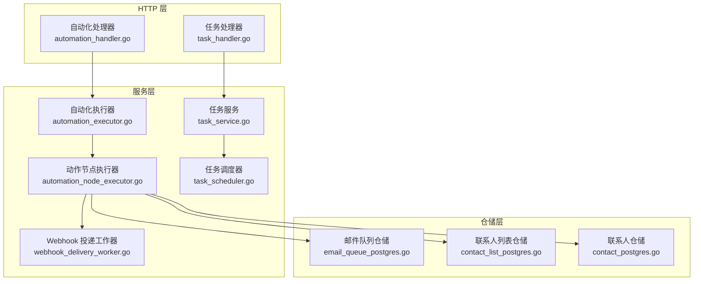
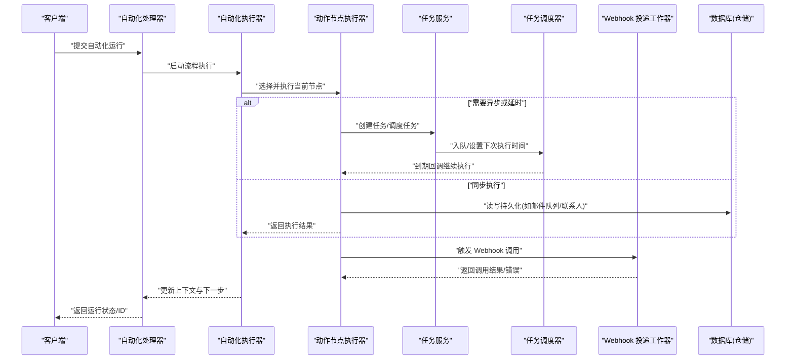
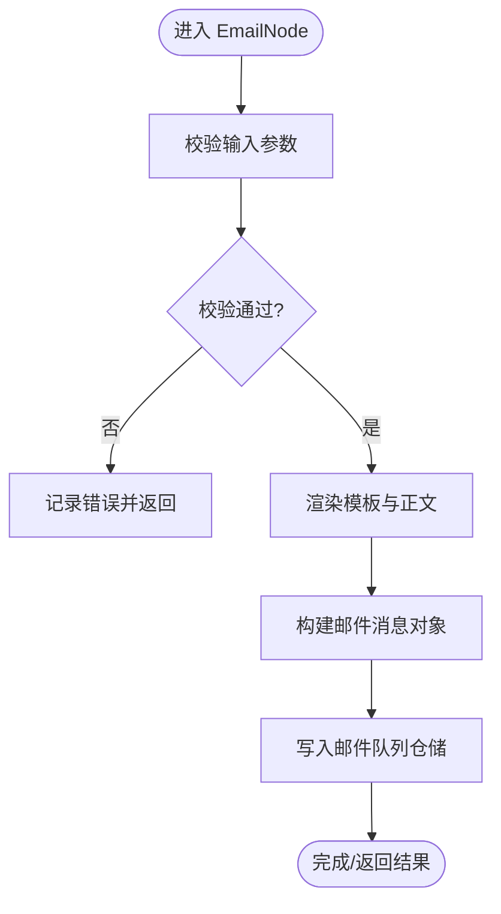
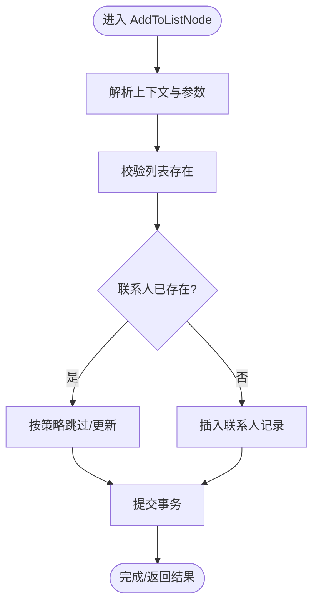
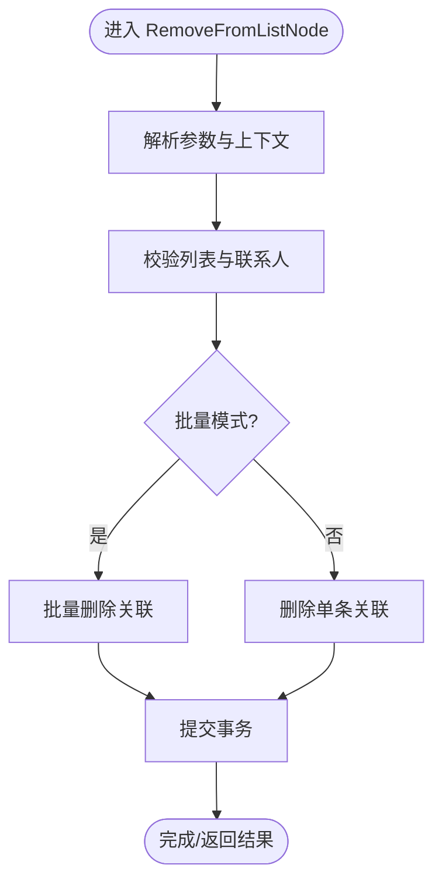
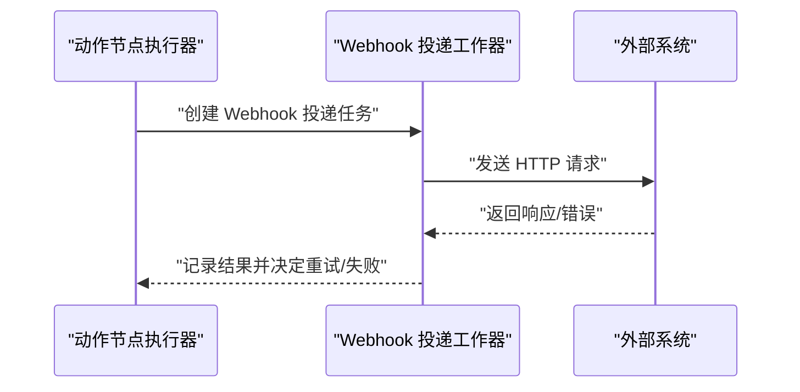
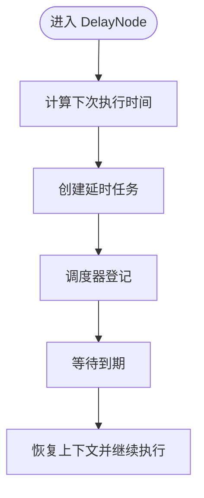
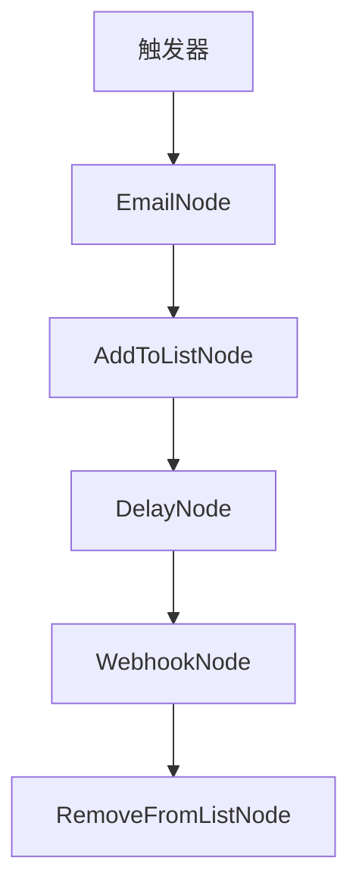
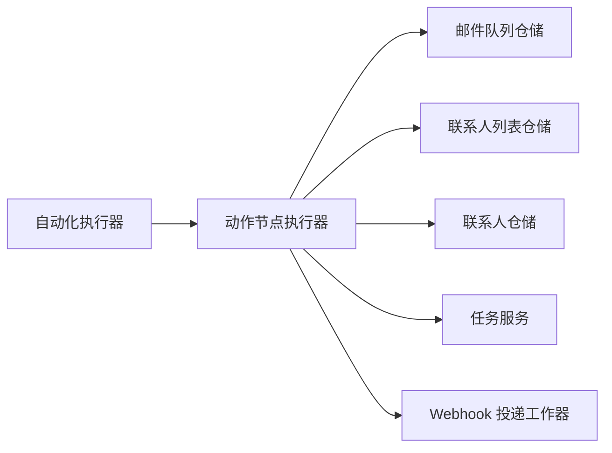

# 动作执行节点

<cite>
**本文引用的文件**   
- [automation_node_executor.go](file://notifuse/internal/service/automation_node_executor.go)
- [automation_executor.go](file://notifuse/internal/service/automation_executor.go)
- [task_service.go](file://notifuse/internal/service/task_service.go)
- [task_scheduler.go](file://notifuse/internal/service/task_scheduler.go)
- [webhook_delivery_worker.go](file://notifuse/internal/service/webhook_delivery_worker.go)
- [email_queue_postgres.go](file://notifuse/internal/repository/email_queue_postgres.go)
- [contact_list_postgres.go](file://notifuse/internal/repository/contact_list_postgres.go)
- [contact_postgres.go](file://notifuse/internal/repository/contact_postgres.go)
- [automation_handler.go](file://notifuse/internal/http/automation_handler.go)
- [task_handler.go](file://notifuse/internal/http/task_handler.go)
</cite>

## 目录
1. [简介](#简介)
2. [项目结构](#项目结构)
3. [核心组件](#核心组件)
4. [架构总览](#架构总览)
5. [详细组件分析](#详细组件分析)
6. [依赖关系分析](#依赖关系分析)
7. [性能考虑](#性能考虑)
8. [故障排查指南](#故障排查指南)
9. [结论](#结论)
10. [附录](#附录)

## 简介
本技术文档围绕“动作执行节点系统”展开，聚焦以下关键动作节点：EmailNode（邮件发送）、AddToListNode（添加联系人）、RemoveFromListNode（移除联系人）、WebhookNode（网络请求）与 DelayNode（延迟执行）。文档将深入说明各节点的配置界面、参数校验与执行流程，并系统化阐述异步任务处理、错误重试与状态跟踪机制。同时解释节点间的依赖关系、数据传递与上下文共享方式，并提供性能监控、批量处理与并发控制建议，以及自定义动作节点的开发指南与集成示例。

## 项目结构
本项目采用分层与按领域组织相结合的结构：
- 服务层（internal/service）：编排自动化流程、调度任务、驱动具体动作节点执行。
- 仓储层（internal/repository）：持久化访问数据库，如邮件队列、联系人列表与联系人记录。
- HTTP 层（internal/http）：对外暴露 API，用于触发自动化、查询任务状态等。
- 领域模型（internal/domain）：定义实体、事件与业务规则。
- 工具与中间件（pkg/*）：提供通用能力，如日志、追踪、限流、HTTP 客户端等。

图表来源
- [automation_handler.go](file://notifuse/internal/http/automation_handler.go)
- [task_handler.go](file://notifuse/internal/http/task_handler.go)
- [automation_executor.go](file://notifuse/internal/service/automation_executor.go)
- [automation_node_executor.go](file://notifuse/internal/service/automation_node_executor.go)
- [task_service.go](file://notifuse/internal/service/task_service.go)
- [task_scheduler.go](file://notifuse/internal/service/task_scheduler.go)
- [webhook_delivery_worker.go](file://notifuse/internal/service/webhook_delivery_worker.go)
- [email_queue_postgres.go](file://notifuse/internal/repository/email_queue_postgres.go)
- [contact_list_postgres.go](file://notifuse/internal/repository/contact_list_postgres.go)
- [contact_postgres.go](file://notifuse/internal/repository/contact_postgres.go)

章节来源
- [automation_handler.go](file://notifuse/internal/http/automation_handler.go)
- [task_handler.go](file://notifuse/internal/http/task_handler.go)
- [automation_executor.go](file://notifuse/internal/service/automation_executor.go)
- [automation_node_executor.go](file://notifuse/internal/service/automation_node_executor.go)
- [task_service.go](file://notifuse/internal/service/task_service.go)
- [task_scheduler.go](file://notifuse/internal/service/task_scheduler.go)
- [webhook_delivery_worker.go](file://notifuse/internal/service/webhook_delivery_worker.go)
- [email_queue_postgres.go](file://notifuse/internal/repository/email_queue_postgres.go)
- [contact_list_postgres.go](file://notifuse/internal/repository/contact_list_postgres.go)
- [contact_postgres.go](file://notifuse/internal/repository/contact_postgres.go)

## 核心组件
- 自动化执行器：负责解析自动化流程图、维护执行上下文、协调节点执行顺序与分支跳转。
- 动作节点执行器：统一注册与分发具体动作节点（邮件、联系人、Webhook、延迟等），封装参数校验、执行与结果回写。
- 任务服务与调度器：提供任务的创建、查询、重试与定时调度能力，支撑异步与延时执行。
- Webhook 投递工作器：对 Webhook 调用进行可靠投递、退避重试与失败归档。
- 仓储接口实现：为邮件队列、联系人列表与联系人提供持久化访问。

章节来源
- [automation_executor.go](file://notifuse/internal/service/automation_executor.go)
- [automation_node_executor.go](file://notifuse/internal/service/automation_node_executor.go)
- [task_service.go](file://notifuse/internal/service/task_service.go)
- [task_scheduler.go](file://notifuse/internal/service/task_scheduler.go)
- [webhook_delivery_worker.go](file://notifuse/internal/service/webhook_delivery_worker.go)
- [email_queue_postgres.go](file://notifuse/internal/repository/email_queue_postgres.go)
- [contact_list_postgres.go](file://notifuse/internal/repository/contact_list_postgres.go)
- [contact_postgres.go](file://notifuse/internal/repository/contact_postgres.go)

## 架构总览
下图展示了从 HTTP 入口到动作节点执行的端到端流程，包括异步任务与重试机制的参与点。

图表来源
- [automation_handler.go](file://notifuse/internal/http/automation_handler.go)
- [automation_executor.go](file://notifuse/internal/service/automation_executor.go)
- [automation_node_executor.go](file://notifuse/internal/service/automation_node_executor.go)
- [task_service.go](file://notifuse/internal/service/task_service.go)
- [task_scheduler.go](file://notifuse/internal/service/task_scheduler.go)
- [webhook_delivery_worker.go](file://notifuse/internal/service/webhook_delivery_worker.go)

## 详细组件分析

### EmailNode（邮件发送）
- 功能概述
  - 根据模板与上下文渲染邮件内容，写入邮件队列仓储，由后续投递器实际发送。
  - 支持多收件人、主题、正文、附件等字段；可配置优先级与重试策略。
- 配置界面要点
  - 必填项：发件人、主题、正文模板、至少一个收件人。
  - 选填项：抄送/密送、附件、发送优先级、重试次数、超时时间。
  - 变量绑定：通过上下文键值映射到模板变量。
- 参数校验
  - 邮箱格式校验、模板非空校验、附件大小限制、收件人数上限。
- 执行流程
  - 渲染模板 -> 构建邮件消息 -> 写入邮件队列 -> 返回成功或错误码。
  - 若配置了立即发送且具备直接发送能力，则走直发路径；否则进入队列。
- 错误处理与重试
  - 入库失败：记录错误并标记任务失败，交由任务服务重试。
  - 投递失败：由投递器按退避策略重试，超过阈值转入死信队列。
- 性能与并发
  - 批量写入队列时采用事务批处理；限制单批次大小以避免大事务。
  - 高并发场景下使用连接池与速率限制保护下游 SMTP/第三方服务。

图表来源
- [automation_node_executor.go](file://notifuse/internal/service/automation_node_executor.go)
- [email_queue_postgres.go](file://notifuse/internal/repository/email_queue_postgres.go)

章节来源
- [automation_node_executor.go](file://notifuse/internal/service/automation_node_executor.go)
- [email_queue_postgres.go](file://notifuse/internal/repository/email_queue_postgres.go)

### AddToListNode（添加联系人）
- 功能概述
  - 将联系人加入指定列表，支持去重与幂等写入。
- 配置界面要点
  - 必填项：目标列表 ID、联系人邮箱。
  - 选填项：联系人姓名、标签、自定义字段、是否忽略重复。
- 参数校验
  - 列表存在性校验、邮箱格式校验、字段长度与类型约束。
- 执行流程
  - 解析上下文获取联系人信息 -> 检查是否存在 -> 插入或更新 -> 返回结果。
- 错误处理与重试
  - 唯一约束冲突：视为成功或按配置忽略。
  - 数据库异常：记录错误并交由任务服务重试。
- 性能与并发
  - 使用 Upsert 操作减少往返；批量添加时使用事务与分批提交。

图表来源
- [automation_node_executor.go](file://notifuse/internal/service/automation_node_executor.go)
- [contact_list_postgres.go](file://notifuse/internal/repository/contact_list_postgres.go)
- [contact_postgres.go](file://notifuse/internal/repository/contact_postgres.go)

章节来源
- [automation_node_executor.go](file://notifuse/internal/service/automation_node_executor.go)
- [contact_list_postgres.go](file://notifuse/internal/repository/contact_list_postgres.go)
- [contact_postgres.go](file://notifuse/internal/repository/contact_postgres.go)

### RemoveFromListNode（移除联系人）
- 功能概述
  - 将联系人从指定列表中移除，支持批量移除与幂等删除。
- 配置界面要点
  - 必填项：目标列表 ID、联系人邮箱。
  - 选填项：批量来源（数组/CSV）、是否忽略不存在。
- 参数校验
  - 列表存在性、邮箱格式、批量数量上限。
- 执行流程
  - 解析参数 -> 定位联系人 -> 在列表中删除关联 -> 返回结果。
- 错误处理与重试
  - 无关联记录：按配置忽略或记录警告。
  - 数据库异常：记录错误并交由任务服务重试。
- 性能与并发
  - 批量删除使用 IN 子句与分批处理，避免长事务与锁竞争。

图表来源
- [automation_node_executor.go](file://notifuse/internal/service/automation_node_executor.go)
- [contact_list_postgres.go](file://notifuse/internal/repository/contact_list_postgres.go)
- [contact_postgres.go](file://notifuse/internal/repository/contact_postgres.go)

章节来源
- [automation_node_executor.go](file://notifuse/internal/service/automation_node_executor.go)
- [contact_list_postgres.go](file://notifuse/internal/repository/contact_list_postgres.go)
- [contact_postgres.go](file://notifuse/internal/repository/contact_postgres.go)

### WebhookNode（网络请求）
- 功能概述
  - 向外部系统发起 HTTP 请求，支持 GET/POST/PUT/DELETE 等方法与自定义头体。
- 配置界面要点
  - 必填项：URL、方法。
  - 选填项：请求头、请求体模板、超时、重试次数、签名/鉴权。
- 参数校验
  - URL 合法性、方法白名单、请求体大小限制、模板变量完整性。
- 执行流程
  - 渲染请求体 -> 建立安全 HTTP 客户端 -> 发起请求 -> 记录响应与错误。
- 错误处理与重试
  - 网络抖动/超时：指数退避重试；达到最大重试后记录失败并告警。
  - 业务错误：根据状态码决定是否重试。
- 性能与并发
  - 使用连接复用与超时控制；对高频调用方启用令牌桶限流。

图表来源
- [automation_node_executor.go](file://notifuse/internal/service/automation_node_executor.go)
- [webhook_delivery_worker.go](file://notifuse/internal/service/webhook_delivery_worker.go)

章节来源
- [automation_node_executor.go](file://notifuse/internal/service/automation_node_executor.go)
- [webhook_delivery_worker.go](file://notifuse/internal/service/webhook_delivery_worker.go)

### DelayNode（延迟执行）
- 功能概述
  - 在当前节点完成后等待一段时间再继续执行后续节点，常用于间隔与定时触发。
- 配置界面要点
  - 必填项：延迟时长（秒/分钟/小时）或绝对时间点。
  - 选填项：时区、最大等待时间、超时处理策略。
- 参数校验
  - 时长范围、时区有效性、相对/绝对时间一致性。
- 执行流程
  - 计算下次执行时间 -> 创建延时任务 -> 调度器到期唤醒 -> 恢复上下文继续执行。
- 错误处理与重试
  - 调度失败：记录错误并重试创建任务；到达最大等待时间则标记失败。
- 性能与并发
  - 使用高效的时间轮或延迟队列；批量延迟任务合并以减少调度开销。

图表来源
- [automation_node_executor.go](file://notifuse/internal/service/automation_node_executor.go)
- [task_service.go](file://notifuse/internal/service/task_service.go)
- [task_scheduler.go](file://notifuse/internal/service/task_scheduler.go)

章节来源
- [automation_node_executor.go](file://notifuse/internal/service/automation_node_executor.go)
- [task_service.go](file://notifuse/internal/service/task_service.go)
- [task_scheduler.go](file://notifuse/internal/service/task_scheduler.go)

### 概念总览
以下为不绑定具体源码的概念流程图，帮助理解动作节点在自动化流程中的协作方式。

[此图为概念示意，无需图表来源]

## 依赖关系分析
- 组件耦合
  - 动作节点执行器依赖仓储层进行数据读写，依赖任务服务进行异步与延时任务管理，依赖 Webhook 投递工作器进行外部通信。
  - 自动化执行器仅与动作节点执行器交互，保持高层编排与底层实现的解耦。
- 外部依赖
  - 数据库：PostgreSQL（通过仓储层访问）。
  - 外部系统：SMTP/第三方邮件服务、Webhook 接收端。
- 潜在循环依赖
  - 通过服务层与仓储层的清晰边界避免循环依赖；动作节点之间通过上下文传递数据而非直接互相引用。

图表来源
- [automation_node_executor.go](file://notifuse/internal/service/automation_node_executor.go)
- [automation_executor.go](file://notifuse/internal/service/automation_executor.go)
- [email_queue_postgres.go](file://notifuse/internal/repository/email_queue_postgres.go)
- [contact_list_postgres.go](file://notifuse/internal/repository/contact_list_postgres.go)
- [contact_postgres.go](file://notifuse/internal/repository/contact_postgres.go)
- [task_service.go](file://notifuse/internal/service/task_service.go)
- [webhook_delivery_worker.go](file://notifuse/internal/service/webhook_delivery_worker.go)

章节来源
- [automation_node_executor.go](file://notifuse/internal/service/automation_node_executor.go)
- [automation_executor.go](file://notifuse/internal/service/automation_executor.go)
- [email_queue_postgres.go](file://notifuse/internal/repository/email_queue_postgres.go)
- [contact_list_postgres.go](file://notifuse/internal/repository/contact_list_postgres.go)
- [contact_postgres.go](file://notifuse/internal/repository/contact_postgres.go)
- [task_service.go](file://notifuse/internal/service/task_service.go)
- [webhook_delivery_worker.go](file://notifuse/internal/service/webhook_delivery_worker.go)

## 性能考虑
- 批量处理
  - 邮件队列与联系人操作均采用分批写入，降低单次事务压力与锁竞争。
- 并发控制
  - 使用令牌桶或滑动窗口限流保护外部服务；对 Webhook 调用设置并发上限与超时。
- 资源管理
  - 数据库连接池、HTTP 客户端复用、模板渲染缓存。
- 监控指标
  - 节点执行耗时、成功率、重试次数、队列积压、Webhook 响应时间分布。

[本节为通用指导，无需章节来源]

## 故障排查指南
- 常见问题
  - 邮件未送达：检查邮件队列状态、投递日志与第三方服务返回码。
  - 联系人未更新：确认列表 ID 与邮箱匹配、查看唯一约束冲突日志。
  - Webhook 失败：核对 URL 可达性、鉴权头、请求体模板与重试策略。
  - 延迟未触发：检查任务调度器状态、任务表记录与系统时钟。
- 定位手段
  - 通过任务处理器查询任务详情与重试历史。
  - 结合自动化处理器返回的运行 ID 追踪上下文变更。
- 恢复策略
  - 对失败任务进行手动重试或批量重放；对死信队列进行人工干预。

章节来源
- [task_handler.go](file://notifuse/internal/http/task_handler.go)
- [automation_handler.go](file://notifuse/internal/http/automation_handler.go)

## 结论
动作执行节点系统通过统一的执行器与仓储抽象，实现了邮件发送、联系人管理、Webhook 调用与延迟执行的标准化流程。借助任务服务与调度器，系统具备良好的异步与可靠性保障。建议在扩展新节点时遵循现有接口与校验规范，充分利用上下文共享与监控指标，确保可观测性与可维护性。

[本节为总结，无需章节来源]

## 附录

### 自定义动作节点开发指南
- 步骤概览
  - 定义节点类型与配置结构。
  - 在动作节点执行器中注册新节点处理器。
  - 实现参数校验、执行逻辑与结果回写。
  - 如需异步或重试，委托任务服务与调度器。
  - 编写单元测试覆盖正常与异常路径。
- 集成示例
  - 参考现有节点（如 WebhookNode）的实现模式，复用安全 HTTP 客户端与重试策略。
  - 在自动化执行器中通过上下文键值传递必要数据，避免强耦合。

[本节为通用指导，无需章节来源]