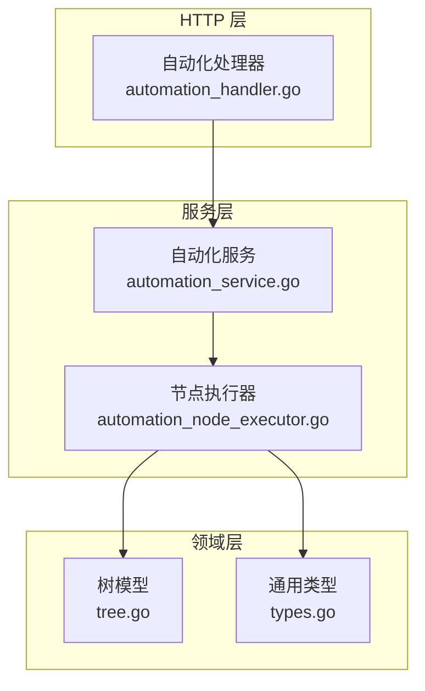
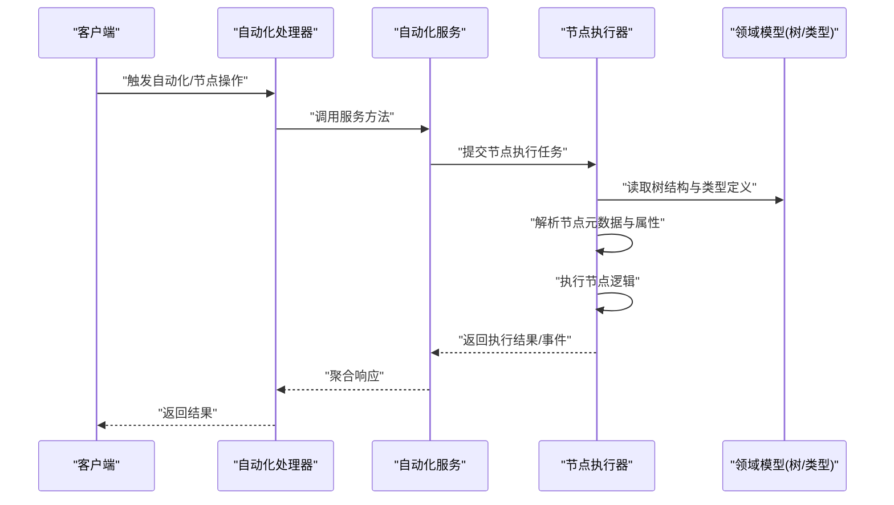
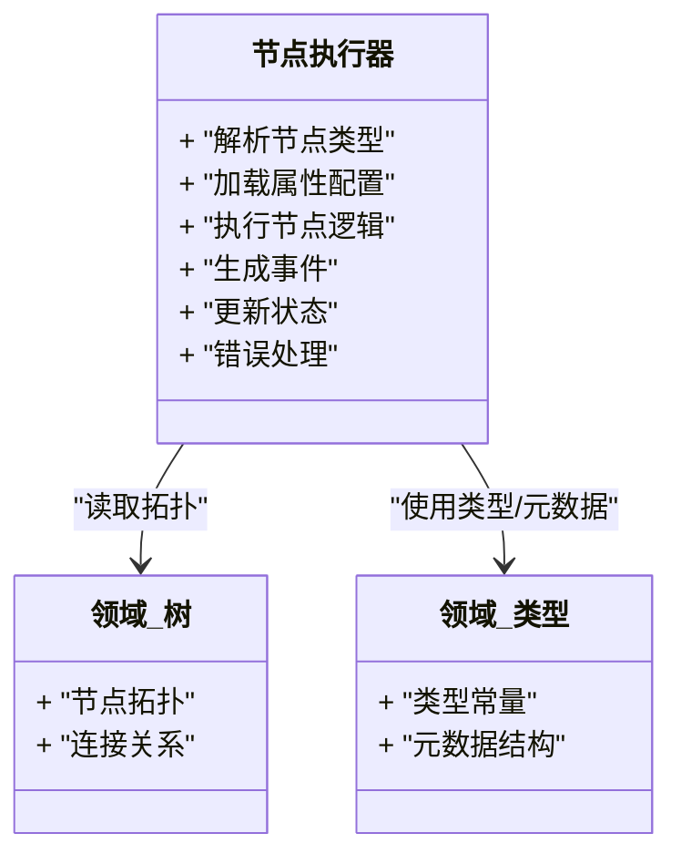
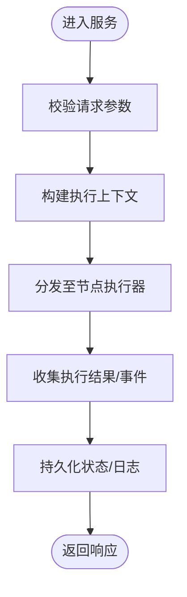
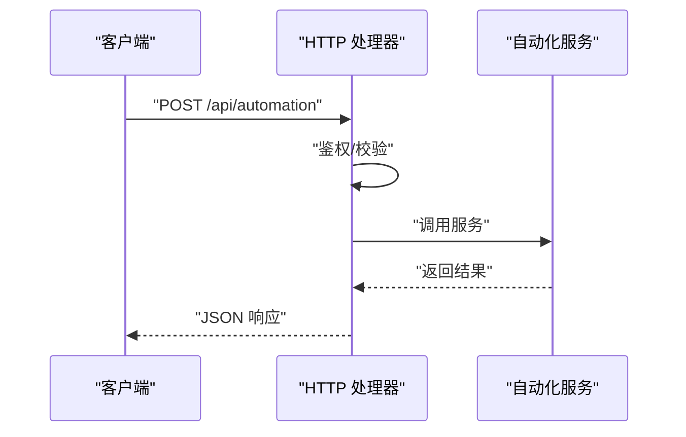
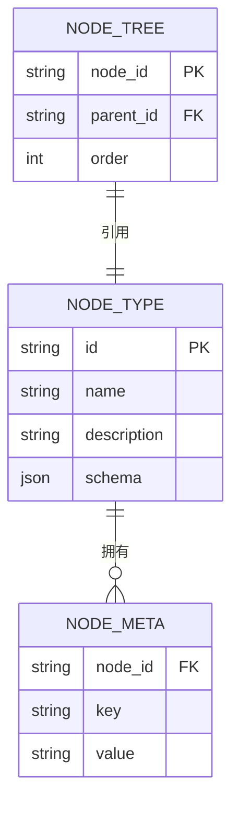
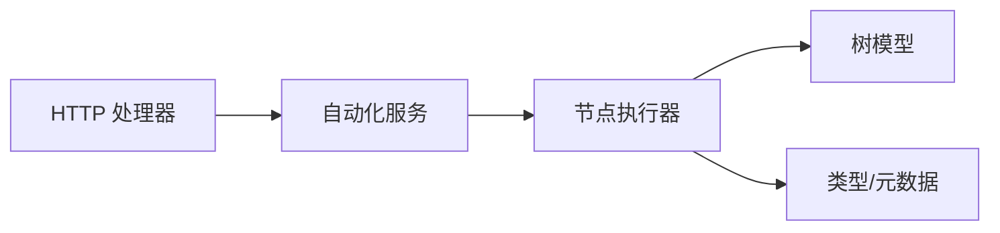

# 基础节点架构

<cite>
**本文引用的文件**   
- [automation_node_executor.go](file://notifuse/internal/service/automation_node_executor.go)
- [automation_service.go](file://notifuse/internal/service/automation_service.go)
- [tree.go](file://notifuse/internal/domain/tree.go)
- [types.go](file://notifuse/internal/domain/types.go)
- [automation_handler.go](file://notifuse/internal/http/automation_handler.go)
</cite>

## 目录
1. [简介](#简介)
2. [项目结构](#项目结构)
3. [核心组件](#核心组件)
4. [架构总览](#架构总览)
5. [详细组件分析](#详细组件分析)
6. [依赖关系分析](#依赖关系分析)
7. [性能考量](#性能考量)
8. [故障排查指南](#故障排查指南)
9. [结论](#结论)
10. [附录](#附录)

## 简介
本技术文档围绕“基础节点架构”展开，聚焦于自动化流程中的节点执行与编排。目标包括：
- 解释节点生命周期管理、属性配置接口定义与事件处理机制
- 说明节点类型常量、节点元数据结构与状态管理
- 描述节点渲染引擎（可视化编排）、拖拽行为与交互协议
- 梳理节点继承体系、抽象方法定义与扩展点设计
- 提供开发最佳实践、性能优化策略与调试技巧

为避免直接粘贴源码，所有实现细节均以“章节来源”标注对应文件路径与行号范围，便于读者快速定位。

## 项目结构
仓库中与“节点架构”相关的代码主要位于以下模块：
- 领域模型层：定义树形结构与通用类型
- 服务层：编排与调度节点执行
- HTTP 层：暴露节点相关 API 并驱动执行

图表来源
- [automation_handler.go](file://notifuse/internal/http/automation_handler.go)
- [automation_service.go](file://notifuse/internal/service/automation_service.go)
- [automation_node_executor.go](file://notifuse/internal/service/automation_node_executor.go)
- [tree.go](file://notifuse/internal/domain/tree.go)
- [types.go](file://notifuse/internal/domain/types.go)

章节来源
- [automation_handler.go](file://notifuse/internal/http/automation_handler.go)
- [automation_service.go](file://notifuse/internal/service/automation_service.go)
- [automation_node_executor.go](file://notifuse/internal/service/automation_node_executor.go)
- [tree.go](file://notifuse/internal/domain/tree.go)
- [types.go](file://notifuse/internal/domain/types.go)

## 核心组件
本节从“基础节点”视角，对关键能力进行分层说明：
- 节点类型与元数据：通过类型常量与结构化元数据描述节点身份、输入输出契约与运行时参数
- 节点生命周期：创建、校验、执行、完成、失败回调等阶段由执行器统一编排
- 属性配置接口：以声明式方式定义节点的配置项、默认值与校验规则
- 事件处理机制：节点在执行过程中产生事件，供上层订阅与记录
- 状态管理：节点在运行时的状态流转与持久化快照

章节来源
- [automation_node_executor.go](file://notifuse/internal/service/automation_node_executor.go)
- [automation_service.go](file://notifuse/internal/service/automation_service.go)
- [tree.go](file://notifuse/internal/domain/tree.go)
- [types.go](file://notifuse/internal/domain/types.go)

## 架构总览
下图展示从 HTTP 请求到节点执行的端到端调用链，以及节点执行器如何基于领域模型驱动节点运行。

图表来源
- [automation_handler.go](file://notifuse/internal/http/automation_handler.go)
- [automation_service.go](file://notifuse/internal/service/automation_service.go)
- [automation_node_executor.go](file://notifuse/internal/service/automation_node_executor.go)
- [tree.go](file://notifuse/internal/domain/tree.go)
- [types.go](file://notifuse/internal/domain/types.go)

## 详细组件分析

### 节点执行器（基础节点）
节点执行器是“基础节点”的核心载体，负责：
- 解析节点类型与元数据
- 加载并校验属性配置
- 驱动节点生命周期（初始化、执行、收尾）
- 产出事件与状态变更
- 错误捕获与重试策略（如适用）

图表来源
- [automation_node_executor.go](file://notifuse/internal/service/automation_node_executor.go)
- [tree.go](file://notifuse/internal/domain/tree.go)
- [types.go](file://notifuse/internal/domain/types.go)

章节来源
- [automation_node_executor.go](file://notifuse/internal/service/automation_node_executor.go)
- [tree.go](file://notifuse/internal/domain/tree.go)
- [types.go](file://notifuse/internal/domain/types.go)

### 自动化服务（编排与调度）
自动化服务承担更高层的编排职责：
- 接收来自 HTTP 层的请求
- 将任务委派给节点执行器
- 汇总执行结果与事件
- 协调事务与上下文传递

图表来源
- [automation_service.go](file://notifuse/internal/service/automation_service.go)
- [automation_node_executor.go](file://notifuse/internal/service/automation_node_executor.go)

章节来源
- [automation_service.go](file://notifuse/internal/service/automation_service.go)
- [automation_node_executor.go](file://notifuse/internal/service/automation_node_executor.go)

### HTTP 处理器（API 入口）
HTTP 处理器作为外部入口，负责：
- 解析请求体与查询参数
- 鉴权与权限校验
- 调用服务层编排逻辑
- 标准化响应格式

图表来源
- [automation_handler.go](file://notifuse/internal/http/automation_handler.go)
- [automation_service.go](file://notifuse/internal/service/automation_service.go)

章节来源
- [automation_handler.go](file://notifuse/internal/http/automation_handler.go)
- [automation_service.go](file://notifuse/internal/service/automation_service.go)

### 领域模型（树与类型）
- 树模型：描述节点拓扑、父子关系与边信息，支撑执行器的遍历与调度
- 类型定义：包含节点类型常量、元数据结构与属性契约，为执行器提供统一的解析与校验依据

图表来源
- [tree.go](file://notifuse/internal/domain/tree.go)
- [types.go](file://notifuse/internal/domain/types.go)

章节来源
- [tree.go](file://notifuse/internal/domain/tree.go)
- [types.go](file://notifuse/internal/domain/types.go)

## 依赖关系分析
- 低耦合：HTTP 层仅依赖服务层；服务层依赖执行器；执行器依赖领域模型
- 高内聚：每个组件职责清晰，边界明确
- 可扩展：新增节点类型只需在类型定义中注册，并在执行器中补充分支逻辑

图表来源
- [automation_handler.go](file://notifuse/internal/http/automation_handler.go)
- [automation_service.go](file://notifuse/internal/service/automation_service.go)
- [automation_node_executor.go](file://notifuse/internal/service/automation_node_executor.go)
- [tree.go](file://notifuse/internal/domain/tree.go)
- [types.go](file://notifuse/internal/domain/types.go)

章节来源
- [automation_handler.go](file://notifuse/internal/http/automation_handler.go)
- [automation_service.go](file://notifuse/internal/service/automation_service.go)
- [automation_node_executor.go](file://notifuse/internal/service/automation_node_executor.go)
- [tree.go](file://notifuse/internal/domain/tree.go)
- [types.go](file://notifuse/internal/domain/types.go)

## 性能考量
- 批量执行与并行度控制：在服务层或执行器中对可并行节点进行并发调度，避免阻塞
- 缓存热点配置：对频繁读取的节点类型与元数据进行缓存，减少重复解析
- 惰性求值：仅在需要时加载下游节点与边信息
- 超时与熔断：为外部依赖设置合理超时，防止级联失败
- 日志采样：在高吞吐场景下对日志进行采样，降低 I/O 压力

[本节为通用指导，不直接分析具体文件]

## 故障排查指南
- 常见错误分类
  - 参数校验失败：检查请求体字段与类型约束
  - 节点未注册：确认类型常量与执行器分支覆盖
  - 元数据缺失：核对节点元数据结构完整性
  - 执行超时：关注外部依赖延迟与并发度
- 定位步骤
  - 查看 HTTP 层入参与响应
  - 追踪服务层上下文与中间状态
  - 深入执行器日志，确认节点生命周期各阶段
  - 对照领域模型，验证树拓扑与类型定义一致性
- 建议工具
  - 结构化日志与链路追踪
  - 单元测试与集成测试用例覆盖异常路径

章节来源
- [automation_handler.go](file://notifuse/internal/http/automation_handler.go)
- [automation_service.go](file://notifuse/internal/service/automation_service.go)
- [automation_node_executor.go](file://notifuse/internal/service/automation_node_executor.go)
- [tree.go](file://notifuse/internal/domain/tree.go)
- [types.go](file://notifuse/internal/domain/types.go)

## 结论
本架构以“节点执行器”为核心，结合“自动化服务”的编排能力与“领域模型”的类型/拓扑定义，形成清晰的层次与职责划分。通过统一的类型常量、元数据结构与属性配置接口，系统具备良好的可扩展性与可维护性。配合合理的性能优化与完善的排障手段，可在复杂自动化场景中稳定运行。

[本节为总结性内容，不直接分析具体文件]

## 附录
- 术语表
  - 节点：自动化流程中的最小可执行单元
  - 元数据：描述节点类型、属性与行为的结构化数据
  - 树模型：表示节点间拓扑关系的图结构
- 参考路径
  - 节点执行器实现：[automation_node_executor.go](file://notifuse/internal/service/automation_node_executor.go)
  - 服务编排逻辑：[automation_service.go](file://notifuse/internal/service/automation_service.go)
  - 领域模型（树/类型）：[tree.go](file://notifuse/internal/domain/tree.go)、[types.go](file://notifuse/internal/domain/types.go)
  - HTTP 入口：[automation_handler.go](file://notifuse/internal/http/automation_handler.go)