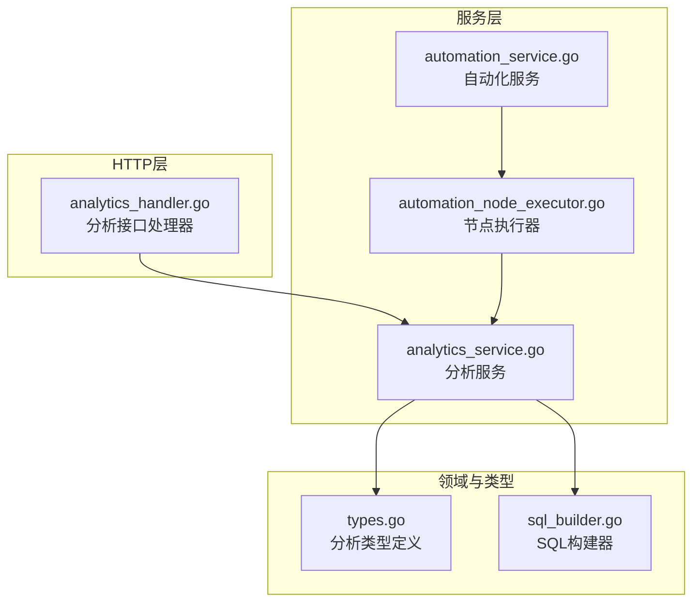
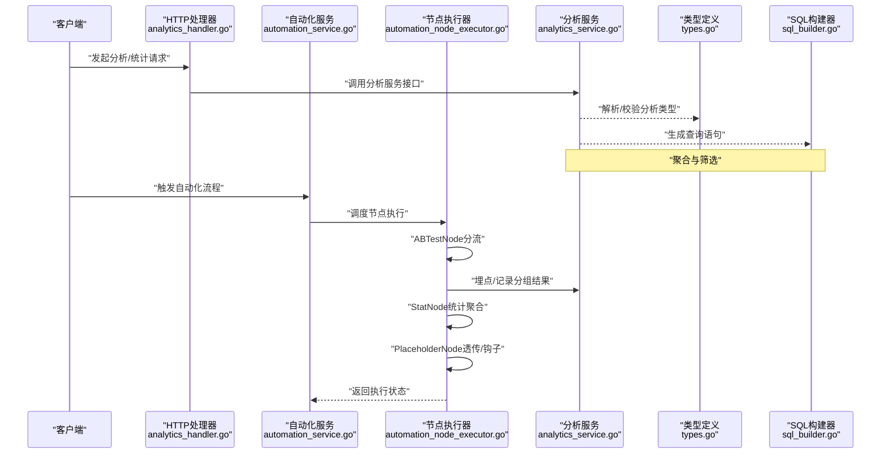
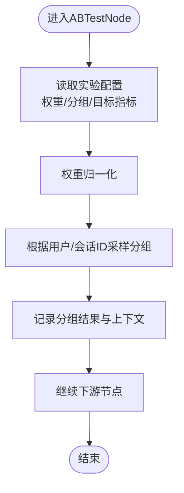
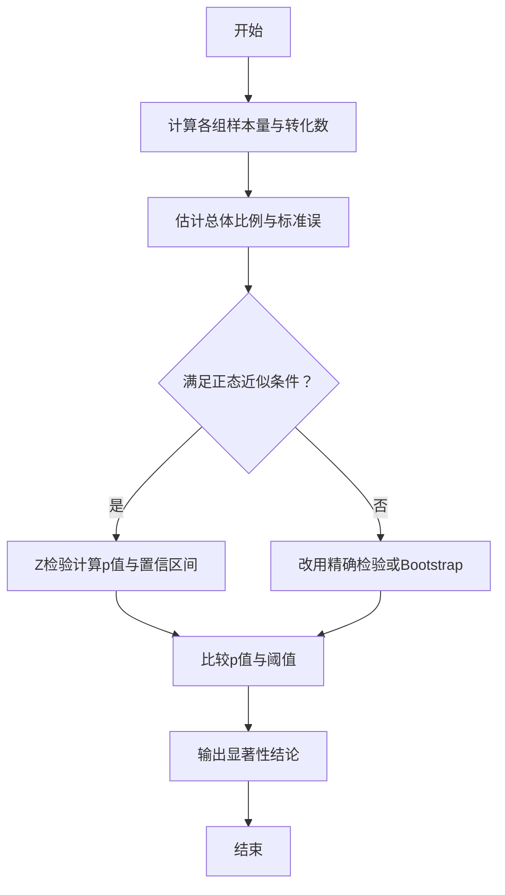
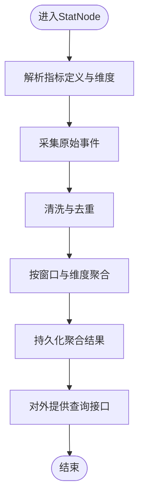
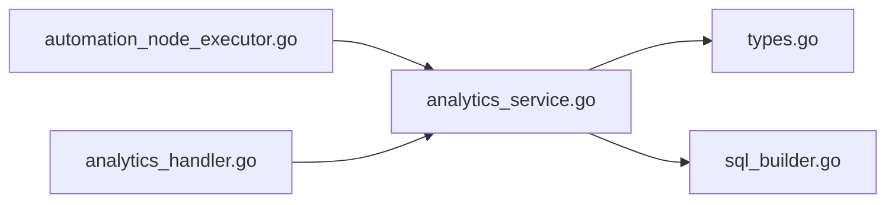

# 工具节点

<cite>
**本文引用的文件**   
- [automation_node_executor.go](file://notifuse/internal/service/automation_node_executor.go)
- [automation_service.go](file://notifuse/internal/service/automation_service.go)
- [analytics_handler.go](file://notifuse/internal/http/analytics_handler.go)
- [analytics_service.go](file://notifuse/internal/service/analytics_service.go)
- [types.go](file://notifuse/pkg/analytics/types.go)
- [sql_builder.go](file://notifuse/pkg/analytics/sql_builder.go)
</cite>

## 目录
1. [简介](#简介)
2. [项目结构](#项目结构)
3. [核心组件](#核心组件)
4. [架构总览](#架构总览)
5. [详细组件分析](#详细组件分析)
6. [依赖关系分析](#依赖关系分析)
7. [性能考虑](#性能考虑)
8. [故障排查指南](#故障排查指南)
9. [结论](#结论)
10. [附录](#附录)

## 简介
本技术文档聚焦于“工具节点系统”中的三类关键节点：ABTestNode（A/B测试节点）、StatNode（统计节点）与PlaceholderNode（占位符节点）。文档从系统架构、数据流、处理逻辑、集成点、错误处理与性能特性等维度展开，深入说明：
- A/B测试的流量分配算法、结果统计与显著性检验方法
- 统计数据的采集、聚合与可视化展示路径
- 占位符节点在流程图中的作用与使用场景
- 工具节点的配置选项、输出格式与数据转换
- 工具节点的扩展方法与自定义统计指标开发指南

## 项目结构
该仓库采用分层组织方式：HTTP层负责请求接入与响应封装；服务层实现业务编排与流程执行；领域模型与类型定义位于domain与pkg中；数据库访问通过repository层完成。工具节点作为自动化流程的一部分，由自动化执行器调度，并通过分析服务进行数据采集与查询。

图表来源
- [analytics_handler.go](file://notifuse/internal/http/analytics_handler.go)
- [automation_service.go](file://notifuse/internal/service/automation_service.go)
- [automation_node_executor.go](file://notifuse/internal/service/automation_node_executor.go)
- [analytics_service.go](file://notifuse/internal/service/analytics_service.go)
- [types.go](file://notifuse/pkg/analytics/types.go)
- [sql_builder.go](file://notifuse/pkg/analytics/sql_builder.go)

章节来源
- [automation_service.go](file://notifuse/internal/service/automation_service.go)
- [automation_node_executor.go](file://notifuse/internal/service/automation_node_executor.go)
- [analytics_handler.go](file://notifuse/internal/http/analytics_handler.go)
- [analytics_service.go](file://notifuse/internal/service/analytics_service.go)
- [types.go](file://notifuse/pkg/analytics/types.go)
- [sql_builder.go](file://notifuse/pkg/analytics/sql_builder.go)

## 核心组件
本节对三类工具节点进行概览式说明，并给出其在系统中的职责边界与交互关系。

- ABTestNode（A/B测试节点）
  - 职责：将进入的流量按权重分配到多个实验组，记录分组结果，并在后续阶段汇总各组的转化指标，支持显著性检验。
  - 关键点：权重归一化、随机抽样、一致性哈希或用户级分流策略、事件埋点、结果聚合与统计推断。

- StatNode（统计节点）
  - 职责：收集与分析流程相关的统计数据，包括计数、比率、均值、方差等，提供聚合视图与时间序列切片。
  - 关键点：指标定义、窗口聚合、去重与幂等、批处理写入、查询优化。

- PlaceholderNode（占位符节点）
  - 职责：在流程图中充当占位或路由分支的标记，便于扩展与调试，不改变主流程的数据形态。
  - 关键点：透传输入、可插拔钩子、日志与追踪、条件跳过。

章节来源
- [automation_node_executor.go](file://notifuse/internal/service/automation_node_executor.go)
- [analytics_service.go](file://notifuse/internal/service/analytics_service.go)
- [types.go](file://notifuse/pkg/analytics/types.go)

## 架构总览
下图展示了工具节点在整体自动化流水线中的位置与数据流向：HTTP入口触发分析相关操作，自动化服务编排流程，节点执行器驱动具体节点（含ABTestNode、StatNode、PlaceholderNode），分析服务负责指标采集与查询。

图表来源
- [analytics_handler.go](file://notifuse/internal/http/analytics_handler.go)
- [automation_service.go](file://notifuse/internal/service/automation_service.go)
- [automation_node_executor.go](file://notifuse/internal/service/automation_node_executor.go)
- [analytics_service.go](file://notifuse/internal/service/analytics_service.go)
- [types.go](file://notifuse/pkg/analytics/types.go)
- [sql_builder.go](file://notifuse/pkg/analytics/sql_builder.go)

## 详细组件分析

### ABTestNode（A/B测试节点）
- 设计要点
  - 流量分配：基于配置的权重向量进行归一化，结合用户标识或会话ID进行稳定分流，确保同一用户在不同请求中保持一致的实验组。
  - 随机性与公平性：采用均匀分布采样，必要时引入分层或哈希策略降低波动。
  - 结果记录：为每个命中事件写入分组标签与上下文元数据，供后续聚合与显著性检验使用。
  - 显著性检验：支持常见的假设检验方法（如比例差异的Z检验或卡方检验），计算p值与置信区间，辅助决策是否拒绝原假设。

- 数据流与处理逻辑

图表来源
- [automation_node_executor.go](file://notifuse/internal/service/automation_node_executor.go)
- [analytics_service.go](file://notifuse/internal/service/analytics_service.go)
- [types.go](file://notifuse/pkg/analytics/types.go)

- 配置选项（示例字段）
  - experiment_id：实验唯一标识
  - groups：分组列表及对应权重
  - user_key：用于分流的键（如用户ID、设备ID）
  - metrics：目标指标集合（如点击率、转化率）
  - significance_level：显著性水平阈值（如0.05）

- 输出格式
  - 包含experiment_id、group、user_key、timestamp、context等字段，便于后续聚合与可视化。

- 显著性检验流程

图表来源
- [analytics_service.go](file://notifuse/internal/service/analytics_service.go)
- [types.go](file://notifuse/pkg/analytics/types.go)

章节来源
- [automation_node_executor.go](file://notifuse/internal/service/automation_node_executor.go)
- [analytics_service.go](file://notifuse/internal/service/analytics_service.go)
- [types.go](file://notifuse/pkg/analytics/types.go)

### StatNode（统计节点）
- 设计要点
  - 指标定义：支持计数、比率、均值、方差、分位数等基础统计量，并可组合复杂表达式。
  - 聚合窗口：支持按时间窗（小时/天/周）与维度（渠道、地区、版本）进行聚合。
  - 数据质量：去重、异常值过滤、缺失值填充策略。
  - 存储与查询：批量写入、索引优化、分页与下推过滤。

- 数据处理流程

图表来源
- [analytics_service.go](file://notifuse/internal/service/analytics_service.go)
- [sql_builder.go](file://notifuse/pkg/analytics/sql_builder.go)
- [types.go](file://notifuse/pkg/analytics/types.go)

- 配置选项（示例字段）
  - metrics：指标列表与表达式
  - dimensions：聚合维度
  - windows：时间窗口大小与对齐策略
  - filters：前置过滤条件
  - retention：保留策略与清理周期

- 输出格式
  - 包含指标名、维度键、时间戳、数值与单位，便于前端图表渲染。

章节来源
- [analytics_service.go](file://notifuse/internal/service/analytics_service.go)
- [sql_builder.go](file://notifuse/pkg/analytics/sql_builder.go)
- [types.go](file://notifuse/pkg/analytics/types.go)

### PlaceholderNode（占位符节点）
- 设计要点
  - 作用：在流程图中作为占位或扩展点，便于在不改动主干逻辑的情况下插入新能力（如日志、监控、灰度开关）。
  - 行为：默认透传输入到下一个节点，可附加钩子函数执行额外逻辑。
  - 调试：输出详细的执行日志与追踪信息，便于定位问题。

- 使用场景
  - 流程骨架预留：提前规划未来功能点，避免频繁重构。
  - 条件分支：配合条件判断实现可选步骤。
  - 观测与审计：统一注入审计与合规检查。

- 配置选项（示例字段）
  - id：节点唯一标识
  - next：下一个节点引用
  - hooks：前置/后置钩子列表
  - enabled：是否启用

章节来源
- [automation_node_executor.go](file://notifuse/internal/service/automation_node_executor.go)

## 依赖关系分析
工具节点之间的耦合度较低，主要通过统一的执行器与服务接口协作。分析服务依赖类型定义与SQL构建器，保证查询的可维护性与可扩展性。

图表来源
- [automation_node_executor.go](file://notifuse/internal/service/automation_node_executor.go)
- [analytics_service.go](file://notifuse/internal/service/analytics_service.go)
- [types.go](file://notifuse/pkg/analytics/types.go)
- [sql_builder.go](file://notifuse/pkg/analytics/sql_builder.go)
- [analytics_handler.go](file://notifuse/internal/http/analytics_handler.go)

章节来源
- [automation_node_executor.go](file://notifuse/internal/service/automation_node_executor.go)
- [analytics_service.go](file://notifuse/internal/service/analytics_service.go)
- [types.go](file://notifuse/pkg/analytics/types.go)
- [sql_builder.go](file://notifuse/pkg/analytics/sql_builder.go)
- [analytics_handler.go](file://notifuse/internal/http/analytics_handler.go)

## 性能考虑
- 分流与采样
  - 使用稳定的用户级分流策略减少跨请求抖动；在高并发下优先选择轻量级的哈希或查表方案。
- 聚合与写入
  - 批量写入与合并更新可降低I/O压力；合理设置窗口大小以平衡实时性与吞吐。
- 查询优化
  - 利用SQL构建器生成高效查询；对常用维度建立索引；按需下推过滤条件。
- 内存与CPU
  - 控制中间结果集大小，避免大对象常驻内存；对热点路径进行缓存与复用。

[本节为通用指导，无需特定文件来源]

## 故障排查指南
- 常见问题
  - 分流不一致：检查用户键与权重配置，确认归一化与采样逻辑正确。
  - 统计偏差：核对去重与清洗规则，验证窗口对齐与聚合维度。
  - 查询缓慢：审查SQL构建器的过滤与连接条件，评估索引与分区策略。
- 诊断建议
  - 增加节点级日志与追踪，记录关键中间状态。
  - 对显著性检验结果进行回溯，验证假设条件与样本量。
  - 使用单元测试与集成测试覆盖边界情况与异常路径。

章节来源
- [automation_node_executor.go](file://notifuse/internal/service/automation_node_executor.go)
- [analytics_service.go](file://notifuse/internal/service/analytics_service.go)
- [sql_builder.go](file://notifuse/pkg/analytics/sql_builder.go)

## 结论
工具节点系统通过清晰的职责划分与松耦合设计，实现了A/B测试、统计分析与流程占位的灵活组合。ABTestNode提供稳定的分流与显著的统计推断，StatNode支撑多维度的指标聚合与可视化，PlaceholderNode则为扩展与调试提供了便利。借助分析服务与SQL构建器，系统在性能与可维护性方面具备良好基础。

[本节为总结性内容，无需特定文件来源]

## 附录

### 扩展方法与自定义统计指标开发指南
- 扩展节点
  - 在节点执行器中注册新的节点类型，实现统一的执行接口。
  - 为PlaceholderNode添加钩子机制，允许外部插件注入逻辑。
- 自定义统计指标
  - 在类型定义中新增指标结构与校验规则。
  - 在服务层实现指标的采集、聚合与查询逻辑，必要时扩展SQL构建器以支持新维度与表达式。
- 配置与输出
  - 遵循统一的配置模式与输出格式约定，确保前后端一致性与向后兼容。
- 测试与回归
  - 为新指标与节点编写单测与集成测试，覆盖正常与异常路径，保障稳定性。

章节来源
- [automation_node_executor.go](file://notifuse/internal/service/automation_node_executor.go)
- [analytics_service.go](file://notifuse/internal/service/analytics_service.go)
- [types.go](file://notifuse/pkg/analytics/types.go)
- [sql_builder.go](file://notifuse/pkg/analytics/sql_builder.go)