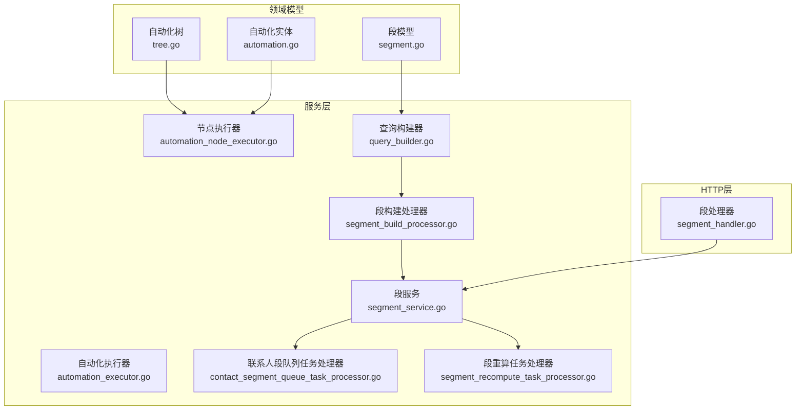
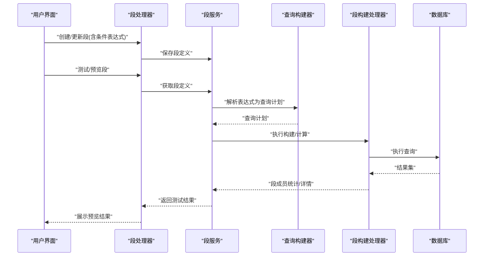
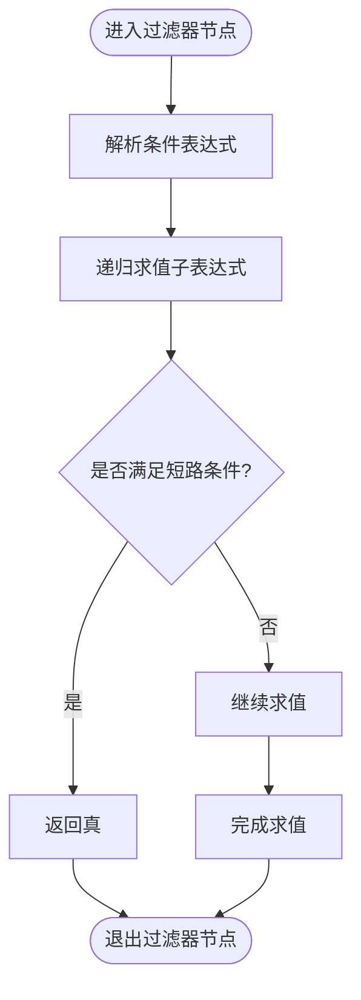
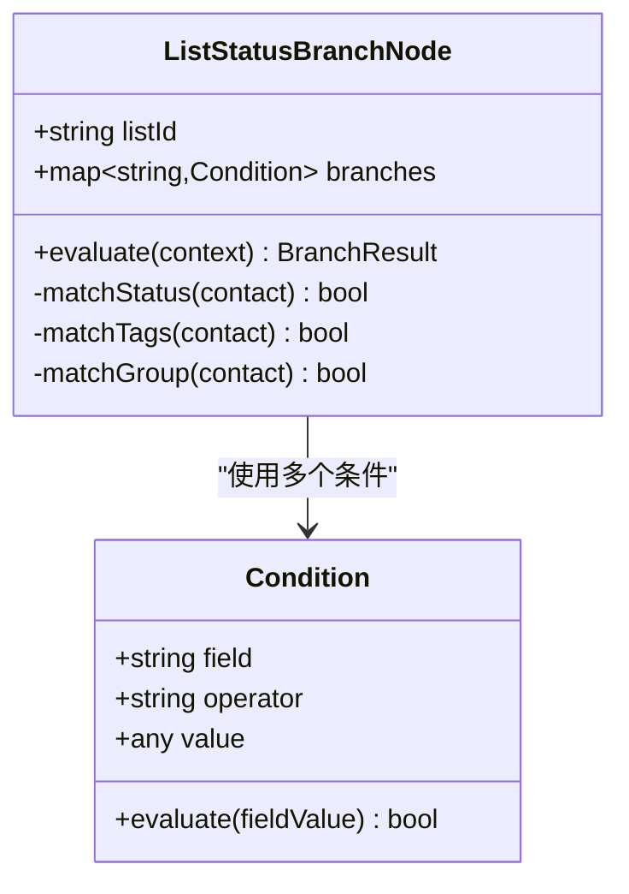
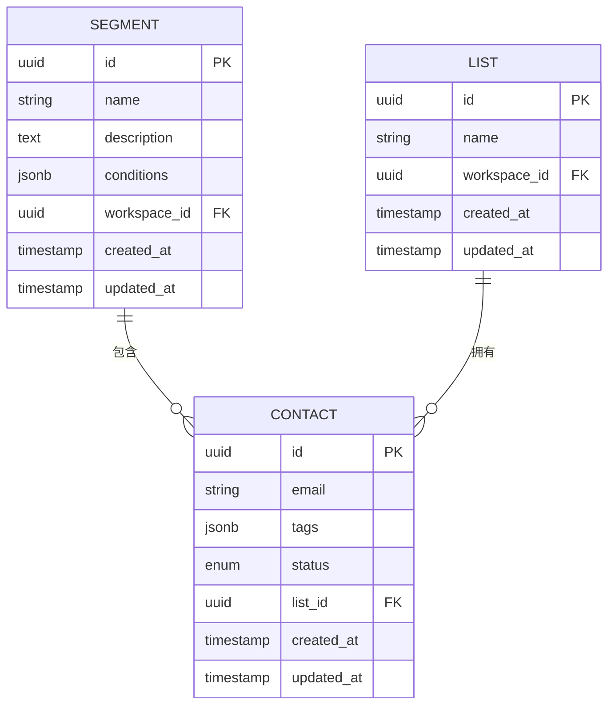
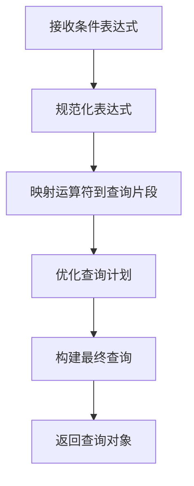
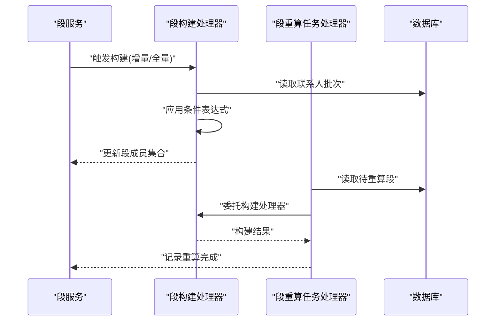
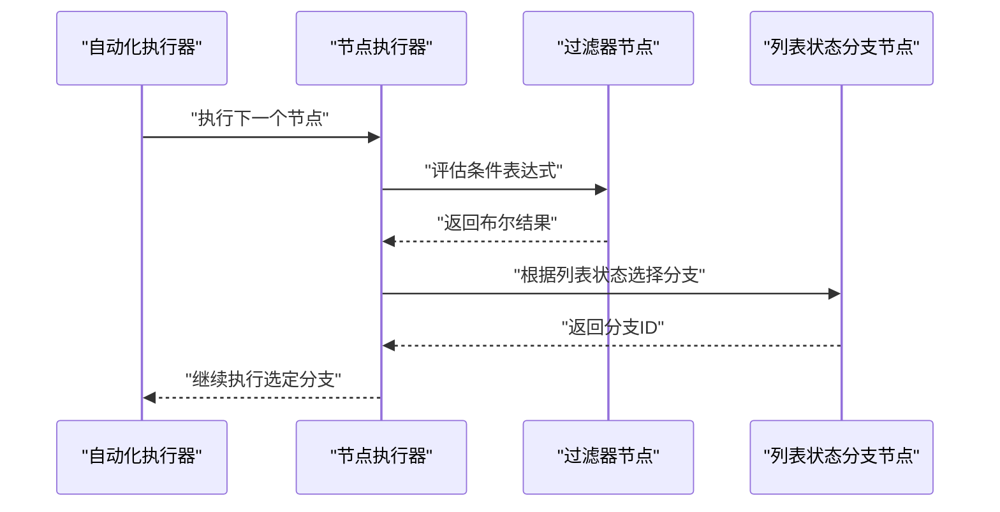
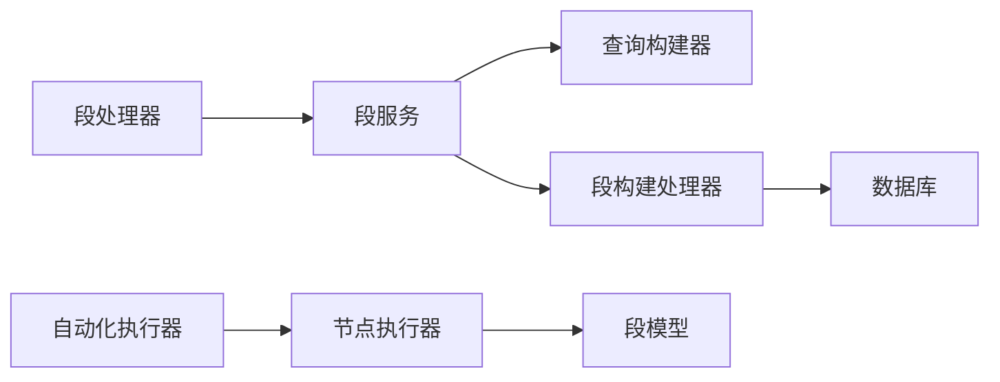

# 条件分支节点

<cite>
**本文引用的文件**   
- [automation_node_executor.go](file://notifuse/internal/service/automation_node_executor.go)
- [automation_executor.go](file://notifuse/internal/service/automation_executor.go)
- [automation_service.go](file://notifuse/internal/service/automation_service.go)
- [tree.go](file://notifuse/internal/domain/tree.go)
- [automation.go](file://notifuse/internal/domain/automation.go)
- [segment.go](file://notifuse/internal/domain/segment.go)
- [query_builder.go](file://notifuse/internal/service/query_builder.go)
- [segment_build_processor.go](file://notifuse/internal/service/segment_build_processor.go)
- [segment_service.go](file://notifuse/internal/service/segment_service.go)
- [contact_segment_queue_task_processor.go](file://notifuse/internal/service/contact_segment_queue_task_processor.go)
- [segment_recompute_task_processor.go](file://notifuse/internal/service/segment_recompute_task_processor.go)
- [segment_handler.go](file://notifuse/internal/http/segment_handler.go)
- [segment_test.go](file://notifuse/internal/domain/segment_test.go)
</cite>

## 目录
1. [简介](#简介)
2. [项目结构](#项目结构)
3. [核心组件](#核心组件)
4. [架构总览](#架构总览)
5. [详细组件分析](#详细组件分析)
6. [依赖关系分析](#依赖关系分析)
7. [性能与缓存](#性能与缓存)
8. [故障排查指南](#故障排查指南)
9. [结论](#结论)
10. [附录](#附录)

## 简介
本技术文档聚焦于“条件分支节点系统”，围绕以下两类关键节点展开：
- FilterNode（过滤器节点）：基于表达式对数据流进行过滤，决定后续执行路径。
- ListStatusBranchNode（列表状态分支节点）：根据联系人列表的状态或属性进行分支选择。

文档将深入说明：
- 条件表达式语法、逻辑运算符与嵌套条件支持
- 条件配置界面的构建、验证规则与实时预览
- 条件评估引擎的实现原理、性能优化与缓存策略
- 复杂条件组合、测试工具与调试方法
- 自定义条件函数的开发与集成指南

## 项目结构
条件分支相关能力主要分布在领域模型、服务层与HTTP接口层：
- 领域模型：定义自动化树、节点类型、段（Segment）等数据结构
- 服务层：实现节点执行器、查询构建器、段构建与重算任务处理
- HTTP层：提供段的创建、更新、查询与测试接口

图表来源
- [tree.go:1-200](file://notifuse/internal/domain/tree.go#L1-L200)
- [automation.go:1-200](file://notifuse/internal/domain/automation.go#L1-L200)
- [segment.go:1-200](file://notifuse/internal/domain/segment.go#L1-L200)
- [automation_node_executor.go:1-200](file://notifuse/internal/service/automation_node_executor.go#L1-L200)
- [automation_executor.go:1-200](file://notifuse/internal/service/automation_executor.go#L1-L200)
- [query_builder.go:1-200](file://notifuse/internal/service/query_builder.go#L1-L200)
- [segment_build_processor.go:1-200](file://notifuse/internal/service/segment_build_processor.go#L1-L200)
- [segment_service.go:1-200](file://notifuse/internal/service/segment_service.go#L1-L200)
- [contact_segment_queue_task_processor.go:1-200](file://notifuse/internal/service/contact_segment_queue_task_processor.go#L1-L200)
- [segment_recompute_task_processor.go:1-200](file://notifuse/internal/service/segment_recompute_task_processor.go#L1-L200)
- [segment_handler.go:1-200](file://notifuse/internal/http/segment_handler.go#L1-L200)

章节来源
- [tree.go:1-200](file://notifuse/internal/domain/tree.go#L1-L200)
- [automation.go:1-200](file://notifuse/internal/domain/automation.go#L1-L200)
- [segment.go:1-200](file://notifuse/internal/domain/segment.go#L1-L200)
- [automation_node_executor.go:1-200](file://notifuse/internal/service/automation_node_executor.go#L1-L200)
- [automation_executor.go:1-200](file://notifuse/internal/service/automation_executor.go#L1-L200)
- [query_builder.go:1-200](file://notifuse/internal/service/query_builder.go#L1-L200)
- [segment_build_processor.go:1-200](file://notifuse/internal/service/segment_build_processor.go#L1-L200)
- [segment_service.go:1-200](file://notifuse/internal/service/segment_service.go#L1-L200)
- [contact_segment_queue_task_processor.go:1-200](file://notifuse/internal/service/contact_segment_queue_task_processor.go#L1-L200)
- [segment_recompute_task_processor.go:1-200](file://notifuse/internal/service/segment_recompute_task_processor.go#L1-L200)
- [segment_handler.go:1-200](file://notifuse/internal/http/segment_handler.go#L1-L200)

## 核心组件
- 过滤器节点（FilterNode）：在自动化流程中作为条件判断点，依据表达式返回布尔结果，控制后续分支走向。
- 列表状态分支节点（ListStatusBranchNode）：针对联系人列表的特定状态或属性进行分支选择，常用于按订阅状态、标签、分组等进行分流。
- 段（Segment）：以条件表达式描述的目标联系人集合，可持久化并用于批量操作与触发器。
- 查询构建器（QueryBuilder）：将条件表达式转换为数据库查询，提升评估性能。
- 段构建与重算处理器：负责增量/全量构建段成员，以及定时或事件驱动的重算。

章节来源
- [automation_node_executor.go:1-200](file://notifuse/internal/service/automation_node_executor.go#L1-L200)
- [segment.go:1-200](file://notifuse/internal/domain/segment.go#L1-L200)
- [query_builder.go:1-200](file://notifuse/internal/service/query_builder.go#L1-L200)
- [segment_build_processor.go:1-200](file://notifuse/internal/service/segment_build_processor.go#L1-L200)
- [segment_recompute_task_processor.go:1-200](file://notifuse/internal/service/segment_recompute_task_processor.go#L1-L200)

## 架构总览
条件分支系统的整体流程如下：
- 用户通过HTTP接口提交段定义（包含条件表达式）
- 服务端解析并校验表达式，生成查询计划
- 查询构建器将表达式转换为高效SQL或内部查询
- 段构建处理器执行查询，维护段成员集合
- 自动化执行器在运行时调用节点执行器，执行过滤器与分支逻辑

图表来源
- [segment_handler.go:1-200](file://notifuse/internal/http/segment_handler.go#L1-L200)
- [segment_service.go:1-200](file://notifuse/internal/service/segment_service.go#L1-L200)
- [query_builder.go:1-200](file://notifuse/internal/service/query_builder.go#L1-L200)
- [segment_build_processor.go:1-200](file://notifuse/internal/service/segment_build_processor.go#L1-L200)

## 详细组件分析

### 过滤器节点（FilterNode）
- 职责：在自动化流程中评估条件表达式，返回布尔值，决定后续分支。
- 输入：上下文数据（如联系人字段、事件属性、环境变量）。
- 输出：布尔结果与可选的诊断信息（便于调试）。
- 行为：
  - 解析表达式树
  - 递归求值子表达式
  - 短路求值（AND/OR）以提升性能
  - 错误捕获与诊断日志

图表来源
- [automation_node_executor.go:1-200](file://notifuse/internal/service/automation_node_executor.go#L1-L200)

章节来源
- [automation_node_executor.go:1-200](file://notifuse/internal/service/automation_node_executor.go#L1-L200)

### 列表状态分支节点（ListStatusBranchNode）
- 职责：根据联系人列表的状态或属性进行分支选择。
- 典型分支键：订阅状态、退订标记、标签集合、分组归属、最近活动状态等。
- 行为：
  - 读取目标列表与联系人元数据
  - 匹配分支条件（支持多条件组合）
  - 选择对应分支执行后续动作

图表来源
- [automation_node_executor.go:1-200](file://notifuse/internal/service/automation_node_executor.go#L1-L200)

章节来源
- [automation_node_executor.go:1-200](file://notifuse/internal/service/automation_node_executor.go#L1-L200)

### 段（Segment）与条件表达式
- 段定义包含：
  - 名称、描述、可见性
  - 条件表达式（支持嵌套、逻辑运算符）
  - 作用域（工作区、列表）
- 条件表达式语法要点：
  - 字段访问：如 contact.email、contact.tags
  - 比较运算符：等于、不等于、包含、不包含、大于、小于、介于
  - 逻辑运算符：与（AND）、或（OR）、非（NOT）
  - 函数调用：内置函数（字符串处理、日期时间、集合操作）
  - 嵌套条件：括号分组与优先级控制
- 验证规则：
  - 语法检查（词法/语法分析）
  - 字段存在性与类型校验
  - 函数签名与参数数量校验
  - 安全限制（禁止危险函数、越权访问）

图表来源
- [segment.go:1-200](file://notifuse/internal/domain/segment.go#L1-L200)

章节来源
- [segment.go:1-200](file://notifuse/internal/domain/segment.go#L1-L200)
- [segment_test.go:1-200](file://notifuse/internal/domain/segment_test.go#L1-L200)

### 查询构建器（QueryBuilder）
- 职责：将条件表达式转换为数据库查询计划，优化执行路径。
- 特性：
  - 表达式到SQL/内部查询的映射
  - 索引友好条件生成
  - 条件合并与去重
  - 分页与批处理支持

图表来源
- [query_builder.go:1-200](file://notifuse/internal/service/query_builder.go#L1-L200)

章节来源
- [query_builder.go:1-200](file://notifuse/internal/service/query_builder.go#L1-L200)

### 段构建与重算处理器
- 段构建处理器：
  - 增量构建：仅处理新增/变更联系人
  - 全量构建：扫描所有联系人并应用条件
  - 失败重试与幂等性保证
- 段重算任务处理器：
  - 定时触发或事件驱动
  - 并行分片执行
  - 进度跟踪与回滚

图表来源
- [segment_build_processor.go:1-200](file://notifuse/internal/service/segment_build_processor.go#L1-L200)
- [segment_recompute_task_processor.go:1-200](file://notifuse/internal/service/segment_recompute_task_processor.go#L1-L200)
- [segment_service.go:1-200](file://notifuse/internal/service/segment_service.go#L1-L200)

章节来源
- [segment_build_processor.go:1-200](file://notifuse/internal/service/segment_build_processor.go#L1-L200)
- [segment_recompute_task_processor.go:1-200](file://notifuse/internal/service/segment_recompute_task_processor.go#L1-L200)
- [segment_service.go:1-200](file://notifuse/internal/service/segment_service.go#L1-L200)

### 自动化执行器与节点执行器
- 自动化执行器：
  - 管理自动化流程生命周期
  - 调度节点执行器
  - 上下文传递与状态持久化
- 节点执行器：
  - 分发到具体节点类型（过滤器、分支等）
  - 执行条件评估与分支选择
  - 错误处理与日志记录

图表来源
- [automation_executor.go:1-200](file://notifuse/internal/service/automation_executor.go#L1-L200)
- [automation_node_executor.go:1-200](file://notifuse/internal/service/automation_node_executor.go#L1-L200)

章节来源
- [automation_executor.go:1-200](file://notifuse/internal/service/automation_executor.go#L1-L200)
- [automation_node_executor.go:1-200](file://notifuse/internal/service/automation_node_executor.go#L1-L200)

## 依赖关系分析
条件分支系统的关键依赖关系如下：
- 节点执行器依赖自动化执行器提供的上下文
- 段服务依赖查询构建器生成查询计划
- 段构建处理器依赖数据库进行数据读写
- HTTP段处理器暴露REST接口供前端调用

图表来源
- [segment_handler.go:1-200](file://notifuse/internal/http/segment_handler.go#L1-L200)
- [segment_service.go:1-200](file://notifuse/internal/service/segment_service.go#L1-L200)
- [query_builder.go:1-200](file://notifuse/internal/service/query_builder.go#L1-L200)
- [segment_build_processor.go:1-200](file://notifuse/internal/service/segment_build_processor.go#L1-L200)
- [automation_executor.go:1-200](file://notifuse/internal/service/automation_executor.go#L1-L200)
- [automation_node_executor.go:1-200](file://notifuse/internal/service/automation_node_executor.go#L1-L200)
- [segment.go:1-200](file://notifuse/internal/domain/segment.go#L1-L200)

章节来源
- [segment_handler.go:1-200](file://notifuse/internal/http/segment_handler.go#L1-L200)
- [segment_service.go:1-200](file://notifuse/internal/service/segment_service.go#L1-L200)
- [query_builder.go:1-200](file://notifuse/internal/service/query_builder.go#L1-L200)
- [segment_build_processor.go:1-200](file://notifuse/internal/service/segment_build_processor.go#L1-L200)
- [automation_executor.go:1-200](file://notifuse/internal/service/automation_executor.go#L1-L200)
- [automation_node_executor.go:1-200](file://notifuse/internal/service/automation_node_executor.go#L1-L200)
- [segment.go:1-200](file://notifuse/internal/domain/segment.go#L1-L200)

## 性能与缓存
- 表达式求值优化：
  - 短路求值：AND/OR提前终止
  - 常量折叠：编译期简化常量表达式
  - 中间结果缓存：避免重复计算
- 查询优化：
  - 索引友好条件生成
  - 条件合并与去重
  - 分页与批处理减少内存占用
- 段构建优化：
  - 增量构建优先
  - 并行分片处理
  - 幂等写入与事务边界控制
- 缓存策略：
  - 段成员集合缓存（TTL）
  - 表达式编译结果缓存
  - 热点联系人元数据缓存

[本节为通用性能指导，不直接分析具体文件]

## 故障排查指南
- 常见问题：
  - 表达式语法错误：检查字段名、运算符与函数签名
  - 条件未命中：确认字段值与数据类型
  - 性能问题：查看查询计划与索引使用情况
  - 构建失败：检查权限、连接池与重试策略
- 调试方法：
  - 启用详细日志，记录表达式解析与求值过程
  - 使用测试接口验证条件表达式
  - 分段构建与逐步缩小范围定位问题
  - 监控段大小变化与构建耗时

章节来源
- [segment_handler.go:1-200](file://notifuse/internal/http/segment_handler.go#L1-L200)
- [segment_service.go:1-200](file://notifuse/internal/service/segment_service.go#L1-L200)
- [segment_build_processor.go:1-200](file://notifuse/internal/service/segment_build_processor.go#L1-L200)

## 结论
条件分支节点系统通过统一的表达式语言与高效的查询构建机制，实现了灵活且高性能的条件判断与分支选择。过滤器节点与列表状态分支节点在自动化流程中发挥关键作用，配合段模型与构建处理器，形成完整的条件评估与执行闭环。通过合理的性能优化与缓存策略，系统能够在大规模数据场景下保持稳定与高效。

[本节为总结性内容，不直接分析具体文件]

## 附录

### 条件表达式语法参考
- 字段访问：支持点号访问与数组索引
- 比较运算符：等于、不等于、包含、不包含、大于、小于、介于
- 逻辑运算符：与（AND）、或（OR）、非（NOT）
- 函数调用：字符串处理、日期时间、集合操作等内置函数
- 嵌套条件：括号分组与优先级控制

[本节为概念性说明，不直接分析具体文件]

### 自定义条件函数开发指南
- 注册新函数：在服务启动时注册函数名与实现
- 函数签名：明确输入参数类型与返回值类型
- 安全性：限制访问外部资源与敏感字段
- 测试：编写单元测试覆盖正常与异常路径
- 文档：提供函数说明与示例用法

[本节为概念性说明，不直接分析具体文件]