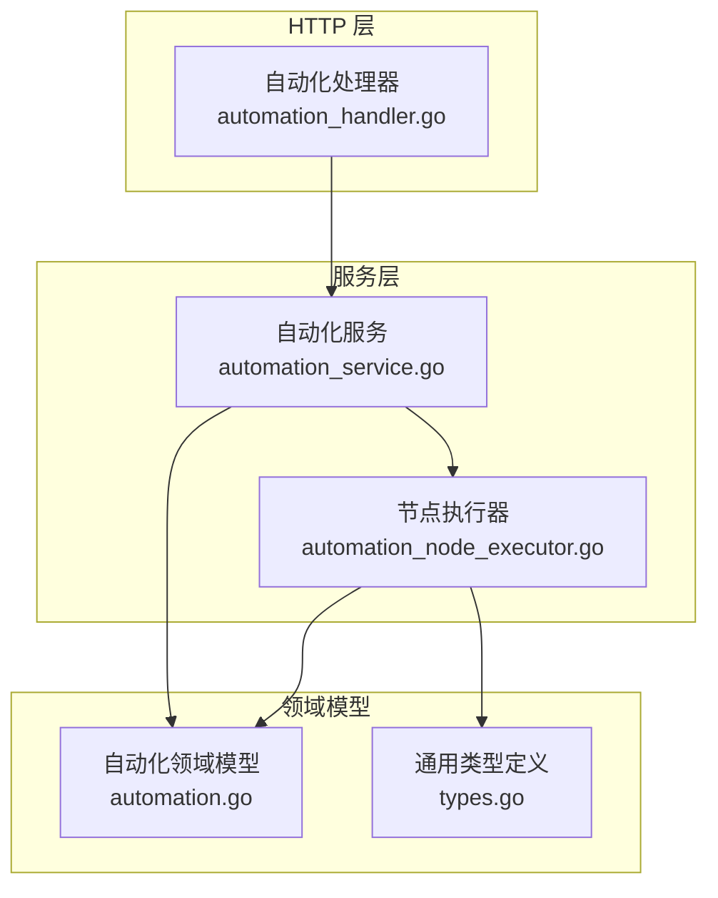
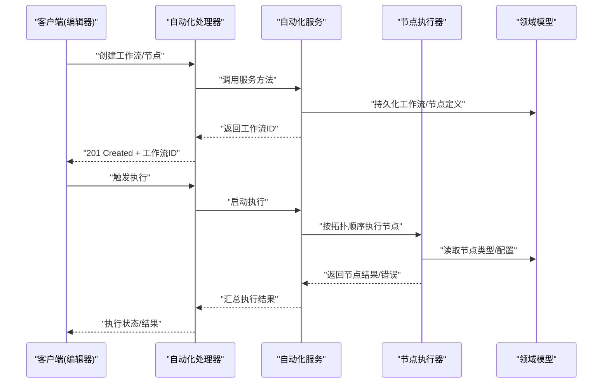
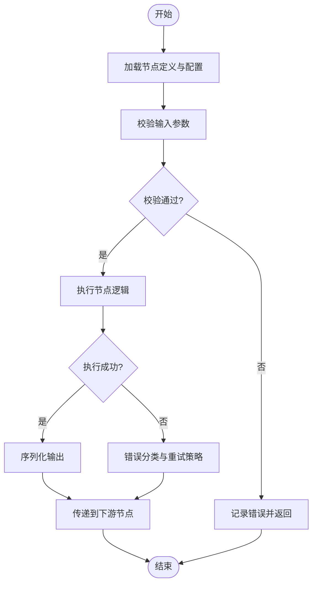

# 节点系统设计

<cite>
**本文引用的文件**   
- [automation_node_executor.go](file://notifuse/internal/service/automation_node_executor.go)
- [automation_service.go](file://notifuse/internal/service/automation_service.go)
- [automation_handler.go](file://notifuse/internal/http/automation_handler.go)
- [automation.go](file://notifuse/internal/domain/automation.go)
- [types.go](file://notifuse/internal/domain/types.go)
</cite>

## 目录
1. [简介](#简介)
2. [项目结构](#项目结构)
3. [核心组件](#核心组件)
4. [架构总览](#架构总览)
5. [详细组件分析](#详细组件分析)
6. [依赖分析](#依赖分析)
7. [性能考虑](#性能考虑)
8. [故障排查指南](#故障排查指南)
9. [结论](#结论)
10. [附录](#附录)

## 简介
本技术文档围绕自动化工作流编辑器的“节点系统”展开，聚焦于以下目标：
- 基础组件 BaseNode 的设计与实现（渲染逻辑、属性配置界面、交互行为）
- 节点类型定义、常量配置与注册机制
- AddNodeButton 添加按钮的实现（拖拽、选择、用户反馈）
- NodePalette 节点面板（分类、搜索过滤、批量操作）
- 自定义节点开发指南、样式定制与响应式适配
- 性能优化、内存管理与调试工具使用

需要特别说明的是：当前仓库中未发现前端可视化编辑器相关的源码（如 React/Vue 组件、拖拽库集成、画布渲染等）。因此，本文对“BaseNode、AddNodeButton、NodePalette”等前端概念采用“基于后端执行器与领域模型的参考设计”进行说明，并给出可落地的接口契约与扩展点。对于实际的前端实现细节，建议结合现有后端能力进行对齐与对接。

## 项目结构
从后端视角看，节点系统的核心位于服务层与领域模型之间：
- 领域模型定义了工作流、节点类型、执行上下文等数据结构
- 服务层编排工作流的调度与执行
- HTTP 层暴露工作流与节点的查询、创建、更新、删除等 API

图表来源
- [automation_handler.go](file://notifuse/internal/http/automation_handler.go)
- [automation_service.go](file://notifuse/internal/service/automation_service.go)
- [automation_node_executor.go](file://notifuse/internal/service/automation_node_executor.go)
- [automation.go](file://notifuse/internal/domain/automation.go)
- [types.go](file://notifuse/internal/domain/types.go)

章节来源
- [automation_handler.go](file://notifuse/internal/http/automation_handler.go)
- [automation_service.go](file://notifuse/internal/service/automation_service.go)
- [automation_node_executor.go](file://notifuse/internal/service/automation_node_executor.go)
- [automation.go](file://notifuse/internal/domain/automation.go)
- [types.go](file://notifuse/internal/domain/types.go)

## 核心组件
本节从“节点系统”的角度梳理关键组件及其职责：
- BaseNode（基础节点抽象）：定义节点通用属性、生命周期钩子、输入输出契约、错误处理与日志埋点。前端渲染时，BaseNode 提供统一的节点外壳（标题、状态指示、连接点、属性面板入口）。
- 节点类型与注册表：集中管理所有可用节点类型、元数据（图标、分组、描述）、默认配置与校验规则；支持动态注册新节点类型。
- AddNodeButton（添加按钮）：承载拖拽源、点击选择、键盘导航与无障碍支持，向画布注入新节点实例。
- NodePalette（节点面板）：按分类展示节点、支持搜索过滤、批量添加到画布或收藏。
- 节点执行器：将节点定义转换为运行时执行单元，负责参数解析、依赖注入、错误传播与结果序列化。

章节来源
- [automation_node_executor.go](file://notifuse/internal/service/automation_node_executor.go)
- [automation_service.go](file://notifuse/internal/service/automation_service.go)
- [automation.go](file://notifuse/internal/domain/automation.go)
- [types.go](file://notifuse/internal/domain/types.go)

## 架构总览
下图展示了从 HTTP 请求到节点执行的端到端流程，以及前后端在“节点系统”上的协作边界。

图表来源
- [automation_handler.go](file://notifuse/internal/http/automation_handler.go)
- [automation_service.go](file://notifuse/internal/service/automation_service.go)
- [automation_node_executor.go](file://notifuse/internal/service/automation_node_executor.go)
- [automation.go](file://notifuse/internal/domain/automation.go)
- [types.go](file://notifuse/internal/domain/types.go)

## 详细组件分析

### BaseNode 基础组件
- 设计要点
  - 统一节点外壳：标题、图标、状态指示、连接点（入/出）、属性面板入口、帮助与错误提示区域
  - 生命周期钩子：初始化、验证、渲染、销毁；用于加载默认值、预取数据、清理资源
  - 输入输出契约：强类型 I/O 定义，便于执行期校验与自动连线
  - 错误与日志：标准化错误码、结构化日志、可观测性指标
- 前端渲染逻辑
  - 根据节点类型选择具体渲染器；未匹配则回退至通用渲染器
  - 属性面板按需懒加载，避免首屏过重
  - 连接点位置计算与自适应布局
- 属性配置界面
  - 表单字段由节点元数据驱动（类型、必填、校验规则、选项集）
  - 支持条件显示、联动更新、实时预览
- 交互行为
  - 选中态、悬停态、禁用态、错误态的视觉反馈
  - 快捷键与键盘可达性（Tab 导航、Enter 确认、Esc 取消）
  - 撤销/重做集成

章节来源
- [automation_node_executor.go](file://notifuse/internal/service/automation_node_executor.go)
- [automation.go](file://notifuse/internal/domain/automation.go)
- [types.go](file://notifuse/internal/domain/types.go)

### 节点类型定义、常量配置与注册机制
- 节点类型定义
  - 唯一标识、名称、分组、图标、描述、版本兼容策略
  - 输入/输出 Schema（字段名、类型、默认值、校验规则）
  - 执行器映射（后端执行函数或外部服务地址）
- 常量配置
  - 全局常量（最大节点数、超时、重试次数、并发度）
  - 主题与样式变量（颜色、圆角、阴影、间距）
- 注册机制
  - 集中注册表维护类型到实现的映射
  - 支持热插拔与插件化扩展
  - 版本迁移与向后兼容检查

章节来源
- [automation.go](file://notifuse/internal/domain/automation.go)
- [types.go](file://notifuse/internal/domain/types.go)

### AddNodeButton 添加按钮
- 功能范围
  - 拖拽源：从节点面板拖拽节点到画布
  - 点击选择：点击后弹出快速插入菜单
  - 用户反馈：高亮放置区、成功/失败提示、错误原因
- 实现要点
  - 原生 Drag & Drop 或第三方库封装
  - 防抖与节流：避免重复插入
  - 无障碍：ARIA 标签、键盘操作、屏幕阅读器友好
  - 与画布坐标转换：确保节点插入位置准确

章节来源
- [automation.go](file://notifuse/internal/domain/automation.go)
- [types.go](file://notifuse/internal/domain/types.go)

### NodePalette 节点面板
- 功能范围
  - 节点分类：按业务域或功能域分组
  - 搜索过滤：关键词匹配、模糊搜索、最近使用排序
  - 批量操作：多选后批量插入、批量收藏、批量导出模板
- 实现要点
  - 虚拟列表：大数据量下的滚动性能
  - 缓存策略：搜索结果与分类索引缓存
  - 响应式：移动端折叠/抽屉模式

章节来源
- [automation.go](file://notifuse/internal/domain/automation.go)
- [types.go](file://notifuse/internal/domain/types.go)

### 自定义节点开发指南
- 步骤概览
  - 定义节点元数据（类型、Schema、默认值）
  - 实现前端渲染器与属性面板
  - 实现后端执行器（或接入外部服务）
  - 注册节点类型到注册表
  - 编写单元测试与集成测试
- 最佳实践
  - 幂等性与可重试：确保执行器具备幂等语义
  - 错误分类：区分可恢复与不可恢复错误
  - 可观测性：埋点耗时、成功率、错误率
  - 配置校验：严格校验输入，尽早失败

章节来源
- [automation_node_executor.go](file://notifuse/internal/service/automation_node_executor.go)
- [automation.go](file://notifuse/internal/domain/automation.go)
- [types.go](file://notifuse/internal/domain/types.go)

### 节点样式定制与响应式适配
- 样式定制
  - 通过 CSS 变量覆盖主题色、边框、阴影、字体
  - 提供多套预设主题（浅色/深色/高对比度）
- 响应式适配
  - 小屏设备隐藏次要信息，保留核心连接点与操作按钮
  - 属性面板在移动端以全屏抽屉呈现
  - 拖拽命中区域增大，提升触控体验

章节来源
- [automation.go](file://notifuse/internal/domain/automation.go)
- [types.go](file://notifuse/internal/domain/types.go)

### 节点执行流程（后端侧）

图表来源
- [automation_node_executor.go](file://notifuse/internal/service/automation_node_executor.go)
- [automation.go](file://notifuse/internal/domain/automation.go)
- [types.go](file://notifuse/internal/domain/types.go)

章节来源
- [automation_node_executor.go](file://notifuse/internal/service/automation_node_executor.go)
- [automation.go](file://notifuse/internal/domain/automation.go)
- [types.go](file://notifuse/internal/domain/types.go)

## 依赖分析
- 组件耦合
  - HTTP 处理器仅依赖服务层接口，保持松耦合
  - 服务层编排执行器与领域模型，职责清晰
  - 执行器依赖领域模型中的类型与配置，不直接访问存储
- 外部依赖
  - 数据库/对象存储：持久化工作流与节点定义
  - 消息队列/任务调度：异步执行与重试
  - 监控与日志：Prometheus/Grafana、ELK/Opensearch
- 潜在循环依赖
  - 通过接口隔离与分层避免循环引用
  - 领域模型不应反向依赖服务层

图表来源
- [automation_handler.go](file://notifuse/internal/http/automation_handler.go)
- [automation_service.go](file://notifuse/internal/service/automation_service.go)
- [automation_node_executor.go](file://notifuse/internal/service/automation_node_executor.go)
- [automation.go](file://notifuse/internal/domain/automation.go)
- [types.go](file://notifuse/internal/domain/types.go)

章节来源
- [automation_handler.go](file://notifuse/internal/http/automation_handler.go)
- [automation_service.go](file://notifuse/internal/service/automation_service.go)
- [automation_node_executor.go](file://notifuse/internal/service/automation_node_executor.go)
- [automation.go](file://notifuse/internal/domain/automation.go)
- [types.go](file://notifuse/internal/domain/types.go)

## 性能考虑
- 渲染性能
  - 虚拟列表与分页加载节点面板
  - 节点属性面板懒加载与按需编译
  - 大画布场景下使用离屏渲染与增量更新
- 执行性能
  - 并行执行无依赖节点
  - 批处理与流式处理减少内存峰值
  - 超时与熔断保护上游服务
- 内存管理
  - 及时释放临时对象与大对象引用
  - 使用对象池复用频繁创建的对象
  - 限制单次执行的最大节点数与深度
- 网络与 IO
  - 连接池与复用
  - 压缩与缓存热点数据
  - 重试与退避策略

[本节为通用指导，无需代码来源]

## 故障排查指南
- 常见问题定位
  - 节点无法插入：检查注册表是否包含该类型、Schema 是否完整
  - 执行失败：查看错误分类与日志堆栈，确认输入校验与依赖服务可用性
  - 性能问题：观察执行耗时分布、内存占用与 GC 情况
- 调试工具
  - 启用详细日志与追踪 ID，串联一次执行的完整链路
  - 使用断点与快照回放复现问题
  - 压测脚本模拟高负载场景
- 健康检查与告警
  - 暴露健康检查端点与指标
  - 设置阈值告警（错误率、延迟、饱和度）

章节来源
- [automation_node_executor.go](file://notifuse/internal/service/automation_node_executor.go)
- [automation_service.go](file://notifuse/internal/service/automation_service.go)

## 结论
本文从后端执行器与领域模型出发，构建了“节点系统”的参考设计与落地方案。尽管当前仓库未包含前端可视化编辑器源码，但通过明确的接口契约、类型定义与执行流程，可为前端 BaseNode、AddNodeButton、NodePalette 的实现提供坚实支撑。建议在后续迭代中补齐前端实现，并与后端保持一致的类型与校验策略，以确保端到端的稳定性与可扩展性。

[本节为总结性内容，无需代码来源]

## 附录
- 术语表
  - 节点：工作流中的一个执行单元
  - 注册表：维护节点类型到实现的映射
  - 属性面板：用于配置节点参数的 UI 组件
  - 执行器：将节点定义转为运行时执行的模块
- 相关接口与文件路径
  - 自动化处理器：[automation_handler.go](file://notifuse/internal/http/automation_handler.go)
  - 自动化服务：[automation_service.go](file://notifuse/internal/service/automation_service.go)
  - 节点执行器：[automation_node_executor.go](file://notifuse/internal/service/automation_node_executor.go)
  - 领域模型：[automation.go](file://notifuse/internal/domain/automation.go)、[types.go](file://notifuse/internal/domain/types.go)