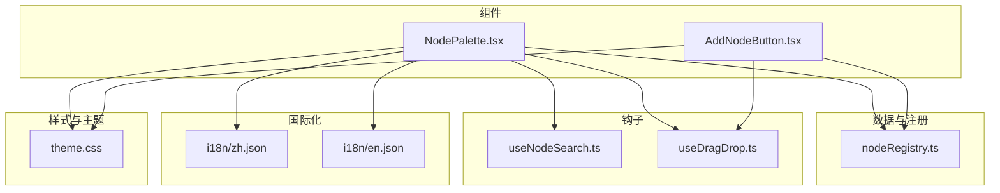
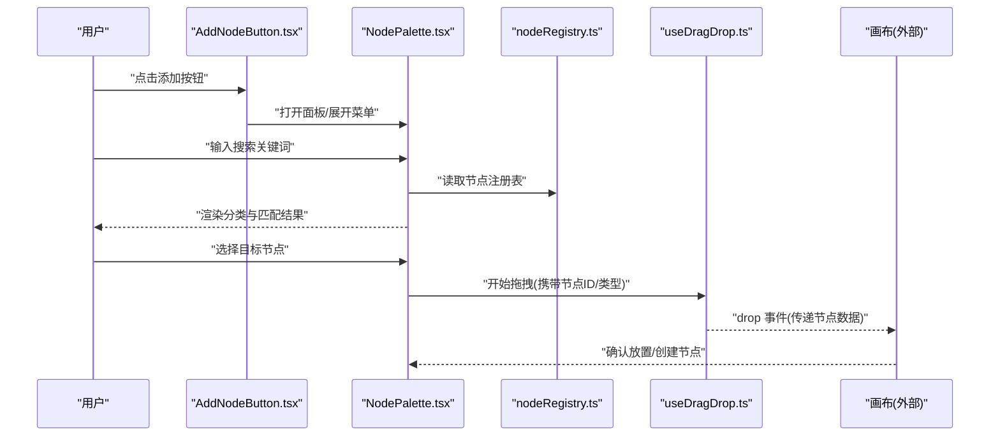
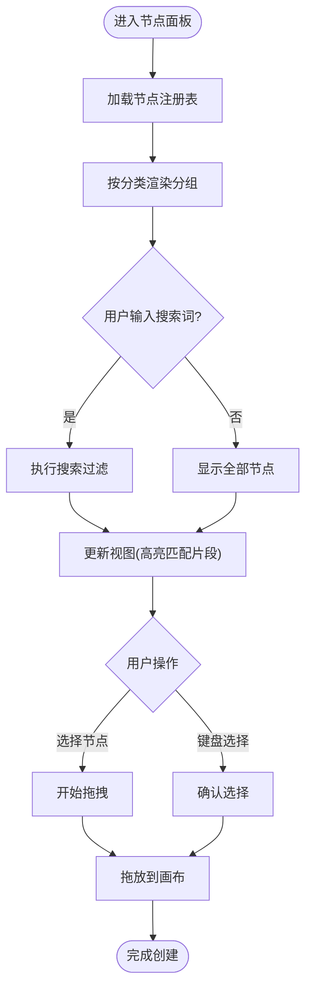
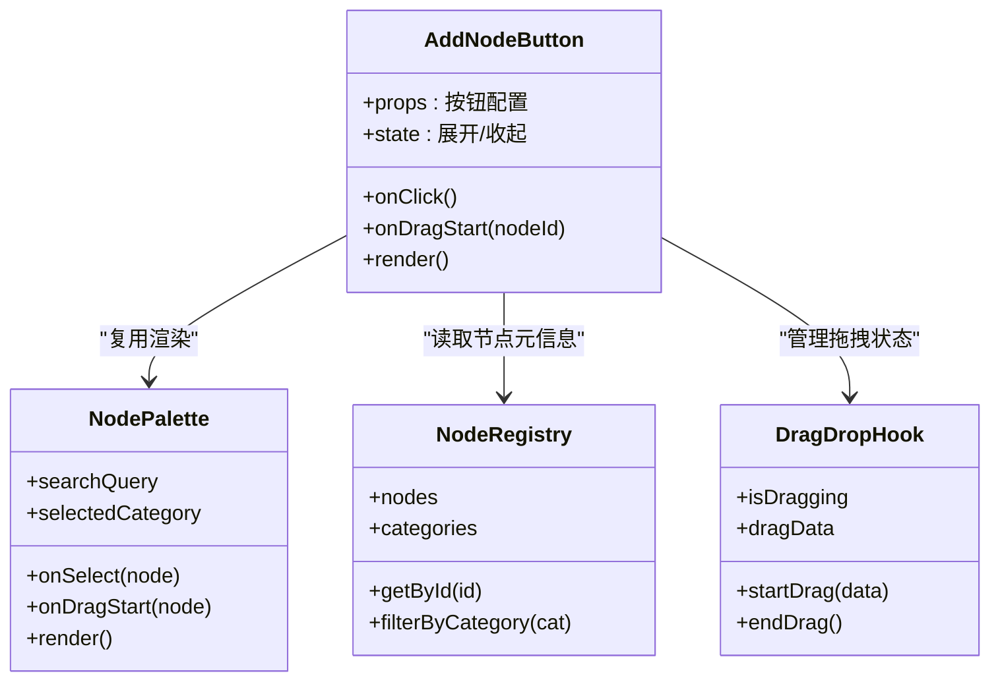
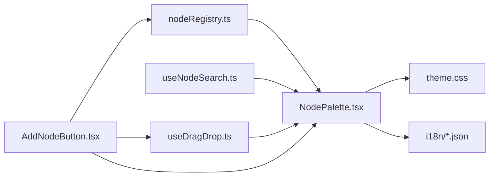

# 节点面板界面

<cite>
**本文引用的文件**   
- [NodePalette.tsx](file://notifuse/console/src/components/automation/NodePalette.tsx)
- [AddNodeButton.tsx](file://notifuse/console/src/components/automation/AddNodeButton.tsx)
- [nodeRegistry.ts](file://notifuse/console/src/components/automation/nodeRegistry.ts)
- [useNodeSearch.ts](file://notifuse/console/src/hooks/useNodeSearch.ts)
- [useDragDrop.ts](file://notifuse/console/src/hooks/useDragDrop.ts)
- [i18n/zh.json](file://notifuse/console/src/i18n/locales/zh.json)
- [i18n/en.json](file://notifuse/console/src/i18n/locales/en.json)
- [theme.css](file://notifuse/console/src/styles/theme.css)
</cite>

## 目录
1. [简介](#简介)
2. [项目结构](#项目结构)
3. [核心组件](#核心组件)
4. [架构总览](#架构总览)
5. [详细组件分析](#详细组件分析)
6. [依赖关系分析](#依赖关系分析)
7. [性能考虑](#性能考虑)
8. [故障排查指南](#故障排查指南)
9. [结论](#结论)
10. [附录](#附录)

## 简介
本文件为“节点面板界面”的全面技术文档，聚焦 NodePalette 节点面板的布局设计、分类组织与搜索过滤；深入说明 AddNodeButton 添加按钮的实现（点击展开、节点选择、拖拽创建）；并覆盖响应式适配、键盘导航与可访问性支持。同时解释节点分组逻辑、图标系统与视觉反馈机制，提供性能优化建议（虚拟滚动与大列表处理），以及样式定制、主题适配与国际化的实现要点。

## 项目结构
本节概述与节点面板相关的代码组织方式与关键入口：
- 组件层：NodePalette 负责整体面板渲染、分类展示与搜索交互；AddNodeButton 负责单个节点的触发与拖拽源。
- 数据与注册：nodeRegistry 集中管理节点元信息、分类与图标映射。
- 钩子层：useNodeSearch 封装搜索与过滤逻辑；useDragDrop 封装拖拽状态与事件。
- 国际化：i18n 资源文件提供多语言文案。
- 主题与样式：theme.css 定义 CSS 变量与主题色板，供组件使用。

图表来源
- [NodePalette.tsx](file://notifuse/console/src/components/automation/NodePalette.tsx)
- [AddNodeButton.tsx](file://notifuse/console/src/components/automation/AddNodeButton.tsx)
- [nodeRegistry.ts](file://notifuse/console/src/components/automation/nodeRegistry.ts)
- [useNodeSearch.ts](file://notifuse/console/src/hooks/useNodeSearch.ts)
- [useDragDrop.ts](file://notifuse/console/src/hooks/useDragDrop.ts)
- [i18n/zh.json](file://notifuse/console/src/i18n/locales/zh.json)
- [i18n/en.json](file://notifuse/console/src/i18n/locales/en.json)
- [theme.css](file://notifuse/console/src/styles/theme.css)

章节来源
- [NodePalette.tsx](file://notifuse/console/src/components/automation/NodePalette.tsx)
- [AddNodeButton.tsx](file://notifuse/console/src/components/automation/AddNodeButton.tsx)
- [nodeRegistry.ts](file://notifuse/console/src/components/automation/nodeRegistry.ts)
- [useNodeSearch.ts](file://notifuse/console/src/hooks/useNodeSearch.ts)
- [useDragDrop.ts](file://notifuse/console/src/hooks/useDragDrop.ts)
- [i18n/zh.json](file://notifuse/console/src/i18n/locales/zh.json)
- [i18n/en.json](file://notifuse/console/src/i18n/locales/en.json)
- [theme.css](file://notifuse/console/src/styles/theme.css)

## 核心组件
- NodePalette 节点面板
  - 职责：聚合节点注册表、执行搜索过滤、按分类渲染节点列表、承载拖拽上下文、暴露面板开关与尺寸控制。
  - 关键能力：分类折叠/展开、搜索高亮、键盘焦点管理、响应式布局切换、无障碍标签与提示。
- AddNodeButton 添加按钮
  - 职责：作为拖拽源，点击展开下拉或抽屉，支持键盘操作与屏幕阅读器提示。
  - 关键能力：点击展开/收起、选中态、拖拽开始、拖拽结束回调、错误边界包裹。

章节来源
- [NodePalette.tsx](file://notifuse/console/src/components/automation/NodePalette.tsx)
- [AddNodeButton.tsx](file://notifuse/console/src/components/automation/AddNodeButton.tsx)

## 架构总览
下图展示了节点面板在自动化编辑器中的交互流程：用户通过 AddNodeButton 发起添加动作，NodePalette 根据 nodeRegistry 提供的节点元数据进行渲染与过滤，并通过 useDragDrop 将选中的节点以拖拽形式传递给画布。

图表来源
- [AddNodeButton.tsx](file://notifuse/console/src/components/automation/AddNodeButton.tsx)
- [NodePalette.tsx](file://notifuse/console/src/components/automation/NodePalette.tsx)
- [nodeRegistry.ts](file://notifuse/console/src/components/automation/nodeRegistry.ts)
- [useDragDrop.ts](file://notifuse/console/src/hooks/useDragDrop.ts)

## 详细组件分析

### NodePalette 节点面板
- 布局设计
  - 顶部：搜索框与筛选条件（如分类、是否常用）。
  - 中部：分类分组区域，每个分类包含若干节点项。
  - 底部：帮助信息与快捷键提示。
  - 响应式：在小屏下切换为全屏抽屉模式，在大屏下保持侧边栏宽度。
- 分类组织
  - 基于 nodeRegistry 的分类字段进行分组，支持动态新增分类。
  - 分类可折叠/展开，默认展开最近使用的分类。
- 搜索与过滤
  - 使用 useNodeSearch 对节点名称、描述、别名进行模糊匹配。
  - 支持大小写不敏感、去重与排序（优先匹配度高的结果）。
- 键盘导航与可访问性
  - Tab 顺序：搜索框 → 分类标题 → 节点项 → 关闭按钮。
  - Enter/Space 选择节点，Esc 关闭面板，方向键在列表内移动焦点。
  - aria-* 属性：role="listbox"、aria-label、aria-expanded、aria-selected 等。
- 视觉反馈
  - 悬停高亮、选中边框、禁用态灰度、拖拽中半透明。
  - 加载骨架屏与空状态占位图。

图表来源
- [NodePalette.tsx](file://notifuse/console/src/components/automation/NodePalette.tsx)
- [useNodeSearch.ts](file://notifuse/console/src/hooks/useNodeSearch.ts)
- [useDragDrop.ts](file://notifuse/console/src/hooks/useDragDrop.ts)

章节来源
- [NodePalette.tsx](file://notifuse/console/src/components/automation/NodePalette.tsx)
- [useNodeSearch.ts](file://notifuse/console/src/hooks/useNodeSearch.ts)
- [useDragDrop.ts](file://notifuse/console/src/hooks/useDragDrop.ts)

### AddNodeButton 添加按钮
- 点击展开
  - 点击后弹出下拉菜单或抽屉，内部直接复用 NodePalette 的渲染逻辑，避免重复实现。
- 节点选择
  - 支持鼠标点击与键盘 Enter/Space 选择，选择后立即关闭面板并返回选中节点。
- 拖拽创建
  - 将节点 ID/类型作为拖拽数据，触发 onDragStart；在画布上 drop 时由上层容器处理创建逻辑。
- 可访问性与反馈
  - 提供 aria-haspopup、aria-expanded、aria-label 等属性；在移动端提供触摸友好的点击热区。

图表来源
- [AddNodeButton.tsx](file://notifuse/console/src/components/automation/AddNodeButton.tsx)
- [NodePalette.tsx](file://notifuse/console/src/components/automation/NodePalette.tsx)
- [nodeRegistry.ts](file://notifuse/console/src/components/automation/nodeRegistry.ts)
- [useDragDrop.ts](file://notifuse/console/src/hooks/useDragDrop.ts)

章节来源
- [AddNodeButton.tsx](file://notifuse/console/src/components/automation/AddNodeButton.tsx)
- [nodeRegistry.ts](file://notifuse/console/src/components/automation/nodeRegistry.ts)
- [useDragDrop.ts](file://notifuse/console/src/hooks/useDragDrop.ts)

### 节点注册表与分组逻辑
- 数据结构
  - nodes：节点清单，包含 id、name、category、icon、description、tags 等。
  - categories：分类集合，用于分组与排序。
- 分组策略
  - 默认按 category 分组，支持自定义排序规则（如按使用频率或字母序）。
  - 未分配分类的节点归入“其他”组。
- 图标系统
  - icon 字段指向统一图标库或 SVG 路径，支持主题色注入。
  - 提供 fallback 图标，确保缺失时仍可显示。

章节来源
- [nodeRegistry.ts](file://notifuse/console/src/components/automation/nodeRegistry.ts)

### 搜索与过滤
- 算法要点
  - 分词与模糊匹配：对 name、description、tags 进行分词，计算匹配得分。
  - 去重与稳定排序：相同得分按注册顺序或最近使用排序。
- 性能优化
  - 防抖输入，减少频繁计算。
  - 缓存上次查询结果，仅在输入变化时重新计算。

章节来源
- [useNodeSearch.ts](file://notifuse/console/src/hooks/useNodeSearch.ts)

### 拖拽与创建
- 拖拽生命周期
  - onDragStart：序列化节点数据，设置拖拽样式。
  - onDragOver：允许放置，提供放置预览。
  - onDrop：校验目标区域，触发创建流程。
- 错误处理
  - 非法节点类型、重复创建、目标不可用等情况给出明确提示。

章节来源
- [useDragDrop.ts](file://notifuse/console/src/hooks/useDragDrop.ts)

### 国际化与主题
- 国际化
  - zh.json、en.json 提供面板文案、分类名、提示信息等。
  - 组件通过 i18n 接口读取当前语言并渲染对应文本。
- 主题适配
  - theme.css 定义 CSS 变量（颜色、间距、圆角、阴影），组件引用变量以实现明暗主题切换。
  - 支持高对比度模式与字体缩放。

章节来源
- [i18n/zh.json](file://notifuse/console/src/i18n/locales/zh.json)
- [i18n/en.json](file://notifuse/console/src/i18n/locales/en.json)
- [theme.css](file://notifuse/console/src/styles/theme.css)

## 依赖关系分析
- 组件耦合
  - NodePalette 依赖 nodeRegistry 获取数据，依赖 useNodeSearch 与 useDragDrop 处理交互。
  - AddNodeButton 仅关注触发与状态，尽量复用 NodePalette 的渲染逻辑以降低重复。
- 外部集成点
  - 画布容器接收拖拽 drop 事件并创建节点实例。
  - 主题与国际化资源通过全局上下文注入。

图表来源
- [NodePalette.tsx](file://notifuse/console/src/components/automation/NodePalette.tsx)
- [AddNodeButton.tsx](file://notifuse/console/src/components/automation/AddNodeButton.tsx)
- [nodeRegistry.ts](file://notifuse/console/src/components/automation/nodeRegistry.ts)
- [useNodeSearch.ts](file://notifuse/console/src/hooks/useNodeSearch.ts)
- [useDragDrop.ts](file://notifuse/console/src/hooks/useDragDrop.ts)
- [theme.css](file://notifuse/console/src/styles/theme.css)
- [i18n/zh.json](file://notifuse/console/src/i18n/locales/zh.json)
- [i18n/en.json](file://notifuse/console/src/i18n/locales/en.json)

章节来源
- [NodePalette.tsx](file://notifuse/console/src/components/automation/NodePalette.tsx)
- [AddNodeButton.tsx](file://notifuse/console/src/components/automation/AddNodeButton.tsx)
- [nodeRegistry.ts](file://notifuse/console/src/components/automation/nodeRegistry.ts)
- [useNodeSearch.ts](file://notifuse/console/src/hooks/useNodeSearch.ts)
- [useDragDrop.ts](file://notifuse/console/src/hooks/useDragDrop.ts)
- [theme.css](file://notifuse/console/src/styles/theme.css)
- [i18n/zh.json](file://notifuse/console/src/i18n/locales/zh.json)
- [i18n/en.json](file://notifuse/console/src/i18n/locales/en.json)

## 性能考虑
- 虚拟滚动
  - 当节点数量较大时，采用虚拟滚动只渲染可视区域内的节点项，显著降低 DOM 节点数与重排开销。
- 列表分页与懒加载
  - 首屏仅加载前 N 个节点，滚动到底部时按需加载更多。
- 计算优化
  - 搜索防抖与增量更新，避免全量重算。
  - 分类预分组与索引，加速查找。
- 渲染优化
  - React.memo 包裹节点项，减少不必要的重渲染。
  - 图片与图标懒加载，避免阻塞主线程。

[本节为通用性能指导，无需特定文件来源]

## 故障排查指南
- 常见问题
  - 搜索无结果：检查 nodeRegistry 中节点字段是否完整；确认搜索忽略大小写与空白字符处理。
  - 拖拽无效：确认 onDragStart 已正确设置 dataTransfer；检查画布容器的 onDrop 监听是否绑定。
  - 主题不生效：确认 theme.css 变量已注入到根节点；检查浏览器控制台是否有 CSS 加载错误。
  - 国际化缺失：确认当前语言包已加载且 key 存在；必要时回退到默认语言。
- 调试建议
  - 在 useNodeSearch 中添加日志输出，观察输入变化与过滤结果。
  - 在 useDragDrop 中打印 dragData 与 drop 目标信息，定位数据传递问题。
  - 使用浏览器开发者工具检查 aria-* 属性是否符合无障碍规范。

章节来源
- [useNodeSearch.ts](file://notifuse/console/src/hooks/useNodeSearch.ts)
- [useDragDrop.ts](file://notifuse/console/src/hooks/useDragDrop.ts)
- [theme.css](file://notifuse/console/src/styles/theme.css)
- [i18n/zh.json](file://notifuse/console/src/i18n/locales/zh.json)
- [i18n/en.json](file://notifuse/console/src/i18n/locales/en.json)

## 结论
NodePalette 与 AddNodeButton 共同构成了自动化编辑器中高效的节点发现与创建体验。通过清晰的分类组织、强大的搜索过滤、完善的拖拽与键盘导航、良好的可访问性与主题/国际化支持，该面板能够在大规模节点场景下保持流畅与易用。结合虚拟滚动与计算优化，可在大列表情况下依然维持高性能表现。

[本节为总结性内容，无需特定文件来源]

## 附录
- 术语
  - 节点：自动化流程中的最小可执行单元。
  - 分类：节点的逻辑分组，便于浏览与管理。
  - 拖拽创建：通过拖拽节点到画布来快速创建流程步骤。
- 最佳实践
  - 为新节点补充 description 与 tags，提升搜索命中率。
  - 合理划分分类，避免单一分类过大。
  - 遵循无障碍规范，确保所有交互均可被键盘与屏幕阅读器使用。

[本节为概念性内容，无需特定文件来源]