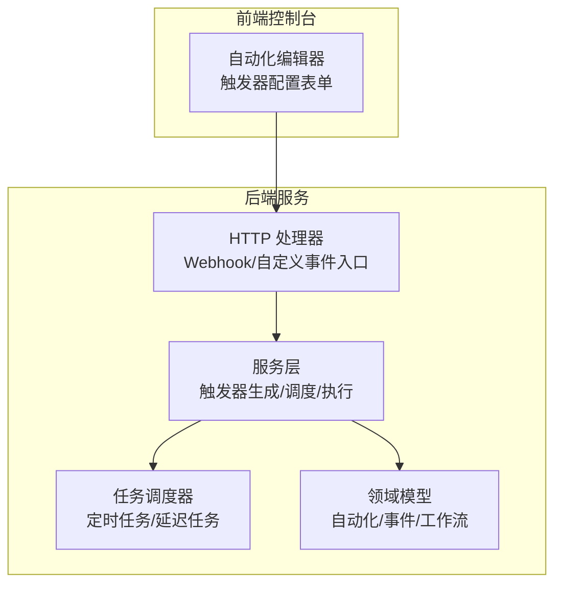
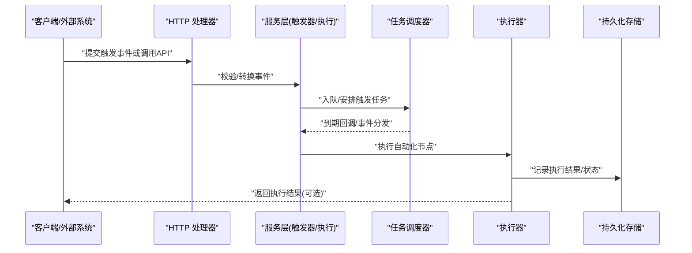
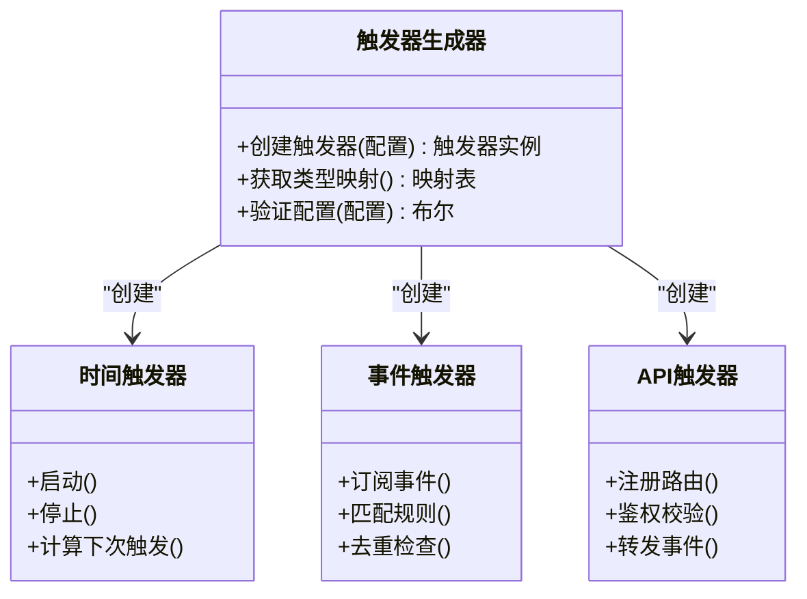
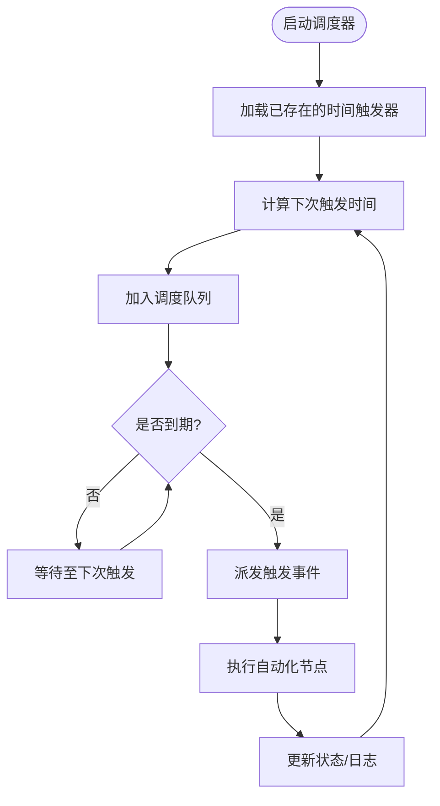
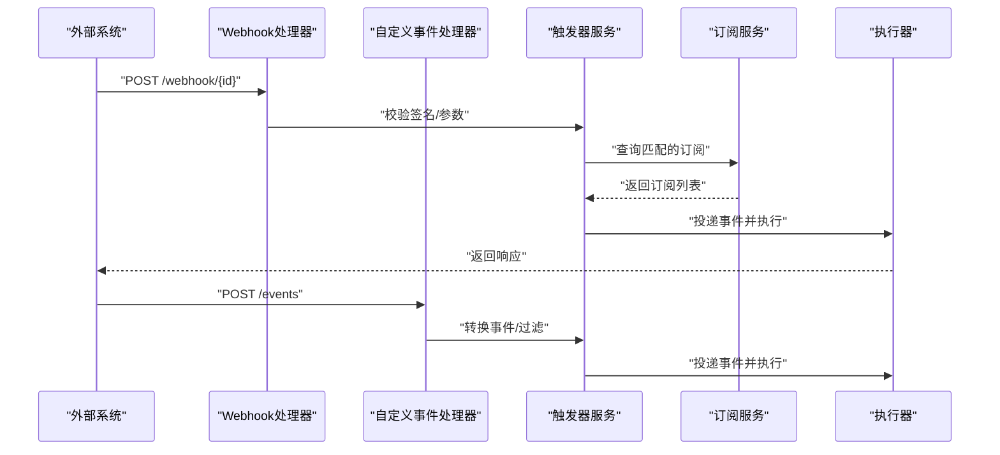
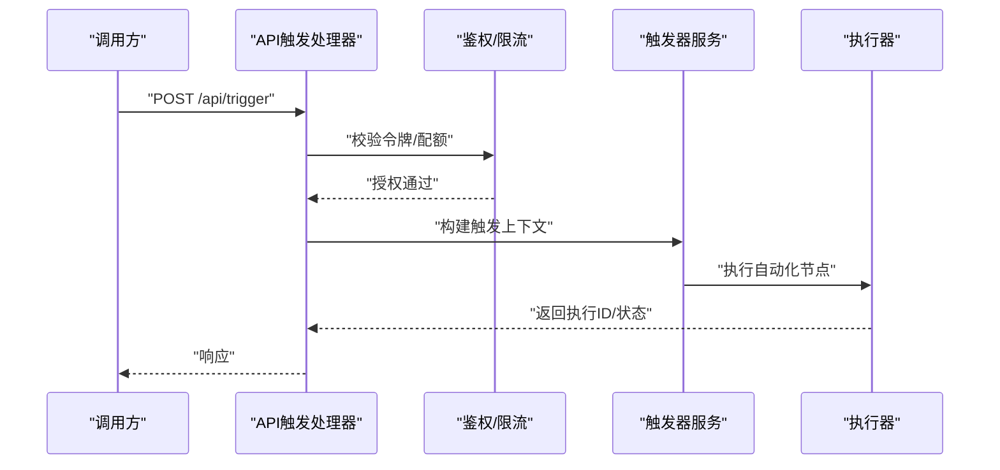
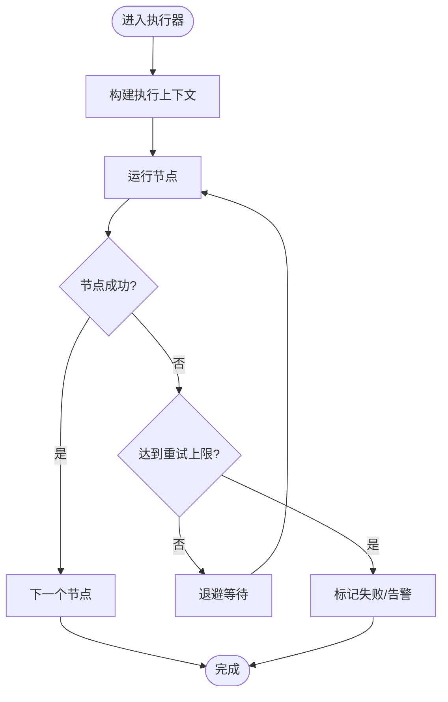
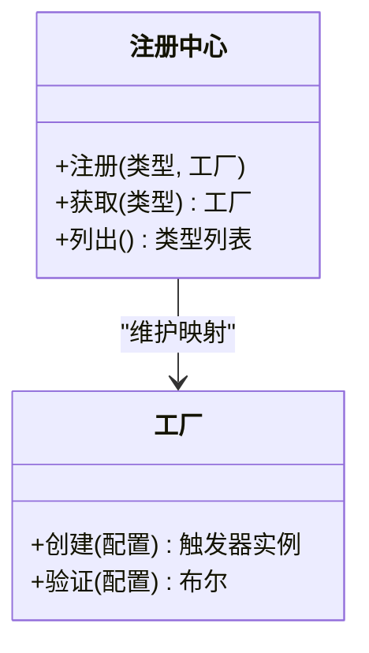
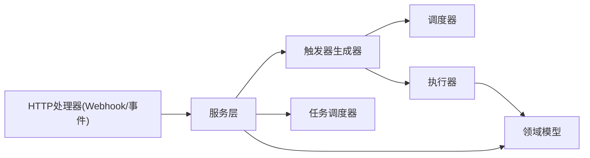

# 触发器节点

<cite>
**本文引用的文件**   
- [automation_trigger_generator.go](file://notifuse/internal/service/automation_trigger_generator.go)
- [automation_scheduler.go](file://notifuse/internal/service/automation_scheduler.go)
- [automation_executor.go](file://notifuse/internal/service/automation_executor.go)
- [automation_node_executor.go](file://notifuse/internal/service/automation_node_executor.go)
- [automation_service.go](file://notifuse/internal/service/automation_service.go)
- [task_scheduler.go](file://notifuse/internal/service/task_scheduler.go)
- [inbound_webhook_event_handler.go](file://notifuse/internal/http/inbound_webhook_event_handler.go)
- [webhook_subscription_service.go](file://notifuse/internal/service/webhook_subscription_service.go)
- [custom_event_handler.go](file://notifuse/internal/http/custom_event_handler.go)
- [custom_event_service.go](file://notifuse/internal/service/custom_event_service.go)
- [automation_test.go](file://notifuse/internal/domain/automation_test.go)
- [automation.go](file://notifuse/internal/domain/automation.go)
</cite>

## 目录
1. [简介](#简介)
2. [项目结构](#项目结构)
3. [核心组件](#核心组件)
4. [架构总览](#架构总览)
5. [详细组件分析](#详细组件分析)
6. [依赖分析](#依赖分析)
7. [性能考虑](#性能考虑)
8. [故障排查指南](#故障排查指南)
9. [结论](#结论)
10. [附录](#附录)

## 简介
本技术文档围绕“触发器节点系统”展开，聚焦于 TriggerNode 组件的实现与使用。内容涵盖：
- 触发器类型：时间触发、事件触发（Webhook/自定义事件）、API 触发等
- 配置界面与业务逻辑：表单验证、数据绑定、用户交互
- 注册机制与动态加载：运行时配置、扩展点
- 性能监控、错误处理与重试机制
- 自定义触发器开发指南与集成示例

为便于理解，文档提供架构图、时序图、流程图及类关系图，并给出关键实现路径的引用定位。

## 项目结构
本项目采用前后端分离与领域服务分层组织：
- 前端控制台位于 console/src，负责可视化编排自动化流程与触发器配置
- 后端服务位于 internal/service 与 internal/http，承载触发器调度、执行与外部事件接入
- 领域模型位于 internal/domain，定义自动化、任务、事件等核心实体

下图展示与触发器相关的前后端模块关系：

图表来源
- [automation_trigger_generator.go:1-120](file://notifuse/internal/service/automation_trigger_generator.go#L1-L120)
- [automation_scheduler.go:1-120](file://notifuse/internal/service/automation_scheduler.go#L1-L120)
- [automation_executor.go:1-120](file://notifuse/internal/service/automation_executor.go#L1-L120)
- [inbound_webhook_event_handler.go:1-120](file://notifuse/internal/http/inbound_webhook_event_handler.go#L1-L120)
- [custom_event_handler.go:1-120](file://notifuse/internal/http/custom_event_handler.go#L1-L120)

章节来源
- [automation_trigger_generator.go:1-120](file://notifuse/internal/service/automation_trigger_generator.go#L1-L120)
- [automation_scheduler.go:1-120](file://notifuse/internal/service/automation_scheduler.go#L1-L120)
- [automation_executor.go:1-120](file://notifuse/internal/service/automation_executor.go#L1-L120)
- [inbound_webhook_event_handler.go:1-120](file://notifuse/internal/http/inbound_webhook_event_handler.go#L1-L120)
- [custom_event_handler.go:1-120](file://notifuse/internal/http/custom_event_handler.go#L1-L120)

## 核心组件
- 触发器生成器：根据自动化配置解析并生成可执行的触发器实例，支持多种触发器类型
- 调度器：管理定时与周期性触发器的生命周期，维护时间窗口与下次触发时刻
- 执行器：统一执行自动化节点，封装上下文、幂等与重试策略
- HTTP 处理器：接收外部 Webhook 与自定义事件，转换为内部事件并投递到触发器管道
- 任务调度器：支撑延迟任务、周期任务与失败重试队列

章节来源
- [automation_trigger_generator.go:1-120](file://notifuse/internal/service/automation_trigger_generator.go#L1-L120)
- [automation_scheduler.go:1-120](file://notifuse/internal/service/automation_scheduler.go#L1-L120)
- [automation_executor.go:1-120](file://notifuse/internal/service/automation_executor.go#L1-L120)
- [task_scheduler.go:1-120](file://notifuse/internal/service/task_scheduler.go#L1-L120)
- [inbound_webhook_event_handler.go:1-120](file://notifuse/internal/http/inbound_webhook_event_handler.go#L1-L120)
- [custom_event_handler.go:1-120](file://notifuse/internal/http/custom_event_handler.go#L1-L120)

## 架构总览
下图展示从触发源到自动化执行的端到端流程：

图表来源
- [inbound_webhook_event_handler.go:1-120](file://notifuse/internal/http/inbound_webhook_event_handler.go#L1-L120)
- [custom_event_handler.go:1-120](file://notifuse/internal/http/custom_event_handler.go#L1-L120)
- [automation_trigger_generator.go:1-120](file://notifuse/internal/service/automation_trigger_generator.go#L1-L120)
- [automation_scheduler.go:1-120](file://notifuse/internal/service/automation_scheduler.go#L1-L120)
- [automation_executor.go:1-120](file://notifuse/internal/service/automation_executor.go#L1-L120)
- [task_scheduler.go:1-120](file://notifuse/internal/service/task_scheduler.go#L1-L120)

## 详细组件分析

### 触发器生成器与类型映射
- 职责：将自动化配置中的触发器描述转换为具体触发器实例；维护触发器类型枚举与工厂映射
- 关键点：
  - 支持时间触发（cron/间隔）、事件触发（Webhook/自定义事件）、API 触发（HTTP 回调）
  - 通过配置项驱动不同触发器行为（如时间窗、过滤条件、签名校验、去重键）
  - 提供扩展接口以便新增触发器类型

图表来源
- [automation_trigger_generator.go:1-120](file://notifuse/internal/service/automation_trigger_generator.go#L1-L120)

章节来源
- [automation_trigger_generator.go:1-120](file://notifuse/internal/service/automation_trigger_generator.go#L1-L120)

### 调度器与时间触发
- 职责：管理时间触发器的生命周期，维护调度计划与下次触发时间
- 关键点：
  - 支持 cron 表达式与固定间隔
  - 提供优雅启停与热更新能力
  - 与任务调度器协作，将到期任务投递至执行管道

图表来源
- [automation_scheduler.go:1-120](file://notifuse/internal/service/automation_scheduler.go#L1-L120)
- [task_scheduler.go:1-120](file://notifuse/internal/service/task_scheduler.go#L1-L120)

章节来源
- [automation_scheduler.go:1-120](file://notifuse/internal/service/automation_scheduler.go#L1-L120)
- [task_scheduler.go:1-120](file://notifuse/internal/service/task_scheduler.go#L1-L120)

### 事件触发（Webhook/自定义事件）
- 职责：接收外部事件，进行鉴权、格式校验、去重后进入触发器管道
- 关键点：
  - Webhook：支持签名校验、白名单、速率限制
  - 自定义事件：支持事件类型过滤、字段匹配、上下文注入
  - 与订阅服务协作，按工作区/自动化维度路由

图表来源
- [inbound_webhook_event_handler.go:1-120](file://notifuse/internal/http/inbound_webhook_event_handler.go#L1-L120)
- [custom_event_handler.go:1-120](file://notifuse/internal/http/custom_event_handler.go#L1-L120)
- [webhook_subscription_service.go:1-120](file://notifuse/internal/service/webhook_subscription_service.go#L1-L120)
- [custom_event_service.go:1-120](file://notifuse/internal/service/custom_event_service.go#L1-L120)

章节来源
- [inbound_webhook_event_handler.go:1-120](file://notifuse/internal/http/inbound_webhook_event_handler.go#L1-L120)
- [custom_event_handler.go:1-120](file://notifuse/internal/http/custom_event_handler.go#L1-L120)
- [webhook_subscription_service.go:1-120](file://notifuse/internal/service/webhook_subscription_service.go#L1-L120)
- [custom_event_service.go:1-120](file://notifuse/internal/service/custom_event_service.go#L1-L120)

### API 触发
- 职责：暴露受控 API 以触发自动化，支持鉴权、限流、审计
- 关键点：
  - 请求体标准化与字段校验
  - 基于工作区/用户的访问控制
  - 异步执行与结果回调（可选）

图表来源
- [automation_trigger_generator.go:1-120](file://notifuse/internal/service/automation_trigger_generator.go#L1-L120)
- [automation_executor.go:1-120](file://notifuse/internal/service/automation_executor.go#L1-L120)

章节来源
- [automation_trigger_generator.go:1-120](file://notifuse/internal/service/automation_trigger_generator.go#L1-L120)
- [automation_executor.go:1-120](file://notifuse/internal/service/automation_executor.go#L1-L120)

### 执行器与节点执行
- 职责：统一执行自动化节点，管理上下文、重试、超时与幂等
- 关键点：
  - 节点级错误隔离与部分成功策略
  - 可插拔的重试策略（指数退避、最大重试次数）
  - 执行日志与指标上报

图表来源
- [automation_node_executor.go:1-120](file://notifuse/internal/service/automation_node_executor.go#L1-L120)
- [automation_executor.go:1-120](file://notifuse/internal/service/automation_executor.go#L1-L120)

章节来源
- [automation_node_executor.go:1-120](file://notifuse/internal/service/automation_node_executor.go#L1-L120)
- [automation_executor.go:1-120](file://notifuse/internal/service/automation_executor.go#L1-L120)

### 配置表单与验证（前端视角）
- 目标：在自动化编辑器中提供可视化的触发器配置表单
- 要点：
  - 时间触发：选择周期/间隔、时区、生效时间段
  - 事件触发：选择事件类型、设置过滤条件、鉴权参数
  - API 触发：配置回调地址、鉴权方式、重试策略
  - 表单验证：必填项、格式校验、范围约束、冲突检测
  - 数据绑定：双向绑定到自动化配置对象，实时预览与校验反馈

说明：本节为概念性说明，不直接分析具体源码文件。

### 触发器注册机制与动态加载
- 注册中心：集中管理触发器类型与工厂函数
- 动态加载：支持运行时新增触发器类型，无需重启服务
- 配置热更新：监听配置变更，重新初始化受影响触发器实例

图表来源
- [automation_trigger_generator.go:1-120](file://notifuse/internal/service/automation_trigger_generator.go#L1-L120)

章节来源
- [automation_trigger_generator.go:1-120](file://notifuse/internal/service/automation_trigger_generator.go#L1-L120)

### 运行时配置与持久化
- 配置来源：数据库/配置中心
- 持久化：触发器元数据、执行状态、审计日志
- 一致性：并发安全、事务边界、版本控制

章节来源
- [automation_service.go:1-120](file://notifuse/internal/service/automation_service.go#L1-L120)
- [automation.go:1-120](file://notifuse/internal/domain/automation.go#L1-L120)

## 依赖分析
触发器子系统的关键依赖关系如下：

图表来源
- [automation_trigger_generator.go:1-120](file://notifuse/internal/service/automation_trigger_generator.go#L1-L120)
- [automation_scheduler.go:1-120](file://notifuse/internal/service/automation_scheduler.go#L1-L120)
- [automation_executor.go:1-120](file://notifuse/internal/service/automation_executor.go#L1-L120)
- [task_scheduler.go:1-120](file://notifuse/internal/service/task_scheduler.go#L1-L120)
- [automation_service.go:1-120](file://notifuse/internal/service/automation_service.go#L1-L120)
- [automation.go:1-120](file://notifuse/internal/domain/automation.go#L1-L120)

章节来源
- [automation_trigger_generator.go:1-120](file://notifuse/internal/service/automation_trigger_generator.go#L1-L120)
- [automation_scheduler.go:1-120](file://notifuse/internal/service/automation_scheduler.go#L1-L120)
- [automation_executor.go:1-120](file://notifuse/internal/service/automation_executor.go#L1-L120)
- [task_scheduler.go:1-120](file://notifuse/internal/service/task_scheduler.go#L1-L120)
- [automation_service.go:1-120](file://notifuse/internal/service/automation_service.go#L1-L120)
- [automation.go:1-120](file://notifuse/internal/domain/automation.go#L1-L120)

## 性能考虑
- 批量处理：对高吞吐事件采用批处理与背压控制
- 索引优化：为触发器匹配与订阅查询建立合适索引
- 缓存策略：热点配置与订阅信息缓存，降低数据库压力
- 异步执行：避免阻塞主线程，使用任务队列解耦
- 资源隔离：按工作区/租户隔离执行资源，防止相互影响

[本节为通用指导，不涉及具体源码分析]

## 故障排查指南
- 常见问题
  - 触发器未生效：检查调度器状态、时间窗与下次触发时间
  - 事件未匹配：确认事件类型、过滤条件与鉴权参数
  - 执行失败：查看执行日志、重试次数与错误码
- 诊断步骤
  - 启用调试日志，定位触发器生命周期各阶段
  - 核对订阅配置与工作区权限
  - 复现最小用例，逐步缩小问题范围
- 恢复策略
  - 重置触发器状态、清理过期任务
  - 回滚配置变更，观察是否恢复

章节来源
- [automation_test.go:1-120](file://notifuse/internal/domain/automation_test.go#L1-L120)
- [automation.go:1-120](file://notifuse/internal/domain/automation.go#L1-L120)

## 结论
触发器节点系统通过清晰的组件划分与可扩展的注册机制，实现了多类型触发器的统一管理与高效执行。结合调度器与执行器的协同，系统在可靠性、性能与可维护性方面具备良好基础。建议在生产环境完善监控与告警，持续优化匹配与执行路径的性能瓶颈。

[本节为总结性内容，不涉及具体源码分析]

## 附录
- 自定义触发器开发指南
  - 定义触发器类型与配置结构
  - 实现工厂函数与验证逻辑
  - 注册到触发器生成器/注册中心
  - 编写单元测试覆盖正常与异常路径
- 集成示例
  - 新增 Webhook 事件类型：在处理器中增加路由与校验，在服务层适配事件转换
  - 新增 API 触发：在 API 层增加端点，复用执行器与上下文构建逻辑

[本节为概念性指导，不涉及具体源码分析]