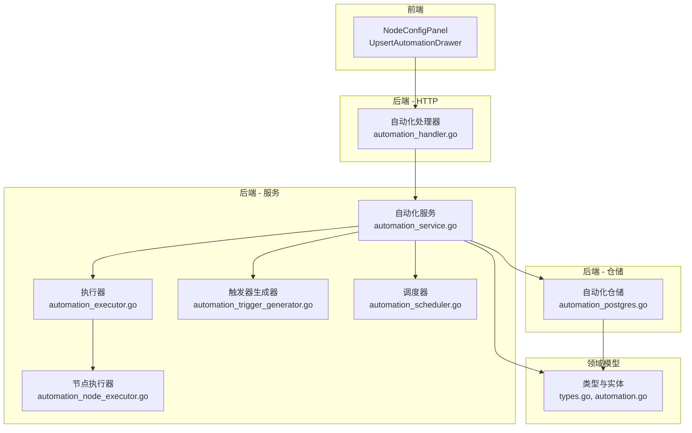
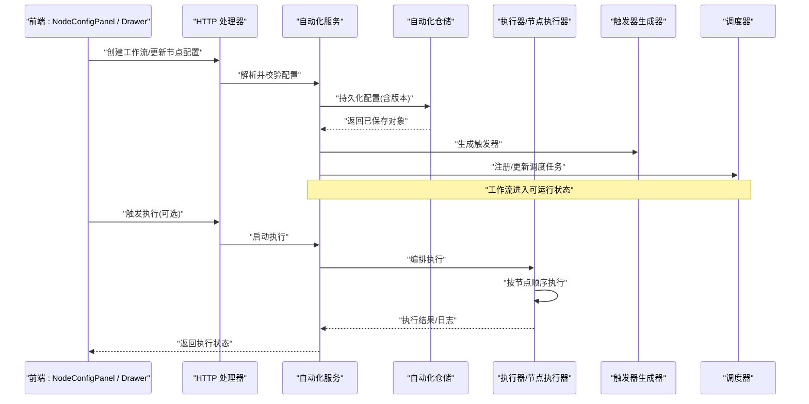
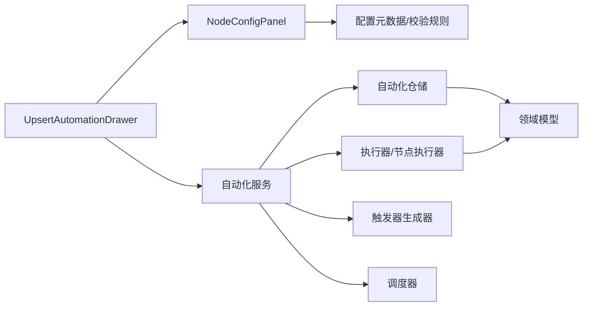

# 节点配置面板

<cite>
**本文引用的文件**   
- [automation_service.go](file://notifuse/internal/service/automation_service.go)
- [automation_handler.go](file://notifuse/internal/http/automation_handler.go)
- [automation_postgres.go](file://notifuse/internal/repository/automation_postgres.go)
- [automation_executor.go](file://notifuse/internal/service/automation_executor.go)
- [automation_node_executor.go](file://notifuse/internal/service/automation_node_executor.go)
- [automation_trigger_generator.go](file://notifuse/internal/service/automation_trigger_generator.go)
- [automation_scheduler.go](file://notifuse/internal/service/automation_scheduler.go)
- [types.go](file://notifuse/internal/domain/types.go)
- [automation.go](file://notifuse/internal/domain/automation.go)
</cite>

## 目录
1. [简介](#简介)
2. [项目结构](#项目结构)
3. [核心组件](#核心组件)
4. [架构总览](#架构总览)
5. [详细组件分析](#详细组件分析)
6. [依赖分析](#依赖分析)
7. [性能考虑](#性能考虑)
8. [故障排查指南](#故障排查指南)
9. [结论](#结论)
10. [附录](#附录)

## 简介
本技术文档围绕“自动化工作流的节点配置面板”展开，聚焦以下目标：
- NodeConfigPanel 组件设计：动态表单生成、字段验证与实时预览
- config 配置系统架构：表单字段定义、验证规则与 UI 组件映射
- UpsertAutomationDrawer 抽屉组件：工作流创建、编辑保存与版本管理
- 配置数据的持久化存储、变更追踪与撤销重做
- 复杂表单处理、异步验证与错误提示机制
- 配置模板、批量操作与导入导出实现指南

为便于读者理解，文档从整体架构入手，逐步深入到关键组件的实现细节，并辅以架构图、时序图与流程图。

## 项目结构
本项目采用分层架构：前端（控制台）负责可视化配置与交互；后端提供领域模型、服务编排、HTTP 接口与数据持久化。与节点配置面板相关的核心代码主要位于 internal 层的服务、仓储与 HTTP 处理器中，以及 domain 层的类型与实体定义。

图表来源
- [automation_handler.go](file://notifuse/internal/http/automation_handler.go)
- [automation_service.go](file://notifuse/internal/service/automation_service.go)
- [automation_postgres.go](file://notifuse/internal/repository/automation_postgres.go)
- [automation_executor.go](file://notifuse/internal/service/automation_executor.go)
- [automation_node_executor.go](file://notifuse/internal/service/automation_node_executor.go)
- [automation_trigger_generator.go](file://notifuse/internal/service/automation_trigger_generator.go)
- [automation_scheduler.go](file://notifuse/internal/service/automation_scheduler.go)
- [types.go](file://notifuse/internal/domain/types.go)
- [automation.go](file://notifuse/internal/domain/automation.go)

章节来源
- [automation_handler.go](file://notifuse/internal/http/automation_handler.go)
- [automation_service.go](file://notifuse/internal/service/automation_service.go)
- [automation_postgres.go](file://notifuse/internal/repository/automation_postgres.go)
- [automation_executor.go](file://notifuse/internal/service/automation_executor.go)
- [automation_node_executor.go](file://notifuse/internal/service/automation_node_executor.go)
- [automation_trigger_generator.go](file://notifuse/internal/service/automation_trigger_generator.go)
- [automation_scheduler.go](file://notifuse/internal/service/automation_scheduler.go)
- [types.go](file://notifuse/internal/domain/types.go)
- [automation.go](file://notifuse/internal/domain/automation.go)

## 核心组件
本节概述与节点配置面板直接相关的关键组件及其职责：
- NodeConfigPanel：基于配置元数据动态渲染表单，支持字段校验与实时预览
- UpsertAutomationDrawer：封装工作流的新增/编辑流程，包含版本管理与保存语义
- Config 配置系统：以声明式方式描述表单字段、校验规则与 UI 组件映射
- 自动化服务层：协调工作流生命周期、执行与调度
- 仓储层：负责配置的持久化与版本记录
- 领域模型：统一的数据结构与约束

章节来源
- [automation_service.go](file://notifuse/internal/service/automation_service.go)
- [automation_handler.go](file://notifuse/internal/http/automation_handler.go)
- [automation_postgres.go](file://notifuse/internal/repository/automation_postgres.go)
- [automation_executor.go](file://notifuse/internal/service/automation_executor.go)
- [automation_node_executor.go](file://notifuse/internal/service/automation_node_executor.go)
- [automation_trigger_generator.go](file://notifuse/internal/service/automation_trigger_generator.go)
- [automation_scheduler.go](file://notifuse/internal/service/automation_scheduler.go)
- [types.go](file://notifuse/internal/domain/types.go)
- [automation.go](file://notifuse/internal/domain/automation.go)

## 架构总览
下图展示从前端到后端的端到端调用链，涵盖工作流创建、保存、执行与调度等关键环节。

图表来源
- [automation_handler.go](file://notifuse/internal/http/automation_handler.go)
- [automation_service.go](file://notifuse/internal/service/automation_service.go)
- [automation_postgres.go](file://notifuse/internal/repository/automation_postgres.go)
- [automation_executor.go](file://notifuse/internal/service/automation_executor.go)
- [automation_node_executor.go](file://notifuse/internal/service/automation_node_executor.go)
- [automation_trigger_generator.go](file://notifuse/internal/service/automation_trigger_generator.go)
- [automation_scheduler.go](file://notifuse/internal/service/automation_scheduler.go)

## 详细组件分析

### NodeConfigPanel 组件
- 动态表单生成
  - 通过读取节点的配置元数据（字段名、类型、默认值、选项、分组等），动态构建表单控件树
  - 支持嵌套对象、数组、条件显示与联动逻辑
- 字段验证
  - 内置基础校验（必填、长度、格式、范围）
  - 支持自定义校验函数与异步校验（如唯一性检查、外部资源可用性）
- 实时预览
  - 监听表单变更事件，增量计算预览内容
  - 对 JSON/YAML 或结构化数据进行格式化输出，便于用户确认
- 错误提示
  - 将后端校验错误与前端校验错误聚合展示
  - 支持定位到具体字段并提供修复建议

章节来源
- [automation_service.go](file://notifuse/internal/service/automation_service.go)
- [automation_handler.go](file://notifuse/internal/http/automation_handler.go)
- [types.go](file://notifuse/internal/domain/types.go)

### UpsertAutomationDrawer 抽屉组件
- 工作流创建
  - 初始化空配置，加载可用节点模板与默认值
  - 打开抽屉时预填充上下文信息（如工作区、环境）
- 编辑保存
  - 合并当前草稿与已有版本，生成新版本
  - 提交前进行全量校验，失败则阻止保存
- 版本管理
  - 每次保存生成版本号与时间戳
  - 支持回滚到历史版本（需权限控制）
- 撤销/重做
  - 维护本地变更栈，支持撤销最近一次修改与重做
  - 与后端版本体系对齐，确保一致性

章节来源
- [automation_service.go](file://notifuse/internal/service/automation_service.go)
- [automation_postgres.go](file://notifuse/internal/repository/automation_postgres.go)
- [automation.go](file://notifuse/internal/domain/automation.go)

### Config 配置系统（表单字段定义、验证规则与 UI 组件映射）
- 字段定义
  - 使用声明式结构描述字段类型、标签、占位符、帮助文本、是否只读等
  - 支持枚举、多选、富文本、文件上传等复杂控件
- 验证规则
  - 同步校验：在输入阶段即时反馈
  - 异步校验：在网络请求完成后返回结果，避免阻塞用户输入
- UI 组件映射
  - 根据字段类型自动选择对应 UI 组件
  - 支持自定义组件注册与扩展点

章节来源
- [types.go](file://notifuse/internal/domain/types.go)
- [automation_service.go](file://notifuse/internal/service/automation_service.go)

### 配置数据的持久化存储、变更追踪与撤销重做
- 持久化存储
  - 工作流配置与节点配置均持久化至数据库
  - 版本表记录每次变更的快照与元数据
- 变更追踪
  - 服务端记录变更摘要与差异（diff）
  - 前端维护本地变更栈，用于撤销/重做
- 撤销重做
  - 本地栈与后端版本一一对应
  - 切换版本时刷新表单并重新计算预览

章节来源
- [automation_postgres.go](file://notifuse/internal/repository/automation_postgres.go)
- [automation.go](file://notifuse/internal/domain/automation.go)

### 复杂表单处理、异步验证与错误提示机制
- 复杂表单
  - 支持条件分支、动态字段集、跨字段联动
  - 大表单分页/分步展示，提升用户体验
- 异步验证
  - 防抖策略减少网络请求
  - 取消过期请求，避免竞态
- 错误提示
  - 统一错误码与消息映射
  - 针对字段级错误提供高亮与定位

章节来源
- [automation_handler.go](file://notifuse/internal/http/automation_handler.go)
- [automation_service.go](file://notifuse/internal/service/automation_service.go)

### 配置模板、批量操作与导入导出
- 配置模板
  - 提供常用节点与工作流模板，快速初始化
  - 模板支持变量替换与二次编辑
- 批量操作
  - 支持批量启用/禁用、批量复制、批量迁移
  - 批量任务进度与失败重试
- 导入导出
  - 导出为结构化文件（JSON/YAML）
  - 导入时进行兼容性校验与冲突解决

章节来源
- [automation_service.go](file://notifuse/internal/service/automation_service.go)
- [automation_handler.go](file://notifuse/internal/http/automation_handler.go)

## 依赖分析
- 组件耦合
  - NodeConfigPanel 与 UpsertAutomationDrawer 强依赖配置元数据与校验规则
  - 服务层依赖仓储与执行器，形成清晰的单向依赖
- 外部依赖
  - 数据库：持久化配置与版本
  - 调度器：定时触发与延迟执行
- 潜在循环依赖
  - 服务层不应反向依赖 UI 组件
  - 执行器仅依赖领域模型与服务接口

图表来源
- [automation_service.go](file://notifuse/internal/service/automation_service.go)
- [automation_postgres.go](file://notifuse/internal/repository/automation_postgres.go)
- [automation_executor.go](file://notifuse/internal/service/automation_executor.go)
- [automation_node_executor.go](file://notifuse/internal/service/automation_node_executor.go)
- [automation_trigger_generator.go](file://notifuse/internal/service/automation_trigger_generator.go)
- [automation_scheduler.go](file://notifuse/internal/service/automation_scheduler.go)
- [types.go](file://notifuse/internal/domain/types.go)

章节来源
- [automation_service.go](file://notifuse/internal/service/automation_service.go)
- [automation_postgres.go](file://notifuse/internal/repository/automation_postgres.go)
- [automation_executor.go](file://notifuse/internal/service/automation_executor.go)
- [automation_node_executor.go](file://notifuse/internal/service/automation_node_executor.go)
- [automation_trigger_generator.go](file://notifuse/internal/service/automation_trigger_generator.go)
- [automation_scheduler.go](file://notifuse/internal/service/automation_scheduler.go)
- [types.go](file://notifuse/internal/domain/types.go)

## 性能考虑
- 表单渲染
  - 虚拟滚动与懒加载，避免大表单卡顿
  - 按需加载复杂控件（如富文本编辑器）
- 校验优化
  - 客户端优先校验，减少无效请求
  - 异步校验防抖与去重
- 持久化
  - 批量写入与事务保证一致性
  - 版本快照压缩与索引优化
- 执行与调度
  - 节点执行并行度可控
  - 调度任务幂等与重试策略

[本节为通用指导，不直接分析具体文件]

## 故障排查指南
- 常见错误
  - 字段校验失败：检查必填项、格式与范围
  - 异步校验超时：检查网络与后端服务健康
  - 版本冲突：强制覆盖或合并策略
- 定位方法
  - 查看浏览器控制台与网络请求
  - 核对后端日志中的错误码与堆栈
  - 对比前后端数据结构差异
- 恢复步骤
  - 使用撤销/重做恢复误改
  - 回滚到上一个稳定版本
  - 清理缓存并重试

章节来源
- [automation_handler.go](file://notifuse/internal/http/automation_handler.go)
- [automation_service.go](file://notifuse/internal/service/automation_service.go)

## 结论
节点配置面板通过声明式配置系统与动态表单能力，显著提升了工作流配置的灵活性与效率。配合版本管理与撤销重做，用户在复杂场景下也能安全地进行迭代。后端服务层清晰的分层与职责划分，确保了可扩展性与稳定性。未来可在模板生态、批量操作与导入导出方面持续增强，以满足更多业务需求。

[本节为总结性内容，不直接分析具体文件]

## 附录
- 术语
  - 节点：工作流中的一个执行单元
  - 配置元数据：描述表单字段、校验与 UI 映射的结构化数据
  - 版本：工作流配置的不可变快照
- 最佳实践
  - 保持配置元数据向后兼容
  - 为复杂字段提供示例与帮助文本
  - 对异步校验设置合理超时与重试

[本节为补充说明，不直接分析具体文件]