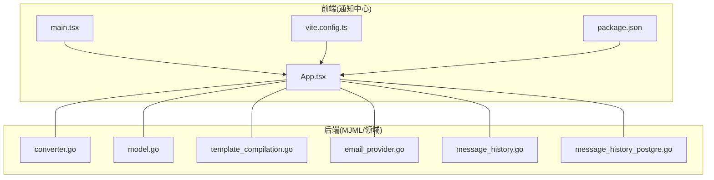
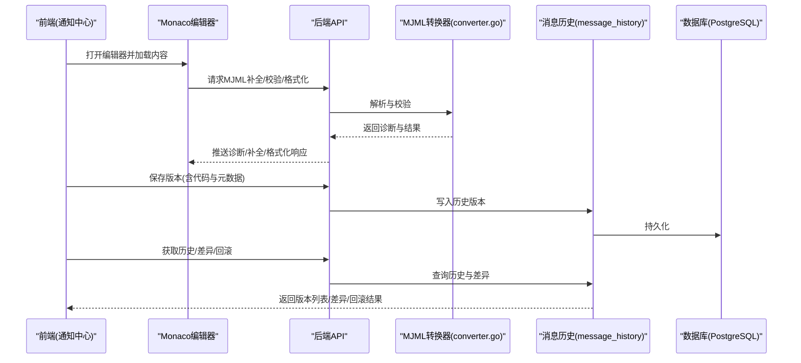
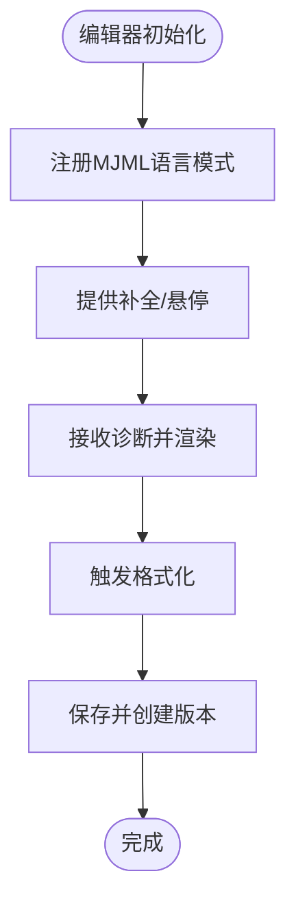
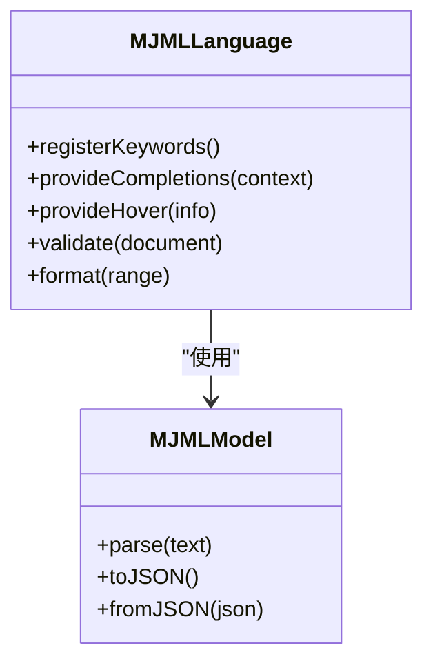
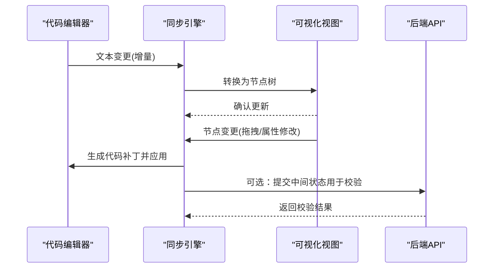
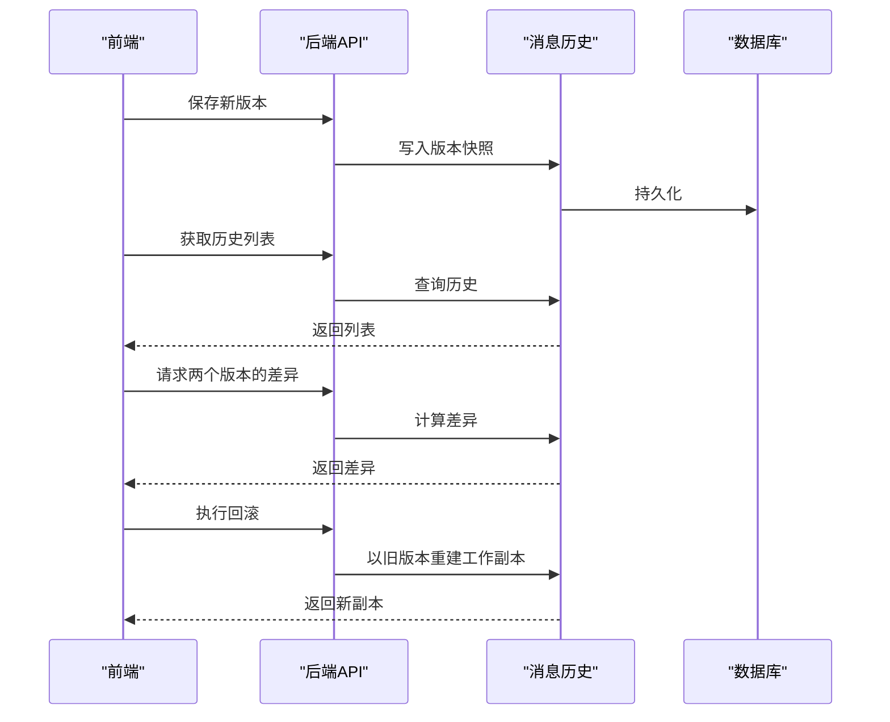
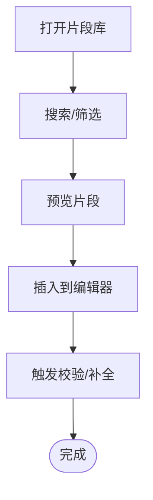
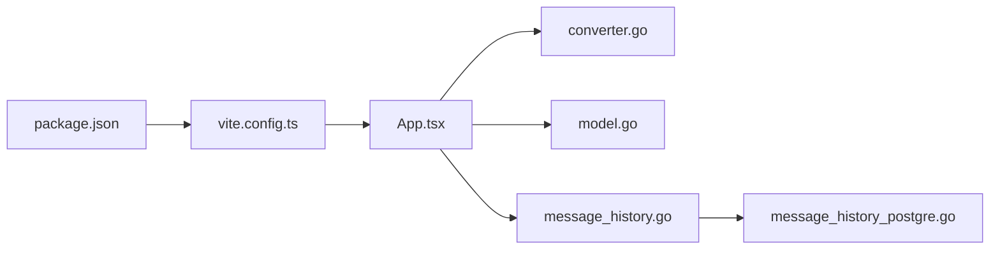

# 代码编辑器

<cite>
**本文引用的文件**   
- [notification_center/src/App.tsx](file://notifuse/notification_center/src/App.tsx)
- [notification_center/src/main.tsx](file://notifuse/notification_center/src/main.tsx)
- [notification_center/vite.config.ts](file://notifuse/notification_center/vite.config.ts)
- [notification_center/package.json](file://notifuse/notification_center/package.json)
- [pkg/notifuse_mjml/converter.go](file://pkg/notifuse_mjml/converter.go)
- [pkg/notifuse_mjml/model.go](file://pkg/notifuse_mjml/model.go)
- [pkg/notifuse_mjml/template_compilation.go](file://pkg/notifuse_mjml/template_compilation.go)
- [internal/domain/email_provider.go](file://internal/domain/email_provider.go)
- [internal/domain/message_history.go](file://internal/domain/message_history.go)
- [internal/repository/message_history_postgre.go](file://internal/repository/message_history_postgre.go)
</cite>

## 目录
1. [简介](#简介)
2. [项目结构](#项目结构)
3. [核心组件](#核心组件)
4. [架构总览](#架构总览)
5. [详细组件分析](#详细组件分析)
6. [依赖分析](#依赖分析)
7. [性能考虑](#性能考虑)
8. [故障排查指南](#故障排查指南)
9. [结论](#结论)
10. [附录](#附录)

## 简介
本技术文档聚焦于邮件编辑器的“代码编辑器”能力，围绕以下目标展开：
- 基于 Monaco Editor 的代码编辑器集成方案（语法高亮、智能提示、错误检查）
- MJML 语法的自定义支持（标签补全、属性验证、格式化）
- 可视化编辑与代码编辑的双向同步机制
- 代码版本控制（差异对比、历史版本、回滚）
- 代码片段管理、模板库集成与批量替换
- 扩展开发与自定义语法支持指南

说明：当前仓库未包含前端 Monaco Editor 的具体实现。本文在“概念性概述”部分提供可落地的架构与流程建议；在“实际映射”部分，将尽可能关联到仓库中已有的 MJML 转换与消息历史等后端能力，为后续前端集成提供依据。

## 项目结构
从仓库结构看，通知中心前端位于 notifuse/notification_center，MJML 相关逻辑位于 pkg/notifuse_mjml，消息历史与提供者抽象位于 internal 层。这些位置可作为代码编辑器集成的参考点：
- 前端入口与配置：notification_center/src/main.tsx、notification_center/src/App.tsx、notification_center/vite.config.ts、notification_center/package.json
- MJML 转换与模型：pkg/notifuse_mjml/converter.go、model.go、template_compilation.go
- 消息历史与提供者：internal/domain/message_history.go、internal/repository/message_history_postgre.go、internal/domain/email_provider.go

图表来源
- [notification_center/src/main.tsx](file://notifuse/notification_center/src/main.tsx)
- [notification_center/src/App.tsx](file://notifuse/notification_center/src/App.tsx)
- [notification_center/vite.config.ts](file://notifuse/notification_center/vite.config.ts)
- [notification_center/package.json](file://notifuse/notification_center/package.json)
- [pkg/notifuse_mjml/converter.go](file://pkg/notifuse_mjml/converter.go)
- [pkg/notifuse_mjml/model.go](file://pkg/notifuse_mjml/model.go)
- [pkg/notifuse_mjml/template_compilation.go](file://pkg/notifuse_mjml/template_compilation.go)
- [internal/domain/email_provider.go](file://internal/domain/email_provider.go)
- [internal/domain/message_history.go](file://internal/domain/message_history.go)
- [internal/repository/message_history_postgre.go](file://internal/repository/message_history_postgre.go)

章节来源
- [notification_center/src/main.tsx](file://notifuse/notification_center/src/main.tsx)
- [notification_center/src/App.tsx](file://notifuse/notification_center/src/App.tsx)
- [notification_center/vite.config.ts](file://notifuse/notification_center/vite.config.ts)
- [notification_center/package.json](file://notifuse/notification_center/package.json)
- [pkg/notifuse_mjml/converter.go](file://pkg/notifuse_mjml/converter.go)
- [pkg/notifuse_mjml/model.go](file://pkg/notifuse_mjml/model.go)
- [pkg/notifuse_mjml/template_compilation.go](file://pkg/notifuse_mjml/template_compilation.go)
- [internal/domain/email_provider.go](file://internal/domain/email_provider.go)
- [internal/domain/message_history.go](file://internal/domain/message_history.go)
- [internal/repository/message_history_postgre.go](file://internal/repository/message_history_postgre.go)

## 核心组件
- Monaco Editor 集成层（概念性）
  - 负责初始化编辑器实例、主题与语言模式注册、事件监听与双向同步桥接
  - 提供诊断（错误检查）、自动补全、悬停信息、格式化等能力
- MJML 自定义语言服务（概念性）
  - 定义 MJML 的语法树、标签与属性校验规则、补全列表与格式化策略
  - 与后端 MJML 编译/转换模块对接，进行实时校验与预览
- 双向同步引擎（概念性）
  - 维护“可视化节点树”和“代码文本”的一致性，处理增量变更与冲突合并
- 版本控制与差异对比（概念性）
  - 记录每次保存的版本快照，支持差异对比与回滚
- 片段与模板库（概念性）
  - 提供常用片段与模板的快速插入、搜索与批量替换

章节来源
- [pkg/notifuse_mjml/converter.go](file://pkg/notifuse_mjml/converter.go)
- [pkg/notifuse_mjml/model.go](file://pkg/notifuse_mjml/model.go)
- [pkg/notifuse_mjml/template_compilation.go](file://pkg/notifuse_mjml/template_compilation.go)
- [internal/domain/message_history.go](file://internal/domain/message_history.go)
- [internal/repository/message_history_postgre.go](file://internal/repository/message_history_postgre.go)

## 架构总览
下图展示“代码编辑器”在整体系统中的角色与交互关系。前端通过 API 调用后端的 MJML 转换与消息历史能力，形成“编辑—校验—保存—版本化”的闭环。

图表来源
- [notification_center/src/App.tsx](file://notifuse/notification_center/src/App.tsx)
- [pkg/notifuse_mjml/converter.go](file://pkg/notifuse_mjml/converter.go)
- [internal/domain/message_history.go](file://internal/domain/message_history.go)
- [internal/repository/message_history_postgre.go](file://internal/repository/message_history_postgre.go)

## 详细组件分析

### Monaco Editor 集成（概念性）
- 初始化与配置
  - 创建编辑器实例，设置主题、字体、行号、最小映射等
  - 注册自定义语言（MJML），包括关键词、括号匹配、注释、缩进规则
- 智能提示与悬停
  - 基于 MJML 标签/属性字典提供补全项
  - 悬停显示属性说明、示例与约束
- 错误检查与快速修复
  - 结合后端 MJML 编译器返回的诊断信息，渲染下划线与问题面板
  - 提供一键修复建议（如自动闭合标签、修正属性名）
- 格式化
  - 调用后端格式化器或本地格式化插件，统一缩进与换行风格

[本节为概念性说明，不直接分析具体源文件]

### MJML 自定义语法支持（概念性）
- 标签补全
  - 根据 MJML 规范生成标签列表，按上下文过滤（例如仅在 body 内允许特定块级标签）
- 属性验证
  - 对必填属性、枚举值、类型约束进行检查，并将错误上报至编辑器诊断
- 格式化
  - 保持标签对齐、属性顺序一致、空行规范化

图表来源
- [pkg/notifuse_mjml/model.go](file://pkg/notifuse_mjml/model.go)
- [pkg/notifuse_mjml/converter.go](file://pkg/notifuse_mjml/converter.go)

章节来源
- [pkg/notifuse_mjml/model.go](file://pkg/notifuse_mjml/model.go)
- [pkg/notifuse_mjml/converter.go](file://pkg/notifuse_mjml/converter.go)

### 双向同步机制（概念性）
- 同步方向
  - 代码→可视化：解析代码为结构化模型，更新可视化树
  - 可视化→代码：将可视化变更序列化为代码文本，回写到编辑器
- 冲突与合并
  - 采用操作序列与时间戳，避免覆盖；必要时提示用户选择保留策略
- 性能优化
  - 增量同步、防抖节流、懒加载大文档

[本节为概念性说明，不直接分析具体源文件]

### 代码版本控制（差异对比、历史版本、回滚）
- 版本快照
  - 每次保存时生成不可变快照，附带元数据（作者、时间、备注）
- 差异对比
  - 基于行级或结构级 diff，突出新增/删除/修改
- 回滚
  - 选择历史版本作为新工作副本，继续编辑

图表来源
- [internal/domain/message_history.go](file://internal/domain/message_history.go)
- [internal/repository/message_history_postgre.go](file://internal/repository/message_history_postgre.go)

章节来源
- [internal/domain/message_history.go](file://internal/domain/message_history.go)
- [internal/repository/message_history_postgre.go](file://internal/repository/message_history_postgre.go)

### 代码片段管理与模板库集成（概念性）
- 片段管理
  - 分类组织片段（布局、按钮、表格等），支持搜索与预览
- 模板库
  - 提供预置模板，支持一键套用与二次编辑
- 批量替换
  - 正则或结构化替换，预览影响范围后批量应用

[本节为概念性说明，不直接分析具体源文件]

### 扩展开发与自定义语法支持指南（概念性）
- 扩展点
  - 语言模式注册、补全提供者、诊断提供者、格式化提供者、命令与快捷键
- 开发步骤
  - 定义语言特征 → 实现补全/诊断/格式化 → 注册到编辑器 → 联调测试
- 与后端协作
  - 将复杂校验与格式化委托给后端服务，前端仅做轻量展示与交互

[本节为概念性说明，不直接分析具体源文件]

## 依赖分析
- 前端依赖
  - Vite 构建配置与包管理，决定如何引入 Monaco 及其语言扩展
- 后端依赖
  - MJML 转换与模板编译能力，为前端提供校验与格式化服务
  - 消息历史与提供者抽象，支撑版本控制与发送链路

图表来源
- [notification_center/package.json](file://notifuse/notification_center/package.json)
- [notification_center/vite.config.ts](file://notifuse/notification_center/vite.config.ts)
- [notification_center/src/App.tsx](file://notifuse/notification_center/src/App.tsx)
- [pkg/notifuse_mjml/converter.go](file://pkg/notifuse_mjml/converter.go)
- [pkg/notifuse_mjml/model.go](file://pkg/notifuse_mjml/model.go)
- [internal/domain/message_history.go](file://internal/domain/message_history.go)
- [internal/repository/message_history_postgre.go](file://internal/repository/message_history_postgre.go)

章节来源
- [notification_center/package.json](file://notifuse/notification_center/package.json)
- [notification_center/vite.config.ts](file://notifuse/notification_center/vite.config.ts)
- [notification_center/src/App.tsx](file://notifuse/notification_center/src/App.tsx)
- [pkg/notifuse_mjml/converter.go](file://pkg/notifuse_mjml/converter.go)
- [pkg/notifuse_mjml/model.go](file://pkg/notifuse_mjml/model.go)
- [internal/domain/message_history.go](file://internal/domain/message_history.go)
- [internal/repository/message_history_postgre.go](file://internal/repository/message_history_postgre.go)

## 性能考虑
- 编辑器侧
  - 大文档分片渲染、虚拟滚动、按需加载语言扩展
  - 防抖/节流输入事件，减少频繁重绘与网络请求
- 同步侧
  - 增量同步与补丁合并，避免整篇重写
  - 离线缓存最近版本，断网时可继续编辑
- 后端侧
  - MJML 编译与格式化结果缓存（按内容哈希）
  - 异步任务队列处理耗时操作（如大规模模板渲染）

[本节为通用指导，不直接分析具体源文件]

## 故障排查指南
- 常见问题定位
  - 补全/诊断不生效：检查语言模式注册与后端接口连通性
  - 同步错乱：核对版本号与时间戳，确认是否发生并发覆盖
  - 格式化异常：比对前后端格式规则一致性
- 日志与调试
  - 启用编辑器诊断输出与网络请求日志
  - 在后端添加关键路径的追踪与错误码
- 回滚与恢复
  - 通过历史版本快速恢复误改内容
  - 若出现不一致，优先比较差异并手动合并

章节来源
- [internal/domain/message_history.go](file://internal/domain/message_history.go)
- [internal/repository/message_history_postgre.go](file://internal/repository/message_history_postgre.go)

## 结论
通过将 Monaco Editor 与 MJML 自定义语言服务结合，并辅以双向同步与版本控制，可在邮件编辑器中实现高效、可靠的代码编辑体验。尽管当前仓库未包含前端 Monaco 的具体实现，但借助现有 MJML 转换与消息历史能力，可以逐步落地上述功能。建议在后续迭代中优先完善语言服务与同步引擎，再扩展到片段、模板与批量替换等高级特性。

[本节为总结性内容，不直接分析具体源文件]

## 附录
- 术语
  - MJML：一种用于编写响应式邮件模板的标记语言
  - Monaco Editor：VS Code 同款代码编辑器内核
  - 双向同步：可视化与代码之间的相互映射与更新
- 参考路径
  - 前端入口与配置：[notification_center/src/main.tsx](file://notifuse/notification_center/src/main.tsx)、[notification_center/src/App.tsx](file://notifuse/notification_center/src/App.tsx)、[notification_center/vite.config.ts](file://notifuse/notification_center/vite.config.ts)、[notification_center/package.json](file://notifuse/notification_center/package.json)
  - MJML 转换与模型：[pkg/notifuse_mjml/converter.go](file://pkg/notifuse_mjml/converter.go)、[pkg/notifuse_mjml/model.go](file://pkg/notifuse_mjml/model.go)、[pkg/notifuse_mjml/template_compilation.go](file://pkg/notifuse_mjml/template_compilation.go)
  - 消息历史与提供者：[internal/domain/message_history.go](file://internal/domain/message_history.go)、[internal/repository/message_history_postgre.go](file://internal/repository/message_history_postgre.go)、[internal/domain/email_provider.go](file://internal/domain/email_provider.go)