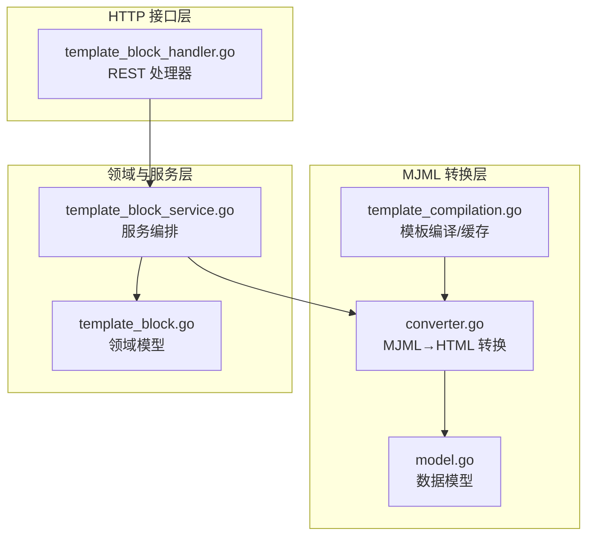
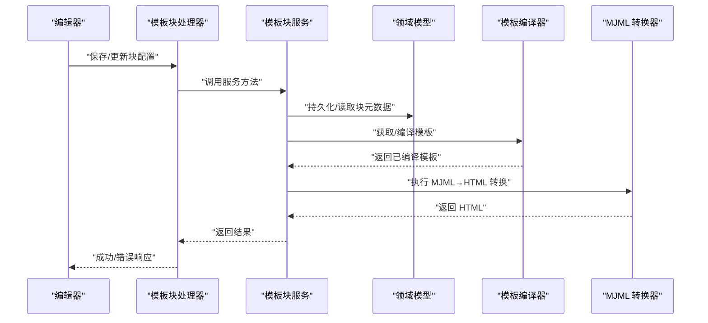
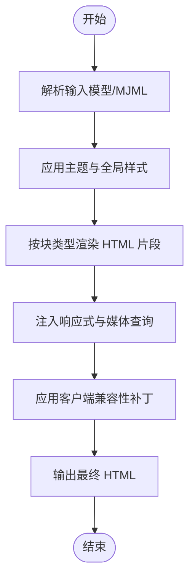
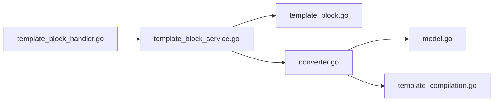

# 内置块类型

<cite>
**本文引用的文件**   
- [pkg/notifuse_mjml/converter.go](file://pkg/notifuse_mjml/converter.go)
- [pkg/notifuse_mjml/model.go](file://pkg/notifuse_mjml/model.go)
- [pkg/notifuse_mjml/template_compilation.go](file://pkg/notifuse_mjml/template_compilation.go)
- [internal/domain/template_block.go](file://internal/domain/template_block.go)
- [internal/service/template_block_service.go](file://internal/service/template_block_service.go)
- [internal/http/handlers/template_block_handler.go](file://internal/http/handlers/template_block_handler.go)
</cite>

## 目录
1. [简介](#简介)
2. [项目结构](#项目结构)
3. [核心组件](#核心组件)
4. [架构总览](#架构总览)
5. [详细组件分析](#详细组件分析)
6. [依赖关系分析](#依赖关系分析)
7. [性能考虑](#性能考虑)
8. [故障排除指南](#故障排除指南)
9. [结论](#结论)
10. [附录](#附录)

## 简介
本文件面向邮件编辑器“内置块类型”的使用与实现说明，覆盖文本、图片、按钮、分隔符、区块、列等常见块类型的属性、样式与行为特性；解释 MJML 到 HTML 的转换流程（含响应式与跨客户端兼容策略）；并提供最佳实践、常见问题排查建议。文档同时给出与代码仓库中相关模块的映射，便于读者在源码中进一步定位实现细节。

## 项目结构
与“内置块类型”相关的核心代码主要分布在以下位置：
- MJML 模型与转换器：定义块类型的数据模型、渲染/编译逻辑以及 MJML→HTML 的转换过程
- 模板块领域与服务层：提供块类型的持久化、查询与业务编排
- HTTP 处理器：对外暴露块类型的 CRUD 接口

图表来源
- [pkg/notifuse_mjml/model.go](file://pkg/notifuse_mjml/model.go)
- [pkg/notifuse_mjml/converter.go](file://pkg/notifuse_mjml/converter.go)
- [pkg/notifuse_mjml/template_compilation.go](file://pkg/notifuse_mjml/template_compilation.go)
- [internal/domain/template_block.go](file://internal/domain/template_block.go)
- [internal/service/template_block_service.go](file://internal/service/template_block_service.go)
- [internal/http/handlers/template_block_handler.go](file://internal/http/handlers/template_block_handler.go)

章节来源
- [pkg/notifuse_mjml/model.go](file://pkg/notifuse_mjml/model.go)
- [pkg/notifuse_mjml/converter.go](file://pkg/notifuse_mjml/converter.go)
- [pkg/notifuse_mjml/template_compilation.go](file://pkg/notifuse_mjml/template_compilation.go)
- [internal/domain/template_block.go](file://internal/domain/template_block.go)
- [internal/service/template_block_service.go](file://internal/service/template_block_service.go)
- [internal/http/handlers/template_block_handler.go](file://internal/http/handlers/template_block_handler.go)

## 核心组件
- 数据模型（Model）：集中定义所有内置块类型的字段、枚举与校验规则，是编辑器 UI 与后端共享的契约
- 转换器（Converter）：将模型实例或 MJML 片段转换为最终可渲染的 HTML，负责响应式布局与兼容性处理
- 模板编译（Template Compilation）：对模板进行预编译与缓存，提升渲染性能
- 领域与服务（Domain & Service）：管理块类型的生命周期、版本迁移与组合拼装
- HTTP 处理器（Handler）：提供块类型的创建、更新、删除与预览接口

章节来源
- [pkg/notifuse_mjml/model.go](file://pkg/notifuse_mjml/model.go)
- [pkg/notifuse_mjml/converter.go](file://pkg/notifuse_mjml/converter.go)
- [pkg/notifuse_mjml/template_compilation.go](file://pkg/notifuse_mjml/template_compilation.go)
- [internal/domain/template_block.go](file://internal/domain/template_block.go)
- [internal/service/template_block_service.go](file://internal/service/template_block_service.go)
- [internal/http/handlers/template_block_handler.go](file://internal/http/handlers/template_block_handler.go)

## 架构总览
下图展示了从编辑器保存块配置到生成 HTML 的关键路径，包括 MJML 转换与模板编译环节。

图表来源
- [internal/http/handlers/template_block_handler.go](file://internal/http/handlers/template_block_handler.go)
- [internal/service/template_block_service.go](file://internal/service/template_block_service.go)
- [internal/domain/template_block.go](file://internal/domain/template_block.go)
- [pkg/notifuse_mjml/template_compilation.go](file://pkg/notifuse_mjml/template_compilation.go)
- [pkg/notifuse_mjml/converter.go](file://pkg/notifuse_mjml/converter.go)

## 详细组件分析

### 数据模型（内置块类型定义）
- 职责：统一描述所有内置块类型的属性、可选值、默认值与约束
- 典型块类型（示例类别，具体以模型为准）：
  - 文本块：标题、正文、富文本、列表等
  - 图片块：源地址、尺寸、对齐、替代文本、链接
  - 按钮块：文案、链接、样式（颜色、圆角、内边距）、对齐
  - 分隔符块：高度、颜色、间距
  - 区块块（Section）：背景、内边距、最大宽度、对齐方式
  - 列块（Columns）：列数、间距、响应式堆叠策略
- 设计要点：
  - 使用强类型字段与枚举，避免自由文本导致的歧义
  - 为每个块提供最小可用默认值，确保空配置也能渲染
  - 通过校验器保证关键属性（如 URL、尺寸）合法

章节来源
- [pkg/notifuse_mjml/model.go](file://pkg/notifuse_mjml/model.go)

### MJML 转换器（MJML→HTML）
- 职责：将模型实例或 MJML 片段转换为最终 HTML，并注入响应式与兼容性补丁
- 关键流程：
  - 解析输入（模型/MJML）
  - 应用主题与全局样式
  - 生成基础 HTML 骨架
  - 按块类型渲染对应 HTML 片段
  - 合并响应式样式与媒体查询
  - 输出最终 HTML
- 兼容性策略：
  - 针对主流邮件客户端（Outlook、Gmail、Apple Mail 等）做降级处理
  - 表格布局优先，避免复杂 CSS 选择器
  - 图片与按钮采用兼容写法，必要时添加注释或条件注释

图表来源
- [pkg/notifuse_mjml/converter.go](file://pkg/notifuse_mjml/converter.go)

章节来源
- [pkg/notifuse_mjml/converter.go](file://pkg/notifuse_mjml/converter.go)

### 模板编译与缓存
- 职责：对模板进行预编译与缓存，减少重复渲染开销
- 关键点：
  - 支持模板版本控制与回滚
  - 缓存键包含模板内容哈希与依赖项变更
  - 失败时快速回退到未缓存路径，保障可用性

章节来源
- [pkg/notifuse_mjml/template_compilation.go](file://pkg/notifuse_mjml/template_compilation.go)

### 领域与服务层（模板块）
- 领域模型：
  - 定义块类型的标识、版本、元数据与关联关系
  - 提供序列化/反序列化工具
- 服务层：
  - 聚合领域与转换器，完成块的创建、更新、删除、预览与批量操作
  - 处理事务与错误码，向上层返回稳定语义

章节来源
- [internal/domain/template_block.go](file://internal/domain/template_block.go)
- [internal/service/template_block_service.go](file://internal/service/template_block_service.go)

### HTTP 处理器（REST 接口）
- 职责：接收编辑器请求，调用服务层，返回 JSON 响应
- 典型端点：
  - 创建/更新块：POST/PUT /api/templates/blocks
  - 删除块：DELETE /api/templates/blocks/:id
  - 预览渲染：GET /api/templates/blocks/:id/render
- 安全与校验：
  - 参数校验、权限检查、速率限制（视部署配置而定）

章节来源
- [internal/http/handlers/template_block_handler.go](file://internal/http/handlers/template_block_handler.go)

## 依赖关系分析
- 低耦合：HTTP 层仅依赖服务层；服务层依赖领域与转换器；转换器依赖模型与编译器
- 可扩展性：新增块类型主要在模型与转换器扩展，不影响上层接口
- 潜在循环：应避免服务层直接依赖 HTTP 层；当前分层清晰，未见循环依赖迹象

图表来源
- [internal/http/handlers/template_block_handler.go](file://internal/http/handlers/template_block_handler.go)
- [internal/service/template_block_service.go](file://internal/service/template_block_service.go)
- [internal/domain/template_block.go](file://internal/domain/template_block.go)
- [pkg/notifuse_mjml/converter.go](file://pkg/notifuse_mjml/converter.go)
- [pkg/notifuse_mjml/model.go](file://pkg/notifuse_mjml/model.go)
- [pkg/notifuse_mjml/template_compilation.go](file://pkg/notifuse_mjml/template_compilation.go)

章节来源
- [internal/http/handlers/template_block_handler.go](file://internal/http/handlers/template_block_handler.go)
- [internal/service/template_block_service.go](file://internal/service/template_block_service.go)
- [internal/domain/template_block.go](file://internal/domain/template_block.go)
- [pkg/notifuse_mjml/converter.go](file://pkg/notifuse_mjml/converter.go)
- [pkg/notifuse_mjml/model.go](file://pkg/notifuse_mjml/model.go)
- [pkg/notifuse_mjml/template_compilation.go](file://pkg/notifuse_mjml/template_compilation.go)

## 性能考虑
- 模板编译缓存：命中缓存可显著降低 CPU 与 I/O 压力
- 增量渲染：仅在块内容变化时重新渲染受影响部分
- 资源优化：图片懒加载、压缩与 CDN 加速
- 并发控制：批量渲染时限制并发度，避免雪崩

[本节为通用指导，不直接分析具体文件]

## 故障排除指南
- 渲染异常
  - 检查块属性是否满足必填与格式校验
  - 确认图片链接可达且 MIME 类型正确
  - 查看转换器日志中的兼容性警告
- 响应式错乱
  - 核对列宽与间距设置，避免超出容器
  - 在目标客户端验证媒体查询生效情况
- 性能问题
  - 观察模板编译缓存命中率
  - 评估大图片与复杂嵌套的影响
- 接口错误
  - 检查请求体结构与鉴权头
  - 根据错误码定位服务层异常

章节来源
- [internal/http/handlers/template_block_handler.go](file://internal/http/handlers/template_block_handler.go)
- [internal/service/template_block_service.go](file://internal/service/template_block_service.go)
- [pkg/notifuse_mjml/converter.go](file://pkg/notifuse_mjml/converter.go)

## 结论
通过将块类型建模为强类型数据模型，并在转换器中集中处理响应式与兼容性策略，系统实现了高内聚、易扩展的邮件编辑器能力。配合模板编译缓存与清晰的层次划分，既保证了渲染性能，也提升了可维护性与可测试性。

[本节为总结性内容，不直接分析具体文件]

## 附录

### 常用块类型与属性速查（概念性清单）
- 文本块
  - 属性：标题、正文、字号、行高、颜色、对齐、链接
  - 样式：字体族、加粗、斜体、下划线、装饰线
  - 行为：点击跳转、复制文本（前端交互）
- 图片块
  - 属性：src、alt、width、height、align、link
  - 样式：边框、圆角、阴影、占位图
  - 行为：点击跳转、懒加载
- 按钮块
  - 属性：text、href、color、backgroundColor、padding、borderRadius、align
  - 样式：悬停态（受客户端支持度影响）
  - 行为：点击跳转、埋点上报
- 分隔符块
  - 属性：height、color、margin
  - 样式：虚线/实线（受客户端支持度影响）
- 区块块（Section）
  - 属性：background、padding、maxWidth、align
  - 样式：背景色/背景图、内边距
- 列块（Columns）
  - 属性：columns、gap、stackOnMobile
  - 样式：列间距、对齐方式
  - 行为：移动端自动堆叠

[本节为概念性说明，不直接分析具体文件]